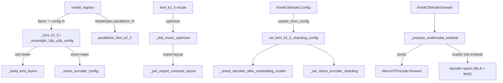

# Kimi K2.7 model family (Kimi K2.5 / K2.6 / K2.7-Code, Kimi-VL, Moonlight)

<!-- connect:up:begin -->
> **Cross-repo concept:** part of [expert-parallelism](../../../concepts/expert-parallelism.md), [flash-attention](../../../concepts/flash-attention.md), [pipeline-parallelism](../../../concepts/pipeline-parallelism.md), [rematerialization](../../../concepts/rematerialization.md), [sequence-parallelism](../../../concepts/sequence-parallelism.md), [sharding](../../../concepts/sharding.md) across this wiki's repos.
<!-- connect:up:end -->
## Overview

`torchtitan/models/kimi_k2_7` is a thin multimodal shell around the DeepSeek-V3 decoder. [`KimiK25Model`](../catalog/torchtitan/models/kimi_k2_7/model.md#KimiK25Model "torchtitan/models/kimi_k2_7/model.py:L45") subclasses `DeepSeekV3Model` and adds exactly one module, an optional MoonViT3d vision tower ([`KimiK25VisionEncoder`](../catalog/torchtitan/models/kimi_k2_7/vision_encoder.md#KimiK25VisionEncoder "torchtitan/models/kimi_k2_7/vision_encoder.py:L472")) whose projected features are scattered into the token-embedding sequence at runs of the shared `<|media_pad|>` placeholder. Everything else - MLA attention, sigmoid-routed MoE, the TP/EP sharding plan, the HF state dict for the text tower - is reused from DeepSeek-V3. One parameterized architecture covers four registry flavors: `debugmodel`, the text-only `moonlight-16B-A3B`, the image-text `Kimi-VL-A3B`, and the ~1T-total / ~32B-active `Kimi-K2.5` (the README states K2.5, K2.6 and K2.7-Code share that architecture and tensor schema). The family-specific value lives in three places: the sharding seam around the vision scatter, the per-parameter DistMuon compute layouts, and the QK-clip post-optimizer hook. This model has no TorchTPU-specific code path in the repo; on TPU it runs through the generic model path.

## Diagram

Legend:
- `REG` - [`model_registry`](../catalog/torchtitan/models/kimi_k2_7/__init__.md#model_registry "torchtitan/models/kimi_k2_7/__init__.py:L506")
- `K25` - [`_kimi_k2_5`](../catalog/torchtitan/models/kimi_k2_7/__init__.md#_kimi_k2_5 "torchtitan/models/kimi_k2_7/__init__.py:L410") / [`_moonlight_16b_a3b_config`](../catalog/torchtitan/models/kimi_k2_7/__init__.md#_moonlight_16b_a3b_config "torchtitan/models/kimi_k2_7/__init__.py:L295")
- `LAY` - [`_build_kimi_layers`](../catalog/torchtitan/models/kimi_k2_7/__init__.md#_build_kimi_layers "torchtitan/models/kimi_k2_7/__init__.py:L207")
- `VEC` - [`_vision_encoder_config`](../catalog/torchtitan/models/kimi_k2_7/__init__.md#_vision_encoder_config "torchtitan/models/kimi_k2_7/__init__.py:L127")
- `PAR` - [`parallelize_kimi_k2_5`](../catalog/torchtitan/models/kimi_k2_7/parallelize.md#parallelize_kimi_k2_5 "torchtitan/models/kimi_k2_7/parallelize.py:L36")
- `REC` - [`kimi_k2_5`](../catalog/torchtitan/models/kimi_k2_7/config_registry.md#kimi_k2_5 "torchtitan/models/kimi_k2_7/config_registry.py:L222")
- `MUON` - [`_dist_muon_optimizer`](../catalog/torchtitan/models/kimi_k2_7/config_registry.md#_dist_muon_optimizer "torchtitan/models/kimi_k2_7/config_registry.py:L294")
- `PEL` - [`_per_expert_compute_layout`](../catalog/torchtitan/models/kimi_k2_7/config_registry.md#_per_expert_compute_layout "torchtitan/models/kimi_k2_7/config_registry.py:L267")
- `CFG` - [`Config`](../catalog/torchtitan/models/kimi_k2_7/model.md#KimiK25Model.Config "torchtitan/models/kimi_k2_7/model.py:L60")
- `SH` - [`set_kimi_k2_5_sharding_config`](../catalog/torchtitan/models/kimi_k2_7/sharding.md#set_kimi_k2_5_sharding_config "torchtitan/models/kimi_k2_7/sharding.py:L52")
- `SEAM` - [`_shard_decoder_after_embedding_scatter`](../catalog/torchtitan/models/kimi_k2_7/sharding.md#_shard_decoder_after_embedding_scatter "torchtitan/models/kimi_k2_7/sharding.py:L69")
- `VSH` - [`_set_vision_encoder_sharding`](../catalog/torchtitan/models/kimi_k2_7/sharding.md#_set_vision_encoder_sharding "torchtitan/models/kimi_k2_7/sharding.py:L96")
- `FWD` - [`forward`](../catalog/torchtitan/models/kimi_k2_7/model.md#KimiK25Model.forward "torchtitan/models/kimi_k2_7/model.py:L212")
- `PME` - [`_prepare_multimodal_embeds`](../catalog/torchtitan/models/kimi_k2_7/model.md#KimiK25Model._prepare_multimodal_embeds "torchtitan/models/kimi_k2_7/model.py:L154")
- `VFWD` - [`forward`](../catalog/torchtitan/models/kimi_k2_7/vision_encoder.md#MoonViTEncoder.forward "torchtitan/models/kimi_k2_7/vision_encoder.py:L404")
- `DEC` - (concept) the inherited DeepSeek-V3 decoder stack, [`layers`](../catalog/torchtitan/models/common/decoder.md#Decoder.Config.layers "torchtitan/models/common/decoder.py:L84")

## Design rationale (why it's built this way)

- **Inherit the decoder, own only the vision seam.** The docstring of [`KimiK25Model`](../catalog/torchtitan/models/kimi_k2_7/model.md#KimiK25Model "torchtitan/models/kimi_k2_7/model.py:L45") reads "Kimi K2.5: DeepSeekV3 language model with a MoonViT3d vision encoder." The config override of `update_from_config` re-runs the base decoder validation and then delegates sharding to the DeepSeek-V3 plan; FLOP accounting also reuses the DeepSeek-V3 function but excludes the vision encoder from active params. So MoE dispatch, MLA kernels and the TP/EP plan behave exactly as on the [DeepSeek-V3 page](deepseek-v3-model.md).
- **The vision scatter breaks sequence parallelism, so SP is resumed one layer late.** The scatter writes vision features at arbitrary sequence positions, which a `Shard(0)` embedding cannot index locally. [`_shard_decoder_after_embedding_scatter`](../catalog/torchtitan/models/kimi_k2_7/sharding.md#_shard_decoder_after_embedding_scatter "torchtitan/models/kimi_k2_7/sharding.py:L69") keeps `tok_embeddings` output `Replicate`, then makes layer 0 accept a `Replicate` input whose rowwise `wo` reduce-scatters back to `Shard(0)`: "the residual is sequence-parallel from layer 0's output and layers 1..N-1 are unchanged full SP." The cost is one extra replicated activation in the embedding and layer-0 input, not a per-layer cost.
- **The vision tower deliberately skips SP.** Per the `sharding.py` module docstring, the patch sequence is short, so sequence-sharding would add gather/scatter around the block-diagonal attention for little memory gain; [`_set_vision_encoder_sharding`](../catalog/torchtitan/models/kimi_k2_7/sharding.md#_set_vision_encoder_sharding "torchtitan/models/kimi_k2_7/sharding.py:L96") keeps activations TP-invariant and only Colwise/Rowwise-shards the linears "for memory".
- **The vision tower is one FSDP unit.** The `parallelize.py` module docstring: the vision encoder is wrapped "as a single unit (its compute is small, so one all-gather beats many per-layer ones)". Under PP it is not wrapped separately, because a stage may see a text-only microbatch, never all-gather the encoder, and trip FSDP's per-microbatch post-backward callback.
- **Muon's per-parameter compute layout follows head and expert boundaries.** Muon orthogonalizes whole matrices, so [`_dist_muon_optimizer`](../catalog/torchtitan/models/kimi_k2_7/config_registry.md#_dist_muon_optimizer "torchtitan/models/kimi_k2_7/config_registry.py:L294") tells DistMuon how to cut each MLA projection (block-shard by one query head or one KV head, `Owned` for whole-matrix ones) and each routed-expert stack ([`_per_expert_compute_layout`](../catalog/torchtitan/models/kimi_k2_7/config_registry.md#_per_expert_compute_layout "torchtitan/models/kimi_k2_7/config_registry.py:L267")). Optimizer collectives are bucketed: layer 0 alone ("much larger dense MLP"), then pairs of MoE layers to "amortize collective launch overhead", with routed experts in their own bucket.
- **QK clipping needs Flex attention.** Every attention layer is built with a QK-clip variant of [`FlexInnerAttention`](../catalog/torchtitan/models/common/attention.md#FlexInnerAttention "torchtitan/models/common/attention.py:L233") that records per-head max logits; the factory raises if `attn_backend != "flex"`. This pins the attention kernel choice for every Kimi flavor.

## Entry points

- [`model_registry`](../catalog/torchtitan/models/kimi_k2_7/__init__.md#model_registry "torchtitan/models/kimi_k2_7/__init__.py:L506") - the `ModelSpec` factory. Looks up `(config_fn, max_context_len)` by flavor, rejects a `seq_len` above the flavor maximum (16384 / 8192 / 131072 / 262144), applies any model converters, and returns a spec named `kimi_k2_5` with `parallelize_fn=parallelize_kimi_k2_5`, a pipelining function that pins `vision_encoder` to the first stage, a post-optimizer hook that registers MoE load balancing plus QK clipping, and the state dict adapter. Reached when a trainer config is constructed.
- [`kimi_k2_5`](../catalog/torchtitan/models/kimi_k2_7/config_registry.md#kimi_k2_5 "torchtitan/models/kimi_k2_7/config_registry.py:L222"), [`kimi_vl_a3b`](../catalog/torchtitan/models/kimi_k2_7/config_registry.md#kimi_vl_a3b "torchtitan/models/kimi_k2_7/config_registry.py:L176"), [`moonlight_16b_a3b`](../catalog/torchtitan/models/kimi_k2_7/config_registry.md#moonlight_16b_a3b "torchtitan/models/kimi_k2_7/config_registry.py:L133"), [`kimi_k2_5_debugmodel`](../catalog/torchtitan/models/kimi_k2_7/config_registry.md#kimi_k2_5_debugmodel "torchtitan/models/kimi_k2_7/config_registry.py:L91") - the recipe functions returning a full [`Trainer`](../catalog/torchtitan/trainer.md#Trainer "torchtitan/trainer.py:L74") config. These are the knob sheets: all use `spmd_backend="spmd_types"`, chunked cross-entropy, DistMuon+AdamW, and (except the debug model, which uses selective AC) full activation checkpointing; the production ones set `expert_parallel_degree=8`.
- [`parallelize_kimi_k2_5`](../catalog/torchtitan/models/kimi_k2_7/parallelize.md#parallelize_kimi_k2_5 "torchtitan/models/kimi_k2_7/parallelize.py:L36") - called by the trainer on the (preferably meta-device) model; applies the whole parallelism stack.
- [`preprocess_inputs`](../catalog/torchtitan/models/kimi_k2_7/model.md#KimiK25Model.preprocess_inputs "torchtitan/models/kimi_k2_7/model.py:L108") and [`forward`](../catalog/torchtitan/models/kimi_k2_7/model.md#KimiK25Model.forward "torchtitan/models/kimi_k2_7/model.py:L212") - the per-step batch path ("Build masks, CP-shard, SPMD-wrap, and return the batch", then the multimodal forward).
- [`MoonViTEncoder`](../catalog/torchtitan/models/kimi_k2_7/vision_encoder.md#MoonViTEncoder "torchtitan/models/kimi_k2_7/vision_encoder.py:L328") and [`VisionRotaryEmbedding2D`](../catalog/torchtitan/models/kimi_k2_7/vision_encoder.md#VisionRotaryEmbedding2D "torchtitan/models/kimi_k2_7/vision_encoder.py:L234") - the most externally used symbols in the unit: the Kimi K3 model imports `MoonViTEncoder` and `VisionRotaryEmbedding2D` from here (see the K3 [`_vision_encoder_config`](../catalog/torchtitan/models/kimi_k3/__init__.md#_vision_encoder_config "torchtitan/models/kimi_k3/__init__.py:L280")).

## Mechanism (step-by-step)

1. **Flavor -> config.** [`model_registry`](../catalog/torchtitan/models/kimi_k2_7/__init__.md#model_registry "torchtitan/models/kimi_k2_7/__init__.py:L506") calls one of [`_debugmodel`](../catalog/torchtitan/models/kimi_k2_7/__init__.md#_debugmodel "torchtitan/models/kimi_k2_7/__init__.py:L219"), [`_moonlight_16b_a3b`](../catalog/torchtitan/models/kimi_k2_7/__init__.md#_moonlight_16b_a3b "torchtitan/models/kimi_k2_7/__init__.py:L359"), [`_kimi_vl_a3b`](../catalog/torchtitan/models/kimi_k2_7/__init__.md#_kimi_vl_a3b "torchtitan/models/kimi_k2_7/__init__.py:L377") or [`_kimi_k2_5`](../catalog/torchtitan/models/kimi_k2_7/__init__.md#_kimi_k2_5 "torchtitan/models/kimi_k2_7/__init__.py:L410"). Moonlight and Kimi-VL share [`_moonlight_16b_a3b_config`](../catalog/torchtitan/models/kimi_k2_7/__init__.md#_moonlight_16b_a3b_config "torchtitan/models/kimi_k2_7/__init__.py:L295") ("no q-LoRA, no RoPE scaling, 64 experts top-6"; only RoPE theta 50000 vs 800000 and the vision tower differ). K2.5 is dim 7168, 61 layers (1 dense), 64 heads, q_lora_rank 1536, 384 routed experts top-8 plus 1 shared, sigmoid routing with route scale 2.827, YaRN RoPE factor 64 over an original 4096 context. The text tower comes from [`_build_kimi_layers`](../catalog/torchtitan/models/kimi_k2_7/__init__.md#_build_kimi_layers "torchtitan/models/kimi_k2_7/__init__.py:L207"), which forwards to the DeepSeek-V3 MLA/MoE builder with Kimi initializers and the QK-clip attention factory; `moe_comm_backend` and `non_blocking_capacity_factor` pass straight through, so MoE dispatch selection is the DeepSeek-V3 one.
2. **Vision tower config.** [`_vision_encoder_config`](../catalog/torchtitan/models/kimi_k2_7/__init__.md#_vision_encoder_config "torchtitan/models/kimi_k2_7/__init__.py:L127") assembles a fully specified [`Config`](../catalog/torchtitan/models/kimi_k2_7/vision_encoder.md#KimiK25VisionEncoder.Config "torchtitan/models/kimi_k2_7/vision_encoder.py:L476"): a linear patch embedding over `3 x 14 x 14` patches, 2D RoPE ([`rotary_pos_emb`](../catalog/torchtitan/models/kimi_k2_7/vision_encoder.md#MoonViTEncoder.Config.rotary_pos_emb "torchtitan/models/kimi_k2_7/vision_encoder.py:L344") with `head_dim = dim / num_heads`), LayerNorm pre-norm blocks whose q/k/v and fc1 use [`_vl_linear`](../catalog/torchtitan/models/kimi_k2_7/__init__.md#_vl_linear "torchtitan/models/kimi_k2_7/__init__.py:L103") and whose output projections use [`_scaled_bias_rowwise_linear`](../catalog/torchtitan/models/kimi_k2_7/__init__.md#_scaled_bias_rowwise_linear "torchtitan/models/kimi_k2_7/__init__.py:L112"), and a projector from the 2x2-merged width (`4 x dim`) to the text hidden size. For K2.5 and Kimi-VL the tower is dim 1152, 27 layers, 16 heads.
3. **Sharding plan is set on the config, not on the module.** When the trainer config is resolved, `KimiK25Model.Config.update_from_config` (on [`Config`](../catalog/torchtitan/models/kimi_k2_7/model.md#KimiK25Model.Config "torchtitan/models/kimi_k2_7/model.py:L60")) checks that `tensor_parallel_degree` divides the vision head count (the decoder validation does not cover it) and calls [`set_kimi_k2_5_sharding_config`](../catalog/torchtitan/models/kimi_k2_7/sharding.md#set_kimi_k2_5_sharding_config "torchtitan/models/kimi_k2_7/sharding.py:L52"). That applies the DeepSeek-V3 plan, then, only when a vision tower exists, the SP seam ([`_shard_decoder_after_embedding_scatter`](../catalog/torchtitan/models/kimi_k2_7/sharding.md#_shard_decoder_after_embedding_scatter "torchtitan/models/kimi_k2_7/sharding.py:L69"), if SP is on) and the vision plan ([`_set_vision_encoder_sharding`](../catalog/torchtitan/models/kimi_k2_7/sharding.md#_set_vision_encoder_sharding "torchtitan/models/kimi_k2_7/sharding.py:L96")). The vision plan keeps `pos_embed` and RoPE `inv_freq` TP-invariant, makes the encoder output TP-invariant and converts it to TP-replicated ([`TP`](../catalog/torchtitan/models/kimi_k2_7/sharding.md#TP "torchtitan/models/kimi_k2_7/sharding.py:L44") axis `I -> R`) so it can be scattered into the replicated text embedding.
4. **Parallelize in a fixed order.** [`parallelize_kimi_k2_5`](../catalog/torchtitan/models/kimi_k2_7/parallelize.md#parallelize_kimi_k2_5 "torchtitan/models/kimi_k2_7/parallelize.py:L36") raises immediately if CP is enabled ("vision scatter needs the full sequence before CP would shard it"). Then: `model.parallelize(parallel_dims)` applies the config-declared TP/SP/EP when `spmd_types` or TP or EP is on; the AC policy is applied to the model and separately to the vision encoder; `torch.compile` is applied to the model and separately to the vision encoder when `"model"` is in `compile.components`; finally FSDP - the vision encoder as one unit (skipped under PP), then the decoder with MoE-aware per-layer wrapping on the `fsdp` mesh and experts on the `efsdp` mesh (or the `spmd_types`-resolved meshes). `skip_dp` returns before FSDP for inference.
5. **Batch preparation.** [`preprocess_inputs`](../catalog/torchtitan/models/kimi_k2_7/model.md#KimiK25Model.preprocess_inputs "torchtitan/models/kimi_k2_7/model.py:L108") builds document-causal attention masks only when `positions` is present and the first attention's inner attention is Flex or varlen ([`FlexInnerAttention`](../catalog/torchtitan/models/common/attention.md#FlexInnerAttention "torchtitan/models/common/attention.py:L233")), merges decoder and multimodal input shardings, CP-shards the batch if CP is on, and annotates SPMD types when [`spmd_backend`](../catalog/torchtitan/config/configs.md#ParallelismConfig.spmd_backend "torchtitan/config/configs.py:L199") is `"spmd_types"`.
6. **Multimodal embedding.** Inside a DP-local SPMD context, [`_prepare_multimodal_embeds`](../catalog/torchtitan/models/kimi_k2_7/model.md#KimiK25Model._prepare_multimodal_embeds "torchtitan/models/kimi_k2_7/model.py:L154") embeds tokens, casts the float32 patches to the patch-embed weight dtype, runs the tower, computes tokens per item as `(h / kh) x (w / kw)` (time is pooled away), locates placeholder runs and scatters. It asserts that image and video placeholders are the same id and that a batch carries only one modality.
7. **Vision encode.** [`forward`](../catalog/torchtitan/models/kimi_k2_7/vision_encoder.md#MoonViTEncoder.forward "torchtitan/models/kimi_k2_7/vision_encoder.py:L404") reads `grid_thw` to host once ("One host sync for the whole forward"), asserts every grid is divisible by the merge kernel, adds interpolated learned positions to the patch embedding, builds a block-diagonal attention mask over packed items, runs the blocks with a 2D RoPE cache, then temporal-mean-pools and 2x2-merges before the projector. The RoPE frequency table from [`rotary_pos_emb`](../catalog/torchtitan/models/kimi_k2_7/vision_encoder.md#MoonViTEncoder.rotary_pos_emb "torchtitan/models/kimi_k2_7/vision_encoder.py:L362") is cached and only regrown when a larger image side appears. Back in [`forward`](../catalog/torchtitan/models/kimi_k2_7/model.md#KimiK25Model.forward "torchtitan/models/kimi_k2_7/model.py:L212"), the result is asserted to be `{"dp": S(0), "tp": R}` and the decoder layers, norm and LM head run as in DeepSeek-V3.
8. **Optimizer and post-step QK clip.** [`_dist_muon_optimizer`](../catalog/torchtitan/models/kimi_k2_7/config_registry.md#_dist_muon_optimizer "torchtitan/models/kimi_k2_7/config_registry.py:L294") builds two param groups: DistMuon (weight decay 0.1, `adjust_lr_fn="match_rms_adamw"`) for MLA projections, dense FFN, router gate, shared and routed experts; AdamW for embeddings, norms, biases, LM head and the whole vision tower. After each optimizer step, the hook registered by `model_registry` runs QK clipping: per-head max logits are MAX-all-reduced over the loss mesh, `scale = 100 / max(logit, 100)`, and [`_clip_mla_weights`](../catalog/torchtitan/models/kimi_k2_7/qk_clip.md#_clip_mla_weights "torchtitan/models/kimi_k2_7/qk_clip.py:L108") multiplies query NoPE rows by `scale ** 0.5`, query RoPE rows by `scale`, and the K rows of `wkv_b` by `scale ** 0.5`, leaving V untouched.
9. **Checkpoint interop.** The adapter's [`__init__`](../catalog/torchtitan/models/kimi_k2_7/state_dict_adapter.md#KimiK25StateDictAdapter.__init__ "torchtitan/models/kimi_k2_7/state_dict_adapter.py:L32") delegates every LM key to the DeepSeek-V3 adapter and keeps a vision-only name map; [`to_hf`](../catalog/torchtitan/models/kimi_k2_7/state_dict_adapter.md#KimiK25StateDictAdapter.to_hf "torchtitan/models/kimi_k2_7/state_dict_adapter.py:L167") re-fuses vision q/k/v into one `wqkv`, reshapes the Linear patch embedding back into a Conv2d weight using [`patch_size`](../catalog/torchtitan/models/kimi_k2_7/state_dict_adapter.md#KimiK25StateDictAdapter.patch_size "torchtitan/models/kimi_k2_7/state_dict_adapter.py:L43") and [`in_channels`](../catalog/torchtitan/models/kimi_k2_7/state_dict_adapter.md#KimiK25StateDictAdapter.in_channels "torchtitan/models/kimi_k2_7/state_dict_adapter.py:L44"), and re-adds the `language_model.` prefix.

## Key data structures

- **`KimiK25Model.Config`** ([`Config`](../catalog/torchtitan/models/kimi_k2_7/model.md#KimiK25Model.Config "torchtitan/models/kimi_k2_7/model.py:L60")) - the DeepSeek-V3 config plus one field, [`vision_encoder`](../catalog/torchtitan/models/kimi_k2_7/model.md#KimiK25Model.Config.vision_encoder "torchtitan/models/kimi_k2_7/model.py:L61"). `None` means text-only (Moonlight): the vision sharding seam is not installed, the model's [`vision_encoder`](../catalog/torchtitan/models/kimi_k2_7/model.md#KimiK25Model.vision_encoder "torchtitan/models/kimi_k2_7/model.py:L104") attribute is `None`, and AC, compile and FSDP skip it.
- **Per-FQN DistMuon compute layouts.** A dict from parameter FQN to a `ComputeLayout`: `Owned` (whole matrix on one rank) for `wq_a`, `wkv_a`, `wo`, dense FFN, router and shared experts; `BlockShard` with block size `qk_nope + qk_rope` (192) for `wq`/`wq_b` and `qk_nope + v` (256) for `wkv_b`; the expert layout from [`_per_expert_compute_layout`](../catalog/torchtitan/models/kimi_k2_7/config_registry.md#_per_expert_compute_layout "torchtitan/models/kimi_k2_7/config_registry.py:L267") - `Shard(0)` on `dp_shard` when EP is 1, else `Shard(0)` on both EP and EFSDP with tensor-dim-0 shard order EP then EFSDP ("EP splits the expert dimension first, then EFSDP repartitions each EP-local expert domain").
- **Bucket configs** - one bucket for layer 0, then one per pair of MoE layers, each split into a non-routed bucket and a `.routed-experts` bucket.

| Flavor | LLM dim / layers / heads | Experts (top-k) | ViT dim / layers / heads | Max ctx | Recipe parallelism |
|---|---|---|---|---|---|
| debugmodel | 256 / 6 / 16 | 8 (top-3) | 256 / 4 / 4 | 16384 | spmd_types, selective AC |
| moonlight-16B-A3B | 2048 / 27 / 16 | 64 (top-6) | none | 8192 | EP 8, full AC |
| Kimi-VL-A3B | 2048 / 27 / 16 | 64 (top-6) | 1152 / 27 / 16 | 131072 | EP 8, full AC |
| Kimi-K2.5 | 7168 / 61 / 64 | 384 (top-8) | 1152 / 27 / 16 | 262144 | EP 8, PP Interleaved1F1B, full AC, compile loss only |

## Dynamics (design intent)

- **Config-time layout reconciliation.** Recipes build DistMuon layouts from their declared parallelism, but the CLI may override `expert_parallel_degree` afterwards. [`__post_init__`](../catalog/torchtitan/models/kimi_k2_7/config_registry.md#_KimiTrainerConfig.__post_init__ "torchtitan/models/kimi_k2_7/config_registry.py:L520") therefore calls [`_align_dist_muon_expert_compute_layouts`](../catalog/torchtitan/models/kimi_k2_7/config_registry.md#_align_dist_muon_expert_compute_layouts "torchtitan/models/kimi_k2_7/config_registry.py:L472"), which rewrites every routed-expert entry to the layout matching the final [`ParallelismConfig`](../catalog/torchtitan/config/configs.md#ParallelismConfig "torchtitan/config/configs.py:L123"), and then rejects `tensor_parallel_degree > 1` at parse time, before TP/FSDP can create `_StridedShard` storage that DistMuon cannot handle.
- **QK-clip statistics span microbatches and recompute.** The QK-clip inner attention appends a max per call "for gradient-accumulation and PP microbatches, plus AC recomputation"; the clip step takes the max of all recorded entries and then clears them, so recomputation under full AC can only re-record the same values.
- **Compile scope.** The full K2.5 recipe compiles only the loss (`CompileConfig(enable=True, components=["loss"])`); the model and vision encoder are compiled only if a user adds `"model"` to the components. The recipe comment notes BF16 compute ("its FP8 path only compresses saved activations").
- **Tests.** The recipe test suite exercises [`kimi_k2_5_debugmodel`](../catalog/torchtitan/models/kimi_k2_7/config_registry.md#kimi_k2_5_debugmodel "torchtitan/models/kimi_k2_7/config_registry.py:L91") with FSDP 2 + PP 2 (Interleaved1F1B, 4 microbatches) + EP 2, and with FSDP 8 + EP 8; a seed-checkpoint variant swaps DistMuon for AdamW because seed creation runs unsharded.

## Edge cases

- **No context parallelism.** CP raises `NotImplementedError` in [`parallelize_kimi_k2_5`](../catalog/torchtitan/models/kimi_k2_7/parallelize.md#parallelize_kimi_k2_5 "torchtitan/models/kimi_k2_7/parallelize.py:L36") even for the text-only Moonlight flavor, although the reason given is the vision scatter.
- **No TP with the shipped recipes.** The model supports TP (and the README reports FSDP+EP+TP+SP parity within bf16 tolerance), but `_KimiTrainerConfig` rejects TP because of DistMuon.
- **Flex attention is mandatory** - any other `attn_backend` raises from the QK-clip attention factory.
- **Vision head divisibility.** TP must divide 16 vision heads for K2.5 / Kimi-VL; this is checked separately from the 64 text heads.
- **Mixed image+video batches assert** in [`_prepare_multimodal_embeds`](../catalog/torchtitan/models/kimi_k2_7/model.md#KimiK25Model._prepare_multimodal_embeds "torchtitan/models/kimi_k2_7/model.py:L154"); grids not divisible by the 2x2 merge kernel assert in the tower.
- **2D RoPE requires `head_dim % 4 == 0`** ([`VisionRotaryEmbedding2D`](../catalog/torchtitan/models/kimi_k2_7/vision_encoder.md#VisionRotaryEmbedding2D "torchtitan/models/kimi_k2_7/vision_encoder.py:L234") constructor, configured by its [`Config`](../catalog/torchtitan/models/kimi_k2_7/vision_encoder.md#VisionRotaryEmbedding2D.Config "torchtitan/models/kimi_k2_7/vision_encoder.py:L246")).
- **PP and DistMuon.** Every PP stage must own at least one transformer layer or its Muon group matches nothing and the optimizer build fails; the README notes this only bites when stage count approaches layer count.
- **Released 1T checkpoints are INT4 group-quantized**; the README notes the inherited adapter only handles FP8 block-scale, so K2.5 trains from scratch but cannot load them yet. The state dict adapter's [`vision_encoder`](../catalog/torchtitan/models/kimi_k2_7/state_dict_adapter.md#KimiK25StateDictAdapter.vision_encoder "torchtitan/models/kimi_k2_7/state_dict_adapter.py:L39") field being `None` routes text-only checkpoints entirely through the DeepSeek-V3 path.

> [!inferred]
> TPU reading: nothing in this package targets TorchTPU, and the shipped knobs are GPU-flavored (`disable_cuda_graphs=True`, Flex attention, `enable_fsdp_symm_mem` passthrough). On TPU, the Flex-only constraint from QK clipping is the main obstacle to swapping in a splash/Pallas attention kernel: a replacement would have to also return per-head max scores. The replicated embedding plus replicated layer-0 input is the single non-SP activation in the decoder and grows with sequence length (up to 262144 for K2.5), which matters for HBM budgeting when SP is on.

## Open questions

- The QK-clip driver and hook registration (`qk_clip`, `register_qk_clip_hook`, and the `QKClipFlexInnerAttention` class) are not in this packet's subgraph; only [`_clip_mla_weights`](../catalog/torchtitan/models/kimi_k2_7/qk_clip.md#_clip_mla_weights "torchtitan/models/kimi_k2_7/qk_clip.py:L108") is citable here. The mechanism above was read from `qk_clip.py` directly.
- `_tpool_patch_merger`, `_compute_2d_rope_cache` and `VisionProjector` (the vision merge path) are also outside the subgraph.
- Whether the TorchTPU lane under `experiments/tpu` is expected to run Kimi at all is not settled by this package; no TPU recipe references it.
- The `"model"` compile component is never enabled by a Kimi recipe, so the interaction of `torch.compile` with the host sync on `grid_thw` and the data-dependent placeholder scatter is untested from the recipes' point of view.

## See also

- [deepseek-v3-model.md](deepseek-v3-model.md) - the inherited decoder, MoE dispatch and TP/EP plan
- [kimi-k3-model.md](kimi-k3-model.md) - reuses `MoonViTEncoder` and `VisionRotaryEmbedding2D`
- [muse-glimmer-model.md](muse-glimmer-model.md), [qwen3-5-model.md](qwen3-5-model.md) - sibling multimodal models with the same vision-scatter pattern
- [parallel-dims-and-parallelization.md](parallel-dims-and-parallelization.md), [flex-shard.md](flex-shard.md) - mesh axes and the `ComputeLayout` / `BlockShard` / `Owned` vocabulary
- [optimizers-and-lr-schedulers.md](optimizers-and-lr-schedulers.md) - DistMuon and param groups
- [model-spec-protocols.md](model-spec-protocols.md), [hf-datasets.md](hf-datasets.md), [checkpointing.md](checkpointing.md)
