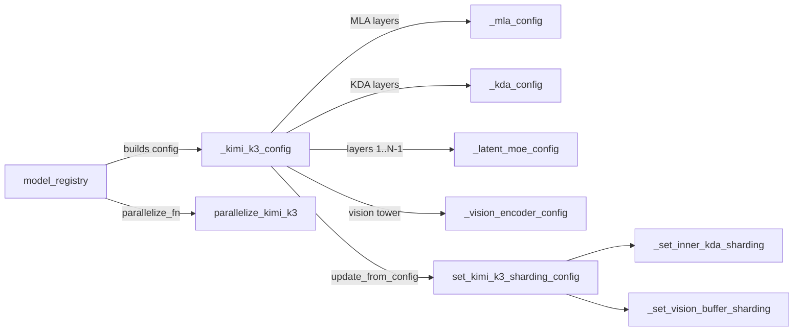
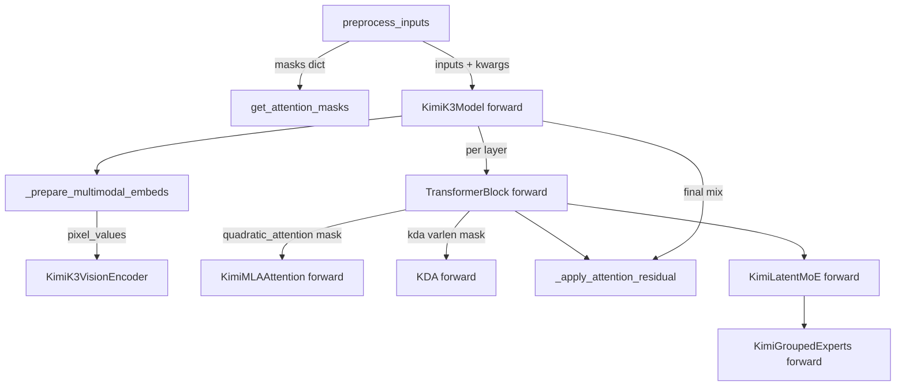

# Kimi K3 model (hybrid KDA/MLA decoder, Attention Residuals, LatentMoE, MoonViT-V2)

<!-- connect:up:begin -->
> **Cross-repo concept:** part of [expert-parallelism](../../../concepts/expert-parallelism.md) across this wiki's repos.
<!-- connect:up:end -->
## Overview
`torchtitan/models/kimi_k3` is a multimodal MoE decoder whose README summarizes it as "a hybrid Kimi Delta Attention (KDA) and Multi-head Latent Attention (MLA) decoder with LatentMoE and a MoonViT-V2 vision encoder". Three ideas distinguish it from the other MoE models in the repo. First, each layer carries **either** a linear-time KDA mixer **or** a quadratic gated-MLA mixer, chosen per layer index by [`_kimi_k3_config`](../catalog/torchtitan/models/kimi_k3/__init__.md#_kimi_k3_config "torchtitan/models/kimi_k3/__init__.py:L364") (released flavor: 69 KDA + 24 MLA of 93 layers). Second, the plain residual stream is replaced by **Attention Residuals**: every block softmax-mixes a growing stack of block summaries in FP32 via [`_apply_attention_residual`](../catalog/torchtitan/models/kimi_k3/model.md#_apply_attention_residual "torchtitan/models/kimi_k3/model.py:L152"). Third, routed experts run in a **latent** width (3584 vs model dim 7168), so token dispatch moves half-width activations ([`forward`](../catalog/torchtitan/models/kimi_k3/moe.md#KimiLatentMoE.forward "torchtitan/models/kimi_k3/moe.py:L125")). For the TPU-performance reader the headline is negative: [`parallelize_kimi_k3`](../catalog/torchtitan/models/kimi_k3/parallelize.md#parallelize_kimi_k3 "torchtitan/models/kimi_k3/parallelize.py:L27") supports only FSDP2/HSDP (+ EP), rejects TP/PP/CP and model compilation, and the KDA kernel it wraps is a CUDA Blackwell-only Attention Gym kernel - there is no TorchTPU lane for this model in this repo.

## Diagram
Build time - from model spec to a sharded module:

Legend:
- `REG` - [`model_registry`](../catalog/torchtitan/models/kimi_k3/__init__.md#model_registry "torchtitan/models/kimi_k3/__init__.py:L554")
- `CFG` - [`_kimi_k3_config`](../catalog/torchtitan/models/kimi_k3/__init__.md#_kimi_k3_config "torchtitan/models/kimi_k3/__init__.py:L364")
- `MLAC` - [`_mla_config`](../catalog/torchtitan/models/kimi_k3/__init__.md#_mla_config "torchtitan/models/kimi_k3/__init__.py:L133")
- `KDAC` - [`_kda_config`](../catalog/torchtitan/models/kimi_k3/__init__.md#_kda_config "torchtitan/models/kimi_k3/__init__.py:L169")
- `MOEC` - [`_latent_moe_config`](../catalog/torchtitan/models/kimi_k3/__init__.md#_latent_moe_config "torchtitan/models/kimi_k3/__init__.py:L219")
- `VISC` - [`_vision_encoder_config`](../catalog/torchtitan/models/kimi_k3/__init__.md#_vision_encoder_config "torchtitan/models/kimi_k3/__init__.py:L280")
- `SH` - [`set_kimi_k3_sharding_config`](../catalog/torchtitan/models/kimi_k3/sharding.md#set_kimi_k3_sharding_config "torchtitan/models/kimi_k3/sharding.py:L84")
- `KSH` - [`_set_inner_kda_sharding`](../catalog/torchtitan/models/kimi_k3/sharding.md#_set_inner_kda_sharding "torchtitan/models/kimi_k3/sharding.py:L32")
- `VSH` - [`_set_vision_buffer_sharding`](../catalog/torchtitan/models/kimi_k3/sharding.md#_set_vision_buffer_sharding "torchtitan/models/kimi_k3/sharding.py:L115")
- `PAR` - [`parallelize_kimi_k3`](../catalog/torchtitan/models/kimi_k3/parallelize.md#parallelize_kimi_k3 "torchtitan/models/kimi_k3/parallelize.py:L27")

Step time - one forward pass:

Legend:
- `PRE` - [`preprocess_inputs`](../catalog/torchtitan/models/kimi_k3/model.md#KimiK3Model.preprocess_inputs "torchtitan/models/kimi_k3/model.py:L340")
- `MASK` - [`get_attention_masks`](../catalog/torchtitan/models/kimi_k3/model.md#KimiK3Model.get_attention_masks "torchtitan/models/kimi_k3/model.py:L385")
- `FWD` - [`forward`](../catalog/torchtitan/models/kimi_k3/model.md#KimiK3Model.forward "torchtitan/models/kimi_k3/model.py:L461")
- `EMB` - [`_prepare_multimodal_embeds`](../catalog/torchtitan/models/kimi_k3/model.md#KimiK3Model._prepare_multimodal_embeds "torchtitan/models/kimi_k3/model.py:L420")
- `VIS` - [`KimiK3VisionEncoder`](../catalog/torchtitan/models/kimi_k3/vision_encoder.md#KimiK3VisionEncoder "torchtitan/models/kimi_k3/vision_encoder.py:L47")
- `BLK` - [`forward`](../catalog/torchtitan/models/kimi_k3/model.md#KimiK3TransformerBlock.forward "torchtitan/models/kimi_k3/model.py:L234")
- `MLA` - [`forward`](../catalog/torchtitan/models/kimi_k3/model.md#KimiMLAAttention.forward "torchtitan/models/kimi_k3/model.py:L106")
- `KDA` - [`forward`](../catalog/torchtitan/models/kimi_k3/kda.md#KDA.forward "torchtitan/models/kimi_k3/kda.py:L238")
- `RES` - [`_apply_attention_residual`](../catalog/torchtitan/models/kimi_k3/model.md#_apply_attention_residual "torchtitan/models/kimi_k3/model.py:L152")
- `MOE` - [`forward`](../catalog/torchtitan/models/kimi_k3/moe.md#KimiLatentMoE.forward "torchtitan/models/kimi_k3/moe.py:L125")
- `GEX` - [`forward`](../catalog/torchtitan/models/kimi_k3/moe.md#KimiGroupedExperts.forward "torchtitan/models/kimi_k3/moe.py:L72")

## Design rationale (why it's built this way)
- **Config factories, not hard-coded modules.** Every submodule is a `Config` built by a small factory in `__init__.py` ([`_linear`](../catalog/torchtitan/models/kimi_k3/__init__.md#_linear "torchtitan/models/kimi_k3/__init__.py:L96"), [`_norm`](../catalog/torchtitan/models/kimi_k3/__init__.md#_norm "torchtitan/models/kimi_k3/__init__.py:L111"), [`_feed_forward_config`](../catalog/torchtitan/models/kimi_k3/__init__.md#_feed_forward_config "torchtitan/models/kimi_k3/__init__.py:L119")). The docstring of [`_kimi_k3_config`](../catalog/torchtitan/models/kimi_k3/__init__.md#_kimi_k3_config "torchtitan/models/kimi_k3/__init__.py:L364") says it assembles the model "from the released topology's free parameters", so the debug flavor (24 layers, dim 1024, 32 experts) and the released flavor (93 layers, dim 7168, 896 experts, top-16) share exactly one code path. Converters (e.g. quantization) can then rewrite the config tree before build, as [`model_registry`](../catalog/torchtitan/models/kimi_k3/__init__.md#model_registry "torchtitan/models/kimi_k3/__init__.py:L554") does after `validate_converter_order`.
- **Hybrid mixer, one block class.** The block config holds both an [`attention`](../catalog/torchtitan/models/kimi_k3/model.md#KimiK3TransformerBlock.Config.attention "torchtitan/models/kimi_k3/model.py:L182") and a [`delta_attention`](../catalog/torchtitan/models/kimi_k3/model.md#KimiK3TransformerBlock.Config.delta_attention "torchtitan/models/kimi_k3/model.py:L183") slot (and a dense FFN vs [`moe`](../catalog/torchtitan/models/kimi_k3/model.md#KimiK3TransformerBlock.Config.moe "torchtitan/models/kimi_k3/model.py:L185") slot); the constructor enforces "exactly one" of each. A layer picks its mask by key (`quadratic_attention` vs `kda`), so one shared mask dict feeds both kinds of layers without per-layer recomputation.
- **MLA without RoPE, with an output gate.** The MLA class docstring explains the released config sets `mla_use_nope=True`: the rope-sized query/key slice is still projected and concatenated, but no rotary transform is applied, so the module has no rope config and [`forward`](../catalog/torchtitan/models/kimi_k3/model.md#KimiMLAAttention.forward "torchtitan/models/kimi_k3/model.py:L106") ignores `positions`. Position information therefore comes only from the KDA layers' causal conv + recurrence. The attention output is multiplied by `sigmoid(gate(x))` before `wo` ("Gated MLA").
- **Attention Residuals in FP32.** [`_apply_attention_residual`](../catalog/torchtitan/models/kimi_k3/model.md#_apply_attention_residual "torchtitan/models/kimi_k3/model.py:L152") is documented as "Apply Kimi's block-level attention residual in FP32": it RMS-normalizes the stacked block values, scores them with a single learned vector (norm weight x a `dim -> 1` projection, both from [`attention_res_norm`](../catalog/torchtitan/models/kimi_k3/model.md#KimiK3TransformerBlock.Config.attention_res_norm "torchtitan/models/kimi_k3/model.py:L188") / `ffn_res_*`), softmaxes over the block axis and returns the weighted sum cast back to the input dtype. Its own docstring carries "TODO: Add TP Support" - this function is one concrete reason TP is rejected.
- **Latent experts to shrink dispatch.** The router scores on the full model dim, but tokens are projected `dim -> latent_dim` before dispatch and `latent_dim -> dim` (plus an RMSNorm) after combine. [`_latent_moe_config`](../catalog/torchtitan/models/kimi_k3/__init__.md#_latent_moe_config "torchtitan/models/kimi_k3/__init__.py:L219") passes `hidden_dim=latent_dim` to the token dispatcher with the comment "The routed experts consume the LATENT stream, so the dispatcher buffers size by latent_dim, not model dim." Shared experts still run at full width on the un-projected input.
- **Declarative sharding.** `sharding.py` states "Declarations only ... Nothing here touches a mesh or a device." [`set_kimi_k3_sharding_config`](../catalog/torchtitan/models/kimi_k3/sharding.md#set_kimi_k3_sharding_config "torchtitan/models/kimi_k3/sharding.py:L84") is invoked from the model config's `update_from_config` with `enable_ep` derived from `expert_parallel_degree > 1`; the actual placement happens later when `model.parallelize(parallel_dims)` runs inside [`parallelize_kimi_k3`](../catalog/torchtitan/models/kimi_k3/parallelize.md#parallelize_kimi_k3 "torchtitan/models/kimi_k3/parallelize.py:L27").

> [!inferred]
> The latent-width routed path roughly halves all-to-all payload per routed token for the released flavor (3584 vs 7168 channels) and halves the grouped-GEMM K/N dims relative to a full-width expert of the same hidden size. That is the obvious performance motivation, but the source only states the buffer-sizing consequence, not the intent.

## Entry points
- [`model_registry`](../catalog/torchtitan/models/kimi_k3/__init__.md#model_registry "torchtitan/models/kimi_k3/__init__.py:L554") - reached when a trainer config asks for the `kimi_k3` spec. It looks up the flavor (`debugmodel` max context 16384, `Kimi-K3` max context 262144), validates `seq_len`, applies converters and returns a `ModelSpec` wiring `parallelize_fn=parallelize_kimi_k3`, `pipelining_fn=None`, the MoE load-balancing hook and the HF state-dict adapter. `attn_backend` (default `flex`) selects only the MLA inner attention; `moe_comm_backend` selects the token dispatcher.
- [`kimi_k3_debugmodel`](../catalog/torchtitan/models/kimi_k3/config_registry.md#kimi_k3_debugmodel "torchtitan/models/kimi_k3/config_registry.py:L62") - the only trainer recipe in-tree: bf16, `SelectiveAC`, chunked cross-entropy, CUDA graphs disabled, 10 steps on the `cc12m-test` multimodal set via [`_kimi_k3_multimodal_dataloader`](../catalog/torchtitan/models/kimi_k3/config_registry.md#_kimi_k3_multimodal_dataloader "torchtitan/models/kimi_k3/config_registry.py:L32") (14px patches, 2x2 spatial merge, at most 256 patches per image, raster patch order, no M-RoPE positions).
- [`preprocess_inputs`](../catalog/torchtitan/models/kimi_k3/model.md#KimiK3Model.preprocess_inputs "torchtitan/models/kimi_k3/model.py:L340") - called by the train loop on every batch before forward ("Build masks and annotate K3 multimodal inputs"); it is where the attention masks and, under the `spmd_types` backend, the input layouts are produced.
- [`forward`](../catalog/torchtitan/models/kimi_k3/model.md#KimiK3Model.forward "torchtitan/models/kimi_k3/model.py:L461") - the model forward, taking token ids plus optional `pixel_values`/`grid_thw`, `special_tokens`, `positions` and the mask dict.
- [`from_hf`](../catalog/torchtitan/models/kimi_k3/state_dict_adapter.md#KimiK3StateDictAdapter.from_hf "torchtitan/models/kimi_k3/state_dict_adapter.py:L267") / [`to_hf`](../catalog/torchtitan/models/kimi_k3/state_dict_adapter.md#KimiK3StateDictAdapter.to_hf "torchtitan/models/kimi_k3/state_dict_adapter.py:L136") - reached from checkpoint load/save when converting to or from an unquantized Hugging Face checkpoint (and from the numerical-parity script).

## Mechanism (step-by-step)
1. **Topology assembly.** [`_kimi_k3_config`](../catalog/torchtitan/models/kimi_k3/__init__.md#_kimi_k3_config "torchtitan/models/kimi_k3/__init__.py:L364") loops over `num_layers`. Indices in `full_attention_layers` (released: `range(3, 92, 4) | {92}`, i.e. every 4th layer plus the last) get an MLA config from [`_mla_config`](../catalog/torchtitan/models/kimi_k3/__init__.md#_mla_config "torchtitan/models/kimi_k3/__init__.py:L133"); all others get a KDA config from [`_kda_config`](../catalog/torchtitan/models/kimi_k3/__init__.md#_kda_config "torchtitan/models/kimi_k3/__init__.py:L169") (q/k/v projections, three depthwise causal convs built by the nested [`conv`](../catalog/torchtitan/models/kimi_k3/__init__.md#_kda_config.conv "torchtitan/models/kimi_k3/__init__.py:L178") factory, low-rank forget gate, per-head beta, gated output norm, `A_log`/`dt_bias` parameters). Layer 0 is the single dense SiTU-GLU FFN (`first_k_dense_replace=1` per the docstring) and has no `attention_res_*` modules; every later layer is LatentMoE. The result is a model config whose [`layers`](../catalog/torchtitan/models/kimi_k3/model.md#KimiK3Model.Config.layers "torchtitan/models/kimi_k3/model.py:L292") list is heterogeneous, plus an optional [`vision_encoder`](../catalog/torchtitan/models/kimi_k3/model.md#KimiK3Model.Config.vision_encoder "torchtitan/models/kimi_k3/model.py:L295") config from [`_vision_encoder_config`](../catalog/torchtitan/models/kimi_k3/__init__.md#_vision_encoder_config "torchtitan/models/kimi_k3/__init__.py:L280").

2. **Sharding declarations.** When the trainer pushes the job config into the model config, [`set_kimi_k3_sharding_config`](../catalog/torchtitan/models/kimi_k3/sharding.md#set_kimi_k3_sharding_config "torchtitan/models/kimi_k3/sharding.py:L84") walks the tree: the vision rotary `inv_freq` buffer is declared DP-replicated by [`_set_vision_buffer_sharding`](../catalog/torchtitan/models/kimi_k3/sharding.md#_set_vision_buffer_sharding "torchtitan/models/kimi_k3/sharding.py:L115"); each KDA layer's inner kernel module gets a local-map boundary from [`_set_inner_kda_sharding`](../catalog/torchtitan/models/kimi_k3/sharding.md#_set_inner_kda_sharding "torchtitan/models/kimi_k3/sharding.py:L32") ("Set the local boundary around Attention Gym's KDA kernels") - token tensors are DP-varying and row-partitioned, conv weights / `A_log` / `dt_bias` replicated - so the opaque kernel sees plain local tensors; each MoE layer gets the common MoE sharding declarations: with EP on, routed-expert weights shard on the expert dim (dim 0), while the `w1/w3` dim-1 / `w2` dim-2 layout passed in is only the EP-off tensor-parallel fallback (unreachable here, since TP is rejected). Sequence parallel inside MoE is left off pending a TP PR.

3. **Parallelization.** [`parallelize_kimi_k3`](../catalog/torchtitan/models/kimi_k3/parallelize.md#parallelize_kimi_k3 "torchtitan/models/kimi_k3/parallelize.py:L27") ("Apply FSDP2 to the Kimi K3 decoder and vision encoder") first raises `NotImplementedError` if TP, PP or CP is enabled, or if `compile.enable` includes the `model` component. Under `spmd_types` it seeds replicated layouts for all non-expert params; if `spmd_types` or EP is active it calls `model.parallelize(parallel_dims)` to realize the step-2 declarations. Activation checkpointing is applied to the decoder and then separately to the [`vision_encoder`](../catalog/torchtitan/models/kimi_k3/model.md#KimiK3Model.vision_encoder "torchtitan/models/kimi_k3/model.py:L336"). With `skip_dp=True` (vLLM inference) it returns here. Otherwise it resolves the DP mesh (`fsdp` or `dp_replicate x fsdp` for HSDP; the `efsdp` sparse mesh for experts when EP is on), FSDP-wraps the vision encoder as its own unit, then FSDP-wraps the decoder per layer with mixed-precision param/reduce dtypes, the reshard-after-forward policy, `ep_degree`, CPU offload and optional symmetric-memory FSDP.

4. **Mask construction.** [`preprocess_inputs`](../catalog/torchtitan/models/kimi_k3/model.md#KimiK3Model.preprocess_inputs "torchtitan/models/kimi_k3/model.py:L340") only builds masks when `positions` are present and the first full-attention backend is flex or varlen. [`get_attention_masks`](../catalog/torchtitan/models/kimi_k3/model.md#KimiK3Model.get_attention_masks "torchtitan/models/kimi_k3/model.py:L385") always builds document varlen metadata (cumulative sequence lengths) for KDA; for MLA it reuses that same metadata under the varlen backend, or asks the base decoder for a flex `BlockMask` otherwise. The method returns `{"quadratic_attention": ..., "kda": ...}`. Under `spmd_types`, the function then annotates inputs: the standard decoder input sharding plus `pixel_values`, `grid_thw` (and the video variants) as DP-varying, using [`MeshAxisName`](../catalog/torchtitan/distributed/parallel_dims.md#MeshAxisName "torchtitan/distributed/parallel_dims.py:L72") and the [`spmd_backend`](../catalog/torchtitan/config/configs.md#ParallelismConfig.spmd_backend "torchtitan/config/configs.py:L199") switch.

5. **Embedding + vision splice.** [`forward`](../catalog/torchtitan/models/kimi_k3/model.md#KimiK3Model.forward "torchtitan/models/kimi_k3/model.py:L461") rejects video inputs ("Kimi K3 v1 supports images but not videos"), then, inside a DP-local SPMD context, calls [`_prepare_multimodal_embeds`](../catalog/torchtitan/models/kimi_k3/model.md#KimiK3Model._prepare_multimodal_embeds "torchtitan/models/kimi_k3/model.py:L420"): token embeddings are looked up, images are cast to the patch-embed dtype and encoded by [`KimiK3VisionEncoder`](../catalog/torchtitan/models/kimi_k3/vision_encoder.md#KimiK3VisionEncoder "torchtitan/models/kimi_k3/vision_encoder.py:L47"), and each image contributes `(h/kh)*(w/kw)` text-side tokens (MoonViT collapses time) that are scattered into the positions of the `image_id` special token. The encoder's projector maps merged 2x2 patch features to the text width.

6. **Hybrid layer loop with Attention Residuals.** `forward` seeds an empty `block_residual_TND` (shape `[T, 0, D]`) and runs each layer's [`forward`](../catalog/torchtitan/models/kimi_k3/model.md#KimiK3TransformerBlock.forward "torchtitan/models/kimi_k3/model.py:L234"). Inside a block: if earlier blocks exist, the input is replaced by an attention-residual mix of `[block summaries..., running prefix sum]`; if `layer_id % attn_res_block_size == 0` the incoming prefix sum is pushed onto the block stack and the prefix sum restarts. The normalized input goes to the layer's mixer - MLA [`forward`](../catalog/torchtitan/models/kimi_k3/model.md#KimiMLAAttention.forward "torchtitan/models/kimi_k3/model.py:L106") (low-rank Q and KV, shared rope-slice key broadcast over heads, configured inner attention, sigmoid output gate) or KDA [`forward`](../catalog/torchtitan/models/kimi_k3/kda.md#KDA.forward "torchtitan/models/kimi_k3/kda.py:L238") (computes raw forget gate and beta, hands q/k/v projections, conv weights, `A_log`, `dt_bias` and `cu_seqlens` to the inner kernel, then applies the gated per-head RMSNorm and output projection). The mixer output is added to the prefix sum, a second residual mix (with `ffn_res_*`) produces the FFN input, and the block returns `prefix_sum + ffn_out` together with the (possibly grown) block stack.

7. **Latent MoE.** For layers >= 1 the FFN is the latent MoE [`forward`](../catalog/torchtitan/models/kimi_k3/moe.md#KimiLatentMoE.forward "torchtitan/models/kimi_k3/moe.py:L125"): the sigmoid-scored, route-normalized top-k router runs on the full-width `x_TD` with the expert-bias term, tokens-per-expert counts are accumulated (no-grad) for the load-balancing hook, routed experts consume `routed_down(x_TD)` at latent width, the combined output goes through `routed_norm` and `routed_up`, and the full-width shared-expert FFN is added. The grouped experts' [`forward`](../catalog/torchtitan/models/kimi_k3/moe.md#KimiGroupedExperts.forward "torchtitan/models/kimi_k3/moe.py:L72") unwraps DTensor weights to local shards, builds int32 cumulative offsets, and runs three grouped matmuls (the gate and up matmuls cast their input to bf16 explicitly; the down matmul consumes the SiTU-GLU output, which is evaluated in FP32 and cast back to the matmul dtype); the dense layer-0 / shared-expert [`forward`](../catalog/torchtitan/models/kimi_k3/moe.md#KimiFeedForward.forward "torchtitan/models/kimi_k3/moe.py:L53") uses the same activation (`beta=4.0`, `linear_beta=25.0`).

8. **Output and FLOP accounting.** After the last layer, `forward` applies one final attention-residual mix with [`output_res_norm`](../catalog/torchtitan/models/kimi_k3/model.md#KimiK3Model.output_res_norm "torchtitan/models/kimi_k3/model.py:L334") / [`output_res_proj`](../catalog/torchtitan/models/kimi_k3/model.md#KimiK3Model.output_res_proj "torchtitan/models/kimi_k3/model.py:L335"), then the final norm and LM head (skippable for chunked loss). For MFU, [`get_nparams_and_flops`](../catalog/torchtitan/models/kimi_k3/model.md#KimiK3Model.Config.get_nparams_and_flops "torchtitan/models/kimi_k3/model.py:L303") reports `6 x active_params + attention_flops`, excluding the vision encoder from active params and summing quadratic-attention FLOPs (which grow with `seq_len`) for MLA layers and delta-rule FLOPs (independent of `seq_len`) for KDA layers.

9. **HF conversion.** [`from_hf`](../catalog/torchtitan/models/kimi_k3/state_dict_adapter.md#KimiK3StateDictAdapter.from_hf "torchtitan/models/kimi_k3/state_dict_adapter.py:L267") drops the two unused layer-0 attention-residual keys and rotary `inv_freq` buffers, flattens the conv patch-embed weight, stacks per-expert `w1/w2/w3` into grouped `[E, ...]` tensors (DTensor-aware when experts are local), splits the vision tower's fused `wqkv`, reshapes `dt_bias` to `[heads, head_dim]`, and resolves per-layer keys through [`_map_from_hf_layer_key`](../catalog/torchtitan/models/kimi_k3/state_dict_adapter.md#KimiK3StateDictAdapter._map_from_hf_layer_key "torchtitan/models/kimi_k3/state_dict_adapter.py:L119") - which needs the layer config because HF uses `self_attn.*` for both MLA and KDA layers (and `g_proj` means different things in each). [`to_hf`](../catalog/torchtitan/models/kimi_k3/state_dict_adapter.md#KimiK3StateDictAdapter.to_hf "torchtitan/models/kimi_k3/state_dict_adapter.py:L136") inverts all of this and synthesizes deterministic placeholders (ones / zeros) for the layer-0 residual keys so strict HF loading succeeds. Both directions raise on any unmapped key.

## Key data structures
- **Mask dict** (`KimiK3AttentionMaskDict`): `"kda"` is always varlen document metadata (KDA reads `cu_seq_q` as `cu_seqlens`); `"quadratic_attention"` is a flex `BlockMask`, the same varlen metadata, or `None` when no MLA layer exists. Built in [`get_attention_masks`](../catalog/torchtitan/models/kimi_k3/model.md#KimiK3Model.get_attention_masks "torchtitan/models/kimi_k3/model.py:L385").
- **`block_residual_TND`**: the Attention-Residual block stack, `N` grows by one every `attn_res_block_size` (12) layers. With 93 layers that is 8 block entries plus the running prefix sum by the end - an activation held across the whole decoder and fed into every [`_apply_attention_residual`](../catalog/torchtitan/models/kimi_k3/model.md#_apply_attention_residual "torchtitan/models/kimi_k3/model.py:L152") call (which upcasts it to FP32).
- **KDA config** ([`Config`](../catalog/torchtitan/models/kimi_k3/kda.md#KDA.Config "torchtitan/models/kimi_k3/kda.py:L186")): [`num_heads`](../catalog/torchtitan/models/kimi_k3/kda.md#KDA.Config.num_heads "torchtitan/models/kimi_k3/kda.py:L187") equals the MLA head count (96 released) and [`head_dim`](../catalog/torchtitan/models/kimi_k3/kda.md#KDA.Config.head_dim "torchtitan/models/kimi_k3/kda.py:L188") is validated to be exactly 128 in `__post_init__` (an Attention Gym kernel constraint).
- **Vision encoder config** ([`Config`](../catalog/torchtitan/models/kimi_k3/vision_encoder.md#KimiK3VisionEncoder.Config "torchtitan/models/kimi_k3/vision_encoder.py:L49")): extends the K2.7 MoonViT encoder config with patch size, input channels, merge kernel, max frames, an RMSNorm final norm and the PatchMergerMLPV2-style projector.
- **Released flavor knobs** (from `__init__.py`): dim 7168, 93 layers, 96 heads, q/kv LoRA ranks 1536/512, MLA head dims 128 nope + 64 rope / 128 v, KDA head dim 128 with conv width 4, dense hidden 33792, latent dim 3584, expert hidden 3072, 896 experts top-16, 2 shared experts, vocab 163840.

## Dynamics (design intent)
- **Ordering matters for the residual stack.** Because a block pushes the *incoming* prefix sum before running its mixer, and the residual mix runs before the push, every block attends over summaries of all previous 12-layer groups - the stack is strictly append-only within a forward ([`forward`](../catalog/torchtitan/models/kimi_k3/model.md#KimiK3TransformerBlock.forward "torchtitan/models/kimi_k3/model.py:L234")).
- **Per-step expert counters.** The latent MoE mutates `tokens_per_expert_E` in-place only in training mode; the `ModelSpec`'s post-optimizer hook consumes these for auxiliary-loss-free load balancing (`load_balance_coeff=1e-3` set in [`_latent_moe_config`](../catalog/torchtitan/models/kimi_k3/__init__.md#_latent_moe_config "torchtitan/models/kimi_k3/__init__.py:L219")).
- **Tests.** `tests/unit_tests/gpu/test_kimi_k3.py` checks the flex mask, that a padded tail becomes one KDA segment, that the Attention Gym KDA kernel matches a recurrent reference (skipped without suitable hardware), and an HF adapter round-trip. The only integration test (`kimi_k3_mm_fsdp`) is registered in the separate B200 suite with 2 GPUs. The README reports end-to-end KL 6.7634e-7 vs the HF implementation on the debug-sized config.

## Edge cases
- **No TPU path.** The KDA kernel module in `kda.py` (behind [`forward`](../catalog/torchtitan/models/kimi_k3/kda.md#KDA.forward "torchtitan/models/kimi_k3/kda.py:L238")) raises unless tensors are CUDA and the device capability is SM100/SM103 (Blackwell), and imports Triton-backed Attention Gym ops (`chunk_kda`, `causal_conv1d`, `l2norm`). Nothing under `torchtitan/experiments/tpu` references `kimi_k3`. Porting would require a TPU implementation of chunked KDA and the varlen causal conv, plus lifting the TP/compile restrictions.
- **Parallelism restrictions.** TP, PP and CP raise; `pipelining_fn=None`. `compile.components` containing `model` raises, so the model always runs eager (only loss-side compile is possible) - see [`parallelize_kimi_k3`](../catalog/torchtitan/models/kimi_k3/parallelize.md#parallelize_kimi_k3 "torchtitan/models/kimi_k3/parallelize.py:L27"). The in-code comment notes `hybridep` dispatch needs GB200-class hardware; `standard`, `deepep` and `minimal_async_ep` run.
- **Mixed image/text batches can deadlock.** A TODO in `parallelize_kimi_k3` warns that an image batch on one DP rank and a text-only batch on another issue different FSDP collectives for the separately-wrapped vision encoder and hit a 90-second timeout.
- **Masks silently absent.** If `positions` is missing, or the MLA backend is neither flex nor varlen (e.g. SDPA), [`preprocess_inputs`](../catalog/torchtitan/models/kimi_k3/model.md#KimiK3Model.preprocess_inputs "torchtitan/models/kimi_k3/model.py:L340") builds no mask dict and KDA runs with `cu_seqlens=None`, i.e. treating the packed batch as a single sequence. KDA rejects a `BlockMask` outright.
- **Multimodal argument checks.** `pixel_values` and `grid_thw` must come together, require a vision encoder and `special_tokens`; videos are not supported.
- **Checkpoints are unquantized only.** The released checkpoint index lists MXFP4 packed/scale FQNs, so the adapter sets `fqn_to_index_mapping = None` and [`from_hf`](../catalog/torchtitan/models/kimi_k3/state_dict_adapter.md#KimiK3StateDictAdapter.from_hf "torchtitan/models/kimi_k3/state_dict_adapter.py:L267") expects dequantized weights; an incomplete set of per-expert tensors raises.
- **`seq_len` is reporting-only.** [`model_registry`](../catalog/torchtitan/models/kimi_k3/__init__.md#model_registry "torchtitan/models/kimi_k3/__init__.py:L554") notes the layers build no RoPE from it; it only bounds and reports `max_context_length` (262144 for the released flavor, although the README cites a 1M context for the released model).

## Open questions
- The KDA kernel wrapper classes (`KDAKernel`, `InnerKDA`, `KimiRMSNormGated`), the MLA class itself, the transformer block / model classes and the latent MoE / grouped-experts classes are not in this packet's subgraph; only their `forward`/`Config` members are. Their constructor-level invariants (e.g. KDA gate `lower_bound` in `[-5, 0)`) are therefore described from source without catalog anchors.
- Whether the SelectiveAC policy in the debug recipe treats the Attention Gym KDA calls as saveable or recomputed is not visible in this module.
- The README lists MXFP4 weights / MXFP8 activations with QAT for the released model, but no quantization converter is wired into the K3 recipe; how (or whether) the repo's quantization converters apply to the latent experts is not settled here.

## See also
- [kimi-k2-7-model](kimi-k2-7-model.md) - source of the MoonViT encoder and 2D vision rotary embedding K3 reuses.
- [deepseek-v3-model](deepseek-v3-model.md) - the MLA + MoE lineage and shared token-dispatcher backends.
- [qwen3-5-model](qwen3-5-model.md) - another hybrid linear-attention model; K3's `sharding.py` follows the same declaration pattern.
- [model-building-blocks](model-building-blocks.md), [model-spec-protocols](model-spec-protocols.md)
- [parallel-dims-and-parallelization](parallel-dims-and-parallelization.md), [flex-shard](flex-shard.md)
- [checkpointing](checkpointing.md), [quantization](quantization.md), [hf-datasets](hf-datasets.md)
- [tpu-moe-dispatch-and-grouped-experts](tpu-moe-dispatch-and-grouped-experts.md) - what a TPU port of the latent MoE would plug into.
