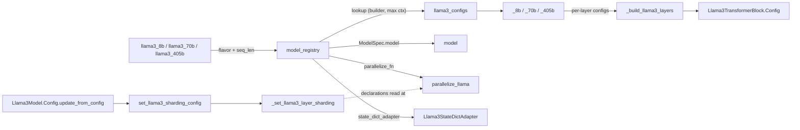

# Llama 3 model family (torchtitan/models/llama3)

<!-- connect:up:begin -->
> **Cross-repo concept:** part of [rematerialization](../../../concepts/rematerialization.md), [sequence-parallelism](../../../concepts/sequence-parallelism.md), [sharding](../../../concepts/sharding.md) across this wiki's repos.
<!-- connect:up:end -->
## Overview

The Llama 3 package is the reference dense decoder in torchtitan, and almost all of it is *configuration*, not modules. [`Llama3Model`](../catalog/torchtitan/models/llama3/model.md#Llama3Model "torchtitan/models/llama3/model.py:L59") is a thin subclass of the shared decoder that only adds default sizes, a sharding hook and a FLOP formula, and [`Llama3TransformerBlock`](../catalog/torchtitan/models/llama3/model.md#Llama3TransformerBlock "torchtitan/models/llama3/model.py:L22") is a plain pre-norm residual block. The real content is a list of per-layer configs built by [`_build_llama3_layers`](../catalog/torchtitan/models/llama3/__init__.md#_build_llama3_layers "torchtitan/models/llama3/__init__.py:L69"), a flavor table [`llama3_configs`](../catalog/torchtitan/models/llama3/__init__.md#llama3_configs "torchtitan/models/llama3/__init__.py:L377"), and [`model_registry`](../catalog/torchtitan/models/llama3/__init__.md#model_registry "torchtitan/models/llama3/__init__.py:L387"), which packages the model config with the parallelize function, the pipelining function and the HF checkpoint adapter into one `ModelSpec`. Because the spec is plain data, the TPU backend reuses it rather than forking the model: it swaps the parallelize function and the attention backend and layers config-level overrides (such as a real-valued RoPE) on top - the model code itself is shared between GPU and TPU.

## Diagram

Legend:
- `RECIPE` - [`llama3_8b`](../catalog/torchtitan/models/llama3/config_registry.md#llama3_8b "torchtitan/models/llama3/config_registry.py:L257"), [`llama3_70b`](../catalog/torchtitan/models/llama3/config_registry.md#llama3_70b "torchtitan/models/llama3/config_registry.py:L332"), [`llama3_405b`](../catalog/torchtitan/models/llama3/config_registry.md#llama3_405b "torchtitan/models/llama3/config_registry.py:L370")
- `REG` - [`model_registry`](../catalog/torchtitan/models/llama3/__init__.md#model_registry "torchtitan/models/llama3/__init__.py:L387")
- `TABLE` - [`llama3_configs`](../catalog/torchtitan/models/llama3/__init__.md#llama3_configs "torchtitan/models/llama3/__init__.py:L377")
- `FLAV` - [`_8b`](../catalog/torchtitan/models/llama3/__init__.md#_8b "torchtitan/models/llama3/__init__.py:L245"), [`_70b`](../catalog/torchtitan/models/llama3/__init__.md#_70b "torchtitan/models/llama3/__init__.py:L289"), [`_405b`](../catalog/torchtitan/models/llama3/__init__.md#_405b "torchtitan/models/llama3/__init__.py:L333")
- `LAYERS` - [`_build_llama3_layers`](../catalog/torchtitan/models/llama3/__init__.md#_build_llama3_layers "torchtitan/models/llama3/__init__.py:L69")
- `BLOCK` - [`Config`](../catalog/torchtitan/models/llama3/model.md#Llama3TransformerBlock.Config "torchtitan/models/llama3/model.py:L34")
- `SPEC` - [`model`](../catalog/torchtitan/protocols/model_spec.md#ModelSpec.model "torchtitan/protocols/model_spec.py:L38")
- `PAR` - [`parallelize_llama`](../catalog/torchtitan/models/llama3/parallelize.md#parallelize_llama "torchtitan/models/llama3/parallelize.py:L23")
- `SDA` - [`Llama3StateDictAdapter`](../catalog/torchtitan/models/llama3/state_dict_adapter.md#Llama3StateDictAdapter "torchtitan/models/llama3/state_dict_adapter.py:L18")
- `UFC` - [`update_from_config`](../catalog/torchtitan/models/llama3/model.md#Llama3Model.Config.update_from_config "torchtitan/models/llama3/model.py:L72")
- `SHARD` - [`set_llama3_sharding_config`](../catalog/torchtitan/models/llama3/sharding.md#set_llama3_sharding_config "torchtitan/models/llama3/sharding.py:L25")
- `LSHARD` - [`_set_llama3_layer_sharding`](../catalog/torchtitan/models/llama3/sharding.md#_set_llama3_layer_sharding "torchtitan/models/llama3/sharding.py:L44")

## Design rationale (why it's built this way)

**Per-layer config lists instead of one block config x N.** [`_build_llama3_layers`](../catalog/torchtitan/models/llama3/__init__.md#_build_llama3_layers "torchtitan/models/llama3/__init__.py:L69") emits one block config per `layer_id` ("per-layer TransformerBlock configs with depth-scaled inits"). The output projections (`wo`, `w2`/`w3`) get a std that shrinks with depth, which only works if each layer owns its config. The same property is what lets converters target layer subsets by FQN: [`llama3_8b_first_85_pct_layers_nvfp4`](../catalog/torchtitan/models/llama3/config_registry.md#llama3_8b_first_85_pct_layers_nvfp4 "torchtitan/models/llama3/config_registry.py:L292") quantizes the leading 85% of decoder layers and keeps the tail plus `lm_head` in bf16.

**Sharding is declared, not applied, at config time.** [`set_llama3_sharding_config`](../catalog/torchtitan/models/llama3/sharding.md#set_llama3_sharding_config "torchtitan/models/llama3/sharding.py:L25") says it in its docstring: "Specs are populated unconditionally - the mesh actually passed to `Module.parallelize()` at runtime determines which declarations apply." The model config therefore does not need to know whether TP is on; one config serves FSDP-only, TP, SP and CP runs. The only knob baked in at config time is `enable_sp`, because SP changes the activation layout around attention and the FFN (Shard(0) sequence layout plus reduce-scatter vs Replicate plus all-reduce on `wo`/`w2`).

**Wrapper order is fixed: TP -> AC -> per-block compile -> FSDP.** [`parallelize_llama`](../catalog/torchtitan/models/llama3/parallelize.md#parallelize_llama "torchtitan/models/llama3/parallelize.py:L23") comments "turn on per-TransformerBlock compile after AC wrapping and before FSDP", so compiled regions contain the checkpointed block and FSDP hooks stay outside the compiled graph. FSDP is *always* applied, even at shard degree 1, because it "still installs the MixedPrecisionPolicy" - bf16 parameter compute and the reduce dtype come from FSDP, not from autocast.

**Precision choices are encoded per projection.** [`llama3_mxfp8_linear_converter_config`](../catalog/torchtitan/models/llama3/config_registry.md#llama3_mxfp8_linear_converter_config "torchtitan/models/llama3/config_registry.py:L41") saves only the fused QKV and FFN down-projection inputs in MXFP8, because those "have single-consumer inputs that are not saved elsewhere for backward"; the docstring stresses the choice "is based on activation ownership, not the activation-checkpointing policy". [`llama3_debugmodel_nvfp4`](../catalog/torchtitan/models/llama3/config_registry.md#llama3_debugmodel_nvfp4 "torchtitan/models/llama3/config_registry.py:L174") leaves `lm_head` unconverted because "NVFP4 requires each GEMM dim divisible by 128, which the vocab projection does not satisfy."

> [!inferred]
> The TPU backend (`torchtitan/experiments/tpu/llama3/`) depends on this design. Its recipes call the same `model_registry` with `attn_backend="sdpa"` and then overwrite `model_spec.parallelize_fn` with a TPU wrapper that delegates to `parallelize_llama` (optionally with `skip_dp=True` plus SimpleFSDP), and swap `ComplexRoPE` for a real-valued RoPE through a config override. Because the model is pure config, no Llama 3 module is forked for TPU. Note that in the shared attention-config helper, `"sdpa"` maps to an attention that cannot consume per-document positions; the TPU lane uses it as a slot that its Splash-attention patch replaces (TPU 8B recipe: `use_splash_attention_kernel=True`, block sizes 2048).

## Entry points

- [`model_registry`](../catalog/torchtitan/models/llama3/__init__.md#model_registry "torchtitan/models/llama3/__init__.py:L387") - the factory the upstream recipes, graph_trainer and the TPU lane all call to obtain a spec. Signature knobs: `flavor`, `seq_len`, `attn_backend` (default `"flex"`; also `"flex_flash"`, `"varlen"`, `"sdpa"`), `tp_gemm_backend` (`"default"` or `"dist_gemm"`), and an ordered `converters` list.
- [`llama3_8b`](../catalog/torchtitan/models/llama3/config_registry.md#llama3_8b "torchtitan/models/llama3/config_registry.py:L257"), [`llama3_70b`](../catalog/torchtitan/models/llama3/config_registry.md#llama3_70b "torchtitan/models/llama3/config_registry.py:L332"), [`llama3_405b`](../catalog/torchtitan/models/llama3/config_registry.md#llama3_405b "torchtitan/models/llama3/config_registry.py:L370"), [`llama3_debugmodel`](../catalog/torchtitan/models/llama3/config_registry.md#llama3_debugmodel "torchtitan/models/llama3/config_registry.py:L63"), [`sft_debugmodel`](../catalog/torchtitan/models/llama3/config_registry.md#sft_debugmodel "torchtitan/models/llama3/config_registry.py:L425") - named recipes returning a full `Trainer.Config`; selected from the command line by function name and reached before any model is built.
- [`update_from_config`](../catalog/torchtitan/models/llama3/model.md#Llama3Model.Config.update_from_config "torchtitan/models/llama3/model.py:L72") - called by the trainer once the job config is resolved; this is where SP is read from [`parallelism`](../catalog/torchtitan/trainer.md#Trainer.Config.parallelism "torchtitan/trainer.py:L114") and sharding declarations are written into every sub-config.
- [`parallelize_llama`](../catalog/torchtitan/models/llama3/parallelize.md#parallelize_llama "torchtitan/models/llama3/parallelize.py:L23") - the `parallelize_fn` the trainer calls on the meta-device model ("The passed-in model preferably should be on meta device").
- [`from_hf`](../catalog/torchtitan/models/llama3/state_dict_adapter.md#Llama3StateDictAdapter.from_hf "torchtitan/models/llama3/state_dict_adapter.py:L113") / [`to_hf`](../catalog/torchtitan/models/llama3/state_dict_adapter.md#Llama3StateDictAdapter.to_hf "torchtitan/models/llama3/state_dict_adapter.py:L69") - reached by checkpoint load/save when HF-format interop is requested.

## Mechanism (step-by-step)

1. **Recipe -> spec.** A recipe such as [`llama3_8b`](../catalog/torchtitan/models/llama3/config_registry.md#llama3_8b "torchtitan/models/llama3/config_registry.py:L257") calls `model_registry("8B", seq_len=...)` and wraps the spec in a `Trainer.Config`: chunked cross-entropy loss sized to the vocab, [`default_adamw`](../catalog/torchtitan/components/optimizer/optimizer.md#default_adamw "torchtitan/components/optimizer/optimizer.py:L396"), a [`TrainingConfig`](../catalog/torchtitan/config/configs.md#TrainingConfig "torchtitan/config/configs.py:L36") whose token budget is expressed in multiples of `max_context_length`, selective AC, and periodic [`CheckpointManager`](../catalog/torchtitan/components/checkpointer/dcp.md#CheckpointManager "torchtitan/components/checkpointer/dcp.py:L89") saves. The perf-relevant differences between recipes live here, not in the model (see the recipe table below).

2. **Flavor lookup and context validation.** [`model_registry`](../catalog/torchtitan/models/llama3/__init__.md#model_registry "torchtitan/models/llama3/__init__.py:L387") reads `(builder, max_context_length)` from [`llama3_configs`](../catalog/torchtitan/models/llama3/__init__.md#llama3_configs "torchtitan/models/llama3/__init__.py:L377") (131072 for every flavor), raises `ValueError` if the requested `seq_len` is larger, and builds the config at that context length so the RoPE cache is sized to the run rather than to 128K. Converters are order-validated and then applied one by one, each returning a new config; the result goes into a `ModelSpec` with `parallelize_fn=parallelize_llama`, the shared LLM pipeline function, and [`Llama3StateDictAdapter`](../catalog/torchtitan/models/llama3/state_dict_adapter.md#Llama3StateDictAdapter "torchtitan/models/llama3/state_dict_adapter.py:L18").

3. **Per-layer config construction.** Each flavor builder (for example [`_8b`](../catalog/torchtitan/models/llama3/__init__.md#_8b "torchtitan/models/llama3/__init__.py:L245")) fixes `dim`, heads and layer count and calls [`_build_llama3_layers`](../catalog/torchtitan/models/llama3/__init__.md#_build_llama3_layers "torchtitan/models/llama3/__init__.py:L69"). Every layer gets two RMSNorms initialized by [`_NORM_INIT`](../catalog/torchtitan/models/llama3/__init__.md#_NORM_INIT "torchtitan/models/llama3/__init__.py:L49"), a GQA attention config with `fuse_qkv=True` (one `wqkv` GEMM), the inner attention chosen by `attn_backend`, a ComplexRoPE (theta 500000, "llama" scaling), and a SwiGLU FFN whose hidden size is rounded to a `multiple_of` (1024 for 1B-8B, 4096 for 70B/405B) - a choice that also keeps FFN GEMM dims aligned for the matrix units.

4. **Sharding declarations at job-config time.** [`update_from_config`](../catalog/torchtitan/models/llama3/model.md#Llama3Model.Config.update_from_config "torchtitan/models/llama3/model.py:L72") runs the base decoder update, then calls [`set_llama3_sharding_config`](../catalog/torchtitan/models/llama3/sharding.md#set_llama3_sharding_config "torchtitan/models/llama3/sharding.py:L25") with `enable_sp` from the parallelism config. Per layer, [`_set_llama3_layer_sharding`](../catalog/torchtitan/models/llama3/sharding.md#_set_llama3_layer_sharding "torchtitan/models/llama3/sharding.py:L44") assigns norm sharding, GQA attention sharding, a local map for the inner attention, and dense FFN sharding. With SP on, norms run on sequence-sharded activations and `wo`/`w2` reduce-scatter to Shard(0); with SP off, activations stay Replicate on TP (CP still Shard(0)) and those projections all-reduce.

5. **Applying parallelism, AC, compile and FSDP.** [`parallelize_llama`](../catalog/torchtitan/models/llama3/parallelize.md#parallelize_llama "torchtitan/models/llama3/parallelize.py:L23") calls `model.parallelize(parallel_dims)` when TP is enabled or the `spmd_types` backend is selected, which turns the declarations from step 4 into placements on the live mesh. It then builds and applies the AC policy, applies per-block `torch.compile` if `"model"` is in the compile components, and returns early for inference (`skip_dp`, used by vLLM because "FSDP's forward hooks are incompatible with torch.inference_mode()"). Otherwise it picks the DP mesh (resolved from the parallel dims under the `spmd_types` backend; otherwise `["dp_replicate", "fsdp"]` for HSDP, else `["fsdp"]`) and wraps the decoder with FSDP using `mixed_precision_param` / `mixed_precision_reduce` and optional CPU offload (`enable_cpu_offload`), all from [`TrainingConfig`](../catalog/torchtitan/config/configs.md#TrainingConfig "torchtitan/config/configs.py:L36"), plus the reshard-after-forward policy and symmetric-memory all-gathers taken from [`ParallelismConfig`](../catalog/torchtitan/config/configs.md#ParallelismConfig "torchtitan/config/configs.py:L123").

6. **Forward.** [`forward`](../catalog/torchtitan/models/llama3/model.md#Llama3TransformerBlock.forward "torchtitan/models/llama3/model.py:L45") is `h = x + attention(attention_norm(x), masks, positions, segment_ids)` then `out = h + feed_forward(ffn_norm(h))`. Passing `positions` and `segment_ids` through the block is what lets packed-document masking work across every attention backend; the block itself has no branching, so it is a clean unit for per-block compile, AC, and scan-over-layers on the TPU graph trainer.

7. **HF checkpoint interop.** [`from_hf`](../catalog/torchtitan/models/llama3/state_dict_adapter.md#Llama3StateDictAdapter.from_hf "torchtitan/models/llama3/state_dict_adapter.py:L113") first checks that the HF RoPE config matches ComplexRoPE, copies `embed_tokens` into `lm_head` for tied models, then renames keys through [`from_hf_map`](../catalog/torchtitan/models/llama3/state_dict_adapter.md#Llama3StateDictAdapter.from_hf_map "torchtitan/models/llama3/state_dict_adapter.py:L29") and reverse-permutes `q_proj`/`k_proj` rows, because HF stores rotary pairs half-split while torchtitan's complex RoPE expects interleaved pairs. [`to_hf`](../catalog/torchtitan/models/llama3/state_dict_adapter.md#Llama3StateDictAdapter.to_hf "torchtitan/models/llama3/state_dict_adapter.py:L69") applies the forward permutation and drops `lm_head` when weights are tied. Both read head counts and `dim` from [`model_config`](../catalog/torchtitan/models/llama3/state_dict_adapter.md#Llama3StateDictAdapter.model_config "torchtitan/models/llama3/state_dict_adapter.py:L26").

## Key data structures

**Flavor table** ([`llama3_configs`](../catalog/torchtitan/models/llama3/__init__.md#llama3_configs "torchtitan/models/llama3/__init__.py:L377"); all max context 131072):

| Flavor | dim | heads / kv heads | layers | FFN rounding | vocab | tied embeddings |
|---|---|---|---|---|---|---|
| debugmodel | 256 | 16 / 16 | 6 | multiple_of 256 | 2048 | no |
| 1B | 2048 | 32 / 8 | 16 | 1024, x1.5 | 128256 | yes |
| 3B | 3072 | 24 / 8 | 28 | 1024, x1.0 | 128256 | yes |
| 8B | 4096 | 32 / 8 | 32 | 1024, x1.3 | 128256 | no |
| 70B | 8192 | 64 / 8 | 80 | 4096, x1.3 | 128256 | no |
| 405B | 16384 | 128 / 8 | 126 | 4096, x1.2 | 128256 | no |

Builders: [`_debugmodel`](../catalog/torchtitan/models/llama3/__init__.md#_debugmodel "torchtitan/models/llama3/__init__.py:L114"), [`_1b`](../catalog/torchtitan/models/llama3/__init__.md#_1b "torchtitan/models/llama3/__init__.py:L151"), [`_3b`](../catalog/torchtitan/models/llama3/__init__.md#_3b "torchtitan/models/llama3/__init__.py:L198"), [`_8b`](../catalog/torchtitan/models/llama3/__init__.md#_8b "torchtitan/models/llama3/__init__.py:L245"), [`_70b`](../catalog/torchtitan/models/llama3/__init__.md#_70b "torchtitan/models/llama3/__init__.py:L289"), [`_405b`](../catalog/torchtitan/models/llama3/__init__.md#_405b "torchtitan/models/llama3/__init__.py:L333").

**Upstream recipe knobs** (what differs between the stock recipes):

| Recipe | TP | AC | compile | precision | seqs / microbatch / DP rank |
|---|---|---|---|---|---|
| `llama3_8b` | 1 | selective | off | bf16 | 1 |
| `llama3_70b` | 8 | full | off | bf16 | 8 |
| `llama3_405b` | 8 | full | on + async TP | float8 except `lm_head` | 2 |
| `llama3_8b_mxfp8` | 1 | selective | on | MXFP8 (QKV, `w2` saved in MXFP8) | 1 |

**[`Config`](../catalog/torchtitan/models/llama3/model.md#Llama3Model.Config "torchtitan/models/llama3/model.py:L68")** adds only [`dim`](../catalog/torchtitan/models/llama3/model.md#Llama3Model.Config.dim "torchtitan/models/llama3/model.py:L69") (default 4096) and [`vocab_size`](../catalog/torchtitan/models/llama3/model.md#Llama3Model.Config.vocab_size "torchtitan/models/llama3/model.py:L70") (default 128256) on top of the decoder's [`layers`](../catalog/torchtitan/models/common/decoder.md#Decoder.Config.layers "torchtitan/models/common/decoder.py:L84"), embeddings, norm and `lm_head`. Its FLOP estimate is `6 x active params + per-layer quadratic attention FLOPs`, so MFU numbers reported for Llama 3 include attention.

**`ModelSpec`** - the hand-off object: [`model`](../catalog/torchtitan/protocols/model_spec.md#ModelSpec.model "torchtitan/protocols/model_spec.py:L38") (the config), [`max_context_length`](../catalog/torchtitan/protocols/model_spec.md#ModelSpec.max_context_length "torchtitan/protocols/model_spec.py:L39"), `parallelize_fn`, `pipelining_fn`, `state_dict_adapter`. Replacing one field is the supported way to retarget a backend.

## Dynamics (design intent)

- Converter order matters and is validated before application; the LoRA-on-float8 debug recipe [`llama3_debugmodel_float8_emulate_lora`](../catalog/torchtitan/models/llama3/config_registry.md#llama3_debugmodel_float8_emulate_lora "torchtitan/models/llama3/config_registry.py:L225") stacks an emulated float8 converter and then LoRA on `wqkv`/`wo`.
- Quantized recipes force compile on: the NVFP4 8B recipe comments "Enable compile so NVFP4's dynamic quantization runs at competitive perf", and [`llama3_8b_mxfp8`](../catalog/torchtitan/models/llama3/config_registry.md#llama3_8b_mxfp8 "torchtitan/models/llama3/config_registry.py:L316") enables compile "so the converter's compile requirement is satisfied".
- [`llama3_debugmodel_dist_gemm`](../catalog/torchtitan/models/llama3/config_registry.md#llama3_debugmodel_dist_gemm "torchtitan/models/llama3/config_registry.py:L122") documents async-TP where "the attention TP collectives are folded into their GEMMs"; it pins `spmd_backend="spmd_types"` and needs TP > 1 and CUDA, and falls back to stock projections with TP off.
- The TPU lane's parity tests (CPU vs device for embedding, attention, FFN, block and full training steps, plus TP/FSDP DTensor workers that call `parallelize_llama`) exercise these same configs; see the Evidence in the packet and the TPU test suite under `torchtitan/experiments/tpu/llama3/tests/`.

## Edge cases

- `seq_len` above 131072 raises `ValueError` in [`model_registry`](../catalog/torchtitan/models/llama3/__init__.md#model_registry "torchtitan/models/llama3/__init__.py:L387"); passing `None` builds at the full 131072, which inflates the RoPE cache - the recipes pass the run's context length.
- The debug model has `n_kv_heads=None` (plain MHA); the HF adapter falls back to `n_heads` for the K permutation in that case.
- Tied 1B/3B: [`from_hf`](../catalog/torchtitan/models/llama3/state_dict_adapter.md#Llama3StateDictAdapter.from_hf "torchtitan/models/llama3/state_dict_adapter.py:L113") synthesizes `lm_head.weight` from `embed_tokens` if missing; [`to_hf`](../catalog/torchtitan/models/llama3/state_dict_adapter.md#Llama3StateDictAdapter.to_hf "torchtitan/models/llama3/state_dict_adapter.py:L69") omits it and also pops it from the safetensors index mapping.
- `rotary_emb.inv_freq` keys from HF are dropped (mapped to `None`); unknown non-layer keys raise `KeyError` in `from_hf`.
- [`llama3_debugmodel_varlen_attn`](../catalog/torchtitan/models/llama3/config_registry.md#llama3_debugmodel_varlen_attn "torchtitan/models/llama3/config_registry.py:L110") caps `max_num_documents=64`, since varlen metadata is sized by document count.
- With `skip_dp=True`, AC and compile are expected to be disabled by config ("mode=none, enable=False"); `parallelize_llama` does not enforce it.

## Open questions

- The FLOP formula lives in a `get_nparams_and_flops` method of the model config that is not in this packet's subgraph; its interaction with the TPU lane's MaxText-comparable FLOP accounting is documented on the TPU pages, not here.
- `pipeline_llm` and the shared decoder sharding helpers (`set_decoder_sharding_config`, `set_gqa_attention_sharding`, `set_dense_ffn_sharding`) are outside this packet; their exact placements are described on [model-building-blocks](model-building-blocks.md) and [parallel-dims-and-parallelization](parallel-dims-and-parallelization.md).
- Whether the TPU recipes' real-valued RoPE override and Splash patch preserve bitwise parity with the flex path at 8B is asserted by tests but not provable statically.

## See also

- [model-spec-protocols](model-spec-protocols.md) - what a `ModelSpec` contains and how the trainer consumes it.
- [model-building-blocks](model-building-blocks.md) - the shared decoder, GQA attention, RoPE and FFN these configs instantiate.
- [parallel-dims-and-parallelization](parallel-dims-and-parallelization.md) - mesh construction and `Module.parallelize`.
- [quantization](quantization.md) - float8 / MXFP8 / NVFP4 converters used by the recipes.
- [tpu-trainer-and-job-config](tpu-trainer-and-job-config.md), [tpu-pallas-kernels](tpu-pallas-kernels.md), [tpu-layer-loop-remat-and-layouts](tpu-layer-loop-remat-and-layouts.md) - how the TPU lane retargets this spec.
- [graph-trainer](graph-trainer.md), [jax-lane](jax-lane.md) - other lanes that reuse the Llama 3 configs.
- [qwen3-model](qwen3-model.md) - the sibling family built the same way, adding QK-norm and MoE.
