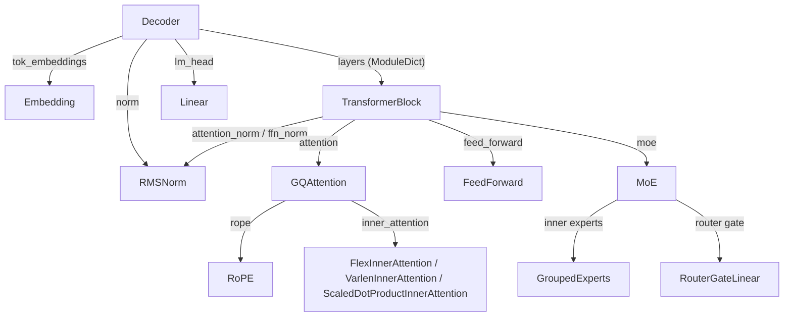
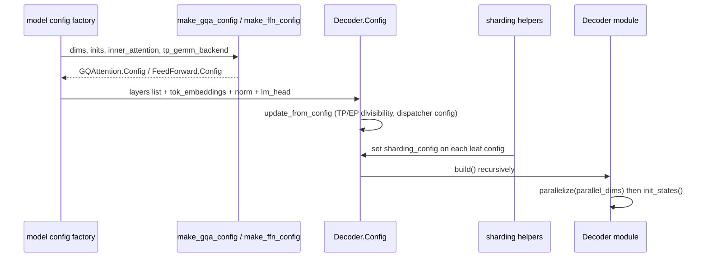

# Model building blocks (torchtitan/models/common)

<!-- connect:up:begin -->
> **Cross-repo concept:** part of [expert-parallelism](../../../concepts/expert-parallelism.md), [flash-attention](../../../concepts/flash-attention.md), [rematerialization](../../../concepts/rematerialization.md), [sequence-parallelism](../../../concepts/sequence-parallelism.md), [sharding](../../../concepts/sharding.md) across this wiki's repos.
<!-- connect:up:end -->
## Overview

`torchtitan/models/common` is the shared component library every decoder-only model in this fork (llama3, qwen3, deepseek_v3/v4, gpt_oss, the TPU examples) is assembled from. The single key idea: **a model is a tree of dataclass configs, and the module tree is just `config.build()` applied recursively.** Each component is a [`Module`](../catalog/torchtitan/protocols/module.md#Module "torchtitan/protocols/module.py:L43") subclass with a nested kw-only `Config` (enforced by [`Configurable`](../catalog/torchtitan/config/configurable.md#Configurable "torchtitan/config/configurable.py:L18")); thin wrappers like [`Linear`](../catalog/torchtitan/models/common/linear.md#Linear "torchtitan/models/common/linear.py:L31") and [`RMSNorm`](../catalog/torchtitan/models/common/nn_modules.md#RMSNorm "torchtitan/models/common/nn_modules.py:L134") use diamond inheritance (`nn.Linear` + `Module`) so the `nn` forward and state-dict layout are reused unchanged. Because everything that matters for performance - which attention kernel runs, how a weight is sharded on each mesh axis, how parameters are initialized, which sub-regions are recomputed in backward - is a *field of a config node* rather than code inside `forward`, a backend can retune a model by rewriting the config tree before build. That is exactly the seam the `experiments/tpu` lane uses (swapping RoPE, Linear and lm_head configs) without forking the model code.

## Diagram

Structure of a built decoder (config containment = module containment):

Legend:
- `DEC` - [`Decoder`](../catalog/torchtitan/models/common/decoder.md#Decoder "torchtitan/models/common/decoder.py:L67")
- `EMB` - [`Embedding`](../catalog/torchtitan/models/common/embedding.md#Embedding "torchtitan/models/common/embedding.py:L24")
- `TB` - [`TransformerBlock`](../catalog/torchtitan/models/common/decoder.md#TransformerBlock "torchtitan/models/common/decoder.py:L46")
- `RN` - [`RMSNorm`](../catalog/torchtitan/models/common/nn_modules.md#RMSNorm "torchtitan/models/common/nn_modules.py:L134")
- `LIN` - [`Linear`](../catalog/torchtitan/models/common/linear.md#Linear "torchtitan/models/common/linear.py:L31")
- `GQA` - [`GQAttention`](../catalog/torchtitan/models/common/attention.md#GQAttention "torchtitan/models/common/attention.py:L999")
- `FFN` - [`FeedForward`](../catalog/torchtitan/models/common/feed_forward.md#FeedForward "torchtitan/models/common/feed_forward.py:L34")
- `MOE` - [`MoE`](../catalog/torchtitan/models/common/moe.md#MoE "torchtitan/models/common/moe.py:L934")
- `ROPE` - [`RoPE`](../catalog/torchtitan/models/common/rope.md#RoPE "torchtitan/models/common/rope.py:L84")
- `INNER` - [`FlexInnerAttention`](../catalog/torchtitan/models/common/attention.md#FlexInnerAttention "torchtitan/models/common/attention.py:L233"), [`VarlenInnerAttention`](../catalog/torchtitan/models/common/attention.md#VarlenInnerAttention "torchtitan/models/common/attention.py:L137"), [`ScaledDotProductInnerAttention`](../catalog/torchtitan/models/common/attention.md#ScaledDotProductInnerAttention "torchtitan/models/common/attention.py:L393")
- `GE` - [`GroupedExperts`](../catalog/torchtitan/models/common/moe.md#GroupedExperts "torchtitan/models/common/moe.py:L440")
- `RGL` - [`RouterGateLinear`](../catalog/torchtitan/models/common/linear.md#RouterGateLinear "torchtitan/models/common/linear.py:L101")

Lifecycle of the same tree from config factory to a parallelized module:

Legend:
- `REG` - (concept) a per-model registry function, e.g. [`llama3_debugmodel`](../catalog/torchtitan/models/llama3/config_registry.md#llama3_debugmodel "torchtitan/models/llama3/config_registry.py:L63")
- `CU` - [`make_gqa_config`](../catalog/torchtitan/models/common/config_utils.md#make_gqa_config "torchtitan/models/common/config_utils.py:L170"), [`make_ffn_config`](../catalog/torchtitan/models/common/config_utils.md#make_ffn_config "torchtitan/models/common/config_utils.py:L267")
- `DC` - [`Config`](../catalog/torchtitan/models/common/decoder.md#Decoder.Config "torchtitan/models/common/decoder.py:L75")
- `SH` - (concept) `decoder_sharding.py` helpers built on [`dense_param_placement`](../catalog/torchtitan/models/common/decoder_sharding.md#dense_param_placement "torchtitan/models/common/decoder_sharding.py:L24") / [`dense_activation_placement`](../catalog/torchtitan/models/common/decoder_sharding.md#dense_activation_placement "torchtitan/models/common/decoder_sharding.py:L39")
- `M` - [`Decoder`](../catalog/torchtitan/models/common/decoder.md#Decoder "torchtitan/models/common/decoder.py:L67")

## Design rationale (why it's built this way)

- **Config-first, fully-specified sub-configs.** The `config_utils.py` module docstring says its helpers "construct fully-specified sub-configs with all dimensional fields set at config creation time." [`make_gqa_config`](../catalog/torchtitan/models/common/config_utils.md#make_gqa_config "torchtitan/models/common/config_utils.py:L170") derives every [`in_features`](../catalog/torchtitan/models/common/linear.md#Linear.Config.in_features "torchtitan/models/common/linear.py:L36") / [`out_features`](../catalog/torchtitan/models/common/linear.md#Linear.Config.out_features "torchtitan/models/common/linear.py:L37") of the Q/K/V and output projections from `dim`, `n_heads`, `n_kv_heads`, `head_dim` up front. The payoff is that tools can inspect and rewrite the whole model (FLOPs counting, float8/MXFP8 conversion, TPU overrides, sharding declarations) as data, before any tensor exists.
- **Flat module hierarchy via diamond inheritance.** The `linear.py` docstring gives the reasons: "The module hierarchy stays flat (no extra wrapper layer). All nn.Linear logic (forward, state_dict, etc.) is reused as-is." Flat FQNs keep checkpoints loadable and make per-weight sharding/quantization filters (which match on FQN) stable. The same logic is why `SigmoidGatedFeedForward` inherits `w1/w2/w3` "so weight FQNs are flat ... which keeps the weights directly shardable."
- **Outer attention vs. inner kernel.** [`GQAttention`](../catalog/torchtitan/models/common/attention.md#GQAttention "torchtitan/models/common/attention.py:L999") owns projections, QK-norm and RoPE; the actual attention math is a separate `inner_attention` config on [`BaseAttention`](../catalog/torchtitan/models/common/attention.md#BaseAttention "torchtitan/models/common/attention.py:L745"). Swapping kernels (flex, varlen/FlashAttention, SDPA, or a TPU splash kernel in the TPU lane) is therefore a one-field config change and never touches projection weights or checkpoint layout.
- **Sharding is declared per leaf, applied per axis.** Every `Module.Config` can carry a `sharding_config`; the placements are expressed over the named mesh axes DP/CP/TP. [`dense_param_placement`](../catalog/torchtitan/models/common/decoder_sharding.md#dense_param_placement "torchtitan/models/common/decoder_sharding.py:L24") documents the convention: "DP/CP axes are spmd.R; the DTensor bridge unfolds DP into storage axes. TP placement is caller-specified." Model sharding files fill these "unconditionally - the mesh actually passed to Module.parallelize() at runtime determines which declarations apply", so the same config serves FSDP-only and FSDP+TP+SP runs.
- **Remat boundaries live in the model, policy lives outside.** [`GQAttention`](../catalog/torchtitan/models/common/attention.md#GQAttention "torchtitan/models/common/attention.py:L999") wraps `qkv`, `inner_attention` and `wo` in named `torch_remat` regions and asks [`Module`](../catalog/torchtitan/protocols/module.md#Module "torchtitan/protocols/module.py:L43") whether each name matches a save pattern. The activation-checkpoint policy therefore selects what to keep by region name without the model knowing which policy is active.

> [!inferred]
> The config-tree design is also what makes the TPU lane possible without forking upstream models: the TPU tests show overrides that take an existing [`ComplexRoPE`](../catalog/torchtitan/models/common/rope.md#ComplexRoPE "torchtitan/models/common/rope.py:L185") or [`CosSinRoPE`](../catalog/torchtitan/models/common/rope.md#CosSinRoPE "torchtitan/models/common/rope.py:L281") config and return a replacement config with the same [`dim`](../catalog/torchtitan/models/common/rope.md#RoPE.Config.dim "torchtitan/models/common/rope.py:L94"), [`max_context_length`](../catalog/torchtitan/models/common/rope.md#RoPE.Config.max_context_length "torchtitan/models/common/rope.py:L95") and [`theta`](../catalog/torchtitan/models/common/rope.md#RoPE.Config.theta "torchtitan/models/common/rope.py:L96"), and a float8 converter that walks every [`Linear`](../catalog/torchtitan/models/common/linear.md#Linear "torchtitan/models/common/linear.py:L31") config in the tree. See [TPU layer loop, remat and layouts](tpu-layer-loop-remat-and-layouts.md) and [quantization](quantization.md).

## Entry points

- [`Linear`](../catalog/torchtitan/models/common/linear.md#Linear "torchtitan/models/common/linear.py:L31") / its [`Config`](../catalog/torchtitan/models/common/linear.md#Linear.Config "torchtitan/models/common/linear.py:L35") - the most-referenced symbol in the unit: every projection (Q/K/V, `wo`, FFN `w1/w2/w3`, [`lm_head`](../catalog/torchtitan/models/common/decoder.md#Decoder.Config.lm_head "torchtitan/models/common/decoder.py:L78"), router gate) is a `Linear.Config(in_features=..., out_features=..., bias=...)`. Note [`bias`](../catalog/torchtitan/models/common/linear.md#Linear.Config.bias "torchtitan/models/common/linear.py:L38") defaults to `False`, unlike `nn.Linear`. Quantization converters and TPU overrides find linears by traversing for this config type.
- [`make_gqa_config`](../catalog/torchtitan/models/common/config_utils.md#make_gqa_config "torchtitan/models/common/config_utils.py:L170"), [`make_ffn_config`](../catalog/torchtitan/models/common/config_utils.md#make_ffn_config "torchtitan/models/common/config_utils.py:L267"), [`make_router_config`](../catalog/torchtitan/models/common/config_utils.md#make_router_config "torchtitan/models/common/config_utils.py:L329") - called by every model's config factory to build one layer's attention, dense FFN, or MoE router. They are where `fuse_qkv` and `tp_gemm_backend` ("default" vs "dist_gemm") pick the projection classes.
- [`Config`](../catalog/torchtitan/models/common/decoder.md#Decoder.Config "torchtitan/models/common/decoder.py:L75") (`Decoder.Config`) - the root of a language-model spec: `dim`, `vocab_size`, [`tok_embeddings`](../catalog/torchtitan/models/common/decoder.md#Decoder.Config.tok_embeddings "torchtitan/models/common/decoder.py:L79"), [`norm`](../catalog/torchtitan/models/common/decoder.md#Decoder.Config.norm "torchtitan/models/common/decoder.py:L80"), [`lm_head`](../catalog/torchtitan/models/common/decoder.md#Decoder.Config.lm_head "torchtitan/models/common/decoder.py:L78"), and [`layers`](../catalog/torchtitan/models/common/decoder.md#Decoder.Config.layers "torchtitan/models/common/decoder.py:L84") (a plain list of per-layer block configs). It is the object a [`model`](../catalog/torchtitan/protocols/model_spec.md#ModelSpec.model "torchtitan/protocols/model_spec.py:L38") field of a model spec holds.
- [`update_from_config`](../catalog/torchtitan/models/common/decoder.md#Decoder.Config.update_from_config "torchtitan/models/common/decoder.py:L134") - reached once from the [`Trainer`](../catalog/torchtitan/trainer.md#Trainer "torchtitan/trainer.py:L74") (or any caller with a `parallelism` field) before build; validates parallel degrees against the architecture and pushes runtime knobs into the tree.
- [`decoder_vocab_size`](../catalog/torchtitan/models/common/config_utils.md#decoder_vocab_size "torchtitan/models/common/config_utils.py:L61") - used by config registries such as [`llama3_debugmodel`](../catalog/torchtitan/models/llama3/config_registry.md#llama3_debugmodel "torchtitan/models/llama3/config_registry.py:L63") to size the cross-entropy loss's `global_vocab_size` from the model spec ("Assert Decoder.Config type so lint is not annoyed").
- [`RMSNorm`](../catalog/torchtitan/models/common/nn_modules.md#RMSNorm "torchtitan/models/common/nn_modules.py:L134") / its [`Config`](../catalog/torchtitan/models/common/nn_modules.md#RMSNorm.Config "torchtitan/models/common/nn_modules.py:L138") - the norm used for [`attention_norm`](../catalog/torchtitan/models/common/decoder.md#TransformerBlock.Config.attention_norm "torchtitan/models/common/decoder.py:L63"), [`ffn_norm`](../catalog/torchtitan/models/common/decoder.md#TransformerBlock.Config.ffn_norm "torchtitan/models/common/decoder.py:L64"), the final norm and the optional QK-norm; [`normalized_shape`](../catalog/torchtitan/models/common/nn_modules.md#RMSNorm.Config.normalized_shape "torchtitan/models/common/nn_modules.py:L139") is the only required field.

## Mechanism (step-by-step)

1. **A config factory assembles the layer list.** A per-model factory loops over layer ids and, for each, builds a block config from [`RMSNorm`](../catalog/torchtitan/models/common/nn_modules.md#RMSNorm "torchtitan/models/common/nn_modules.py:L134") norms, an attention config from [`make_gqa_config`](../catalog/torchtitan/models/common/config_utils.md#make_gqa_config "torchtitan/models/common/config_utils.py:L170") and either a dense FFN from [`make_ffn_config`](../catalog/torchtitan/models/common/config_utils.md#make_ffn_config "torchtitan/models/common/config_utils.py:L267") or an MoE. Per-layer `param_init` dicts are attached here (llama3 uses depth-scaled init for `wo` and `w2/w3`), because [`Module`](../catalog/torchtitan/protocols/module.md#Module "torchtitan/protocols/module.py:L43") initializes each parameter by name lookup in that dict. With `fuse_qkv=True`, `make_gqa_config` builds one `wqkv` [`Linear`](../catalog/torchtitan/models/common/linear.md#Linear "torchtitan/models/common/linear.py:L31") of width `(n_heads + 2 * n_kv) * head_dim` and a per-slice initializer so the fused weight is "bit-identical to the stock separate wq/wk/wv" (and, under spmd_types TP, each rank copies only its chunk). With `tp_gemm_backend="dist_gemm"` it swaps in the all-gather-fused QKV and row-parallel output classes, and rejects the combination unless `fuse_qkv=True`.

2. **The attention backend is chosen as a config, not a flag on the module.** The `inner_attention` passed to [`make_gqa_config`](../catalog/torchtitan/models/common/config_utils.md#make_gqa_config "torchtitan/models/common/config_utils.py:L170") is one of [`FlexInnerAttention`](../catalog/torchtitan/models/common/attention.md#FlexInnerAttention "torchtitan/models/common/attention.py:L233") ("Inner attention using `flex_attention` with torch.compile"; carries `block_size` and `kernel_options`), [`VarlenInnerAttention`](../catalog/torchtitan/models/common/attention.md#VarlenInnerAttention "torchtitan/models/common/attention.py:L137") (packed-document varlen/FlashAttention with a `window_size`), or [`ScaledDotProductInnerAttention`](../catalog/torchtitan/models/common/attention.md#ScaledDotProductInnerAttention "torchtitan/models/common/attention.py:L393"). The `config_utils.py` backend mapper notes that SDPA "only supports a boolean `is_causal` flag and cannot consume per-document positions", so for language models it is not a document-masked backend. Flex compiles `flex_attention` once as a class variable (comment: otherwise "there will be multiple compiled flex_attention instances, which can be slow") with `max_autotune` and coordinate-descent tuning on, and marks the call with a regional-inductor context so a non-inductor outer compile can still hand this region to inductor.

3. **The root config is validated against the parallelism.** [`update_from_config`](../catalog/torchtitan/models/common/decoder.md#Decoder.Config.update_from_config "torchtitan/models/common/decoder.py:L134") reads `config.parallelism` and fails fast if `tensor_parallel_degree` does not divide `n_heads` and `n_kv_heads` of the first full-attention layer, if any [`MoE`](../catalog/torchtitan/models/common/moe.md#MoE "torchtitan/models/common/moe.py:L934") config's `num_experts` is not divisible by `expert_parallel_degree`, or if weight tying is combined with pipeline parallelism. It then pushes EP token-dispatcher settings into the tree and, when called from the [`Trainer`](../catalog/torchtitan/trainer.md#Trainer "torchtitan/trainer.py:L74"), copies `debug.moe_force_load_balance` into each router. Hybrid models (linear + full attention) are handled by looking up the *first* layer that has an attention config rather than `layers[0]`.

4. **Sharding helpers annotate each leaf config.** Model sharding files call the `decoder_sharding.py` helpers, which compose placements from [`dense_param_placement`](../catalog/torchtitan/models/common/decoder_sharding.md#dense_param_placement "torchtitan/models/common/decoder_sharding.py:L24") (params: DP/CP replicated, TP caller-chosen) and [`dense_activation_placement`](../catalog/torchtitan/models/common/decoder_sharding.md#dense_activation_placement "torchtitan/models/common/decoder_sharding.py:L39") (activations: "DP is token-sharded. CP and TP placements are caller-specified"). The standard Megatron pattern falls out: Q/K/V and `w1/w3` are colwise (weight `Shard(0)`, output feature-sharded), `wo` and `w2` are rowwise (weight `Shard(1)`, output `Partial` then reduce-scattered under SP or all-reduced otherwise), norms run on sequence-sharded activations under SP, and the root norm before [`lm_head`](../catalog/torchtitan/models/common/decoder.md#Decoder.Config.lm_head "torchtitan/models/common/decoder.py:L78") is "the last clean module boundary to all-gather the TP sequence shard". The embedding is vocab-sharded (`Shard(0)` on TP) and emits `Partial`. Vision blocks get the analogous treatment from [`set_vision_transformer_block_sharding_config`](../catalog/torchtitan/models/common/vision_encoder_sharding.md#set_vision_transformer_block_sharding_config "torchtitan/models/common/vision_encoder_sharding.py:L169").

5. **The tree is built.** [`Decoder`](../catalog/torchtitan/models/common/decoder.md#Decoder "torchtitan/models/common/decoder.py:L67") builds [`tok_embeddings`](../catalog/torchtitan/models/common/decoder.md#Decoder.Config.tok_embeddings "torchtitan/models/common/decoder.py:L79"), then one block per entry of [`layers`](../catalog/torchtitan/models/common/decoder.md#Decoder.Config.layers "torchtitan/models/common/decoder.py:L84") into a `ModuleDict` keyed `"0".."N-1"` (the built attribute is [`layers`](../catalog/torchtitan/models/common/decoder.md#Decoder.layers "torchtitan/models/common/decoder.py:L210")), then [`norm`](../catalog/torchtitan/models/common/decoder.md#Decoder.Config.norm "torchtitan/models/common/decoder.py:L80") and [`lm_head`](../catalog/torchtitan/models/common/decoder.md#Decoder.Config.lm_head "torchtitan/models/common/decoder.py:L78"); with `enable_weight_tying` the embedding weight is pointed at the lm_head weight (and re-tied in `init_states`, because on the meta device the constructor tie may not have taken effect). A `ModuleDict` rather than a list keeps FQNs string-keyed so pipeline stages can delete layers and keep the rest addressable. [`Module`](../catalog/torchtitan/protocols/module.md#Module "torchtitan/protocols/module.py:L43") `parallelize` then walks the tree once, distributes each declared param/buffer, and wraps each `forward` with input/output redistribution (see [model spec protocols](model-spec-protocols.md)).

6. **Forward: one shared preamble, then per-layer blocks.** The decoder computes the token embedding and, once above the layers, a document-segment id tensor from `positions`. The comment explains why it is not computed inside attention: "every layer shares `positions` and each layer is its own activation-checkpoint region - computing it inside an attention module would run it once per layer instead of once per step." Each [`TransformerBlock`](../catalog/torchtitan/models/common/decoder.md#TransformerBlock "torchtitan/models/common/decoder.py:L46") follows the docstring contract `x + attn(norm(x), ...); x + ffn(norm(x))`. Activations are folded token-major (`[T, D]`, `[T, H, K]`), not `[B, S, D]`. Masks are built per step by the decoder: a flex `BlockMask` (causal AND packed-document, block size from the flex config, with `separate_full_blocks` disabled in batch-invariant mode), varlen cumulative-length metadata, or nothing for SDPA - the union type is [`AttentionMasksType`](../catalog/torchtitan/models/common/attention.md#AttentionMasksType "torchtitan/models/common/attention.py:L90"). If `_skip_lm_head` is set (chunked loss), the decoder returns hidden states and the loss applies `lm_head` per chunk.

7. **Inside attention: remat regions and the kernel boundary.** [`GQAttention`](../catalog/torchtitan/models/common/attention.md#GQAttention "torchtitan/models/common/attention.py:L999") runs `qkv_linear`, then optional QK-norm ([`k_norm`](../catalog/torchtitan/models/common/attention.md#GQAttention.k_norm "torchtitan/models/common/attention.py:L1060") and its q twin, "before RoPE, per Qwen3"), then [`RoPE`](../catalog/torchtitan/models/common/rope.md#RoPE "torchtitan/models/common/rope.py:L84") (`rope=None` selects NoPE, used per layer by iRoPE models), then the inner kernel, then `wo`. `qkv`, `inner_attention` and `wo` are each a named `torch_remat` region whose `recompute` flag comes from the module's configured save patterns, so a selective-AC policy can say "save the attention output, recompute the projections" by name. `enable_gqa` is set when `n_heads > n_kv_heads`; an explicit scale is passed only when `head_dim` was given explicitly. Head splitting uses `-1` for the head count so TP-sharded local heads are inferred from the shape.

8. **FFN and MoE.** [`FeedForward`](../catalog/torchtitan/models/common/feed_forward.md#FeedForward "torchtitan/models/common/feed_forward.py:L34") is SwiGLU, `w2(silu(w1(x)) * w3(x))`, and its config takes "the **final** hidden_dim (no internal 2/3 scaling)". [`MoE`](../catalog/torchtitan/models/common/moe.md#MoE "torchtitan/models/common/moe.py:L934") runs a router whose gate is a [`RouterGateLinear`](../catalog/torchtitan/models/common/linear.md#RouterGateLinear "torchtitan/models/common/linear.py:L101") ("Router projection with FP32 output and backward compute"; a CUDA BF16-in/FP32-out fast path, FP32 compute everywhere else including TPU), then a routed-experts region that dispatches tokens (all-to-all under EP), calls [`GroupedExperts`](../catalog/torchtitan/models/common/moe.md#GroupedExperts "torchtitan/models/common/moe.py:L440") on plain local tensors, and combines; shared experts are added last. `GroupedExperts` stores `w1/w3` as `(E, F, D)` and `w2` as `(E, D, F)`, casts activations and weights to bf16 for `torch._grouped_mm`, and keeps the grouped-GEMM call in an overridable method so low-precision variants (MXFP8) can replace it and FX tracers still see the op. MoE keeps `tokens_per_expert_E` (non-persistent) and, with aux-loss-free balancing, a persistent `expert_bias_E` updated outside the model by an optimizer pre-hook. Routing/balancing aux losses derive from [`AuxLoss`](../catalog/torchtitan/models/common/aux_loss.md#AuxLoss "torchtitan/models/common/aux_loss.py:L81"). Details: [TPU MoE dispatch and grouped experts](tpu-moe-dispatch-and-grouped-experts.md).

## Key data structures

| Structure | What it represents | Perf-relevant fields |
|---|---|---|
| [`Config`](../catalog/torchtitan/models/common/decoder.md#Decoder.Config "torchtitan/models/common/decoder.py:L75") (`Decoder.Config`) | Whole LM architecture | `layers` list (heterogeneous blocks allowed), `enable_weight_tying` |
| [`TransformerBlock`](../catalog/torchtitan/models/common/decoder.md#TransformerBlock "torchtitan/models/common/decoder.py:L46") Config | One layer | `attention` (required), exactly one of `feed_forward` / `moe` in practice, two norms |
| [`GQAttention`](../catalog/torchtitan/models/common/attention.md#GQAttention "torchtitan/models/common/attention.py:L999") Config | Outer attention | `qkv_linear` (fused or separate), `inner_attention` (kernel backend), `rope`, `qk_norm`, `n_kv_heads`, `head_dim` |
| [`RoPE`](../catalog/torchtitan/models/common/rope.md#RoPE "torchtitan/models/common/rope.py:L84") Config | Rotary cache spec | [`dim`](../catalog/torchtitan/models/common/rope.md#RoPE.Config.dim "torchtitan/models/common/rope.py:L94"), [`max_context_length`](../catalog/torchtitan/models/common/rope.md#RoPE.Config.max_context_length "torchtitan/models/common/rope.py:L95"), [`theta`](../catalog/torchtitan/models/common/rope.md#RoPE.Config.theta "torchtitan/models/common/rope.py:L96"), `scaling` (`none`/`llama`/`yarn`). The cache is a non-persistent buffer of all positions, replicated on TP. [`ComplexRoPE`](../catalog/torchtitan/models/common/rope.md#ComplexRoPE "torchtitan/models/common/rope.py:L185") rotates adjacent pairs via complex multiply; [`CosSinRoPE`](../catalog/torchtitan/models/common/rope.md#CosSinRoPE "torchtitan/models/common/rope.py:L281") rotates halves - not interchangeable for a given checkpoint. |
| [`Embedding`](../catalog/torchtitan/models/common/embedding.md#Embedding "torchtitan/models/common/embedding.py:L24") | Token embedding | Under TP, each rank holds a contiguous vocab chunk; out-of-range ids are clamped, looked up, and masked to zero, producing a partial sum. |
| `sharding_config` on any `Module.Config` | Per-leaf placements on DP/CP/TP(/EP) | built from [`dense_param_placement`](../catalog/torchtitan/models/common/decoder_sharding.md#dense_param_placement "torchtitan/models/common/decoder_sharding.py:L24") and [`dense_activation_placement`](../catalog/torchtitan/models/common/decoder_sharding.md#dense_activation_placement "torchtitan/models/common/decoder_sharding.py:L39") |

## Dynamics (design intent)

- **Config factories are reused across sizes and backends.** Registries such as [`llama3_debugmodel`](../catalog/torchtitan/models/llama3/config_registry.md#llama3_debugmodel "torchtitan/models/llama3/config_registry.py:L63"), [`llama3_405b`](../catalog/torchtitan/models/llama3/config_registry.md#llama3_405b "torchtitan/models/llama3/config_registry.py:L370"), [`deepseek_v3_debugmodel`](../catalog/torchtitan/models/deepseek_v3/config_registry.md#deepseek_v3_debugmodel "torchtitan/models/deepseek_v3/config_registry.py:L66"), [`qwen35_debugmodel_moe`](../catalog/torchtitan/models/qwen3_5/config_registry.md#qwen35_debugmodel_moe "torchtitan/models/qwen3_5/config_registry.py:L95") and the TPU example [`_build_gemma4_layers`](../catalog/torchtitan/experiments/tpu/examples/gemma4/__init__.md#_build_gemma4_layers "torchtitan/experiments/tpu/examples/gemma4/__init__.py:L165") all produce the same component vocabulary; only dims, inits and backend strings change.
- **Mixed precision is local and explicit, not global.** The varlen backend casts q/k/v to bf16 before the kernel and casts back; grouped experts cast to bf16 for `_grouped_mm` and `type_as` the input on exit; the router gate computes in FP32. These are per-op dtype decisions that hold regardless of the FSDP mixed-precision policy.
- **Determinism hooks.** The flex mask disables the full-block-first optimization in batch-invariant mode, and varlen forces `num_splits=1` on FA2 or in batch-invariant mode to avoid nondeterministic split-k reductions. The graph_trainer bitwise-determinism tests exercise [`FlexInnerAttention`](../catalog/torchtitan/models/common/attention.md#FlexInnerAttention "torchtitan/models/common/attention.py:L233") under these settings.
- **TPU attention path.** [`ScaledDotProductInnerAttention`](../catalog/torchtitan/models/common/attention.md#ScaledDotProductInnerAttention "torchtitan/models/common/attention.py:L393") detects an available `tpu` device module and then prefers `SDPBackend.OVERRIDEABLE` (with MATH fallback), so the TorchTPU backend can supply its own fused attention; on CUDA it prefers cuDNN. It also contains a TT-UNFLATTEN-SHIM: when handed folded 3-D `[T, H, K]` tensors it reshapes them back to `[B, L, H, K]` using a sequence length published by the TPU lane's unflatten shim, or treats the stream as one sequence when the shim is inactive.

## Edge cases

- [`bias`](../catalog/torchtitan/models/common/linear.md#Linear.Config.bias "torchtitan/models/common/linear.py:L38") defaults to `False` for `Linear` but `True` for the Conv wrappers in `nn_modules.py` (each matches its own upstream default, as the comments note).
- [`GQAttention`](../catalog/torchtitan/models/common/attention.md#GQAttention "torchtitan/models/common/attention.py:L999") rejects `dim % n_heads != 0` when `head_dim` is not given, and `n_heads % n_kv_heads != 0`. TP degree must additionally divide both head counts ([`update_from_config`](../catalog/torchtitan/models/common/decoder.md#Decoder.Config.update_from_config "torchtitan/models/common/decoder.py:L134")).
- [`ScaledDotProductInnerAttention`](../catalog/torchtitan/models/common/attention.md#ScaledDotProductInnerAttention "torchtitan/models/common/attention.py:L393") raises if given `attention_masks`; with the shim active, `num_tokens` must be divisible by the published sequence length.
- [`MoE`](../catalog/torchtitan/models/common/moe.md#MoE "torchtitan/models/common/moe.py:L934"): `load_balance_coeff` (aux-loss-free bias) and a load-balance aux loss on the router are mutually exclusive. A source TODO notes that activation checkpointing double-counts `tokens_per_expert_E` (forward and recompute), harmless for the bias update "thanks to the torch.sign() operator" but visible in usage metrics.
- [`AuxLoss`](../catalog/torchtitan/models/common/aux_loss.md#AuxLoss "torchtitan/models/common/aux_loss.py:L81") metric accumulation is protected from recompute only under `torch_remat`-based checkpointing; under the PyTorch-checkpoint `FullAC`/`SelectiveAC` policies "the region is inert and the metric over-counts".
- Weight tying plus pipeline parallelism raises `NotImplementedError`.

## Open questions

- Several central symbols of this subsystem are not in this packet's subgraph and so are described above without citation: the decoder's `forward` / `preprocess_inputs` / `get_attention_masks`, `segment_ids_from_positions`, `QKVLinear` / `FusedQKVLinear`, `RoutedExperts`, `TokenChoiceTopKRouter`, `get_attention_config`, and the `decoder_sharding.py` setters (`colwise_config`, `rowwise_config`, `set_gqa_attention_sharding`, `set_decoder_sharding_config`).
- The flex backend's default `max_autotune=True` is described in a comment as a discovery workflow ("run once ... then set kernel_options explicitly"); whether TPU runs ever take this path (flex is Triton-backed) is not settled by this module - the TPU lane appears to use SDPA-overrideable or its own splash kernels instead.
- `_skip_lm_head` is an attribute rather than a forward kwarg because PP backward chokes on bool kwargs; the TODO to fix this upstream is open.

## See also

- [Model spec protocols](model-spec-protocols.md) - `Module`, `Configurable`, `ModelSpec`, `ShardingConfig` and `parallelize`
- [Training components](training-components.md)
- [Parallel dims and parallelization](parallel-dims-and-parallelization.md)
- [Llama3 model](llama3-model.md), [Qwen3 model](qwen3-model.md), [DeepSeek-V3 model](deepseek-v3-model.md)
- [TPU MoE dispatch and grouped experts](tpu-moe-dispatch-and-grouped-experts.md)
- [TPU context-parallel attention](tpu-context-parallel-attention.md)
- [TPU layer loop, remat and layouts](tpu-layer-loop-remat-and-layouts.md)
- [TPU Pallas kernels](tpu-pallas-kernels.md)
- [Quantization](quantization.md)
