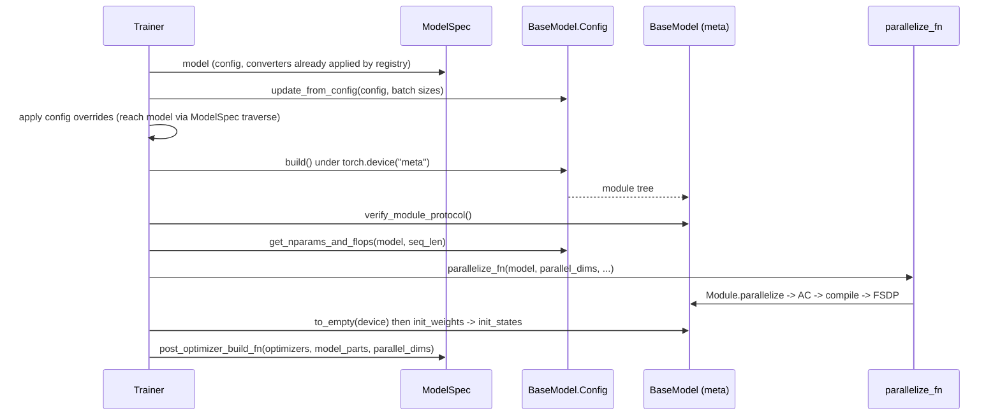
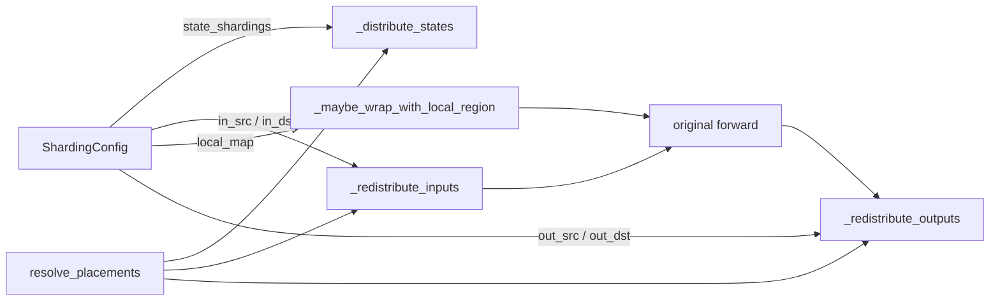

# Model spec protocols (torchtitan/protocols)

<!-- connect:up:begin -->
> **Cross-repo concept:** part of [rematerialization](../../../concepts/rematerialization.md), [sequence-parallelism](../../../concepts/sequence-parallelism.md), [sharding](../../../concepts/sharding.md) across this wiki's repos.
<!-- connect:up:end -->
## Overview

`torchtitan/protocols` is the small set of base classes and dataclasses that every model, and the [`Trainer`](../catalog/torchtitan/trainer.md#Trainer "torchtitan/trainer.py:L74") that drives it, agrees on. It has four parts. (1) [`Module`](../catalog/torchtitan/protocols/module.md#Module "torchtitan/protocols/module.py:L43") fuses `nn.Module` with [`Configurable`](../catalog/torchtitan/config/configurable.md#Configurable "torchtitan/config/configurable.py:L18"): a module is built from its nested [`Config`](../catalog/torchtitan/protocols/module.md#Module.Config "torchtitan/protocols/module.py:L94") via [`build`](../catalog/torchtitan/protocols/module.md#Module.Config.build "torchtitan/protocols/module.py:L98"), initializes itself via [`init_states`](../catalog/torchtitan/protocols/module.md#Module.init_states "torchtitan/protocols/module.py:L109"), and shards itself via [`parallelize`](../catalog/torchtitan/protocols/module.md#Module.parallelize "torchtitan/protocols/module.py:L279"). (2) [`ShardingConfig`](../catalog/torchtitan/protocols/sharding.md#ShardingConfig "torchtitan/protocols/sharding.py:L60") is the declarative placement contract each module config may carry. (3) [`ModelSpec`](../catalog/torchtitan/protocols/model_spec.md#ModelSpec "torchtitan/protocols/model_spec.py:L33") is the "per-model bundle" - an already-selected arch config plus the callables (`parallelize_fn`, `pipelining_fn`, ...) the trainer invokes. (4) [`ModelConfigConverter`](../catalog/torchtitan/protocols/model.md#ModelConfigConverter "torchtitan/protocols/model.py:L19") and [`StateDictAdapter`](../catalog/torchtitan/protocols/state_dict_adapter.md#StateDictAdapter "torchtitan/protocols/state_dict_adapter.py:L80") transform, respectively, the config tree before build and the checkpoint layout at load/save. The key design idea is that **parallelism is data on the config tree, not code in the model**: placements are declared per parameter, per forward input and per output over named mesh axes (DP/CP/TP/EP), and one generic `parallelize` turns them into `distribute_tensor` calls and redistribution wrappers - so the same model code runs FSDP-only, FSDP+TP+SP, or on a TPU mesh, depending only on which axes the runtime mesh has.

## Diagram

The model lifecycle as driven by the trainer:

Legend:
- `T` - [`Trainer`](../catalog/torchtitan/trainer.md#Trainer "torchtitan/trainer.py:L74")
- `S` - [`ModelSpec`](../catalog/torchtitan/protocols/model_spec.md#ModelSpec "torchtitan/protocols/model_spec.py:L33")
- `C` - [`Config`](../catalog/torchtitan/protocols/model.md#BaseModel.Config "torchtitan/protocols/model.py:L109")
- `M` - [`BaseModel`](../catalog/torchtitan/protocols/model.md#BaseModel "torchtitan/protocols/model.py:L36")
- `P` - [`parallelize_fn`](../catalog/torchtitan/protocols/model_spec.md#ModelSpec.parallelize_fn "torchtitan/protocols/model_spec.py:L45")

What `Module.parallelize` installs on one module that has a sharding config:

Legend:
- `SC` - [`ShardingConfig`](../catalog/torchtitan/protocols/sharding.md#ShardingConfig "torchtitan/protocols/sharding.py:L60")
- `DS` - [`_distribute_states`](../catalog/torchtitan/protocols/module.md#Module._distribute_states "torchtitan/protocols/module.py:L401")
- `RI` - [`_redistribute_inputs`](../catalog/torchtitan/protocols/module.md#Module._redistribute_inputs "torchtitan/protocols/module.py:L594")
- `LM` - [`_maybe_wrap_with_local_region`](../catalog/torchtitan/protocols/module.md#Module._maybe_wrap_with_local_region "torchtitan/protocols/module.py:L489")
- `RO` - [`_redistribute_outputs`](../catalog/torchtitan/protocols/module.md#Module._redistribute_outputs "torchtitan/protocols/module.py:L695")
- `RP` - [`resolve_placements`](../catalog/torchtitan/protocols/sharding.md#resolve_placements "torchtitan/protocols/sharding.py:L120")
- `FWD` - (concept) the module's own `forward`

## Design rationale (why it's built this way)

- **Build-time auto-wiring instead of factories.** [`Configurable`](../catalog/torchtitan/config/configurable.md#Configurable "torchtitan/config/configurable.py:L18")'s `__init_subclass__` sets each nested Config's owner class and enforces `@dataclass(kw_only=True, slots=True)`, so `config.build()` always constructs the right class with `config=replace(self)`. [`Module`](../catalog/torchtitan/protocols/module.md#Module "torchtitan/protocols/module.py:L43")'s [`build`](../catalog/torchtitan/protocols/module.md#Module.Config.build "torchtitan/protocols/module.py:L98") additionally stamps [`param_init`](../catalog/torchtitan/protocols/module.md#Module.Config.param_init "torchtitan/protocols/module.py:L95") and [`sharding_config`](../catalog/torchtitan/protocols/module.md#Module.Config.sharding_config "torchtitan/protocols/module.py:L96") onto the instance; the comment explains it is done there "because there is no common Module.__init__ that all subclasses call" (and `slots=True` prevents `super().build()`).
- **Meta-device build, deferred init.** Because initialization is a separate recursive pass ([`init_states`](../catalog/torchtitan/protocols/module.md#Module.init_states "torchtitan/protocols/module.py:L109")) driven by per-parameter `param_init` dicts, the trainer can build the whole model on `meta`, shard it, and only then materialize each rank's local shard with `to_empty` and initialize it in place. Full-size weights are never allocated on one device - the property that makes large models fit.
- **Declarative src/dst placement pairs.** The [`ShardingConfig`](../catalog/torchtitan/protocols/sharding.md#ShardingConfig "torchtitan/protocols/sharding.py:L60") docstring: "Redistribution is expressed as a (source, destination) pair ... For DTensor, the src is usually implicit in the tensor's placements; declaring it explicitly keeps the contract uniform with future erased-type systems that require both sides of every redistribute." That second backend exists here: under `spmd_backend == "spmd_types"`, sources are mandatory and asserted under type checking. The config is "completely dtype-agnostic ... quantization (Float8/MXFP8) is orthogonal."
- **Declare everything, apply what the mesh has.** [`resolve_placements`](../catalog/torchtitan/protocols/sharding.md#resolve_placements "torchtitan/protocols/sharding.py:L120") requires a declaration for every axis of the mesh it is resolved against but ignores extra axes; [`_distribute_states`](../catalog/torchtitan/protocols/module.md#Module._distribute_states "torchtitan/protocols/module.py:L401") skips an entry whose mesh resolves to `None`. Model sharding files therefore fill placements unconditionally and the runtime mesh decides which apply.
- **Config rewrites over model forks.** [`ModelConfigConverter`](../catalog/torchtitan/protocols/model.md#ModelConfigConverter "torchtitan/protocols/model.py:L19") exists so transforms "modify configs before model build (e.g. quantization, LoRA)". [`ModelSpec`](../catalog/torchtitan/protocols/model_spec.md#ModelSpec "torchtitan/protocols/model_spec.py:L33") implements `traverse` purely so that a traversal of the trainer config "would otherwise stop here" does not - it exposes only [`model`](../catalog/torchtitan/protocols/model_spec.md#ModelSpec.model "torchtitan/protocols/model_spec.py:L38"), "the callable fields ... are intentionally not traversable."

> [!inferred]
> For TPU performance this layering is the whole extension surface: the `experiments/tpu` lane defines its own converters (packed QKV, TPU grouped experts, TPU token dispatcher) and replaces `parallelize_fn` on an upstream spec - e.g. [`reg_trainer_qwen3_8b`](../catalog/torchtitan/experiments/tpu/qwen3/config_registry.md#reg_trainer_qwen3_8b "torchtitan/experiments/tpu/qwen3/config_registry.py:L344") takes the upstream qwen3 `8B` spec with the `sdpa` backend and swaps in a TPU parallelize function - instead of editing upstream model files. See [TPU trainer and job config](tpu-trainer-and-job-config.md).

## Entry points

- [`build`](../catalog/torchtitan/protocols/module.md#Module.Config.build "torchtitan/protocols/module.py:L98") - the single most-called symbol: every component (model, attention, linear, but also optimizers, dataloaders, loss via the base [`build`](../catalog/torchtitan/config/configurable.md#Configurable.Config.build "torchtitan/config/configurable.py:L134")) is constructed through it. The trainer calls the root model config's `build()` under `torch.device("meta")` and the training default dtype.
- [`ModelSpec`](../catalog/torchtitan/protocols/model_spec.md#ModelSpec "torchtitan/protocols/model_spec.py:L33") - produced by a model's registry function and stored on the trainer config; fields [`name`](../catalog/torchtitan/protocols/model_spec.md#ModelSpec.name "torchtitan/protocols/model_spec.py:L36"), [`flavor`](../catalog/torchtitan/protocols/model_spec.md#ModelSpec.flavor "torchtitan/protocols/model_spec.py:L37"), [`model`](../catalog/torchtitan/protocols/model_spec.md#ModelSpec.model "torchtitan/protocols/model_spec.py:L38"), [`max_context_length`](../catalog/torchtitan/protocols/model_spec.md#ModelSpec.max_context_length "torchtitan/protocols/model_spec.py:L39"), [`parallelize_fn`](../catalog/torchtitan/protocols/model_spec.md#ModelSpec.parallelize_fn "torchtitan/protocols/model_spec.py:L45"), [`pipelining_fn`](../catalog/torchtitan/protocols/model_spec.md#ModelSpec.pipelining_fn "torchtitan/protocols/model_spec.py:L46"), [`post_optimizer_build_fn`](../catalog/torchtitan/protocols/model_spec.md#ModelSpec.post_optimizer_build_fn "torchtitan/protocols/model_spec.py:L47"), [`state_dict_adapter`](../catalog/torchtitan/protocols/model_spec.md#ModelSpec.state_dict_adapter "torchtitan/protocols/model_spec.py:L48"). Registries such as [`llama3_debugmodel`](../catalog/torchtitan/models/llama3/config_registry.md#llama3_debugmodel "torchtitan/models/llama3/config_registry.py:L63") or the TPU [`qwen3_1_7b`](../catalog/torchtitan/experiments/tpu/qwen3/config_registry.md#qwen3_1_7b "torchtitan/experiments/tpu/qwen3/config_registry.py:L272") wrap one into a full trainer config.
- [`parallelize`](../catalog/torchtitan/protocols/module.md#Module.parallelize "torchtitan/protocols/module.py:L279") - called on the root model by each model's `parallelize_fn` (llama3 calls it when `spmd_backend == "spmd_types"` or TP is enabled), before activation checkpointing, compile and FSDP are applied.
- [`init_states`](../catalog/torchtitan/protocols/module.md#Module.init_states "torchtitan/protocols/module.py:L109") - reached after `to_empty` through the backward-compatible `init_weights` alias on [`BaseModel`](../catalog/torchtitan/protocols/model.md#BaseModel "torchtitan/protocols/model.py:L36") ("External tools (e.g., AutoParallel) wrap init_weights with DTensor-aware interception").
- [`convert`](../catalog/torchtitan/protocols/model.md#ModelConfigConverter.convert "torchtitan/protocols/model.py:L32") - called by registry functions on each converter in order (`config = c.build().convert(config)`) before the spec is assembled; may return a replacement root config.
- [`configure_remat_regions`](../catalog/torchtitan/protocols/module.md#Module.configure_remat_regions "torchtitan/protocols/module.py:L76") - called per transformer block by the region-based activation-checkpoint policy to stamp each submodule's qualified name and save patterns.
- [`to_hf`](../catalog/torchtitan/protocols/state_dict_adapter.md#BaseStateDictAdapter.to_hf "torchtitan/protocols/state_dict_adapter.py:L41") / [`from_hf`](../catalog/torchtitan/protocols/state_dict_adapter.md#BaseStateDictAdapter.from_hf "torchtitan/protocols/state_dict_adapter.py:L53") - used by checkpointing when loading or saving HuggingFace-format weights.

## Mechanism (step-by-step)

1. **Spec assembly and config conversion.** A registry function builds the arch config (a [`Config`](../catalog/torchtitan/protocols/model.md#BaseModel.Config "torchtitan/protocols/model.py:L109") subclass), applies each [`ModelConfigConverter`](../catalog/torchtitan/protocols/model.md#ModelConfigConverter "torchtitan/protocols/model.py:L19") by calling its [`convert`](../catalog/torchtitan/protocols/model.md#ModelConfigConverter.convert "torchtitan/protocols/model.py:L32"), and returns a [`ModelSpec`](../catalog/torchtitan/protocols/model_spec.md#ModelSpec "torchtitan/protocols/model_spec.py:L33") with the model-specific callables. Converters typically walk the tree with the config `traverse` (which yields `(fqn, config, parent, field_name)` so a node can be replaced in its parent) and swap leaf configs - for example replacing every [`Linear`](../catalog/torchtitan/models/common/linear.md#Linear "torchtitan/models/common/linear.py:L31") [`Config`](../catalog/torchtitan/models/common/linear.md#Linear.Config "torchtitan/models/common/linear.py:L35") with a quantized or cast variant. Because this happens before build, the change costs nothing at runtime beyond the replaced module itself.

2. **Runtime fix-up of the config.** The [`Trainer`](../catalog/torchtitan/trainer.md#Trainer "torchtitan/trainer.py:L74") calls the abstract `update_from_config` on [`Config`](../catalog/torchtitan/protocols/model.md#BaseModel.Config "torchtitan/protocols/model.py:L109") with the full trainer config and derived batch sizes (the base class marks it "TODO: This function violates encapsulation"). Model implementations use it to validate parallel degrees and to write `sharding_config` on every leaf (llama3 does this through its sharding module with the `enable_sequence_parallel` flag). Trainer-level config overrides run after this, reaching the model through [`ModelSpec`](../catalog/torchtitan/protocols/model_spec.md#ModelSpec "torchtitan/protocols/model_spec.py:L33")'s traversal hook; the trainer comment notes overrides "must run after update_from_config above (it sets sharding config on the pre-override modules)".

3. **Meta build and protocol check.** The root config's [`build`](../catalog/torchtitan/protocols/module.md#Module.Config.build "torchtitan/protocols/module.py:L98") recursively constructs the module tree on the meta device; each [`Module`](../catalog/torchtitan/protocols/module.md#Module "torchtitan/protocols/module.py:L43") receives its `_param_init` and [`_sharding_config`](../catalog/torchtitan/protocols/module.md#Module._sharding_config "torchtitan/protocols/module.py:L55"). [`verify_module_protocol`](../catalog/torchtitan/protocols/model.md#BaseModel.verify_module_protocol "torchtitan/protocols/model.py:L88") then fails fast if any submodule is a plain `nn.Module`, since `init_states` and `parallelize` only recurse properly through `Module` nodes (containers use the protocol-compatible [`ModuleList`](../catalog/torchtitan/protocols/module.md#ModuleList "torchtitan/protocols/module.py:L768") / [`ModuleDict`](../catalog/torchtitan/protocols/module.md#ModuleDict "torchtitan/protocols/module.py:L774")). [`get_nparams_and_flops`](../catalog/torchtitan/protocols/model.md#BaseModel.Config.get_nparams_and_flops "torchtitan/protocols/model.py:L127") gives the parameter count and FLOPs-per-token used for MFU reporting (llama3: `6 * active_nparams` plus quadratic attention FLOPs).

4. **Declarative parallelization.** The model's [`parallelize_fn`](../catalog/torchtitan/protocols/model_spec.md#ModelSpec.parallelize_fn "torchtitan/protocols/model_spec.py:L45") calls [`parallelize`](../catalog/torchtitan/protocols/module.md#Module.parallelize "torchtitan/protocols/module.py:L279"), which may run at most once per instance. It recurses depth-first into children (looking through non-`Module` wrappers such as a checkpoint wrapper), then, for a module with a sharding config: distributes its own parameters and buffers per [`state_shardings`](../catalog/torchtitan/protocols/sharding.md#ShardingConfig.state_shardings "torchtitan/protocols/sharding.py:L108") ([`_distribute_states`](../catalog/torchtitan/protocols/module.md#Module._distribute_states "torchtitan/protocols/module.py:L401")), caches the positional arg names of the *unwrapped* `forward`, and replaces `forward` with `redistribute inputs -> [optional local_map] forward -> redistribute outputs`. The docstring notes "`fully_shard` hooks on `__call__` fire around the wrapped `forward`", so FSDP's all-gather happens outside these TP/SP redistributions. Every parameter must have a declared placement; a missing one raises. A param that is already a DTensor (weight tying) is skipped but its placements must match.

5. **Placement resolution per mesh axis.** [`resolve_placements`](../catalog/torchtitan/protocols/sharding.md#resolve_placements "torchtitan/protocols/sharding.py:L120") turns an `SpmdType` keyed by axis name into a DTensor placement tuple in mesh-axis order, first unfolding the logical DP axis into its concrete storage axes. It normalizes `Shard`/`Partial` on a size-1 axis to `Replicate()`, because "all three are operationally identical on a 1-rank axis ... but DTensor's op rules ... treat them as distinct" (a TODO ties removal of this to FlexShard replacing `fully_shard`). Under the `spmd_types` backend, state distribution instead goes through the SPMD-typed path and first rejects parameters that would shard unevenly on TP or EP.

6. **Per-call input and output redistribution.** On every forward, [`_redistribute_inputs`](../catalog/torchtitan/protocols/module.md#Module._redistribute_inputs "torchtitan/protocols/module.py:L594") binds positional args to names, wraps plain tensors as DTensors using [`in_src_shardings`](../catalog/torchtitan/protocols/sharding.md#ShardingConfig.in_src_shardings "torchtitan/protocols/sharding.py:L109") (`DTensor.from_local(..., run_check=False)`), checks that existing DTensors match the declared source, and redistributes to [`in_dst_shardings`](../catalog/torchtitan/protocols/sharding.md#ShardingConfig.in_dst_shardings "torchtitan/protocols/sharding.py:L110") with `async_op=True` only when placements differ - so a matching layout is a no-op and a mismatch becomes, e.g., the SP all-gather before attention. [`_redistribute_outputs`](../catalog/torchtitan/protocols/module.md#Module._redistribute_outputs "torchtitan/protocols/module.py:L695") does the same with [`out_src_shardings`](../catalog/torchtitan/protocols/sharding.md#ShardingConfig.out_src_shardings "torchtitan/protocols/sharding.py:L111") / [`out_dst_shardings`](../catalog/torchtitan/protocols/sharding.md#ShardingConfig.out_dst_shardings "torchtitan/protocols/sharding.py:L112") (e.g. rowwise `Partial` -> reduce-scatter to sequence-sharded), and today only handles a single tensor output.

7. **Local-tensor regions.** When [`local_map`](../catalog/torchtitan/protocols/sharding.md#ShardingConfig.local_map "torchtitan/protocols/sharding.py:L113") is set, [`_maybe_wrap_with_local_region`](../catalog/torchtitan/protocols/module.md#Module._maybe_wrap_with_local_region "torchtitan/protocols/module.py:L489") wraps the forward so the body sees plain local tensors: input placements come from `in_dst_shardings`, output from `out_src_shardings`, and the [`LocalMapConfig`](../catalog/torchtitan/protocols/sharding.md#LocalMapConfig "torchtitan/protocols/sharding.py:L34") carries only `in_grad_placements`. DTensor uses `local_map`; the `spmd_types` backend uses an untyped local region. This is how attention kernels and MoE expert compute (dynamic-shape token dispatch) escape DTensor op dispatch entirely - important for custom kernels that DTensor has no sharding rule for.

8. **Materialize and initialize.** After parallelization the trainer calls `to_empty` and then [`init_states`](../catalog/torchtitan/protocols/module.md#Module.init_states "torchtitan/protocols/module.py:L109") (via `init_weights`). It first recurses into its children in order, finishing each child's subtree before moving on (again looking through wrappers such as compile or checkpoint wrappers), then initializes the module's own parameters by name from `param_init` (falling back to `reset_parameters`, else raising), and calls [`_init_self_buffers`](../catalog/torchtitan/protocols/module.md#Module._init_self_buffers "torchtitan/protocols/module.py:L242") for device-aware buffers (RoPE cache, MoE counters). Because buffer init often re-assigns a plain tensor, it records each DTensor buffer's mesh and placements beforehand and re-distributes the fresh global tensor afterwards; SPMD type annotations are saved and restored around both `to_empty` and buffer init.

9. **Optional post-optimizer hook and checkpoint adapter.** If set, [`post_optimizer_build_fn`](../catalog/torchtitan/protocols/model_spec.md#ModelSpec.post_optimizer_build_fn "torchtitan/protocols/model_spec.py:L47") runs with the built optimizers, model parts and parallel dims. For HF interop, a [`StateDictAdapter`](../catalog/torchtitan/protocols/state_dict_adapter.md#StateDictAdapter "torchtitan/protocols/state_dict_adapter.py:L80") reads `model.safetensors.index.json` into [`fqn_to_index_mapping`](../catalog/torchtitan/protocols/state_dict_adapter.md#BaseStateDictAdapter.fqn_to_index_mapping "torchtitan/protocols/state_dict_adapter.py:L29") (so HF-format saves keep the original shard-file layout) and subclasses implement [`to_hf`](../catalog/torchtitan/protocols/state_dict_adapter.md#BaseStateDictAdapter.to_hf "torchtitan/protocols/state_dict_adapter.py:L41") / [`from_hf`](../catalog/torchtitan/protocols/state_dict_adapter.md#BaseStateDictAdapter.from_hf "torchtitan/protocols/state_dict_adapter.py:L53").

## Key data structures

| Structure | Fields that matter | Notes |
|---|---|---|
| [`Config`](../catalog/torchtitan/protocols/module.md#Module.Config "torchtitan/protocols/module.py:L94") (`Module.Config`) | [`param_init`](../catalog/torchtitan/protocols/module.md#Module.Config.param_init "torchtitan/protocols/module.py:L95"), [`sharding_config`](../catalog/torchtitan/protocols/module.md#Module.Config.sharding_config "torchtitan/protocols/module.py:L96") | Base of every module config; kw-only, slotted. |
| [`ShardingConfig`](../catalog/torchtitan/protocols/sharding.md#ShardingConfig "torchtitan/protocols/sharding.py:L60") | [`state_shardings`](../catalog/torchtitan/protocols/sharding.md#ShardingConfig.state_shardings "torchtitan/protocols/sharding.py:L108"), [`in_src_shardings`](../catalog/torchtitan/protocols/sharding.md#ShardingConfig.in_src_shardings "torchtitan/protocols/sharding.py:L109"), [`in_dst_shardings`](../catalog/torchtitan/protocols/sharding.md#ShardingConfig.in_dst_shardings "torchtitan/protocols/sharding.py:L110"), [`out_src_shardings`](../catalog/torchtitan/protocols/sharding.md#ShardingConfig.out_src_shardings "torchtitan/protocols/sharding.py:L111"), [`out_dst_shardings`](../catalog/torchtitan/protocols/sharding.md#ShardingConfig.out_dst_shardings "torchtitan/protocols/sharding.py:L112"), [`local_map`](../catalog/torchtitan/protocols/sharding.md#ShardingConfig.local_map "torchtitan/protocols/sharding.py:L113") | Input dicts are keyed by `forward` arg name; placements are `SpmdType` over named axes. |
| [`LocalMapConfig`](../catalog/torchtitan/protocols/sharding.md#LocalMapConfig "torchtitan/protocols/sharding.py:L34") | `in_grad_placements` | `None` omits input-gradient placements. |
| [`ModelSpec`](../catalog/torchtitan/protocols/model_spec.md#ModelSpec "torchtitan/protocols/model_spec.py:L33") | arch config + callables | Plain dataclass (not a `Configurable.Config`); callables typed as bare `Callable` because the CLI type resolver cannot handle `Callable[..., X]`. |
| [`Module`](../catalog/torchtitan/protocols/module.md#Module "torchtitan/protocols/module.py:L43") class attrs | `_param_init`, [`_sharding_config`](../catalog/torchtitan/protocols/module.md#Module._sharding_config "torchtitan/protocols/module.py:L55"), `_parallelized`, `_remat_module_fqn`, `_remat_save_patterns` | Remat attrs are inert unless an enclosing `torch_remat` checkpoint is active. |

## Dynamics (design intent)

- **Ordering inside `parallelize_fn`.** llama3's parallelize function applies, in order: `Module.parallelize` (TP/SP/CP placements), activation checkpointing, per-block compile ("after AC wrapping and before FSDP"), then FSDP. The protocol's input/output wrappers therefore sit *inside* the AC and compile regions, so redistributions are recomputed with the block and visible to the compiler.
- **Remat by region name.** [`configure_remat_regions`](../catalog/torchtitan/protocols/module.md#Module.configure_remat_regions "torchtitan/protocols/module.py:L76") writes each submodule's FQN and the save patterns; model code asks `remat_should_recompute(local_name)`, which recomputes unless the qualified name matches a pattern (fnmatch). This lets a policy keep specific activations (e.g. attention output) across the whole model with one glob.
- **PP builds parts, then inits each.** With pipeline parallelism the trainer hands the meta model and `parallelize_fn` to [`pipelining_fn`](../catalog/torchtitan/protocols/model_spec.md#ModelSpec.pipelining_fn "torchtitan/protocols/model_spec.py:L46"), then runs `to_empty` + `init_weights` on every returned part.
- **Async collectives.** DTensor redistributions on both input and output boundaries use `async_op=True`, which leaves room for the compiler/runtime to overlap them with neighboring compute.

## Edge cases

- `parallelize` raises if called twice on the same instance; modules without a sharding config are skipped silently (a TODO says this becomes an assert once all models migrate).
- [`resolve_placements`](../catalog/torchtitan/protocols/sharding.md#resolve_placements "torchtitan/protocols/sharding.py:L120") raises `ValueError` if a declaration is missing any axis of the mesh - the most common error when adding a new mesh axis.
- A weight tied between two modules with conflicting sharding configs raises in [`_distribute_states`](../catalog/torchtitan/protocols/module.md#Module._distribute_states "torchtitan/protocols/module.py:L401") ("This usually means a tied parameter is referenced by two modules with conflicting sharding configs").
- With `local_map` set, `out_src_shardings` (or `out_dst_shardings`) is required and every positional arg must have an `in_dst_shardings` (or `in_src_shardings`) entry, else an assertion fires.
- [`_redistribute_outputs`](../catalog/torchtitan/protocols/module.md#Module._redistribute_outputs "torchtitan/protocols/module.py:L695") returns tuple outputs unchanged on the DTensor path and raises on the `spmd_types` path; multi-output modules (MoE, Flux) must redistribute internally.
- `init_states` raises if a module owns parameters but has neither `param_init` nor `reset_parameters`; a missing name in `param_init` lists the available keys.
- [`BaseModel`](../catalog/torchtitan/protocols/model.md#BaseModel "torchtitan/protocols/model.py:L36")'s `preprocess_inputs` deliberately raises `NotImplementedError`: models on the standard trainer path must override it; bespoke pipelines (Flux) never call it.

## Open questions

- `Configurable.Config.traverse`, the config-tree walker that converters and overrides depend on, and `ModelSpec.traverse` are not in this packet's subgraph; they are described above without citation.
- The `spmd_types` backend path (`_spmd_distribute_state`, SPMD local regions, typecheck gating "so compile doesn't error") is only partially visible here; how it composes with TorchTPU compilation is not settled by this module.
- [`get_nparams_and_flops`](../catalog/torchtitan/protocols/model.md#BaseModel.Config.get_nparams_and_flops "torchtitan/protocols/model.py:L127") is per-model; whether TPU MFU numbers use the same FLOPs formula as upstream (the TPU graph-trainer tests compare against MaxText FLOPs) is decided outside this subsystem.

## See also

- [Model building blocks](model-building-blocks.md) - the components that implement this protocol
- [Trainer and train loop](trainer-and-train-loop.md)
- [Parallel dims and parallelization](parallel-dims-and-parallelization.md)
- [Config overrides](config-overrides.md)
- [Quantization](quantization.md)
- [Checkpointing](checkpointing.md)
- [TPU trainer and job config](tpu-trainer-and-job-config.md)
- [FlexShard](flex-shard.md)
