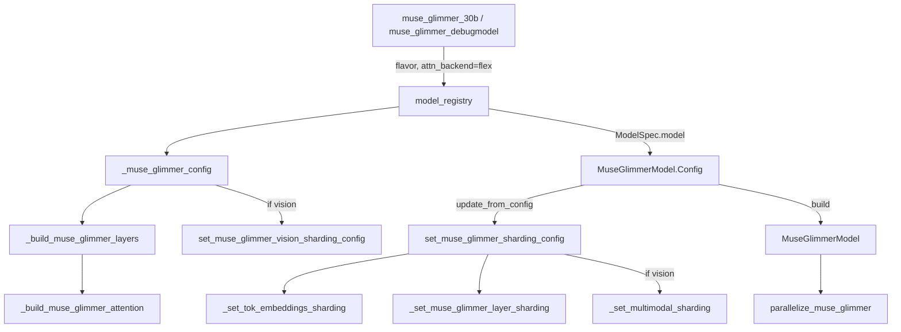
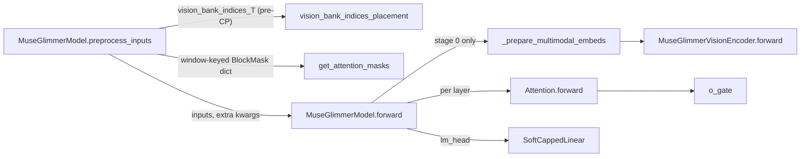

# Muse Glimmer model (text decoder + owned vision stack)

<!-- connect:up:begin -->
> **Cross-repo concept:** part of [pipeline-parallelism](../../../concepts/pipeline-parallelism.md), [rematerialization](../../../concepts/rematerialization.md), [sequence-parallelism](../../../concepts/sequence-parallelism.md), [sharding](../../../concepts/sharding.md) across this wiki's repos.
<!-- connect:up:end -->
## Overview

`torchtitan/models/muse_glimmer` is a dense decoder-only LM ([`MuseGlimmerModel`](../catalog/torchtitan/models/muse_glimmer/model.md#MuseGlimmerModel "torchtitan/models/muse_glimmer/model.py:L262"), a [`Decoder`](../catalog/torchtitan/models/common/decoder.md#Decoder "torchtitan/models/common/decoder.py:L67") subclass) that can optionally *own* a vision encoder + adapter and run them inside its own `forward`. The package is almost entirely configuration: the architecture's quirks (iRoPE, a cyclic sliding-window / global pattern, a tuned query scale, a sigmoid attention output gate, post-norm residuals, a tanh soft-capped head) are encoded as per-layer config fields by [`_muse_glimmer_config`](../catalog/torchtitan/models/muse_glimmer/__init__.md#_muse_glimmer_config "torchtitan/models/muse_glimmer/__init__.py:L353"), and the parallel layout is encoded as `sharding_config` fields by [`set_muse_glimmer_sharding_config`](../catalog/torchtitan/models/muse_glimmer/sharding.md#set_muse_glimmer_sharding_config "torchtitan/models/muse_glimmer/sharding.py:L55"). The single key design idea is **"put each transform where it composes"**: the soft-cap lives in the `lm_head` so it survives chunked loss and vocab sharding, the embedding norm is bundled with the embedding so it travels with PP stage 0 and runs after the TP all-reduce, and vision-bank indices are computed before CP sharding so every shard can gather the right image rows. Upstream training of this package is `spmd_types`-only; the TPU lane wraps it (see [Edge cases](#edge-cases)).

| flavor | dim | layers | Q/KV heads | head_dim | vocab | max ctx | vision | window pattern |
|---|---:|---:|---:|---:|---:|---:|:---:|---|
| `debugmodel` | 256 | 8 | 4 / 2 | 64 | 2048 | 4096 | no | 128,128,128,global |
| `30B` | 6656 | 52 | 32 / 2 | 128 | 202048 | 16384 | no | 2048,2048,2048,global |
| `debugmodel_mm` | 256 | 8 | 4 / 2 | 64 | 2048 | 4096 | yes (3-layer ViT) | 128,128,128,global |
| `30B_mm` | 6656 | 52 | 32 / 2 | 128 | 202048 | 16384 | yes (50-layer ViT) | 2048,2048,2048,global |

## Diagram

Build-time view: how a trainer config turns into a sharded, compiled, FSDP-wrapped model.

Legend:
- `TC` - [`muse_glimmer_30b`](../catalog/torchtitan/models/muse_glimmer/config_registry.md#muse_glimmer_30b "torchtitan/models/muse_glimmer/config_registry.py:L205") / [`muse_glimmer_debugmodel`](../catalog/torchtitan/models/muse_glimmer/config_registry.md#muse_glimmer_debugmodel "torchtitan/models/muse_glimmer/config_registry.py:L113")
- `REG` - [`model_registry`](../catalog/torchtitan/models/muse_glimmer/__init__.md#model_registry "torchtitan/models/muse_glimmer/__init__.py:L526")
- `CFG` - [`_muse_glimmer_config`](../catalog/torchtitan/models/muse_glimmer/__init__.md#_muse_glimmer_config "torchtitan/models/muse_glimmer/__init__.py:L353")
- `LAY` - [`_build_muse_glimmer_layers`](../catalog/torchtitan/models/muse_glimmer/__init__.md#_build_muse_glimmer_layers "torchtitan/models/muse_glimmer/__init__.py:L199")
- `ATT` - [`_build_muse_glimmer_attention`](../catalog/torchtitan/models/muse_glimmer/__init__.md#_build_muse_glimmer_attention "torchtitan/models/muse_glimmer/__init__.py:L134")
- `VSC` - [`set_muse_glimmer_vision_sharding_config`](../catalog/torchtitan/models/muse_glimmer/sharding.md#set_muse_glimmer_vision_sharding_config "torchtitan/models/muse_glimmer/sharding.py:L183")
- `MC` - [`Config`](../catalog/torchtitan/models/muse_glimmer/model.md#MuseGlimmerModel.Config "torchtitan/models/muse_glimmer/model.py:L270")
- `SSC` - [`set_muse_glimmer_sharding_config`](../catalog/torchtitan/models/muse_glimmer/sharding.md#set_muse_glimmer_sharding_config "torchtitan/models/muse_glimmer/sharding.py:L55")
- `TOK` - [`_set_tok_embeddings_sharding`](../catalog/torchtitan/models/muse_glimmer/sharding.md#_set_tok_embeddings_sharding "torchtitan/models/muse_glimmer/sharding.py:L79")
- `LSH` - [`_set_muse_glimmer_layer_sharding`](../catalog/torchtitan/models/muse_glimmer/sharding.md#_set_muse_glimmer_layer_sharding "torchtitan/models/muse_glimmer/sharding.py:L127")
- `MMS` - [`_set_multimodal_sharding`](../catalog/torchtitan/models/muse_glimmer/sharding.md#_set_multimodal_sharding "torchtitan/models/muse_glimmer/sharding.py:L108")
- `M` - [`MuseGlimmerModel`](../catalog/torchtitan/models/muse_glimmer/model.md#MuseGlimmerModel "torchtitan/models/muse_glimmer/model.py:L262")
- `PAR` - [`parallelize_muse_glimmer`](../catalog/torchtitan/models/muse_glimmer/parallelize.md#parallelize_muse_glimmer "torchtitan/models/muse_glimmer/parallelize.py:L30")

Step-time view: one batch from the dataloader through the model.

Legend:
- `PRE` - [`preprocess_inputs`](../catalog/torchtitan/models/muse_glimmer/model.md#MuseGlimmerModel.preprocess_inputs "torchtitan/models/muse_glimmer/model.py:L360")
- `VBP` - [`vision_bank_indices_placement`](../catalog/torchtitan/models/muse_glimmer/sharding.md#vision_bank_indices_placement "torchtitan/models/muse_glimmer/sharding.py:L42")
- `MSK` - [`get_attention_masks`](../catalog/torchtitan/models/muse_glimmer/model.md#MuseGlimmerModel.get_attention_masks "torchtitan/models/muse_glimmer/model.py:L534")
- `FWD` - [`forward`](../catalog/torchtitan/models/muse_glimmer/model.md#MuseGlimmerModel.forward "torchtitan/models/muse_glimmer/model.py:L492")
- `PME` - [`_prepare_multimodal_embeds`](../catalog/torchtitan/models/muse_glimmer/model.md#MuseGlimmerModel._prepare_multimodal_embeds "torchtitan/models/muse_glimmer/model.py:L466")
- `VE` - [`forward`](../catalog/torchtitan/models/muse_glimmer/vision_encoder.md#MuseGlimmerVisionEncoder.forward "torchtitan/models/muse_glimmer/vision_encoder.py:L427")
- `AF` - [`forward`](../catalog/torchtitan/models/muse_glimmer/model.md#Attention.forward "torchtitan/models/muse_glimmer/model.py:L111")
- `OG` - [`o_gate`](../catalog/torchtitan/models/muse_glimmer/model.md#Attention.o_gate "torchtitan/models/muse_glimmer/model.py:L107")
- `SCL` - [`SoftCappedLinear`](../catalog/torchtitan/models/muse_glimmer/model.md#SoftCappedLinear "torchtitan/models/muse_glimmer/model.py:L190")

## Design rationale (why it's built this way)

- **Soft-cap inside the head, not in `forward`.** The [`SoftCappedLinear`](../catalog/torchtitan/models/muse_glimmer/model.md#SoftCappedLinear "torchtitan/models/muse_glimmer/model.py:L190") docstring states the reason: keeping the multiplier + `tanh` cap in the `lm_head` "means it runs wherever `lm_head` runs: the full forward for `CrossEntropyLoss`, or per-chunk inside `ChunkedLossWrapper`", and because it is elementwise per logit "it composes with sequence chunking and vocab (loss-parallel) sharding". All four trainer configs use `ChunkedLossWrapper` (the 30B ones note it "avoids materializing the full [T, vocab] logits"), which only works because the cap moved into the head. The head also upcasts logits to fp32 before the cap.
- **Embedding norm bundled with the embedding, ordered after the collective.** The token embedding is a container (embedding + scaleless RMSNorm) so the norm is not pruned off stage 0 under PP. [`_set_tok_embeddings_sharding`](../catalog/torchtitan/models/muse_glimmer/sharding.md#_set_tok_embeddings_sharding "torchtitan/models/muse_glimmer/sharding.py:L79") then moves the vocab-parallel sharding from the container onto the inner embedding child, so the `Partial` result is all-reduced at the embedding boundary - "normalizing a Partial sum would be wrong". The model source contrasts the two ends of the network explicitly: the head relies on elementwise independence, the embedding norm on explicit ordering relative to the collective.
- **Window selection is a mask-dict lookup, not per-layer mask building.** [`get_attention_masks`](../catalog/torchtitan/models/muse_glimmer/model.md#MuseGlimmerModel.get_attention_masks "torchtitan/models/muse_glimmer/model.py:L534") builds one `"global"` BlockMask plus one per *distinct* window size, all from the same causal + packed-document base so "the global and windowed variants cannot drift apart"; [`Attention`](../catalog/torchtitan/models/muse_glimmer/model.md#Attention "torchtitan/models/muse_glimmer/model.py:L79") indexes by its own `window_size`. With the 30B pattern this is just two masks per step for 52 layers. Varlen instead bakes the window into each layer's kernel arg at build time (in [`_build_muse_glimmer_attention`](../catalog/torchtitan/models/muse_glimmer/__init__.md#_build_muse_glimmer_attention "torchtitan/models/muse_glimmer/__init__.py:L134")), so all layers share one varlen metadata object.
- **Sharding is declared on configs, applied generically.** [`set_muse_glimmer_sharding_config`](../catalog/torchtitan/models/muse_glimmer/sharding.md#set_muse_glimmer_sharding_config "torchtitan/models/muse_glimmer/sharding.py:L55") fills every sub-config "unconditionally -- `Module.parallelize` filters disabled axes at runtime". There is no per-model `apply_tp` code: [`parallelize_muse_glimmer`](../catalog/torchtitan/models/muse_glimmer/parallelize.md#parallelize_muse_glimmer "torchtitan/models/muse_glimmer/parallelize.py:L30") just calls `model.parallelize(parallel_dims)` (the [`Module`](../catalog/torchtitan/protocols/module.md#Module "torchtitan/protocols/module.py:L43") protocol) and then layers AC, compile and FSDP on top.
- **Vision is TP-invariant and CP-replicated.** [`set_muse_glimmer_vision_sharding_config`](../catalog/torchtitan/models/muse_glimmer/sharding.md#set_muse_glimmer_vision_sharding_config "torchtitan/models/muse_glimmer/sharding.py:L183") says "Vision activations are invariant across TP and replicated across CP"; the README says multimodal fusion "is TP-replicated; the first decoder layer restores the standard decoder layout". Per-image ViT work is small and irregular, so it is not split across CP shards; only text tokens are.
- **FSDP the vision stack as whole units.** The parallelize comment: "one AllGather per module is cheaper than per-layer sharding for the (relatively small) vision stack", and it must happen before the decoder is wrapped.

> [!inferred]
> The iRoPE NoPE schedule and the sliding-window schedule are deliberately phase-aligned (both count backward from the last layer, period 4). For the 52-layer 30B flavor this makes exactly layers 3, 7, ..., 51 both NoPE and global, and the other 39 layers RoPE + 2048-token sliding window. For TPU cost modelling that means ~75% of layers have attention cost bounded by the window, and the remaining global layers dominate attention FLOPs at long context; `get_nparams_and_flops` on the config accounts for this by passing each layer's window to the attention-FLOP formula.

## Entry points

- [`model_registry`](../catalog/torchtitan/models/muse_glimmer/__init__.md#model_registry "torchtitan/models/muse_glimmer/__init__.py:L526") - turns a flavor name + `seq_len` + `attn_backend` (default `"flex"`) + optional converters into a `ModelSpec`. It rejects `seq_len` above the flavor's max context (4096 debug, 16384 for 30B), runs converters (e.g. quantization) on the config, and wires `parallelize_fn`, a PP function that co-locates the four vision modules with the first stage, and the HF state-dict adapter.
- [`muse_glimmer_debugmodel`](../catalog/torchtitan/models/muse_glimmer/config_registry.md#muse_glimmer_debugmodel "torchtitan/models/muse_glimmer/config_registry.py:L113"), [`muse_glimmer_debugmodel_mm`](../catalog/torchtitan/models/muse_glimmer/config_registry.md#muse_glimmer_debugmodel_mm "torchtitan/models/muse_glimmer/config_registry.py:L154"), [`muse_glimmer_30b`](../catalog/torchtitan/models/muse_glimmer/config_registry.md#muse_glimmer_30b "torchtitan/models/muse_glimmer/config_registry.py:L205"), [`muse_glimmer_30b_mm`](../catalog/torchtitan/models/muse_glimmer/config_registry.md#muse_glimmer_30b_mm "torchtitan/models/muse_glimmer/config_registry.py:L243") - the `--config` targets returning a full [`Trainer`](../catalog/torchtitan/trainer.md#Trainer "torchtitan/trainer.py:L74") config. Debug flavors use selective AC and 8x / 4x `max_context_length` tokens per microbatch; the 30B flavors use full AC, pure FSDP (`data_parallel_shard_degree=-1`, TP/CP/PP = 1) and one context-length of tokens per microbatch per DP rank. All pin `spmd_backend="spmd_types"`.
- [`preprocess_inputs`](../catalog/torchtitan/models/muse_glimmer/model.md#MuseGlimmerModel.preprocess_inputs "torchtitan/models/muse_glimmer/model.py:L360") - called by the trainer on every batch before forward; "Build first-stage vision-bank indices and masks, then shard the batch." This is the most-called external entry into the package.
- [`forward`](../catalog/torchtitan/models/muse_glimmer/model.md#MuseGlimmerModel.forward "torchtitan/models/muse_glimmer/model.py:L492") - the training step forward (and per PP stage forward), receiving tokens or stage-input hidden states plus the extra kwargs produced by preprocessing.
- [`from_hf`](../catalog/torchtitan/models/muse_glimmer/state_dict_adapter.md#MuseGlimmerStateDictAdapter.from_hf "torchtitan/models/muse_glimmer/state_dict_adapter.py:L279") - reached at checkpoint load when the job loads HF-format weights; maps released HF names to torchtitan FQNs for both the text decoder and the vision stack.

## Mechanism (step-by-step)

1. **Flavor -> per-layer config.** [`_muse_glimmer_30b`](../catalog/torchtitan/models/muse_glimmer/__init__.md#_muse_glimmer_30b "torchtitan/models/muse_glimmer/__init__.py:L445") (or [`_debugmodel`](../catalog/torchtitan/models/muse_glimmer/__init__.md#_debugmodel "torchtitan/models/muse_glimmer/__init__.py:L430") / [`_muse_glimmer_debugmodel_mm`](../catalog/torchtitan/models/muse_glimmer/__init__.md#_muse_glimmer_debugmodel_mm "torchtitan/models/muse_glimmer/__init__.py:L476")) fixes the shape and calls [`_muse_glimmer_config`](../catalog/torchtitan/models/muse_glimmer/__init__.md#_muse_glimmer_config "torchtitan/models/muse_glimmer/__init__.py:L353"). That assembles the bundled embedding + scaleless norm, the `SoftCappedLinear` head (output multiplier 0.196 for 30B, cap temperature 20.0), a final gain-centered norm built by [`_gain_norm`](../catalog/torchtitan/models/muse_glimmer/__init__.md#_gain_norm "torchtitan/models/muse_glimmer/__init__.py:L108") with `gain_center=0.0` but initialized to ones, and the layer list from [`_build_muse_glimmer_layers`](../catalog/torchtitan/models/muse_glimmer/__init__.md#_build_muse_glimmer_layers "torchtitan/models/muse_glimmer/__init__.py:L199"). Each block gets four gain-centered norms (pre/post attention, pre/post FFN, post norms with eps 1e-8), a SwiGLU FFN of hidden size 3 x dim, and depth-scaled init on `wo`/`w2`/`w3`. When a vision encoder is configured, its sharding is filled here, *before* build, because "the built modules copy these configs into `Module.parallelize`".

2. **Per-layer attention config.** [`_build_muse_glimmer_attention`](../catalog/torchtitan/models/muse_glimmer/__init__.md#_build_muse_glimmer_attention "torchtitan/models/muse_glimmer/__init__.py:L134") decides, per `layer_id`, whether RoPE is present (iRoPE: every 4th layer counting back from the last is NoPE) and the sliding window from the cyclic `window_pattern` (0 means global). It builds GQA projections, a scaleless QK-norm on `head_dim`, complex RoPE with theta 500000, a query scale of `43.784 / sqrt(head_dim)`, and an `o_gate` linear from `dim` to `n_heads * head_dim`. For a varlen inner attention it writes the window into the kernel config as `(window - 1, 0)`; for flex it leaves the inner attention untouched and relies on the mask dict.

3. **Sharding is attached at config-update time.** When the trainer applies the job config, [`Config`](../catalog/torchtitan/models/muse_glimmer/model.md#MuseGlimmerModel.Config "torchtitan/models/muse_glimmer/model.py:L270")'s `update_from_config` calls [`set_muse_glimmer_sharding_config`](../catalog/torchtitan/models/muse_glimmer/sharding.md#set_muse_glimmer_sharding_config "torchtitan/models/muse_glimmer/sharding.py:L55") with `enable_sp` from [`ParallelismConfig`](../catalog/torchtitan/config/configs.md#ParallelismConfig "torchtitan/config/configs.py:L123"). It applies the shared decoder layout, fixes the embedding container ([`_set_tok_embeddings_sharding`](../catalog/torchtitan/models/muse_glimmer/sharding.md#_set_tok_embeddings_sharding "torchtitan/models/muse_glimmer/sharding.py:L79")), and per block runs [`_set_muse_glimmer_layer_sharding`](../catalog/torchtitan/models/muse_glimmer/sharding.md#_set_muse_glimmer_layer_sharding "torchtitan/models/muse_glimmer/sharding.py:L127"): all four norms run on the sequence-parallel activation (or TP-invariant / CP-sharded without SP), QK norms are sharded on the head dim independent of SP, and `o_gate` is colwise "so its Shard(-1) output aligns with the head-sharded attention output before `wo`". With vision, [`_set_multimodal_sharding`](../catalog/torchtitan/models/muse_glimmer/sharding.md#_set_multimodal_sharding "torchtitan/models/muse_glimmer/sharding.py:L108") makes the vision projection TP-invariant and, under SP, forces the perception norm output to be replicated on [`CP`](../catalog/torchtitan/models/muse_glimmer/sharding.md#CP "torchtitan/models/muse_glimmer/sharding.py:L38") and [`TP`](../catalog/torchtitan/models/muse_glimmer/sharding.md#TP "torchtitan/models/muse_glimmer/sharding.py:L39") while varying on [`DP`](../catalog/torchtitan/models/muse_glimmer/sharding.md#DP "torchtitan/models/muse_glimmer/sharding.py:L37").

4. **Build.** [`__init__`](../catalog/torchtitan/models/muse_glimmer/model.md#MuseGlimmerModel.__init__ "torchtitan/models/muse_glimmer/model.py:L338") lets the base decoder build embeddings, layers, norm and head, then builds the four optional multimodal modules (`vision_projection`, `perception_emb_norm`, the encoder, the adapter), each `None` for text-only flavors. The vision encoder ([`MuseGlimmerVisionEncoder`](../catalog/torchtitan/models/muse_glimmer/vision_encoder.md#MuseGlimmerVisionEncoder "torchtitan/models/muse_glimmer/vision_encoder.py:L208")) names its block stack `layers` so shared AC/PP tooling works on it unchanged.

5. **Parallelize: TP -> AC -> compile -> FSDP.** [`parallelize_muse_glimmer`](../catalog/torchtitan/models/muse_glimmer/parallelize.md#parallelize_muse_glimmer "torchtitan/models/muse_glimmer/parallelize.py:L30") first refuses any [`spmd_backend`](../catalog/torchtitan/config/configs.md#ParallelismConfig.spmd_backend "torchtitan/config/configs.py:L199") other than `spmd_types`, and with vision + TP asserts that the TP degree divides the vision head count. It then applies the declared TP/SP/CP layout via `model.parallelize`, applies the AC policy to the decoder and to the vision encoder (the 2-layer adapter is left unwrapped), applies per-block `torch.compile` "after AC wrapping and before FSDP" to the decoder, encoder and adapter, and finally FSDP: the encoder and adapter as single units first, then the decoder per block with mixed-precision param/reduce dtypes, reshard policy, CPU offload and optional symmetric-memory FSDP. `skip_dp=True` returns before FSDP for inference (FSDP hooks are incompatible with `torch.inference_mode()`).

6. **Per-batch preprocessing.** [`preprocess_inputs`](../catalog/torchtitan/models/muse_glimmer/model.md#MuseGlimmerModel.preprocess_inputs "torchtitan/models/muse_glimmer/model.py:L360") rejects video inputs, validates that images come with `grid_thw` and an `image_id` special token, and - on the embedding stage only - converts placeholder tokens into absolute rows of a packed "vision bank" (a running count of placeholders, `-1` elsewhere). Doing this on the full sequence *before* CP sharding is what keeps the indices global; after CP each shard only sees a slice. It then builds attention masks via [`get_attention_masks`](../catalog/torchtitan/models/muse_glimmer/model.md#MuseGlimmerModel.get_attention_masks "torchtitan/models/muse_glimmer/model.py:L534") when the first layer uses [`FlexInnerAttention`](../catalog/torchtitan/models/common/attention.md#FlexInnerAttention "torchtitan/models/common/attention.py:L233") or varlen, CP-shards the batch if CP is enabled, and annotates SPMD types. The indices get their own layout from [`vision_bank_indices_placement`](../catalog/torchtitan/models/muse_glimmer/sharding.md#vision_bank_indices_placement "torchtitan/models/muse_glimmer/sharding.py:L42"): sharded over (DP, CP) and additionally TP under SP, in which case they are explicitly `spmd.shard`-ed over the TP group so "each TP rank gathers vision rows for its local token shard".

7. **Embedding stage + multimodal fusion.** [`forward`](../catalog/torchtitan/models/muse_glimmer/model.md#MuseGlimmerModel.forward "torchtitan/models/muse_glimmer/model.py:L492") embeds tokens (norm included) only where `tok_embeddings` exists; on later PP stages the input is already hidden states. Under a DP-local SPMD context it calls [`_prepare_multimodal_embeds`](../catalog/torchtitan/models/muse_glimmer/model.md#MuseGlimmerModel._prepare_multimodal_embeds "torchtitan/models/muse_glimmer/model.py:L466"), which runs encoder -> adapter on the packed pixels, projects to `dim`, applies the scaleless perception norm, and gathers bank rows into placeholder positions. The encoder ([`forward`](../catalog/torchtitan/models/muse_glimmer/vision_encoder.md#MuseGlimmerVisionEncoder.forward "torchtitan/models/muse_glimmer/vision_encoder.py:L427")) concatenates all images of the batch into one sequence and runs the transformer once with block-diagonal masks: most layers use a sparse per-window mask, every `sparse_attention_factor`-th layer and the last layer use the per-image global mask; outputs are pixel-shuffle downsampled per image.

8. **Decoder layers and head.** Each block applies post-norm residuals around attention and FFN. [`Attention`](../catalog/torchtitan/models/muse_glimmer/model.md#Attention "torchtitan/models/muse_glimmer/model.py:L79")'s [`forward`](../catalog/torchtitan/models/muse_glimmer/model.md#Attention.forward "torchtitan/models/muse_glimmer/model.py:L111") normalizes q/k, multiplies q by `scale_query_by` (on top of the inner attention's standard `head_dim**-0.5` scaling), applies RoPE only on RoPE layers, picks its BlockMask from the dict by window key, runs the inner attention, and multiplies the output by `sigmoid(o_gate(x))` before `wo`. Unless the PP/chunked-loss path sets the skip-head flag (then hidden states are returned and the loss wrapper applies the head per chunk), the [`SoftCappedLinear`](../catalog/torchtitan/models/muse_glimmer/model.md#SoftCappedLinear "torchtitan/models/muse_glimmer/model.py:L190") head produces fp32 logits `T * tanh(logits * m / T)`.

9. **HF interop.** [`from_hf`](../catalog/torchtitan/models/muse_glimmer/state_dict_adapter.md#MuseGlimmerStateDictAdapter.from_hf "torchtitan/models/muse_glimmer/state_dict_adapter.py:L279") validates the HF RoPE config, reads head geometry from [`_attn_geometry`](../catalog/torchtitan/models/muse_glimmer/state_dict_adapter.md#MuseGlimmerStateDictAdapter._attn_geometry "torchtitan/models/muse_glimmer/state_dict_adapter.py:L227") and [`_vision_num_heads`](../catalog/torchtitan/models/muse_glimmer/state_dict_adapter.md#MuseGlimmerStateDictAdapter._vision_num_heads "torchtitan/models/muse_glimmer/state_dict_adapter.py:L237"), renames keys via the map built in [`__init__`](../catalog/torchtitan/models/muse_glimmer/state_dict_adapter.md#MuseGlimmerStateDictAdapter.__init__ "torchtitan/models/muse_glimmer/state_dict_adapter.py:L107"), and row-permutes q/k weights (and vision q/k biases) from HF split-half RoPE layout to torchtitan's interleaved complex RoPE layout. The module docstring records that without the permute logit cosine vs HF "drops to ~0.82". The permutes redistribute FSDP-sharded DTensors to Replicate first, because the head-splitting view cannot unflatten an unevenly sharded dim.

## Key data structures

- [`Config`](../catalog/torchtitan/models/muse_glimmer/model.md#MuseGlimmerModel.Config "torchtitan/models/muse_glimmer/model.py:L270") (`MuseGlimmerModel.Config`) - the decoder config narrowed to the bundled embedding type, plus `vision_projection`, `perception_emb_norm`, [`vision_encoder`](../catalog/torchtitan/models/muse_glimmer/model.md#MuseGlimmerModel.Config.vision_encoder "torchtitan/models/muse_glimmer/model.py:L288") and `vision_adapter` (all optional). Its FLOP accounting excludes the vision modules from active params ("Vision modules run per image rather than per text token") and sums per-layer quadratic attention FLOPs with each layer's window, so reported MFU reflects sliding-window savings.
- `Attention.Config` - GQA config plus `scale_query_by`, [`o_gate`](../catalog/torchtitan/models/muse_glimmer/model.md#Attention.o_gate "torchtitan/models/muse_glimmer/model.py:L107") and `window_size` (`None` = global), with a `sliding_window_size` alias kept for a vLLM generator wrapper.
- The attention-mask dict from [`get_attention_masks`](../catalog/torchtitan/models/muse_glimmer/model.md#MuseGlimmerModel.get_attention_masks "torchtitan/models/muse_glimmer/model.py:L534") - `{"global": BlockMask, "swa_<n>": BlockMask, ...}` for flex; a single varlen metadata object for varlen.
- `vision_bank_indices_T` - per-token int index into the packed vision bank (`-1` for text tokens), laid out by [`vision_bank_indices_placement`](../catalog/torchtitan/models/muse_glimmer/sharding.md#vision_bank_indices_placement "torchtitan/models/muse_glimmer/sharding.py:L42").
- [`Config`](../catalog/torchtitan/models/muse_glimmer/vision_encoder.md#MuseGlimmerVisionEncoder.Config "torchtitan/models/muse_glimmer/vision_encoder.py:L226") (`MuseGlimmerVisionEncoder.Config`) - latent dim, layer/head counts, patch geometry, downsample factor, `sparse_attention_factor`, learned positional grid size. Built for production by [`muse_glimmer_vision_encoder_config`](../catalog/torchtitan/models/muse_glimmer/__init__.md#muse_glimmer_vision_encoder_config "torchtitan/models/muse_glimmer/__init__.py:L265") (1536 latent, 50 layers, 16 heads, patch 14, temporal 2, downsample 2, sparse factor 4) using [`_vision_linear`](../catalog/torchtitan/models/muse_glimmer/__init__.md#_vision_linear "torchtitan/models/muse_glimmer/__init__.py:L245") for its projections.
- [`model_config`](../catalog/torchtitan/models/muse_glimmer/state_dict_adapter.md#MuseGlimmerStateDictAdapter.model_config "torchtitan/models/muse_glimmer/state_dict_adapter.py:L113") on the state-dict adapter - the model config the adapter reads head counts from; HF<->native key map is keyed on the released checkpoint's FQNs.

## Dynamics (design intent)

- **Ordering in parallelize is load-bearing**: TP layout (via `model.parallelize`) -> AC -> per-block compile -> FSDP; the source comment pins compile "after AC wrapping and before FSDP", and vision FSDP must precede decoder FSDP.
- **Mask construction happens once per batch in preprocessing**, outside the layer loop, and reuses the block size and batch-invariance setting of the configured flex inner attention (`separate_full_blocks` is disabled in batch-invariant mode).
- **Multimodal fusion runs on the first PP stage only**: `model_registry`'s PP function places `vision_encoder`, `vision_adapter`, `vision_projection`, `perception_emb_norm` with stage 0, and `forward` skips fusion whenever `tok_embeddings` is `None`.
- **Vision dataloader geometry is derived from the model**: [`_muse_glimmer_mm_dataloader`](../catalog/torchtitan/models/muse_glimmer/config_registry.md#_muse_glimmer_mm_dataloader "torchtitan/models/muse_glimmer/config_registry.py:L41") copies `patch_size`, `patch_temporal` and `downsample_factor` from the encoder config because they "drive the image-placeholder token count", which must equal the encoder's downsampled output count; it disables MRoPE positions since the LLM uses 1D complex RoPE.
- The `debugmodel_mm` docstring states the integration smoke suite covers the TP+CP+PP+SP path; the README lists CP, TP+CP+SP and TP+CP+PP+SP as supported multimodal compositions.

## Edge cases

- **Upstream parallelize is `spmd_types`-only**: any other `spmd_backend` raises `NotImplementedError` in [`parallelize_muse_glimmer`](../catalog/torchtitan/models/muse_glimmer/parallelize.md#parallelize_muse_glimmer "torchtitan/models/muse_glimmer/parallelize.py:L30").
- **Attention backend must be flex or varlen**: [`get_attention_masks`](../catalog/torchtitan/models/muse_glimmer/model.md#MuseGlimmerModel.get_attention_masks "torchtitan/models/muse_glimmer/model.py:L534") raises `TypeError` otherwise ("requires FlexInnerAttention or VarlenInnerAttention for sliding-window masks"). With plain SDPA, preprocessing builds no masks at all, so the sliding windows would silently not apply in this upstream package.
- **Vision inputs**: video raises `NotImplementedError`; images without `grid_thw` / `image_id` raise `ValueError`; the encoder asserts temporal grid == 1 and grid h/w divisible by the downsample factor, and that `grid_thw` accounts for exactly all packed patches.
- **TP degree vs heads**: vision heads must divide TP. With only 2 KV heads in every flavor, TP degrees above 2 depend on how the shared GQA sharding helper handles KV heads.
- **`seq_len` above the flavor max** raises in [`model_registry`](../catalog/torchtitan/models/muse_glimmer/__init__.md#model_registry "torchtitan/models/muse_glimmer/__init__.py:L526").
- **HF save/load with FSDP**: the q/k permutes would fail on unevenly sharded DTensors without the replicate-then-permute wrapper used by [`from_hf`](../catalog/torchtitan/models/muse_glimmer/state_dict_adapter.md#MuseGlimmerStateDictAdapter.from_hf "torchtitan/models/muse_glimmer/state_dict_adapter.py:L279").

> [!inferred]
> **What the TPU lane changes.** `torchtitan/experiments/tpu/muse_glimmer/` wraps this package for TorchTPU (text-only `debugmodel` and `30B` flavors, per its module docstring). Because neither flex nor varlen runs on TPU, it swaps each layer's inner attention for a window-aware SDPA variant (so the per-layer sliding windows are honored and picked up by the Splash attention patch), swaps the outer attention for one that forwards `positions` so packed documents are masked, and replaces the `spmd_types`-only parallelize function with a partial-DTensor + SimpleFSDP one. Its config registry also offers a Pallas fused cross-entropy variant and graph-trainer configs for 30B. Those symbols are outside this packet; see [tpu-trainer-and-job-config](tpu-trainer-and-job-config.md), [tpu-pallas-kernels](tpu-pallas-kernels.md) and [tpu-graph-trainer](tpu-graph-trainer.md).

## Open questions

- The base `Decoder.preprocess_inputs` selects masks from the first *full-attention* backend, while Muse Glimmer's override reads `first_attention`; the difference does not matter here (all layers share one backend), but the reason for the divergence is not documented.
- The 30B trainer config uses pure FSDP with full AC at 16k context; there is no in-package statement of the intended TP/CP/PP recipe for the 30B flavor beyond the README's support list.
- The shared helpers this package leans on (the decoder sharding helpers, the multimodal gather, the PP first-stage function, the generic `Module.parallelize`) are not in this packet's subgraph; their exact placements are documented on [parallel-dims-and-parallelization](parallel-dims-and-parallelization.md) and [model-building-blocks](model-building-blocks.md).

## See also

- [model-building-blocks](model-building-blocks.md) - `Decoder`, GQA attention, RMSNorm, Linear used here
- [model-spec-protocols](model-spec-protocols.md) - `ModelSpec`, `Module`, sharding configs
- [parallel-dims-and-parallelization](parallel-dims-and-parallelization.md) - mesh axes, FSDP, compile, AC
- [qwen3-5-model](qwen3-5-model.md) - the multimodal pattern this package mirrors
- [kimi-k2-7-model](kimi-k2-7-model.md) - sibling VLM sharing the vision sharding helpers
- [gpt-oss-model](gpt-oss-model.md) - same per-layer sliding-window approach
- [training-components](training-components.md) - `ChunkedLossWrapper`, `CrossEntropyLoss`
- [checkpointing](checkpointing.md) - HF load/save via the state-dict adapter
- [tpu-trainer-and-job-config](tpu-trainer-and-job-config.md), [tpu-graph-trainer](tpu-graph-trainer.md), [tpu-pallas-kernels](tpu-pallas-kernels.md)
- [rl-training](rl-training.md) - RL examples that use this model
