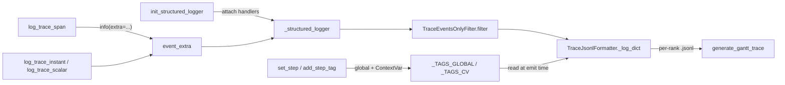
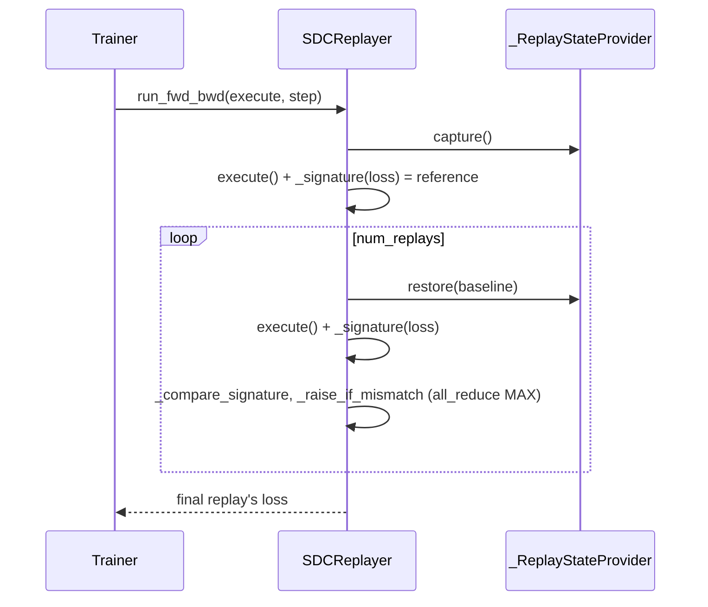

# Observability: structured JSONL phase tracing and SDC replay

## Overview

`torchtitan/observability` holds two independent tools that share one purpose - making a long distributed run inspectable after the fact without slowing it down. The **structured logger** is a thin layer over Python `logging`: training code wraps phases in [`log_trace_span`](../catalog/torchtitan/observability/structured_logger/structured_logging.md#log_trace_span "torchtitan/observability/structured_logger/structured_logging.py:L364") and emits markers/scalars with [`log_trace_instant`](../catalog/torchtitan/observability/structured_logger/structured_logging.md#log_trace_instant "torchtitan/observability/structured_logger/structured_logging.py:L339") / [`log_trace_scalar`](../catalog/torchtitan/observability/structured_logger/structured_logging.md#log_trace_scalar "torchtitan/observability/structured_logger/structured_logging.py:L295"); every record is stamped at emit time with the current step, relative step, and step tags held in a hybrid global/ContextVar store ([`set_step`](../catalog/torchtitan/observability/structured_logger/step_state.md#set_step "torchtitan/observability/structured_logger/step_state.py:L101"), [`add_step_tag`](../catalog/torchtitan/observability/structured_logger/step_state.md#add_step_tag "torchtitan/observability/structured_logger/step_state.py:L153")), and written as one JSON line per record to a per-rank file. A post-hoc merger turns those files into a Chrome/Perfetto trace. The **SDC replayer** ([`SDCReplayer`](../catalog/torchtitan/observability/sdc_replayer.md#SDCReplayer "torchtitan/observability/sdc_replayer.py:L318")) snapshots state, runs the step's first forward/backward, restores, re-runs it, and compares device-side hashes of loss, gradients, buffers, and RNG state - raising on every rank if anything diverged. The key design idea of the logger is that it is *ambient*: no metric dictionaries are threaded through the code; the step context lives in module state, and the README states the principles outright: "Stay invisible to users", "Never block training", "Support pluggable backends via handler factories."

For TPU-performance work the logger gives you a cheap per-rank host-side timeline of the trainer phases (`step`, `fwd_bwd`, `optim`, `fetching_batch`, `preprocess_inputs`, `gc_collect`, ...) that complements a device profile: it spans every step rather than a profiling window, and it tags GC steps so they can be excluded from step-time statistics.

## Diagram

Record flow from a training phase to the files and the merged trace:

Legend:
- `INIT` - [`init_structured_logger`](../catalog/torchtitan/observability/structured_logger/structured_logging.md#init_structured_logger "torchtitan/observability/structured_logger/structured_logging.py:L224")
- `SLOG` - [`_structured_logger`](../catalog/torchtitan/observability/structured_logger/structured_logging.md#_structured_logger._structured_logger "torchtitan/observability/structured_logger/structured_logging.py:L37")
- `STEP` - [`set_step`](../catalog/torchtitan/observability/structured_logger/step_state.md#set_step "torchtitan/observability/structured_logger/step_state.py:L101"), [`add_step_tag`](../catalog/torchtitan/observability/structured_logger/step_state.md#add_step_tag "torchtitan/observability/structured_logger/step_state.py:L153")
- `TAGS` - [`_TAGS_GLOBAL`](../catalog/torchtitan/observability/structured_logger/step_state.md#_TAGS_GLOBAL._TAGS_GLOBAL "torchtitan/observability/structured_logger/step_state.py:L75"), [`_TAGS_CV`](../catalog/torchtitan/observability/structured_logger/step_state.md#_TAGS_CV._TAGS_CV "torchtitan/observability/structured_logger/step_state.py:L84")
- `SPAN` - [`log_trace_span`](../catalog/torchtitan/observability/structured_logger/structured_logging.md#log_trace_span "torchtitan/observability/structured_logger/structured_logging.py:L364")
- `INST` - [`log_trace_instant`](../catalog/torchtitan/observability/structured_logger/structured_logging.md#log_trace_instant "torchtitan/observability/structured_logger/structured_logging.py:L339"), [`log_trace_scalar`](../catalog/torchtitan/observability/structured_logger/structured_logging.md#log_trace_scalar "torchtitan/observability/structured_logger/structured_logging.py:L295")
- `EXTRA` - [`event_extra`](../catalog/torchtitan/observability/structured_logger/structured_logging.md#event_extra "torchtitan/observability/structured_logger/structured_logging.py:L159")
- `FILT` - [`filter`](../catalog/torchtitan/observability/structured_logger/structured_logging.md#TraceEventsOnlyFilter.filter "torchtitan/observability/structured_logger/structured_logging.py:L207")
- `FMT` - [`_log_dict`](../catalog/torchtitan/observability/structured_logger/jsonl_handler.md#TraceJsonlFormatter._log_dict "torchtitan/observability/structured_logger/jsonl_handler.py:L74")
- `GANTT` - [`generate_gantt_trace`](../catalog/torchtitan/observability/structured_logger/gantt_generator.md#generate_gantt_trace "torchtitan/observability/structured_logger/gantt_generator.py:L25")

The SDC replay lifecycle for one checked step:

## Design rationale (why it's built this way)

- **Python `logging` as the transport.** Records are ordinary `LogRecord`s on a dedicated named logger with `propagate = False`, so handlers (file, database, custom backend) are just logging handlers loaded by dotted path from `TITAN_STRUCT_LOGGER_HANDLERS`. A forwarder installed on the root logger lets *other* libraries' loggers join the stream simply by emitting a record carrying `log_type_name` - the docstring's example is a checkpoint backend logging write latency - while native records cannot be double-logged because they never propagate to root.
- **Ambient step context with a two-tier store.** The step/tag state is "stored in two places": a module global for the SPMD trainer (one process, one thread) and a ContextVar for async RL actors, where "actor A's `gc` must not leak into actor B's view of `eval`". `set_step` writes both; `add_step_tag` writes only the scope it is in. This is why trainer code never passes a step argument to a trace call.
- **Strict schema.** A filter drops any record on the structured logger that did not come through the `log_trace_*` API, with a one-shot warning, so the JSONL schema stays queryable. The README frames the output as "LLM friendly: Emit structured, per-rank data that can be queried during and after a run."
- **Compile-safe no-ops.** Every emit path returns early under `torch.compiler.is_compiling()`, so decorating a function that ends up inside a compiled region does not insert graph breaks or Python side effects into the trace.
- **SDC replay as a hardware-agnostic check.** The module docstring positions replay as one SDC strategy among others (shadow computation, checksummed matmuls) that "trades extra forward/backward time on checked steps for an in-training, hardware-agnostic check, and requires fully deterministic execution." Gradients are *not* snapshotted - the entry contract (post-`zero_grad`) lets restore rebuild them without gradient-sized clones, "preserving their storage addresses for CUDA graphs".

## Entry points

- [`init_structured_logger`](../catalog/torchtitan/observability/structured_logger/structured_logging.md#init_structured_logger "torchtitan/observability/structured_logger/structured_logging.py:L224") - called once per process by the training entry script (with `source="training"` and `enable=config.debug.enable_structured_logging`) and by RL actors; `rank` defaults to `$RANK` so it can run before `torch.distributed` init. Repeated calls are no-ops; `enable=False` turns every later trace call into a no-op.
- [`log_trace_span`](../catalog/torchtitan/observability/structured_logger/structured_logging.md#log_trace_span "torchtitan/observability/structured_logger/structured_logging.py:L364") - the workhorse; used as a context manager or decorator around the [`Trainer`](../catalog/torchtitan/trainer.md#Trainer "torchtitan/trainer.py:L74")'s phases (`model_parallelism_init`, `torch_distributed_init`, `fwd_bwd`, `preprocess_inputs`, `fetching_batch`, `optim`, `collect_dist_metrics`, `step`) and around GC.
- [`log_trace_scalar`](../catalog/torchtitan/observability/structured_logger/structured_logging.md#log_trace_scalar "torchtitan/observability/structured_logger/structured_logging.py:L295") and [`log_trace_instant`](../catalog/torchtitan/observability/structured_logger/structured_logging.md#log_trace_instant "torchtitan/observability/structured_logger/structured_logging.py:L339") - per-step scalars (the trainer logs `local_valid_tokens` and `global_valid_tokens`) and markers (`structured_logger_started`, `training_start`).
- [`set_step`](../catalog/torchtitan/observability/structured_logger/step_state.md#set_step "torchtitan/observability/structured_logger/step_state.py:L101") and [`add_step_tag`](../catalog/torchtitan/observability/structured_logger/step_state.md#add_step_tag "torchtitan/observability/structured_logger/step_state.py:L153") - the trainer calls `set_step(step, relative_step=step - loaded_step)` at the top of every step; the GC helper calls `add_step_tag("gc")` when it actually collected.
- [`SDCReplayer`](../catalog/torchtitan/observability/sdc_replayer.md#SDCReplayer "torchtitan/observability/sdc_replayer.py:L318") - built by the trainer only when `config.sdc_replayer` is assigned programmatically (it is hidden from the CLI); its [`run_fwd_bwd`](../catalog/torchtitan/observability/sdc_replayer.md#SDCReplayer.run_fwd_bwd "torchtitan/observability/sdc_replayer.py:L392") wraps the step's first gradient-accumulation group. [`num_replays`](../catalog/torchtitan/observability/sdc_replayer.md#SDCReplayer.Config.num_replays "torchtitan/observability/sdc_replayer.py:L340") sets how many re-executions are compared.
- [`generate_gantt_trace`](../catalog/torchtitan/observability/structured_logger/gantt_generator.md#generate_gantt_trace "torchtitan/observability/structured_logger/gantt_generator.py:L25") - offline: "Merge per-rank JSONL into a Chrome Trace JSON for Perfetto."

## Mechanism (step-by-step)

1. **Handler registration.** [`init_structured_logger`](../catalog/torchtitan/observability/structured_logger/structured_logging.md#init_structured_logger "torchtitan/observability/structured_logger/structured_logging.py:L224") resolves the handler factory list (default: the JSONL handler; if `TITAN_STRUCT_LOGGER_HANDLERS` is set, *only* the listed factories run), calls each with the dedicated [`_structured_logger`](../catalog/torchtitan/observability/structured_logger/structured_logging.md#_structured_logger._structured_logger "torchtitan/observability/structured_logger/structured_logging.py:L37"), rank, source, and output dir, raises the logger to INFO, flips [`_is_initialized`](../catalog/torchtitan/observability/structured_logger/structured_logging.md#_is_initialized._is_initialized "torchtitan/observability/structured_logger/structured_logging.py:L42"), stores a partial of itself in [`_structured_logger_subprocess_init_fn`](../catalog/torchtitan/observability/structured_logger/structured_logging.md#_structured_logger_subprocess_init_fn._structured_logger_subprocess_init_fn "torchtitan/observability/structured_logger/structured_logging.py:L43") (exposed by [`get_structured_logger_subprocess_init_fn`](../catalog/torchtitan/observability/structured_logger/structured_logging.md#get_structured_logger_subprocess_init_fn "torchtitan/observability/structured_logger/structured_logging.py:L151") so worker subprocesses can re-attach the same handlers), and installs the root forwarder via [`_ensure_root_forwarder`](../catalog/torchtitan/observability/structured_logger/structured_logging.md#_ensure_root_forwarder "torchtitan/observability/structured_logger/structured_logging.py:L142"). The default JSONL handler writes `{output_dir}/structured_logs/{source}.global_rank_{rank}.{timestamp}-{random}.jsonl` - one file per rank per process start, so restarts never clobber earlier files.

2. **Step context.** At the top of each training step the trainer calls [`set_step`](../catalog/torchtitan/observability/structured_logger/step_state.md#set_step "torchtitan/observability/structured_logger/step_state.py:L101"), which writes the absolute and relative step to both the global and the ContextVar and calls [`clear_step_tags`](../catalog/torchtitan/observability/structured_logger/step_state.md#clear_step_tags "torchtitan/observability/structured_logger/step_state.py:L178"). `relative_step` defaults to `step`, but resumed runs must pass it so analysis can "align per-restart event timelines". During the step, [`add_step_tag`](../catalog/torchtitan/observability/structured_logger/step_state.md#add_step_tag "torchtitan/observability/structured_logger/step_state.py:L153") appends to [`_TAGS_GLOBAL`](../catalog/torchtitan/observability/structured_logger/step_state.md#_TAGS_GLOBAL._TAGS_GLOBAL "torchtitan/observability/structured_logger/step_state.py:L75") outside asyncio or to [`_TAGS_CV`](../catalog/torchtitan/observability/structured_logger/step_state.md#_TAGS_CV._TAGS_CV "torchtitan/observability/structured_logger/step_state.py:L84") inside a task; readers like [`get_step`](../catalog/torchtitan/observability/structured_logger/step_state.md#get_step "torchtitan/observability/structured_logger/step_state.py:L129") check the ContextVar first and fall back to the global.

3. **Span emission.** [`__enter__`](../catalog/torchtitan/observability/structured_logger/structured_logging.md#log_trace_span.__enter__ "torchtitan/observability/structured_logger/structured_logging.py:L414") captures the asyncio task name (None in SPMD code), starts a `timeit` wall-clock timer, and emits `<name>_start`; [`__exit__`](../catalog/torchtitan/observability/structured_logger/structured_logging.md#log_trace_span.__exit__ "torchtitan/observability/structured_logger/structured_logging.py:L441") emits `<name>_error` first if an exception escaped, then always `<name>_end` with `value` = elapsed ms, so "every `_start` has a matching close". As a decorator, [`__call__`](../catalog/torchtitan/observability/structured_logger/structured_logging.md#log_trace_span.__call__ "torchtitan/observability/structured_logger/structured_logging.py:L478") builds a fresh span per invocation (so concurrent calls do not share `start_time`) and picks [`async_wrapper`](../catalog/torchtitan/observability/structured_logger/structured_logging.md#log_trace_span.async_wrapper "torchtitan/observability/structured_logger/structured_logging.py:L499") for coroutines - otherwise the span would close before the coroutine ran - or [`sync_wrapper`](../catalog/torchtitan/observability/structured_logger/structured_logging.md#log_trace_span.sync_wrapper "torchtitan/observability/structured_logger/structured_logging.py:L506") with `stacklevel + 1` so the `caller` field points at user code. All three emitters go through [`event_extra`](../catalog/torchtitan/observability/structured_logger/structured_logging.md#event_extra "torchtitan/observability/structured_logger/structured_logging.py:L159"), which fills the [`ExtraFields`](../catalog/torchtitan/observability/structured_logger/structured_logging.md#ExtraFields "torchtitan/observability/structured_logger/structured_logging.py:L75") keys and a [`LogType`](../catalog/torchtitan/observability/structured_logger/structured_logging.md#LogType "torchtitan/observability/structured_logger/structured_logging.py:L62") (`event` for span records, `instant` for markers and scalars). Each emitter first checks [`_structured_logger_disabled`](../catalog/torchtitan/observability/structured_logger/structured_logging.md#_structured_logger_disabled "torchtitan/observability/structured_logger/structured_logging.py:L53") (backed by [`_disabled`](../catalog/torchtitan/observability/structured_logger/structured_logging.md#_disabled._disabled "torchtitan/observability/structured_logger/structured_logging.py:L46")) and whether it is being compiled.

4. **Filtering and formatting.** The handler's [`filter`](../catalog/torchtitan/observability/structured_logger/structured_logging.md#TraceEventsOnlyFilter.filter "torchtitan/observability/structured_logger/structured_logging.py:L207") passes only records that carry `log_type_name`. The formatter's [`_log_dict`](../catalog/torchtitan/observability/structured_logger/jsonl_handler.md#TraceJsonlFormatter._log_dict "torchtitan/observability/structured_logger/jsonl_handler.py:L74") builds a flat dict: per-process constants (rank, local rank, source, host, pid, thread id), the step/relative step/tags read from step state *at emit time* (a per-record `step` in `extra` overrides), timestamps in s/ms/us, the record kind and name, `value`, `task_name`, a `caller` of `file:line:function`, a per-formatter `seq_id`, and `delta_ms` since the previous record on that thread. Long free-text messages are truncated to 1000 characters.

5. **Offline merge.** [`generate_gantt_trace`](../catalog/torchtitan/observability/structured_logger/gantt_generator.md#generate_gantt_trace "torchtitan/observability/structured_logger/gantt_generator.py:L25") loads every `*.jsonl` in a directory, assigns one Perfetto process per source file, pairs `_start`/`_end` records via a LIFO stack per `(source, task_name)`, and slot-packs task time ranges with min-heap interval scheduling so nested spans in one task stack on one track, sequential tasks reuse a track, and only truly concurrent tasks get parallel tracks.

6. **SDC replay: capture and reference.** When scheduled (the first `num_steps` optimizer steps since start or since the last checkpoint load; `-1` = every step), [`run_fwd_bwd`](../catalog/torchtitan/observability/sdc_replayer.md#SDCReplayer.run_fwd_bwd "torchtitan/observability/sdc_replayer.py:L392") calls [`_run_checked`](../catalog/torchtitan/observability/sdc_replayer.md#SDCReplayer._run_checked "torchtitan/observability/sdc_replayer.py:L528"). Its [`_state_provider`](../catalog/torchtitan/observability/sdc_replayer.md#SDCReplayer._state_provider "torchtitan/observability/sdc_replayer.py:L365") runs [`capture`](../catalog/torchtitan/observability/sdc_replayer.md#_ReplayStateProvider.capture "torchtitan/observability/sdc_replayer.py:L188"): Python, CPU, and accelerator RNG states, a clone of every registered buffer, the caller-owned scalars (the trainer registers `ntokens_seen`), and each parameter's entry gradient *identity* only. The step then executes once and [`_signature`](../catalog/torchtitan/observability/sdc_replayer.md#SDCReplayer._signature "torchtitan/observability/sdc_replayer.py:L415") records, via its [`add_tensor`](../catalog/torchtitan/observability/sdc_replayer.md#SDCReplayer.add_tensor "torchtitan/observability/sdc_replayer.py:L426") helper, a schema entry (name, shape, dtype, device) and a device-side `torch.hash_tensor` digest for the loss, RNG states, every buffer, and every gradient (DTensors are hashed on their local shard). The reference signature is [`clone`](../catalog/torchtitan/observability/sdc_replayer.md#_ReplaySignature.clone "torchtitan/observability/sdc_replayer.py:L72")d and the reference result dropped.

7. **SDC replay: restore, re-run, compare.** For each of [`num_replays`](../catalog/torchtitan/observability/sdc_replayer.md#SDCReplayer.Config.num_replays "torchtitan/observability/sdc_replayer.py:L340") iterations, [`restore`](../catalog/torchtitan/observability/sdc_replayer.md#_ReplayStateProvider.restore "torchtitan/observability/sdc_replayer.py:L236") resets RNGs and scalars, copies buffer values back into the original buffer objects, and returns gradients to `None` or zeros them in place; the step re-executes, and [`_compare_signature`](../catalog/torchtitan/observability/sdc_replayer.md#_compare_signature "torchtitan/observability/sdc_replayer.py:L276") produces a single device-side boolean by stacking and comparing all digests (plus schema and scalar-state equality). [`_raise_if_mismatch`](../catalog/torchtitan/observability/sdc_replayer.md#SDCReplayer._raise_if_mismatch "torchtitan/observability/sdc_replayer.py:L490") all-reduces that flag with MAX so *every* rank agrees, and only on a mismatch calls [`_find_signature_mismatch`](../catalog/torchtitan/observability/sdc_replayer.md#_find_signature_mismatch "torchtitan/observability/sdc_replayer.py:L296") to name the first differing tensor and gathers the detail from the offending rank before raising. Only the final execution's gradients, buffers, RNG advancement, and loss are committed.

## Key data structures

- **JSONL record** - flat dict with `rank`, `source`, `step`, `relative_step`, `step_tags`, `log_type` (`event`/`instant`/`text`), `log_type_name` (e.g. `fwd_bwd_end`), `value` (ms for span ends, the number for scalars), `task_name`, `caller`, `time_us`, `seq_id`, `delta_ms`.
- **Step state** - globals and ContextVars for step, relative step, and tags; tags are tuples (immutable) "so snapshots can't be mutated-through-reference to bypass CV scope-isolation."
- **`SDCReplayer.Config`** - [`Config`](../catalog/torchtitan/observability/sdc_replayer.md#SDCReplayer.Config "torchtitan/observability/sdc_replayer.py:L331") with `num_steps` (default 1: check only the first step after each (re)start, "where corruption from a bad restore or initialization is most likely") and `num_replays` (default 1); [`__post_init__`](../catalog/torchtitan/observability/sdc_replayer.md#SDCReplayer.Config.__post_init__ "torchtitan/observability/sdc_replayer.py:L346") rejects invalid values.
- **[`_ReplaySignature`](../catalog/torchtitan/observability/sdc_replayer.md#_ReplaySignature "torchtitan/observability/sdc_replayer.py:L67")** - parallel tuples of schema entries and device digests, plus [`state`](../catalog/torchtitan/observability/sdc_replayer.md#_ReplaySignature.state "torchtitan/observability/sdc_replayer.py:L70") (Python RNG and named scalars) compared by value.

## Dynamics (design intent)

- **Cost model of the logger.** Each record is a synchronous `logging` call plus a JSON dump and a file write on the calling thread; spans time host wall-clock via `timeit.default_timer`. There is no device synchronization anywhere in the logger.
- **Cost model of SDC replay.** A checked step runs `1 + num_replays` forward/backwards; unchecked steps call `execute()` directly "with no snapshot or signature overhead." Comparison stays on device until one scalar flag is pulled to the host per replay (plus the all-reduce). Only the first gradient-accumulation group is checked; "later groups exercise the same compute and communication paths, so checking them too would only add overhead."
- **Concurrency.** Span decorators are re-entrant per call; the formatter keeps per-thread `delta_ms` state; tags are task-scoped inside asyncio.
- **Trainer validation.** The trainer config rejects SDC replay unless `debug.deterministic=True` and `deterministic_warn_only=False`, and allows at most one replay when CUDA graphs are enabled.

> [!inferred]
> On TorchTPU, where ops are recorded lazily and compiled/executed asynchronously, a `log_trace_span` around `fwd_bwd` or `optim` measures host-side tracing/dispatch time, not device execution, unless something inside the span forces materialization (for example the loss `.item()` used for logging). Use these spans for host-overhead and input-pipeline analysis (`fetching_batch`, `preprocess_inputs`, `gc_collect`) and the device profiler for device time. Likewise, SDC replay on TPU depends on `torch.hash_tensor` being supported by the backend (the constructor probes it and raises otherwise) and on the TPU device module exposing `get_rng_state_all` / `set_rng_state_all`.

## Edge cases

- **The TPU trainer can lose the `fwd_bwd` span.** The base trainer's `forward_backward_step` is decorated with the `fwd_bwd` span, but the TPU trainer overrides it undecorated and only calls the parent in the default path; with `compile.materialize_forward_before_backward` (forward and backward split into two programs) it runs its own body, so no `fwd_bwd_start`/`_end` records are emitted for that step. The enclosing `step` span still is.
- **`TITAN_STRUCT_LOGGER_HANDLERS` replaces, not extends.** Setting it drops the default JSONL handler unless you list it.
- **`log_trace_scalar` silently skips non-numeric values** (including bools) with a console warning, and every emitter is a no-op inside `torch.compile` tracing.
- **Async decorator `caller` is wrong**: a TODO notes it lands on wrapper/asyncio internals; use the context-manager form when the call site matters.
- **SDC entry contract.** `run_fwd_bwd` must start from the post-`zero_grad` state; routing a later accumulation group through it, or leaving a `requires_grad` parameter out of the optimizer, "surfaces as a false mismatch." The hash is order-insensitive, so permutation-only corruption can collide.
- **SDC state is not checkpointed**; the trainer calls `reset_schedule` after a checkpoint load so the first steps after a restore are checked again.
- **Rank naming.** A TODO notes `rank` is the rank within an actor's proc mesh, so `(source, rank)` can collide across multiple RL meshes.

## Open questions

- Whether TorchTPU provides `torch.hash_tensor` and the RNG-state-all APIs that the replayer requires is not determinable from this repo; no TPU-lane recipe in the source enables `sdc_replayer`.
- The packet does not include `TraceJsonlHandler`, `register_jsonl_handler`, `_StructuredRecordForwarder`, `ScalarStateAccessor`, or `SDCReplayMismatch` in its subgraph; they are described above from source but not cited.
- No integration between the structured logger and the device profiler is visible (spans are not emitted as profiler annotations), so correlating JSONL spans with an xprof/Perfetto device trace has to be done by timestamp.

## See also

- [Debug and profiling tools](debug-and-profiling-tools.md) - console logger, torch profiler, memory snapshots, GC control
- [Trainer and train loop](trainer-and-train-loop.md) - where spans, `set_step`, and replay hook in
- [Training components](training-components.md) - metrics processor (tokens/sec, TFLOPs, MFU)
- [TPU trainer and job config](tpu-trainer-and-job-config.md) - the TPU trainer's `forward_backward_step` override
- [RL training](rl-training.md) - the async-actor case the ContextVar tag store exists for
- [Checkpointing](checkpointing.md) - replay schedule reset on load
