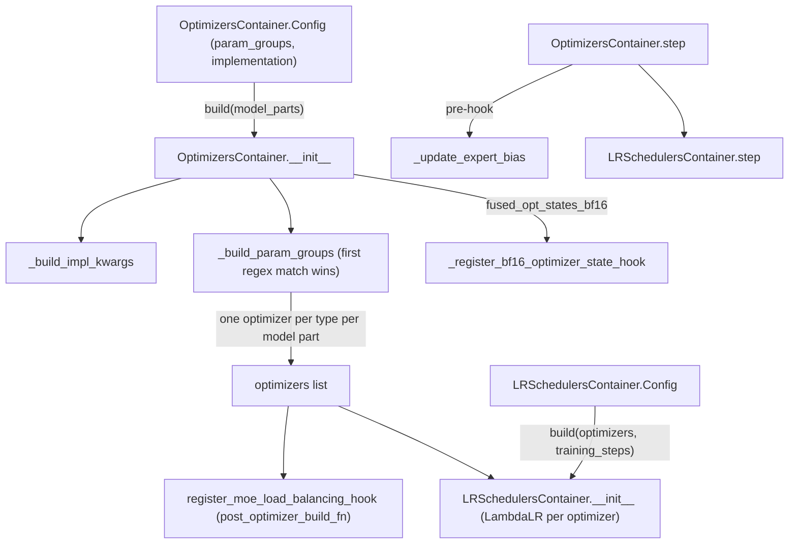
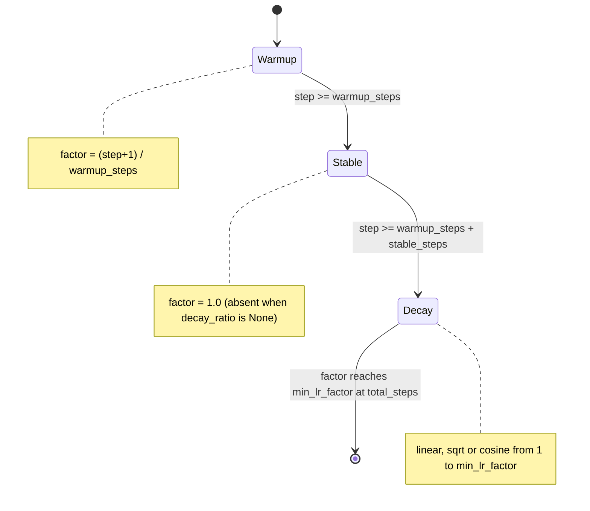

# Optimizers and LR schedulers: OptimizersContainer, param groups, and warmup-stable-decay

<!-- connect:up:begin -->
> **Cross-repo concept:** part of [expert-parallelism](../../../concepts/expert-parallelism.md) across this wiki's repos.
<!-- connect:up:end -->
## Overview

The optimizer subsystem gives the training loop a single object that behaves like one `torch.optim.Optimizer` while actually holding several. [`OptimizersContainer`](../catalog/torchtitan/components/optimizer/optimizer.md#OptimizersContainer "torchtitan/components/optimizer/optimizer.py:L84") ("A container for multiple optimizers, supporting mixed optimizer types") assigns every trainable parameter of every model part to the first [`ParamGroupConfig`](../catalog/torchtitan/components/optimizer/optimizer.md#ParamGroupConfig "torchtitan/components/optimizer/optimizer.py:L46") whose regex matches its name, then builds **one optimizer instance per (model part, optimizer type)**, so groups that share a type are batched into one instance "for performance". [`LRSchedulersContainer`](../catalog/torchtitan/components/optimizer/lr_scheduler.md#LRSchedulersContainer "torchtitan/components/optimizer/lr_scheduler.py:L25") mirrors that with one `LambdaLR` per inner optimizer, all driven by the same pure warmup-stable-decay lambda. A small utils module converts optimizer state to flat, FQN-keyed dicts so DCP can save and reshard it, and the module also hosts the MoE "auxiliary-loss-free" expert-bias update, which runs as an optimizer step pre-hook.

For TPU performance the relevant knobs are few and concrete: the `implementation` mode (`fused` is the default and documented as CUDA-only; most TPU recipes pin `foreach`, though the Qwen3 MoE 30B FSDP-only benchmark recipe selects `fused` and the Llama3 scan lane selects `fused_opt_states_bf16`), the `fused_opt_states_bf16` mode that halves Adam state memory, and the TPU lane's option to replace `step()` with a separately compiled XLA graph. The schedule itself is cheap host-side arithmetic.

## Diagram

Build and per-step lifecycle as driven by the trainer:

Legend:
- `CFG` - [`Config`](../catalog/torchtitan/components/optimizer/optimizer.md#OptimizersContainer.Config "torchtitan/components/optimizer/optimizer.py:L108")
- `INIT` - [`__init__`](../catalog/torchtitan/components/optimizer/optimizer.md#OptimizersContainer.__init__ "torchtitan/components/optimizer/optimizer.py:L223")
- `IMPL` - [`_build_impl_kwargs`](../catalog/torchtitan/components/optimizer/optimizer.md#OptimizersContainer._build_impl_kwargs "torchtitan/components/optimizer/optimizer.py:L158")
- `PG` - [`_build_param_groups`](../catalog/torchtitan/components/optimizer/optimizer.md#OptimizersContainer._build_param_groups "torchtitan/components/optimizer/optimizer.py:L173")
- `OPTS` - [`optimizers`](../catalog/torchtitan/components/optimizer/optimizer.md#OptimizersContainer.optimizers "torchtitan/components/optimizer/optimizer.py:L143")
- `BF16` - [`_register_bf16_optimizer_state_hook`](../catalog/torchtitan/components/optimizer/optimizer.md#OptimizersContainer._register_bf16_optimizer_state_hook "torchtitan/components/optimizer/optimizer.py:L337")
- `HOOK` - [`register_moe_load_balancing_hook`](../catalog/torchtitan/components/optimizer/optimizer.md#register_moe_load_balancing_hook "torchtitan/components/optimizer/optimizer.py:L449")
- `LCFG` - [`Config`](../catalog/torchtitan/components/optimizer/lr_scheduler.md#LRSchedulersContainer.Config "torchtitan/components/optimizer/lr_scheduler.py:L51")
- `LRS` - [`__init__`](../catalog/torchtitan/components/optimizer/lr_scheduler.md#LRSchedulersContainer.__init__ "torchtitan/components/optimizer/lr_scheduler.py:L198")
- `STEP` - [`step`](../catalog/torchtitan/components/optimizer/optimizer.md#OptimizersContainer.step "torchtitan/components/optimizer/optimizer.py:L294")
- `UEB` - [`_update_expert_bias`](../catalog/torchtitan/components/optimizer/optimizer.md#register_moe_load_balancing_hook._update_expert_bias "torchtitan/components/optimizer/optimizer.py:L484")
- `LSTEP` - [`step`](../catalog/torchtitan/components/optimizer/lr_scheduler.md#LRSchedulersContainer.step "torchtitan/components/optimizer/lr_scheduler.py:L222")

The learning-rate multiplier over training (piecewise; `min_lr_factor` raises the floor of the decay phase):

## Design rationale (why it's built this way)

- **Explicit param groups, no inheritance.** [`ParamGroupConfig`](../catalog/torchtitan/components/optimizer/optimizer.md#ParamGroupConfig "torchtitan/components/optimizer/optimizer.py:L46") says "`optimizer_name` and `optimizer_kwargs` fully define the optimizer for matched parameters - no implicit inheritance", and [`optimizer_kwargs`](../catalog/torchtitan/components/optimizer/optimizer.md#ParamGroupConfig.optimizer_kwargs "torchtitan/components/optimizer/optimizer.py:L70") "Must include all required kwargs (e.g. `lr`). No implicit defaults." This makes mixed setups (Muon for matrices, AdamW for embeddings/norms/biases, a separate LR for routers) a list of regexes rather than subclassing. [`default_adamw`](../catalog/torchtitan/components/optimizer/optimizer.md#default_adamw "torchtitan/components/optimizer/optimizer.py:L396") is the one-group convenience: pattern `.*`, AdamW, `betas=(0.9, 0.95)`, `eps=1e-8`, `weight_decay=0.1`.
- **Batch same-type groups into one instance.** Parameter groups that share an optimizer name become one optimizer instance per model part; the container's docstring gives performance as the reason.

> [!inferred]
> PyTorch's Adam/AdamW still iterate `param_groups` inside `step()` and launch their `foreach`/`fused` kernels per group, so the saving is fewer optimizer objects and `step()` calls, not kernel fusion across groups.

- **Patterns stay out of the checkpoint.** [`_build_param_groups`](../catalog/torchtitan/components/optimizer/optimizer.md#OptimizersContainer._build_param_groups "torchtitan/components/optimizer/optimizer.py:L173") returns regex patterns separately "so they stay out of the saved optimizer state dict; they are logging-only", but records canonical `param_names` on each group, which the checkpoint utilities need for FQN keys.
- **FQN-flat optimizer state for resharding and PP.** [`get_flat_optim_state_dict`](../catalog/torchtitan/components/optimizer/utils.md#get_flat_optim_state_dict "torchtitan/components/optimizer/utils.py:L88") emits `state.{fqn}.{name}` / `param_groups.{fqn}.{key}`: "The flat layout avoids the integer `param_group` index collisions that break pipeline-parallel checkpoints (multiple chunks reusing index 0)." Keying by FQN also lets DCP reshard DTensor state when FSDP/TP degrees change between save and load.
- **Schedules are stateless functions of the step.** The LR container saves only `last_epoch`; on load "each scheduler recomputes its lr from its own optimizer's `base_lrs`. This handles mixed optimizers (different base lrs) and resharding (different number of schedulers between save and load)" (class docstring of [`LRSchedulersContainer`](../catalog/torchtitan/components/optimizer/lr_scheduler.md#LRSchedulersContainer "torchtitan/components/optimizer/lr_scheduler.py:L25")).
- **bf16 Adam state by pre-populating, not by patching Adam.** [`_register_bf16_optimizer_state_hook`](../catalog/torchtitan/components/optimizer/optimizer.md#OptimizersContainer._register_bf16_optimizer_state_hook "torchtitan/components/optimizer/optimizer.py:L337") creates `exp_avg`/`exp_avg_sq` in bf16 before Adam's lazy init so "`_init_group` finds non-empty state and skips its own fp32 allocation", which makes the fused CUDA kernel dispatch its mixed-precision path; a load post-hook re-casts after PyTorch's `load_state_dict` upcasts states to the parameter dtype.

## Entry points

- [`OptimizersContainer`](../catalog/torchtitan/components/optimizer/optimizer.md#OptimizersContainer "torchtitan/components/optimizer/optimizer.py:L84") / [`Config`](../catalog/torchtitan/components/optimizer/optimizer.md#OptimizersContainer.Config "torchtitan/components/optimizer/optimizer.py:L108") - `Trainer.Config.optimizer`. The [`Trainer`](../catalog/torchtitan/trainer.md#Trainer "torchtitan/trainer.py:L74") builds it "after applying parallelisms to the model", so it sees the final (FSDP/TP DTensor, PP-split) parameters, and then calls the model spec's `post_optimizer_build_fn`.
- [`default_adamw`](../catalog/torchtitan/components/optimizer/optimizer.md#default_adamw "torchtitan/components/optimizer/optimizer.py:L396") - what nearly every recipe calls. TPU recipes pass `implementation="foreach"`: [`qwen3_8b`](../catalog/torchtitan/experiments/tpu/qwen3/config_registry.md#qwen3_8b "torchtitan/experiments/tpu/qwen3/config_registry.py:L555") (with the comment "Keep the established dense optimizer path until native fused AdamW has a dedicated long-convergence validation for this recipe"), [`reg_trainer_qwen3_8b`](../catalog/torchtitan/experiments/tpu/qwen3/config_registry.md#reg_trainer_qwen3_8b "torchtitan/experiments/tpu/qwen3/config_registry.py:L344"), [`llama3_70b`](../catalog/torchtitan/experiments/tpu/llama3/config_registry.md#llama3_70b "torchtitan/experiments/tpu/llama3/config_registry.py:L269"), [`sft_llama3_8b_metamath`](../catalog/torchtitan/experiments/tpu/llama3/config_registry.md#sft_llama3_8b_metamath "torchtitan/experiments/tpu/llama3/config_registry.py:L399").
- [`LRSchedulersContainer`](../catalog/torchtitan/components/optimizer/lr_scheduler.md#LRSchedulersContainer "torchtitan/components/optimizer/lr_scheduler.py:L25") / [`Config`](../catalog/torchtitan/components/optimizer/lr_scheduler.md#LRSchedulersContainer.Config "torchtitan/components/optimizer/lr_scheduler.py:L51") - `Trainer.Config.lr_scheduler`; [`build`](../catalog/torchtitan/components/optimizer/lr_scheduler.md#LRSchedulersContainer.Config.build "torchtitan/components/optimizer/lr_scheduler.py:L90") is called right after the optimizers with `training_steps=config.training.steps`. Knobs: [`warmup_steps`](../catalog/torchtitan/components/optimizer/lr_scheduler.md#LRSchedulersContainer.Config.warmup_steps "torchtitan/components/optimizer/lr_scheduler.py:L52") (default 200), [`decay_ratio`](../catalog/torchtitan/components/optimizer/lr_scheduler.md#LRSchedulersContainer.Config.decay_ratio "torchtitan/components/optimizer/lr_scheduler.py:L65") (None = decay starts right after warmup; a value enables WSD), [`decay_type`](../catalog/torchtitan/components/optimizer/lr_scheduler.md#LRSchedulersContainer.Config.decay_type "torchtitan/components/optimizer/lr_scheduler.py:L74") (`linear` / `sqrt` / `cosine`), [`min_lr_factor`](../catalog/torchtitan/components/optimizer/lr_scheduler.md#LRSchedulersContainer.Config.min_lr_factor "torchtitan/components/optimizer/lr_scheduler.py:L82"), and `total_steps` to decouple the curve from the run length.
- [`register_moe_load_balancing_hook`](../catalog/torchtitan/components/optimizer/optimizer.md#register_moe_load_balancing_hook "torchtitan/components/optimizer/optimizer.py:L449") - "Register an optimizer step pre-hook for MoE auxiliary-loss-free load balancing"; MoE model specs (Qwen3, Qwen3.5, DeepSeek-V3/V4, Kimi) set it as `post_optimizer_build_fn`.
- [`get_moe_load_balancing_metrics`](../catalog/torchtitan/components/optimizer/optimizer.md#get_moe_load_balancing_metrics "torchtitan/components/optimizer/optimizer.py:L654") / [`configure_moe_routing_metrics`](../catalog/torchtitan/components/optimizer/optimizer.md#configure_moe_routing_metrics "torchtitan/components/optimizer/optimizer.py:L570") - routing-balance metrics for logging, enabled per run ("Enable graph-safe routing metric capture on supported MoE layers").

## Mechanism (step-by-step)

1. **Resolve the implementation mode.** [`_build_impl_kwargs`](../catalog/torchtitan/components/optimizer/optimizer.md#OptimizersContainer._build_impl_kwargs "torchtitan/components/optimizer/optimizer.py:L158") maps [`implementation`](../catalog/torchtitan/components/optimizer/optimizer.md#OptimizersContainer.Config.implementation "torchtitan/components/optimizer/optimizer.py:L114") to `{fused, foreach}` flags that are injected into every param group (per-group `optimizer_kwargs` can override them). `fused` (default) and `fused_opt_states_bf16` set `fused=True`; `foreach` sets horizontal fusion; `for-loop` sets neither. The config docstring calls `fused` "CUDA only", and most TPU recipes choose `foreach`; the minimal TPU trainer (`experiments/tpu/train_minimal.py`) even asserts that `fused` is not used on a TPU device. The TPU graph-trainer lane is different: its config tests assert that the Qwen3 MoE 30B FSDP-only benchmark recipe uses `fused` and that `--optimizer.implementation=fused` is accepted from the CLI.

2. **Partition parameters by regex.** For each model part (one per PP stage), [`_build_param_groups`](../catalog/torchtitan/components/optimizer/optimizer.md#OptimizersContainer._build_param_groups "torchtitan/components/optimizer/optimizer.py:L173") walks the [`param_groups`](../catalog/torchtitan/components/optimizer/optimizer.md#OptimizersContainer.Config.param_groups "torchtitan/components/optimizer/optimizer.py:L109") in order; each [`pattern`](../catalog/torchtitan/components/optimizer/optimizer.md#ParamGroupConfig.pattern "torchtitan/components/optimizer/optimizer.py:L63") claims every still-unclaimed trainable parameter it matches (`re.search` on the FQN), and a pattern that matches nothing raises. Groups are bucketed by [`optimizer_name`](../catalog/torchtitan/components/optimizer/optimizer.md#ParamGroupConfig.optimizer_name "torchtitan/components/optimizer/optimizer.py:L67"), each carrying `params`, canonical `param_names`, the impl flags and the group kwargs.

3. **Instantiate, validate, and wire hooks.** [`__init__`](../catalog/torchtitan/components/optimizer/optimizer.md#OptimizersContainer.__init__ "torchtitan/components/optimizer/optimizer.py:L223") resolves each name to a factory (`Adam`, `AdamW`, or `DistMuon` from flex_shard; anything else is `NotImplementedError`), constructs one optimizer per bucket with `optimizer_factory_kwargs_by_name` (instance-wide args such as Muon's compute metadata and communication buckets), logs the assignment via [`_log_optimizer`](../catalog/torchtitan/components/optimizer/optimizer.md#OptimizersContainer._log_optimizer "torchtitan/components/optimizer/optimizer.py:L250"), and asserts every trainable parameter landed in exactly one optimizer. With `fused_opt_states_bf16` it registers the bf16 state hooks. Finally it calls `Optimizer.__init__` on the container itself so the container has its own hook registry - that is what lets [`register_moe_load_balancing_hook`](../catalog/torchtitan/components/optimizer/optimizer.md#register_moe_load_balancing_hook "torchtitan/components/optimizer/optimizer.py:L449") call `register_step_pre_hook` on the container.

4. **Build the schedule.** [`build`](../catalog/torchtitan/components/optimizer/lr_scheduler.md#LRSchedulersContainer.Config.build "torchtitan/components/optimizer/lr_scheduler.py:L90") clamps `warmup_steps` to `total_steps`, computes `decay_steps = round(total_steps * decay_ratio)` (or everything after warmup when `decay_ratio` is None), and adds "a virtual last step to prevent the learning rate from dropping to 0" via `stable_steps = total_steps + 1 - warmup - decay`. The lambda returns `(step+1)/warmup` during warmup, `1.0` while stable, then `min_lr_factor + (1 - min_lr_factor) * f(progress)` with `f` linear, `1 - sqrt`, or half-cosine. [`__init__`](../catalog/torchtitan/components/optimizer/lr_scheduler.md#LRSchedulersContainer.__init__ "torchtitan/components/optimizer/lr_scheduler.py:L198") wraps each inner optimizer in a `LambdaLR` with that one lambda, so all [`schedulers`](../catalog/torchtitan/components/optimizer/lr_scheduler.md#LRSchedulersContainer.schedulers "torchtitan/components/optimizer/lr_scheduler.py:L196") scale their own base LR by the same factor.

5. **Per step: zero, step, schedule.** The trainer calls [`zero_grad`](../catalog/torchtitan/components/optimizer/optimizer.md#OptimizersContainer.zero_grad "torchtitan/components/optimizer/optimizer.py:L307") at the start of a train step, reads [`get_metrics`](../catalog/torchtitan/components/optimizer/lr_scheduler.md#LRSchedulersContainer.get_metrics "torchtitan/components/optimizer/lr_scheduler.py:L211") for LR logging, runs forward/backward, clips gradients, asserts on-device that loss and grad norm are finite, and then calls [`step`](../catalog/torchtitan/components/optimizer/optimizer.md#OptimizersContainer.step "torchtitan/components/optimizer/optimizer.py:L294") followed by the scheduler [`step`](../catalog/torchtitan/components/optimizer/lr_scheduler.md#LRSchedulersContainer.step "torchtitan/components/optimizer/lr_scheduler.py:L222"). The container's `step` runs any container-level pre-hooks (MoE bias update) and then each inner optimizer's `step()` in order; closures are rejected.

6. **MoE expert-bias update (pre-hook).** If any MoE layer sets `load_balance_coeff` (it must be set consistently on all of them, checked by [`_should_register_moe_balancing_hook`](../catalog/torchtitan/components/optimizer/optimizer.md#register_moe_load_balancing_hook._should_register_moe_balancing_hook "torchtitan/components/optimizer/optimizer.py:L465")), [`_update_expert_bias`](../catalog/torchtitan/components/optimizer/optimizer.md#register_moe_load_balancing_hook._update_expert_bias "torchtitan/components/optimizer/optimizer.py:L484") stacks every layer's `tokens_per_expert_E` (found by [`_iter_moe_layers`](../catalog/torchtitan/components/optimizer/optimizer.md#_iter_moe_layers "torchtitan/components/optimizer/optimizer.py:L425"), including MTP layers), halves the counts for layers under full activation checkpointing (recompute counts tokens twice), all-reduces over the dense TP group when EP and TP are both on and over the `loss` mesh, then adds `coeff * sign(mean - count)` (re-centered to zero mean) to `expert_bias_E` and zeroes the counters. One batched all-reduce covers all layers. The source flags the cost: "Currently this sync is blocking (thus exposed) and happens on the default compute stream."

7. **Checkpoint state as flat FQN dicts.** [`state_dict`](../catalog/torchtitan/components/optimizer/optimizer.md#OptimizersContainer.state_dict "torchtitan/components/optimizer/optimizer.py:L311") first calls [`init_optim_state`](../catalog/torchtitan/components/optimizer/utils.md#init_optim_state "torchtitan/components/optimizer/utils.py:L29") ("Materialize optimizer state by running one zero-gradient, zero-lr step", then resetting Adam's step counter and moments so the first real update is still step 1), then merges each optimizer's [`get_flat_optim_state_dict`](../catalog/torchtitan/components/optimizer/utils.md#get_flat_optim_state_dict "torchtitan/components/optimizer/utils.py:L88") output; nested per-param state (e.g. Shampoo-style) is flattened by [`_flatten_state_nested`](../catalog/torchtitan/components/optimizer/utils.md#_flatten_state_nested "torchtitan/components/optimizer/utils.py:L208"). [`load_state_dict`](../catalog/torchtitan/components/optimizer/optimizer.md#OptimizersContainer.load_state_dict "torchtitan/components/optimizer/optimizer.py:L325") materializes state the same way (the live state tells the loader which tensors to expect) and hands the whole flat dict to every optimizer via [`load_flat_optim_state_dict`](../catalog/torchtitan/components/optimizer/utils.md#load_flat_optim_state_dict "torchtitan/components/optimizer/utils.py:L110"), which ignores keys it does not own. The LR container saves and restores only `last_epoch`.

## Key data structures

- [`ParamGroupConfig`](../catalog/torchtitan/components/optimizer/optimizer.md#ParamGroupConfig "torchtitan/components/optimizer/optimizer.py:L46") - `pattern` (regex over FQNs, first match wins), `optimizer_name`, `optimizer_kwargs` (complete hyperparameters).
- [`optimizers`](../catalog/torchtitan/components/optimizer/optimizer.md#OptimizersContainer.optimizers "torchtitan/components/optimizer/optimizer.py:L143") - the flat list of inner `torch.optim.Optimizer`s, ordered by model part then by first appearance of each optimizer type; iteration ([`__iter__`](../catalog/torchtitan/components/optimizer/optimizer.md#OptimizersContainer.__iter__ "torchtitan/components/optimizer/optimizer.py:L287")) and `len()` expose it, and the LR container builds one scheduler per entry. [`T`](../catalog/torchtitan/components/optimizer/optimizer.md#T "torchtitan/components/optimizer/optimizer.py:L75") is the generic optimizer type parameter.
- **Flat optimizer state dict** - keys `state.<fqn>.<state_name>` (e.g. `exp_avg`, `exp_avg_sq`, `step`) and `param_groups.<fqn>.<hyperparameter>`; one dict covers all optimizers and model parts.
- **LR scheduler state** - `{"last_epoch": int}` only.
- **MoE routing metrics** - [`collect_moe_routing_metric_tensors`](../catalog/torchtitan/components/optimizer/optimizer.md#collect_moe_routing_metric_tensors "torchtitan/components/optimizer/optimizer.py:L594") returns two fixed-shape stacked tensors (per-layer per-expert counts, per-layer normalized aux loss), "the fixed-shape local tensors produced by the latest forward"; [`set_moe_routing_metric_tensors`](../catalog/torchtitan/components/optimizer/optimizer.md#set_moe_routing_metric_tensors "torchtitan/components/optimizer/optimizer.py:L625") restores them from graph outputs ("Restore graph outputs as runtime sidecars consumed by metric logging"). The aux-loss module providing them is found by duck typing in [`_moe_routing_metrics_aux_loss`](../catalog/torchtitan/components/optimizer/optimizer.md#_moe_routing_metrics_aux_loss "torchtitan/components/optimizer/optimizer.py:L558").

## Dynamics (design intent)

- **Optimizer memory and dtype.** With default AdamW the state is two fp32 tensors per parameter (plus a step); FSDP shards them along with the parameters. `fused_opt_states_bf16` stores `exp_avg`/`exp_avg_sq` (and `max_exp_avg_sq` with amsgrad) in bf16 while parameters stay fp32, and keeps them bf16 across checkpoint loads. The source frames this mode around the fused CUDA kernel; it is gated on `Adam`/`AdamW` instances only.
- **TPU: how `step()` actually executes.** In the TPU lane, `compile.optimizer_compile` selects between `eager` (the container's `step` runs through TorchTPU's eager/deferred execution), `separate_graph` (`experiments/tpu/compiled_optimizers/separate_graph.py` replaces the container's [`step`](../catalog/torchtitan/components/optimizer/optimizer.md#OptimizersContainer.step "torchtitan/components/optimizer/optimizer.py:L294") with a function that traces a functional AdamW per param group and runs it as one static XLA executable, "eliminating 300+ host dispatch roundtrips per step"), and, in the TPU graph trainer, `in_graph` (AdamW folded into the joint forward/backward graph). The separate-graph path supports only `torch.optim.AdamW`, rejects amsgrad, and bakes betas/eps/weight decay into the graph as constants while feeding the scheduled LR in as a tensor each step, so `LRSchedulersContainer` keeps working unchanged.
- **Collectives on the step path.** The only collectives this subsystem itself issues are the MoE bias all-reduces in the pre-hook and the metric all-reduces (TP, DP, CP meshes) in `get_moe_load_balancing_metrics`; the latter runs only on logging steps. Optimizer math is otherwise local to each shard.

> [!inferred]
> On TorchTPU, the eager `foreach` step still issues many small ops per step on the host, which is why the separate-graph compile exists. The TPU optimization guide in the repo notes that the in-graph optimizer "costs HBM" because step inputs are not donated, so the graph holds both old and updated copies of parameters and optimizer state; separate-graph is the lower-memory way to remove dispatch overhead.

## Edge cases

- **A pattern that matches nothing is an error**, as is a trainable parameter matched by no pattern (the final assertion). A catch-all `.*` group must come last, because earlier patterns claim first.
- **Warmup and decay overflow.** If `warmup_steps > total_steps` it is clamped with a warning; if warmup + decay exceed total steps, decay is shortened. `warmup_steps=0` is allowed (the warmup branch is never taken). With `decay_ratio=None` there is no stable phase.
- **`total_steps` vs actual steps.** Setting `total_steps` shorter than `training.steps` leaves the LR at its floor (`min_lr_factor`, or near zero) for the remaining steps.
- **Restoring an LR schedule onto a changed config** recomputes LRs from the new `base_lrs` and lambda at the saved step; nothing but `last_epoch` carries over.
- **Calling `state_dict()` before training** runs a zero-lr optimizer step to create state. Parameters are untouched and Adam counters are reset, but other optimizers' internal counters are not.
- **Layout changes break optimizer resume.** Optimizer state is keyed by live parameter FQNs and shapes. The TPU optimization guide warns that switching an MoE expert weight to its kernel-native layout renames the live parameter (e.g. `w1_EDF` vs `w1_EFD`), so a plain optimizer-state load fails on the missing key even though model checkpoints are translated by state-dict hooks.
- **MoE counters under full AC.** The halving heuristic assumes recompute exactly doubles counts; the source marks it as "a hack" that affects only usage metrics, not expert choice.
- **TorchTPU lacks `aten::median`.** `get_moe_load_balancing_metrics` computes medians by sorting ("TPU workaround: torch_tpu lacks aten::median"), preserving PyTorch's lower-median semantics.

## Open questions

- The TPU compiled-optimizer modules (`apply_compiled_optimizer`, `functional_adamw_step`) and the TPU trainer that calls them are not in this packet's subgraph; their behavior is summarized from `experiments/tpu/compiled_optimizers/` and `experiments/tpu/train.py`.
- Whether `fused` AdamW is now supported on TorchTPU is ambiguous in-repo: the minimal TPU trainer asserts against it, a TPU config test accepts it as a CLI override, and the `qwen3_8b` recipe comment implies a native fused AdamW exists but is not yet validated for long convergence.
- How `fused_opt_states_bf16` behaves on TorchTPU (where the CUDA mixed-precision fused kernel does not exist) and whether the separate-graph path preserves bf16 state dtypes is not settled by this code; the separate-graph builder creates missing states with `zeros_like(p)` (parameter dtype).
- `DistMuon` (from `torchtitan/distributed/flex_shard`) is a supported factory name but its internals are outside this subsystem.

## See also

- [trainer-and-train-loop](trainer-and-train-loop.md) - build order and the per-step zero/clip/step/schedule sequence.
- [checkpointing](checkpointing.md) - how the flat optimizer and LR states are saved with DCP.
- [flex-shard](flex-shard.md) - `DistMuon` and the sharded optimizer path.
- [tpu-moe-dispatch-and-grouped-experts](tpu-moe-dispatch-and-grouped-experts.md) - the MoE layers whose bias and counters the pre-hook updates, and the kernel-native weight layout.
- [tpu-graph-trainer](tpu-graph-trainer.md) - `optimizer_compile="in_graph"` and the separate-graph optimizer.
- [tpu-trainer-and-job-config](tpu-trainer-and-job-config.md) - TPU recipes and `compile.optimizer_compile`.
- [quantization](quantization.md) - other precision knobs that interact with optimizer state memory.
