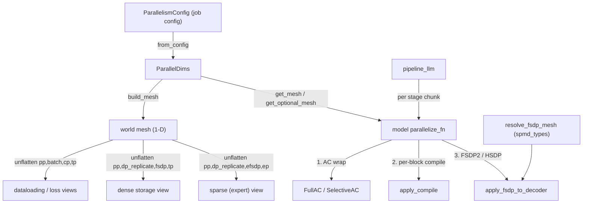

# ParallelDims, device meshes and the parallelization pipeline

<!-- connect:up:begin -->
> **Cross-repo concept:** part of [expert-parallelism](../../../concepts/expert-parallelism.md), [pipeline-parallelism](../../../concepts/pipeline-parallelism.md), [rematerialization](../../../concepts/rematerialization.md), [sharding](../../../concepts/sharding.md) across this wiki's repos.
<!-- connect:up:end -->
## Overview

`torchtitan/distributed` is the model-agnostic layer that every trainer and every model's
`parallelize_fn` goes through. Its key idea is **one 1-D world mesh, many named views**:
[`ParallelDims`](../catalog/torchtitan/distributed/parallel_dims.md#ParallelDims "torchtitan/distributed/parallel_dims.py:L112")
holds six integer degrees (`dp_replicate`, `dp_shard`, `cp`, `tp`, `pp`, `ep`), validates that
the five non-EP degrees multiply to the world size (`ep` only has to divide `dp_shard * cp * tp`), and
[`build_mesh`](../catalog/torchtitan/distributed/parallel_dims.md#ParallelDims.build_mesh "torchtitan/distributed/parallel_dims.py:L192")
creates a single `("world",)` DeviceMesh and *unflattens* it several times into differently-shaped
views (data loading, loss, dense storage, sparse/expert storage). Every consumer asks for a mesh
by axis name through
[`get_mesh`](../catalog/torchtitan/distributed/parallel_dims.md#ParallelDims.get_mesh "torchtitan/distributed/parallel_dims.py:L442")
/ [`get_optional_mesh`](../catalog/torchtitan/distributed/parallel_dims.md#ParallelDims.get_optional_mesh "torchtitan/distributed/parallel_dims.py:L374"),
never by building its own. On top of the meshes, a model's parallelize function composes the
techniques in a fixed order - TP (via the model's own `parallelize`), then activation checkpointing
([`FullAC`](../catalog/torchtitan/distributed/activation_checkpoint.md#FullAC "torchtitan/distributed/activation_checkpoint.py:L168")
/ [`SelectiveAC`](../catalog/torchtitan/distributed/activation_checkpoint.md#SelectiveAC "torchtitan/distributed/activation_checkpoint.py:L187")),
then per-block [`apply_compile`](../catalog/torchtitan/distributed/compile.md#apply_compile "torchtitan/distributed/compile.py:L39"),
then FSDP2 ([`apply_fsdp_to_decoder`](../catalog/torchtitan/distributed/fsdp.md#apply_fsdp_to_decoder "torchtitan/distributed/fsdp.py:L189")),
optionally wrapped per pipeline stage by [`pipeline_llm`](../catalog/torchtitan/distributed/pipeline_parallel.md#pipeline_llm "torchtitan/distributed/pipeline_parallel.py:L65").
A second axis of variation is the **SPMD backend** (`partial_dtensor` vs `spmd_types`), which
changes which mesh views exist and how FSDP is told about its data-parallel axes.

For TPU performance the two things that matter most here are (a) the *physical* order of ranks
in the world mesh (`enable_tpu_topo_mesh`), which decides whether XLA can use fast N-D collectives,
and (b) the AC save set, which decides how many Pallas attention kernels and collectives are
re-run in backward.

## Diagram

Legend:
- `CFG` - (concept) the `parallelism` section of the job config
- `PD` - [`ParallelDims`](../catalog/torchtitan/distributed/parallel_dims.md#ParallelDims "torchtitan/distributed/parallel_dims.py:L112"), built by [`from_config`](../catalog/torchtitan/distributed/parallel_dims.md#ParallelDims.from_config "torchtitan/distributed/parallel_dims.py:L129")
- `WM` - (concept) the `("world",)` DeviceMesh created inside [`build_mesh`](../catalog/torchtitan/distributed/parallel_dims.md#ParallelDims.build_mesh "torchtitan/distributed/parallel_dims.py:L192")
- `DL` - (concept) dataloading + loss views stored by [`build_mesh`](../catalog/torchtitan/distributed/parallel_dims.md#ParallelDims.build_mesh "torchtitan/distributed/parallel_dims.py:L192")
- `DN` - (concept) dense storage view stored by [`build_mesh`](../catalog/torchtitan/distributed/parallel_dims.md#ParallelDims.build_mesh "torchtitan/distributed/parallel_dims.py:L192")
- `SP` - (concept) sparse (expert) view stored by [`build_mesh`](../catalog/torchtitan/distributed/parallel_dims.md#ParallelDims.build_mesh "torchtitan/distributed/parallel_dims.py:L192")
- `PAR` - (concept) a model's `parallelize_fn`, which queries [`get_mesh`](../catalog/torchtitan/distributed/parallel_dims.md#ParallelDims.get_mesh "torchtitan/distributed/parallel_dims.py:L442")
- `AC` - [`FullAC`](../catalog/torchtitan/distributed/activation_checkpoint.md#FullAC "torchtitan/distributed/activation_checkpoint.py:L168") / [`SelectiveAC`](../catalog/torchtitan/distributed/activation_checkpoint.md#SelectiveAC "torchtitan/distributed/activation_checkpoint.py:L187")
- `CMP` - [`apply_compile`](../catalog/torchtitan/distributed/compile.md#apply_compile "torchtitan/distributed/compile.py:L39")
- `FS` - [`apply_fsdp_to_decoder`](../catalog/torchtitan/distributed/fsdp.md#apply_fsdp_to_decoder "torchtitan/distributed/fsdp.py:L189")
- `RF` - [`resolve_fsdp_mesh`](../catalog/torchtitan/distributed/fsdp.md#resolve_fsdp_mesh "torchtitan/distributed/fsdp.py:L32")
- `PP` - [`pipeline_llm`](../catalog/torchtitan/distributed/pipeline_parallel.md#pipeline_llm "torchtitan/distributed/pipeline_parallel.py:L65")

The mesh views, with their axis order (outermost first), as `build_mesh` creates them:

| View | Axes | Exists under | Used for |
|---|---|---|---|
| dataloading | `pp, batch, cp, tp` | both backends | batch sharding of the data loader; `batch = dp_replicate * dp_shard` |
| loss | `batch` x `cp` flattened | both | loss all-reduce |
| dense storage | `pp, dp_replicate, fsdp, tp` | `partial_dtensor` | FSDP mesh; `fsdp = dp_shard * cp` |
| dense storage | `pp, dp_replicate, dp_shard, cp, tp` | `spmd_types` | FSDP mesh + `DataParallelMeshDims` |
| dense fwd/bwd | `dp, cp, tp` (`dp = dp_replicate * dp_shard`) | `spmd_types` | SPMD type checking |
| sparse | `pp, dp_replicate, efsdp, ep` | both | routed experts; `efsdp = dp_shard * cp * tp / ep` |

## Design rationale (why it's built this way)

- **Unflatten from one world mesh instead of `init_device_mesh` per shape.** All views share the
  same device order, so a rank's coordinate in the dense view and in the sparse view are
  consistent. The docstring of `build_mesh` admits the cost: DeviceMesh "recreates the process
  group for each dimension", and the authors accept redundant process groups rather than
  complicate the code. To keep that cost down, axes that are not needed are unflattened with a
  `"fake"` backend (`_mesh_exist` decides) so no real communicator is created for them.
- **`fsdp` (or `dp_shard` under `spmd_types`) always exists, even at degree 1.** The comment in
  `_mesh_exist` is explicit: it is kept on a real backend "so fully_shard() can apply
  MixedPrecisionPolicy even at degree 1". Likewise `efsdp` is kept whenever `ep > 1` "because we
  need FSDP wrapping to help the MoE layers do mixed precision training". FSDP doubles as the
  mixed-precision mechanism, so it can never be skipped; the llama3 parallelize says so directly
  ("Always run apply_fsdp_to_decoder -- with shard_degree=1 it is a no-op for the all-gather but
  still installs the MixedPrecisionPolicy").
- **CP folds into FSDP.** `fsdp = dp_shard * cp`: "we always assume that when cp is used, FSDP is
  also applied to utilize its weight all-gather and gradients reduce_scatter even if there may be
  no data parallelism". CP ranks hold different tokens, so their weight gradients must be reduced
  exactly like DP ranks - hence the `loss` view also spans `cp`.
- **EP borrows from the dense region instead of adding devices.** `ep` is not a factor of the
  world size; it must divide `dp_shard * cp * tp` (the "sparse region", validated in `_validate`),
  and the leftover becomes `efsdp`. Experts are thus sharded across the same devices that run
  dense FSDP/CP/TP, re-viewed as `(efsdp, ep)`.
- **Mesh objects are cached by axis tuple.** "DeviceMesh equality is by identity, so reuse the
  same object instead of re-slicing a submesh on every lookup" - FSDP and DTensor compare meshes
  by identity, so two slices of the same axes would be treated as different meshes.
- **Topology-aware world mesh for TPU.** When `enable_tpu_topo_mesh` is set and the backend is
  TorchTPU, the module-level `init_device_mesh` asks `torch.tpu.topology_aware_mesh` for a rank
  order and builds the DeviceMesh with `preserve_rank_order=True`. The source comment gives the
  performance reason: without it sub-group ranks are sorted ascending, "which scrambles the
  physical device order and makes XLA fall back from the fast N-D SparseCore collective strategy
  to a slow 1-D ring". The TPU recipes such as
  [`qwen3_8b`](../catalog/torchtitan/experiments/tpu/qwen3/config_registry.md#qwen3_8b "torchtitan/experiments/tpu/qwen3/config_registry.py:L555")
  and [`llama3_70b`](../catalog/torchtitan/experiments/tpu/llama3/config_registry.md#llama3_70b "torchtitan/experiments/tpu/llama3/config_registry.py:L269")
  turn it on together with `use_simple_fsdp=True`.
- **AC is a `Configurable` policy object, selected as a tyro subcommand.**
  [`ActivationCheckpointingConfig`](../catalog/torchtitan/distributed/activation_checkpoint.md#ActivationCheckpointingConfig "torchtitan/distributed/activation_checkpoint.py:L418")
  is a union of `selective | region | full | memory-budget | none`; subclasses customize the
  save set by overriding `get_save_ops` (the base docstring: "To customize the per-op SAC save set,
  subclass SelectiveAC and override get_save_ops"). That hook is exactly what the TPU lane uses
  (see Mechanism step 5).

## Entry points

- [`from_config`](../catalog/torchtitan/distributed/parallel_dims.md#ParallelDims.from_config "torchtitan/distributed/parallel_dims.py:L129") -
  called by the trainer while it initializes distributed state; copies the six degrees, the
  `spmd_backend` and `enable_tpu_topo_mesh` out of the job config into a
  [`ParallelDims`](../catalog/torchtitan/distributed/parallel_dims.md#ParallelDims "torchtitan/distributed/parallel_dims.py:L112").
- [`get_mesh`](../catalog/torchtitan/distributed/parallel_dims.md#ParallelDims.get_mesh "torchtitan/distributed/parallel_dims.py:L442") and
  [`get_optional_mesh`](../catalog/torchtitan/distributed/parallel_dims.md#ParallelDims.get_optional_mesh "torchtitan/distributed/parallel_dims.py:L374") -
  the query API used by trainers (data-parallel degree/rank from `"batch"`, loss reduction over
  `"loss"`, PP over `"pp"`) and by every parallelize function. Lazily triggers `build_mesh`.
- [`ActivationCheckpointingConfig`](../catalog/torchtitan/distributed/activation_checkpoint.md#ActivationCheckpointingConfig "torchtitan/distributed/activation_checkpoint.py:L418") -
  the trainer config field type; a parallelize function calls `ac_config.build(...).apply(model)`
  on the chosen [`ActivationCheckpointing`](../catalog/torchtitan/distributed/activation_checkpoint.md#ActivationCheckpointing "torchtitan/distributed/activation_checkpoint.py:L114") policy.
- [`apply_compile`](../catalog/torchtitan/distributed/compile.md#apply_compile "torchtitan/distributed/compile.py:L39") and
  [`apply_fsdp_to_decoder`](../catalog/torchtitan/distributed/fsdp.md#apply_fsdp_to_decoder "torchtitan/distributed/fsdp.py:L189") -
  shared helpers called from model `parallelize_fn`s (llama3, qwen3, deepseek_v3, gpt_oss, ...),
  after AC wrapping.
- [`pipeline_llm`](../catalog/torchtitan/distributed/pipeline_parallel.md#pipeline_llm "torchtitan/distributed/pipeline_parallel.py:L65") /
  [`pipeline_with_first_stage_modules`](../catalog/torchtitan/distributed/pipeline_parallel.md#pipeline_with_first_stage_modules "torchtitan/distributed/pipeline_parallel.py:L144") -
  the model spec's `pipelining_fn` when `pp > 1`; splits the model into stage chunks and calls the
  model's `parallelize_fn` on each chunk.
- [`get_spmd_backend`](../catalog/torchtitan/distributed/utils.md#get_spmd_backend "torchtitan/distributed/utils.py:L45") and
  [`get_spmd_context`](../catalog/torchtitan/distributed/utils.md#get_spmd_context "torchtitan/distributed/utils.py:L419") -
  process-wide backend flag (set by the trainer from `parallelism.spmd_backend`) and the context
  manager the trainer wraps forward/backward in.

## Mechanism (step-by-step)

1. **Degrees in, validated.** [`from_config`](../catalog/torchtitan/distributed/parallel_dims.md#ParallelDims.from_config "torchtitan/distributed/parallel_dims.py:L129")
   fills [`dp_replicate`](../catalog/torchtitan/distributed/parallel_dims.md#ParallelDims.dp_replicate "torchtitan/distributed/parallel_dims.py:L113"),
   [`dp_shard`](../catalog/torchtitan/distributed/parallel_dims.md#ParallelDims.dp_shard "torchtitan/distributed/parallel_dims.py:L114"),
   [`cp`](../catalog/torchtitan/distributed/parallel_dims.md#ParallelDims.cp "torchtitan/distributed/parallel_dims.py:L115"),
   [`tp`](../catalog/torchtitan/distributed/parallel_dims.md#ParallelDims.tp "torchtitan/distributed/parallel_dims.py:L116"),
   [`pp`](../catalog/torchtitan/distributed/parallel_dims.md#ParallelDims.pp "torchtitan/distributed/parallel_dims.py:L117"),
   [`ep`](../catalog/torchtitan/distributed/parallel_dims.md#ParallelDims.ep "torchtitan/distributed/parallel_dims.py:L118") and
   [`world_size`](../catalog/torchtitan/distributed/parallel_dims.md#ParallelDims.world_size "torchtitan/distributed/parallel_dims.py:L119").
   `__post_init__` validates them: every degree except `dp_shard` must be `>= 1`; `dp_shard = -1`
   means "whatever is left", computed as `world_size // (dp_replicate * cp * tp * pp)`;
   `dp_replicate * dp_shard * cp * tp * pp` must equal the world size exactly; and `ep` must divide
   `dp_shard * cp * tp`. Note `ep` is deliberately absent from the product.

2. **Process-wide SPMD backend.** The trainer copies
   [`spmd_backend`](../catalog/torchtitan/distributed/parallel_dims.md#ParallelDims.spmd_backend "torchtitan/distributed/parallel_dims.py:L120")
   into a module global readable through
   [`get_spmd_backend`](../catalog/torchtitan/distributed/utils.md#get_spmd_backend "torchtitan/distributed/utils.py:L45")
   ("Return the active SPMD backend"). Runtime helpers such as
   [`current_spmd_mesh`](../catalog/torchtitan/distributed/spmd_types.md#current_spmd_mesh "torchtitan/distributed/spmd_types.py:L141")
   return `None` unless the backend is `spmd_types`, so model code can call them unconditionally.
   `partial_dtensor` uses DTensor only for model-parallel axes; `spmd_types` additionally types the
   `dp` and `cp` axes. Context parallelism requires `spmd_types` (enforced by config validation).

3. **Build the world mesh and its views.** [`build_mesh`](../catalog/torchtitan/distributed/parallel_dims.md#ParallelDims.build_mesh "torchtitan/distributed/parallel_dims.py:L192")
   creates a 1-D `("world",)` mesh (topology-aware on TPU when enabled), then calls
   `world_mesh._unflatten(0, degrees, names, backend_override=...)` once per view (see the table
   above). The `loss` view is the only one built by *flattening* (`batch` x `cp`). Each requested
   axis that `_mesh_exist` reports as unnecessary gets a `"fake"` backend. The method finally
   records every 1-D axis mesh by name and runs `_validate_meshes`, which asserts each axis has the
   expected size (for example `efsdp == dp_shard * cp * tp // ep`).

4. **Querying meshes.** [`get_optional_mesh`](../catalog/torchtitan/distributed/parallel_dims.md#ParallelDims.get_optional_mesh "torchtitan/distributed/parallel_dims.py:L374")
   returns `None` as soon as any requested axis is not enabled (size 1, unless it is a force-kept
   axis), returns the cached 1-D mesh for a single name, and for several names slices the *first*
   global view whose axis names are a superset and caches the result by tuple.
   [`get_mesh`](../catalog/torchtitan/distributed/parallel_dims.md#ParallelDims.get_mesh "torchtitan/distributed/parallel_dims.py:L442")
   is the raising variant. Under `spmd_types`, FSDP does not get a hand-picked submesh;
   [`resolve_fsdp_mesh`](../catalog/torchtitan/distributed/fsdp.md#resolve_fsdp_mesh "torchtitan/distributed/fsdp.py:L32")
   returns the full activated storage mesh plus a `DataParallelMeshDims(shard=("dp_shard","cp") or
   "dp_shard", replicate="dp_replicate" or None)`, and
   [`resolve_sparse_fsdp_mesh`](../catalog/torchtitan/distributed/fsdp.md#resolve_sparse_fsdp_mesh "torchtitan/distributed/fsdp.py:L65")
   does the same for experts with `shard="efsdp"`. Under `partial_dtensor` the llama3 parallelize
   asks for `["dp_replicate", "fsdp"]` (HSDP) or `["fsdp"]`.

5. **Activation checkpointing wraps each block.** [`ActivationCheckpointing`](../catalog/torchtitan/distributed/activation_checkpoint.md#ActivationCheckpointing "torchtitan/distributed/activation_checkpoint.py:L114")`.apply`
   disables Dynamo's LRU cache (a workaround for a SAC + PP + flex interaction described in
   `_disable_dynamo_lru_cache`), then replaces every child of `model.layers` with a wrapped block.
   [`FullAC`](../catalog/torchtitan/distributed/activation_checkpoint.md#FullAC "torchtitan/distributed/activation_checkpoint.py:L168")
   ("Recompute the entire transformer block during the backward pass") wraps with a checkpoint
   wrapper. [`SelectiveAC`](../catalog/torchtitan/distributed/activation_checkpoint.md#SelectiveAC "torchtitan/distributed/activation_checkpoint.py:L187")
   installs a per-op policy: ops in the save set (compute-intensive aten ops, SDPA/flex attention,
   `linear`/`mm`, `max` for low-precision scales, `topk` for stable MoE routing, plus
   `reduce_scatter_tensor` and `all_to_all_single`) are `MUST_SAVE`, everything else is
   recomputed, and every *second* `mm`/`linear` is recomputed to balance memory and compute. Its
   [`Config`](../catalog/torchtitan/distributed/activation_checkpoint.md#SelectiveAC.Config "torchtitan/distributed/activation_checkpoint.py:L197")
   adds `force_recompute_mm_shapes_by_fqns` (default `["moe.router.gate"]`), which forces recompute
   of any mm whose weight *shape* matches - not just that module. The policy matches
   `aten.linear` as well as `aten.mm` because "Some backends (e.g. PrivateUse1) register
   aten.linear as a leaf op instead of decomposing it" - which is the TorchTPU case.
   In this fork the wrapper itself is imported from `torchtitan.experiments.tpu.utils`
   (`ptd_checkpoint_wrapper_with_early_stop`, always called with `early_stop=False`), a TPU-lane
   shim over PyTorch's checkpoint wrapper.

   > [!inferred]
   > The TPU lane retunes SAC by subclassing, in `torchtitan/experiments/tpu/activation_checkpoint.py`
   > (symbols not in this packet): `TPUSelectiveAC` removes the two saved collectives because
   > torch-tpu's split compiler rejects a `wait_tensor` whose producer is a saved graph input, so
   > collectives are recomputed together with their waits (TPU context parallelism switches plain
   > SelectiveAC to it); `AttentionSavingSelectiveAC` adds the Pallas splash-attention forward
   > custom op to the save set by name, because the default list only knows SDPA/flex and
   > otherwise re-runs the attention kernel in backward (the docstring measures 81 ms of an
   > 840 ms step on Llama-3.2-1B / 4x v6e). See [tpu-layer-loop-remat-and-layouts](tpu-layer-loop-remat-and-layouts.md).

6. **Per-block torch.compile.** [`apply_compile`](../catalog/torchtitan/distributed/compile.md#apply_compile "torchtitan/distributed/compile.py:L39")
   runs *after* AC wrapping and *before* FSDP. It optionally turns on Inductor's async-TP pass on
   the dense TP mesh, sets `capture_scalar_outputs` (data-dependent shapes in token-choice MoE
   dispatch) and `skip_fwd_side_effects_in_bwd_under_checkpoint` (so AC recompute does not try to
   replay Python mutations such as RoPE cache updates), then calls
   `transformer_block.compile(backend=..., fullgraph=True)` on each block - "compilation efficient
   due to repeated structure". With the `aot_eager` backend and a model using flex attention it
   swaps in a regional-inductor backend so only the flex region is lowered by Inductor.

7. **FSDP2 / HSDP and expert sharding.** [`apply_fsdp_to_decoder`](../catalog/torchtitan/distributed/fsdp.md#apply_fsdp_to_decoder "torchtitan/distributed/fsdp.py:L189")
   builds a `MixedPrecisionPolicy(param_dtype, reduce_dtype, cast_forward_inputs=False)` and calls
   `fully_shard` on: the embedding (or, with weight tying, embedding + norm + lm_head as one unit
   "to avoid duplicate all-gathers"), `[norm, lm_head]` (not resharded after forward by default,
   since FSDP would prefetch them immediately), each transformer block, and the root. The
   reshard-after-forward policy `"default"` resolves to `not pp_enabled` - PP avoids per-microbatch
   all-gathers. For MoE blocks, experts get `Shard(1)` instead of `Shard(0)` when the expert FSDP
   group is larger than `num_experts` (to avoid padding), and with `ep > 1` a per-parameter
   `shard_placement_fn` puts routed experts on the `efsdp` mesh and everything else on the dense
   mesh. Gradient division is disabled (the training loop scales by global token count) and, on
   non-CUDA devices such as TPU, `set_force_sum_reduction_for_comms(True)` is forced because
   `premul_sum` is CUDA-only. With EP, explicit forward/backward prefetch chains are installed
   because EP's device-to-host syncs "could interfere with implicit prefetching".

8. **Pipeline parallelism wraps the whole pipeline.** [`pipeline_llm`](../catalog/torchtitan/distributed/pipeline_parallel.md#pipeline_llm "torchtitan/distributed/pipeline_parallel.py:L65")
   asks [`_get_pipeline_metadata`](../catalog/torchtitan/distributed/pipeline_parallel.md#_get_pipeline_metadata "torchtitan/distributed/pipeline_parallel.py:L194")
   for the number of virtual stages (from the schedule class and
   `pipeline_parallel_layers_per_stage`, with first/last-stage weights for embedding and output),
   generates per-stage module FQN lists, splits the model on the `pp` mesh, and then runs the
   model's `parallelize_fn` on **each stage chunk** - so steps 5-7 happen per chunk - before
   building the schedule. [`pipeline_with_first_stage_modules`](../catalog/torchtitan/distributed/pipeline_parallel.md#pipeline_with_first_stage_modules "torchtitan/distributed/pipeline_parallel.py:L144")
   prepends extra modules (for example a vision encoder) to stage 0 and warns, in its docstring,
   that the auto split does not model that load.

9. **Runtime SPMD context and determinism.** [`get_spmd_context`](../catalog/torchtitan/distributed/utils.md#get_spmd_context "torchtitan/distributed/utils.py:L419")
   returns a context factory; under `spmd_types` it registers the dense and sparse fwd/bwd meshes
   and pushes the dense mesh as the current SPMD mesh (optionally with global type checking).
   [`annotate_input_spmd_types`](../catalog/torchtitan/distributed/spmd_types.md#annotate_input_spmd_types "torchtitan/distributed/spmd_types.py:L230")
   asserts every tensor forward input against its declared layout and raises if one has none.
   [`set_determinism`](../catalog/torchtitan/distributed/utils.md#set_determinism "torchtitan/distributed/utils.py:L172")
   seeds DTensor RNG identically across SPMD axes but distinctly across the axes given in
   `distinct_seed_mesh_dims` (the trainer passes `["pp"]`) and, in deterministic mode, turns off
   flex-attention autotuning.

## TPU lane: what changes

| Knob | Core default | TPU lane | Why (from source) |
|---|---|---|---|
| World mesh rank order | ascending | `enable_tpu_topo_mesh=True` -> `torch.tpu.topology_aware_mesh` + `preserve_rank_order=True` | keeps XLA on the N-D SparseCore collective strategy instead of a 1-D ring |
| Data parallel | FSDP2 `fully_shard` | `use_simple_fsdp=True` in recipes; the TPU llama3 parallelize runs core parallelize with `skip_dp=True`, then SimpleFSDP over `["dp_replicate","fsdp"]` / `["fsdp"]` | compiler-visible DP |
| FSDP reshard | `default` (= not PP) | `qwen3_8b` pins `fsdp_reshard_after_forward="never"` (Zero-2) | "current best-performing benchmark recipe" |
| Compile | per-block Inductor | `tpu_compile_mode` `layer` or `fullgraph` (`torch.compile(model, fullgraph=True, backend="tpu")`) | whole-model XLA graph |
| SAC save set | SDPA/flex + 2 collectives saved | `TPUSelectiveAC` (collectives recomputed), `AttentionSavingSelectiveAC` (Pallas attention saved) | torch-tpu wait_tensor pairing; avoid re-running splash forward |
| CPU offload | supported | forced off with a warning | not supported on the TPU run |

> [!inferred]
> The TPU-lane rows other than the topology mesh come from `torchtitan/experiments/tpu/llama3/infra/parallelize.py`,
> `torchtitan/experiments/tpu/activation_checkpoint.py` and the TPU config registries, read directly;
> those parallelize functions are not in this packet's subgraph. The graph-trainer TPU path selects
> its own rematerialization policy and does not apply the eager AC config (a comment in the
> `qwen3_8b` recipe says so). See [tpu-trainer-and-job-config](tpu-trainer-and-job-config.md) and
> [tpu-graph-trainer](tpu-graph-trainer.md).

## Key data structures

- **[`ParallelDims`](../catalog/torchtitan/distributed/parallel_dims.md#ParallelDims "torchtitan/distributed/parallel_dims.py:L112")** -
  the six degrees, `world_size`, `spmd_backend`, `enable_tpu_topo_mesh`, plus three caches:
  `_world_mesh`, `_single_axis_meshes` (name -> 1-D mesh) and `_multi_axis_meshes` (axis tuple ->
  submesh), and `_global_meshes` (the multi-axis views). Convenience properties: `fsdp_enabled`
  is `dp_shard > 1 or cp > 1`; `non_data_parallel_size = cp * tp * pp`; `seq_len_divisor =
  tp * 2 * cp` (sequence parallel needs `seq_len % tp == 0`; load-balanced CP needs `2 * cp`).
- **[`MeshAxisName`](../catalog/torchtitan/distributed/parallel_dims.md#MeshAxisName "torchtitan/distributed/parallel_dims.py:L72")** -
  "Names for axes of a DeviceMesh": `dp, dp_replicate, dp_shard, fsdp, tp, cp, pp, ep, efsdp`. The
  docstring fixes vocabulary: torchtitan says *axis* for a mesh axis and *dim* for a tensor
  dimension. `dp` is a logical axis that `unfold_dp_axis` expands into `dp_replicate, dp_shard`.
- **[`ActivationCheckpointing`](../catalog/torchtitan/distributed/activation_checkpoint.md#ActivationCheckpointing "torchtitan/distributed/activation_checkpoint.py:L114") `.Config`** -
  shared knobs `preserve_rng_state` (default True, "may be slower"), `determinism_check`, `debug`;
  [`Config`](../catalog/torchtitan/distributed/activation_checkpoint.md#FullAC.Config "torchtitan/distributed/activation_checkpoint.py:L172")
  adds nothing; `SelectiveAC.Config` adds the force-recompute FQN list.

## Dynamics (design intent)

- Mesh building is **lazy and idempotent**: every accessor checks `_single_axis_meshes` and calls
  `build_mesh` on first use, so a `ParallelDims` built in a test or a precompile path works without
  an explicit build call. Graph-trainer and TPU tests construct it directly with explicit degrees
  (Evidence: `test_param_cast_to_bf16_at_ngpu_1`, `test_spmd_types_uses_dtensor_storage_and_local_compute`).
- The composition order is **AC -> compile -> FSDP** per block, and under PP that whole sequence
  runs once per stage chunk; reversing it would compile around FSDP hooks or wrap AC around a
  compiled block.
- Process-group creation scales with the number of non-fake axes in all views, not with the
  number of distinct device groups (acknowledged TODO in `build_mesh`).
- TPU tests pin the CP/FSDP interplay: `test_flattens_dp_shard_and_cp_once` exercises
  [`resolve_fsdp_mesh`](../catalog/torchtitan/distributed/fsdp.md#resolve_fsdp_mesh "torchtitan/distributed/fsdp.py:L32"),
  and `test_tpu_selective_ac_recomputes_collectives_with_their_waits` exercises the SAC policy.

## Edge cases

- `ep` is **not** part of the world-size product. Setting `ep` larger than `dp_shard * cp * tp`
  or not dividing it raises a `ValueError`, even if the world size would allow it.
- `get_optional_mesh(["dp_replicate", "fsdp"])` returns `None` if *either* axis is size 1; use
  `get_activated_mesh` when you want "whichever of these is enabled".
- Under `spmd_types` there is no `fsdp` axis name (it is `dp` / `dp_shard`), and under
  `partial_dtensor` there is no `dp` / `dp_shard`; asking for the wrong one raises "Invalid mesh dim".
- If the whole dense storage mesh is size 1, `resolve_fsdp_mesh` returns `None` for
  `DataParallelMeshDims` because size-1 axes carry no SPMD annotations.
- `enable_tpu_topo_mesh` needs a torch whose `DeviceMesh.__init__` accepts `preserve_rank_order`
  (the error message says torch >= 2.15); otherwise it raises and suggests
  `--parallelism.no-enable_tpu_topo_mesh`.
- `force_recompute_mm_shapes_by_fqns` matches by weight shape, so an unrelated `Linear` with the
  same `(in, out)` as the MoE router gate is also recomputed.
- PP stage counts: multi-stage schedules need at least 2 virtual stages per rank; single-stage
  schedules exactly 1; `num_virtual_stages` must divide evenly by `pp`.

## Open questions

- The fork's `activation_checkpoint.py` imports its checkpoint wrapper from the TPU experiment
  folder; whether that shim changes behavior beyond rejecting `early_stop=True` is not visible from
  this packet (the shim symbol is not in the subgraph).
- The EP / MinimalAsyncEP dispatcher validation
  ([`maybe_update_minimal_async_ep_config`](../catalog/torchtitan/distributed/minimal_async_ep/api.md#maybe_update_minimal_async_ep_config "torchtitan/distributed/minimal_async_ep/api.py:L84"))
  requires `num_experts % ep == 0` and imports `FullAC`; how it interacts with each AC policy is
  not settled here. See [tpu-moe-dispatch-and-grouped-experts](tpu-moe-dispatch-and-grouped-experts.md).
- The flex-shard optimizer resharding symbols in this subsystem (for example
  [`run`](../catalog/torchtitan/distributed/flex_shard/_optimizer_reshard_runtime.md#_BucketedRedistributionRuntime.run "torchtitan/distributed/flex_shard/_optimizer_reshard_runtime.py:L419"))
  are covered on [flex-shard](flex-shard.md).
- Central symbols missing from this packet: `TPUSelectiveAC`, `AttentionSavingSelectiveAC`,
  `tpu_selective_ac_config`, the module-level `init_device_mesh`, `get_activated_mesh`,
  `resolve_mesh`, the TPU `parallelize_llama`, and `RegionAC` / `MemoryBudgetAC`.

## See also

- [trainer-and-train-loop](trainer-and-train-loop.md)
- [job-config](job-config.md)
- [flex-shard](flex-shard.md)
- [checkpointing](checkpointing.md)
- [model-building-blocks](model-building-blocks.md)
- [tpu-trainer-and-job-config](tpu-trainer-and-job-config.md)
- [tpu-context-parallel-attention](tpu-context-parallel-attention.md)
- [tpu-moe-dispatch-and-grouped-experts](tpu-moe-dispatch-and-grouped-experts.md)
- [tpu-layer-loop-remat-and-layouts](tpu-layer-loop-remat-and-layouts.md)
- [tpu-graph-trainer](tpu-graph-trainer.md)
- [graph-trainer](graph-trainer.md)
