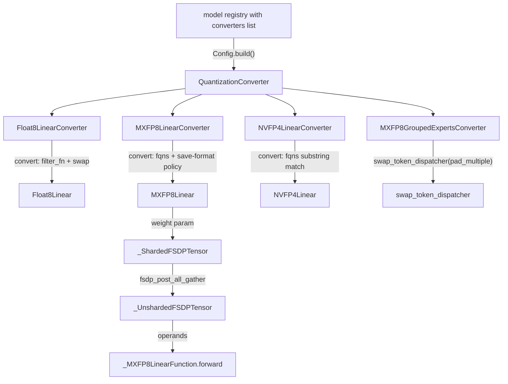

# Quantization converters: Float8 / MXFP8 / NVFP4 config-tree swaps

## Overview

Quantization in torchtitan is **not a module wrapper applied to a built model** - it is a *config-tree rewrite* that runs before anything is instantiated. Each format is a [`QuantizationConverter`](../catalog/torchtitan/components/quantization/__init__.md#QuantizationConverter "torchtitan/components/quantization/__init__.py:L21") (itself a [`ModelConfigConverter`](../catalog/torchtitan/protocols/model.md#ModelConfigConverter "torchtitan/protocols/model.py:L19")): a model registry builds the converter from its `Config`, calls `convert(model_config)`, and the converter walks every [`Linear`](../catalog/torchtitan/models/common/linear.md#Linear "torchtitan/models/common/linear.py:L31") `Config` (or `GroupedExperts.Config`) in the tree and replaces the matching ones with a drop-in subclass config - `Float8Linear.Config`, `MXFP8Linear.Config`, `NVFP4Linear.Config`, or a dynamically-minted quantized experts class. Because the replacement config *inherits from* `Linear.Config`, the model's stock sharding (colwise/rowwise TP, FSDP) is carried over unchanged; only the GEMM changes. The three formats are three backends behind one seam: Float8 delegates almost entirely to torchao's `Float8Linear`; NVFP4 reuses torchao's NVFP4 linear plus torchtitan's SPMD `local_map` folding; MXFP8 is implemented in-tree, with a custom autograd function and an FSDP tensor-subclass lifecycle that quantizes each weight **once per all-gather** instead of once per GEMM.

For the TPU-performance lens the key facts are: (1) every upstream converter's constructor gates on CUDA/ROCm capability, so on TPU only the Float8 path is reachable, and only through a TPU subclass that rebuilds the torchao config without the GPU check (the inherited `convert` swap is reused verbatim); (2) MoE routed experts on the TPU lane run in TorchTPU Pallas grouped-matmul kernels that these converters do not target, so FP8 for experts is a separate kernel path; (3) when any layer is quantized, the trainer's metrics processor reports **no MFU at all** (see Edge cases).

## Diagram

How a converter list turns into a quantized model (config time, then runtime for MXFP8 under FSDP):

Legend:
- `REG` - (concept) a `model_registry(..., converters=[...])` call such as [`llama3_405b`](../catalog/torchtitan/models/llama3/config_registry.md#llama3_405b "torchtitan/models/llama3/config_registry.py:L370")
- `BASE` - [`QuantizationConverter`](../catalog/torchtitan/components/quantization/__init__.md#QuantizationConverter "torchtitan/components/quantization/__init__.py:L21")
- `F8` - [`Float8LinearConverter`](../catalog/torchtitan/components/quantization/float8.md#Float8LinearConverter "torchtitan/components/quantization/float8.py:L53")
- `MX` - [`MXFP8LinearConverter`](../catalog/torchtitan/components/quantization/mxfp8/converter.md#MXFP8LinearConverter "torchtitan/components/quantization/mxfp8/converter.py:L58")
- `NV` - [`NVFP4LinearConverter`](../catalog/torchtitan/components/quantization/nvfp4.md#NVFP4LinearConverter "torchtitan/components/quantization/nvfp4.py:L267")
- `MXE` - [`MXFP8GroupedExpertsConverter`](../catalog/torchtitan/components/quantization/mxfp8/converter.md#MXFP8GroupedExpertsConverter "torchtitan/components/quantization/mxfp8/converter.py:L236")
- `F8L` - [`Float8Linear`](../catalog/torchtitan/components/quantization/float8.md#Float8Linear "torchtitan/components/quantization/float8.py:L27")
- `MXL` - [`MXFP8Linear`](../catalog/torchtitan/components/quantization/mxfp8/linear.md#MXFP8Linear "torchtitan/components/quantization/mxfp8/linear.py:L303")
- `NVL` - [`NVFP4Linear`](../catalog/torchtitan/components/quantization/nvfp4.md#NVFP4Linear "torchtitan/components/quantization/nvfp4.py:L84")
- `DISP` - [`swap_token_dispatcher`](../catalog/torchtitan/components/quantization/utils.md#swap_token_dispatcher "torchtitan/components/quantization/utils.py:L33")
- `SH` - [`_ShardedFSDPTensor`](../catalog/torchtitan/components/quantization/_fsdp_tensor.md#_ShardedFSDPTensor "torchtitan/components/quantization/_fsdp_tensor.py:L259")
- `UN` - [`_UnshardedFSDPTensor`](../catalog/torchtitan/components/quantization/_fsdp_tensor.md#_UnshardedFSDPTensor "torchtitan/components/quantization/_fsdp_tensor.py:L446")
- `FN` - [`forward`](../catalog/torchtitan/components/quantization/mxfp8/linear.md#_MXFP8LinearFunction.forward "torchtitan/components/quantization/mxfp8/linear.py:L69")

## Design rationale (why it's built this way)

- **Rewrite configs, not modules.** The base class docstring says subclasses "define a nested Config and implement ``convert()`` to transform the model config tree." Doing the swap on configs means the model is built (often on `meta`) already in its final form, so parallelization, `init_states`, and checkpoint FQNs see the quantized modules from the start - there is no post-hoc module surgery that could race with FSDP/TP wrapping. It also makes ordering explicit: a registry validates that quantization converters precede LoRA in the same list.
- **Subclass `Linear.Config`, keep sharding.** Every replacement config is documented as a "Drop-in replacement for Linear.Config". The NVFP4 module docstring spells out the payoff: it "inherits the model's stock colwise/rowwise sharding and changes only the GEMM. Under tensor parallelism the block boundary keeps its stock bf16 collectives (all-gather / reduce-scatter); NVFP4 does not move fp4 codes over the wire." So none of these formats reduce TP/FSDP communication volume - they only speed up (and shrink) the matmuls.
- **`model_compile_enabled` is advisory state, not a switch.** [`model_compile_enabled`](../catalog/torchtitan/components/quantization/__init__.md#QuantizationConverter.Config.model_compile_enabled "torchtitan/components/quantization/__init__.py:L30") is threaded in by recipes (computed from `compile.enable` and `"model" in compile.components`) so converters can warn ("torch.compile enablement is required for highest performance of NVFP4 dynamic quantization") and so Float8's `emulate` mode can refuse compile. The package header is blunt: "The quantization modules are intended to be ran under `torch.compile` for competitive performance" - dynamic per-step scaling is a chain of small elementwise ops that only pays off once fused.
- **MXFP8 weights are quantized per unshard, not per GEMM.** The 32x32 square scale tile is chosen because it is "transpose-invariant and lets FPROP and DGRAD share one qdata allocation"; tying the quantization to the FSDP all-gather (a tensor-subclass pair) means the bf16 all-gather output is freed immediately and only qdata+scales stay resident for forward, backward, and recompute.
- **BF16 save format is the conservative default.** The long docstring on `linears_saving_inputs_for_backward_in_mxfp8` explains that saving an extra MXFP8 copy of an input is only a memory win if nothing else already keeps the BF16 tensor alive (flash attention does), and that under full activation checkpointing the columnwise operand is produced in both the original forward and the recompute. Recipes opt specific single-consumer projections (fused QKV, FFN down) into MXFP8 by FQN.

> [!inferred]
> The CUDA/ROCm capability gates in each converter constructor are the reason the TPU lane cannot use the upstream converters directly: the gate is in `__init__`, while `convert` is device-agnostic. That split is what makes "subclass, rebuild the torchao config, inherit `convert`" a clean TPU adapter.

## Entry points

- [`QuantizationConverter`](../catalog/torchtitan/components/quantization/__init__.md#QuantizationConverter "torchtitan/components/quantization/__init__.py:L21") - the base every format extends; reached when a model registry iterates its `converters` list and calls `build().convert(config)` on each, before the `ModelSpec` is returned. Its `Config` ([`Config`](../catalog/torchtitan/components/quantization/__init__.md#QuantizationConverter.Config "torchtitan/components/quantization/__init__.py:L29")) adds exactly one field, `model_compile_enabled`.
- [`Float8LinearConverter`](../catalog/torchtitan/components/quantization/float8.md#Float8LinearConverter "torchtitan/components/quantization/float8.py:L53") - "Replace matching Linear.Config with Float8Linear.Config." Used by the large dense recipes (e.g. [`llama3_405b`](../catalog/torchtitan/models/llama3/config_registry.md#llama3_405b "torchtitan/models/llama3/config_registry.py:L370") with `filter_fqns=["lm_head"]`) and - via a TPU subclass that skips the GPU gate - by the TPU lane's float8 recipes. Its [`Config`](../catalog/torchtitan/components/quantization/float8.md#Float8LinearConverter.Config "torchtitan/components/quantization/float8.py:L57") carries [`recipe_name`](../catalog/torchtitan/components/quantization/float8.md#Float8LinearConverter.Config.recipe_name "torchtitan/components/quantization/float8.py:L58") (`rowwise` or `rowwise_with_gw_hp`), `filter_fqns`, and `emulate`.
- [`MXFP8LinearConverter`](../catalog/torchtitan/components/quantization/mxfp8/converter.md#MXFP8LinearConverter "torchtitan/components/quantization/mxfp8/converter.py:L58") - in-tree MXFP8 dense linears for SM100+; [`Config`](../catalog/torchtitan/components/quantization/mxfp8/converter.md#MXFP8LinearConverter.Config "torchtitan/components/quantization/mxfp8/converter.py:L62") selects targets by `fqns` and the per-linear backward save format. Paired with [`MXFP8GroupedExpertsConverter`](../catalog/torchtitan/components/quantization/mxfp8/converter.md#MXFP8GroupedExpertsConverter "torchtitan/components/quantization/mxfp8/converter.py:L236") for MoE (e.g. [`graph_trainer_deepseek_v3_debugmodel_mxfp8`](../catalog/torchtitan/experiments/graph_trainer/deepseek_v3/config_registry.md#graph_trainer_deepseek_v3_debugmodel_mxfp8 "torchtitan/experiments/graph_trainer/deepseek_v3/config_registry.py:L35")).
- [`NVFP4LinearConverter`](../catalog/torchtitan/components/quantization/nvfp4.md#NVFP4LinearConverter "torchtitan/components/quantization/nvfp4.py:L267") - NVFP4 dense linears; its [`Config`](../catalog/torchtitan/components/quantization/nvfp4.md#NVFP4LinearConverter.Config "torchtitan/components/quantization/nvfp4.py:L271") has only [`fqns`](../catalog/torchtitan/components/quantization/nvfp4.md#NVFP4LinearConverter.Config.fqns "torchtitan/components/quantization/nvfp4.py:L272"). The mixed-precision recipes ([`llama3_8b_first_85_pct_layers_nvfp4`](../catalog/torchtitan/models/llama3/config_registry.md#llama3_8b_first_85_pct_layers_nvfp4 "torchtitan/models/llama3/config_registry.py:L292"), [`qwen3_8b_first_85_pct_layers_nvfp4`](../catalog/torchtitan/models/qwen3/config_registry.md#qwen3_8b_first_85_pct_layers_nvfp4 "torchtitan/models/qwen3/config_registry.py:L262"), [`qwen3_debugmodel_first_85_pct_layers_nvfp4`](../catalog/torchtitan/models/qwen3/config_registry.md#qwen3_debugmodel_first_85_pct_layers_nvfp4 "torchtitan/models/qwen3/config_registry.py:L99")) pass `layers.<i>.` FQNs for the leading 85% of decoder layers and keep the tail plus LM head in bf16.
- [`has_quantization`](../catalog/torchtitan/components/quantization/utils.md#has_quantization "torchtitan/components/quantization/utils.py:L67") - the read side: the [`Trainer`](../catalog/torchtitan/trainer.md#Trainer "torchtitan/trainer.py:L74") calls it on the model config when building the metrics processor, which then suppresses MFU.

## Mechanism (step-by-step)

1. **Constructor = capability + dependency gate.** Building a converter from its config runs its `__init__`, which is where all hardware checks live. [`Float8LinearConverter`](../catalog/torchtitan/components/quantization/float8.md#Float8LinearConverter "torchtitan/components/quantization/float8.py:L53") requires torchao, then NVIDIA SM89+ or AMD gfx942+ unless `emulate=True` and compile is off; it resolves a torchao recipe into [`torchao_config`](../catalog/torchtitan/components/quantization/float8.md#Float8LinearConverter.torchao_config "torchtitan/components/quantization/float8.py:L113") (or a plain `emulate=True` config), sets `torch._inductor.config.emulate_precision_casts` for the `rowwise` recipe as a workaround for a PyTorch issue, and builds [`filter_fn`](../catalog/torchtitan/components/quantization/float8.md#Float8LinearConverter.filter_fn "torchtitan/components/quantization/float8.py:L137") - either torchao's `auto_filter_small_kn` heuristic or [`module_filter_fn`](../catalog/torchtitan/components/quantization/utils.md#module_filter_fn "torchtitan/components/quantization/utils.py:L16"). The MXFP8 ([`__init__`](../catalog/torchtitan/components/quantization/mxfp8/converter.md#MXFP8LinearConverter.__init__ "torchtitan/components/quantization/mxfp8/converter.py:L107")) and NVFP4 ([`__init__`](../catalog/torchtitan/components/quantization/nvfp4.md#NVFP4LinearConverter.__init__ "torchtitan/components/quantization/nvfp4.py:L280")) constructors require SM100 and a torchao build exposing the right kernels; MXFP8 even prints the exact nightly `pip` command because its 32x32 swizzled cast kernel "is newer than any torchao release". On TPU, the float8 adapter in `torchtitan/experiments/tpu/float8_converter.py` replaces this constructor wholesale: it builds the same torchao recipe config, rejects `auto_filter_small_kn` ("uses CUDA-tuned thresholds"), and documents that TorchTPU lowers `torch._scaled_mm` natively and treats cuBLAS `use_fast_accum` as a no-op because TPU matmuls already accumulate in FP32.

2. **Select targets on the config tree.** `convert` walks `model_config.traverse(Linear.Config)`, which yields `(fqn, config, parent, attr)` tuples. Float8's [`convert`](../catalog/torchtitan/components/quantization/float8.md#Float8LinearConverter.convert "torchtitan/components/quantization/float8.py:L151") keeps a linear when `filter_fn` passes: [`module_filter_fn`](../catalog/torchtitan/components/quantization/utils.md#module_filter_fn "torchtitan/components/quantization/utils.py:L16") requires both dims divisible by 16 ("due to float8 tensorcore hardware requirements") and no `filter_fqns` substring in the FQN - so `filter_fqns` is an *exclude* list. MXFP8's [`convert`](../catalog/torchtitan/components/quantization/mxfp8/converter.md#MXFP8LinearConverter.convert "torchtitan/components/quantization/mxfp8/converter.py:L121") and NVFP4's [`convert`](../catalog/torchtitan/components/quantization/nvfp4.md#NVFP4LinearConverter.convert "torchtitan/components/quantization/nvfp4.py:L299") invert that: `fqns` is an *include* list of substrings, and an empty list means convert everything. All three raise if a router gate is selected - its logits pick experts, so quantization error could flip routing.

3. **Swap the config in place.** For each selected linear the converter builds the replacement config, copying `in_features`, `out_features`, `bias`, `param_init` (plus `_torchao_config` for Float8, or `input_activation_format_for_backward` for MXFP8), and writes it back via `setattr(parent, attr, ...)`, list indexing, or by replacing the root. Replacement configs validate shapes in `__post_init__`: [`MXFP8Linear`](../catalog/torchtitan/components/quantization/mxfp8/linear.md#MXFP8Linear "torchtitan/components/quantization/mxfp8/linear.py:L303") needs both dims divisible by 32 and [`NVFP4Linear`](../catalog/torchtitan/components/quantization/nvfp4.md#NVFP4Linear "torchtitan/components/quantization/nvfp4.py:L84") by 128 ("NVFP4 cannot quantize this Linear; exclude it from the converter fqns"). (The NVFP4 recipes' bf16 LM head is a separate choice: the converter's `fqns` docstring says the mixed recipe leaves it unquantized "for stability".) Nothing is allocated - the swap only changes which class `build()` will instantiate.

4. **MoE experts: mint a subclass and re-pad the dispatcher.** [`MXFP8GroupedExpertsConverter`](../catalog/torchtitan/components/quantization/mxfp8/converter.md#MXFP8GroupedExpertsConverter "torchtitan/components/quantization/mxfp8/converter.py:L236") ([`convert`](../catalog/torchtitan/components/quantization/mxfp8/converter.md#MXFP8GroupedExpertsConverter.convert "torchtitan/components/quantization/mxfp8/converter.py:L271")) and [`Float8GroupedExpertsConverter`](../catalog/torchtitan/components/quantization/float8.md#Float8GroupedExpertsConverter "torchtitan/components/quantization/float8.py:L224") ([`convert`](../catalog/torchtitan/components/quantization/float8.md#Float8GroupedExpertsConverter.convert "torchtitan/components/quantization/float8.py:L254")) traverse `GroupedExperts.Config`, look up the config's owning module class, and create (once, cached per parent class) a subclass that overrides only the `_grouped_mm` seam to call torchao's quantize-then-scaled-grouped-mm. Because grouped GEMMs need each expert's token group aligned (16 elements for FP8, `pad_multiple` default 32 for MXFP8), each converter first calls [`swap_token_dispatcher`](../catalog/torchtitan/components/quantization/utils.md#swap_token_dispatcher "torchtitan/components/quantization/utils.py:L33") on the parent routed-experts config, replacing a plain all-to-all dispatcher with a padding-capable one or raising if the dispatcher cannot pad. This is the one place quantization reaches into MoE dispatch.

5. **Float8 and NVFP4 at build time.** [`Float8Linear`](../catalog/torchtitan/components/quantization/float8.md#Float8Linear "torchtitan/components/quantization/float8.py:L27") inherits torchao's `Float8Linear` plus torchtitan's [`Module`](../catalog/torchtitan/protocols/module.md#Module "torchtitan/protocols/module.py:L43") protocol (not `Linear`, to avoid MRO conflicts with `Linear.__init__`), and its [`__init__`](../catalog/torchtitan/components/quantization/float8.md#Float8Linear.__init__ "torchtitan/components/quantization/float8.py:L40") just forwards dims and the torchao config - all dynamic scaling happens in torchao's forward. [`NVFP4Linear`](../catalog/torchtitan/components/quantization/nvfp4.md#NVFP4Linear "torchtitan/components/quantization/nvfp4.py:L84") does more: its config [`build`](../catalog/torchtitan/components/quantization/nvfp4.md#NVFP4Linear.Config.build "torchtitan/components/quantization/nvfp4.py:L113") inspects the stock TP placement of `weight` and folds it into a `local_map` region (rowwise vs colwise input/grad placements) so the opaque NVFP4 GEMM runs on local shards, and its [`__init__`](../catalog/torchtitan/components/quantization/nvfp4.md#NVFP4Linear.__init__ "torchtitan/components/quantization/nvfp4.py:L159") re-registers the stochastic-rounding seed and the Random Hadamard Transform sign vector as non-persistent `None` buffers so they are materialized per rank (the sign vector is hardcoded so every TP rank agrees without a broadcast).

6. **MXFP8 at build time: install the sharded weight wrapper.** [`MXFP8Linear`](../catalog/torchtitan/components/quantization/mxfp8/linear.md#MXFP8Linear "torchtitan/components/quantization/mxfp8/linear.py:L303")'s config [`build`](../catalog/torchtitan/components/quantization/mxfp8/linear.md#MXFP8Linear.Config.build "torchtitan/components/quantization/mxfp8/linear.py:L336") rejects `parallelism.spmd_backend='partial_dtensor'` (the MXFP8 matmul is an opaque autograd function with no DTensor sharding rule), and the module wraps its weight parameter in an MXFP8 subclass of [`_ShardedFSDPTensor`](../catalog/torchtitan/components/quantization/_fsdp_tensor.md#_ShardedFSDPTensor "torchtitan/components/quantization/_fsdp_tensor.py:L259"). That wrapper holds the high-precision shard in [`_tensor`](../catalog/torchtitan/components/quantization/_fsdp_tensor.md#_ShardedFSDPTensor._tensor "torchtitan/components/quantization/_fsdp_tensor.py:L289") and is "the ``nn.Parameter`` the optimizer updates and the checkpoint stores" - normally an fp32 master weight, since `training.dtype` defaults to float32.

7. **MXFP8 at runtime: quantize on all-gather, compute from operands.** When FSDP unshards, the pre-all-gather hook casts the shard to `mp_policy.param_dtype` (bf16) and pads uneven dim-0 shards; [`fsdp_post_all_gather`](../catalog/torchtitan/components/quantization/_fsdp_tensor.md#_ShardedFSDPTensor.fsdp_post_all_gather "torchtitan/components/quantization/_fsdp_tensor.py:L398") trims padding, then calls the format's [`_build_operands`](../catalog/torchtitan/components/quantization/mxfp8/tensor.md#_LinearShardedTensorWithMXFP8Compute._build_operands "torchtitan/components/quantization/mxfp8/tensor.py:L92") ([`_quantize_mxfp8_weight`](../catalog/torchtitan/components/quantization/mxfp8/tensor.md#_quantize_mxfp8_weight "torchtitan/components/quantization/mxfp8/tensor.py:L54") - one Triton kernel producing E4M3 qdata plus pre-swizzled fprop/dgrad scales) and returns a storage-free [`_UnshardedFSDPTensor`](../catalog/torchtitan/components/quantization/_fsdp_tensor.md#_UnshardedFSDPTensor "torchtitan/components/quantization/_fsdp_tensor.py:L446"). The bf16 all-gather output is released immediately. On re-unshard (RAF=True, or a later step) the same object's tensors are refilled in place so autograd's saved references stay valid. [`forward`](../catalog/torchtitan/components/quantization/mxfp8/linear.md#MXFP8Linear.forward "torchtitan/components/quantization/mxfp8/linear.py:L368") reads those operands (or quantizes per call when no data-parallel wrapper owns the weight) and calls the autograd function: [`forward`](../catalog/torchtitan/components/quantization/mxfp8/linear.md#_MXFP8LinearFunction.forward "torchtitan/components/quantization/mxfp8/linear.py:L69") quantizes activations rowwise (1x32 blocks, RCEIL scales pinned to match the weight cast), pads tokens to a multiple of 32, runs `F.scaled_mm`, and saves either the BF16 input or a columnwise MXFP8 input; [`backward`](../catalog/torchtitan/components/quantization/mxfp8/linear.md#_MXFP8LinearFunction.backward "torchtitan/components/quantization/mxfp8/linear.py:L201") quantizes the output gradient both ways and runs DGRAD and WGRAD as two more scaled GEMMs, reading the dgrad weight operand back off the unsharded tensor.

## Key data structures

- **Converter `Config` dataclasses** - all `kw_only, slots` dataclasses deriving from [`Config`](../catalog/torchtitan/components/quantization/__init__.md#QuantizationConverter.Config "torchtitan/components/quantization/__init__.py:L29"). Note the asymmetry: Float8 uses `filter_fqns` (exclude), MXFP8/NVFP4 use `fqns` (include, empty = all).
- **Per-converter runtime state** - Float8 keeps [`config`](../catalog/torchtitan/components/quantization/float8.md#Float8LinearConverter.config "torchtitan/components/quantization/float8.py:L75"), `torchao_config`, `filter_fn`, and an `enabled` flag (false when torchao is too old to look up recipes, in which case `convert` is a no-op that returns the tree unchanged).
- **The MXFP8 operands dataclass** - frozen, three distinct allocations (qdata in N x K, fprop scales, dgrad scales); the K x N fprop qdata is a *property* (a transpose view), because FSDP frees each dataclass field's storage and must not free the same memory twice.
- **`_ShardedFSDPTensor` / `_UnshardedFSDPTensor`** - a two-state tensor-subclass lifecycle documented at length in `_fsdp_tensor.py`. The sharded half survives FSDP bookkeeping ops (copy, view, split, scatter) by re-wrapping; the unsharded half answers only view and factory ops ([`__torch_dispatch__`](../catalog/torchtitan/components/quantization/_fsdp_tensor.md#_UnshardedFSDPTensor.__torch_dispatch__ "torchtitan/components/quantization/_fsdp_tensor.py:L522")) and raises on any read, because it has no high-precision storage. A new format subclasses only the sharded class and implements one method.
- **Quantized experts cache** - module-level dicts mapping a base experts class to its Float8/MXFP8 subclass; [`has_quantization`](../catalog/torchtitan/components/quantization/utils.md#has_quantization "torchtitan/components/quantization/utils.py:L67") reads them to recognize quantized experts configs.

## Dynamics (design intent)

- **Quantization frequency.** Float8 (torchao) and NVFP4 quantize activations, weights, and gradients on the fly every GEMM. MXFP8 quantizes activations/gradients per GEMM but weights only once per FSDP unshard lifetime; the `_fsdp_tensor.py` header states that "RAF=False keeps a single C alive across forward, backward, recomputation, and pipeline microbatches; RAF=True reuses that same C object, refilling its storage before backward."
- **Activation checkpointing interaction.** Under full AC the MXFP8 save format is applied identically in the original forward and the recompute ("We intentionally apply the same policy to both"), so MXFP8-format saves cost an extra columnwise cast in the discarded original forward.
- **Compile.** `Float8LinearConverter.Config.emulate` is "Not compatible with torch.compile"; MXFP8's autograd function is `allow_in_graph`, so Dynamo traces around it rather than into it.
- **Tests.** The TPU lane's `test_float8_converter.py` asserts that the upstream converter refuses to build without CUDA (`test_builds_without_cuda`), that `rowwise` resolves to axiswise scaling with power-of-two scales for input, weight, and grad_output, and that an emulated converted layer matches a plain linear.

## Edge cases

- **MFU disappears.** The metrics processor sets MFU to `None` when [`has_quantization`](../catalog/torchtitan/components/quantization/utils.md#has_quantization "torchtitan/components/quantization/utils.py:L67") is true ("MFU is based on BF16 peak FLOPS which is misleading when quantization (FP8/MX) is active"). TFLOPs and tokens/sec are still logged - compare those across bf16 and fp8 runs, not MFU.
- **Upstream converters cannot build on TPU.** All CUDA/ROCm gates raise `ValueError` before `convert` runs. The TPU float8 recipes (llama3 70B float8, Qwen3 MoE 235B scan float8) use the TPU subclass and also restore the TPU `parallelize_fn` that the generic `model_registry` overwrote. The Qwen3 235B float8 recipe is labelled "A reference for the upstream float8 path on Qwen3, not a speed recipe": only attention projections become FP8, since the routed experts run in TPU Pallas grouped-matmul kernels "which torchao's converters do not target".
- **Substring matching is sharp.** NVFP4/MXFP8 `fqns` match as substrings, so `layers.1` would also match `layers.10`; the NVFP4 tail helper appends a trailing `.` for this reason, and raises rather than return an empty list (empty would mean "convert everything").
- **Small or odd shapes are silently skipped (Float8) or rejected (MXFP8/NVFP4).** Float8 quietly skips dims not divisible by 16; MXFP8 (32) and NVFP4 (128) raise at config validation, and MXFP8 also checks the *local* (post-TP) dims at forward time.
- **Uneven FSDP sharding of experts.** The MXFP8 sharded tensor supports dim-0 sharding only; it raises if FSDP picks `Shard(1)` for grouped experts (which happens when the FSDP degree exceeds the expert count).
- **Float8 `rowwise` flips a global Inductor flag** (`emulate_precision_casts = True`), affecting every compiled region in the process, not just float8 layers.
- **Frozen MXFP8 weights are requantized every forward** when no data-parallel wrapper owns them (a TODO notes keying operands on the parameter version counter).

## Open questions

- The TPU float8 adapter (`TpuFloat8LinearConverter` in `torchtitan/experiments/tpu/float8_converter.py`), the TPU FP8 expert grouped-matmul kernel (`torchtitan/experiments/tpu/kernels/fp8_expert_segment_matmul.py`), and `nvfp4_bf16_tail_fqns` are central to the TPU lens but are not in this packet's subgraph, so they are described here only by file path. The FP8 expert kernel follows a MaxText `fp8_full`-style recipe on tokamax GMM kernels and is the TPU answer to `Float8GroupedExpertsConverter`; see the TPU Pallas kernels page.
- Whether TorchTPU's `torch._scaled_mm` lowering fuses the torchao dynamic-scaling elementwise ops into the matmul, or leaves them as separate XLA fusions, is not visible from this repo.
- `has_quantization` only recognizes the three upstream linear config types and the cached experts classes; whether a TPU-only FP8 expert kernel path is counted (and thus whether MFU is suppressed for it) is not settled by these sources.

## See also

- [Model spec protocols](model-spec-protocols.md) - `ModelConfigConverter` and how registries apply converters
- [Model building blocks](model-building-blocks.md) - `Linear.Config`, `traverse`, `GroupedExperts`
- [Parallel dims and parallelization](parallel-dims-and-parallelization.md) - the FSDP/TP sharding the swapped configs inherit
- [TPU MoE dispatch and grouped experts](tpu-moe-dispatch-and-grouped-experts.md)
- [TPU Pallas kernels](tpu-pallas-kernels.md)
- [Observability](observability.md) and [Training components](training-components.md) - metrics/MFU reporting
- [Llama3 model](llama3-model.md), [Qwen3 model](qwen3-model.md), [DeepSeek-V3 model](deepseek-v3-model.md) - recipes that enable converters
- [Graph trainer](graph-trainer.md) - SimpleFSDP's direct construction of the MXFP8 unsharded tensor
