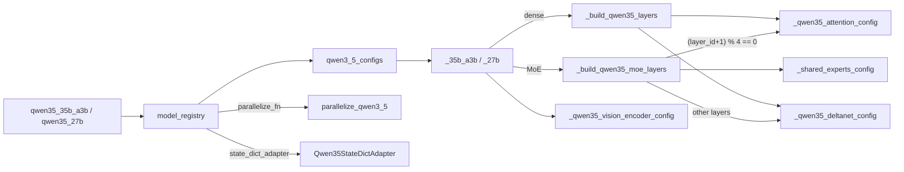
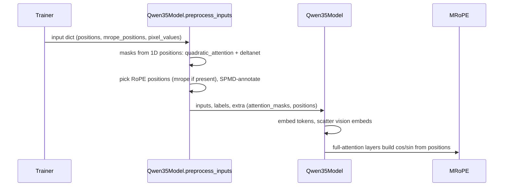

# Qwen3.5 hybrid-attention model family (torchtitan/models/qwen3_5)

<!-- connect:up:begin -->
> **Cross-repo concept:** part of [expert-parallelism](../../../concepts/expert-parallelism.md), [rematerialization](../../../concepts/rematerialization.md), [sequence-parallelism](../../../concepts/sequence-parallelism.md), [sharding](../../../concepts/sharding.md) across this wiki's repos.
<!-- connect:up:end -->
## Overview

Qwen3.5 is a multimodal decoder whose layers are *not* all the same: in every group of four, three layers use Gated DeltaNet (a linear-attention recurrence with a depthwise causal conv) and the fourth uses full softmax attention with an output gate and partial RoPE. [`Qwen35Model`](../catalog/torchtitan/models/qwen3_5/model.md#Qwen35Model "torchtitan/models/qwen3_5/model.py:L248") describes it as "Hybrid attention: 75% GatedDeltaNet (linear) + 25% full attention", plus [`OffsetRMSNorm`](../catalog/torchtitan/models/qwen3_5/model.md#OffsetRMSNorm "torchtitan/models/qwen3_5/model.py:L62"), 3D [`MRoPE`](../catalog/torchtitan/models/qwen3_5/rope.md#MRoPE "torchtitan/models/qwen3_5/rope.py:L15") positions for image/video tokens, an optional vision encoder, and an MoE variant with a sigmoid-gated shared expert. As with the other torchtitan families, the package is mostly config: layer builders pick the attention kind per `layer_id`, [`set_qwen35_sharding_config`](../catalog/torchtitan/models/qwen3_5/sharding.md#set_qwen35_sharding_config "torchtitan/models/qwen3_5/sharding.py:L115") declares placements for both layer kinds, and [`parallelize_qwen3_5`](../catalog/torchtitan/models/qwen3_5/parallelize.md#parallelize_qwen3_5 "torchtitan/models/qwen3_5/parallelize.py:L34") applies them. For TPU performance the important fact is that the linear-attention layers dominate the stack and change which parallelism axes are available (no CP; TP limited by DeltaNet head counts).

## Diagram

Legend:
- `RECIPE` - [`qwen35_35b_a3b`](../catalog/torchtitan/models/qwen3_5/config_registry.md#qwen35_35b_a3b "torchtitan/models/qwen3_5/config_registry.py:L310"), [`qwen35_27b`](../catalog/torchtitan/models/qwen3_5/config_registry.md#qwen35_27b "torchtitan/models/qwen3_5/config_registry.py:L275")
- `REG` - [`model_registry`](../catalog/torchtitan/models/qwen3_5/__init__.md#model_registry "torchtitan/models/qwen3_5/__init__.py:L1096")
- `TABLE` - [`qwen3_5_configs`](../catalog/torchtitan/models/qwen3_5/__init__.md#qwen3_5_configs "torchtitan/models/qwen3_5/__init__.py:L1082")
- `FLAV` - [`_35b_a3b`](../catalog/torchtitan/models/qwen3_5/__init__.md#_35b_a3b "torchtitan/models/qwen3_5/__init__.py:L887"), [`_27b`](../catalog/torchtitan/models/qwen3_5/__init__.md#_27b "torchtitan/models/qwen3_5/__init__.py:L831")
- `MOEL` - [`_build_qwen35_moe_layers`](../catalog/torchtitan/models/qwen3_5/__init__.md#_build_qwen35_moe_layers "torchtitan/models/qwen3_5/__init__.py:L379")
- `DENSEL` - [`_build_qwen35_layers`](../catalog/torchtitan/models/qwen3_5/__init__.md#_build_qwen35_layers "torchtitan/models/qwen3_5/__init__.py:L313")
- `VIS` - [`_qwen35_vision_encoder_config`](../catalog/torchtitan/models/qwen3_5/__init__.md#_qwen35_vision_encoder_config "torchtitan/models/qwen3_5/__init__.py:L148")
- `ATTN` - [`_qwen35_attention_config`](../catalog/torchtitan/models/qwen3_5/__init__.md#_qwen35_attention_config "torchtitan/models/qwen3_5/__init__.py:L208")
- `GDN` - [`_qwen35_deltanet_config`](../catalog/torchtitan/models/qwen3_5/__init__.md#_qwen35_deltanet_config "torchtitan/models/qwen3_5/__init__.py:L253")
- `SHE` - [`_shared_experts_config`](../catalog/torchtitan/models/qwen3_5/__init__.md#_shared_experts_config "torchtitan/models/qwen3_5/__init__.py:L130")
- `PAR` - [`parallelize_qwen3_5`](../catalog/torchtitan/models/qwen3_5/parallelize.md#parallelize_qwen3_5 "torchtitan/models/qwen3_5/parallelize.py:L34")
- `SDA` - [`Qwen35StateDictAdapter`](../catalog/torchtitan/models/qwen3_5/state_dict_adapter.md#Qwen35StateDictAdapter "torchtitan/models/qwen3_5/state_dict_adapter.py:L36")

A second view - the per-step input path that makes the hybrid work under SPMD:

(`T` is the trainer - a concept here; `P` is [`preprocess_inputs`](../catalog/torchtitan/models/qwen3_5/model.md#Qwen35Model.preprocess_inputs "torchtitan/models/qwen3_5/model.py:L376"), `M` is [`Qwen35Model`](../catalog/torchtitan/models/qwen3_5/model.md#Qwen35Model "torchtitan/models/qwen3_5/model.py:L248"), `R` is [`MRoPE`](../catalog/torchtitan/models/qwen3_5/rope.md#MRoPE "torchtitan/models/qwen3_5/rope.py:L15").)

## Design rationale (why it's built this way)

**Layer kind is chosen by index, not by a separate class per flavor.** Both builders set `is_full = (layer_id + 1) % full_attention_interval == 0` with interval 4, and attach either a full-attention config or a DeltaNet config to the same block config; FFN/MoE and norms are identical for both kinds. This keeps a single block type for compile/AC/FSDP while letting the cost profile vary per layer.

**Separate `wq`/`wk`/`wv`, not fused QKV.** [`_qwen35_attention_config`](../catalog/torchtitan/models/qwen3_5/__init__.md#_qwen35_attention_config "torchtitan/models/qwen3_5/__init__.py:L208") makes `wq` twice as wide (`n_heads x head_dim x 2`) because it emits both the query and a per-head sigmoid gate. The attention class docstring explains the consequence: "the 2x-wide, gated `wq` doesn't fit a fused QKV projection that TP-shards by head." Likewise [`_qwen35_deltanet_config`](../catalog/torchtitan/models/qwen3_5/__init__.md#_qwen35_deltanet_config "torchtitan/models/qwen3_5/__init__.py:L253") keeps `in_proj_q/k/v/z/a/b` and `conv_q/k/v` separate even though HF fuses the q/k/v projection (`in_proj_qkv`) and the three convs (`conv1d`); [`Qwen35StateDictAdapter`](../catalog/torchtitan/models/qwen3_5/state_dict_adapter.md#Qwen35StateDictAdapter "torchtitan/models/qwen3_5/state_dict_adapter.py:L36") splits/fuses at checkpoint time instead. Separate projections are what make clean column-wise (head) TP possible.

**OffsetRMSNorm with zero init.** [`OffsetRMSNorm`](../catalog/torchtitan/models/qwen3_5/model.md#OffsetRMSNorm "torchtitan/models/qwen3_5/model.py:L62") computes `(1 + weight) * norm(x)` and is built by [`_offset_norm`](../catalog/torchtitan/models/qwen3_5/__init__.md#_offset_norm "torchtitan/models/qwen3_5/__init__.py:L126") with a zeros initializer, so "the norm starts as identity-scaled". It upcasts to float32 "for numerical stability in pow/rsqrt" and casts back - every decoder norm, final norm, and QK-norm pays that up/down-cast.

**MRoPE degrades to plain RoPE for text.** [`MRoPE`](../catalog/torchtitan/models/qwen3_5/rope.md#MRoPE "torchtitan/models/qwen3_5/rope.py:L15") overrides only the cache-reshape step: 2D `(tokens, 3)` positions build an interleaved temporal/height/width cache; 1D text positions "fall back to the plain CosSinRoPE per-token lookup". Text-only training therefore runs the same code path as other CosSin models.

**CP is explicitly unsupported.** [`parallelize_qwen3_5`](../catalog/torchtitan/models/qwen3_5/parallelize.md#parallelize_qwen3_5 "torchtitan/models/qwen3_5/parallelize.py:L34") raises `NotImplementedError`: "GatedDeltaNet (75% of layers) requires full-sequence allgather, and multimodal CP needs vision scatter before CP sharding." The recurrence is sequential along the sequence, so the usual ring/all-gather CP for softmax attention does not apply.

> [!inferred]
> The TPU lane (`torchtitan/experiments/tpu/qwen3_5/`) is a config transform over this package, not a fork. Its `model_registry` accepts only `attn_backend="sdpa"`, calls this `model_registry`, and replaces the model config with a text-only variant: the vision encoder is dropped; each DeltaNet's inner module is swapped for a TPU implementation that computes the chunked gated delta rule as batched matmuls XLA can compile (upstream runs CUDA/Triton kernels) and derives packed-document boundaries from static `[B, S]` segment-id masks rather than dynamic-shape `cu_seqlens`; each full-attention layer passes `positions` to a document-masked SDPA that the Splash/Tokamax patches replace; expert-bias balancing is disabled (`load_balance_coeff=None`) because HF checkpoints carry no expert bias; and `pipelining_fn` is set to `None`. Its 35B recipe uses SimpleFSDP with EP=1.

## Entry points

- [`model_registry`](../catalog/torchtitan/models/qwen3_5/__init__.md#model_registry "torchtitan/models/qwen3_5/__init__.py:L1096") - factory for all flavors; `seq_len`, `attn_backend` (default `"flex"`), `moe_comm_backend`, `converters`. Its spec uses a pipelining function that pins `vision_encoder` to the first stage and the MoE load-balancing post-optimizer hook.
- Recipes: [`qwen35_debugmodel`](../catalog/torchtitan/models/qwen3_5/config_registry.md#qwen35_debugmodel "torchtitan/models/qwen3_5/config_registry.py:L45"), [`qwen35_debugmodel_moe`](../catalog/torchtitan/models/qwen3_5/config_registry.md#qwen35_debugmodel_moe "torchtitan/models/qwen3_5/config_registry.py:L95"), [`qwen35_0_8b`](../catalog/torchtitan/models/qwen3_5/config_registry.md#qwen35_0_8b "torchtitan/models/qwen3_5/config_registry.py:L139"), [`qwen35_2b`](../catalog/torchtitan/models/qwen3_5/config_registry.md#qwen35_2b "torchtitan/models/qwen3_5/config_registry.py:L173"), [`qwen35_4b`](../catalog/torchtitan/models/qwen3_5/config_registry.md#qwen35_4b "torchtitan/models/qwen3_5/config_registry.py:L207"), [`qwen35_9b`](../catalog/torchtitan/models/qwen3_5/config_registry.md#qwen35_9b "torchtitan/models/qwen3_5/config_registry.py:L240"), [`qwen35_27b`](../catalog/torchtitan/models/qwen3_5/config_registry.md#qwen35_27b "torchtitan/models/qwen3_5/config_registry.py:L275"), [`qwen35_35b_a3b`](../catalog/torchtitan/models/qwen3_5/config_registry.md#qwen35_35b_a3b "torchtitan/models/qwen3_5/config_registry.py:L310"), [`qwen35_122b_a10b`](../catalog/torchtitan/models/qwen3_5/config_registry.md#qwen35_122b_a10b "torchtitan/models/qwen3_5/config_registry.py:L347"), [`qwen35_397b_a17b`](../catalog/torchtitan/models/qwen3_5/config_registry.md#qwen35_397b_a17b "torchtitan/models/qwen3_5/config_registry.py:L386") - full `Trainer.Config` objects selected by name; all use a multimodal tokenizer and the cc12m image-text datasets.
- [`Config`](../catalog/torchtitan/models/qwen3_5/model.md#Qwen35Model.Config "torchtitan/models/qwen3_5/model.py:L292") - its `update_from_config` validates TP against DeltaNet head counts and writes the sharding declarations.
- [`preprocess_inputs`](../catalog/torchtitan/models/qwen3_5/model.md#Qwen35Model.preprocess_inputs "torchtitan/models/qwen3_5/model.py:L376") - called by the trainer every step before forward; builds both mask kinds when the first full-attention backend is flex or varlen, chooses RoPE positions, and annotates SPMD types.
- [`parallelize_qwen3_5`](../catalog/torchtitan/models/qwen3_5/parallelize.md#parallelize_qwen3_5 "torchtitan/models/qwen3_5/parallelize.py:L34") - the `parallelize_fn`; `skip_dp=True` is "used by the vLLM generator, which replicates params across vLLM DP groups".

## Mechanism (step-by-step)

1. **Flavor -> hybrid layer list.** [`model_registry`](../catalog/torchtitan/models/qwen3_5/__init__.md#model_registry "torchtitan/models/qwen3_5/__init__.py:L1096") looks up [`qwen3_5_configs`](../catalog/torchtitan/models/qwen3_5/__init__.md#qwen3_5_configs "torchtitan/models/qwen3_5/__init__.py:L1082") (max context 262144 for real flavors, 4096 for debug), rejects larger `seq_len`, builds the config and applies converters. A dense flavor such as [`_27b`](../catalog/torchtitan/models/qwen3_5/__init__.md#_27b "torchtitan/models/qwen3_5/__init__.py:L831") calls [`_build_qwen35_layers`](../catalog/torchtitan/models/qwen3_5/__init__.md#_build_qwen35_layers "torchtitan/models/qwen3_5/__init__.py:L313"); an MoE flavor such as [`_35b_a3b`](../catalog/torchtitan/models/qwen3_5/__init__.md#_35b_a3b "torchtitan/models/qwen3_5/__init__.py:L887") calls [`_build_qwen35_moe_layers`](../catalog/torchtitan/models/qwen3_5/__init__.md#_build_qwen35_moe_layers "torchtitan/models/qwen3_5/__init__.py:L379"). Each flavor also attaches a vision encoder from [`_qwen35_vision_encoder_config`](../catalog/torchtitan/models/qwen3_5/__init__.md#_qwen35_vision_encoder_config "torchtitan/models/qwen3_5/__init__.py:L148") (patch 16, temporal patch 2, 2x2 spatial merge) into [`vision_encoder`](../catalog/torchtitan/models/qwen3_5/model.md#Qwen35Model.Config.vision_encoder "torchtitan/models/qwen3_5/model.py:L293").

2. **Full-attention layers.** [`_qwen35_attention_config`](../catalog/torchtitan/models/qwen3_5/__init__.md#_qwen35_attention_config "torchtitan/models/qwen3_5/__init__.py:L208") builds `wq` (query + gate), `wk`, `wv`, a depth-initialized `wo`, OffsetRMSNorm QK-norms over `head_dim`, and the inner attention from `attn_backend`. Real flavors use `head_dim=256` with `rotary_dim=64`, so only the first quarter of each head is rotated; the [`MRoPE`](../catalog/torchtitan/models/qwen3_5/rope.md#MRoPE "torchtitan/models/qwen3_5/rope.py:L15") config's [`mrope_section`](../catalog/torchtitan/models/qwen3_5/rope.md#MRoPE.Config.mrope_section "torchtitan/models/qwen3_5/rope.py:L28") (`[11, 11, 10]`) must sum to `rotary_dim / 2`, or [`MRoPE`](../catalog/torchtitan/models/qwen3_5/rope.md#MRoPE "torchtitan/models/qwen3_5/rope.py:L15") construction raises. RoPE theta is 1e7.

3. **Gated DeltaNet layers.** [`_qwen35_deltanet_config`](../catalog/torchtitan/models/qwen3_5/__init__.md#_qwen35_deltanet_config "torchtitan/models/qwen3_5/__init__.py:L253") builds bias-free projections for q/k (key dim = `n_key_heads x 128`), v/z (value dim = `n_value_heads x 128`), per-value-head `a`/`b` gates, three depthwise causal Conv1d (kernel 4, `groups == channels`, padding applied in forward), an inner gated-delta kernel module, a gated RMSNorm per value head, and a depth-initialized `out_proj`. `A_log` is initialized as the log of a uniform sample on [0.01, 16] to "avoid near-zero decay heads under bf16 initialization".

4. **MoE with shared expert.** In MoE flavors every layer (both kinds) carries a softmax top-k router with `route_norm`, grouped routed experts with depth-scaled init, and a shared expert from [`_shared_experts_config`](../catalog/torchtitan/models/qwen3_5/__init__.md#_shared_experts_config "torchtitan/models/qwen3_5/__init__.py:L130"): a SwiGLU FFN plus a `dim -> 1` gate whose sigmoid scales the shared output ("Qwen3.5's sigmoid-gated shared-expert config").

5. **Job-config hook: TP validation and sharding declarations.** [`Config`](../catalog/torchtitan/models/qwen3_5/model.md#Qwen35Model.Config "torchtitan/models/qwen3_5/model.py:L292") raises if `tensor_parallel_degree` does not divide both DeltaNet key-head and value-head counts, then calls [`set_qwen35_sharding_config`](../catalog/torchtitan/models/qwen3_5/sharding.md#set_qwen35_sharding_config "torchtitan/models/qwen3_5/sharding.py:L115"). That function computes the layer input layout (sequence-parallel or Replicate-on-TP with CP Shard(0)); if a vision encoder exists it makes the token embedding output full-sequence Replicate on TP ("Vision scatter needs the full embedding sequence on every TP rank"), shards the encoder via [`_set_vision_encoder_sharding`](../catalog/torchtitan/models/qwen3_5/sharding.md#_set_vision_encoder_sharding "torchtitan/models/qwen3_5/sharding.py:L244"), and lets layer 0 restore the decoder layout. Per layer, [`_set_qwen35_layer_sharding`](../catalog/torchtitan/models/qwen3_5/sharding.md#_set_qwen35_layer_sharding "torchtitan/models/qwen3_5/sharding.py:L159") dispatches by layer kind and adds dense-FFN or MoE (+ shared-expert gate) sharding.

6. **Per-kind TP layouts.** [`_set_full_attention_sharding`](../catalog/torchtitan/models/qwen3_5/sharding.md#_set_full_attention_sharding "torchtitan/models/qwen3_5/sharding.py:L274") makes `wq/wk/wv` column-wise, `wo` row-wise (reduce-scatter under SP, else all-reduce), QK-norms head-sharded, and the MRoPE `cache` buffer Replicate. [`_set_deltanet_sharding`](../catalog/torchtitan/models/qwen3_5/sharding.md#_set_deltanet_sharding "torchtitan/models/qwen3_5/sharding.py:L303") makes all six input projections column-wise, conv weights and per-head `A_log`/`dt_bias` Shard(0), `out_proj` row-wise, and puts a single `local_map` boundary around the inner gated-delta module so the convolution and recurrence run on rank-local heads; `cu_seqlens` is declared DP-varying and TP-replicated. The axis names come from the module-level alias [`TP`](../catalog/torchtitan/models/qwen3_5/sharding.md#TP "torchtitan/models/qwen3_5/sharding.py:L51") and its DP/CP siblings.

7. **Parallelize.** [`parallelize_qwen3_5`](../catalog/torchtitan/models/qwen3_5/parallelize.md#parallelize_qwen3_5 "torchtitan/models/qwen3_5/parallelize.py:L34") rejects CP, applies `model.parallelize(parallel_dims)` when TP/EP/`spmd_types` is active, then applies the AC policy to the decoder *and separately* to the vision encoder, compiles both when model compile is on, and returns early for `skip_dp`. For training it resolves dense and expert DP meshes exactly like Qwen3 (`fsdp` and `efsdp`), wraps the vision encoder with its own FSDP call first, then the decoder with `ep_degree` and the expert mesh; dtypes come from [`TORCH_DTYPE_MAP`](../catalog/torchtitan/config/__init__.md#TORCH_DTYPE_MAP "torchtitan/config/__init__.py:L9") over the [`TrainingConfig`](../catalog/torchtitan/config/configs.md#TrainingConfig "torchtitan/config/configs.py:L36") mixed-precision fields.

8. **Per-step input preparation.** [`preprocess_inputs`](../catalog/torchtitan/models/qwen3_5/model.md#Qwen35Model.preprocess_inputs "torchtitan/models/qwen3_5/model.py:L376") builds a mask dict from the 1D `positions` when the first full-attention backend is flex or varlen (no masks otherwise): `deltanet` varlen metadata (document starts detected as a 0 followed by a 1, so multimodal padding at position 0 is not split into fake documents) and `quadratic_attention` (shared with DeltaNet under varlen, else the decoder's flex mask). It then substitutes `mrope_positions` for `positions` when present - keeping "RoPE consistent across every pipeline stage even though the raw vision inputs ... only reach the first stage" - shards inputs for CP if enabled, and under `spmd_types` annotates input SPMD types, including the nested DeltaNet `cu_seq_q` under [`ParallelDims`](../catalog/torchtitan/distributed/parallel_dims.md#ParallelDims "torchtitan/distributed/parallel_dims.py:L112")' dense mesh.

## Key data structures

**Flavor table** ([`qwen3_5_configs`](../catalog/torchtitan/models/qwen3_5/__init__.md#qwen3_5_configs "torchtitan/models/qwen3_5/__init__.py:L1082"); real flavors: head_dim 256, rotary 64, DeltaNet head dims 128, max ctx 262144, vocab 248320):

| Flavor | dim | layers (full-attn = every 4th) | attn heads / kv | DeltaNet key / value heads | FFN or MoE |
|---|---|---|---|---|---|
| 0.8B | 1024 | 24 | 8 / 2 | 16 / 16 | 3584 |
| 2B | 2048 | 24 | 8 / 2 | 16 / 16 | 6144 |
| 4B | 2560 | 32 | 16 / 4 | 16 / 32 | 9216 |
| 9B | 4096 | 32 | 16 / 4 | 16 / 32 | 12288 |
| 27B | 5120 | 64 | 24 / 4 | 16 / 48 | 17408 |
| 35B-A3B | 2048 | 40 | 16 / 2 | 16 / 32 | 256 experts, top-8, 512 (+ shared 512) |
| 122B-A10B | 3072 | 48 | 32 / 2 | 16 / 64 | 256 experts, top-8, 1024 (+ shared 1024) |
| 397B-A17B | 4096 | 60 | 32 / 2 | 16 / 64 | 512 experts, top-10, 1024 (+ shared 1024) |

Builders: [`_0_8b`](../catalog/torchtitan/models/qwen3_5/__init__.md#_0_8b "torchtitan/models/qwen3_5/__init__.py:L593"), [`_2b`](../catalog/torchtitan/models/qwen3_5/__init__.md#_2b "torchtitan/models/qwen3_5/__init__.py:L654"), [`_4b`](../catalog/torchtitan/models/qwen3_5/__init__.md#_4b "torchtitan/models/qwen3_5/__init__.py:L715"), [`_9b`](../catalog/torchtitan/models/qwen3_5/__init__.md#_9b "torchtitan/models/qwen3_5/__init__.py:L775"), [`_27b`](../catalog/torchtitan/models/qwen3_5/__init__.md#_27b "torchtitan/models/qwen3_5/__init__.py:L831"), [`_35b_a3b`](../catalog/torchtitan/models/qwen3_5/__init__.md#_35b_a3b "torchtitan/models/qwen3_5/__init__.py:L887"), [`_122b_a10b`](../catalog/torchtitan/models/qwen3_5/__init__.md#_122b_a10b "torchtitan/models/qwen3_5/__init__.py:L952"), [`_397b_a17b`](../catalog/torchtitan/models/qwen3_5/__init__.md#_397b_a17b "torchtitan/models/qwen3_5/__init__.py:L1017"); debug: [`_debugmodel`](../catalog/torchtitan/models/qwen3_5/__init__.md#_debugmodel "torchtitan/models/qwen3_5/__init__.py:L469") (dim 256, 8 layers, rotary 16, `mrope_section=[3, 3, 2]`) and [`_debugmodel_moe`](../catalog/torchtitan/models/qwen3_5/__init__.md#_debugmodel_moe "torchtitan/models/qwen3_5/__init__.py:L528") (4 layers, 8 experts, top-2).

**Upstream recipe parallelism** - FSDP everywhere (`data_parallel_shard_degree=-1`); TP 2 for 9B, 4 for 27B; MoE: 35B TP2/EP8, 122B TP4/EP8, 397B TP8/EP16; selective AC up to 2B, full AC from 4B; the MoE debug recipe exercises DP2 x PP2 x EP4 x TP2.

**Mask dict** - `{"quadratic_attention": BlockMask | VarlenMetadata | None, "deltanet": VarlenMetadata | None}`; each block selects its entry by layer kind.

**FLOPs** - the config's estimate is decoder-only: the vision encoder is excluded from active params ("The vision encoder cost scales with patches rather than text sequence length"), full-attention layers add quadratic attention FLOPs and DeltaNet layers add linear delta-rule FLOPs, so MFU here is not comparable to a pure-softmax model at the same size.

## Dynamics (design intent)

- Text-only batches: when `max_num_documents` is unset, there is a single document, and the backend is not varlen, `get_attention_masks` drops the DeltaNet metadata entirely (`cu_seq_q.numel() == 2`), so the recurrence runs over the whole row without offsets.
- [`MRoPE`](../catalog/torchtitan/models/qwen3_5/rope.md#MRoPE "torchtitan/models/qwen3_5/rope.py:L15") runs its scatter on local tensors and re-distributes the result with the cache buffer's placements under TP, so the attention forward never wraps DTensors manually.
- [`qwen35_debugmodel_moe`](../catalog/torchtitan/models/qwen3_5/config_registry.md#qwen35_debugmodel_moe "torchtitan/models/qwen3_5/config_registry.py:L95") and the large recipes set `disable_cuda_graphs=True`; the varlen debug recipe does the same.
- The TPU lane's tests (Evidence) check HF reference parity, that the TPU DeltaNet isolates batch rows and packed documents, that attention isolates packed documents, the flavor registry, and the 35B recipe.

## Edge cases

- `seq_len=None` builds at 262144 context; the recipes multiply that by 4 for the microbatch token budget, so launching a large recipe without `seq_len` asks for a 1M-token microbatch per DP rank.
- `context_parallel_degree > 1` always raises in `parallelize_qwen3_5`.
- TP must divide DeltaNet key heads (16 for every real flavor) and value heads; full-attention KV heads (2 or 4) are not checked by this validation.
- The 0.8B docstring notes HF ties embeddings but "Torchtitan doesn't support tied embeddings yet, so we use a separate lm_head"; conversion must handle it.
- [`Qwen35StateDictAdapter`](../catalog/torchtitan/models/qwen3_5/state_dict_adapter.md#Qwen35StateDictAdapter "torchtitan/models/qwen3_5/state_dict_adapter.py:L36") switches key prefix to `model.*` and drops all `model.visual.*` keys when the config has no vision encoder - which is how text-only (including TPU) configs load multimodal-named checkpoints.
- `preprocess_inputs` asserts that either `positions` or `mrope_positions` is present.

## Open questions

- Central symbols missing from this packet's subgraph: the attention module `Qwen35Attention`, the block `Qwen35TransformerBlock`, and the `GatedDeltaNet` / inner kernel modules in `gdn.py`; their forward-pass details are summarized here from source but not citable.
- Full-attention TP with `n_kv_heads=2` at TP 4 or 8 (122B, 397B recipes) would split below one KV head under column-wise `wk`/`wv`; whether the GQA path replicates KV heads in that case is not settled in this package.
- The chunk size and memory profile of the TPU chunked delta-rule implementation, and whether a Pallas kernel replaces it, are outside this packet (see [tpu-pallas-kernels](tpu-pallas-kernels.md)).

## See also

- [qwen3-model](qwen3-model.md) - the all-softmax predecessor; same MoE meshes and FSDP wiring.
- [model-building-blocks](model-building-blocks.md), [model-spec-protocols](model-spec-protocols.md).
- [parallel-dims-and-parallelization](parallel-dims-and-parallelization.md) - `Module.parallelize`, `local_map`, `efsdp`.
- [tpu-context-parallel-attention](tpu-context-parallel-attention.md) - why CP is a softmax-attention technique.
- [tpu-moe-dispatch-and-grouped-experts](tpu-moe-dispatch-and-grouped-experts.md), [tpu-trainer-and-job-config](tpu-trainer-and-job-config.md), [tpu-pallas-kernels](tpu-pallas-kernels.md).
- [hf-datasets](hf-datasets.md), [data-loading](data-loading.md) - multimodal datasets and MRoPE position construction.
- [rl-training](rl-training.md) - the vLLM `skip_dp` path.
