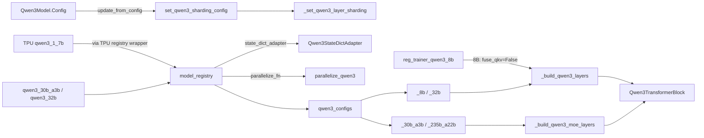

# Qwen3 model family - dense and MoE (torchtitan/models/qwen3)

<!-- connect:up:begin -->
> **Cross-repo concept:** part of [expert-parallelism](../../../concepts/expert-parallelism.md), [rematerialization](../../../concepts/rematerialization.md), [sequence-parallelism](../../../concepts/sequence-parallelism.md), [sharding](../../../concepts/sharding.md) across this wiki's repos.
<!-- connect:up:end -->
## Overview

The Qwen3 package covers both the dense Qwen3 line (0.6B-32B) and the Qwen3-MoE line (30B-A3B, 235B-A22B) with a single block type: [`Qwen3TransformerBlock`](../catalog/torchtitan/models/qwen3/model.md#Qwen3TransformerBlock "torchtitan/models/qwen3/model.py:L26") holds either a dense FFN or an MoE, decided purely by which sub-config is present. Two layer builders - [`_build_qwen3_layers`](../catalog/torchtitan/models/qwen3/__init__.md#_build_qwen3_layers "torchtitan/models/qwen3/__init__.py:L92") and [`_build_qwen3_moe_layers`](../catalog/torchtitan/models/qwen3/__init__.md#_build_qwen3_moe_layers "torchtitan/models/qwen3/__init__.py:L135") - produce per-layer configs, [`model_registry`](../catalog/torchtitan/models/qwen3/__init__.md#model_registry "torchtitan/models/qwen3/__init__.py:L697") packages them into a `ModelSpec`, and [`parallelize_qwen3`](../catalog/torchtitan/models/qwen3/parallelize.md#parallelize_qwen3 "torchtitan/models/qwen3/parallelize.py:L28") applies TP/EP, AC, compile and FSDP with a separate expert-data-parallel mesh. Relative to Llama 3 the architecture adds QK-norm, a fixed 128 head dim, and CosSin RoPE; relative to the stock torchtitan code, this fork adds a `fuse_qkv` knob that the TPU lane uses to avoid fused-QKV relayout copies.

## Diagram

Legend:
- `RECIPE` - [`qwen3_30b_a3b`](../catalog/torchtitan/models/qwen3/config_registry.md#qwen3_30b_a3b "torchtitan/models/qwen3/config_registry.py:L323"), [`qwen3_32b`](../catalog/torchtitan/models/qwen3/config_registry.md#qwen3_32b "torchtitan/models/qwen3/config_registry.py:L382")
- `TPU17` - [`qwen3_1_7b`](../catalog/torchtitan/experiments/tpu/qwen3/config_registry.md#qwen3_1_7b "torchtitan/experiments/tpu/qwen3/config_registry.py:L272")
- `TPU8` - [`reg_trainer_qwen3_8b`](../catalog/torchtitan/experiments/tpu/qwen3/config_registry.md#reg_trainer_qwen3_8b "torchtitan/experiments/tpu/qwen3/config_registry.py:L344")
- `REG` - [`model_registry`](../catalog/torchtitan/models/qwen3/__init__.md#model_registry "torchtitan/models/qwen3/__init__.py:L697")
- `TABLE` - [`qwen3_configs`](../catalog/torchtitan/models/qwen3/__init__.md#qwen3_configs "torchtitan/models/qwen3/__init__.py:L680")
- `MOEF` - [`_30b_a3b`](../catalog/torchtitan/models/qwen3/__init__.md#_30b_a3b "torchtitan/models/qwen3/__init__.py:L530"), [`_235b_a22b`](../catalog/torchtitan/models/qwen3/__init__.md#_235b_a22b "torchtitan/models/qwen3/__init__.py:L595")
- `DENSEF` - [`_8b`](../catalog/torchtitan/models/qwen3/__init__.md#_8b "torchtitan/models/qwen3/__init__.py:L378"), [`_32b`](../catalog/torchtitan/models/qwen3/__init__.md#_32b "torchtitan/models/qwen3/__init__.py:L448")
- `MOEL` - [`_build_qwen3_moe_layers`](../catalog/torchtitan/models/qwen3/__init__.md#_build_qwen3_moe_layers "torchtitan/models/qwen3/__init__.py:L135")
- `DENSE` - [`_build_qwen3_layers`](../catalog/torchtitan/models/qwen3/__init__.md#_build_qwen3_layers "torchtitan/models/qwen3/__init__.py:L92")
- `BLOCK` - [`Qwen3TransformerBlock`](../catalog/torchtitan/models/qwen3/model.md#Qwen3TransformerBlock "torchtitan/models/qwen3/model.py:L26")
- `CFG` - [`Config`](../catalog/torchtitan/models/qwen3/model.md#Qwen3Model.Config "torchtitan/models/qwen3/model.py:L84")
- `SHARD` - [`set_qwen3_sharding_config`](../catalog/torchtitan/models/qwen3/sharding.md#set_qwen3_sharding_config "torchtitan/models/qwen3/sharding.py:L38")
- `LSHARD` - [`_set_qwen3_layer_sharding`](../catalog/torchtitan/models/qwen3/sharding.md#_set_qwen3_layer_sharding "torchtitan/models/qwen3/sharding.py:L60")
- `PAR` - [`parallelize_qwen3`](../catalog/torchtitan/models/qwen3/parallelize.md#parallelize_qwen3 "torchtitan/models/qwen3/parallelize.py:L28")
- `SDA` - [`Qwen3StateDictAdapter`](../catalog/torchtitan/models/qwen3/state_dict_adapter.md#Qwen3StateDictAdapter "torchtitan/models/qwen3/state_dict_adapter.py:L26")

## Design rationale (why it's built this way)

**One block, two FFN kinds.** [`Qwen3TransformerBlock`](../catalog/torchtitan/models/qwen3/model.md#Qwen3TransformerBlock "torchtitan/models/qwen3/model.py:L26") sets `moe_enabled = config.moe is not None` and builds either `self.moe` or `self.feed_forward`. Everything downstream - sharding, FSDP, the HF adapter - keys off the same "is there an MoE sub-config" test, so dense and MoE flavors share attention, norms, RoPE and the parallelize function.

**Fused vs unfused QKV is a perf knob, not an architecture choice.** Every flavor builder except `debugmodel_non_fused_qkv` (which hard-wires `False` to keep coverage of the separate wq/wk/wv path) takes `fuse_qkv` (default `True`). The comment above [`qwen3_configs`](../catalog/torchtitan/models/qwen3/__init__.md#qwen3_configs "torchtitan/models/qwen3/__init__.py:L680") explains why the fork added it: "On TPU, `fuse_qkv=False` avoids the fused-QKV relayout copies in training and the full FSDP all-gather in `FusedQKVLinear._split_qkv_on_save` during RL weight sync." [`model_registry`](../catalog/torchtitan/models/qwen3/__init__.md#model_registry "torchtitan/models/qwen3/__init__.py:L697") forwards `fuse_qkv` only when it is not `None`, so the flavor default stays authoritative.

**Initialization follows Megatron's residual scaling for MoE.** [`_LINEAR_INIT`](../catalog/torchtitan/models/qwen3/__init__.md#_LINEAR_INIT._LINEAR_INIT "torchtitan/models/qwen3/__init__.py:L53") is `normal(std=0.02)`; the MoE builder scales the attention output projection and expert `w2` by `0.02 / sqrt(2 x n_layers)`, citing Megatron's initializer. Dense builders use plain `_LINEAR_INIT` for `wo`.

**MoE aux loss must know the global batch.** [`Config`](../catalog/torchtitan/models/qwen3/model.md#Qwen3Model.Config "torchtitan/models/qwen3/model.py:L84") refuses to guess: if a load-balance aux loss is configured, `update_from_config` raises unless both `local_global_batch_size` and `global_batch_size` are passed, because "a per-rank fallback silently makes the aux gradient dp-times too large."

**Sharding is declared for all axes, filtered at runtime.** [`set_qwen3_sharding_config`](../catalog/torchtitan/models/qwen3/sharding.md#set_qwen3_sharding_config "torchtitan/models/qwen3/sharding.py:L38"): dense sub-configs "are populated unconditionally - `Module.parallelize` filters disabled axes at runtime"; MoE sub-configs likewise with "`resolve_mesh` filters disabled axes".

> [!inferred]
> The TPU lane keeps this package unmodified and wraps it. `torchtitan/experiments/tpu/qwen3/__init__.py` defines its own registry that, for `("8B", "sdpa")`, builds a TPU 8B config via `_build_qwen3_layers(fuse_qkv=False, ...)` ("avoid running attention projection GEMMs as a single fused block on TPU") and otherwise delegates to the upstream `model_registry`. TPU recipes then replace `parallelize_fn` with a TPU wrapper that calls `parallelize_qwen3(..., skip_dp=True)`, configures per-parameter SimpleFSDP shard dims, and applies SimpleFSDP; under CP it also swaps in a TPU selective-AC policy. MaxText-parity recipes wrap the config in a subclass that reports MaxText FLOPs so MFU is comparable.

## Entry points

- [`model_registry`](../catalog/torchtitan/models/qwen3/__init__.md#model_registry "torchtitan/models/qwen3/__init__.py:L697") - the factory: `flavor`, `seq_len`, `attn_backend` (default `"flex"`), `moe_comm_backend` (`"standard"`, `"deepep"`), the fork's `fuse_qkv`, and `converters`. Returns a spec with `post_optimizer_build_fn=register_moe_load_balancing_hook` (expert-bias balancing) for every flavor.
- Upstream recipes: [`qwen3_debugmodel`](../catalog/torchtitan/models/qwen3/config_registry.md#qwen3_debugmodel "torchtitan/models/qwen3/config_registry.py:L40"), [`qwen3_0_6b`](../catalog/torchtitan/models/qwen3/config_registry.md#qwen3_0_6b "torchtitan/models/qwen3/config_registry.py:L203"), [`qwen3_1_7b`](../catalog/torchtitan/models/qwen3/config_registry.md#qwen3_1_7b "torchtitan/models/qwen3/config_registry.py:L233"), [`qwen3_14b`](../catalog/torchtitan/models/qwen3/config_registry.md#qwen3_14b "torchtitan/models/qwen3/config_registry.py:L288"), [`qwen3_32b`](../catalog/torchtitan/models/qwen3/config_registry.md#qwen3_32b "torchtitan/models/qwen3/config_registry.py:L382"), [`qwen3_30b_a3b`](../catalog/torchtitan/models/qwen3/config_registry.md#qwen3_30b_a3b "torchtitan/models/qwen3/config_registry.py:L323"), [`qwen3_moe_debug`](../catalog/torchtitan/models/qwen3/config_registry.md#qwen3_moe_debug "torchtitan/models/qwen3/config_registry.py:L427"), [`sft_qwen3_8b_math`](../catalog/torchtitan/models/qwen3/config_registry.md#sft_qwen3_8b_math "torchtitan/models/qwen3/config_registry.py:L512") - chosen by name on the command line.
- TPU recipes: [`reg_trainer_qwen3_8b`](../catalog/torchtitan/experiments/tpu/qwen3/config_registry.md#reg_trainer_qwen3_8b "torchtitan/experiments/tpu/qwen3/config_registry.py:L344") and the TPU [`qwen3_1_7b`](../catalog/torchtitan/experiments/tpu/qwen3/config_registry.md#qwen3_1_7b "torchtitan/experiments/tpu/qwen3/config_registry.py:L272") return a TPU trainer config built on this package's model config.
- [`Config`](../catalog/torchtitan/models/qwen3/model.md#Qwen3Model.Config "torchtitan/models/qwen3/model.py:L84") - its `update_from_config` is the trainer's hook for aux-loss scaling and sharding declarations.
- [`parallelize_qwen3`](../catalog/torchtitan/models/qwen3/parallelize.md#parallelize_qwen3 "torchtitan/models/qwen3/parallelize.py:L28") - the `parallelize_fn` called on the meta-device model.
- [`from_hf`](../catalog/torchtitan/models/qwen3/state_dict_adapter.md#Qwen3StateDictAdapter.from_hf "torchtitan/models/qwen3/state_dict_adapter.py:L131") / [`to_hf`](../catalog/torchtitan/models/qwen3/state_dict_adapter.md#Qwen3StateDictAdapter.to_hf "torchtitan/models/qwen3/state_dict_adapter.py:L56") - HF checkpoint import/export, including expert stacking.

## Mechanism (step-by-step)

1. **Flavor -> layer configs.** [`model_registry`](../catalog/torchtitan/models/qwen3/__init__.md#model_registry "torchtitan/models/qwen3/__init__.py:L697") reads `(builder, max_context_length)` from [`qwen3_configs`](../catalog/torchtitan/models/qwen3/__init__.md#qwen3_configs "torchtitan/models/qwen3/__init__.py:L680"), rejects a `seq_len` above it (40960 for real flavors, 4096 for debug, 128 for the test model), and calls the builder with only the keyword arguments that were set. Converters are order-validated and applied, then the spec is assembled with the shared LLM pipelining function and [`Qwen3StateDictAdapter`](../catalog/torchtitan/models/qwen3/state_dict_adapter.md#Qwen3StateDictAdapter "torchtitan/models/qwen3/state_dict_adapter.py:L26").

2. **Dense layers.** [`_build_qwen3_layers`](../catalog/torchtitan/models/qwen3/__init__.md#_build_qwen3_layers "torchtitan/models/qwen3/__init__.py:L92") builds, per layer, two [`_qwen3_norm`](../catalog/torchtitan/models/qwen3/__init__.md#_qwen3_norm "torchtitan/models/qwen3/__init__.py:L88") RMSNorms (eps 1e-6), a GQA attention with an explicit `head_dim` (128 for every real flavor, independent of `dim / n_heads`), a per-head QK-norm built from the same helper, the inner attention for `attn_backend`, and a SwiGLU FFN with an explicit `hidden_dim`. RoPE is CosSin with theta 1e6.

3. **MoE layers.** [`_build_qwen3_moe_layers`](../catalog/torchtitan/models/qwen3/__init__.md#_build_qwen3_moe_layers "torchtitan/models/qwen3/__init__.py:L135") keeps the same attention but replaces the FFN with an MoE config: a softmax top-k router with `route_norm=True`, grouped routed experts (`w1_EFD`, `w2_EDF`, `w3_EFD` stacked over experts) with a selectable `comm_backend` and optional non-blocking capacity factor, and `load_balance_coeff=1e-3` (aux-loss-free expert-bias balancing, applied by the post-optimizer hook). When `global_aux_loss_coeff` is set, every router instead gets a batch-wise aux loss - "Qwen's global-batch load-balance loss ... not make_moe_config's microbatch-wise loss" - which is what [`qwen3_30b_a3b_global_aux`](../catalog/torchtitan/models/qwen3/config_registry.md#qwen3_30b_a3b_global_aux "torchtitan/models/qwen3/config_registry.py:L358") selects.

4. **Job-config hook: aux loss scaling and sharding.** [`Config`](../catalog/torchtitan/models/qwen3/model.md#Qwen3Model.Config "torchtitan/models/qwen3/model.py:L84") runs the decoder update, then (when an aux loss exists) rescales it with the local and global batch sizes, PP flag and context length, and finally calls [`set_qwen3_sharding_config`](../catalog/torchtitan/models/qwen3/sharding.md#set_qwen3_sharding_config "torchtitan/models/qwen3/sharding.py:L38") with `enable_sp` and `enable_ep = expert_parallel_degree > 1`. Per layer, [`_set_qwen3_layer_sharding`](../catalog/torchtitan/models/qwen3/sharding.md#_set_qwen3_layer_sharding "torchtitan/models/qwen3/sharding.py:L60") shards attention and norms on every block, shards QK-norm on the head axis independent of SP (weight Replicate), shards the dense FFN only on dense blocks, and routes MoE blocks through the common MoE sharding with expert weights laid out as `S(1)` for `w1`/`w3` and `S(2)` for `w2`.

5. **Parallelize.** [`parallelize_qwen3`](../catalog/torchtitan/models/qwen3/parallelize.md#parallelize_qwen3 "torchtitan/models/qwen3/parallelize.py:L28") calls `model.parallelize(parallel_dims)` when TP or EP is on (or under `spmd_types`), configures MoE aux-loss reduction across the mesh, applies AC, then per-block compile, and returns early for inference with `skip_dp`. For training it resolves two meshes: the dense DP mesh (`dp_replicate` + `fsdp`) and, when EP is enabled, an expert DP mesh (`dp_replicate` + `efsdp`). Both go into the FSDP wrapper together with `ep_degree`, so expert parameters are sharded over the smaller expert-data-parallel group while dense parameters use the full DP group; precision comes from [`TrainingConfig`](../catalog/torchtitan/config/configs.md#TrainingConfig "torchtitan/config/configs.py:L36") and reshard/symmetric-memory policy from [`ParallelismConfig`](../catalog/torchtitan/config/configs.md#ParallelismConfig "torchtitan/config/configs.py:L123").

6. **Forward.** [`Qwen3TransformerBlock`](../catalog/torchtitan/models/qwen3/model.md#Qwen3TransformerBlock "torchtitan/models/qwen3/model.py:L26") computes `x = x + attention(attention_norm(x), masks, positions, segment_ids)`, then adds either `moe(ffn_norm(x))` or `feed_forward(ffn_norm(x))`. The branch is static per layer, so per-block compile sees no data-dependent control flow at the block level; routing dynamics live inside the MoE module.

7. **HF interop with stacked experts.** [`from_hf`](../catalog/torchtitan/models/qwen3/state_dict_adapter.md#Qwen3StateDictAdapter.from_hf "torchtitan/models/qwen3/state_dict_adapter.py:L131") validates CosSin RoPE, ties `lm_head` when needed, renames dense keys, and collects per-expert HF tensors (`mlp.experts.{e}.gate_proj` etc.) by layer to concatenate them into the grouped `w1_EFD`/`w3_EFD`/`w2_EDF` tensors - using DTensor-aware concatenation when `to_hf` previously recorded local expert indices (online, distributed), else plain stacking (offline conversion). [`to_hf`](../catalog/torchtitan/models/qwen3/state_dict_adapter.md#Qwen3StateDictAdapter.to_hf "torchtitan/models/qwen3/state_dict_adapter.py:L56") does the reverse, recording each grouped tensor's placements, shape and mesh so a later load can rebuild the same sharding. Unlike Llama 3, no Q/K permutation is needed because CosSin RoPE already uses HF's half-split layout.

8. **TPU recipes.** [`reg_trainer_qwen3_8b`](../catalog/torchtitan/experiments/tpu/qwen3/config_registry.md#reg_trainer_qwen3_8b "torchtitan/experiments/tpu/qwen3/config_registry.py:L344") takes the 8B config, unties embeddings and re-initializes the embedding with std 1.0, installs the TPU parallelize wrapper, and sets the TPU knobs: SimpleFSDP on a TPU-topology mesh, full AC, deferred-and-fused eager mode, `torch.compile(backend="tpu")` with `materialize_forward_before_backward` and a compiled grad norm, Splash attention with all block sizes at 1024, the loss kernel enabled, fp32 gradient reduce, 6 x 2048 tokens per microbatch. The TPU [`qwen3_1_7b`](../catalog/torchtitan/experiments/tpu/qwen3/config_registry.md#qwen3_1_7b "torchtitan/experiments/tpu/qwen3/config_registry.py:L272") is the small-scale sibling: Splash blocks at 512, loss kernel off, bf16 reduce, 1 x 2048 tokens.

## Key data structures

**Flavor table** ([`qwen3_configs`](../catalog/torchtitan/models/qwen3/__init__.md#qwen3_configs "torchtitan/models/qwen3/__init__.py:L680")):

| Flavor | dim | heads / kv | head_dim | layers | FFN / experts | tied | max ctx |
|---|---|---|---|---|---|---|---|
| testmodel | 128 | 8 / 8 | 16 | 3 | 256 | yes | 128 |
| debugmodel | 256 | 16 / 8 | 128 | 8 | 3072 | yes | 4096 |
| 0.6B | 1024 | 16 / 8 | 128 | 28 | 3072 | yes | 40960 |
| 1.7B | 2048 | 16 / 8 | 128 | 28 | 6144 | yes | 40960 |
| 4B | 2560 | 32 / 8 | 128 | 36 | 9728 | yes | 40960 |
| 8B | 4096 | 32 / 8 | 128 | 36 | 12288 | no | 40960 |
| 14B | 5120 | 40 / 8 | 128 | 40 | 17408 | no | 40960 |
| 32B | 5120 | 64 / 8 | 128 | 64 | 25600 | no | 40960 |
| debugmodel_moe | 256 | 16 / 8 | 128 | 8 | 64 experts, top-8, 768 | no | 4096 |
| 30B-A3B | 2048 | 32 / 4 | 128 | 48 | 128 experts, top-8, 768 | no | 40960 |
| 235B-A22B | 4096 | 64 / 4 | 128 | 94 | 128 experts, top-8, 1536 (RoPE theta 5e6) | no | 40960 |

Builders: [`_testmodel`](../catalog/torchtitan/models/qwen3/__init__.md#_testmodel "torchtitan/models/qwen3/__init__.py:L639"), [`_debugmodel`](../catalog/torchtitan/models/qwen3/__init__.md#_debugmodel "torchtitan/models/qwen3/__init__.py:L208"), [`_debugmodel_non_fused_qkv`](../catalog/torchtitan/models/qwen3/__init__.md#_debugmodel_non_fused_qkv "torchtitan/models/qwen3/__init__.py:L246"), [`_0_6b`](../catalog/torchtitan/models/qwen3/__init__.md#_0_6b "torchtitan/models/qwen3/__init__.py:L264"), [`_1_7b`](../catalog/torchtitan/models/qwen3/__init__.md#_1_7b "torchtitan/models/qwen3/__init__.py:L302"), [`_4b`](../catalog/torchtitan/models/qwen3/__init__.md#_4b "torchtitan/models/qwen3/__init__.py:L340"), [`_8b`](../catalog/torchtitan/models/qwen3/__init__.md#_8b "torchtitan/models/qwen3/__init__.py:L378"), [`_14b`](../catalog/torchtitan/models/qwen3/__init__.md#_14b "torchtitan/models/qwen3/__init__.py:L413"), [`_32b`](../catalog/torchtitan/models/qwen3/__init__.md#_32b "torchtitan/models/qwen3/__init__.py:L448"), [`_debugmodel_moe`](../catalog/torchtitan/models/qwen3/__init__.md#_debugmodel_moe "torchtitan/models/qwen3/__init__.py:L486"), [`_30b_a3b`](../catalog/torchtitan/models/qwen3/__init__.md#_30b_a3b "torchtitan/models/qwen3/__init__.py:L530"), [`_235b_a22b`](../catalog/torchtitan/models/qwen3/__init__.md#_235b_a22b "torchtitan/models/qwen3/__init__.py:L595").

**[`Config`](../catalog/torchtitan/models/qwen3/model.md#Qwen3Model.Config "torchtitan/models/qwen3/model.py:L84")** defaults [`dim`](../catalog/torchtitan/models/qwen3/model.md#Qwen3Model.Config.dim "torchtitan/models/qwen3/model.py:L85") to 1024 and vocab to 151936; its FLOP estimate is `6 x active params + quadratic attention`, with active params counting only top-k experts.

**Upstream large recipes** ([`qwen3_14b`](../catalog/torchtitan/models/qwen3/config_registry.md#qwen3_14b "torchtitan/models/qwen3/config_registry.py:L288"), [`qwen3_30b_a3b`](../catalog/torchtitan/models/qwen3/config_registry.md#qwen3_30b_a3b "torchtitan/models/qwen3/config_registry.py:L323"), [`qwen3_32b`](../catalog/torchtitan/models/qwen3/config_registry.md#qwen3_32b "torchtitan/models/qwen3/config_registry.py:L382")) are all FSDP-only (`data_parallel_shard_degree=-1`, TP/CP/PP = 1) with full AC; the MoE debug recipes set EP explicitly ([`qwen3_moe_debug`](../catalog/torchtitan/models/qwen3/config_registry.md#qwen3_moe_debug "torchtitan/models/qwen3/config_registry.py:L427") EP=1, [`qwen3_moe_deepep`](../catalog/torchtitan/models/qwen3/config_registry.md#qwen3_moe_deepep "torchtitan/models/qwen3/config_registry.py:L463") EP=4 with the DeepEP all-to-all).

## Dynamics (design intent)

- [`qwen3_moe_deepep`](../catalog/torchtitan/models/qwen3/config_registry.md#qwen3_moe_deepep "torchtitan/models/qwen3/config_registry.py:L463") documents that DeepEP's dispatch "takes the compact, host-synced, backward-able path", that EP=1 "falls back to local", that the training shape determines a fixed per-rank buffer capacity, and that numerics are "step-1 bitwise, reduction-order drift thereafter" vs the standard all-to-all. This path is GPU-only; the TPU lane uses its own token dispatcher (see [tpu-moe-dispatch-and-grouped-experts](tpu-moe-dispatch-and-grouped-experts.md)).
- [`qwen3_debugmodel_moe_param_groups`](../catalog/torchtitan/models/qwen3/config_registry.md#qwen3_debugmodel_moe_param_groups "torchtitan/models/qwen3/config_registry.py:L128") shows the per-parameter-group optimizer pattern: no weight decay on embeddings/output, a separate Adam with lower LR on `router.gate`.
- Quantized and attention-variant debug recipes - [`qwen3_debugmodel_nvfp4`](../catalog/torchtitan/models/qwen3/config_registry.md#qwen3_debugmodel_nvfp4 "torchtitan/models/qwen3/config_registry.py:L77"), [`qwen3_debugmodel_first_85_pct_layers_nvfp4`](../catalog/torchtitan/models/qwen3/config_registry.md#qwen3_debugmodel_first_85_pct_layers_nvfp4 "torchtitan/models/qwen3/config_registry.py:L99"), [`qwen3_8b_first_85_pct_layers_nvfp4`](../catalog/torchtitan/models/qwen3/config_registry.md#qwen3_8b_first_85_pct_layers_nvfp4 "torchtitan/models/qwen3/config_registry.py:L262"), [`qwen3_debugmodel_flex_flash`](../catalog/torchtitan/models/qwen3/config_registry.md#qwen3_debugmodel_flex_flash "torchtitan/models/qwen3/config_registry.py:L164") - keep the last 15% of layers and `lm_head` in bf16 for NVFP4, and pin `spmd_backend="spmd_types"`; `flex_flash` requires a Hopper/Blackwell GPU.
- [`qwen3_debugmodel_non_fused_qkv`](../catalog/torchtitan/models/qwen3/config_registry.md#qwen3_debugmodel_non_fused_qkv "torchtitan/models/qwen3/config_registry.py:L417") exists to keep "coverage for the separate wq/wk/wv path now that fuse_qkv defaults to True" - the path the TPU 8B config depends on.
- The TPU test suite (Evidence) covers CPU-vs-device parity for attention, dense FFN, MoE FFN and full blocks, TP/FSDP DTensor workers, SimpleFSDP shard-dim configuration, and graph-trainer recipes for 8B/32B/30B/235B that this package's configs feed.

## Edge cases

- Aux-loss configs without `local_global_batch_size` and `global_batch_size` raise `ValueError` in `update_from_config`; the stock trainer passes both, but custom harnesses must too.
- [`qwen3_30b_a3b_global_aux`](../catalog/torchtitan/models/qwen3/config_registry.md#qwen3_30b_a3b_global_aux "torchtitan/models/qwen3/config_registry.py:L358") defaults `seq_len` to 2048 and disables AC entirely; it expresses "12 sequences per DP rank and 768 sequences per train step" as token budgets.
- Tied flavors (test, debug, 0.6B-4B): `from_hf` copies `embed_tokens` into `lm_head` if missing; `to_hf` drops `lm_head`. The TPU recipes explicitly untie (`enable_weight_tying = False`).
- `to_hf` silently skips keys not in the map, so a renamed sub-module would be dropped from exports without error.
- The expert re-stacking path in `from_hf` only emits a grouped tensor once all experts of a layer are seen; a partial HF shard yields no entry for that layer.
- `_set_qwen3_layer_sharding` asserts the attention is a GQA config; a custom attention class must bring its own sharding.

## Open questions

- The MoE module internals (router, token dispatch, grouped GEMM, `set_moe_sharding_config`) are outside this packet; see [model-building-blocks](model-building-blocks.md) and [tpu-moe-dispatch-and-grouped-experts](tpu-moe-dispatch-and-grouped-experts.md).
- The TPU registry wrapper, TPU parallelize wrapper and SimpleFSDP shard-dim logic are not in this packet's subgraph, so they are described above only in `[!inferred]` form.
- Whether `fuse_qkv=False` should also be the TPU default for flavors other than 8B is not decided in source; only 8B is overridden.

## See also

- [llama3-model](llama3-model.md) - the dense reference built the same way.
- [qwen3-5-model](qwen3-5-model.md) - the hybrid linear/full-attention successor.
- [model-building-blocks](model-building-blocks.md), [model-spec-protocols](model-spec-protocols.md).
- [parallel-dims-and-parallelization](parallel-dims-and-parallelization.md) - meshes, including `efsdp` for experts.
- [tpu-moe-dispatch-and-grouped-experts](tpu-moe-dispatch-and-grouped-experts.md), [tpu-trainer-and-job-config](tpu-trainer-and-job-config.md), [tpu-graph-trainer](tpu-graph-trainer.md), [tpu-context-parallel-attention](tpu-context-parallel-attention.md), [tpu-pallas-kernels](tpu-pallas-kernels.md).
- [optimizers-and-lr-schedulers](optimizers-and-lr-schedulers.md) - the MoE load-balancing hook and param groups.
- [rl-training](rl-training.md) - the weight-sync path that motivated unfused QKV.
