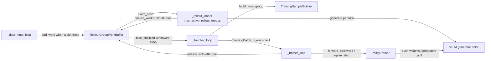
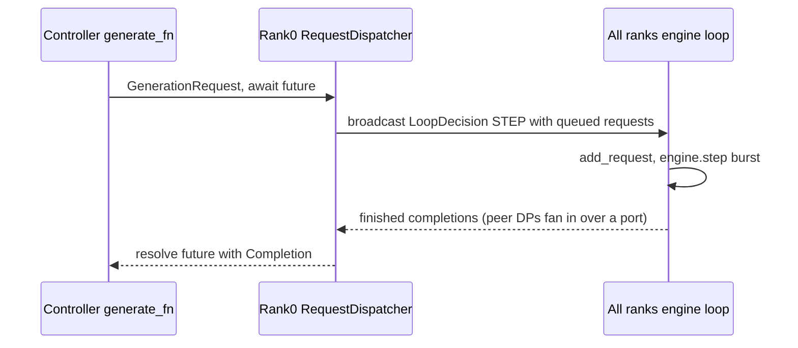

# TitanRL: asynchronous GRPO/DAPO training with disaggregated trainer and vLLM generators (experiments/rl)

<!-- connect:up:begin -->
> **Cross-repo concept:** part of [continuous-batching](../../../concepts/continuous-batching.md), [expert-parallelism](../../../concepts/expert-parallelism.md), [kv-cache](../../../concepts/kv-cache.md) across this wiki's repos.
<!-- connect:up:end -->
## Overview

`torchtitan/experiments/rl` ("TitanRL") is an on/off-policy RL post-training stack for LLMs. A single-process [`Controller`](../catalog/torchtitan/experiments/rl/controller.md#Controller "torchtitan/experiments/rl/controller.py:L260") ("Top-level RL async training orchestrator") drives two kinds of Monarch actors on separate process meshes: a [`PolicyTrainer`](../catalog/torchtitan/experiments/rl/actors/trainer.md#PolicyTrainer "torchtitan/experiments/rl/actors/trainer.py:L48") that runs a normal TorchTitan model with TorchTitan's parallelism, loss, optimizer and checkpointing, and one or more vLLM generator actor replicas that serve the **same TorchTitan model definition** inside vLLM. The README's headline claims are a "Unified model definition" (trainer and vLLM run mostly the same model code, so kernels are implemented once and train/inference mismatch is reduced), "Batch invariance" (bitwise-identical log-probs across DP layouts in supported configurations), and "One stack from pretraining to post-training."

The key design idea is **pipelined asynchrony with a bounded staleness budget**: data loading, rollout generation, batch packing and policy updates are independent asyncio loops connected by a fixed-capacity work buffer whose size, `(target_offpolicy_steps + 1) * num_prompts_per_train_step` groups, caps how far rollouts can lag the trainer's weights. Weight publishing from trainer to generators is overlapped with the next step's forward/backward. Throughput comes from keeping generators and trainer both busy; correctness comes from the buffer bound and from importance-ratio clipping in the loss.

**TPU scope:** nothing in this experiment targets TPU. Mesh provisioning assigns `CUDA_VISIBLE_DEVICES` ranges ([`PerHostProvisioner`](../catalog/torchtitan/experiments/rl/train.md#PerHostProvisioner "torchtitan/experiments/rl/train.py:L102")), the generator is vLLM with CUDA graphs, attention is FlashAttention varlen or flex, and weight sync uses TorchStore. It belongs in a TPU-performance reading as the reference for how TorchTitan structures RL, not as a runnable TPU path.

## Diagram

The four controller loops and the buffer that couples them (adapted from the controller module docstring):

Legend:
- `DATA` - (concept) the controller's data-input loop, which awaits a free slot then reads one prompt from the rollouter
- `BUF` - (concept) the active-slot work buffer sized by [`AsyncLoopConfig`](../catalog/torchtitan/experiments/rl/controller.md#AsyncLoopConfig "torchtitan/experiments/rl/controller.py:L155")
- `RL` - [`_rollout_loop`](../catalog/torchtitan/experiments/rl/controller.md#Controller._rollout_loop "torchtitan/experiments/rl/controller.py:L949")
- `GEN` - (concept) the vLLM generator actor (one per generator process mesh)
- `BAT` - (concept) the controller's batcher loop
- `TSB` - [`build_from_group`](../catalog/torchtitan/experiments/rl/components/training_sample_builder.md#TrainingSampleBuilder.build_from_group "torchtitan/experiments/rl/components/training_sample_builder.py:L56")
- `TR` - (concept) the controller's trainer loop, the only finite loop
- `PT` - [`PolicyTrainer`](../catalog/torchtitan/experiments/rl/actors/trainer.md#PolicyTrainer "torchtitan/experiments/rl/actors/trainer.py:L48")

Inside one generator replica (DP x TP ranks), request intake is decoupled from the SPMD engine loop:

## Design rationale (why it's built this way)

- **Disaggregated trainer and generators.** Generation and training have different optimal parallelism, so they run on separately sized meshes: the trainer uses the full training `ParallelismConfig` (FSDP/TP/EP/CP), while each generator uses an [`InferenceParallelismConfig`](../catalog/torchtitan/experiments/rl/models/vllm_registry.md#InferenceParallelismConfig "torchtitan/experiments/rl/models/vllm_registry.py:L52") - "a focused subset" with pure DP replication (vLLM "skips FSDP/DDP"), TP, EP and optional SP, and no CP/PP. The example [`rl_grpo_qwen3_0_6b_varlen`](../catalog/torchtitan/experiments/rl/examples/alphabet_sort/config_registry.md#rl_grpo_qwen3_0_6b_varlen "torchtitan/experiments/rl/examples/alphabet_sort/config_registry.py:L86") ("6 GPUs: 4 gen + 2 train") shows the typical asymmetry: trainer TP=2, generator TP=4. `num_generators` adds whole replicas behind a router.
- **Bounded off-policy via slot accounting, not timestamps.** [`AsyncLoopConfig`](../catalog/torchtitan/experiments/rl/controller.md#AsyncLoopConfig "torchtitan/experiments/rl/controller.py:L155") sizes the buffer at `B = (S + 1) * P` groups (S = `target_offpolicy_steps`, P = `num_prompts_per_train_step`). Slots are released only after the trainer's weights have been pulled into generators, so "no sample will be born stale". A windowed FIFO (`window_fraction`, default 0.3, citing the arXiv paper in its docstring) lets the batcher skip an unfinished head-of-line group; the hard bound becomes `max_offpolicy_steps = (B + W - 2) // P`. `target_offpolicy_steps = 0` gives synchronous on-policy training.
- **One rollout worker per slot.** `run()` spawns `max_active_rollout_groups` rollout tasks so "generation [can] fill the whole windowed FIFO range, including the cold start". The generator's `max_num_seqs` ceiling is derived from the same number: `min(ceil(B * num_samples_per_prompt / generator_dp_shards), 512)`, so vLLM's batch capacity matches the maximum concurrent rollouts.
- **Overlap weight sync with compute.** The trainer loop's docstring: trainer push "Called after optimizer.step(), Awaited before next optimizer.step"; generator pull "Called after push completes, Awaited before next push." Push stages the state dict GPU -> CPU (`direct_rdma=False`) so the trainer's GPU copy is free immediately and any number of generators can read it; trainer weights are cast to the generator dtype on the way out (buffers excluded).
- **Decoupled request intake in the generator.** The generator actor's class docstring: "vLLM `engine.step`, which is a TP collective, and the request-intake are decoupled, so a new request can join mid-flight, instead of waiting for the current batch to drain" - continuous batching across concurrent multi-turn rollouts. Weight pulls ride the same loop between step bursts and by default do not drain in-flight requests ("hotswap"); the router's `hot_swap=False` instead drains each generator before its pull, and the controller then requires `reset_prefix_cache_on_weight_sync`, because otherwise requests admitted after a pull would reuse KV cached under the old weights.
- **Losses normalize by global valid tokens.** [`DAPOLoss`](../catalog/torchtitan/experiments/rl/losses/dapo.md#DAPOLoss "torchtitan/experiments/rl/losses/dapo.py:L23") divides the summed per-token loss by `global_valid_tokens` "so gradient accumulation matches a single large batch". The cost, noted in the trainer loop, is that microbatches cannot be streamed into the trainer before the whole step is packed.
- **Batch invariance as a debugging mode.** The README is explicit that it "trades throughput for exact numerics". `Controller.Config.__post_init__` enforces its preconditions: deterministic mode, bf16 trainer forward via FSDP mixed precision (`mixed_precision_param == "bfloat16"`), a bf16 generator, no sequence parallel, and no ROCm.

## Entry points

- [`main`](../catalog/torchtitan/experiments/rl/train.md#main "torchtitan/experiments/rl/train.py:L273") - `python -m torchtitan.experiments.rl.train --module <pkg> --config <fn>`. Parses a `Controller.Config`, computes the trainer world size (product of all training parallel degrees) and per-generator world size (`dp * tp`), spawns the trainer and generator process meshes, then awaits `setup_async` and `run`.
- [`Controller`](../catalog/torchtitan/experiments/rl/controller.md#Controller "torchtitan/experiments/rl/controller.py:L260") - built from the config; `setup_async` spawns actors and does the initial weight push/pull, `run` starts the four loops and returns when the trainer loop finishes `num_training_steps`.
- Config registry functions such as [`rl_grpo_qwen3_0_6b_varlen`](../catalog/torchtitan/experiments/rl/examples/alphabet_sort/config_registry.md#rl_grpo_qwen3_0_6b_varlen "torchtitan/experiments/rl/examples/alphabet_sort/config_registry.py:L86"), [`rl_grpo_qwen3_30b_a3b_varlen`](../catalog/torchtitan/experiments/rl/examples/alphabet_sort/config_registry.md#rl_grpo_qwen3_30b_a3b_varlen "torchtitan/experiments/rl/examples/alphabet_sort/config_registry.py:L785"), [`_qwen3_4b_dapo_math_config`](../catalog/torchtitan/experiments/rl/examples/dapo_math/config_registry.md#_qwen3_4b_dapo_math_config "torchtitan/experiments/rl/examples/dapo_math/config_registry.py:L46") and [`rl_grpo_qwen3_30b_a3b_deepep_search_r1_perf`](../catalog/torchtitan/experiments/rl/examples/search_r1/config_registry.md#rl_grpo_qwen3_30b_a3b_deepep_search_r1_perf "torchtitan/experiments/rl/examples/search_r1/config_registry.py:L173") - what `--config` names; each returns a full `Controller.Config` (model spec, rollouter, trainer, generator, async loop).
- [`PolicyTrainer`](../catalog/torchtitan/experiments/rl/actors/trainer.md#PolicyTrainer "torchtitan/experiments/rl/actors/trainer.py:L48") endpoints `forward_backward`, `optim_step`, `push_model_state_dict`, `save_checkpoint` - called by the trainer loop, plus one initial `push_model_state_dict` from `setup_async`.
- [`_run_single_rollout`](../catalog/torchtitan/experiments/rl/rollout/rollouter.md#RolloutWorker._run_single_rollout "torchtitan/experiments/rl/rollout/rollouter.py:L370") - the per-rollout env/generator alternation; the documented override point for custom multi-turn logic (the Verifiers example overrides it as [`_run_single_rollout`](../catalog/torchtitan/experiments/rl/examples/verifiers/components/rollouter.md#VerifiersRollouter._run_single_rollout "torchtitan/experiments/rl/examples/verifiers/components/rollouter.py:L268") to delegate to an external environment).

## Mechanism (step-by-step)

1. **Provision meshes and spawn actors.** [`main`](../catalog/torchtitan/experiments/rl/train.md#main "torchtitan/experiments/rl/train.py:L273") carves GPUs with [`PerHostProvisioner`](../catalog/torchtitan/experiments/rl/train.md#PerHostProvisioner "torchtitan/experiments/rl/train.py:L102") ("Allocates non-overlapping GPU ranges within a single host"), e.g. GPUs 0-3 for training and 4-7 for generation, exported per process mesh as `CUDA_VISIBLE_DEVICES`. `Controller.setup_async` records [`trainer_dp_degree`](../catalog/torchtitan/experiments/rl/controller.md#Controller.trainer_dp_degree "torchtitan/experiments/rl/controller.py:L569") (`dp_replicate * dp_shard`, used by the batcher to split each step across DP ranks), computes the generators' `max_num_seqs`, spawns the trainer, generators and a single-process router (on its own mesh "so routing does not contend with the training loop for the controller's GIL"), initializes TorchStore with storage volumes colocated on the trainer mesh, restores `policy_version` from a checkpoint if present, starts every generator's engine loop, and performs the initial trainer push and generator pull.

2. **Trainer construction.** [`PolicyTrainer`](../catalog/torchtitan/experiments/rl/actors/trainer.md#PolicyTrainer "torchtitan/experiments/rl/actors/trainer.py:L48") is a regular TorchTitan training process inside an actor: it enables batch invariance before process-group init if requested, builds `ParallelDims`, builds the model on the meta device, runs the model spec's `parallelize_fn` with the trainer's activation-checkpoint config (default [`SelectiveAC`](../catalog/torchtitan/distributed/activation_checkpoint.md#SelectiveAC "torchtitan/distributed/activation_checkpoint.py:L187")), materializes and initializes weights, then builds optimizers, [`LRSchedulersContainer`](../catalog/torchtitan/components/optimizer/lr_scheduler.md#LRSchedulersContainer "torchtitan/components/optimizer/lr_scheduler.py:L25") and a [`CheckpointManager`](../catalog/torchtitan/components/checkpointer/dcp.md#CheckpointManager "torchtitan/components/checkpointer/dcp.py:L89") that loads HF weights. Only varlen or [`FlexInnerAttention`](../catalog/torchtitan/models/common/attention.md#FlexInnerAttention "torchtitan/models/common/attention.py:L233") backends are accepted (packed variable-length documents). A [`ChunkedLossWrapper`](../catalog/torchtitan/components/loss.md#ChunkedLossWrapper "torchtitan/components/loss.py:L515") loss takes ownership of the LM head and the model skips it, so full-vocab logits are never materialized at once.

3. **Rollout generation.** Each [`_rollout_loop`](../catalog/torchtitan/experiments/rl/controller.md#Controller._rollout_loop "torchtitan/experiments/rl/controller.py:L949") task claims a waiting work item and asks the rollouter to run one group of `num_samples_per_prompt` sibling rollouts. Each sibling is produced by [`_run_single_rollout`](../catalog/torchtitan/experiments/rl/rollout/rollouter.md#RolloutWorker._run_single_rollout "torchtitan/experiments/rl/rollout/rollouter.py:L370"), which alternates env steps and generate calls until the env reports a terminal status; generate calls go through the router with a `routing_session_id` so a rollout's turns stick to one generator and reuse its prefix KV cache. Rewards are attached by the rubric, then [`AdvantageEstimator`](../catalog/torchtitan/experiments/rl/rollout/advantage.md#AdvantageEstimator "torchtitan/experiments/rl/rollout/advantage.py:L22") computes `A_i = (r_i - mean(r)) / denom` within the group (`denom = std + 1e-6` when `should_std_normalize`, else 1.0 - "Dr.GRPO mean-baseline" is the default). A group that raises becomes an empty [`RolloutGroup`](../catalog/torchtitan/experiments/rl/rollout/types.md#RolloutGroup "torchtitan/experiments/rl/rollout/types.py:L166") carrying a failure metric; [`compute_rollout_metrics`](../catalog/torchtitan/experiments/rl/controller_metrics.md#compute_rollout_metrics "torchtitan/experiments/rl/controller_metrics.py:L216") attaches lengths, truncation and reward breakdowns.

4. **Generator engine loop.** On a generator, a `generate` call only enqueues a [`GenerationRequest`](../catalog/torchtitan/experiments/rl/actors/generator.md#GenerationRequest "torchtitan/experiments/rl/actors/generator.py:L1450") on rank 0 and awaits a future. Every rank runs a background engine loop: rank 0 decides the next action and broadcasts it; all ranks add the requests and run a burst of `engine.step()` calls (a TP collective); finished requests resolve their futures individually, not per batch. With DP > 1, [`RequestDispatcher`](../catalog/torchtitan/experiments/rl/actors/generator.md#RequestDispatcher "torchtitan/experiments/rl/actors/generator.py:L352") routes requests to a DP replica and the replica's `tp_rank=0` fans completed outputs back to rank 0 over a port (layout `global_rank = dp_rank * tp_degree + tp_rank`, reused unchanged for EP).

5. **Batch building.** The batcher loop takes the oldest finalized group the windowed FIFO allows and calls [`build_from_group`](../catalog/torchtitan/experiments/rl/components/training_sample_builder.md#TrainingSampleBuilder.build_from_group "torchtitan/experiments/rl/components/training_sample_builder.py:L56"), which drops failed groups, groups where any sibling produced no completion tokens, and (by default) zero-reward-variance groups ("no learning signal across siblings"); dropped groups release their slot immediately. Surviving rollouts are packed by [`rollout_to_training_samples`](../catalog/torchtitan/experiments/rl/components/training_sample_builder.md#TrainingSampleBuilder.rollout_to_training_samples "torchtitan/experiments/rl/components/training_sample_builder.py:L168"): turns sharing a growing prefix become one sequence with prompts and env replies masked out of the loss, and a new sample opens wherever the prefix breaks (history compaction, stripped thinking, retokenization); each sample records the min/max policy version of its turns. The packer accumulates `num_prompts_per_train_step` trainable groups, splits them into per-DP-rank microbatches of `num_tokens_per_microbatch_per_dp_rank`, and puts one `TrainingBatch` on a size-1 queue.

6. **Train step and weight sync.** The trainer loop takes a batch, computes policy-age metrics against the live trainer version, and calls `forward_backward` once per microbatch (each DP rank picks its slice) followed by `optim_step`. In `forward_backward`, the model runs with varlen/flex attention masks built from positions, then the loss - [`GRPOLoss`](../catalog/torchtitan/experiments/rl/losses/grpo.md#GRPOLoss "torchtitan/experiments/rl/losses/grpo.py:L17") (DAPO with a symmetric `clip_eps`) or [`DAPOLoss`](../catalog/torchtitan/experiments/rl/losses/dapo.md#DAPOLoss "torchtitan/experiments/rl/losses/dapo.py:L23") (independent `ratio_clip_low` / `ratio_clip_high`, e.g. 0.2 / 0.28 for "clip-higher") - computes per-token `-min(ratio * A, clip(ratio) * A)` with `ratio = exp(clamp(logp_trainer - logp_generator, -10, 10))`, masking tokens whose generator log-prob is non-finite, and divides by the global valid-token count. `optim_step` clips the global grad norm, steps optimizer and scheduler, zeroes grads, and bumps `policy_version`. Before `optim_step` the loop waits for the previous push to finish (the push reads the weights the optimizer is about to change); after it, the loop waits for the previous pull, then starts this version's push -> pull -> slot release in the background, overlapping it with the next step's forward/backward.

## Key data structures

| Structure | Holds | Why it matters |
|---|---|---|
| [`AsyncLoopConfig`](../catalog/torchtitan/experiments/rl/controller.md#AsyncLoopConfig "torchtitan/experiments/rl/controller.py:L155") | `num_training_steps`, `num_prompts_per_train_step` (P), `num_samples_per_prompt` (group size), `target_offpolicy_steps` (S), `window_fraction`, buffer/builder/batcher/validation configs; derived `max_active_rollout_groups`, `window_size`, `max_offpolicy_steps` | The throughput-vs-staleness dial and the generator concurrency ceiling. |
| [`InferenceParallelismConfig`](../catalog/torchtitan/experiments/rl/models/vllm_registry.md#InferenceParallelismConfig "torchtitan/experiments/rl/models/vllm_registry.py:L52") | `data_parallel_degree`, `tensor_parallel_degree`, `expert_parallel_degree`, `enable_sequence_parallel`, `spmd_backend` | Translated to a training `ParallelismConfig` (vLLM DP carried on `dp_shard` so EP divides it) before `parallelize_fn` runs inside vLLM. |
| [`Rollout`](../catalog/torchtitan/experiments/rl/rollout/types.md#Rollout "torchtitan/experiments/rl/rollout/types.py:L133") | `group_id`, `rollout_id`, ordered turns (each with its full prompt), status, reward, reward breakdown, advantage | Turns store full prompts (O(turns^2) tokens, noted as a TODO) so branching can be detected at packing time. |
| [`RolloutGroup`](../catalog/torchtitan/experiments/rl/rollout/types.md#RolloutGroup "torchtitan/experiments/rl/rollout/types.py:L166") | `group_id`, sibling rollouts, metrics | The unit of buffer accounting and advantage centering. |
| [`GenerationRequest`](../catalog/torchtitan/experiments/rl/actors/generator.md#GenerationRequest "torchtitan/experiments/rl/actors/generator.py:L1450") | `request_id`, prompt token ids, sampling config, routing session id | Picklable so it can be broadcast inside an engine-loop decision. |

## Dynamics (design intent)

- **The trainer is the clock.** Producer loops run forever; `run()` waits on the first completed task, treats a finished producer as a crash, and on exit closes the buffer (waking buffer waiters) then cancels tasks (waking queue waiters). A non-finite mean loss stops training before the checkpoint for that step is written.
- **Observed staleness can undershoot the target.** The `target_offpolicy_steps` docstring: when generation is the bottleneck "the buffer may not fill and observed offpolicy steps will be lower"; strict FIFO never exceeds the target, windowed FIFO may, up to `max_offpolicy_steps`.
- **Where the step blocks.** Timing metrics separate `wait_for_training_batch` (generation-bound), `forward_backward`, `optim`, and the two `blocking_*` weight-sync waits, so a profile of step time immediately shows which side of the disaggregation is the bottleneck.
- **Parity tests.** [`build_trainer_model`](../catalog/torchtitan/experiments/rl/tests/test_bitwise_parity.md#build_trainer_model "torchtitan/experiments/rl/tests/test_bitwise_parity.py:L102") and [`build_inference_engine`](../catalog/torchtitan/experiments/rl/tests/test_bitwise_parity.md#build_inference_engine "torchtitan/experiments/rl/tests/test_bitwise_parity.py:L206") build the trainer model and a vLLM engine from the same RL config so the bitwise-parity test can compare their log-probs; batch-invariant recipes such as [`rl_grpo_qwen3_0_6b_varlen_batch_invariant`](../catalog/torchtitan/experiments/rl/examples/alphabet_sort/config_registry.md#rl_grpo_qwen3_0_6b_varlen_batch_invariant "torchtitan/experiments/rl/examples/alphabet_sort/config_registry.py:L886") and [`rl_grpo_qwen3_moe_debug_varlen_batch_invariant`](../catalog/torchtitan/experiments/rl/examples/alphabet_sort/config_registry.md#rl_grpo_qwen3_moe_debug_varlen_batch_invariant "torchtitan/experiments/rl/examples/alphabet_sort/config_registry.py:L693") exercise dense and MoE-EP layouts.

## Edge cases

- **`training.num_tokens_per_train_step` is ignored**; optimizer-step boundaries come from `async_loop.num_prompts_per_train_step` (a warning is emitted if it is set).
- **No pipeline parallelism** in the trainer (`forward_backward` requires exactly one model part) and no CP/PP in generators.
- **SP requires divisibility**: `max_context_length % tensor_parallel_degree == 0` when sequence parallel is on.
- **Generator checkpointing must be disabled**; generators always receive weights from the trainer via TorchStore.
- **Partial resume.** Only model, optimizer and `policy_version` are restored; in-flight rollouts and the dataset position are not (noted as a TODO in `setup_async`).
- **Non-finite generator log-probs** (e.g. under CUDA graphs) drop those tokens from both the loss and its denominator rather than training them as on-policy.
- **Compile backend.** The example recipes use `CompileConfig(backend="aot_eager")` for both sides; the controller notes Inductor "crashes the vLLM engine on the shared model path". The DeepEP perf recipe disables compile entirely and relies on CUDA-only fused-SwiGLU / Helion RoPE overrides.

## Open questions

- Several central components are outside the packet subgraph and cannot be cited: the generator actor itself (`VLLMGenerator`, `actors/generator.py`), the `RolloutGroupWorkBuffer`, the `Batcher`, the `WeightSyncManager`, the `InterGeneratorRouter` and its routing strategies, the `Rollouter` base class's `run_group_rollouts`, and the batch-invariance toggle `set_batch_invariance`. Their behavior above is described from source and docstrings.
- Whether any part of this loop could drive a TPU generator or trainer is not addressed in the repo; the trainer is device-generic TorchTitan code, but provisioning, vLLM integration and weight transfer are CUDA-specific here.
- The README notes unified-model performance "can trail native vLLM in inference-only workloads but outperform it end to end in some RL configurations"; no benchmark data is checked in.

## See also

- [trainer-and-train-loop](trainer-and-train-loop.md) - the core trainer whose components `PolicyTrainer` reuses
- [training-components](training-components.md), [optimizers-and-lr-schedulers](optimizers-and-lr-schedulers.md), [checkpointing](checkpointing.md)
- [parallel-dims-and-parallelization](parallel-dims-and-parallelization.md) - how trainer and generator parallelism configs become meshes
- [qwen3-model](qwen3-model.md), [qwen3-5-model](qwen3-5-model.md), [gpt-oss-model](gpt-oss-model.md), [muse-glimmer-model](muse-glimmer-model.md) - models used by the RL recipes
- [observability](observability.md) - structured logger and metrics used by the RL loop
