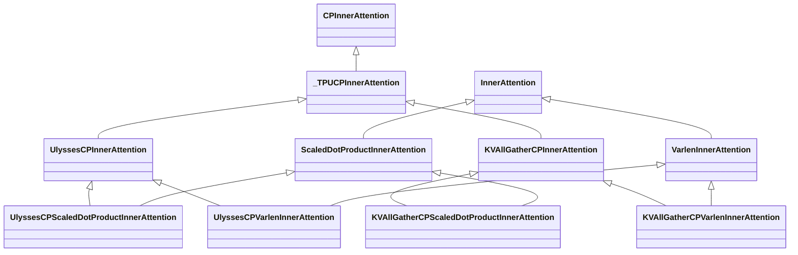
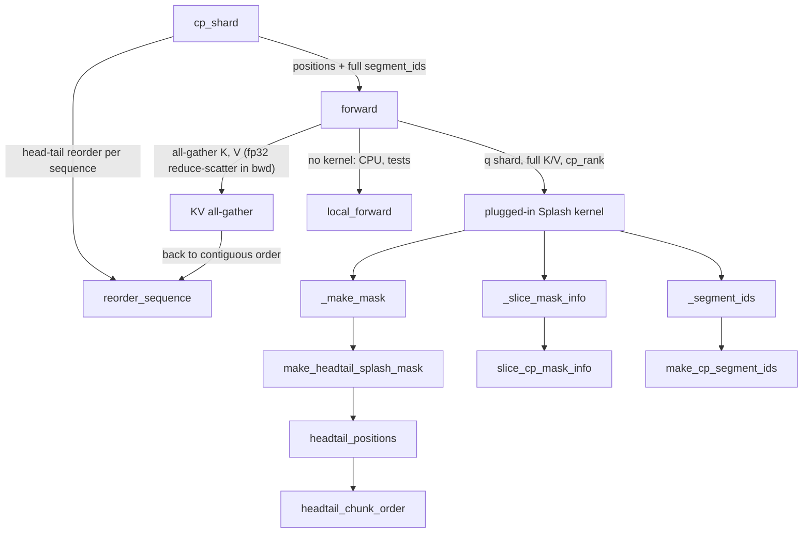

# TPU context-parallel attention (head-tail KV all-gather and Ulysses CP)

<!-- connect:up:begin -->
> **Cross-repo concept:** part of [splash-attention](../../../concepts/splash-attention.md) across this wiki's repos.
<!-- connect:up:end -->
## Overview

Core TorchTitan models context parallelism (CP) as a property of the *inner attention*: an inner attention that subclasses [`CPInnerAttention`](../catalog/torchtitan/models/common/cp_attention.md#CPInnerAttention "torchtitan/models/common/cp_attention.py:L39") ("Inner attention that owns its context-parallel behavior") must say how to shard the model inputs (`cp_shard`) and what collectives to run around attention (`forward`). The core CP classes are built on [`FlexInnerAttention`](../catalog/torchtitan/models/common/attention.md#FlexInnerAttention "torchtitan/models/common/attention.py:L233"), which does not run on TPU, so the TPU lane supplies its own pair of strategies as **mixins** that wrap the single-device [`ScaledDotProductInnerAttention`](../catalog/torchtitan/models/common/attention.md#ScaledDotProductInnerAttention "torchtitan/models/common/attention.py:L393") and [`VarlenInnerAttention`](../catalog/torchtitan/models/common/attention.md#VarlenInnerAttention "torchtitan/models/common/attention.py:L137"):

- **`all_gather`** - [`KVAllGatherCPInnerAttention`](../catalog/torchtitan/experiments/tpu/cp_attention.md#KVAllGatherCPInnerAttention "torchtitan/experiments/tpu/cp_attention.py:L433"), "MaxText-style load-balanced KV All-Gather". Q stays sequence-sharded (S / cp tokens, all heads), K and V are all-gathered to the full sequence, and the attention kernel runs with a causal mask whose Q rows are in **head-tail** order.
- **`ulysses`** - [`UlyssesCPInnerAttention`](../catalog/torchtitan/experiments/tpu/cp_attention.md#UlyssesCPInnerAttention "torchtitan/experiments/tpu/cp_attention.py:L322"), all-to-all from token-sharded to head-sharded, full-sequence attention on H / cp heads, all-to-all back.

The key design idea for TPU performance is that **the fast kernel (Splash or Tokamax Splash) is never CP-aware by itself**: the CP mixin keeps all collectives and the head-tail bookkeeping, and the kernel is plugged in at runtime as the "local attention". For KV all-gather, the kernel sees each rank's S / cp queries against all S keys, and is made correct by permuting its mask's `q_sequence` into head-tail order and slicing its precomputed `MaskInfo` to the rank's shard with a runtime rank tensor - so every rank runs the same compiled program.

## Diagram

Class structure: each concrete TPU CP attention is a strategy mixin plus the single-device inner attention it wraps.

Legend:
- `CPInnerAttention` - [`CPInnerAttention`](../catalog/torchtitan/models/common/cp_attention.md#CPInnerAttention "torchtitan/models/common/cp_attention.py:L39")
- `_TPUCPInnerAttention` - [`_TPUCPInnerAttention`](../catalog/torchtitan/experiments/tpu/cp_attention.md#_TPUCPInnerAttention "torchtitan/experiments/tpu/cp_attention.py:L303")
- `UlyssesCPInnerAttention` - [`UlyssesCPInnerAttention`](../catalog/torchtitan/experiments/tpu/cp_attention.md#UlyssesCPInnerAttention "torchtitan/experiments/tpu/cp_attention.py:L322")
- `KVAllGatherCPInnerAttention` - [`KVAllGatherCPInnerAttention`](../catalog/torchtitan/experiments/tpu/cp_attention.md#KVAllGatherCPInnerAttention "torchtitan/experiments/tpu/cp_attention.py:L433")
- `InnerAttention` - [`InnerAttention`](../catalog/torchtitan/models/common/attention.md#InnerAttention "torchtitan/models/common/attention.py:L129")
- `ScaledDotProductInnerAttention` - [`ScaledDotProductInnerAttention`](../catalog/torchtitan/models/common/attention.md#ScaledDotProductInnerAttention "torchtitan/models/common/attention.py:L393")
- `VarlenInnerAttention` - [`VarlenInnerAttention`](../catalog/torchtitan/models/common/attention.md#VarlenInnerAttention "torchtitan/models/common/attention.py:L137")
- `UlyssesCPScaledDotProductInnerAttention` - [`UlyssesCPScaledDotProductInnerAttention`](../catalog/torchtitan/experiments/tpu/cp_attention.md#UlyssesCPScaledDotProductInnerAttention "torchtitan/experiments/tpu/cp_attention.py:L854")
- `UlyssesCPVarlenInnerAttention` - [`UlyssesCPVarlenInnerAttention`](../catalog/torchtitan/experiments/tpu/cp_attention.md#UlyssesCPVarlenInnerAttention "torchtitan/experiments/tpu/cp_attention.py:L863")
- `KVAllGatherCPScaledDotProductInnerAttention` - [`KVAllGatherCPScaledDotProductInnerAttention`](../catalog/torchtitan/experiments/tpu/cp_attention.md#KVAllGatherCPScaledDotProductInnerAttention "torchtitan/experiments/tpu/cp_attention.py:L872")
- `KVAllGatherCPVarlenInnerAttention` - [`KVAllGatherCPVarlenInnerAttention`](../catalog/torchtitan/experiments/tpu/cp_attention.md#KVAllGatherCPVarlenInnerAttention "torchtitan/experiments/tpu/cp_attention.py:L883")

KV all-gather data path for one training step (input sharding once, then per attention layer):

Legend:
- `CPS` - [`cp_shard`](../catalog/torchtitan/experiments/tpu/cp_attention.md#KVAllGatherCPInnerAttention.cp_shard "torchtitan/experiments/tpu/cp_attention.py:L498")
- `RS` - [`reorder_sequence`](../catalog/torchtitan/experiments/tpu/cp_attention.md#reorder_sequence "torchtitan/experiments/tpu/cp_attention.py:L207")
- `FWD` - [`forward`](../catalog/torchtitan/experiments/tpu/cp_attention.md#KVAllGatherCPInnerAttention.forward "torchtitan/experiments/tpu/cp_attention.py:L712")
- `AG` - (concept) the K/V all-gather collective with its reduce-scatter backward
- `KERN` - (concept) the Splash / Tokamax Splash wrapper installed via `set_local_attention`
- `LF` - [`local_forward`](../catalog/torchtitan/experiments/tpu/cp_attention.md#KVAllGatherCPInnerAttention.local_forward "torchtitan/experiments/tpu/cp_attention.py:L590")
- `MASK` - [`_make_mask`](../catalog/torchtitan/experiments/tpu/kernels/splash_attention.md#_make_mask "torchtitan/experiments/tpu/kernels/splash_attention.py:L124") (stock Splash; Tokamax has a twin [`_make_mask`](../catalog/torchtitan/experiments/tpu/kernels/tokamax_splash_attention.md#_make_mask "torchtitan/experiments/tpu/kernels/tokamax_splash_attention.py:L69"))
- `HTM` - [`make_headtail_splash_mask`](../catalog/torchtitan/experiments/tpu/headtail.md#make_headtail_splash_mask "torchtitan/experiments/tpu/headtail.py:L45")
- `HTP` - [`headtail_positions`](../catalog/torchtitan/experiments/tpu/headtail.md#headtail_positions "torchtitan/experiments/tpu/headtail.py:L21")
- `HCO` - [`headtail_chunk_order`](../catalog/torchtitan/experiments/tpu/headtail.md#headtail_chunk_order "torchtitan/experiments/tpu/headtail.py:L16")
- `SLM` - [`_slice_mask_info`](../catalog/torchtitan/experiments/tpu/kernels/splash_attention.md#_slice_mask_info "torchtitan/experiments/tpu/kernels/splash_attention.py:L127") (Tokamax twin: [`_slice_mask_info`](../catalog/torchtitan/experiments/tpu/kernels/tokamax_splash_attention.md#_slice_mask_info "torchtitan/experiments/tpu/kernels/tokamax_splash_attention.py:L72"))
- `SCM` - [`slice_cp_mask_info`](../catalog/torchtitan/experiments/tpu/headtail.md#slice_cp_mask_info "torchtitan/experiments/tpu/headtail.py:L97")
- `SEG` - [`_segment_ids`](../catalog/torchtitan/experiments/tpu/kernels/splash_attention.md#_make_splash_attention_fn._segment_ids "torchtitan/experiments/tpu/kernels/splash_attention.py:L250") (Tokamax twin: [`_segment_ids`](../catalog/torchtitan/experiments/tpu/kernels/tokamax_splash_attention.md#_make_splash_attention_fn._segment_ids "torchtitan/experiments/tpu/kernels/tokamax_splash_attention.py:L206"))
- `MCS` - [`make_cp_segment_ids`](../catalog/torchtitan/experiments/tpu/headtail.md#make_cp_segment_ids "torchtitan/experiments/tpu/headtail.py:L76")

## Design rationale (why it's built this way)

**Head-tail order balances causal work.** The `headtail.py` module docstring: "With causal attention, splitting a sequence into `cp` contiguous shards gives the last rank the most work. Head-tail load balancing (MaxText's `reorder_sequence`) cuts the sequence into `2 * cp` chunks and gives rank `r` chunks `r` and `2 * cp - 1 - r`, so every rank does the same amount of causal attention work." The order `[0, 2cp-1, 1, 2cp-2, ...]` is defined exactly once ([`headtail_chunk_order`](../catalog/torchtitan/experiments/tpu/headtail.md#headtail_chunk_order "torchtitan/experiments/tpu/headtail.py:L16")) and reused by the torch-side [`reorder_sequence`](../catalog/torchtitan/experiments/tpu/cp_attention.md#reorder_sequence "torchtitan/experiments/tpu/cp_attention.py:L207"), the JAX-side [`reorder_sequence_jax`](../catalog/torchtitan/experiments/tpu/headtail.md#reorder_sequence_jax "torchtitan/experiments/tpu/headtail.py:L37"), and both Splash kernels. [`test_headtail_order_matches_torch_load_balancer`](../catalog/torchtitan/experiments/tpu/tests/test_cp_attention.md#CPShardTest.test_headtail_order_matches_torch_load_balancer "torchtitan/experiments/tpu/tests/test_cp_attention.py:L552") pins it to torch's own head-tail load balancer, which core CP uses for the B == 1 case.

**Ulysses needs no load balancing.** Ulysses attends over the full sequence after its all-to-all, "so there is no causal imbalance to balance": its load balancer must be `None`, while KV all-gather requires `"headtail"`.

**Permute the mask instead of writing a new one.** [`make_headtail_splash_mask`](../catalog/torchtitan/experiments/tpu/headtail.md#make_headtail_splash_mask "torchtitan/experiments/tpu/headtail.py:L45") takes the stock `CausalMask` / `LocalMask` and replaces its `q_sequence` with the head-tail positions. "The stock masks compare and hash `q_sequence`, so kernel caching still works." The Splash kernel is then created with `q_seq_shards=cp`, and its precomputed `MaskInfo` is sliced per rank at runtime ([`slice_cp_mask_info`](../catalog/torchtitan/experiments/tpu/headtail.md#slice_cp_mask_info "torchtitan/experiments/tpu/headtail.py:L97")) using `jax.lax.dynamic_slice_in_dim` with the rank tensor, so the mask metadata is static and shared and the rank is data, not a compile-time constant.

**The CP rank is a tensor, cached before tracing.** A module-level cache maps `(device, rank)` to a shape-(1,) int32 tensor, populated in eager mode by [`cp_shard`](../catalog/torchtitan/experiments/tpu/cp_attention.md#KVAllGatherCPInnerAttention.cp_shard "torchtitan/experiments/tpu/cp_attention.py:L498") and at weight init "so torch.compile lifts it as a dynamic graph input instead of baking a constant rank into the traced graph." The reference attention selects its rank's rows with `index_select` for the same reason: "indexing with it would read its value (a data-dependent graph break under torch.compile)."

**Segment ids once per step, not per layer.** Packed-document masking needs full-sequence `segment_ids`, but after sharding each rank only holds S / cp positions. Rather than all-gather positions in every layer, `cp_shard` computes full-sequence segment ids from the raw positions before sharding and attaches them to the sharded positions tensor, and the decoder's segment-id helper is patched to return them ([`test_cp_shard_precomputes_full_segment_ids_once_per_step`](../catalog/torchtitan/experiments/tpu/tests/test_cp_attention.md#CPShardTest.test_cp_shard_precomputes_full_segment_ids_once_per_step "torchtitan/experiments/tpu/tests/test_cp_attention.py:L498")). The per-layer all-gather path ([`_full_sequence_segment_ids_all_gather`](../catalog/torchtitan/experiments/tpu/cp_attention.md#KVAllGatherCPInnerAttention._full_sequence_segment_ids_all_gather "torchtitan/experiments/tpu/cp_attention.py:L689")) survives only as a fallback for direct calls with sharded inputs.

**Reduce-scatter in FP32 by default.** The K/V all-gather's backward is a reduce-scatter in `reduce_dtype` (config default `"float32"`, optionally `"bfloat16"`), so gradient partial sums over CP ranks are accumulated in FP32 even when activations are BF16.

**One wait per collective while tracing.** The source notes that "TorchTPU's split compiler requires every `wait_tensor` to consume a collective, so a second wait fails to compile"; the TPU collectives use traceable functional collectives under `torch.compile` and the eager `spmd_types` redistribute otherwise.

**Reference attention is an explicit opt-in.** [`local_forward`](../catalog/torchtitan/experiments/tpu/cp_attention.md#KVAllGatherCPInnerAttention.local_forward "torchtitan/experiments/tpu/cp_attention.py:L590") computes explicit masked attention in FP32 over the full `(S / cp, S)` score matrix, "avoiding the torch_tpu compiled SDPA backward NaN issue when `q_seq_len != kv_seq_len`". Because that matrix is quadratic in S, [`forward`](../catalog/torchtitan/experiments/tpu/cp_attention.md#KVAllGatherCPInnerAttention.forward "torchtitan/experiments/tpu/cp_attention.py:L712") refuses to run it on TPU unless `allow_reference_attention=True` - a production run without the Splash kernel fails loudly instead of silently running a slow, memory-hungry path.

> [!inferred]
> The trade-off between the two strategies follows from their collectives: KV all-gather moves K and V (n_kv_heads x head_dim per token, small under GQA) and places no constraint on head counts beyond TP divisibility, while Ulysses moves Q, K, V and the output through two all-to-alls per layer and needs `n_heads` divisible by `tp * cp`. The source does not record a measured comparison between them.

## Entry points

- [`validate_tpu_context_parallel`](../catalog/torchtitan/experiments/tpu/cp_attention.md#validate_tpu_context_parallel "torchtitan/experiments/tpu/cp_attention.py:L1050") - "Checks TPU CP attention against the parallelism config." Called on the built config; complements core CP validation with the TPU rules (see Mechanism step 1). Exercised by [`test_all_gather_cp_config_and_numerical_parity`](../catalog/torchtitan/experiments/tpu/tests/test_workarounds.md#WorkaroundsTest.test_all_gather_cp_config_and_numerical_parity "torchtitan/experiments/tpu/tests/test_workarounds.py:L770").
- [`cp_shard`](../catalog/torchtitan/experiments/tpu/cp_attention.md#KVAllGatherCPInnerAttention.cp_shard "torchtitan/experiments/tpu/cp_attention.py:L498") - classmethod the decoder calls once per step on the attention class that owns CP, to reorder and shard `input`, `labels` and `positions` before the layer loop. [`UlyssesCPInnerAttention`](../catalog/torchtitan/experiments/tpu/cp_attention.md#UlyssesCPInnerAttention "torchtitan/experiments/tpu/cp_attention.py:L322") has its own `cp_shard` that shards contiguously with no load balancer.
- [`forward`](../catalog/torchtitan/experiments/tpu/cp_attention.md#KVAllGatherCPInnerAttention.forward "torchtitan/experiments/tpu/cp_attention.py:L712") - per attention layer; runs the K/V all-gather, reorders, resolves segment ids and calls the local kernel. The Ulysses equivalent lives on [`UlyssesCPInnerAttention`](../catalog/torchtitan/experiments/tpu/cp_attention.md#UlyssesCPInnerAttention "torchtitan/experiments/tpu/cp_attention.py:L322").
- [`_TPUCPInnerAttention`](../catalog/torchtitan/experiments/tpu/cp_attention.md#_TPUCPInnerAttention "torchtitan/experiments/tpu/cp_attention.py:L303") - "Shared base for TPU CP inner attentions with pluggable local attention." Its `set_local_attention` is the hook through which the Splash patch installs the kernel at model-patch time (a source TODO plans to replace this runtime injection with first-class Splash/Tokamax inner-attention configs).
- [`_undo_headtail`](../catalog/torchtitan/experiments/tpu/train_minimal.md#TrainerMinimal._undo_headtail "torchtitan/experiments/tpu/train_minimal.py:L446") - in the minimal trainer's step callback, gathers CP-sharded tokens/labels/positions and restores contiguous order with [`reorder_sequence`](../catalog/torchtitan/experiments/tpu/cp_attention.md#reorder_sequence "torchtitan/experiments/tpu/cp_attention.py:L207") (`to_contiguous=True`) when the load balancer is head-tail.

## Mechanism (step-by-step)

1. **Recipe and validation.** A recipe enables CP explicitly - it sets `parallelism.context_parallel_degree`, `spmd_backend="spmd_types"` and the load balancer the strategy needs, then applies core `ContextParallelTransform` with the TPU CP class matching the model's single-device inner attention (SDPA -> [`KVAllGatherCPScaledDotProductInnerAttention`](../catalog/torchtitan/experiments/tpu/cp_attention.md#KVAllGatherCPScaledDotProductInnerAttention "torchtitan/experiments/tpu/cp_attention.py:L872") or [`UlyssesCPScaledDotProductInnerAttention`](../catalog/torchtitan/experiments/tpu/cp_attention.md#UlyssesCPScaledDotProductInnerAttention "torchtitan/experiments/tpu/cp_attention.py:L854"); Varlen -> the Varlen twins). [`validate_tpu_context_parallel`](../catalog/torchtitan/experiments/tpu/cp_attention.md#validate_tpu_context_parallel "torchtitan/experiments/tpu/cp_attention.py:L1050") then rejects: pipeline parallelism ("Pipeline microbatches would split each rank's head-tail / token shard"); CP with TP or EP under FSDP2 on torch builds lacking spmd-types FSDP storage resolution (unless SimpleFSDP); a load balancer that does not match the strategy; non-causal windows for KV all-gather; head counts that do not divide (KV all-gather: `n_heads` and `n_kv_heads` divisible by `tp`; Ulysses: `n_heads` divisible by `tp * cp`, and `n_kv_heads / tp` must divide or be divisible by `cp`); and, given the training config, sequence lengths the strategy cannot shard (KV all-gather: `max_context_length` divisible by `2 * cp`, microbatch tokens a multiple of it) plus Splash block sizes that do not divide S / cp (Q blocks) or S (K/V blocks). It also rejects Tokamax `*_diag_skip`, which "assumes natural Q order".

2. **Per-step input sharding in head-tail order.** [`cp_shard`](../catalog/torchtitan/experiments/tpu/cp_attention.md#KVAllGatherCPInnerAttention.cp_shard "torchtitan/experiments/tpu/cp_attention.py:L498") first caches the rank tensor and patches the decoder's segment-id helper, refuses any load balancer other than `"headtail"` ([`test_all_gather_cp_requires_headtail_inputs`](../catalog/torchtitan/experiments/tpu/tests/test_workarounds.md#WorkaroundsTest.test_all_gather_cp_requires_headtail_inputs "torchtitan/experiments/tpu/tests/test_workarounds.py:L1013")), and computes full-sequence segment ids from the raw positions. When B > 1 sequences are folded into one `[B * S]` axis, head-tail reordering must happen *per sequence*: it reshapes each sharded key to `[B, S]`, applies [`reorder_sequence`](../catalog/torchtitan/experiments/tpu/cp_attention.md#reorder_sequence "torchtitan/experiments/tpu/cp_attention.py:L207"), regroups to `[cp, B, S / cp]` so dim-0 chunking gives rank r its `[B, S / cp]` slice, and lets core sharding chunk without a balancer. With B == 1 it defers to core sharding with torch's `"headtail"` balancer. Finally it attaches the full segment ids to the sharded positions. The resulting per-rank layout is pinned by [`test_kv_all_gather_cp_shard_layout`](../catalog/torchtitan/experiments/tpu/tests/test_cp_attention.md#CPShardTest.test_kv_all_gather_cp_shard_layout "torchtitan/experiments/tpu/tests/test_cp_attention.py:L371") and [`test_kv_all_gather_cp_shard_respects_input_shardings`](../catalog/torchtitan/experiments/tpu/tests/test_cp_attention.md#CPShardTest.test_kv_all_gather_cp_shard_respects_input_shardings "torchtitan/experiments/tpu/tests/test_cp_attention.py:L413"), whose [`_shard`](../catalog/torchtitan/experiments/tpu/tests/test_cp_attention.md#_shard "torchtitan/experiments/tpu/tests/test_cp_attention.py:L186") / [`_unshard`](../catalog/torchtitan/experiments/tpu/tests/test_cp_attention.md#_unshard "torchtitan/experiments/tpu/tests/test_cp_attention.py:L197") helpers spell out the expected layout.

3. **K/V all-gather and reorder back to contiguous.** In each layer, [`forward`](../catalog/torchtitan/experiments/tpu/cp_attention.md#KVAllGatherCPInnerAttention.forward "torchtitan/experiments/tpu/cp_attention.py:L712") picks the plugged-in kernel (or the reference on CPU / when allowed), looks up the cached rank tensor, and recovers `(B, S / cp)` from a flattened 3-D input using the unflatten sequence length. It all-gathers K and V along the token dim (FP32 reduce-scatter in backward), reshapes the gathered `(cp, B, S / cp, ...)` to `(B, S, ...)`, and applies [`reorder_sequence`](../catalog/torchtitan/experiments/tpu/cp_attention.md#reorder_sequence "torchtitan/experiments/tpu/cp_attention.py:L207") with `to_contiguous=True` - so K/V are in natural order while Q stays a head-tail shard. `enable_gqa` is recomputed from the actual head counts.

4. **Segment-id resolution.** Still in [`forward`](../catalog/torchtitan/experiments/tpu/cp_attention.md#KVAllGatherCPInnerAttention.forward "torchtitan/experiments/tpu/cp_attention.py:L712"): if full-length `segment_ids` were passed (the normal path, threaded down by the decoder from the precomputed tensor), they are reshaped to `(B, S)`; else the positions' attached full segment ids are used; else positions are all-gathered and reordered to contiguous by [`_full_sequence_segment_ids_all_gather`](../catalog/torchtitan/experiments/tpu/cp_attention.md#KVAllGatherCPInnerAttention._full_sequence_segment_ids_all_gather "torchtitan/experiments/tpu/cp_attention.py:L689"); else a shard-length `segment_ids` is all-gathered and reordered. The rank tensor is added as `cp_rank` and the kernel is called on `(q_4d, k_4d, v_4d)`.

5. **Kernel side: head-tail mask, sliced MaskInfo, per-rank segment ids.** The Splash wrapper infers `cp_size = kv_seq_len // q_seq_len`, builds its single-head mask through [`_make_mask`](../catalog/torchtitan/experiments/tpu/kernels/splash_attention.md#_make_mask "torchtitan/experiments/tpu/kernels/splash_attention.py:L124") -> [`make_headtail_splash_mask`](../catalog/torchtitan/experiments/tpu/headtail.md#make_headtail_splash_mask "torchtitan/experiments/tpu/headtail.py:L45") (a `LocalMask` for sliding windows, a `CausalMask` otherwise, and a `FullMask` - order irrelevant - for non-causal; with cp > 1 the mask's `q_sequence` becomes [`headtail_positions`](../catalog/torchtitan/experiments/tpu/headtail.md#headtail_positions "torchtitan/experiments/tpu/headtail.py:L21")), and creates the kernel with `q_seq_shards=cp_size`. At call time [`_slice_mask_info`](../catalog/torchtitan/experiments/tpu/kernels/splash_attention.md#_slice_mask_info "torchtitan/experiments/tpu/kernels/splash_attention.py:L127") narrows the forward, dQ and dKV `MaskInfo` to this rank via [`slice_cp_mask_info`](../catalog/torchtitan/experiments/tpu/headtail.md#slice_cp_mask_info "torchtitan/experiments/tpu/headtail.py:L97") and its inner [`_slice`](../catalog/torchtitan/experiments/tpu/headtail.md#slice_cp_mask_info._slice "torchtitan/experiments/tpu/headtail.py:L113") (stock Splash slices `data_next`, `mask_next`, `block_mask` on axis 1 and `q_sequence` on axis 0; the Tokamax twin slices its own field set on axis 0). [`_segment_ids`](../catalog/torchtitan/experiments/tpu/kernels/splash_attention.md#_make_splash_attention_fn._segment_ids "torchtitan/experiments/tpu/kernels/splash_attention.py:L250") calls [`make_cp_segment_ids`](../catalog/torchtitan/experiments/tpu/headtail.md#make_cp_segment_ids "torchtitan/experiments/tpu/headtail.py:L76"), which builds `SegmentIds(q, kv)` with KV ids in natural order and Q ids head-tail-reordered by [`reorder_sequence_jax`](../catalog/torchtitan/experiments/tpu/headtail.md#reorder_sequence_jax "torchtitan/experiments/tpu/headtail.py:L37") and dynamically sliced to this rank. Correctness against dense attention is asserted by [`test_mask_matches_dense_reference`](../catalog/torchtitan/experiments/tpu/kernels/tests/test_splash_attention.md#HeadTailMaskTest.test_mask_matches_dense_reference "torchtitan/experiments/tpu/kernels/tests/test_splash_attention.py:L112") and [`test_cp_shard_parity`](../catalog/torchtitan/experiments/tpu/kernels/tests/test_splash_attention.md#SplashAttentionTest.test_cp_shard_parity "torchtitan/experiments/tpu/kernels/tests/test_splash_attention.py:L511") ("Head-tail CP Q shards against the full K/V match full attention"), with Tokamax twins [`test_mask_matches_dense_reference`](../catalog/torchtitan/experiments/tpu/kernels/tests/test_tokamax_splash_attention.md#HeadTailMaskTest.test_mask_matches_dense_reference "torchtitan/experiments/tpu/kernels/tests/test_tokamax_splash_attention.py:L74") and [`test_cp_shard_parity`](../catalog/torchtitan/experiments/tpu/kernels/tests/test_tokamax_splash_attention.md#SplashAttentionTokamaxTest.test_cp_shard_parity "torchtitan/experiments/tpu/kernels/tests/test_tokamax_splash_attention.py:L566").

6. **Reference fallback.** Without a kernel (CPU, short sequences, tests), [`local_forward`](../catalog/torchtitan/experiments/tpu/cp_attention.md#KVAllGatherCPInnerAttention.local_forward "torchtitan/experiments/tpu/cp_attention.py:L590") reconstructs this rank's Q positions by head-tail-reordering `arange(S)` with [`reorder_sequence`](../catalog/torchtitan/experiments/tpu/cp_attention.md#reorder_sequence "torchtitan/experiments/tpu/cp_attention.py:L207") and selecting the rank's row, builds the causal mask `q_pos >= kv_pos` and the same-document mask from head-tail Q segment ids against contiguous KV segment ids, and runs FP32 softmax attention. [`test_all_gather_cp_config_and_numerical_parity`](../catalog/torchtitan/experiments/tpu/tests/test_workarounds.md#WorkaroundsTest.test_all_gather_cp_config_and_numerical_parity "torchtitan/experiments/tpu/tests/test_workarounds.py:L770") checks the `all_gather` CP=2 recipe config, then runs a simulated cp=4 forward + backward through this reference against a CP=1 run (with packed documents).

7. **Ulysses path.** [`UlyssesCPInnerAttention`](../catalog/torchtitan/experiments/tpu/cp_attention.md#UlyssesCPInnerAttention "torchtitan/experiments/tpu/cp_attention.py:L322") ("Ulysses (all-to-all) CP mixin for any single-device inner attention") repeats KV heads when there are fewer than `cp` (e.g. 2 KV heads at cp=4), all-to-alls Q, K and V from `(T / cp, H)` to `(T, H / cp)`, resolves full-sequence segment ids the same way, runs either the plugged-in full-sequence kernel or the wrapped single-device attention, and all-to-alls the output back. Since every rank attends over the whole sequence, its `cp_shard` shards contiguously, keeps attention masks unsharded and only precomputes the segment ids.

## Key data structures

| Item | Where | Meaning |
|---|---|---|
| head-tail chunk order | [`headtail_chunk_order`](../catalog/torchtitan/experiments/tpu/headtail.md#headtail_chunk_order "torchtitan/experiments/tpu/headtail.py:L16") | `[0, 2cp-1, 1, 2cp-2, ...]`; rank r owns chunks r and 2cp-1-r |
| head-tail positions | [`headtail_positions`](../catalog/torchtitan/experiments/tpu/headtail.md#headtail_positions "torchtitan/experiments/tpu/headtail.py:L21") | entry i = original position of the token at head-tail index i; rank r holds `[r*S/cp, (r+1)*S/cp)` |
| `reduce_dtype` | [`KVAllGatherCPScaledDotProductInnerAttention`](../catalog/torchtitan/experiments/tpu/cp_attention.md#KVAllGatherCPScaledDotProductInnerAttention "torchtitan/experiments/tpu/cp_attention.py:L872"), [`KVAllGatherCPVarlenInnerAttention`](../catalog/torchtitan/experiments/tpu/cp_attention.md#KVAllGatherCPVarlenInnerAttention "torchtitan/experiments/tpu/cp_attention.py:L883") configs | dtype of the K/V gradient reduce-scatter; `"float32"` (default) or `"bfloat16"` |
| `allow_reference_attention` | same configs | run the quadratic reference on TPU when no kernel is plugged in (tests, tiny models) |
| rank-tensor cache | module state in `cp_attention.py` | `(device, rank) -> int32[1]`; filled eagerly so compiled graphs take the rank as input |
| full segment ids on positions | set by [`cp_shard`](../catalog/torchtitan/experiments/tpu/cp_attention.md#KVAllGatherCPInnerAttention.cp_shard "torchtitan/experiments/tpu/cp_attention.py:L498") | `(B, S)` packed-document ids computed once per step before sharding |
| `MaskInfo` built for `q_seq_shards=cp` | Splash / Tokamax kernels | static block-sparsity metadata for all ranks, sliced per rank by [`slice_cp_mask_info`](../catalog/torchtitan/experiments/tpu/headtail.md#slice_cp_mask_info "torchtitan/experiments/tpu/headtail.py:L97") |

## Dynamics (design intent)

- **Every rank runs one program.** Rank identity enters only through the `cp_rank` tensor (dynamic slices of `MaskInfo` and Q segment ids, `index_select` in the reference), so compiled executables are rank-independent.
- **Collectives per layer.** KV all-gather issues two all-gathers forward and two reduce-scatters backward per attention layer; Ulysses issues three all-to-alls in and one out (plus their backward transposes). Per-step segment-id work happens once in `cp_shard`, not per layer.
- **Graph structure under tracing.** The tests' compiled-collectives suite (fake 2-rank process group) checks "Traced CP attentions compile to one graph with one wait per collective".
- **Sliding windows.** Supported only through the Splash kernel's `LocalMask` path; both the KV all-gather reference and Ulysses-over-SDPA raise `NotImplementedError` for sliding windows without a kernel. Subclasses such as [`SlidingWindowScaledDotProductInnerAttention`](../catalog/torchtitan/experiments/tpu/muse_glimmer/attention.md#SlidingWindowScaledDotProductInnerAttention "torchtitan/experiments/tpu/muse_glimmer/attention.py:L118") and [`SlidingWindowScaledDotProductAttention`](../catalog/torchtitan/experiments/tpu/examples/gemma4/model.md#SlidingWindowScaledDotProductAttention "torchtitan/experiments/tpu/examples/gemma4/model.py:L127") carry their window on the module, which the CP mixin reads.

## Edge cases

- KV all-gather requires every sequence length to be divisible by `2 * cp`; [`reorder_sequence`](../catalog/torchtitan/experiments/tpu/cp_attention.md#reorder_sequence "torchtitan/experiments/tpu/cp_attention.py:L207") and [`headtail_positions`](../catalog/torchtitan/experiments/tpu/headtail.md#headtail_positions "torchtitan/experiments/tpu/headtail.py:L21") raise otherwise. `cp_size <= 1` is a no-op.
- KV all-gather is causal-only: a Varlen window with a nonzero right side raises at construction and in validation.
- `out_transform` (an LSE epilogue) is unsupported by KV all-gather, and by Ulysses unless it wraps plain Varlen attention with no kernel plugged in.
- KV all-gather over SDPA rejects explicit `attention_masks` (it masks causally and by document via positions); over Varlen it needs positions or segment ids because the unsharded `cu_seqlens` do not apply.
- With CP, the Splash wrapper ignores `use_document_aware_block_skipping` (warns once and falls back to batch-native masking; packed documents are still masked exactly via segment ids). Recipes should set `sa_use_document_aware_block_skipping=False`.
- Splash block sizes are capped at their lengths, but each must still *divide* S / cp (Q-side) or S (K/V-side); the validator reports the offending field.
- Flex attention has no TPU CP counterpart: the core [`KVAllGatherCPFlexInnerAttention`](../catalog/torchtitan/models/common/cp_attention.md#KVAllGatherCPFlexInnerAttention "torchtitan/models/common/cp_attention.py:L55") and [`UlyssesCPFlexInnerAttention`](../catalog/torchtitan/models/common/cp_attention.md#UlyssesCPFlexInnerAttention "torchtitan/models/common/cp_attention.py:L113") are the GPU-side analogues; the TPU class lookup raises for any base other than SDPA or Varlen ("Flex attention does not run on TPU").
- [`GraphTrainerScaledDotProductInnerAttention`](../catalog/torchtitan/experiments/graph_trainer/common_utils.md#GraphTrainerScaledDotProductInnerAttention "torchtitan/experiments/graph_trainer/common_utils.py:L54") subclasses SDPA too, but the TPU strategy table maps only the exact SDPA and Varlen bases.

## Open questions

- Central symbols missing from the packet subgraph: the Ulysses `forward` / `cp_shard` / `local_forward` methods, the collective helpers (`_all_to_all`, `_AllGatherKV`, `_all_gather_kv`, `_repeat_kv_heads`), the recipe-facing selectors `tpu_cp_inner_attention` and `tpu_cp_load_balancer`, `install_tpu_cp_patches` (lets FSDP2 shard over the flattened `dp_shard_cp` mesh on torch releases without spmd-types FSDP), `revert_tpu_context_parallel` (swaps CP attentions back for a cp=1 reference run), and the decoder segment-id patch. They are described from source but not cited.
- Document-aware block skipping under CP is a source TODO ("slicing segment_ids into q_seg and kv_seg before computing block bounds"); until then CP pays for blocks that are fully masked across document boundaries.
- No performance comparison between `all_gather` and `ulysses` is recorded in the repo; the Qwen3 1.7B 32k recipes exist for both at cp=4.
- CP with pipeline parallelism is rejected outright; whether head-tail sharding can be made microbatch-aware is not discussed.

## See also

- [Parallel dims and parallelization](parallel-dims-and-parallelization.md) - the CP mesh axis and how CP composes with FSDP/TP.
- [TPU Pallas kernels](tpu-pallas-kernels.md) - the Splash and Tokamax Splash wrappers that are plugged in as the local attention.
- [Model building blocks](model-building-blocks.md) - the shared inner-attention classes the CP mixins wrap.
- [TPU trainer and job config](tpu-trainer-and-job-config.md) - the Splash kernel config block and its block sizes.
- [Qwen3 model](qwen3-model.md) - the model whose TPU recipes enable CP.
- [TPU MoE dispatch and grouped experts](tpu-moe-dispatch-and-grouped-experts.md).
