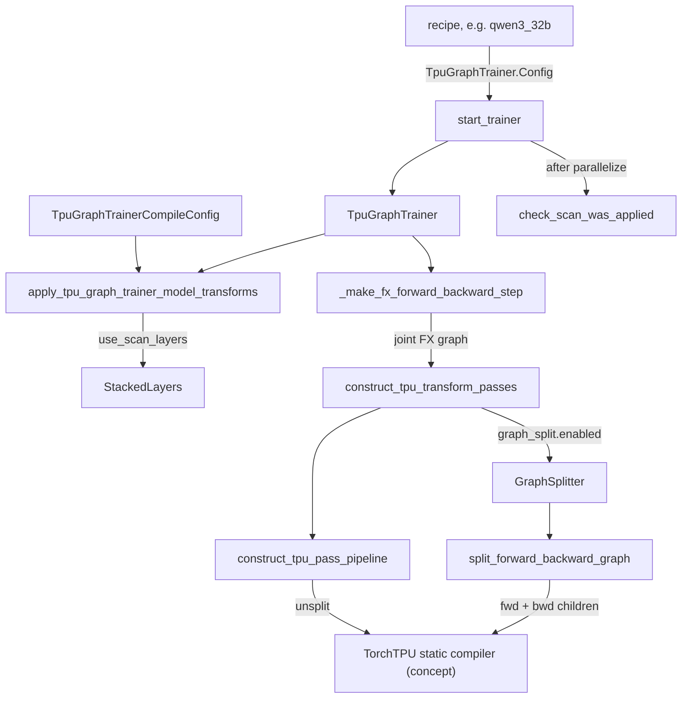
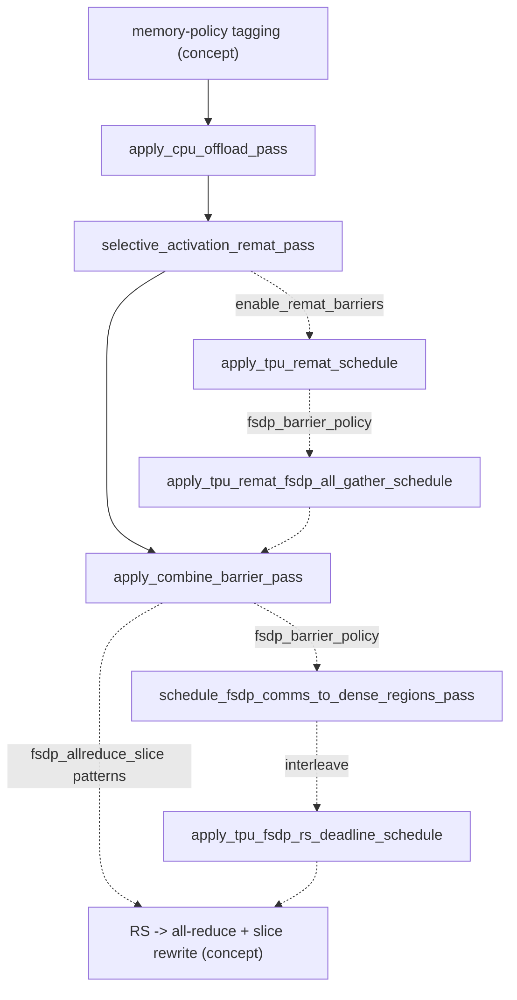

# TPU GraphTrainer: joint fwd+bwd FX trace, the 'tpu' pass pipeline, layer scan, graph splitting and remat/FSDP scheduling

<!-- connect:up:begin -->
> **Cross-repo concept:** part of [rematerialization](../../../concepts/rematerialization.md), [sparsecore](../../../concepts/sparsecore.md) across this wiki's repos.
<!-- connect:up:end -->
## Overview

[`TpuGraphTrainer`](../catalog/torchtitan/experiments/tpu/graph_trainer/tpu_graph_trainer.md#TpuGraphTrainer "torchtitan/experiments/tpu/graph_trainer/tpu_graph_trainer.py:L66") is the TPU specialization of the upstream [`GraphTrainer`](../catalog/torchtitan/experiments/graph_trainer/trainer.md#GraphTrainer "torchtitan/experiments/graph_trainer/trainer.py:L142") and the trainer behind the large TPU recipes (Qwen3 8B/32B, Qwen3-MoE 30B/235B, Llama3 at 70B/405B, Muse Glimmer 30B). Instead of `torch.compile` capturing pieces of an eager step, it traces the **whole training step** - model forward, loss, autograd backward, and optionally the AdamW update - into one FX graph with `make_fx` (`compile.mode='aot_fx_trace'`). It then rewrites that graph with a TPU-specific **pass pipeline** and hands the result to TorchTPU's static compiler, which produces one PJRT/XLA executable that runs with no per-op host dispatch.

The key design idea is that **memory and collective scheduling are decided on the joint graph, before XLA sees it**, by inserting explicit tags and `optimization_barrier` dependencies. XLA's latency-hiding scheduler is free to reorder anything without a data dependency, and on a whole-step program that freedom routinely costs tens of GiB of HBM (forward and recomputed all-gathers merged, recompute workspaces of two layers live at once, all reduce-scatters bunched behind all all-gathers). The pipeline's passes turn the intended order into data dependencies. Two structural options extend this: **layer stacking + scan** ([`StackedLayers`](../catalog/torchtitan/experiments/tpu/graph_trainer/layer_stack.md#StackedLayers "torchtitan/experiments/tpu/graph_trainer/layer_stack.py:L374")) collapses N decoder layers into one `while` loop with an in-body FSDP gather, and the **graph splitter** ([`GraphSplitter`](../catalog/torchtitan/experiments/tpu/graph_trainer/graph_split.md#GraphSplitter "torchtitan/experiments/tpu/graph_trainer/graph_split.py:L254")) cuts the joint graph into separately compiled forward/backward (and per-layer) executables.

## Diagram

From recipe to compiled executable(s):

Legend:
- `REC` - [`qwen3_32b`](../catalog/torchtitan/experiments/tpu/qwen3/config_registry.md#qwen3_32b "torchtitan/experiments/tpu/qwen3/config_registry.py:L677")
- `ST` - [`start_trainer`](../catalog/torchtitan/experiments/tpu/train.md#start_trainer "torchtitan/experiments/tpu/train.py:L208")
- `TGT` - [`TpuGraphTrainer`](../catalog/torchtitan/experiments/tpu/graph_trainer/tpu_graph_trainer.md#TpuGraphTrainer "torchtitan/experiments/tpu/graph_trainer/tpu_graph_trainer.py:L66")
- `CC` - [`TpuGraphTrainerCompileConfig`](../catalog/torchtitan/experiments/tpu/graph_trainer/config.md#TpuGraphTrainerCompileConfig "torchtitan/experiments/tpu/graph_trainer/config.py:L111")
- `XF` - [`apply_tpu_graph_trainer_model_transforms`](../catalog/torchtitan/experiments/tpu/graph_trainer/config.md#apply_tpu_graph_trainer_model_transforms "torchtitan/experiments/tpu/graph_trainer/config.py:L244")
- `SL` - [`StackedLayers`](../catalog/torchtitan/experiments/tpu/graph_trainer/layer_stack.md#StackedLayers "torchtitan/experiments/tpu/graph_trainer/layer_stack.py:L374")
- `MFX` - [`_make_fx_forward_backward_step`](../catalog/torchtitan/experiments/tpu/graph_trainer/tpu_graph_trainer.md#TpuGraphTrainer._make_fx_forward_backward_step "torchtitan/experiments/tpu/graph_trainer/tpu_graph_trainer.py:L363")
- `CTP` - [`construct_tpu_transform_passes`](../catalog/torchtitan/experiments/tpu/graph_trainer/tpu_backend_pass.md#construct_tpu_transform_passes "torchtitan/experiments/tpu/graph_trainer/tpu_backend_pass.py:L523")
- `CPP` - [`construct_tpu_pass_pipeline`](../catalog/torchtitan/experiments/tpu/graph_trainer/tpu_backend_pass.md#construct_tpu_pass_pipeline "torchtitan/experiments/tpu/graph_trainer/tpu_backend_pass.py:L647")
- `SCOMP` - (concept) `torch_tpu._internal.compile.compiler.StaticCompiler`, invoked by the terminal compile pass
- `GS` - [`GraphSplitter`](../catalog/torchtitan/experiments/tpu/graph_trainer/graph_split.md#GraphSplitter "torchtitan/experiments/tpu/graph_trainer/graph_split.py:L254")
- `SFB` - [`split_forward_backward_graph`](../catalog/torchtitan/experiments/tpu/graph_trainer/graph_split.md#split_forward_backward_graph "torchtitan/experiments/tpu/graph_trainer/graph_split.py:L1004")
- `CHK` - [`check_scan_was_applied`](../catalog/torchtitan/experiments/tpu/graph_trainer/scan_guards.md#check_scan_was_applied "torchtitan/experiments/tpu/graph_trainer/scan_guards.py:L50")

The transform passes, in the order [`construct_tpu_transform_passes`](../catalog/torchtitan/experiments/tpu/graph_trainer/tpu_backend_pass.md#construct_tpu_transform_passes "torchtitan/experiments/tpu/graph_trainer/tpu_backend_pass.py:L523") appends them (dashed = only under the named knob):

Legend:
- `TAG` - (concept) the upstream memory-policy tagging pass; TPU policies plug into it, e.g. [`full_remat_with_saves`](../catalog/torchtitan/experiments/tpu/graph_trainer/tpu_memory_policy.md#full_remat_with_saves "torchtitan/experiments/tpu/graph_trainer/tpu_memory_policy.py:L268") and [`offload_scan_activations`](../catalog/torchtitan/experiments/tpu/graph_trainer/tpu_host_offload.md#offload_scan_activations "torchtitan/experiments/tpu/graph_trainer/tpu_host_offload.py:L309")
- `OFF` - [`apply_cpu_offload_pass`](../catalog/torchtitan/experiments/graph_trainer/cpu_offload.md#apply_cpu_offload_pass "torchtitan/experiments/graph_trainer/cpu_offload.py:L440")
- `SAR` - [`selective_activation_remat_pass`](../catalog/torchtitan/experiments/graph_trainer/selective_activation_remat.md#selective_activation_remat_pass "torchtitan/experiments/graph_trainer/selective_activation_remat.py:L101")
- `RB` - [`apply_tpu_remat_schedule`](../catalog/torchtitan/experiments/tpu/graph_trainer/remat_schedule.md#apply_tpu_remat_schedule "torchtitan/experiments/tpu/graph_trainer/remat_schedule.py:L137")
- `AGB` - [`apply_tpu_remat_fsdp_all_gather_schedule`](../catalog/torchtitan/experiments/tpu/graph_trainer/remat_schedule.md#apply_tpu_remat_fsdp_all_gather_schedule "torchtitan/experiments/tpu/graph_trainer/remat_schedule.py:L401")
- `CB` - [`apply_combine_barrier_pass`](../catalog/torchtitan/experiments/tpu/graph_trainer/passes/insert_combine_barriers.md#apply_combine_barrier_pass "torchtitan/experiments/tpu/graph_trainer/passes/insert_combine_barriers.py:L79")
- `DENSE` - [`schedule_fsdp_comms_to_dense_regions_pass`](../catalog/torchtitan/experiments/graph_trainer/fsdp_passes.md#schedule_fsdp_comms_to_dense_regions_pass "torchtitan/experiments/graph_trainer/fsdp_passes.py:L1008")
- `RSD` - [`apply_tpu_fsdp_rs_deadline_schedule`](../catalog/torchtitan/experiments/tpu/graph_trainer/remat_schedule.md#apply_tpu_fsdp_rs_deadline_schedule "torchtitan/experiments/tpu/graph_trainer/remat_schedule.py:L716")
- `RSAR` - (concept) `passes/reduce_scatter_allreduce.py`, enabled by `compile.fsdp_allreduce_slice_parameter_patterns`

## Design rationale (why it's built this way)

**Trace the whole step, then compile once.** The terminal compile pass's docstring says the compiled executable replaces the module's forward, "eliminating per-node host dispatch overhead during training steps". Because loss and backward are in the same trace, the TPU compile config's docstring warns that `aot_fx_trace` "captures model, loss, and backward jointly regardless of `components`" - which is why TPU recipes leave `"loss"` out of `compile.components` ([`test_pallas_loss_recipe_overrides_lm_head`](../catalog/torchtitan/experiments/tpu/graph_trainer/tests/test_tpu_graph_trainer_config.md#TpuGraphTrainerConfigTest.test_pallas_loss_recipe_overrides_lm_head "torchtitan/experiments/tpu/graph_trainer/tests/test_tpu_graph_trainer_config.py:L1364") asserts it). The trainer also rejects `ChunkedLossWrapper` because "FX unrolls its loop and defeats bounded-memory execution" - the fused Pallas cross-entropy is the bounded-memory loss on this path.

**Barriers instead of hoping.** Each scheduling pass encodes a failure observed when XLA was left alone. [`apply_tpu_remat_schedule`](../catalog/torchtitan/experiments/tpu/graph_trainer/remat_schedule.md#apply_tpu_remat_schedule "torchtitan/experiments/tpu/graph_trainer/remat_schedule.py:L137"): "XLA may otherwise schedule `recompute_1` early, follow `dx1` into layer 0, and defer `dw1`. That keeps layer 1's recomputed workspace live while layer 0 is running." [`apply_tpu_remat_fsdp_all_gather_schedule`](../catalog/torchtitan/experiments/tpu/graph_trainer/remat_schedule.md#apply_tpu_remat_fsdp_all_gather_schedule "torchtitan/experiments/tpu/graph_trainer/remat_schedule.py:L401"): without a distinguishing dependency "XLA can CSE the two all-gathers and retain the forward full parameter until backward". [`apply_tpu_fsdp_rs_deadline_schedule`](../catalog/torchtitan/experiments/tpu/graph_trainer/remat_schedule.md#apply_tpu_fsdp_rs_deadline_schedule "torchtitan/experiments/tpu/graph_trainer/remat_schedule.py:L716"): "FX order is not an XLA dependency. TPU LHS can therefore regroup all AGs ahead of all RSs." All barriers are tuple `optimization_barrier`s that "do not reshape or numerically change any tensor".

**Fail loudly on silently-wrong configurations.** The scan guards module states the principle: "Every failure mode in here is otherwise silent. The run succeeds, either unrolled or stacked from layer 0, and the log looks like a correct scan run." So [`check_scan_was_applied`](../catalog/torchtitan/experiments/tpu/graph_trainer/scan_guards.md#check_scan_was_applied "torchtitan/experiments/tpu/graph_trainer/scan_guards.py:L50") asks the built model whether a scanning [`StackedLayers`](../catalog/torchtitan/experiments/tpu/graph_trainer/layer_stack.md#StackedLayers "torchtitan/experiments/tpu/graph_trainer/layer_stack.py:L374") exists, [`offload_scan_activations`](../catalog/torchtitan/experiments/tpu/graph_trainer/tpu_host_offload.md#offload_scan_activations "torchtitan/experiments/tpu/graph_trainer/tpu_host_offload.py:L309") raises rather than warns when it finds nothing to offload (otherwise "the mistake surfaces as a perf result nobody can explain"), and [`apply_tpu_graph_trainer_model_transforms`](../catalog/torchtitan/experiments/tpu/graph_trainer/config.md#apply_tpu_graph_trainer_model_transforms "torchtitan/experiments/tpu/graph_trainer/config.py:L244") rejects ZeRO-3 without scan, splitting or an FSDP barrier policy because "XLA can merge forward and recomputed all-gathers and retain full parameters through backward".

**Scan exists for memory and compile time, not speed per se.** [`LayerStack`](../catalog/torchtitan/experiments/tpu/graph_trainer/layer_stack.md#LayerStack "torchtitan/experiments/tpu/graph_trainer/layer_stack.py:L393")'s `run` docstring gives the two reasons: the scan "collapses `n_layers` copies of the block into a single `stablehlo.while` body, so compile time and program size stop growing with depth", and an unrolled loop under SimpleFSDP gathers the whole stacked tensor so "every layer's weights are then resident until the backward is done: about 137 GiB per chip at llama3-70b, which does not fit". The scan instead passes each rank's shard and gathers one layer inside the body, described per parameter by a [`ScanFSDPSpec`](../catalog/torchtitan/experiments/tpu/graph_trainer/scan_fsdp.md#ScanFSDPSpec "torchtitan/experiments/tpu/graph_trainer/scan_fsdp.py:L42").

**Splitting widens or narrows the compiler's window on purpose.** The graph-split module docstring: combining remat regions in one executable "changes only the compiler scheduling scope; it preserves the per-layer activation-checkpoint boundaries and just-in-time recompute order". A one-layer backward child "already supplies the same lifetime boundary" the remat barriers would add, which is why the config docstring describes the two as alternatives.

> [!inferred]
> The TPU pipeline is a branch of the upstream GraphTrainer rather than a set of upstream passes because its terminal step lowers to a TorchTPU static executable instead of Inductor, and because several passes (MoE combine barriers, TPU LHS deadline ordering, 8-row all-gather folding) only make sense against XLA:TPU's scheduler and tiling.

## Entry points

- [`start_trainer`](../catalog/torchtitan/experiments/tpu/train.md#start_trainer "torchtitan/experiments/tpu/train.py:L208") - the TPU launcher; picks [`TpuGraphTrainer`](../catalog/torchtitan/experiments/tpu/graph_trainer/tpu_graph_trainer.md#TpuGraphTrainer "torchtitan/experiments/tpu/graph_trainer/tpu_graph_trainer.py:L66") whenever the recipe returned a `TpuGraphTrainer.Config`, raises Dynamo recompile limits first, and after parallelization calls [`check_scan_was_applied`](../catalog/torchtitan/experiments/tpu/graph_trainer/scan_guards.md#check_scan_was_applied "torchtitan/experiments/tpu/graph_trainer/scan_guards.py:L50") on every model part.
- Recipes that return a graph-trainer config: [`qwen3_8b`](../catalog/torchtitan/experiments/tpu/qwen3/config_registry.md#qwen3_8b "torchtitan/experiments/tpu/qwen3/config_registry.py:L555"), [`qwen3_32b`](../catalog/torchtitan/experiments/tpu/qwen3/config_registry.md#qwen3_32b "torchtitan/experiments/tpu/qwen3/config_registry.py:L677"), [`qwen3_moe_30b`](../catalog/torchtitan/experiments/tpu/qwen3/config_registry.md#qwen3_moe_30b "torchtitan/experiments/tpu/qwen3/config_registry.py:L735"), [`_qwen3_moe_30b_fsdp_only_full_ac`](../catalog/torchtitan/experiments/tpu/qwen3/config_registry.md#_qwen3_moe_30b_fsdp_only_full_ac "torchtitan/experiments/tpu/qwen3/config_registry.py:L797"), [`_qwen3_moe_235b_fsdp_only`](../catalog/torchtitan/experiments/tpu/qwen3/config_registry.md#_qwen3_moe_235b_fsdp_only "torchtitan/experiments/tpu/qwen3/config_registry.py:L942"), [`qwen3_moe_235b_scan`](../catalog/torchtitan/experiments/tpu/qwen3/config_registry.md#qwen3_moe_235b_scan "torchtitan/experiments/tpu/qwen3/config_registry.py:L1141"), [`muse_glimmer_30b_full_logits`](../catalog/torchtitan/experiments/tpu/muse_glimmer/config_registry.md#muse_glimmer_30b_full_logits "torchtitan/experiments/tpu/muse_glimmer/config_registry.py:L221"); Llama3 recipes move onto it through [`_on_scan_lane`](../catalog/torchtitan/experiments/tpu/llama3/config_registry.md#_on_scan_lane "torchtitan/experiments/tpu/llama3/config_registry.py:L85") ("Offload is not optional above 8B: without it the scan bodies keep every layer's input live and 405B does not compile").
- [`TpuGraphTrainerCompileConfig`](../catalog/torchtitan/experiments/tpu/graph_trainer/config.md#TpuGraphTrainerCompileConfig "torchtitan/experiments/tpu/graph_trainer/config.py:L111") - the `compile` field ([`compile`](../catalog/torchtitan/experiments/tpu/graph_trainer/tpu_graph_trainer.md#TpuGraphTrainer.Config.compile "torchtitan/experiments/tpu/graph_trainer/tpu_graph_trainer.py:L90")) every knob on this page lives on; extends [`GraphTrainerCompileConfig`](../catalog/torchtitan/experiments/graph_trainer/configs.md#GraphTrainerCompileConfig "torchtitan/experiments/graph_trainer/configs.py:L69") with `backend='tpu'`, `pass_pipeline='tpu'`, the TPU memory policies, `optimizer_compile`, `use_scan_layers`, `enable_remat_barriers`, `fsdp_barrier_policy`, `graph_split`, and the all-reduce-slice patterns.
- [`_make_fx_forward_backward_step`](../catalog/torchtitan/experiments/tpu/graph_trainer/tpu_graph_trainer.md#TpuGraphTrainer._make_fx_forward_backward_step "torchtitan/experiments/tpu/graph_trainer/tpu_graph_trainer.py:L363") - reached on every forward/backward step; traces and compiles on the first call, then only replays the compiled step.

## Mechanism (step-by-step)

1. **Config conversion and validation.** A recipe either builds a `TpuGraphTrainer.Config` directly or converts a `TPUTrainerConfig`. The config's `__post_init__` forces `pass_pipeline='tpu'` ("A generic GraphTrainer pipeline cannot lower a TPU graph"). In `__init__`, [`apply_tpu_graph_trainer_model_transforms`](../catalog/torchtitan/experiments/tpu/graph_trainer/config.md#apply_tpu_graph_trainer_model_transforms "torchtitan/experiments/tpu/graph_trainer/config.py:L244") runs before the model is built: joint-graph options (scan, split, remat barriers, FSDP barrier policy, all-reduce-slice, in-graph optimizer) require `aot_fx_trace`; `fsdp_barrier_policy` requires remat plus `enable_remat_barriers`; scan forbids generic offload policies (use `full_and_scan_offload`), forbids TP/CP/PP (1-D data parallel only) and EP > 1. With `use_scan_layers`, it swaps the model config for its stacked-layer class and wraps `parallelize_fn` so SimpleFSDP shard dims are configured for the stacks. The trainer also wraps `parallelize_fn` to run the TPU model patches (attention/loss/GMM kernels) first.

2. **Layer stacking (optional).** With scan, each kind of per-layer weight becomes one `[n_layers, *shape]` parameter owned by [`LayerStack`](../catalog/torchtitan/experiments/tpu/graph_trainer/layer_stack.md#LayerStack "torchtitan/experiments/tpu/graph_trainer/layer_stack.py:L393"), and `model.layers` becomes a [`StackedLayers`](../catalog/torchtitan/experiments/tpu/graph_trainer/layer_stack.md#StackedLayers "torchtitan/experiments/tpu/graph_trainer/layer_stack.py:L374") container that runs layer 0's module as a template via `functional_call`. Per-layer names reappear only as views during `init_weights` and `state_dict`, so checkpoints stay portable between stacked and unstacked runs, but optimizer state does not. On the first forward the stack builds a [`ScanFSDPSpec`](../catalog/torchtitan/experiments/tpu/graph_trainer/scan_fsdp.md#ScanFSDPSpec "torchtitan/experiments/tpu/graph_trainer/scan_fsdp.py:L42") per stack (group name, param/reduce dtypes, gather dim, replicate group for HSDP) and the scan body gathers one row per iteration with a functional collective that "lowers into the loop and lands next to the compute that needs it". The gathered weight is forced to be recomputed in backward (budget 0.0), except the MoE aux-loss expert counts, whose all-reduce would be "an exposed DCN round trip per layer on multi-slice". [`test_llama3_recipe_overrides_complex_rope`](../catalog/torchtitan/experiments/tpu/graph_trainer/tests/test_tpu_graph_trainer_config.md#TpuGraphTrainerConfigTest.test_llama3_recipe_overrides_complex_rope "torchtitan/experiments/tpu/graph_trainer/tests/test_tpu_graph_trainer_config.py:L1331") pins one porting prerequisite: Llama3 must use real-arithmetic RoPE or "cannot run its decoder loop as a `scan`".

3. **Joint trace.** On the first step [`_make_fx_forward_backward_step`](../catalog/torchtitan/experiments/tpu/graph_trainer/tpu_graph_trainer.md#TpuGraphTrainer._make_fx_forward_backward_step "torchtitan/experiments/tpu/graph_trainer/tpu_graph_trainer.py:L363") builds the upstream fwd+loss+bwd step function and traces it with the minimal make_fx tracer (or loads a precompiled FX artifact). Backward nodes carry `autograd_backward` metadata and a layer id derived from module FQN annotations ([`_is_backward_node`](../catalog/torchtitan/experiments/graph_trainer/common_utils.md#_is_backward_node "torchtitan/experiments/graph_trainer/common_utils.py:L286"), [`_get_layer_id`](../catalog/torchtitan/experiments/graph_trainer/common_utils.md#_get_layer_id "torchtitan/experiments/graph_trainer/common_utils.py:L294"), keyed on [`_MODULE_FQN`](../catalog/torchtitan/experiments/graph_trainer/common_utils.md#_MODULE_FQN "torchtitan/experiments/graph_trainer/common_utils.py:L181")); every later pass keys off those two facts.

4. **Memory policy: what to save, recompute or offload.** If `memory_policy` is set, [`construct_tpu_transform_passes`](../catalog/torchtitan/experiments/tpu/graph_trainer/tpu_backend_pass.md#construct_tpu_transform_passes "torchtitan/experiments/tpu/graph_trainer/tpu_backend_pass.py:L523") appends, in order, memory-policy tagging, [`apply_cpu_offload_pass`](../catalog/torchtitan/experiments/graph_trainer/cpu_offload.md#apply_cpu_offload_pass "torchtitan/experiments/graph_trainer/cpu_offload.py:L440") ("A no-op unless the policy tagged something MUST_CPU_OFFLOAD, but without it the offloading policies set their tags and this pipeline drops them"), and [`selective_activation_remat_pass`](../catalog/torchtitan/experiments/graph_trainer/selective_activation_remat.md#selective_activation_remat_pass "torchtitan/experiments/graph_trainer/selective_activation_remat.py:L101") ("insert recompute duplicates before backward consumers"). The TPU-registered policies are `full_and_offload`, `full_and_scan_offload`, `tpu_selective` and `tpu_selective_and_offload`. The selective ones all go through [`full_remat_with_saves`](../catalog/torchtitan/experiments/tpu/graph_trainer/tpu_memory_policy.md#full_remat_with_saves "torchtitan/experiments/tpu/graph_trainer/tpu_memory_policy.py:L268"): full recompute except named save regions (`moe.routing`, `attention.inner_attention`, optionally only in the last N layers, which backward reaches first) and, under ZeRO-2, the FSDP all-gather outputs. `full_and_scan_offload` runs FullAC and then [`offload_scan_activations`](../catalog/torchtitan/experiments/tpu/graph_trainer/tpu_host_offload.md#offload_scan_activations "torchtitan/experiments/tpu/graph_trainer/tpu_host_offload.py:L309"), which puts one `ao.offload` in the forward scan body and one `ao.reload` on the backward body's in-loop slice, so the stacked `[n_layers, b, s, d]` layer-input save (33.8 GB at 405B seq 8192, per the module docstring) lives on host and the device holds one slice at a time.

5. **Remat and FSDP scheduling barriers.** With `enable_remat_barriers`, [`apply_tpu_remat_schedule`](../catalog/torchtitan/experiments/tpu/graph_trainer/remat_schedule.md#apply_tpu_remat_schedule "torchtitan/experiments/tpu/graph_trainer/remat_schedule.py:L137") makes layer L+1's local parameter gradients a dependency of layer L's recompute/backward entry, so only one layer's recompute workspace is live; [`test_traced_two_layer_schedule`](../catalog/torchtitan/experiments/tpu/graph_trainer/tests/test_remat_schedule.md#TestTpuRematSchedule.test_traced_two_layer_schedule "torchtitan/experiments/tpu/graph_trainer/tests/test_remat_schedule.py:L431") exercises it under full, SAC, and saved-masked-attention policies. With `fsdp_barrier_policy`, [`apply_tpu_remat_fsdp_all_gather_schedule`](../catalog/torchtitan/experiments/tpu/graph_trainer/remat_schedule.md#apply_tpu_remat_fsdp_all_gather_schedule "torchtitan/experiments/tpu/graph_trainer/remat_schedule.py:L401") barriers the recomputed all-gather roots so they cannot be CSE'd with the forward ones, releasing layer L's gathers from the backward entry `fsdp_barrier_prefetch_distance` layers ahead - a bounded prefetch window for the latency-hiding scheduler. Then [`schedule_fsdp_comms_to_dense_regions_pass`](../catalog/torchtitan/experiments/graph_trainer/fsdp_passes.md#schedule_fsdp_comms_to_dense_regions_pass "torchtitan/experiments/graph_trainer/fsdp_passes.py:L1008") places bucketed FSDP comms against dense (attention) work, skipping MoE layers, and under `interleave` [`apply_tpu_fsdp_rs_deadline_schedule`](../catalog/torchtitan/experiments/tpu/graph_trainer/remat_schedule.md#apply_tpu_fsdp_rs_deadline_schedule "torchtitan/experiments/tpu/graph_trainer/remat_schedule.py:L716") adds the previous layer's reduce-scatter waits to each all-gather barrier - trading AG/RS concurrency for lower HBM. Recipe comments quantify the trade: on [`qwen3_32b`](../catalog/torchtitan/experiments/tpu/qwen3/config_registry.md#qwen3_32b "torchtitan/experiments/tpu/qwen3/config_registry.py:L677") "Prefetch beats interleave by 0.3-0.6% here for ~4 GiB more peak HBM".

6. **MoE combine barriers and collective rewrites.** [`apply_combine_barrier_pass`](../catalog/torchtitan/experiments/tpu/graph_trainer/passes/insert_combine_barriers.md#apply_combine_barrier_pass "torchtitan/experiments/tpu/graph_trainer/passes/insert_combine_barriers.py:L79") always runs: it finds nodes annotated `EP=padded_combine` and brackets the region's entries and exits with `tpu::_optimization_barrier`, because inside the full graph "XLA cross-fuses the combine with adjacent ops and the fused kernel's bf16 layout / SC offload choices change the numerics enough to break the loss curve" (a silent no-op when no annotation exists). If `fsdp_allreduce_slice_parameter_patterns` is set, selected FSDP gradient reduce-scatters are lowered as all-reduce plus a rank-local slice, gated by a byte cap; the 512-chip Qwen3-32B recipe explains why: 50-row w1/w3 gradient shards are "not a multiple of 8, so their reduce-scatters run on the TensorCore instead of SparseCore", and the rewrite took the step from 14.33 to 12.34 s for +49 GiB peak HBM.

7. **Compile: whole, or split.** Unsplit, [`construct_tpu_pass_pipeline`](../catalog/torchtitan/experiments/tpu/graph_trainer/tpu_backend_pass.md#construct_tpu_pass_pipeline "torchtitan/experiments/tpu/graph_trainer/tpu_backend_pass.py:L647") ("joint transforms, then compilation") appends the terminal compile pass, which filters non-tensor outputs, calls TorchTPU's `StaticCompiler` ("PJRT compile finishes lazily on first execute") and rebinds the graph module's forward to the executable. With `graph_split.enabled`, the transform passes run alone (remat and FSDP metadata must exist before partitioning), then [`GraphSplitter`](../catalog/torchtitan/experiments/tpu/graph_trainer/graph_split.md#GraphSplitter "torchtitan/experiments/tpu/graph_trainer/graph_split.py:L254") (built once by [`from_trainer_config`](../catalog/torchtitan/experiments/tpu/graph_trainer/graph_split.md#GraphSplitter.from_trainer_config "torchtitan/experiments/tpu/graph_trainer/graph_split.py:L262")) calls [`split_forward_backward_graph`](../catalog/torchtitan/experiments/tpu/graph_trainer/graph_split.md#split_forward_backward_graph "torchtitan/experiments/tpu/graph_trainer/graph_split.py:L1004"), which marks every `autograd_backward` node and its descendants as backward and turns each forward tensor that backward reads into an explicit residual output, producing a [`SplitForwardBackwardGraph`](../catalog/torchtitan/experiments/tpu/graph_trainer/graph_split.md#SplitForwardBackwardGraph "torchtitan/experiments/tpu/graph_trainer/graph_split.py:L236"). The forward may be further cut every `forward_layers_per_executable` layers; the backward either stays whole, is grouped `by_layer` (keeping each layer's FSDP collective chain with it), or forms `fsdp_pipeline` stages that move each layer's all-gather earlier and reduce-scatter later. Each child compiles independently, with dead split-boundary buffers donated by default so queued executables do not each reserve fresh HBM for their outputs.

8. **Execution and the optimizer.** Every step replays the compiled graph and writes the returned gradients onto `param.grad`. `optimizer_compile` then chooses where AdamW runs: `eager`; `separate_graph` (a standalone compiled optimizer graph); or `in_graph`, where the trainer registers persistent `_optstate_*` buffers and traces forward+loss+backward+AdamW into one executable (single model part only, not with graph splitting, not with `compile_grad_norm`). [`MfuBenchmark`](../catalog/torchtitan/experiments/tpu/graph_trainer/mfu_benchmark.md#MfuBenchmark "torchtitan/experiments/tpu/graph_trainer/mfu_benchmark.py:L17"), when `tpu_config.enable_mfu_benchmark` is on, records wall time and tokens between two logged steps and reports mean step time, TFLOPs and MFU over the whole window - "a longer-time average without requiring a less frequent `log_freq`".

## Key data structures

- [`TpuGraphTrainerCompileConfig`](../catalog/torchtitan/experiments/tpu/graph_trainer/config.md#TpuGraphTrainerCompileConfig "torchtitan/experiments/tpu/graph_trainer/config.py:L111") - the knob surface. Most perf-relevant fields: `memory_policy`, `save_regions`, `save_last_n_layers`, `use_scan_layers`, `enable_remat_barriers`, `fsdp_barrier_policy` (`none`/`prefetch`/`interleave`), `fsdp_barrier_prefetch_distance`, `graph_split` (`enabled`, `forward_layers_per_executable`, `backward_partition_mode`, `backward_layers_per_executable`, `donate_internal_buffers`, `cpu_offload_prefetch_executables`), `fsdp_allreduce_slice_parameter_patterns` / `_max_input_bytes`, `optimizer_compile`, `compile_grad_norm`.
- [`SplitForwardBackwardGraph`](../catalog/torchtitan/experiments/tpu/graph_trainer/graph_split.md#SplitForwardBackwardGraph "torchtitan/experiments/tpu/graph_trainer/graph_split.py:L236") - the split result: forward and backward GraphModules, their example inputs, and the residual nodes that cross the boundary.
- [`LayerStack`](../catalog/torchtitan/experiments/tpu/graph_trainer/layer_stack.md#LayerStack "torchtitan/experiments/tpu/graph_trainer/layer_stack.py:L393") - owns the stacked parameters, the per-layer names, the view-swap state for `unrolled()`, and the lazily-built FSDP gather plan.
- [`ScanFSDPSpec`](../catalog/torchtitan/experiments/tpu/graph_trainer/scan_fsdp.md#ScanFSDPSpec "torchtitan/experiments/tpu/graph_trainer/scan_fsdp.py:L42") - per stacked parameter: process-group name, `param_dtype` (compute dtype for the gathered weight), `reduce_dtype`, `sharded`, `replicate_group_name` (HSDP), `gather_dim`.
- [`TpuReplicateComputation`](../catalog/torchtitan/experiments/tpu/graph_trainer/simple_fsdp.md#TpuReplicateComputation "torchtitan/experiments/tpu/graph_trainer/simple_fsdp.py:L114") - a SimpleFSDP parametrization re-classed in place so even, non-leading shards gather with native TPU collectives instead of the upstream copying path; skipped when layer stacks are present ("Scan flattens its stacks onto dim 0 so it scales past 512 ranks").

## Dynamics (design intent)

- **Trace once, replay forever.** Tracing, pass application and compilation happen on the first step only; afterwards each step is a replay. `StaticCompiler` returns immediately and the PJRT compile completes on the first execution, so step 1 absorbs compile time.
- **Scan and gradient flow.** The stack raises if the scan's initial carry does not require grad, because `scan`'s backward would then return zeros for the carry and "every layer's weight gradient would reflect only itself -- with a correct loss and no error". The scan body returns a scalar as its per-iteration output so `scan` does not stack 80 copies of the activation.
- **Collective layout.** Within the scan, the TPU all-gather replacement transposes `gather_dim` to 0 for one contiguous gather (avoiding thousands of slice/concat ops) and folds 2-D shards whose row count is not a multiple of 8 into `[rows*k, cols/k]`, because "TPU stores 2-D tensors in `(8, 128)` tiles".
- **Split executables and HBM.** Without buffer donation, "every executable queued ahead of the device reserves fresh HBM for its outputs at enqueue time"; donation is in TorchTPU's compilation cache key, so it is on by default.

## Edge cases

- **ZeRO-3 needs a structural option.** `fsdp_reshard_after_forward='always'` is rejected unless scan, graph splitting, or an FSDP barrier policy is on. The baseline MoE recipe [`_qwen3_moe_30b_fsdp_only_full_ac`](../catalog/torchtitan/experiments/tpu/qwen3/config_registry.md#_qwen3_moe_30b_fsdp_only_full_ac "torchtitan/experiments/tpu/qwen3/config_registry.py:L797") stays on ZeRO-2 explicitly; [`qwen3_moe_235b_scan`](../catalog/torchtitan/experiments/tpu/qwen3/config_registry.md#qwen3_moe_235b_scan "torchtitan/experiments/tpu/qwen3/config_registry.py:L1141") uses ZeRO-3 + scan + `full_and_scan_offload` because "94 layers of 128 experts do not fit without Zero-3 plus offloading".
- **Scan incompatibilities.** No TP/CP/PP, no EP > 1, no `tpu_selective*` policies ("A scan node stands for the whole layer loop and is always saved"), no load-balanced MoE layers, no MoE routing metrics (a scan body cannot stash tensors on modules), and the all-reduce-slice patterns no longer match because per-layer names disappear into stacks. Flipping `use_scan_layers` breaks optimizer-state resume.
- **Graph split incompatibilities.** Not with `fsdp_barrier_policy` (the whole-graph collective placement "is not partition-boundary aware"), not with `optimizer_compile='in_graph'`, not with precompiled FX artifacts. `backward_partition_mode` requires `enabled`; `cpu_offload_prefetch_executables` requires a split backward.
- **Combine barriers are silent when unannotated.** If the MoE dispatcher's `padded_combine` annotation is absent, [`apply_combine_barrier_pass`](../catalog/torchtitan/experiments/tpu/graph_trainer/passes/insert_combine_barriers.md#apply_combine_barrier_pass "torchtitan/experiments/tpu/graph_trainer/passes/insert_combine_barriers.py:L79") prints a notice and does nothing.
- **Scan flags left to the CLI.** The 235B recipe pins its libtpu flags because "a scan step measured without them runs ~10% slow"; Llama3's scan lane disables Shardy HLO sharding v3, which "segfaults ... on GraphTrainer".
- **MFU window.** [`MfuBenchmark`](../catalog/torchtitan/experiments/tpu/graph_trainer/mfu_benchmark.md#MfuBenchmark "torchtitan/experiments/tpu/graph_trainer/mfu_benchmark.py:L17") requires `0 < start_step < final_step` and both boundaries to be metric log steps, so the device has drained before timing.

## Open questions

- The terminal compile pass, the partitioned compile pass, `split_and_compile`, the stacked-gather planner and the in-graph AdamW loop are central to this mechanism but outside this page's citation set; their details here come from reading the source, not from linked catalog entries.
- `apply_tpu_fsdp_rs_deadline_schedule` orders reduce-scatter *completion*, which its own TODO calls "a deliberate prototype constraint" that "may overconstrain hardware that can execute AG and RS independently"; whether an RS-start/AG-start primitive will replace it is open.
- The scan body recomputes the whole layer in backward (budget 0.0) because tagging only the gather is lost on re-trace; the source says to switch "once the meta survives", so the recompute cost of scan is expected to change.
- Optimizer-state and DCP `get_model_state_dict` support for stacked models are tracked as open upstream issues in the layer-stack docstring.

## See also

- [graph-trainer](graph-trainer.md) - the upstream GraphTrainer this branches from (tracer, generic passes, memory policies)
- [tpu-trainer-and-job-config](tpu-trainer-and-job-config.md) - the eager/`torch.compile` TPU trainer and `TPUTrainerConfig`
- [tpu-layer-loop-remat-and-layouts](tpu-layer-loop-remat-and-layouts.md) - the layer-loop container and remat regions used by save regions
- [tpu-pallas-kernels](tpu-pallas-kernels.md) - the attention, GMM and fused-loss kernels patched in before parallelization
- [tpu-moe-dispatch-and-grouped-experts](tpu-moe-dispatch-and-grouped-experts.md) - the padded combine the barrier pass protects
- [flex-shard](flex-shard.md), [parallel-dims-and-parallelization](parallel-dims-and-parallelization.md) - SimpleFSDP and mesh construction
- [qwen3-model](qwen3-model.md), [llama3-model](llama3-model.md), [muse-glimmer-model](muse-glimmer-model.md)
