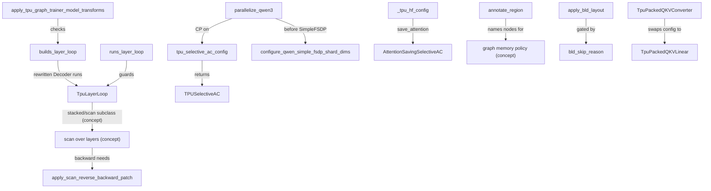

# TPU layer loop, remat policies and layouts (experiments/tpu)

<!-- connect:up:begin -->
> **Cross-repo concept:** part of [rematerialization](../../../concepts/rematerialization.md), [splash-attention](../../../concepts/splash-attention.md) across this wiki's repos.
<!-- connect:up:end -->
## Overview
Most of a decoder's step time and memory on TPU is decided by how each transformer layer is lowered:
whether the layers are one loop body or N unrolled copies, what is saved versus recomputed for
backward, and which physical layout XLA picks for the activations and weights. The TPU lane owns these
three decisions with small, surgical mechanisms that leave upstream model code untouched:
a **layer-loop seam** ([`TpuLayerLoop`](../catalog/torchtitan/experiments/tpu/layer_loop.md#TpuLayerLoop "torchtitan/experiments/tpu/layer_loop.py:L33"))
that lets a recipe replace `Decoder`'s inline loop with a scan; a **scan backward patch**
([`apply_scan_reverse_backward_patch`](../catalog/torchtitan/experiments/tpu/scan_backward_patch.md#apply_scan_reverse_backward_patch "torchtitan/experiments/tpu/scan_backward_patch.py:L61"))
that stops torch's scan backward from copying every saved activation; **TPU remat policies**
([`TPUSelectiveAC`](../catalog/torchtitan/experiments/tpu/activation_checkpoint.md#TPUSelectiveAC "torchtitan/experiments/tpu/activation_checkpoint.py:L30"),
[`AttentionSavingSelectiveAC`](../catalog/torchtitan/experiments/tpu/activation_checkpoint.md#AttentionSavingSelectiveAC "torchtitan/experiments/tpu/activation_checkpoint.py:L93"),
[`annotate_region`](../catalog/torchtitan/experiments/tpu/remat_regions.md#annotate_region "torchtitan/experiments/tpu/remat_regions.py:L37"))
that correct upstream's GPU-shaped save sets; and **layout fixes**
([`apply_bld_layout`](../catalog/torchtitan/experiments/tpu/bld_layout.md#apply_bld_layout "torchtitan/experiments/tpu/bld_layout.py:L285"),
[`TpuPackedQKVLinear`](../catalog/torchtitan/experiments/tpu/qkv.md#TpuPackedQKVLinear "torchtitan/experiments/tpu/qkv.py:L76"),
[`configure_qwen_simple_fsdp_shard_dims`](../catalog/torchtitan/experiments/tpu/qwen3_sharding.md#configure_qwen_simple_fsdp_shard_dims "torchtitan/experiments/tpu/qwen3_sharding.py:L19"))
that steer XLA away from slow TPU layouts. The shared design idea: keep FQNs, parameters and
checkpoint keys identical to upstream, and change only the class of an already-built module, a config
node before build, or a torch global for the extent of one call.

## Diagram

Legend:
- `CFGT` - [`apply_tpu_graph_trainer_model_transforms`](../catalog/torchtitan/experiments/tpu/graph_trainer/config.md#apply_tpu_graph_trainer_model_transforms "torchtitan/experiments/tpu/graph_trainer/config.py:L244")
- `BLL` - [`builds_layer_loop`](../catalog/torchtitan/experiments/tpu/layer_loop.md#builds_layer_loop "torchtitan/experiments/tpu/layer_loop.py:L92")
- `TLL` - [`TpuLayerLoop`](../catalog/torchtitan/experiments/tpu/layer_loop.md#TpuLayerLoop "torchtitan/experiments/tpu/layer_loop.py:L33")
- `SCAN` - (concept) the graph trainer's stacked-layers container that runs the layers as one `scan`; see [tpu-graph-trainer](tpu-graph-trainer.md)
- `SBP` - [`apply_scan_reverse_backward_patch`](../catalog/torchtitan/experiments/tpu/scan_backward_patch.md#apply_scan_reverse_backward_patch "torchtitan/experiments/tpu/scan_backward_patch.py:L61")
- `RLL` - [`runs_layer_loop`](../catalog/torchtitan/experiments/tpu/layer_loop.md#runs_layer_loop "torchtitan/experiments/tpu/layer_loop.py:L87")
- `PQ` - [`parallelize_qwen3`](../catalog/torchtitan/experiments/tpu/qwen3/infra/parallelize.md#parallelize_qwen3 "torchtitan/experiments/tpu/qwen3/infra/parallelize.py:L23")
- `TSAC` - [`tpu_selective_ac_config`](../catalog/torchtitan/experiments/tpu/activation_checkpoint.md#tpu_selective_ac_config "torchtitan/experiments/tpu/activation_checkpoint.py:L62")
- `TSA` - [`TPUSelectiveAC`](../catalog/torchtitan/experiments/tpu/activation_checkpoint.md#TPUSelectiveAC "torchtitan/experiments/tpu/activation_checkpoint.py:L30")
- `SHD` - [`configure_qwen_simple_fsdp_shard_dims`](../catalog/torchtitan/experiments/tpu/qwen3_sharding.md#configure_qwen_simple_fsdp_shard_dims "torchtitan/experiments/tpu/qwen3_sharding.py:L19")
- `HF` - [`_tpu_hf_config`](../catalog/torchtitan/experiments/tpu/transformers_modeling_backend/config_registry.md#_tpu_hf_config "torchtitan/experiments/tpu/transformers_modeling_backend/config_registry.py:L182")
- `ASA` - [`AttentionSavingSelectiveAC`](../catalog/torchtitan/experiments/tpu/activation_checkpoint.md#AttentionSavingSelectiveAC "torchtitan/experiments/tpu/activation_checkpoint.py:L93")
- `AR` - [`annotate_region`](../catalog/torchtitan/experiments/tpu/remat_regions.md#annotate_region "torchtitan/experiments/tpu/remat_regions.py:L37")
- `MP` - (concept) the graph trainer's `tpu_selective` memory policy that reads region names
- `BLD` - [`apply_bld_layout`](../catalog/torchtitan/experiments/tpu/bld_layout.md#apply_bld_layout "torchtitan/experiments/tpu/bld_layout.py:L285")
- `SKIP` - [`bld_skip_reason`](../catalog/torchtitan/experiments/tpu/bld_layout.md#bld_skip_reason "torchtitan/experiments/tpu/bld_layout.py:L274")
- `CONV` - [`TpuPackedQKVConverter`](../catalog/torchtitan/experiments/tpu/qkv.md#TpuPackedQKVConverter "torchtitan/experiments/tpu/qkv.py:L198")
- `PQKV` - [`TpuPackedQKVLinear`](../catalog/torchtitan/experiments/tpu/qkv.md#TpuPackedQKVLinear "torchtitan/experiments/tpu/qkv.py:L76")

## Design rationale (why it's built this way)
- **Own the loop, not the model.** The `layer_loop.py` docstring: `Decoder.forward` "loops over the
  layers inline, so running them any other way -- as one `scan`, or with a gather or an offload around
  each layer -- means owning that loop." Instead of forking each model,
  [`TpuLayerLoop`](../catalog/torchtitan/experiments/tpu/layer_loop.md#TpuLayerLoop "torchtitan/experiments/tpu/layer_loop.py:L33")
  is still a `ModuleDict` holding the same layer objects, so "FQNs and the optimizer are unaffected",
  and the rewritten decoder forward is a verbatim copy of upstream's except the loop hunk. A test diffs
  the two ASTs to catch upstream edits.
- **Patch two globals, not the backward method.** The scan backward patch swaps `torch.flip` and
  `scan_op` inside torch's `scan.py` only for the dynamic extent of one `call_backward`, "because
  upstream edits that method every few weeks and a fork silently reverts their fixes." It refuses to
  install if the upstream source no longer reverses by flip and raises at runtime rather than fall back
  to copying ("roughly doubles peak memory").
- **Recompute collectives instead of saving them.** Core `SelectiveAC` saves `all_to_all_single` and
  `reduce_scatter_tensor` outputs but recomputes their `wait_tensor`. On torch-tpu that breaks both
  ways: compiled, the split compiler rejects a wait whose producer is a graph input; eager, an
  un-waited async tensor is kept across forward and backward.
  [`TPUSelectiveAC`](../catalog/torchtitan/experiments/tpu/activation_checkpoint.md#TPUSelectiveAC "torchtitan/experiments/tpu/activation_checkpoint.py:L30")
  removes those two ops from the save set, trading an extra collective in backward for correctness.
- **The policy swap lives in parallelize, not in recipes.**
  [`tpu_selective_ac_config`](../catalog/torchtitan/experiments/tpu/activation_checkpoint.md#tpu_selective_ac_config "torchtitan/experiments/tpu/activation_checkpoint.py:L62")
  is called by parallelize functions "rather than recipes setting the config, so CLI parsing, which only
  knows the core AC configs, cannot undo it."
- **Save the Pallas attention like upstream saves SDPA.** Upstream's save set lists the SDPA variants
  and flex attention; the TPU attention is a Pallas custom op absent from those lists, so selective AC
  recomputed it. The
  [`AttentionSavingSelectiveAC`](../catalog/torchtitan/experiments/tpu/activation_checkpoint.md#AttentionSavingSelectiveAC "torchtitan/experiments/tpu/activation_checkpoint.py:L93")
  docstring measures the cost: on Llama-3.2-1B / 4x v6e the splash forward ran 32 times per step and
  the duplicate cost 81 ms of an 840 ms step. Saving costs one attention output plus LSE per layer
  (~69 MB at T=16384, H=32, D=64).
- **Layout by class swap after build.** `bld_layout.py` explains that folding `[B, L]` into one `T`
  dim made XLA's layout assignment pick T-minor layouts for FP32 RMSNorm outputs and q/k around RoPE;
  on qwen3-8b/v6e-8 that added ~260 ms of transposes and ~90 ms of slower dW matmuls per two steps
  (-9% TPS). Swapping built-module classes (instead of claiming config nodes) "composes with every
  `@override`, including the RoPE ones".
- **Pack QKV contiguously.** The upstream fused projection interleaves Q/K/V per KV head, which forces
  per-layer relayout copies.
  [`TpuPackedQKVLinear`](../catalog/torchtitan/experiments/tpu/qkv.md#TpuPackedQKVLinear "torchtitan/experiments/tpu/qkv.py:L76")
  stores `[all Q; all K; all V]` in one parameter, keeping a single FSDP all-gather and reduce-scatter;
  the [`qwen3_32b`](../catalog/torchtitan/experiments/tpu/qwen3/config_registry.md#qwen3_32b "torchtitan/experiments/tpu/qwen3/config_registry.py:L677")
  recipe records "-3.5% step time and -19.7 GiB peak HBM at local batch 8".

## Entry points
- [`apply_tpu_graph_trainer_model_transforms`](../catalog/torchtitan/experiments/tpu/graph_trainer/config.md#apply_tpu_graph_trainer_model_transforms "torchtitan/experiments/tpu/graph_trainer/config.py:L244") - called once by the TPU graph trainer before the model is built; when `compile.use_scan_layers` is on it swaps the model config onto a scanned subclass and asserts [`builds_layer_loop`](../catalog/torchtitan/experiments/tpu/layer_loop.md#builds_layer_loop "torchtitan/experiments/tpu/layer_loop.py:L92") holds.
- [`apply_scan_reverse_backward_patch`](../catalog/torchtitan/experiments/tpu/scan_backward_patch.md#apply_scan_reverse_backward_patch "torchtitan/experiments/tpu/scan_backward_patch.py:L61") - installed at model-stacking time whenever layers run as a scan; a `False` return is turned into a build-time error so a run does not OOM steps later.
- [`parallelize_qwen3`](../catalog/torchtitan/experiments/tpu/qwen3/infra/parallelize.md#parallelize_qwen3 "torchtitan/experiments/tpu/qwen3/infra/parallelize.py:L23") - the TPU Qwen3 parallelize function; converts selective AC via [`tpu_selective_ac_config`](../catalog/torchtitan/experiments/tpu/activation_checkpoint.md#tpu_selective_ac_config "torchtitan/experiments/tpu/activation_checkpoint.py:L62") when CP is enabled and calls [`configure_qwen_simple_fsdp_shard_dims`](../catalog/torchtitan/experiments/tpu/qwen3_sharding.md#configure_qwen_simple_fsdp_shard_dims "torchtitan/experiments/tpu/qwen3_sharding.py:L19") before SimpleFSDP.
- [`apply_bld_layout`](../catalog/torchtitan/experiments/tpu/bld_layout.md#apply_bld_layout "torchtitan/experiments/tpu/bld_layout.py:L285") with [`bld_skip_reason`](../catalog/torchtitan/experiments/tpu/bld_layout.md#bld_skip_reason "torchtitan/experiments/tpu/bld_layout.py:L274") - run from the regular trainer's pre-parallelize patch step when `tpu_config.bld_block_layout` is on (the default).
- [`TpuPackedQKVConverter`](../catalog/torchtitan/experiments/tpu/qkv.md#TpuPackedQKVConverter "torchtitan/experiments/tpu/qkv.py:L198") - applied by recipes to the model config before build, e.g. [`qwen3_32b`](../catalog/torchtitan/experiments/tpu/qwen3/config_registry.md#qwen3_32b "torchtitan/experiments/tpu/qwen3/config_registry.py:L677"), [`_qwen3_moe_30b_fsdp_only_full_ac`](../catalog/torchtitan/experiments/tpu/qwen3/config_registry.md#_qwen3_moe_30b_fsdp_only_full_ac "torchtitan/experiments/tpu/qwen3/config_registry.py:L797") and [`qwen3_moe_235b_scan`](../catalog/torchtitan/experiments/tpu/qwen3/config_registry.md#qwen3_moe_235b_scan "torchtitan/experiments/tpu/qwen3/config_registry.py:L1141").
- [`AttentionSavingSelectiveAC`](../catalog/torchtitan/experiments/tpu/activation_checkpoint.md#AttentionSavingSelectiveAC "torchtitan/experiments/tpu/activation_checkpoint.py:L93") - selected by [`_tpu_hf_config`](../catalog/torchtitan/experiments/tpu/transformers_modeling_backend/config_registry.md#_tpu_hf_config "torchtitan/experiments/tpu/transformers_modeling_backend/config_registry.py:L182") when `save_attention=True`, otherwise plain [`SelectiveAC`](../catalog/torchtitan/distributed/activation_checkpoint.md#SelectiveAC "torchtitan/distributed/activation_checkpoint.py:L187").
- [`annotate_region`](../catalog/torchtitan/experiments/tpu/remat_regions.md#annotate_region "torchtitan/experiments/tpu/remat_regions.py:L37") - used inside model code at trace time (e.g. the MoE token dispatcher's expert-sort argsort) to name FX nodes for a graph memory policy.

## Mechanism (step-by-step)
1. **Install the layer-loop seam.** A model class rewritten for the TPU lane keeps the stock embedding / norm / LM-head path but, when `model.layers` is a [`TpuLayerLoop`](../catalog/torchtitan/experiments/tpu/layer_loop.md#TpuLayerLoop "torchtitan/experiments/tpu/layer_loop.py:L33"), calls the container once with `(h, attention_masks, positions, segment_ids)` instead of looping. The base container just loops; a subclass decides *how* to run (one-at-a-time from stacked weights, or as a single `scan`). Only subclasses of [`Decoder`](../catalog/torchtitan/models/common/decoder.md#Decoder "torchtitan/models/common/decoder.py:L67") that still run the stock forward can be rewritten, which covers [`Llama3Model`](../catalog/torchtitan/models/llama3/model.md#Llama3Model "torchtitan/models/llama3/model.py:L59") and [`Qwen3Model`](../catalog/torchtitan/models/qwen3/model.md#Qwen3Model "torchtitan/models/qwen3/model.py:L75"). [`runs_layer_loop`](../catalog/torchtitan/experiments/tpu/layer_loop.md#runs_layer_loop "torchtitan/experiments/tpu/layer_loop.py:L87") checks a built model and [`builds_layer_loop`](../catalog/torchtitan/experiments/tpu/layer_loop.md#builds_layer_loop "torchtitan/experiments/tpu/layer_loop.py:L92") checks a config by identity of the forward function; the stacking code refuses to stack a model that fails the check, because a stock decoder would "ignore the stacks and quietly train nothing".
2. **Select scan from the CLI late.** Recipes are built before CLI parsing, but scan is a model-class choice, so [`apply_tpu_graph_trainer_model_transforms`](../catalog/torchtitan/experiments/tpu/graph_trainer/config.md#apply_tpu_graph_trainer_model_transforms "torchtitan/experiments/tpu/graph_trainer/config.py:L244") re-derives the model config onto the scanned subclass once the final `compile.use_scan_layers` is known, wraps `parallelize_fn` to choose SimpleFSDP shard dims for the stacks, and asserts the rewrite landed. Scanned bodies are always fully activation-checkpointed regardless of the configured memory policy.
3. **Make scan's backward copy-free.** Torch's scan backward flips every saved activation stack, scans forward over the copies, then flips the gradients; on TPU the reversed tensor also needs a new layout, so the copy is what runs large models out of HBM. Inside one `call_backward`, the patch installed by [`apply_scan_reverse_backward_patch`](../catalog/torchtitan/experiments/tpu/scan_backward_patch.md#apply_scan_reverse_backward_patch "torchtitan/experiments/tpu/scan_backward_patch.py:L61") makes the input flip a no-op, replaces the scan with one over an ascending int64 index whose body reads its row with `index_select` (a dynamic-slice) and is annotated so torch_tpu runs the loop in reverse, writing each gradient row in final position with a dynamic-update-slice (no `index_copy` scatter, which XLA's collective pipeliner cannot move collectives through). It relaunches its own scan with torch's real names restored so downstream passes (e.g. activation offloading) still recognize the scan node. Off TPU it falls back to a descending forward scan plus one flip.
4. **Pick a remat policy that fits torch-tpu.** With CP enabled, [`parallelize_qwen3`](../catalog/torchtitan/experiments/tpu/qwen3/infra/parallelize.md#parallelize_qwen3 "torchtitan/experiments/tpu/qwen3/infra/parallelize.py:L23") converts an exact [`Config`](../catalog/torchtitan/distributed/activation_checkpoint.md#SelectiveAC.Config "torchtitan/distributed/activation_checkpoint.py:L197") into a [`TPUSelectiveAC`](../catalog/torchtitan/experiments/tpu/activation_checkpoint.md#TPUSelectiveAC "torchtitan/experiments/tpu/activation_checkpoint.py:L30") config (full AC, subclasses and None pass through untouched); its save set is upstream's minus the two collectives. [`AttentionSavingSelectiveAC`](../catalog/torchtitan/experiments/tpu/activation_checkpoint.md#AttentionSavingSelectiveAC "torchtitan/experiments/tpu/activation_checkpoint.py:L93") instead *adds* the splash forward to the save set by name match (`splash_attn_fwd` substring), because the op is registered lazily with a config-hash suffix and cannot be listed statically. Among the regular-lane Llama3 recipes, the 8B / 70B / 405B (and SFT) recipes use [`FullAC`](../catalog/torchtitan/distributed/activation_checkpoint.md#FullAC "torchtitan/distributed/activation_checkpoint.py:L168"), while the debug model and 1B use plain [`SelectiveAC`](../catalog/torchtitan/distributed/activation_checkpoint.md#SelectiveAC "torchtitan/distributed/activation_checkpoint.py:L187").
5. **Name what graph remat should keep.** [`annotate_region`](../catalog/torchtitan/experiments/tpu/remat_regions.md#annotate_region "torchtitan/experiments/tpu/remat_regions.py:L37") only adds `node.meta["custom"]["remat_region"] = name`; it does not change execution. Two region names are defined: `attention.inner_attention` (the splash output and LSE that attention backward reads) and `moe.routing` (router top-k ids and the expert-sort permutation). The graph trainer's `compile.save_regions` / `save_last_n_layers` select them, e.g. the Qwen3-30B MoE benchmark uses `memory_policy="tpu_selective"` with both regions, so backward skips re-running the splash forward and the routing sort.
6. **Run dense blocks on `[B, L, ...]` views.** [`apply_bld_layout`](../catalog/torchtitan/experiments/tpu/bld_layout.md#apply_bld_layout "torchtitan/experiments/tpu/bld_layout.py:L285") walks the built model and, for each Llama3/Qwen3 block whose forward, attention ([`GQAttention`](../catalog/torchtitan/models/common/attention.md#GQAttention "torchtitan/models/common/attention.py:L999") with a stock, fused or packed QKV projection) and RoPE are the known upstream implementations, swaps in generated subclasses: the block views `[T, D]` as `[B, L, D]` around its own forward, attention computes q/k/v as `[B, L, H, K]` and applies RoPE on a `[B, L, 1, W]` cache view (a cat-free rotate-half for exact [`CosSinRoPE`](../catalog/torchtitan/models/common/rope.md#CosSinRoPE "torchtitan/models/common/rope.py:L281")), and [`MoE`](../catalog/torchtitan/models/common/moe.md#MoE "torchtitan/models/common/moe.py:L934") is flattened back to `[T, D]` around its unchanged forward. The external `[T, D]` contract is preserved, and `L` comes from the unflatten sequence length the TPU trainer sets; without it every patched module runs the upstream `[T]` path. [`bld_skip_reason`](../catalog/torchtitan/experiments/tpu/bld_layout.md#bld_skip_reason "torchtitan/experiments/tpu/bld_layout.py:L274") disables the whole pass under CP or TP, which shard the token dim.
7. **Pack Q/K/V before build.** [`TpuPackedQKVConverter`](../catalog/torchtitan/experiments/tpu/qkv.md#TpuPackedQKVConverter "torchtitan/experiments/tpu/qkv.py:L198") is a [`ModelConfigConverter`](../catalog/torchtitan/protocols/model.md#ModelConfigConverter "torchtitan/protocols/model.py:L19") that replaces every exact fused-QKV config node with the packed config (requiring an explicit fused initializer, which it re-packs so initialization matches the interleaved layout). At runtime [`TpuPackedQKVLinear`](../catalog/torchtitan/experiments/tpu/qkv.md#TpuPackedQKVLinear "torchtitan/experiments/tpu/qkv.py:L76") splits the one parameter *once* so autograd concatenates Q/K/V gradients straight into the packed grad ("Three independent slices create three full-size slice-backward buffers and delay the single FSDP reduce-scatter"). State-dict hooks split to canonical `wq`/`wk`/`wv` on save and merge on load.
8. **Choose FSDP shard axes that fit TPU tiles.** Under SimpleFSDP with FSDP degree `dp_shard x cp` (from [`ParallelDims`](../catalog/torchtitan/distributed/parallel_dims.md#ParallelDims "torchtitan/distributed/parallel_dims.py:L112") [`dp_shard`](../catalog/torchtitan/distributed/parallel_dims.md#ParallelDims.dp_shard "torchtitan/distributed/parallel_dims.py:L114") and [`cp`](../catalog/torchtitan/distributed/parallel_dims.md#ParallelDims.cp "torchtitan/distributed/parallel_dims.py:L115")), [`configure_qwen_simple_fsdp_shard_dims`](../catalog/torchtitan/experiments/tpu/qwen3_sharding.md#configure_qwen_simple_fsdp_shard_dims "torchtitan/experiments/tpu/qwen3_sharding.py:L19") first applies the generic hidden-axis selection, then (without EP) handles grouped-expert banks whose expert count does not divide the FSDP degree: shard on dim 1, or for `w2` with the kernel-native layout on the trailing D axis so the grouped matmul reads it as a transposed RHS instead of paying a relayout copy. The source comment gives the motivation: W2's F=1536 at 512 ranks is a 3-row stripe "which no TPU tile fits". Incompatible shapes raise rather than fall back.

## Key data structures
- **Layer container** - [`TpuLayerLoop`](../catalog/torchtitan/experiments/tpu/layer_loop.md#TpuLayerLoop "torchtitan/experiments/tpu/layer_loop.py:L33"): a `ModuleDict` subclass; identity of the layer modules and their FQNs is the invariant everything else (optimizer, checkpoints, SimpleFSDP parametrization) relies on.
- **Save sets** - [`TPUSelectiveAC`](../catalog/torchtitan/experiments/tpu/activation_checkpoint.md#TPUSelectiveAC "torchtitan/experiments/tpu/activation_checkpoint.py:L30") returns `upstream - {all_to_all_single, reduce_scatter_tensor}`; [`AttentionSavingSelectiveAC`](../catalog/torchtitan/experiments/tpu/activation_checkpoint.md#AttentionSavingSelectiveAC "torchtitan/experiments/tpu/activation_checkpoint.py:L93") returns a `set` subclass whose `__contains__` also matches any op whose name contains `splash_attn_fwd`.
- **Region vocabulary** - the `remat_region` node-meta key and the names `attention.inner_attention` and `moe.routing`, which follow upstream `RegionAC` naming (`<block-relative module FQN>.<local name>`) so eager and graph AC can later share one vocabulary.
- **Packed QKV parameter** - [`TpuPackedQKVLinear`](../catalog/torchtitan/experiments/tpu/qkv.md#TpuPackedQKVLinear "torchtitan/experiments/tpu/qkv.py:L76") `wqkv_packed` with `q_rows = n_heads x head_dim` and `kv_rows = n_kv_heads x head_dim`; the checkpoint view is always three tensors.
- **Per-module FSDP shard hint** - `_fsdp_shard_dim` (an int or a per-parameter dict) set on expert modules by [`configure_qwen_simple_fsdp_shard_dims`](../catalog/torchtitan/experiments/tpu/qwen3_sharding.md#configure_qwen_simple_fsdp_shard_dims "torchtitan/experiments/tpu/qwen3_sharding.py:L19") and read by SimpleFSDP.

## Dynamics (design intent)
- The scan backward patch assumes one thread per process: the two replacements are module globals of
  torch's `scan.py`, so a concurrent `call_backward` would see them. Each swap saves and restores what
  it found, so nested calls unwind correctly.
- The `scan_backward_patch.py` tests cover the intended behavior: flips removed with gradients
  unchanged, a reverse loop requested from torch_tpu without `index_copy`, the scan launched under
  torch's own names, absorption of unrelated upstream edits, a raise instead of reverse-by-copy, refusal
  to install when the fix has landed or someone else patched first, and fallback on devices that ignore
  the reverse request.
- `[B, L]` results match the `[T]` path to reduction-order rounding, not bit for bit (different matmul
  and reduction shapes); the CosSin rotate is bit-exact on CPU. `apply_bld_layout` is idempotent and
  its generated classes are registered by name so pickling (including the graph trainer's pickler)
  resolves them.
- [`test_qwen3_32b_recipes_reuse_8b_zero3_policy`](../catalog/torchtitan/experiments/tpu/graph_trainer/tests/test_tpu_graph_trainer_config.md#TpuGraphTrainerConfigTest.test_qwen3_32b_recipes_reuse_8b_zero3_policy "torchtitan/experiments/tpu/graph_trainer/tests/test_tpu_graph_trainer_config.py:L724")
  pins that the 32B recipe has 64 packed-QKV layers and otherwise reuses the 8B Zero-3 policy (with a
  `prefetch` FSDP barrier).

## Edge cases
- A [`TpuLayerLoop`](../catalog/torchtitan/experiments/tpu/layer_loop.md#TpuLayerLoop "torchtitan/experiments/tpu/layer_loop.py:L33") cannot be split across pipeline stages (TODO in source); a layer-less PP stage keeps the plain empty `ModuleDict` path.
- Scanned layers must be homogeneous, must not mutate their inputs, and need a traced step; MoE layers that write to closed-over counters (e.g. the discarded-token counter, routing metrics) break scan bodies, which is why [`qwen3_moe_235b_scan`](../catalog/torchtitan/experiments/tpu/qwen3/config_registry.md#qwen3_moe_235b_scan "torchtitan/experiments/tpu/qwen3/config_registry.py:L1141") imports an override and disables MoE routing metrics. It also clears per-layer-name FSDP all-reduce-slice patterns, since stacking removes the `layers.*` names.
- Stacking changes `named_parameters()` (stacks appear under a mangled name) even though `state_dict()` keeps unrolled `layers.i.*` keys; anything keyed on live parameter names sees the difference.
- [`apply_bld_layout`](../catalog/torchtitan/experiments/tpu/bld_layout.md#apply_bld_layout "torchtitan/experiments/tpu/bld_layout.py:L285") skips MLA, custom blocks, custom QKV projections, RoPE subclasses overriding `forward`, DTensor inputs, and any module whose `forward` is bound on the instance (wrappers like FQN annotation) - such modules must be patched before they are wrapped.
- [`TpuPackedQKVLinear`](../catalog/torchtitan/experiments/tpu/qkv.md#TpuPackedQKVLinear "torchtitan/experiments/tpu/qkv.py:L76") supports TP=1 only: a global contiguous `[Q; K; V]` layout is incompatible with the existing `Shard(0)` TP plan.
- [`TPUSelectiveAC`](../catalog/torchtitan/experiments/tpu/activation_checkpoint.md#TPUSelectiveAC "torchtitan/experiments/tpu/activation_checkpoint.py:L30") re-runs Ulysses CP all-to-alls in backward; the TODO is to save them again once torch-tpu accepts a wait on a saved tensor.

## Open questions
- The stacked-layers container, the stacking entry, the scanned model-class builder, the graph memory
  policy's save-region table and the regular-lane Llama parallelize function are not in this packet's
  subgraph; they are described by behavior only (see [tpu-graph-trainer](tpu-graph-trainer.md)).
- Whether `[B, L]` remains a win on newer XLA layout heuristics is explicitly open: the source's
  REMOVAL note asks to re-measure `bld_block_layout` on vs off before deleting it.
- [`AttentionSavingSelectiveAC`](../catalog/torchtitan/experiments/tpu/activation_checkpoint.md#AttentionSavingSelectiveAC "torchtitan/experiments/tpu/activation_checkpoint.py:L93") is wired only into the transformers-modeling-backend recipes in the cited code; whether native Llama/Qwen recipes should adopt it (versus graph-trainer save regions) is not settled.

## See also
- [tpu-trainer-and-job-config](tpu-trainer-and-job-config.md) - where `bld_block_layout` and the patch step are configured
- [tpu-graph-trainer](tpu-graph-trainer.md) - scan-over-layers, memory policies, save regions, offload
- [graph-trainer](graph-trainer.md) - the upstream graph trainer the TPU lane extends
- [parallel-dims-and-parallelization](parallel-dims-and-parallelization.md), [flex-shard](flex-shard.md)
- [model-building-blocks](model-building-blocks.md) - `Decoder`, `GQAttention`, fused QKV, RoPE
- [tpu-moe-dispatch-and-grouped-experts](tpu-moe-dispatch-and-grouped-experts.md) - routing region and expert layouts
- [tpu-context-parallel-attention](tpu-context-parallel-attention.md) - why CP switches the AC policy
- [qwen3-model](qwen3-model.md), [llama3-model](llama3-model.md)
