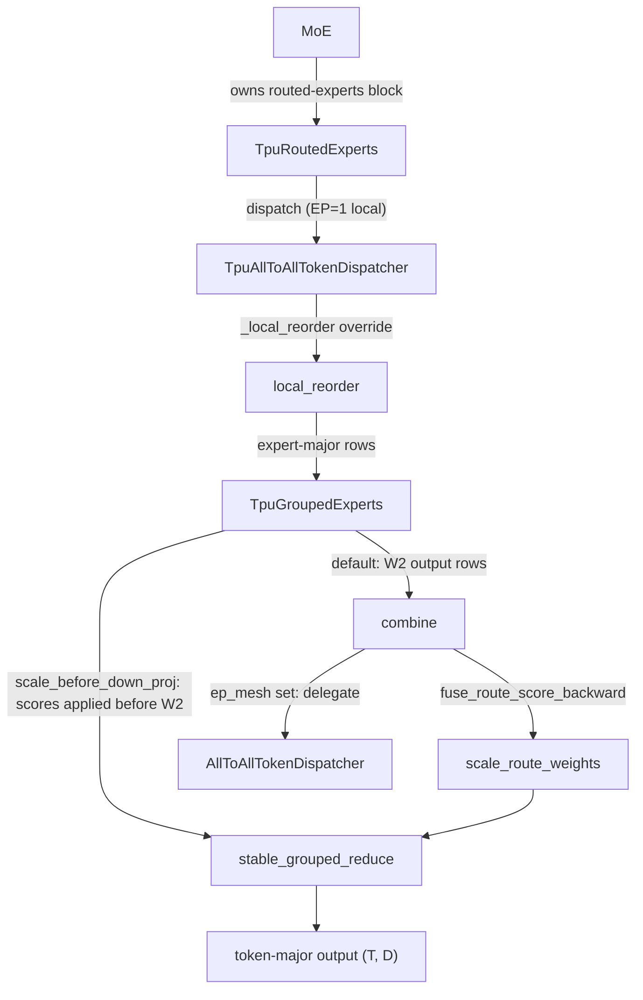
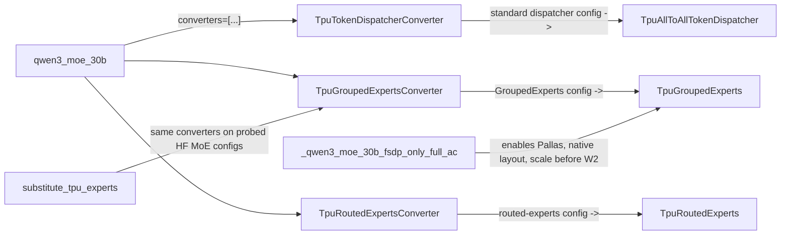

# TPU MoE dispatch and grouped experts (local reorder VJPs, fixed-K combine, Pallas grouped matmul)

<!-- connect:up:begin -->
> **Cross-repo concept:** part of [expert-parallelism](../../../concepts/expert-parallelism.md), [pallas-kernel](../../../concepts/pallas-kernel.md), [rematerialization](../../../concepts/rematerialization.md) across this wiki's repos.
<!-- connect:up:end -->
## Overview

The TPU lane does not write its own MoE layer. It keeps the shared [`MoE`](../catalog/torchtitan/models/common/moe.md#MoE "torchtitan/models/common/moe.py:L934") structure (router -> routed-experts block -> token dispatcher + grouped experts) and replaces three leaf configs *before construction* with TPU subclasses, using three [`ModelConfigConverter`](../catalog/torchtitan/protocols/model.md#ModelConfigConverter "torchtitan/protocols/model.py:L19")s that a recipe lists in its model spec. The replacements change *how the same math is differentiated and laid out*, not what is computed: the dispatcher's permutation and combine get hand-written autograd functions whose backward is a whole-row gather instead of the native element-wise scatter/gather; the routed-experts block can move the routing-score multiply to before the down projection (W2) so a rematerializing backward does not replay W2; and the grouped experts gain opt-in Pallas grouped-matmul kernels with a weight layout that matches what the kernel consumes. The single key idea is that, on TPU, the default PyTorch autograd for MoE permutations lowers to scatter/gather patterns XLA runs at a tiny fraction of HBM bandwidth, so the lane rewrites these VJPs as row-indexed gathers, with an FP32 sum over the fixed top-K axis wherever a token's `K` route copies must be accumulated.

These optimizations target the **EP=1** (experts replicated, FSDP-sharded) configuration that the FSDP-only Qwen3 MoE TPU recipes use (the base `qwen3_moe_30b` recipe itself sets `expert_parallel_degree=128`; its FSDP-only derivative pins EP=1); with an EP mesh, the combine delegates back to the standard all-to-all path.

## Diagram

Forward data flow through one TPU MoE block at EP=1 (the two route-weighting variants are mutually exclusive):

Legend:
- `MOE` - [`MoE`](../catalog/torchtitan/models/common/moe.md#MoE "torchtitan/models/common/moe.py:L934")
- `RE` - [`TpuRoutedExperts`](../catalog/torchtitan/experiments/tpu/token_dispatcher.md#TpuRoutedExperts "torchtitan/experiments/tpu/token_dispatcher.py:L294")
- `DISP` - [`TpuAllToAllTokenDispatcher`](../catalog/torchtitan/experiments/tpu/token_dispatcher.md#TpuAllToAllTokenDispatcher "torchtitan/experiments/tpu/token_dispatcher.py:L235")
- `LR` - [`local_reorder`](../catalog/torchtitan/experiments/tpu/token_dispatcher.md#local_reorder "torchtitan/experiments/tpu/token_dispatcher.py:L222")
- `GE` - [`TpuGroupedExperts`](../catalog/torchtitan/experiments/tpu/grouped_experts.md#TpuGroupedExperts "torchtitan/experiments/tpu/grouped_experts.py:L90")
- `CMB` - [`combine`](../catalog/torchtitan/experiments/tpu/token_dispatcher.md#TpuAllToAllTokenDispatcher.combine "torchtitan/experiments/tpu/token_dispatcher.py:L267")
- `SRW` - [`scale_route_weights`](../catalog/torchtitan/experiments/tpu/token_dispatcher.md#scale_route_weights "torchtitan/experiments/tpu/token_dispatcher.py:L75")
- `SGR` - [`stable_grouped_reduce`](../catalog/torchtitan/experiments/tpu/token_dispatcher.md#stable_grouped_reduce "torchtitan/experiments/tpu/token_dispatcher.py:L151")
- `A2A` - [`AllToAllTokenDispatcher`](../catalog/torchtitan/models/common/token_dispatcher.md#AllToAllTokenDispatcher "torchtitan/models/common/token_dispatcher.py:L228")
- `OUT` - (concept) the combined per-token MoE output

How a recipe installs the TPU classes (config-tree rewrite before any module is built):

Legend:
- `R30` - [`qwen3_moe_30b`](../catalog/torchtitan/experiments/tpu/qwen3/config_registry.md#qwen3_moe_30b "torchtitan/experiments/tpu/qwen3/config_registry.py:L735")
- `TDC` - [`TpuTokenDispatcherConverter`](../catalog/torchtitan/experiments/tpu/token_dispatcher.md#TpuTokenDispatcherConverter "torchtitan/experiments/tpu/token_dispatcher.py:L385")
- `TGC` - [`TpuGroupedExpertsConverter`](../catalog/torchtitan/experiments/tpu/grouped_experts.md#TpuGroupedExpertsConverter "torchtitan/experiments/tpu/grouped_experts.py:L396")
- `TRC` - [`TpuRoutedExpertsConverter`](../catalog/torchtitan/experiments/tpu/token_dispatcher.md#TpuRoutedExpertsConverter "torchtitan/experiments/tpu/token_dispatcher.py:L358")
- `DISP` - [`TpuAllToAllTokenDispatcher`](../catalog/torchtitan/experiments/tpu/token_dispatcher.md#TpuAllToAllTokenDispatcher "torchtitan/experiments/tpu/token_dispatcher.py:L235")
- `GE` - [`TpuGroupedExperts`](../catalog/torchtitan/experiments/tpu/grouped_experts.md#TpuGroupedExperts "torchtitan/experiments/tpu/grouped_experts.py:L90")
- `RE` - [`TpuRoutedExperts`](../catalog/torchtitan/experiments/tpu/token_dispatcher.md#TpuRoutedExperts "torchtitan/experiments/tpu/token_dispatcher.py:L294")
- `FSDP` - [`_qwen3_moe_30b_fsdp_only_full_ac`](../catalog/torchtitan/experiments/tpu/qwen3/config_registry.md#_qwen3_moe_30b_fsdp_only_full_ac "torchtitan/experiments/tpu/qwen3/config_registry.py:L797")
- `HF` - [`substitute_tpu_experts`](../catalog/torchtitan/experiments/tpu/transformers_modeling_backend/model.md#substitute_tpu_experts "torchtitan/experiments/tpu/transformers_modeling_backend/model.py:L954")

## Design rationale (why it's built this way)

**Collision scatters are the enemy.** Sorting `T * K` routes by expert and then gathering token rows means each token row appears `K` times in the routed input. Native autograd differentiates that gather as a scatter-add with collisions, and the standard combine differentiates its `scatter_add` over a `(rows, dim)`-expanded index as an element-wise gather. The [`substitute_tpu_experts`](../catalog/torchtitan/experiments/tpu/transformers_modeling_backend/model.md#substitute_tpu_experts "torchtitan/experiments/tpu/transformers_modeling_backend/model.py:L954") docstring quantifies it: "XLA runs that on TPU at a few percent of HBM bandwidth (Qwen3-30B-A3B on v6e-32: 9.2 ms per call, 83% of the step)", and concludes "The dispatcher matters more than the experts." Both TPU VJPs are therefore expressed as `index_select` of whole rows: the reorder's backward gathers by the inverse permutation, reshapes to `(T, K, D)` and sums over the fixed `K` axis in FP32, while the combine does that reshape-and-sum in its forward so its backward is a bare row gather - no collisions in either, possible only because dropless local dispatch produces exactly `K` rows per token.

**Save a 1-D index, not an expanded one.** The fixed-K combine's docstring records that the upstream deterministic scatter's generated VJP "expanded the row index across the hidden dimension and materialized a 768-MiB index per layer at the production shape." The TPU version saves only `index_N` for backward (asserted by a saved-tensor-hook test).

**Stable sorts are a numerics decision, not a perf one.** The reorder keeps its expert sort stable because "changing equal-expert route order changes BF16 expert dWeight accumulation and produced an unacceptable training-trajectory shift." The authors list the alternatives they measured and rejected (FP32 `index_add`, generic inverse scatter, composite-key sorts, an opaque Pallas gather/reduce, fusing score scaling into the reduce): some won isolated microbenchmarks, "but none produced a material whole-model improvement". The docstring is explicit that this is "the best measured whole-graph implementation, not a proof that no faster formulation exists."

**Scale before W2 to make remat cheaper.** W2 is linear, so scaling its input rows equals scaling its output rows. Scaling the input makes the score gradient `rowsum(hidden * dHidden)`, "which does not read the W2 output, so a rematerializing backward no longer recomputes the W2 forward" ([`TpuRoutedExperts`](../catalog/torchtitan/experiments/tpu/token_dispatcher.md#TpuRoutedExperts "torchtitan/experiments/tpu/token_dispatcher.py:L294")). The only change is rounding position (each BF16 hidden row is scaled in FP32 and rounded before W2). The 235B recipe test asserts this knob is "not a numerics knob": it is on in the base, MaxText-parity and splitter recipes alike.

**EP>1 is deliberately out of scope for the combine.** The module docstring says the reorder VJP runs for both EP=1 and EP>1 (it precedes transport), but the fixed-K combine "is deliberately scoped to EP=1"; supporting EP would require keeping the return all-to-all and placing SP-local rows in global sequence coordinates, which "has not been benchmarked here."

**The FSDP-only Qwen MoE TPU recipes turn on Pallas grouped matmul for correctness as well as speed.** (It is off by default, including in the base `qwen3_moe_30b` recipe.) The grouped-experts forward comment says the Qwen TPU recipe uses Pallas because native grouped-mm "mode-2 dWeight is incorrect at M=4096". The kernel-native layout stores each expert weight as `(E, K, N)` in exactly the order the kernel consumes (K = contracted input dim), so no transpose is paid per step; state-dict hooks keep the canonical `w1_EFD` / `w2_EDF` / `w3_EFD` checkpoint contract.

> [!inferred]
> The converters match the *exact* standard dispatcher and routed-experts config types (they skip subclasses), so a model family that already ships its own dispatcher subclass (for example a non-standard comm backend) is left alone rather than silently overwritten. The grouped-experts converter instead matches subclasses too, which is what makes it propagate a model-specific activation such as Gemma4's `gelu_tanh` (the Gemma4 test suite has a converter-propagation test for exactly this).

## Entry points

- [`TpuTokenDispatcherConverter`](../catalog/torchtitan/experiments/tpu/token_dispatcher.md#TpuTokenDispatcherConverter "torchtitan/experiments/tpu/token_dispatcher.py:L385") - "Select TPU local reorder and combine VJPs for the standard dispatcher." Runs over the model config tree when the model spec is built; replaces every config whose type is exactly the standard all-to-all dispatcher config with the TPU subclass config, copying shared fields. Idempotent, as asserted by [`test_converter_preserves_fields_and_is_idempotent`](../catalog/torchtitan/experiments/tpu/tests/test_token_dispatcher.md#test_converter_preserves_fields_and_is_idempotent "torchtitan/experiments/tpu/tests/test_token_dispatcher.py:L281").
- [`TpuGroupedExpertsConverter`](../catalog/torchtitan/experiments/tpu/grouped_experts.md#TpuGroupedExpertsConverter "torchtitan/experiments/tpu/grouped_experts.py:L396") - "Select the TPU grouped-expert implementation before construction." Rewrites every [`GroupedExperts`](../catalog/torchtitan/models/common/moe.md#GroupedExperts "torchtitan/models/common/moe.py:L440") config; the Pallas knobs default off, so conversion alone changes nothing until a recipe enables them. Used by the HF-parity tests ([`test_qwen3_5_hf_reference_parity`](../catalog/torchtitan/experiments/tpu/qwen3_5/tests/test_qwen3_5.md#Qwen35Test.test_qwen3_5_hf_reference_parity "torchtitan/experiments/tpu/qwen3_5/tests/test_qwen3_5.py:L180"), [`test_one_step_matches_hf`](../catalog/torchtitan/experiments/tpu/examples/gemma4/tests/test_gemma4.md#TestGemma4HFReferenceParity.test_one_step_matches_hf "torchtitan/experiments/tpu/examples/gemma4/tests/test_gemma4.py:L649")).
- [`TpuRoutedExpertsConverter`](../catalog/torchtitan/experiments/tpu/token_dispatcher.md#TpuRoutedExpertsConverter "torchtitan/experiments/tpu/token_dispatcher.py:L358") - "Select `TpuRoutedExperts` for the standard routed-experts block." Needed only so a recipe can later set `scale_before_down_proj`.
- [`qwen3_moe_30b`](../catalog/torchtitan/experiments/tpu/qwen3/config_registry.md#qwen3_moe_30b "torchtitan/experiments/tpu/qwen3/config_registry.py:L735") - the "TPU specialization of the global-aux Qwen3 30B recipe"; lists the three converters in the model spec. [`_qwen3_moe_30b_fsdp_only_full_ac`](../catalog/torchtitan/experiments/tpu/qwen3/config_registry.md#_qwen3_moe_30b_fsdp_only_full_ac "torchtitan/experiments/tpu/qwen3/config_registry.py:L797") ("Batch-6 FSDP128 baseline with local dropless expert dispatch") is where the perf knobs are actually turned on; the 235B recipes ([`_qwen3_moe_235b_fsdp_only`](../catalog/torchtitan/experiments/tpu/qwen3/config_registry.md#_qwen3_moe_235b_fsdp_only "torchtitan/experiments/tpu/qwen3/config_registry.py:L942"), [`qwen3_moe_235b_scan`](../catalog/torchtitan/experiments/tpu/qwen3/config_registry.md#qwen3_moe_235b_scan "torchtitan/experiments/tpu/qwen3/config_registry.py:L1141")) re-apply them with re-tuned tiling.
- [`_make_moe_config`](../catalog/torchtitan/experiments/tpu/examples/gemma4/__init__.md#_make_moe_config "torchtitan/experiments/tpu/examples/gemma4/__init__.py:L104") - the Gemma4 example builds [`TpuGroupedExperts`](../catalog/torchtitan/experiments/tpu/grouped_experts.md#TpuGroupedExperts "torchtitan/experiments/tpu/grouped_experts.py:L90") directly (no converter) with `activation="gelu_tanh"`.
- [`substitute_tpu_experts`](../catalog/torchtitan/experiments/tpu/transformers_modeling_backend/model.md#substitute_tpu_experts "torchtitan/experiments/tpu/transformers_modeling_backend/model.py:L954") - HF-modeling-backend path. Registered converters never see the MoE configs that the HF backend probes at construction time, so this applies the grouped-experts and dispatcher converters to each layer's stored config between construction and parallelize (TPU only).

## Mechanism (step-by-step)

1. **Config rewrite before construction.** A recipe's `converters=[TpuTokenDispatcherConverter, TpuGroupedExpertsConverter, TpuRoutedExpertsConverter]` (as in [`qwen3_moe_30b`](../catalog/torchtitan/experiments/tpu/qwen3/config_registry.md#qwen3_moe_30b "torchtitan/experiments/tpu/qwen3/config_registry.py:L735")) walks the config tree and replaces leaf configs in place (by parent attribute, list slot, or root). Each converter builds the TPU config by copying every field the source shares with the target, so new upstream fields carry over automatically and the TPU-only knobs start at their defaults (`fuse_route_score_backward=False`, `scale_before_down_proj=False`, `use_pallas_grouped_mm=False`). The perf recipe [`_qwen3_moe_30b_fsdp_only_full_ac`](../catalog/torchtitan/experiments/tpu/qwen3/config_registry.md#_qwen3_moe_30b_fsdp_only_full_ac "torchtitan/experiments/tpu/qwen3/config_registry.py:L797") then traverses the converted tree and sets, on every grouped-experts config, `use_pallas_grouped_mm=True`, `use_pallas_paired_grouped_mm=True`, `pallas_grouped_mm_tile_m=256`, `pallas_grouped_mm_tgmm_tiling=(256, 0, 0)` and `use_kernel_native_weight_layout=True`, and sets `scale_before_down_proj=True` on every routed-experts config. It also pins `expert_parallel_degree=1` and selects `memory_policy="tpu_selective"` with `save_regions=("moe.routing", "attention.inner_attention")`.

2. **Expert-sort with a row-gather VJP.** At EP=1 the dispatcher falls back to local dispatch, which calls the `_local_reorder` hook that [`TpuAllToAllTokenDispatcher`](../catalog/torchtitan/experiments/tpu/token_dispatcher.md#TpuAllToAllTokenDispatcher "torchtitan/experiments/tpu/token_dispatcher.py:L235") overrides to call [`local_reorder`](../catalog/torchtitan/experiments/tpu/token_dispatcher.md#local_reorder "torchtitan/experiments/tpu/token_dispatcher.py:L222"). It computes a **stable** argsort of the flattened `(T*K)` expert ids inside the `moe.routing` remat region ("Marked so that a selective memory policy can save the sort order" - this is the region the 30B recipe's `save_regions` names). The autograd function then gathers token rows and scores into expert-major order and saves only the inverse permutation. Backward gathers gradients back to token-major order with that inverse, reshapes to `(T, K, D)` and sums the `K` copies in FP32 - restoring top-k-slot accumulation order. Score gradients use the same inverse gather with no sum. The same override is active at EP>1 because the reorder precedes the all-to-all.

3. **Grouped experts on expert-sorted rows.** [`TpuGroupedExperts`](../catalog/torchtitan/experiments/tpu/grouped_experts.md#TpuGroupedExperts "torchtitan/experiments/tpu/grouped_experts.py:L90") ("TPU expert kernels with opt-in Pallas grouped paths") has three execution paths. Without Pallas and with `silu`, it defers to the base [`GroupedExperts`](../catalog/torchtitan/models/common/moe.md#GroupedExperts "torchtitan/models/common/moe.py:L440") forward; with `gelu_tanh` it runs a mirrored copy of that forward with a configurable activation (the seam pinned by [`test_silu_delegates_to_super_and_gelu_uses_grouped_mm_seam`](../catalog/torchtitan/experiments/tpu/examples/gemma4/tests/test_gemma4.md#TestTpuGroupedExpertsActivation.test_silu_delegates_to_super_and_gelu_uses_grouped_mm_seam "torchtitan/experiments/tpu/examples/gemma4/tests/test_gemma4.py:L160")). With Pallas, it takes local shards of the (possibly DTensor) weights, casts activations to BF16 ("expert compute is BF16 even when the surrounding model is FP32"), pads the row count up to a multiple of `tile_m` by appending zero rows to the *last* expert's group (they add nothing to dWeight and are sliced off), and runs W1 and W3 either as two segment matmuls or as one **paired** kernel that shares routed-token loads between the equal-shaped W1/W3 projections. The SwiGLU/GELU product is formed, optionally scaled by `row_scale_R` (step 4), and W2 runs as a third segment matmul whose dWeight tiling can differ from W1/W3's because "a dWeight is tiled along `K`, the weight's input dimension, which is `F` for W2 and `D` for W1/W3". All dWeight kernels accumulate in FP32 and store in the weights' BF16 dtype.

4. **Route weighting - one of two placements.** In the default path [`combine`](../catalog/torchtitan/experiments/tpu/token_dispatcher.md#TpuAllToAllTokenDispatcher.combine "torchtitan/experiments/tpu/token_dispatcher.py:L267") multiplies each W2 output row by its expert-sorted score in FP32. With `fuse_route_score_backward`, it uses [`scale_route_weights`](../catalog/torchtitan/experiments/tpu/token_dispatcher.md#scale_route_weights "torchtitan/experiments/tpu/token_dispatcher.py:L75") instead, which (only for BF16 outputs with FP32 scores on CPU/TPU) saves the BF16 output and computes dScore as a fused FP32 multiply-and-row-reduce, avoiding native autograd's saved FP32 `[N, D]` tensor; the comment says this matches the gradient implied by MaxText's FP32 route-weighted combine, numerically but not bitwise. Alternatively [`TpuRoutedExperts`](../catalog/torchtitan/experiments/tpu/token_dispatcher.md#TpuRoutedExperts "torchtitan/experiments/tpu/token_dispatcher.py:L294") with `scale_before_down_proj` runs dispatch itself, passes the sorted scores as `row_scale_R` into the grouped experts (scaling hidden rows before W2), and calls the fixed-K reduce directly - skipping the dispatcher's combine. The constructor rejects enabling both (`"enable only one"`) and requires the TPU dispatcher; the forward requires EP=1 local dispatch metadata. Equivalence of the two placements (outputs and all gradients) is asserted by [`test_scale_before_down_proj_matches_scaling_the_output`](../catalog/torchtitan/experiments/tpu/tests/test_token_dispatcher.md#test_scale_before_down_proj_matches_scaling_the_output "torchtitan/experiments/tpu/tests/test_token_dispatcher.py:L326") via its inner [`run`](../catalog/torchtitan/experiments/tpu/tests/test_token_dispatcher.md#test_scale_before_down_proj_matches_scaling_the_output.run "torchtitan/experiments/tpu/tests/test_token_dispatcher.py:L338") helper.

5. **Fixed-K combine.** [`stable_grouped_reduce`](../catalog/torchtitan/experiments/tpu/token_dispatcher.md#stable_grouped_reduce "torchtitan/experiments/tpu/token_dispatcher.py:L151") ("Reduce fixed-K routes by token with FP32 accumulation") stable-argsorts the per-row original-token index so each token's `K` rows become contiguous, gathers, reshapes to `(T, K, D)` and sums over `K` in FP32. Its backward is just `grad_output[index_N]` - a row gather with no collisions - and it saves only the 1-D index. If the dispatcher has an EP mesh, [`combine`](../catalog/torchtitan/experiments/tpu/token_dispatcher.md#TpuAllToAllTokenDispatcher.combine "torchtitan/experiments/tpu/token_dispatcher.py:L267") returns the standard [`AllToAllTokenDispatcher`](../catalog/torchtitan/models/common/token_dispatcher.md#AllToAllTokenDispatcher "torchtitan/models/common/token_dispatcher.py:L228") combine unchanged.

6. **FSDP layout of expert banks.** When the expert count does not divide the FSDP degree (e.g. 128 experts over 512 ranks), [`configure_qwen_simple_fsdp_shard_dims`](../catalog/torchtitan/experiments/tpu/qwen3_sharding.md#configure_qwen_simple_fsdp_shard_dims "torchtitan/experiments/tpu/qwen3_sharding.py:L19") ("Use divisible hidden axes for uneven Qwen parameters under SimpleFSDP") shards [`TpuGroupedExperts`](../catalog/torchtitan/experiments/tpu/grouped_experts.md#TpuGroupedExperts "torchtitan/experiments/tpu/grouped_experts.py:L90") parameters on a hidden axis instead of dim 0. With the kernel-native layout and a divisible trailing D axis it shards W2 on that trailing axis and flips the module's transposed-RHS flag, so the gathered `[E, D, F]` W2 is read as a transposed RHS "instead of paying a full relayout copy"; the grouped-experts forward then picks the separate `pallas_grouped_mm_w2_transposed_tgmm_tiling`. Under kernel-native layout, the module's state-sharding config is also rewritten so canonical sharding specs apply to the transposed native storage.

## Key data structures

| Knob (config field) | Owner | Default | Effect |
|---|---|---|---|
| `fuse_route_score_backward` | [`TpuAllToAllTokenDispatcher`](../catalog/torchtitan/experiments/tpu/token_dispatcher.md#TpuAllToAllTokenDispatcher "torchtitan/experiments/tpu/token_dispatcher.py:L235") | False | Route-score multiply after W2 uses the fused-dScore autograd function |
| `scale_before_down_proj` | [`TpuRoutedExperts`](../catalog/torchtitan/experiments/tpu/token_dispatcher.md#TpuRoutedExperts "torchtitan/experiments/tpu/token_dispatcher.py:L294") | False | Scores scale hidden rows before W2; remat backward does not replay W2 |
| `activation` | [`TpuGroupedExperts`](../catalog/torchtitan/experiments/tpu/grouped_experts.md#TpuGroupedExperts "torchtitan/experiments/tpu/grouped_experts.py:L90") | `silu` | `silu` or `gelu_tanh` (Gemma4) |
| `use_pallas_grouped_mm` | same | False | Segment-matmul Pallas kernels instead of native grouped mm |
| `use_pallas_paired_grouped_mm` | same | False | One kernel for W1+W3; requires Pallas, full-N TGMM tile, and no EP mesh |
| `pallas_grouped_mm_tile_m` / `_tile_k` / `_tile_n` | same | 1024 / 0 / 0 | Forward tiles; rows are zero-padded to a multiple of `tile_m` |
| `pallas_grouped_mm_tgmm_tiling` | same | (128, 128, 128) | dWeight (TGMM) tiling for W1/W3 (and W2 unless overridden) |
| `pallas_grouped_mm_w2_tgmm_tiling` | same | None | Separate W2 dWeight tiling (W2's K axis is the shorter F) |
| `pallas_grouped_mm_w2_transposed_tgmm_tiling` | same | None | W2 dWeight tiling when W2 is FSDP-sharded on its trailing axis |
| `use_kernel_native_weight_layout` | same | False | Store weights `(E, K, N)`; requires Pallas; checkpoint keys stay canonical |

Recipe values observed in source:

| Recipe | tile_m | tgmm (W1/W3) | W2 tgmm | W2 transposed | Notes |
|---|---|---|---|---|---|
| [`_qwen3_moe_30b_fsdp_only_full_ac`](../catalog/torchtitan/experiments/tpu/qwen3/config_registry.md#_qwen3_moe_30b_fsdp_only_full_ac "torchtitan/experiments/tpu/qwen3/config_registry.py:L797") | 256 | (256, 0, 0) | follows | follows | paired, native layout, EP=1, Zero-2 |
| [`_qwen3_moe_235b_fsdp_only`](../catalog/torchtitan/experiments/tpu/qwen3/config_registry.md#_qwen3_moe_235b_fsdp_only "torchtitan/experiments/tpu/qwen3/config_registry.py:L942") | 256 | (512, 2048, 0) | (256, 768, 0) | (256, 0, 2048) | memory_policy reset to `full` |
| [`qwen3_moe_235b_scan`](../catalog/torchtitan/experiments/tpu/qwen3/config_registry.md#qwen3_moe_235b_scan "torchtitan/experiments/tpu/qwen3/config_registry.py:L1141") | 256 | (512, 2048, 0) | (256, 768, 0) | - | 94 scanned layers |

The 235B comment explains why W1/W3 and W2 tile independently: an untiled paired dWeight needs 105 MB against Mosaic's 64 MB scoped-VMEM budget, the paired dWeight prefers a 2048 K tile, and a 2048 tile on W2's 1536-wide axis "does not clamp": it allocates a 33.55 MB window, doubled by buffering to the whole 64 MB, and "the module OOMs before the first step (measured on 64 v7x)".

## Dynamics (design intent)

- **Numerics guarantees are tested, not assumed.** [`scale_route_weights`](../catalog/torchtitan/experiments/tpu/token_dispatcher.md#scale_route_weights "torchtitan/experiments/tpu/token_dispatcher.py:L75") is checked against native autograd with `rtol=0, atol=0` on CPU, keeps native behavior for other dtypes, and is traced through forward and backward. [`stable_grouped_reduce`](../catalog/torchtitan/experiments/tpu/token_dispatcher.md#stable_grouped_reduce "torchtitan/experiments/tpu/token_dispatcher.py:L151") is checked against a `scatter_add` reference and for saving only the index. The local combine is compared with the standard dispatcher at `rtol=0.05, atol=0.125` (BF16 tolerances), and the EP combine is asserted to delegate.
- **Determinism through stable ordering.** Both reorders use stable argsorts so equal keys keep expert-major order; the combine therefore reduces each token's routes in a deterministic order (the docstring calls this "avoiding another gratuitous change in deterministic accumulation order").
- **Recipe assertions pin the knobs.** [`test_fsdp_only_recipe_uses_fused_adamw_and_attention_tuning`](../catalog/torchtitan/experiments/tpu/graph_trainer/tests/test_tpu_graph_trainer_config.md#TpuGraphTrainerConfigTest.test_fsdp_only_recipe_uses_fused_adamw_and_attention_tuning "torchtitan/experiments/tpu/graph_trainer/tests/test_tpu_graph_trainer_config.py:L799") asserts the 30B benchmark recipe has TPU dispatchers with `fuse_route_score_backward` off and every routed-experts block with `scale_before_down_proj` on; [`test_235b_maxtext_twin_changes_only_the_two_numerics_knobs`](../catalog/torchtitan/experiments/tpu/graph_trainer/tests/test_tpu_graph_trainer_config.md#TpuGraphTrainerConfigTest.test_235b_maxtext_twin_changes_only_the_two_numerics_knobs "torchtitan/experiments/tpu/graph_trainer/tests/test_tpu_graph_trainer_config.py:L1112") asserts 94 routed-experts blocks with the flag on in each 235B variant.
- **Remat interaction.** The `moe.routing` region annotation lets the `tpu_selective` memory policy save the expert sort order rather than recompute it; the 235B recipe resets to plain `full` remat because those saves "were measured only on 30B".

## Edge cases

- `scale_before_down_proj=True` with a non-TPU dispatcher, with `fuse_route_score_backward=True`, or under an EP mesh raises `ValueError`. `row_scale_R` without `use_pallas_grouped_mm` also raises.
- `use_kernel_native_weight_layout` without `use_pallas_grouped_mm`, `use_pallas_paired_grouped_mm` without Pallas, a paired TGMM tiling whose N entry is not 0, and paired matmul with an EP mesh ("Paired grouped matmul requires EP=1 exact-row dispatch") all raise at construction or parallelize.
- [`scale_route_weights`](../catalog/torchtitan/experiments/tpu/token_dispatcher.md#scale_route_weights "torchtitan/experiments/tpu/token_dispatcher.py:L75") requires `routed[N, D]` and `scores[N]` with matching row counts; other dtypes or devices silently take the native path.
- Activations other than `silu` / `gelu_tanh` are rejected.
- Row padding to `tile_m` lands on the last expert's group; it is sliced off the output, and `row_scale_R` is padded to match.
- The HF-backend substitution is a no-op off TPU; it enables the Pallas path only when the model carries the use-Pallas flag, and then uses the unpaired kernels with bounded K/N tiles (the paired kernel "holds full (dim, hidden) weight slabs in VMEM").
- The routed-experts and dispatcher converters skip configs that are already subclasses, so a second pass is a no-op.

## Open questions

- The central symbols the packet did not include: the shared routed-experts module (`RoutedExperts`, whose forward drives dispatch -> experts -> combine), the dispatch metadata dataclasses, the base local dispatcher, the config `derive` helper the converters use, and the Pallas kernels themselves (`segment_matmul_pallas_2d`, `paired_segment_matmul_pallas_2d`, the `route_score_grad` op). They are described here from source but cannot be cited; see [TPU Pallas kernels](tpu-pallas-kernels.md) for the kernel side.
- The module docstring says the fixed-K reduction "should be applicable" after the EP return all-to-all, but no benchmark or implementation exists; the EP>1 TPU path therefore only benefits from the reorder VJP.
- Whole-model gains of each knob are described qualitatively in comments (e.g. "regressed two full-model brackets"); the only absolute number in source is the HF-backend dispatcher measurement (9.2 ms per call, 83% of the step on v6e-32). Per-knob step-time deltas are not recorded in the repo.

## See also

- [Parallel dims and parallelization](parallel-dims-and-parallelization.md) - EP mesh wiring and how EP composes with FSDP.
- [Model building blocks](model-building-blocks.md) - the shared MoE, router and grouped-experts modules this page specializes.
- [TPU Pallas kernels](tpu-pallas-kernels.md) - the segment / paired segment matmul kernels.
- [TPU layer loop, remat and layouts](tpu-layer-loop-remat-and-layouts.md) - remat regions and the `tpu_selective` memory policy.
- [TPU graph trainer](tpu-graph-trainer.md) - the trainer the Qwen3 MoE recipes run on.
- [Qwen3 model](qwen3-model.md), [Qwen3.5 model](qwen3-5-model.md) - models whose TPU recipes use these classes.
- [TPU context-parallel attention](tpu-context-parallel-attention.md).
