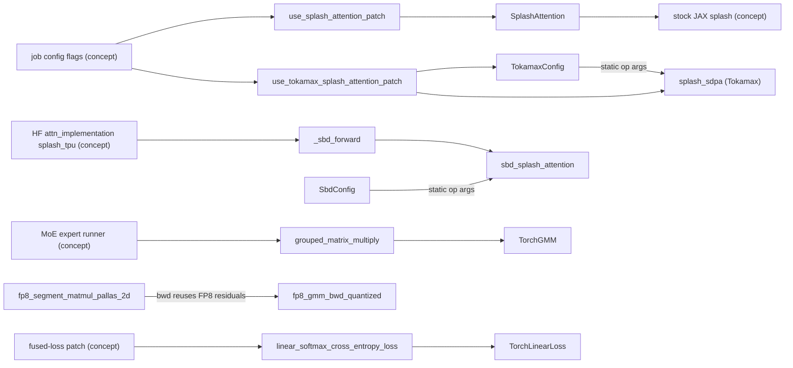
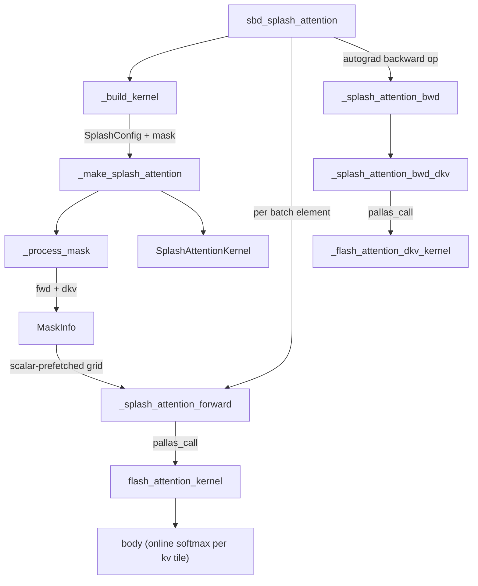

# TPU Pallas kernels: splash attention (stock, Tokamax, SBD fork), grouped matmul, FP8 GMM and fused linear cross-entropy

<!-- connect:up:begin -->
> **Cross-repo concept:** part of [flash-attention](../../../concepts/flash-attention.md), [mosaic-kernel](../../../concepts/mosaic-kernel.md), [pallas-kernel](../../../concepts/pallas-kernel.md), [splash-attention](../../../concepts/splash-attention.md), [vmem-budget](../../../concepts/vmem-budget.md) across this wiki's repos.
<!-- connect:up:end -->
## Overview

`torchtitan/experiments/tpu/kernels/` is where the TPU backend replaces the three hottest PyTorch computations - scaled-dot-product attention, MoE expert matmuls, and the LM-head projection plus cross-entropy - with Pallas/Mosaic kernels written in **JAX**. Every kernel is a JAX function wrapped by the torch_tpu Pallas bridge (`torch_tpu._internal.pallas`: either `custom_jax_kernel` or the newer `jax_op` custom-op decorator), registered as a `torch.library` custom op with a fake-tensor rule and a hand-written autograd pairing, so it is opaque to Dynamo and appears in the lowered program as one custom call per kernel. Upstream model code does not import these kernels directly (TPU-lane modules such as the conformer example and the grouped-experts runner do): TPU-side monkey patches in `workarounds.py` (for example [`use_splash_attention_patch`](../catalog/torchtitan/experiments/tpu/workarounds.md#use_splash_attention_patch "torchtitan/experiments/tpu/workarounds.py:L33") and [`use_tokamax_splash_attention_patch`](../catalog/torchtitan/experiments/tpu/workarounds.md#use_tokamax_splash_attention_patch "torchtitan/experiments/tpu/workarounds.py:L234")) swap modules or methods in a built model based on job-config flags.

The single most important idea for performance work: **every kernel knob must reach the kernel as a value that is part of the compile-cache key**. Tile sizes, mask choice, dropout rate and scheduler flags are hashed into op names or passed as static op arguments, never read from mutable globals inside the traced JAX function - otherwise a changed config silently reuses a stale compiled kernel. Most of the comments, regression tests and odd-looking plumbing in this directory exist to defend that invariant.

## Diagram

Which kernel a training step reaches, and through which entry:

Legend:
- `CFG` - (concept) `splash_attention_kernel` / `loss_kernel` / `qwen3` job-config sections read by the TPU patch installer
- `USP` - [`use_splash_attention_patch`](../catalog/torchtitan/experiments/tpu/workarounds.md#use_splash_attention_patch "torchtitan/experiments/tpu/workarounds.py:L33")
- `UTP` - [`use_tokamax_splash_attention_patch`](../catalog/torchtitan/experiments/tpu/workarounds.md#use_tokamax_splash_attention_patch "torchtitan/experiments/tpu/workarounds.py:L234")
- `SA` - [`SplashAttention`](../catalog/torchtitan/experiments/tpu/kernels/splash_attention.md#SplashAttention "torchtitan/experiments/tpu/kernels/splash_attention.py:L674")
- `STOCK` - (concept) `jax.experimental.pallas.ops.tpu.splash_attention`, wrapped in `splash_attention.py`
- `TC` - [`TokamaxConfig`](../catalog/torchtitan/experiments/tpu/kernels/tokamax_splash_attention.md#TokamaxConfig "torchtitan/experiments/tpu/kernels/tokamax_splash_attention.py:L77")
- `SDPA` - [`splash_sdpa`](../catalog/torchtitan/experiments/tpu/kernels/tokamax_splash_attention.md#splash_sdpa "torchtitan/experiments/tpu/kernels/tokamax_splash_attention.py:L578")
- `HF` - (concept) the HF transformers modeling backend's attention registration
- `SBDF` - [`_sbd_forward`](../catalog/torchtitan/experiments/tpu/transformers_modeling_backend/attention.md#_sbd_forward "torchtitan/experiments/tpu/transformers_modeling_backend/attention.py:L443")
- `SBD` - [`sbd_splash_attention`](../catalog/torchtitan/experiments/tpu/kernels/splash_bias_dropout.md#sbd_splash_attention "torchtitan/experiments/tpu/kernels/splash_bias_dropout.py:L820")
- `SBDC` - [`SbdConfig`](../catalog/torchtitan/experiments/tpu/kernels/splash_bias_dropout.md#SbdConfig "torchtitan/experiments/tpu/kernels/splash_bias_dropout.py:L69")
- `MOE` - (concept) TorchTitan's MoE grouped-mm runner, overridden by the GMM patch
- `GMM` - [`grouped_matrix_multiply`](../catalog/torchtitan/experiments/tpu/kernels/gmm.md#grouped_matrix_multiply "torchtitan/experiments/tpu/kernels/gmm.py:L98")
- `TGMM` - [`TorchGMM`](../catalog/torchtitan/experiments/tpu/kernels/gmm.md#TorchGMM "torchtitan/experiments/tpu/kernels/gmm.py:L75")
- `FP8` - [`fp8_segment_matmul_pallas_2d`](../catalog/torchtitan/experiments/tpu/kernels/fp8_expert_segment_matmul.md#fp8_segment_matmul_pallas_2d "torchtitan/experiments/tpu/kernels/fp8_expert_segment_matmul.py:L607")
- `FP8B` - [`fp8_gmm_bwd_quantized`](../catalog/torchtitan/experiments/tpu/kernels/fp8_expert_segment_matmul.md#fp8_gmm_bwd_quantized "torchtitan/experiments/tpu/kernels/fp8_expert_segment_matmul.py:L118")
- `LOSS` - (concept) the output-projection patch enabled by `loss_kernel.use_loss_kernel`
- `LCE` - [`linear_softmax_cross_entropy_loss`](../catalog/torchtitan/experiments/tpu/kernels/linear_softmax_cross_entropy_loss.md#linear_softmax_cross_entropy_loss "torchtitan/experiments/tpu/kernels/linear_softmax_cross_entropy_loss.py:L347")
- `TLL` - [`TorchLinearLoss`](../catalog/torchtitan/experiments/tpu/kernels/linear_softmax_cross_entropy_loss.md#TorchLinearLoss "torchtitan/experiments/tpu/kernels/linear_softmax_cross_entropy_loss.py:L282")

Inside the vendored SBD splash kernel - mask preprocessing at build time, then the forward and the fused dkv backward:

Legend:
- `SBD` - [`sbd_splash_attention`](../catalog/torchtitan/experiments/tpu/kernels/splash_bias_dropout.md#sbd_splash_attention "torchtitan/experiments/tpu/kernels/splash_bias_dropout.py:L820")
- `BK` - [`_build_kernel`](../catalog/torchtitan/experiments/tpu/kernels/splash_bias_dropout.md#_build_kernel "torchtitan/experiments/tpu/kernels/splash_bias_dropout.py:L161")
- `MSA` - [`_make_splash_attention`](../catalog/torchtitan/experiments/tpu/kernels/sbd_splash/splash_attention_kernel.md#_make_splash_attention "torchtitan/experiments/tpu/kernels/sbd_splash/splash_attention_kernel.py:L3348")
- `PM` - [`_process_mask`](../catalog/torchtitan/experiments/tpu/kernels/sbd_splash/splash_attention_mask_info.md#_process_mask "torchtitan/experiments/tpu/kernels/sbd_splash/splash_attention_mask_info.py:L345")
- `MI` - [`MaskInfo`](../catalog/torchtitan/experiments/tpu/kernels/sbd_splash/splash_attention_mask_info.md#MaskInfo "torchtitan/experiments/tpu/kernels/sbd_splash/splash_attention_mask_info.py:L38")
- `SAK` - [`SplashAttentionKernel`](../catalog/torchtitan/experiments/tpu/kernels/sbd_splash/splash_attention_kernel.md#SplashAttentionKernel "torchtitan/experiments/tpu/kernels/sbd_splash/splash_attention_kernel.py:L3281")
- `FWD` - [`_splash_attention_forward`](../catalog/torchtitan/experiments/tpu/kernels/sbd_splash/splash_attention_kernel.md#_splash_attention_forward "torchtitan/experiments/tpu/kernels/sbd_splash/splash_attention_kernel.py:L1113")
- `FAK` - [`flash_attention_kernel`](../catalog/torchtitan/experiments/tpu/kernels/sbd_splash/splash_attention_kernel.md#flash_attention_kernel "torchtitan/experiments/tpu/kernels/sbd_splash/splash_attention_kernel.py:L560")
- `BODY` - [`body`](../catalog/torchtitan/experiments/tpu/kernels/sbd_splash/splash_attention_kernel.md#flash_attention_kernel.body "torchtitan/experiments/tpu/kernels/sbd_splash/splash_attention_kernel.py:L728")
- `BWD` - [`_splash_attention_bwd`](../catalog/torchtitan/experiments/tpu/kernels/sbd_splash/splash_attention_kernel.md#_splash_attention_bwd "torchtitan/experiments/tpu/kernels/sbd_splash/splash_attention_kernel.py:L3127")
- `DKV` - [`_splash_attention_bwd_dkv`](../catalog/torchtitan/experiments/tpu/kernels/sbd_splash/splash_attention_kernel.md#_splash_attention_bwd_dkv "torchtitan/experiments/tpu/kernels/sbd_splash/splash_attention_kernel.py:L2572")
- `DKVK` - [`_flash_attention_dkv_kernel`](../catalog/torchtitan/experiments/tpu/kernels/sbd_splash/splash_attention_kernel.md#_flash_attention_dkv_kernel "torchtitan/experiments/tpu/kernels/sbd_splash/splash_attention_kernel.py:L1933")

## Design rationale (why it's built this way)

**Three splash backends, one contract.** The directory carries three splash attention implementations that a recipe can swap between: the stock JAX splash wrapper ([`SplashAttention`](../catalog/torchtitan/experiments/tpu/kernels/splash_attention.md#SplashAttention "torchtitan/experiments/tpu/kernels/splash_attention.py:L674") in `splash_attention.py`), Tokamax's splash ([`splash_sdpa`](../catalog/torchtitan/experiments/tpu/kernels/tokamax_splash_attention.md#splash_sdpa "torchtitan/experiments/tpu/kernels/tokamax_splash_attention.py:L578"), whose patch docstring calls it "zero-overhead Tokamax layout-fused splash attention" because the `(B, S, H, D) -> (B, H, S, D)` transposes run inside the JAX program instead of as separate torch ops), and the vendored **SBD fork** ([`sbd_splash_attention`](../catalog/torchtitan/experiments/tpu/kernels/splash_bias_dropout.md#sbd_splash_attention "torchtitan/experiments/tpu/kernels/splash_bias_dropout.py:L820")), a Tokamax splash fork that adds additive attention bias and in-kernel PRNG dropout. The SBD module docstring states its no-regression contract: "Features off, the kernel is bit-exact with unmodified tokamax splash", and prices the features: dropout ~+12-13%, per-key bias ~+2%, full-rank bias ~+43% over features-off. The Tokamax `splash_sdpa` deliberately re-checks `enable_gqa` against head counts even though it does not need it, because "the two functions are meant to be interchangeable via a config flag".

**Config travels as cache-key arguments, not globals.** Both [`TokamaxConfig`](../catalog/torchtitan/experiments/tpu/kernels/tokamax_splash_attention.md#TokamaxConfig "torchtitan/experiments/tpu/kernels/tokamax_splash_attention.py:L77") and [`SbdConfig`](../catalog/torchtitan/experiments/tpu/kernels/splash_bias_dropout.md#SbdConfig "torchtitan/experiments/tpu/kernels/splash_bias_dropout.py:L69") are process-global class-attribute containers, but neither is read inside the traced function. Their values are flattened into the op's argument list on every call, because the `jax_op` bridge "caches compiled kernels by argument values, so a config read inside would be invisible to the cache and a changed config could reuse a stale kernel". The SbdConfig docstring: "Each value is part of the op's trace-cache key, so `update(...)` takes effect on the next call regardless of what shapes were traced before." The stock wrapper does the equivalent by hashing all splash kwargs into a SHA-256-suffixed op name (`pallas::splash_attn_fwd_<hash>`).

**Silent misconfiguration is treated as a bug class.** A real regression - the patch read unprefixed field names off a config whose fields are all `sa_`-prefixed, so every value was `None` and `TokamaxConfig.update` (which skips `None`) kept library defaults - is pinned by [`test_tokamax_patch_forwards_splash_config`](../catalog/torchtitan/experiments/tpu/tests/test_workarounds.md#WorkaroundsTest.test_tokamax_patch_forwards_splash_config "torchtitan/experiments/tpu/tests/test_workarounds.py:L342"), whose docstring says: "Nothing failed - it was just slower, which is exactly why this needs a test rather than a runtime error." The same instinct makes Tokamax [`splash_sdpa`](../catalog/torchtitan/experiments/tpu/kernels/tokamax_splash_attention.md#splash_sdpa "torchtitan/experiments/tpu/kernels/tokamax_splash_attention.py:L578") raise if a caller passes per-call tile sizes that disagree with the active TokamaxConfig, rather than silently ignore them.

**The torch side owns autograd and residuals.** None of the torch wrappers go through JAX's `custom_vjp` ([`_splash_attention_custom`](../catalog/torchtitan/experiments/tpu/kernels/sbd_splash/splash_attention_kernel.md#_splash_attention_custom "torchtitan/experiments/tpu/kernels/sbd_splash/splash_attention_kernel.py:L1678")). They call the forward ([`_splash_attention_forward`](../catalog/torchtitan/experiments/tpu/kernels/sbd_splash/splash_attention_kernel.md#_splash_attention_forward "torchtitan/experiments/tpu/kernels/sbd_splash/splash_attention_kernel.py:L1113")) and backward ([`_splash_attention_bwd`](../catalog/torchtitan/experiments/tpu/kernels/sbd_splash/splash_attention_kernel.md#_splash_attention_bwd "torchtitan/experiments/tpu/kernels/sbd_splash/splash_attention_kernel.py:L3127")) halves directly from two separate custom ops, saving the forward's `(out, logsumexp)` alongside the inputs so there is "no extra forward pass at backward time". This makes the forward and backward two independently-compiled custom calls that PyTorch activation checkpointing and torch.compile can schedule like any other op.

**FP8 numerics follow an existing recipe, and residuals stay FP8.** The FP8 grouped matmul module docstring states it follows "MaxText's `quantization=fp8_full` recipe": forward operands are e4m3 (per-row for X, per-output-column shared across experts for W), backward gradients e5m2 with the forward scale folded in. "Autograd saves the FP8 values and scales instead of the BF16 inputs, so the backward never re-reads or re-quantizes X or W" - a direct activation-memory saving. FP8 residuals cross the torch boundary bitcast to int8.

> [!inferred]
> The overall pattern - kernels in JAX, glue in torch - exists because the TorchTPU stack lowers both to the same XLA program; reusing the JAX/Tokamax Pallas kernel ecosystem is far cheaper than re-authoring kernels against a torch-native Pallas front end. The per-kernel bridge choice (`custom_jax_kernel` in older wrappers such as GMM and stock splash, `jax_op` in Tokamax/SBD/FP8) reflects the bridge's evolution; the newer wrappers are the ones that pass config as static op arguments.

## Entry points

- [`use_splash_attention_patch`](../catalog/torchtitan/experiments/tpu/workarounds.md#use_splash_attention_patch "torchtitan/experiments/tpu/workarounds.py:L33") - reached from the TPU patch installer when `splash_attention_kernel.use_splash_attention_kernel` is set. Walks the model, replaces `ScaledDotProduct*` / `FlexAttention` children with [`SplashAttention`](../catalog/torchtitan/experiments/tpu/kernels/splash_attention.md#SplashAttention "torchtitan/experiments/tpu/kernels/splash_attention.py:L674") (or rebinds `_sdpa_native_torch` in place), picks up `sliding_window_size` per layer, keeps the original module as a fallback, and for Ulysses CP inner attentions installs the kernel as their local attention. Raises if it matched nothing.
- [`use_tokamax_splash_attention_patch`](../catalog/torchtitan/experiments/tpu/workarounds.md#use_tokamax_splash_attention_patch "torchtitan/experiments/tpu/workarounds.py:L234") - reached instead when `use_tokamax_splash_attention_kernel` is set (it wins over the stock flag). Copies the `sa_*` tile/layout fields into [`TokamaxConfig`](../catalog/torchtitan/experiments/tpu/kernels/tokamax_splash_attention.md#TokamaxConfig "torchtitan/experiments/tpu/kernels/tokamax_splash_attention.py:L77") once, filters remaining kwargs against [`splash_sdpa`](../catalog/torchtitan/experiments/tpu/kernels/tokamax_splash_attention.md#splash_sdpa "torchtitan/experiments/tpu/kernels/tokamax_splash_attention.py:L578")'s real signature (logging dropped keys at patch time, because a logger call inside the traced forward graph-breaks Dynamo), then patches attention forwards.
- [`_sbd_forward`](../catalog/torchtitan/experiments/tpu/transformers_modeling_backend/attention.md#_sbd_forward "torchtitan/experiments/tpu/transformers_modeling_backend/attention.py:L443") - reached when an HF transformers model runs with `attn_implementation="splash_tpu"`. Draws a `(B, 2)` int32 dropout seed from torch's device RNG (salted per rank), updates [`SbdConfig`](../catalog/torchtitan/experiments/tpu/kernels/splash_bias_dropout.md#SbdConfig "torchtitan/experiments/tpu/kernels/splash_bias_dropout.py:L69"), and calls [`sbd_splash_attention`](../catalog/torchtitan/experiments/tpu/kernels/splash_bias_dropout.md#sbd_splash_attention "torchtitan/experiments/tpu/kernels/splash_bias_dropout.py:L820") with `heads_first=True`.
- [`grouped_matrix_multiply`](../catalog/torchtitan/experiments/tpu/kernels/gmm.md#grouped_matrix_multiply "torchtitan/experiments/tpu/kernels/gmm.py:L98") - reached from the MoE expert runner once `qwen3.use_gmm_kernel` installs the GMM patch; computes the SwiGLU expert MLP as three Megablox GMMs.
- [`fp8_segment_matmul_pallas_2d`](../catalog/torchtitan/experiments/tpu/kernels/fp8_expert_segment_matmul.md#fp8_segment_matmul_pallas_2d "torchtitan/experiments/tpu/kernels/fp8_expert_segment_matmul.py:L607") - FP8 drop-in for the BF16 expert segment matmul ("Same contract as `expert_segment_matmul.segment_matmul_pallas_2d`").
- [`linear_softmax_cross_entropy_loss`](../catalog/torchtitan/experiments/tpu/kernels/linear_softmax_cross_entropy_loss.md#linear_softmax_cross_entropy_loss "torchtitan/experiments/tpu/kernels/linear_softmax_cross_entropy_loss.py:L347") - reached from the TPU loss when `loss_kernel.use_loss_kernel` replaces the output projection; fuses LM-head matmul, softmax and CE so the `(tokens, vocab)` logits are never materialized in HBM.
- [`fill_indices`](../catalog/torchtitan/experiments/tpu/kernels/fill_indices.md#fill_indices "torchtitan/experiments/tpu/kernels/fill_indices.py:L10") - a JAX (`fori_loop`, not Pallas) port of MoE permutation-index construction; its patch is currently a no-op stub (see Edge cases).

## Mechanism (step-by-step)

1. **Patch time: choose a backend and freeze its config.** The installer checks the Tokamax flag before the stock flag, so only one splash backend is active. [`use_tokamax_splash_attention_patch`](../catalog/torchtitan/experiments/tpu/workarounds.md#use_tokamax_splash_attention_patch "torchtitan/experiments/tpu/workarounds.py:L234") writes the recipe's tuned tiles into [`TokamaxConfig`](../catalog/torchtitan/experiments/tpu/kernels/tokamax_splash_attention.md#TokamaxConfig "torchtitan/experiments/tpu/kernels/tokamax_splash_attention.py:L77") and raises if a real splash config resolved nothing (the regression [`test_tokamax_patch_forwards_splash_config`](../catalog/torchtitan/experiments/tpu/tests/test_workarounds.md#WorkaroundsTest.test_tokamax_patch_forwards_splash_config "torchtitan/experiments/tpu/tests/test_workarounds.py:L342") guards). [`use_splash_attention_patch`](../catalog/torchtitan/experiments/tpu/workarounds.md#use_splash_attention_patch "torchtitan/experiments/tpu/workarounds.py:L33") instead captures the kwargs on each [`SplashAttention`](../catalog/torchtitan/experiments/tpu/kernels/splash_attention.md#SplashAttention "torchtitan/experiments/tpu/kernels/splash_attention.py:L674") module. Either way, block sizes (default 512 for every tile; the test recipe sets 1024/1024/512) are fixed before the first compiled step.

2. **Call time: layout, fallback and segment ids.** [`SplashAttention`](../catalog/torchtitan/experiments/tpu/kernels/splash_attention.md#SplashAttention "torchtitan/experiments/tpu/kernels/splash_attention.py:L674") unwraps DTensors to local shards (the kernel is per-device; sharding is restored with `DTensor.from_local` on the way out), falls back to the original module on CPU, for `seq_len < 128`, or when `auto_block_size` finds no power-of-two block dividing the length, and transposes `(B, S, H, D)` to the kernel's `(B, H, S, D)`. Packed-document `segment_ids` are expected to arrive precomputed once per step; deriving them from `positions` per layer is kept only as a fallback, which "profiling showed to be 25% of device time". The Tokamax [`splash_sdpa`](../catalog/torchtitan/experiments/tpu/kernels/tokamax_splash_attention.md#splash_sdpa "torchtitan/experiments/tpu/kernels/tokamax_splash_attention.py:L578") avoids the torch-side transposes entirely by doing them inside its JAX function, and the SBD entry's `heads_first=True` avoids them on both sides - measured in the SBD wrapper at "5.53 GiB / 308 ms heads-first versus 6.87 GiB / 357 ms transposing" (16k x 32 heads, 16 layers fwd+bwd).

3. **Kernel construction: the mask becomes block-sparse metadata.** For each configuration the wrapper builds a kernel once. In the SBD path [`_build_kernel`](../catalog/torchtitan/experiments/tpu/kernels/splash_bias_dropout.md#_build_kernel "torchtitan/experiments/tpu/kernels/splash_bias_dropout.py:L161") turns `SbdConfig` statics into a [`SplashConfig`](../catalog/torchtitan/experiments/tpu/kernels/sbd_splash/splash_attention_kernel.md#SplashConfig "torchtitan/experiments/tpu/kernels/sbd_splash/splash_attention_kernel.py:L167") ("Tile sizes parameterizing SplashAttention kernels ... negligible effect on numerics, but affect performance greatly"), picks `LocalMask` / `CausalMask` / `FullMask`, and calls [`_make_splash_attention`](../catalog/torchtitan/experiments/tpu/kernels/sbd_splash/splash_attention_kernel.md#_make_splash_attention "torchtitan/experiments/tpu/kernels/sbd_splash/splash_attention_kernel.py:L3348"), which runs [`_process_mask`](../catalog/torchtitan/experiments/tpu/kernels/sbd_splash/splash_attention_mask_info.md#_process_mask "torchtitan/experiments/tpu/kernels/sbd_splash/splash_attention_mask_info.py:L345") ("Transform a dense mask into a sparse representation", LRU-cached) separately for the forward `(block_q, block_kv)` grid and the dkv `(block_q_dkv, block_kv_dkv)` grid. The output is a [`MaskInfo`](../catalog/torchtitan/experiments/tpu/kernels/sbd_splash/splash_attention_mask_info.md#MaskInfo "torchtitan/experiments/tpu/kernels/sbd_splash/splash_attention_mask_info.py:L38") per pass plus a sparsity fraction that feeds the kernel's cost estimate. Lazy masks such as [`ChunkedCausalMask`](../catalog/torchtitan/experiments/tpu/kernels/sbd_splash/splash_attention_mask.md#ChunkedCausalMask "torchtitan/experiments/tpu/kernels/sbd_splash/splash_attention_mask.py:L290") (causal within fixed chunks, "Llama4 models use interleaved chunk attention") express their structure as a mask function so fully-masked blocks never enter the grid. The result is wrapped in a pytree [`SplashAttentionKernel`](../catalog/torchtitan/experiments/tpu/kernels/sbd_splash/splash_attention_kernel.md#SplashAttentionKernel "torchtitan/experiments/tpu/kernels/sbd_splash/splash_attention_kernel.py:L3281"); [`manual_sharding_spec`](../catalog/torchtitan/experiments/tpu/kernels/sbd_splash/splash_attention_kernel.md#SplashAttentionKernel.manual_sharding_spec "torchtitan/experiments/tpu/kernels/sbd_splash/splash_attention_kernel.py:L3301") exposes it to `shard_map`, supporting only q-sequence sharding.

4. **Document-aware block skipping (per example).** Static causal metadata is blind to packed documents, so a packed stream "still multiplies fully-masked tiles and throws the products away". When `segment_ids` are passed, the wrappers intersect each block's `[min, max]` segment-id interval to drop tiles that can hold no same-document pair. On the SBD path the forward [`MaskInfo`](../catalog/torchtitan/experiments/tpu/kernels/sbd_splash/splash_attention_mask_info.md#MaskInfo "torchtitan/experiments/tpu/kernels/sbd_splash/splash_attention_mask_info.py:L38") is a compacted active-block list, so dropped steps are removed and `num_active_blocks` (the traced Pallas grid bound) shrinks: "a dropped step costs nothing at all: no DMA, no compute, no grid iteration". The SBD wrapper's measurements at its Llama-3.2-1B op-point: 14,307 tok/s/device with segment ids alone, 18,640 with tiles zeroed, 20,210 with the list compacted. Correctness is pinned by [`test_segment_ids_block_skipping_parity`](../catalog/torchtitan/experiments/tpu/kernels/tests/test_splash_bias_dropout.md#SplashBiasDropoutTest.test_segment_ids_block_skipping_parity "torchtitan/experiments/tpu/kernels/tests/test_splash_bias_dropout.py:L588") ("Skipping is exact") and [`test_segment_ids_padding_layout_parity`](../catalog/torchtitan/experiments/tpu/kernels/tests/test_splash_bias_dropout.md#SplashBiasDropoutTest.test_segment_ids_padding_layout_parity "torchtitan/experiments/tpu/kernels/tests/test_splash_bias_dropout.py:L470"). The catch: per-example metadata makes XLA run the batched kernel as a serial loop, which is why `SbdConfig.document_aware_skipping` and the stock wrapper's `use_document_aware_block_skipping` exist as switches.

5. **The forward Pallas call.** [`_splash_attention_forward`](../catalog/torchtitan/experiments/tpu/kernels/sbd_splash/splash_attention_kernel.md#_splash_attention_forward "torchtitan/experiments/tpu/kernels/sbd_splash/splash_attention_kernel.py:L1113") issues one `pallas_call` over grid `(q_heads, active_blocks)` with six scalar-prefetched `MaskInfo` arrays (rows, cols, mask_next, bounds, block_mask), `("parallel", "arbitrary")` dimension semantics, a cost estimate scaled by mask sparsity, and the `XLA_TPU_FORCE_LP_LLO_SCHEDULER` flag bound to `use_experimental_scheduler`. Each grid step runs [`flash_attention_kernel`](../catalog/torchtitan/experiments/tpu/kernels/sbd_splash/splash_attention_kernel.md#flash_attention_kernel "torchtitan/experiments/tpu/kernels/sbd_splash/splash_attention_kernel.py:L560"), which initializes `m/l/o` VMEM scratch on a row's first step, writes the output tile on its last, and treats `block_mask == 0` as "visit, initialize, write, compute nothing" - the convention the document-aware anchors rely on. The inner [`body`](../catalog/torchtitan/experiments/tpu/kernels/sbd_splash/splash_attention_kernel.md#flash_attention_kernel.body "torchtitan/experiments/tpu/kernels/sbd_splash/splash_attention_kernel.py:L728") does the online-softmax update per `block_kv_compute` slice: QK matmul in f32, optional bias add, mask/soft-cap, running max and sum, then PV. Statistics are kept lane-replicated `(bq, NUM_LANES)` - [`NUM_LANES`](../catalog/torchtitan/experiments/tpu/kernels/sbd_splash/splash_attention_kernel.md#NUM_LANES "torchtitan/experiments/tpu/kernels/sbd_splash/splash_attention_kernel.py:L29") is 128 and `block_kv_compute` must be a multiple of it.

6. **Base-2 exponent and dropout inside the body.** With [`use_base2_exp`](../catalog/torchtitan/experiments/tpu/kernels/sbd_splash/splash_attention_kernel.md#SplashConfig.use_base2_exp "torchtitan/experiments/tpu/kernels/sbd_splash/splash_attention_kernel.py:L201") the kernel multiplies q (and bias, soft cap, sinks) by [`LOG2E`](../catalog/torchtitan/experiments/tpu/kernels/sbd_splash/splash_attention_kernel.md#LOG2E "torchtitan/experiments/tpu/kernels/sbd_splash/splash_attention_kernel.py:L35") and uses `exp2`. The fork's `SplashConfig` defaults it on, but `SbdConfig` deliberately defaults it **off**: base-2 is "2.4% faster" but double-rounds q in bf16, giving 25-60% higher output error than stock splash at 16k. With [`dropout_rate`](../catalog/torchtitan/experiments/tpu/kernels/sbd_splash/splash_attention_kernel.md#SplashConfig.dropout_rate "torchtitan/experiments/tpu/kernels/sbd_splash/splash_attention_kernel.py:L234") > 0, the keep mask is generated in-kernel with `pltpu.prng_seed` hashed on absolute 256x256 quantum coordinates (seed words, head, q-quantum, kv-quantum), so it is independent of block sizes and the backward can regenerate it; dropout applies only to the PV-feeding copy of the probabilities, leaving the softmax statistics and logsumexp undropped. `SbdConfig` pins the "verified frontier configuration": mask version 4 (quarter-area draws bitcast to uint8, one compare), fold-rescale, and the dkv fused-compare.

7. **The backward: one fused dkv kernel.** [`_splash_attention_bwd`](../catalog/torchtitan/experiments/tpu/kernels/sbd_splash/splash_attention_kernel.md#_splash_attention_bwd "torchtitan/experiments/tpu/kernels/sbd_splash/splash_attention_kernel.py:L3127") calls [`_splash_attention_bwd_dkv`](../catalog/torchtitan/experiments/tpu/kernels/sbd_splash/splash_attention_kernel.md#_splash_attention_bwd_dkv "torchtitan/experiments/tpu/kernels/sbd_splash/splash_attention_kernel.py:L2572"), which launches [`_flash_attention_dkv_kernel`](../catalog/torchtitan/experiments/tpu/kernels/sbd_splash/splash_attention_kernel.md#_flash_attention_dkv_kernel "torchtitan/experiments/tpu/kernels/sbd_splash/splash_attention_kernel.py:L1933") to produce dq, dk, dv (and dbias) in one pass; the fork's `SplashConfig.__post_init__` rejects the unfused path, and the separate [`_flash_attention_dq_kernel`](../catalog/torchtitan/experiments/tpu/kernels/sbd_splash/splash_attention_kernel.md#_flash_attention_dq_kernel "torchtitan/experiments/tpu/kernels/sbd_splash/splash_attention_kernel.py:L1808") is legacy. By default dq is written as one unreduced partial per kv step and summed outside the kernel - "the largest backward temporary at long sequence". `SbdConfig.dq_reduction_steps = 3` accumulates dq in-kernel into three partials and gives the dkv pass a compactable dynamic block list; its comment records "the dkv kernel 178.7 -> 75.9 ms and the 45 ms dq sum gone (+19% tok/s, +15% over stock splash)" on Llama-3.2-1B at 4x v6e, and the default `-1` picks 3 once there are four or more kv blocks. Per-key bias gradients are covered by [`test_perkey_bias_dbias`](../catalog/torchtitan/experiments/tpu/kernels/tests/test_splash_bias_dropout.md#SplashBiasDropoutTest.test_perkey_bias_dbias "torchtitan/experiments/tpu/kernels/tests/test_splash_bias_dropout.py:L832").

8. **MoE expert matmuls.** [`grouped_matrix_multiply`](../catalog/torchtitan/experiments/tpu/kernels/gmm.md#grouped_matrix_multiply "torchtitan/experiments/tpu/kernels/gmm.py:L98") converts torch's cumulative `offs` into per-group sizes and hands a Python tuple of those sizes to [`TorchGMM`](../catalog/torchtitan/experiments/tpu/kernels/gmm.md#TorchGMM "torchtitan/experiments/tpu/kernels/gmm.py:L75"), whose forward is Megablox `gmm` and backward `gmm(transpose_rhs)` for dX plus `tgmm` for dW, all at fixed `(128, 128, 128)` tiling. The group sizes are baked into a per-tuple cache of compiled bridge kernels rather than passed as a traced array, avoiding "nested `@jax.jit` tracer collisions". The FP8 path, [`fp8_segment_matmul_pallas_2d`](../catalog/torchtitan/experiments/tpu/kernels/fp8_expert_segment_matmul.md#fp8_segment_matmul_pallas_2d "torchtitan/experiments/tpu/kernels/fp8_expert_segment_matmul.py:L607"), instead keeps group sizes as an int32 tensor operand and passes nine [`Tiling`](../catalog/torchtitan/experiments/tpu/kernels/fp8_expert_segment_matmul.md#Tiling "torchtitan/experiments/tpu/kernels/fp8_expert_segment_matmul.py:L64") ints (forward, dInput, dWeight) as static op args, where a zero K/N tile means "full dimension". Its forward quantizes like [`fp8_gmm_fwd`](../catalog/torchtitan/experiments/tpu/kernels/fp8_expert_segment_matmul.md#fp8_gmm_fwd "torchtitan/experiments/tpu/kernels/fp8_expert_segment_matmul.py:L169") and returns the FP8 operands as residuals; the backward op feeds them to [`fp8_gmm_bwd_quantized`](../catalog/torchtitan/experiments/tpu/kernels/fp8_expert_segment_matmul.md#fp8_gmm_bwd_quantized "torchtitan/experiments/tpu/kernels/fp8_expert_segment_matmul.py:L118"), whose BF16-input twin is [`fp8_gmm_bwd`](../catalog/torchtitan/experiments/tpu/kernels/fp8_expert_segment_matmul.md#fp8_gmm_bwd "torchtitan/experiments/tpu/kernels/fp8_expert_segment_matmul.py:L186"). Each library call is wrapped in a named scope so profiles show `fp8_moe_gmm_fwd` / `fp8_moe_gmm_dlhs` / `fp8_moe_tgmm_drhs` rather than one generic GMM name. Tests check the forward against a dequantized reference ([`test_forward_matches_dequantized_reference`](../catalog/torchtitan/experiments/tpu/kernels/tests/test_fp8_expert_segment_matmul.md#Fp8ExpertSegmentMatmulTest.test_forward_matches_dequantized_reference "torchtitan/experiments/tpu/kernels/tests/test_fp8_expert_segment_matmul.py:L162"), [`test_fwd_matches_dequantized_reference`](../catalog/torchtitan/experiments/tpu/kernels/tests/test_fp8_expert_segment_matmul.md#Fp8GmmTest.test_fwd_matches_dequantized_reference "torchtitan/experiments/tpu/kernels/tests/test_fp8_expert_segment_matmul.py:L61")), the backward against BF16/F32 within 10% relative error ([`test_backward_is_close_to_bf16`](../catalog/torchtitan/experiments/tpu/kernels/tests/test_fp8_expert_segment_matmul.md#Fp8ExpertSegmentMatmulTest.test_backward_is_close_to_bf16 "torchtitan/experiments/tpu/kernels/tests/test_fp8_expert_segment_matmul.py:L180"), [`test_bwd_is_close_to_f32`](../catalog/torchtitan/experiments/tpu/kernels/tests/test_fp8_expert_segment_matmul.md#Fp8GmmTest.test_bwd_is_close_to_f32 "torchtitan/experiments/tpu/kernels/tests/test_fp8_expert_segment_matmul.py:L73")), and that tiny gradient rows do not flush scales to zero and poison every expert's dW ([`test_tiny_gradient_rows_stay_finite`](../catalog/torchtitan/experiments/tpu/kernels/tests/test_fp8_expert_segment_matmul.md#Fp8ExpertSegmentMatmulTest.test_tiny_gradient_rows_stay_finite "torchtitan/experiments/tpu/kernels/tests/test_fp8_expert_segment_matmul.py:L209")).

9. **Fused linear cross-entropy.** [`linear_softmax_cross_entropy_loss`](../catalog/torchtitan/experiments/tpu/kernels/linear_softmax_cross_entropy_loss.md#linear_softmax_cross_entropy_loss "torchtitan/experiments/tpu/kernels/linear_softmax_cross_entropy_loss.py:L347") applies [`TorchLinearLoss`](../catalog/torchtitan/experiments/tpu/kernels/linear_softmax_cross_entropy_loss.md#TorchLinearLoss "torchtitan/experiments/tpu/kernels/linear_softmax_cross_entropy_loss.py:L282"), which saves only `(x, labels, weights, lse)` and calls hash-named forward/backward custom ops; the defaults tile `b=1024, h=512, v=2048`. The identity case dispatches to the installed Tokamax kernel; a soft-cap or logit multiplier (the Muse Glimmer LM head) dispatches to a vendored copy that applies `cap * tanh(z * mul / cap)` per logits tile in VMEM. That copy also carries VMEM-sized tile heuristics, [`get_heuristic_fwd_config`](../catalog/torchtitan/experiments/tpu/kernels/linear_softmax_ce_softcap_kernel.md#get_heuristic_fwd_config "torchtitan/experiments/tpu/kernels/linear_softmax_ce_softcap_kernel.py:L315") and [`get_heuristic_bwd_config`](../catalog/torchtitan/experiments/tpu/kernels/linear_softmax_ce_softcap_kernel.md#get_heuristic_bwd_config "torchtitan/experiments/tpu/kernels/linear_softmax_ce_softcap_kernel.py:L333"), both over [`_get_heuristic_config`](../catalog/torchtitan/experiments/tpu/kernels/linear_softmax_ce_softcap_kernel.md#_get_heuristic_config "torchtitan/experiments/tpu/kernels/linear_softmax_ce_softcap_kernel.py:L142"): `b_block` is the smallest divisor of B from 1024 up, `h_block` targets `mxu_column_size * num_mxus / num_cores`, and `v_block` is the largest multiple of 128 whose explicit per-buffer VMEM accounting fits the scoped limit and splits evenly across TensorCores.

## Key data structures

- [`MaskInfo`](../catalog/torchtitan/experiments/tpu/kernels/sbd_splash/splash_attention_mask_info.md#MaskInfo "torchtitan/experiments/tpu/kernels/sbd_splash/splash_attention_mask_info.py:L38") - the block-sparse attention schedule: `active_rows`/`active_cols` (one entry per grid step), `block_mask` (1 = full block, 2 = partial; the fork adds 0 = visit-but-compute-nothing), `mask_next` (index into `partial_mask_blocks`), `num_active_blocks` (grid bound), `q_sequence`. Its docstring warns these live in TPU scalar memory, "a scarse resource", so they are downcast to int8/int16 when possible. Re-exported as [`MaskInfo`](../catalog/torchtitan/experiments/tpu/kernels/sbd_splash/splash_attention_kernel.md#MaskInfo "torchtitan/experiments/tpu/kernels/sbd_splash/splash_attention_kernel.py:L27") and [`MaskInfo`](../catalog/torchtitan/experiments/tpu/kernels/sbd_splash/base.md#MaskInfo "torchtitan/experiments/tpu/kernels/sbd_splash/base.py:L12"). The dynamic-mask variant comes from [`_process_dynamic_mask`](../catalog/torchtitan/experiments/tpu/kernels/sbd_splash/splash_attention_mask_info.md#_process_dynamic_mask "torchtitan/experiments/tpu/kernels/sbd_splash/splash_attention_mask_info.py:L218") via [`_make_dynamic_splash_attention`](../catalog/torchtitan/experiments/tpu/kernels/sbd_splash/splash_attention_kernel.md#_make_dynamic_splash_attention "torchtitan/experiments/tpu/kernels/sbd_splash/splash_attention_kernel.py:L3425"), which forces `dq_reduction_steps=3` ("the only mode that supports the dynamic grid").
- [`SplashConfig`](../catalog/torchtitan/experiments/tpu/kernels/sbd_splash/splash_attention_kernel.md#SplashConfig "torchtitan/experiments/tpu/kernels/sbd_splash/splash_attention_kernel.py:L167") - frozen dataclass: forward tiles (`block_q`, `block_kv`, `block_kv_compute`), dkv tiles, QKV layouts (`HEAD_DIM_MINOR` / `SEQ_MINOR`, physical only), `fuse_reciprocal`, `use_base2_exp`, `dq_reduction_steps`, `use_experimental_scheduler`, `qk_diag_skip` (skip the above-diagonal QK sub-tiles of a causal diagonal block; pure causal and square blocks only), plus the fork's dropout and per-key bias knobs, each validated for mutual compatibility in `__post_init__`. [`get_default`](../catalog/torchtitan/experiments/tpu/kernels/sbd_splash/splash_attention_kernel.md#SplashConfig.get_default "torchtitan/experiments/tpu/kernels/sbd_splash/splash_attention_kernel.py:L445") returns all-128 tiles with a "Select better parameters based on a heuristic" TODO - the torch wrappers never use it.
- [`SbdConfig`](../catalog/torchtitan/experiments/tpu/kernels/splash_bias_dropout.md#SbdConfig "torchtitan/experiments/tpu/kernels/splash_bias_dropout.py:L69") / [`TokamaxConfig`](../catalog/torchtitan/experiments/tpu/kernels/tokamax_splash_attention.md#TokamaxConfig "torchtitan/experiments/tpu/kernels/tokamax_splash_attention.py:L77") - process-global tuning knobs, flattened into op arguments on every call (`SbdConfig.static_args()` returns 18 values in signature order).
- [`Tiling`](../catalog/torchtitan/experiments/tpu/kernels/fp8_expert_segment_matmul.md#Tiling "torchtitan/experiments/tpu/kernels/fp8_expert_segment_matmul.py:L64") - `(tile_m, tile_k, tile_n)` in each GEMM's own operand order; the FP8 entry defaults to `(512, 0, 0)` for all three passes.

## Dynamics (design intent)

- **Batch: vmap vs scan.** Splash kernels are per-example; the wrappers map them over the batch. The stock and Tokamax wrappers always `vmap` the forward but default the backward to `jax.lax.scan` ("memory safe, sizing the XLA backward program for one element at a time"), with `use_vmap_bwd` trading memory for throughput. The SBD wrapper switches to `scan` exactly when per-example document metadata is in play, because XLA already serializes that case and the scan form "lets XLA place each example's operands in VMEM" (dkv 3.25 -> 2.85 ms in its measurement); otherwise one batched `vmap` call is faster.
- **Retrace discipline.** Dropout seeds are tensor operands (`(B, 2)` int32), so a new seed every step never retraces. Every static knob value compiles its own kernel, so mixing causal and sliding-window layers in one model is supported - each window size is its own cached kernel. [`_sbd_forward`](../catalog/torchtitan/experiments/tpu/transformers_modeling_backend/attention.md#_sbd_forward "torchtitan/experiments/tpu/transformers_modeling_backend/attention.py:L443") notes it verified the seed draw "survives graph capture" under `torch.compile(backend="tpu", fullgraph=True)`, and XORs a per-rank salt so data-parallel ranks do not drop identical positions.
- **Grid-level parallelism.** The forward grid marks the head axis `parallel` (sharded across TensorCores) and the block axis `arbitrary` (sequential, carrying VMEM scratch); the dkv kernel marks every grid axis `arbitrary` because dk/dv/dbias accumulate across revisits.

## Edge cases

- **Block sizes must divide the sequence length.** Wrappers clamp each block to `min(block, seq_len)`, but a non-dividing size still fails; `auto_block_size` on [`SplashAttention`](../catalog/torchtitan/experiments/tpu/kernels/splash_attention.md#SplashAttention "torchtitan/experiments/tpu/kernels/splash_attention.py:L674") picks the largest power-of-two block in [128, 512] that divides, or falls back to the original module. The stock wrapper also honors `SPLASH_BLOCK_Q` / `SPLASH_BLOCK_KV` / `SPLASH_BLOCK_DKV` environment overrides.
- **Context parallelism disables document-aware skipping.** With head-tail CP (`cp_size > 1`) or KV all-gather CP, the stock wrapper warns and falls back to batch-native masking; the Tokamax wrapper never implements skipping (its `MaskInfo` is a compacted list the stock rewrite cannot edit) and rejects `*_diag_skip` under CP.
- **Scheduler flag inverts sign.** The SBD module docstring: `use_experimental_scheduler` was ~2.4% faster off on a GQA shape but an "8.06x DETERMINISTIC regression" when off on an MHA b4/S4096/H64 shape. "Sweep it per op-point x pass-set before changing the default."
- **dkv VMEM overflow on wide heads.** At fp32 head_dim 512 with 512-row blocks the dkv tiles total 16.6 MiB, past v5e's 16 MiB default scoped VMEM (`CompileTimeScopedVmemOom`); the SBD wrapper caps dkv blocks so `block * head_dim * itemsize` stays within 512 x 256 x 4 bytes.
- **GMM forces a host sync per call.** [`grouped_matrix_multiply`](../catalog/torchtitan/experiments/tpu/kernels/gmm.md#grouped_matrix_multiply "torchtitan/experiments/tpu/kernels/gmm.py:L98") calls `.cpu()` on the group sizes and builds a new kernel per distinct routing distribution, so every MoE layer blocks on device->host transfer and dynamic routing can recompile repeatedly. The FP8 entry avoids both by passing group sizes as a tensor.
- **Fused loss needs aligned token counts.** The Mosaic loss kernel requires the token count to be a multiple of `b_block_size` (the TPU loss raises otherwise); soft-cap / multiplier transforms are only legal with `implementation="mosaic_tpu"`.
- **`fill_indices` is not wired.** Its patch body is commented out with a TODO noting the upstream function "no longer exists"; the kernel and its tests ([`test_parity`](../catalog/torchtitan/experiments/tpu/kernels/tests/test_fill_indices.md#TestFillIndices.test_parity "torchtitan/experiments/tpu/kernels/tests/test_fill_indices.py:L55"), [`test_truncation`](../catalog/torchtitan/experiments/tpu/kernels/tests/test_fill_indices.md#TestFillIndices.test_truncation "torchtitan/experiments/tpu/kernels/tests/test_fill_indices.py:L75"), [`test_empty`](../catalog/torchtitan/experiments/tpu/kernels/tests/test_fill_indices.md#TestFillIndices.test_empty "torchtitan/experiments/tpu/kernels/tests/test_fill_indices.py:L97")) remain.
- **Runtime attention masks are rejected.** The stock patch raises on a non-None `attention_masks`; only causal / full / sliding-window masks plus `segment_ids` are expressible.

## Open questions

- Nothing in this tree calls [`fp8_segment_matmul_pallas_2d`](../catalog/torchtitan/experiments/tpu/kernels/fp8_expert_segment_matmul.md#fp8_segment_matmul_pallas_2d "torchtitan/experiments/tpu/kernels/fp8_expert_segment_matmul.py:L607") outside its tests, so how a recipe selects the FP8 expert path (versus the BF16 segment matmul the TPU grouped experts use) is not visible from this checkout.
- The pure-JAX path through [`_splash_attention`](../catalog/torchtitan/experiments/tpu/kernels/sbd_splash/splash_attention_kernel.md#_splash_attention "torchtitan/experiments/tpu/kernels/sbd_splash/splash_attention_kernel.py:L3235") / [`_splash_attention_custom`](../catalog/torchtitan/experiments/tpu/kernels/sbd_splash/splash_attention_kernel.md#_splash_attention_custom "torchtitan/experiments/tpu/kernels/sbd_splash/splash_attention_kernel.py:L1678") / [`_splash_attention_fwd`](../catalog/torchtitan/experiments/tpu/kernels/sbd_splash/splash_attention_kernel.md#_splash_attention_fwd "torchtitan/experiments/tpu/kernels/sbd_splash/splash_attention_kernel.py:L1740") (a `jax.custom_vjp`) is not used by the torch wrappers; whether the JAX lane consumes it is not settled here.
- The relative ranking of stock vs Tokamax vs SBD splash at a given op-point is only partially recorded (the SBD docstring claims parity with stock splash once compaction is on); no in-tree benchmark compares all three.
- The torch_tpu bridge (`custom_jax_kernel`, `jax_op`) is outside this repo; how it lowers the JAX function into the torch_tpu program and what it adds per call is documented in the torch_tpu silo, not here.

## See also

- [tpu-moe-dispatch-and-grouped-experts](tpu-moe-dispatch-and-grouped-experts.md) - routing and the BF16 segment-matmul experts that the GMM/FP8 kernels serve
- [tpu-context-parallel-attention](tpu-context-parallel-attention.md) - head-tail and Ulysses CP, which install splash as local attention
- [tpu-layer-loop-remat-and-layouts](tpu-layer-loop-remat-and-layouts.md) - remat regions and the BLD layout the kernels run under
- [tpu-trainer-and-job-config](tpu-trainer-and-job-config.md) - the job-config sections that toggle each patch
- [quantization](quantization.md) - FP8 training outside the kernel layer
- [model-building-blocks](model-building-blocks.md) - the attention and MoE modules the patches replace
- [muse-glimmer-model](muse-glimmer-model.md) - the soft-capped LM head behind the vendored loss kernel
- [tpu-graph-trainer](tpu-graph-trainer.md)
