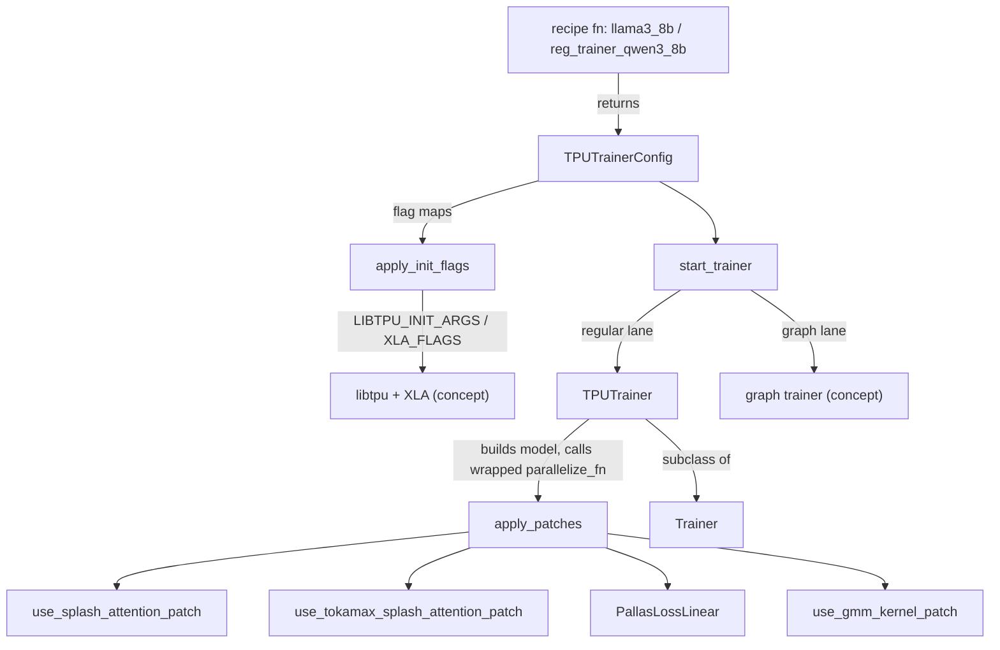
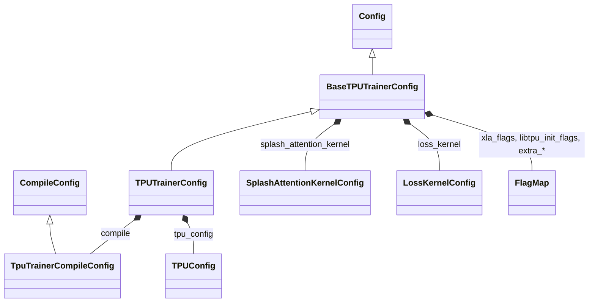

# TPU trainer and job config (experiments/tpu)

<!-- connect:up:begin -->
> **Cross-repo concept:** part of [pallas-kernel](../../../concepts/pallas-kernel.md), [sparsecore](../../../concepts/sparsecore.md), [splash-attention](../../../concepts/splash-attention.md) across this wiki's repos.
<!-- connect:up:end -->
## Overview
The TorchTPU lane under `torchtitan/experiments/tpu` does not fork torchtitan's trainer; it
specializes it at three seams. First, a config subclass
([`TPUTrainerConfig`](../catalog/torchtitan/experiments/tpu/tpu_job_config.md#TPUTrainerConfig "torchtitan/experiments/tpu/tpu_job_config.py:L248"))
adds TPU-only blocks - Splash attention tiles, the fused Pallas loss, libtpu/XLA flag maps, TorchTPU eager
mode and a TPU compile policy - on top of the generic
[`Config`](../catalog/torchtitan/trainer.md#Trainer.Config "torchtitan/trainer.py:L76"). Second, a
launcher ([`start_trainer`](../catalog/torchtitan/experiments/tpu/train.md#start_trainer "torchtitan/experiments/tpu/train.py:L208"))
picks the trainer class and wraps the model spec's `parallelize_fn` so that kernel swaps happen on the
*built* model immediately before sharding. Third, a trainer subclass
([`TPUTrainer`](../catalog/torchtitan/experiments/tpu/train.md#TPUTrainer "torchtitan/experiments/tpu/train.py:L36"))
changes only the loss, the grad norm, how the optimizer step executes and the forward/backward graph boundary. The single key idea: a recipe
is a Python function that returns a *complete* performance configuration, including the compiler
flags, so a benchmark is reproducible from the recipe name alone.

## Diagram

Legend:
- `REC` - [`llama3_8b`](../catalog/torchtitan/experiments/tpu/llama3/config_registry.md#llama3_8b "torchtitan/experiments/tpu/llama3/config_registry.py:L204"), [`reg_trainer_qwen3_8b`](../catalog/torchtitan/experiments/tpu/qwen3/config_registry.md#reg_trainer_qwen3_8b "torchtitan/experiments/tpu/qwen3/config_registry.py:L344")
- `CFG` - [`TPUTrainerConfig`](../catalog/torchtitan/experiments/tpu/tpu_job_config.md#TPUTrainerConfig "torchtitan/experiments/tpu/tpu_job_config.py:L248")
- `FLAGS` - [`apply_init_flags`](../catalog/torchtitan/experiments/tpu/tpu_flags.md#apply_init_flags "torchtitan/experiments/tpu/tpu_flags.py:L109")
- `LIBTPU` - (concept) the libtpu runtime and XLA compiler that read the environment
- `ST` - [`start_trainer`](../catalog/torchtitan/experiments/tpu/train.md#start_trainer "torchtitan/experiments/tpu/train.py:L208")
- `TT` - [`TPUTrainer`](../catalog/torchtitan/experiments/tpu/train.md#TPUTrainer "torchtitan/experiments/tpu/train.py:L36")
- `GT` - (concept) the TPU graph trainer, see [tpu-graph-trainer](tpu-graph-trainer.md)
- `AP` - [`apply_patches`](../catalog/torchtitan/experiments/tpu/workarounds.md#apply_patches "torchtitan/experiments/tpu/workarounds.py:L714")
- `SPL` - [`use_splash_attention_patch`](../catalog/torchtitan/experiments/tpu/workarounds.md#use_splash_attention_patch "torchtitan/experiments/tpu/workarounds.py:L33")
- `TOK` - [`use_tokamax_splash_attention_patch`](../catalog/torchtitan/experiments/tpu/workarounds.md#use_tokamax_splash_attention_patch "torchtitan/experiments/tpu/workarounds.py:L234")
- `LOSS` - [`PallasLossLinear`](../catalog/torchtitan/experiments/tpu/workarounds.md#PallasLossLinear "torchtitan/experiments/tpu/workarounds.py:L460")
- `GMM` - [`use_gmm_kernel_patch`](../catalog/torchtitan/experiments/tpu/workarounds.md#use_gmm_kernel_patch "torchtitan/experiments/tpu/workarounds.py:L554")
- `BASE` - [`Trainer`](../catalog/torchtitan/trainer.md#Trainer "torchtitan/trainer.py:L74")

Legend:
- `Config` - [`Config`](../catalog/torchtitan/trainer.md#Trainer.Config "torchtitan/trainer.py:L76")
- `BaseTPUTrainerConfig` - [`BaseTPUTrainerConfig`](../catalog/torchtitan/experiments/tpu/tpu_job_config.md#BaseTPUTrainerConfig "torchtitan/experiments/tpu/tpu_job_config.py:L150")
- `TPUTrainerConfig` - [`TPUTrainerConfig`](../catalog/torchtitan/experiments/tpu/tpu_job_config.md#TPUTrainerConfig "torchtitan/experiments/tpu/tpu_job_config.py:L248")
- `CompileConfig` - [`CompileConfig`](../catalog/torchtitan/config/configs.md#CompileConfig "torchtitan/config/configs.py:L338")
- `TpuTrainerCompileConfig` - [`TpuTrainerCompileConfig`](../catalog/torchtitan/experiments/tpu/tpu_job_config.md#TpuTrainerCompileConfig "torchtitan/experiments/tpu/tpu_job_config.py:L45")
- `SplashAttentionKernelConfig` - [`SplashAttentionKernelConfig`](../catalog/torchtitan/experiments/tpu/tpu_job_config.md#SplashAttentionKernelConfig "torchtitan/experiments/tpu/tpu_job_config.py:L105")
- `LossKernelConfig` - [`LossKernelConfig`](../catalog/torchtitan/experiments/tpu/tpu_job_config.md#LossKernelConfig "torchtitan/experiments/tpu/tpu_job_config.py:L135")
- `FlagMap` - [`FlagMap`](../catalog/torchtitan/experiments/tpu/tpu_flags.md#FlagMap "torchtitan/experiments/tpu/tpu_flags.py:L45")
- `TPUConfig` - [`TPUConfig`](../catalog/torchtitan/experiments/tpu/tpu_job_config.md#TPUConfig "torchtitan/experiments/tpu/tpu_job_config.py:L13")

## Design rationale (why it's built this way)
- **Flags live in the config, not the launcher.** The `tpu_flags.py` module docstring states the goal:
  "the flags a recipe needs are part of the training configuration instead of being documented only at
  the launcher level." Recipes compose named bundles of related libtpu flags with
  [`merge_flags`](../catalog/torchtitan/experiments/tpu/tpu_flags.md#merge_flags "torchtitan/experiments/tpu/tpu_flags.py:L72")
  (e.g. the SparseCore collective aggregator and the latency-hiding layer scheduler always move
  together, because the scheduler requires the aggregator). Because the flags are on the config they
  are logged with it, diffable between recipes, and asserted on in tests.
- **Three-level precedence with the environment winning.** Config set < `extra_*` CLI layer < an
  exported `LIBTPU_INIT_ARGS`/`XLA_FLAGS`. The environment wins because it "names the process being
  launched as specifically as a config can". `!flag` drops a recipe's flag without knowing its value
  ([`parse_flags`](../catalog/torchtitan/experiments/tpu/tpu_flags.md#parse_flags "torchtitan/experiments/tpu/tpu_flags.py:L87")).
- **[`FlagMap`](../catalog/torchtitan/experiments/tpu/tpu_flags.md#FlagMap "torchtitan/experiments/tpu/tpu_flags.py:L45") is its own type** so the CLI parser takes a whole
  `"flag=value ..."` string; a plain `dict` field would only expose the keys already in its default,
  so a launch could retune a recipe's flags but never add one.
- **Flags must be rendered before the first TPU device use.** The
  [`apply_init_flags`](../catalog/torchtitan/experiments/tpu/tpu_flags.md#apply_init_flags "torchtitan/experiments/tpu/tpu_flags.py:L109")
  docstring warns that libtpu "latches their values while the first program is compiled, so flags
  applied after that point are silently ignored." That is why rendering happens in the process entry
  wrapper, before distributed init and before the trainer exists.
- **Kernel swaps are monkey patches on the built model, applied inside `parallelize_fn`.** The
  launcher wraps the spec's `parallelize_fn` so
  [`apply_patches`](../catalog/torchtitan/experiments/tpu/workarounds.md#apply_patches "torchtitan/experiments/tpu/workarounds.py:L714")
  runs in every process right before sharding. Upstream model code stays untouched, and the swap sees
  the final module tree (after converters, before SimpleFSDP parametrization).
- **One shared base for three lanes.**
  [`BaseTPUTrainerConfig`](../catalog/torchtitan/experiments/tpu/tpu_job_config.md#BaseTPUTrainerConfig "torchtitan/experiments/tpu/tpu_job_config.py:L150")
  holds the lane-agnostic blocks (splash, loss kernel, LoRA, flags) so jax and torchax recipes can
  copy-construct from a TorchTPU recipe; only the generic compile policy (`enable`, `components`,
  `backend`) crosses lanes, because TorchTPU's execution controls "JAX and TorchAX must not inherit
  merely because they reuse a TorchTPU recipe".
- **A one-boundary graph split instead of a graph trainer.**
  `compile.materialize_forward_before_backward` ends the lazy forward XLA graph at the loss so backward
  compiles as a second program, cutting first-step compile time. The config comment is explicit that
  "This is one runtime boundary, not GraphTrainer's multi-executable splitter."
- **MFU uses MaxText's FLOP convention** via
  [`get_maxtext_decoder_nparams_and_flops`](../catalog/torchtitan/experiments/tpu/mfu_flops.md#get_maxtext_decoder_nparams_and_flops "torchtitan/experiments/tpu/mfu_flops.py:L17"),
  an "independent port of MaxText's standard decoder calculation" so TPU MFU numbers are comparable to
  MaxText reference runs. It refuses decoders whose attention or shared-expert blocks it cannot count
  rather than silently applying the wrong formula.

## Entry points
- [`start_trainer`](../catalog/torchtitan/experiments/tpu/train.md#start_trainer "torchtitan/experiments/tpu/train.py:L208") - the `__main__` target of `experiments/tpu/train.py`; reached after the entry wrapper has parsed the recipe (`--module ... --config <recipe>`), rendered the flags and entered the TorchTPU eager mode. Accepts either a regular [`TPUTrainerConfig`](../catalog/torchtitan/experiments/tpu/tpu_job_config.md#TPUTrainerConfig "torchtitan/experiments/tpu/tpu_job_config.py:L248") or a graph-trainer config.
- [`apply_init_flags`](../catalog/torchtitan/experiments/tpu/tpu_flags.md#apply_init_flags "torchtitan/experiments/tpu/tpu_flags.py:L109") - called once per worker by the entry wrapper when the detected device is TPU, before `maybe_init_distributed` and before any device tensor exists. Also usable with a private `environ` mapping to prepare a subprocess.
- Recipe functions such as [`llama3_8b`](../catalog/torchtitan/experiments/tpu/llama3/config_registry.md#llama3_8b "torchtitan/experiments/tpu/llama3/config_registry.py:L204"), [`llama3_70b`](../catalog/torchtitan/experiments/tpu/llama3/config_registry.md#llama3_70b "torchtitan/experiments/tpu/llama3/config_registry.py:L269"), [`llama3_405b`](../catalog/torchtitan/experiments/tpu/llama3/config_registry.md#llama3_405b "torchtitan/experiments/tpu/llama3/config_registry.py:L334"), [`reg_trainer_qwen3_8b`](../catalog/torchtitan/experiments/tpu/qwen3/config_registry.md#reg_trainer_qwen3_8b "torchtitan/experiments/tpu/qwen3/config_registry.py:L344"), [`qwen35_moe_35b`](../catalog/torchtitan/experiments/tpu/qwen3_5/config_registry.md#qwen35_moe_35b "torchtitan/experiments/tpu/qwen3_5/config_registry.py:L78") and [`sft_llama3_8b_metamath`](../catalog/torchtitan/experiments/tpu/llama3/config_registry.md#sft_llama3_8b_metamath "torchtitan/experiments/tpu/llama3/config_registry.py:L399") - selected by name on the command line; each returns a fully populated config. Recipes that return a graph-trainer config ([`qwen3_8b`](../catalog/torchtitan/experiments/tpu/qwen3/config_registry.md#qwen3_8b "torchtitan/experiments/tpu/qwen3/config_registry.py:L555"), [`qwen3_moe_30b`](../catalog/torchtitan/experiments/tpu/qwen3/config_registry.md#qwen3_moe_30b "torchtitan/experiments/tpu/qwen3/config_registry.py:L735")) still build a `TPUTrainerConfig` first and convert it.
- [`start_trainer`](../catalog/torchtitan/experiments/tpu/train_minimal.md#start_trainer "torchtitan/experiments/tpu/train_minimal.py:L507") and [`start_trainer`](../catalog/torchtitan/experiments/tpu/conformer/train_minimal.md#start_trainer "torchtitan/experiments/tpu/conformer/train_minimal.py:L144") - the minimal hand-rolled trainers (generic and Conformer) that bypass `Trainer`; useful for isolating a TPU problem from the full trainer.
- [`run_distributed`](../catalog/torchtitan/experiments/tpu/distributed.md#run_distributed "torchtitan/experiments/tpu/distributed.py:L120") - the test-side launcher that spawns N workers on TPU, GPU or CPU; for CPU it hides accelerators via [`cpu_only_env`](../catalog/torchtitan/experiments/tpu/device_env.md#cpu_only_env "torchtitan/experiments/tpu/device_env.py:L25") so spawned children detect CPU from the start.

## Mechanism (step-by-step)
1. **A recipe assembles the whole performance configuration.** A dense Llama3 recipe such as [`llama3_8b`](../catalog/torchtitan/experiments/tpu/llama3/config_registry.md#llama3_8b "torchtitan/experiments/tpu/llama3/config_registry.py:L204") takes the upstream [`model_spec`](../catalog/torchtitan/trainer.md#Trainer.Config.model_spec "torchtitan/trainer.py:L83") from the registry, swaps in the TPU parallelize function, and sets [`ParallelismConfig`](../catalog/torchtitan/config/configs.md#ParallelismConfig "torchtitan/config/configs.py:L123") to SimpleFSDP on the TPU topology mesh (`use_simple_fsdp=True, enable_tpu_topo_mesh=True`), full activation checkpointing, [`TPUConfig`](../catalog/torchtitan/experiments/tpu/tpu_job_config.md#TPUConfig "torchtitan/experiments/tpu/tpu_job_config.py:L13") `eager_mode="DEFER_AND_FUSE"`, a [`TpuTrainerCompileConfig`](../catalog/torchtitan/experiments/tpu/tpu_job_config.md#TpuTrainerCompileConfig "torchtitan/experiments/tpu/tpu_job_config.py:L45") with `enable=True, backend="tpu", components=["model"]`, Splash attention with all nine tiles at 2048 and `SEQ_MINOR` q/k layouts, and the fused Pallas cross-entropy loss. Token budgets come from [`TrainingConfig`](../catalog/torchtitan/config/configs.md#TrainingConfig "torchtitan/config/configs.py:L36") ([`num_tokens_per_microbatch_per_dp_rank`](../catalog/torchtitan/config/configs.md#TrainingConfig.num_tokens_per_microbatch_per_dp_rank "torchtitan/config/configs.py:L37") and [`max_context_length`](../catalog/torchtitan/config/configs.md#TrainingConfig.max_context_length "torchtitan/config/configs.py:L51")), which replaced batch/seq_len upstream. Regular-trainer Qwen3 ([`reg_trainer_qwen3_8b`](../catalog/torchtitan/experiments/tpu/qwen3/config_registry.md#reg_trainer_qwen3_8b "torchtitan/experiments/tpu/qwen3/config_registry.py:L344")) additionally turns on `materialize_forward_before_backward`, `compile_grad_norm`, 1024 tiles and the loss kernel via [`LossKernelConfig`](../catalog/torchtitan/experiments/tpu/tpu_job_config.md#LossKernelConfig "torchtitan/experiments/tpu/tpu_job_config.py:L135").
2. **Construction-time validation.** [`BaseTPUTrainerConfig`](../catalog/torchtitan/experiments/tpu/tpu_job_config.md#BaseTPUTrainerConfig "torchtitan/experiments/tpu/tpu_job_config.py:L150") `__post_init__` sets `training.disable_cuda_graphs=True` *before* calling the base validator (which would otherwise reject every TPU MoE token dispatcher as not CUDA-graph capturable), runs the TPU context-parallel validation when `context_parallel_degree > 1`, and zeroes `comm.trace_buf_size`. [`TPUTrainerConfig`](../catalog/torchtitan/experiments/tpu/tpu_job_config.md#TPUTrainerConfig "torchtitan/experiments/tpu/tpu_job_config.py:L248") then restores the TPU compile type if a plain [`CompileConfig`](../catalog/torchtitan/config/configs.md#CompileConfig "torchtitan/config/configs.py:L338") was carried over, rejects `compile_grad_norm` with EP > 1 or PP > 1, and defaults `dump_folder` to `/tmp/outputs`.
3. **Flags are rendered into the environment.** [`apply_init_flags`](../catalog/torchtitan/experiments/tpu/tpu_flags.md#apply_init_flags "torchtitan/experiments/tpu/tpu_flags.py:L109") handles `LIBTPU_INIT_ARGS` and `XLA_FLAGS` independently: it parses the existing env var, logs every flag the CLI `extra_*` layer removes or overrides, warns for every flag the environment already pins to a different value, and writes back [`resolve_flags`](../catalog/torchtitan/experiments/tpu/tpu_flags.md#resolve_flags "torchtitan/experiments/tpu/tpu_flags.py:L99")`(declared, env)` with removal sentinels dropped. Booleans are rendered as lowercase `true`/`false` because that is what libtpu and XLA parse. If neither the config nor the extra layer sets anything, the env var is left exactly as found.
4. **Pre-flight in the launcher.** [`start_trainer`](../catalog/torchtitan/experiments/tpu/train.md#start_trainer "torchtitan/experiments/tpu/train.py:L208") raises Dynamo's recompile limits to `max(64, 2 x n_layers + 16)` (per-layer compile under SimpleFSDP gives every layer its own module class, so the default limit of 8 fails at 52/80 layers), validates that the replicate degree does not straddle DCN on multi-slice, disables pinned host memory on multi-slice, and resizes every RoPE cache in [`model`](../catalog/torchtitan/protocols/model_spec.md#ModelSpec.model "torchtitan/protocols/model_spec.py:L38") down to [`max_context_length`](../catalog/torchtitan/config/configs.md#TrainingConfig.max_context_length "torchtitan/config/configs.py:L51") - without that, caches were sized to the flavor's full 131072 context and Llama3-70B ran out of program HBM. It then picks Flux's own trainer, the graph trainer, or [`TPUTrainer`](../catalog/torchtitan/experiments/tpu/train.md#TPUTrainer "torchtitan/experiments/tpu/train.py:L36"), warning that `compile.mode="fullgraph"` on the regular trainer captures forward+backward but not the optimizer step.
5. **Deadlock and hang guards.** Before constructing the trainer, all ranks hit a `dist.barrier()`: on XLA, rank 0's device-setup graph can compile faster and race into an all-reduce while others are still compiling the determinism broadcast. A missing [`Config`](../catalog/torchtitan/trainer.md#Trainer.Config "torchtitan/trainer.py:L76") `debug.seed` is forced to 42 to avoid a known TPU hang.
6. **Kernel patches at parallelize time.** For the regular lane only, the launcher replaces the spec's `parallelize_fn` with a wrapper that first calls [`apply_patches`](../catalog/torchtitan/experiments/tpu/workarounds.md#apply_patches "torchtitan/experiments/tpu/workarounds.py:L714") and, for the llama3 / muse_glimmer / qwen3 / qwen3_5 / gemma4 families, forwards `tpu_compile_mode=compile.mode`. In order, the patcher checks the fused-loss logit transform, installs a CPU-safe `histc`, installs the TPU CP runtime patches when CP > 1, replaces attention with [`use_tokamax_splash_attention_patch`](../catalog/torchtitan/experiments/tpu/workarounds.md#use_tokamax_splash_attention_patch "torchtitan/experiments/tpu/workarounds.py:L234") (wins if both flags are set) or [`use_splash_attention_patch`](../catalog/torchtitan/experiments/tpu/workarounds.md#use_splash_attention_patch "torchtitan/experiments/tpu/workarounds.py:L33"), wraps the LM head in [`PallasLossLinear`](../catalog/torchtitan/experiments/tpu/workarounds.md#PallasLossLinear "torchtitan/experiments/tpu/workarounds.py:L460") so the fused loss receives `(x, weight.T)` instead of logits, routes MoE grouped matmuls through [`use_gmm_kernel_patch`](../catalog/torchtitan/experiments/tpu/workarounds.md#use_gmm_kernel_patch "torchtitan/experiments/tpu/workarounds.py:L554"), and finally applies the `[B, L, ...]` block layout when `tpu_config.bld_block_layout` is on (see [tpu-layer-loop-remat-and-layouts](tpu-layer-loop-remat-and-layouts.md)).
7. **The trainer specializes three hooks.** [`TPUTrainer`](../catalog/torchtitan/experiments/tpu/train.md#TPUTrainer "torchtitan/experiments/tpu/train.py:L36") builds the TPU cross-entropy loss from the config, optionally installs a compiled DTensor-aware grad norm (the clip itself stays eager), and with `optimizer_compile="separate_graph"` captures `optimizer.step` as its own compiled graph. Its forward/backward step, when `materialize_forward_before_backward` is on and PP is off, runs forward+loss, calls the TorchTPU `synchronize(loss, wait=False)` to cut the lazy graph without waiting or breaking autograd, then runs `loss.backward()` as a second XLA program. Everything else is inherited from [`Trainer`](../catalog/torchtitan/trainer.md#Trainer "torchtitan/trainer.py:L74").
8. **Run and tear down.** After construction the launcher verifies scan was applied to each model part (only meaningful on the graph lane), then takes one of two exclusive branches: with `checkpoint.create_seed_checkpoint` it writes a single-device step-0 seed checkpoint and does not train; otherwise it logs the config JSON on rank 0 and runs `trainer.train()` inside the unflatten-sequence-length context keyed on [`training`](../catalog/torchtitan/trainer.md#Trainer.Config.training "torchtitan/trainer.py:L113") `.max_context_length`, which the `[B, L]` layout code reads. On success it closes the trainer, barriers and destroys the process group.
9. **MFU accounting.** When [`TPUConfig`](../catalog/torchtitan/experiments/tpu/tpu_job_config.md#TPUConfig "torchtitan/experiments/tpu/tpu_job_config.py:L13") `enable_mfu_benchmark` is on, the TPU graph trainer emits one aggregate MFU figure from `mfu_benchmark_start_step` to the end; the regular `TPUTrainer` path does not read this flag. The FLOP count for Qwen3 configs comes from [`get_maxtext_decoder_nparams_and_flops`](../catalog/torchtitan/experiments/tpu/mfu_flops.md#get_maxtext_decoder_nparams_and_flops "torchtitan/experiments/tpu/mfu_flops.py:L17"): LM head (not embedding), Q/K/V/O projections, causal-halved attention, SwiGLU or routed top-k experts plus the router, all times 3 for forward+backward, iterating [`layers`](../catalog/torchtitan/models/common/decoder.md#Decoder.Config.layers "torchtitan/models/common/decoder.py:L84").

## Key data structures
| Block | Field (default) | What it controls for perf |
|---|---|---|
| [`TPUConfig`](../catalog/torchtitan/experiments/tpu/tpu_job_config.md#TPUConfig "torchtitan/experiments/tpu/tpu_job_config.py:L13") | `eager_mode` (`""`; recipes use `DEFER_AND_FUSE`) | TorchTPU eager execution mode, entered around the whole run |
| | `bld_block_layout` (True) | Run dense blocks on `[B, L, ...]` views to avoid slow T-minor layouts |
| | `enable_amp` (True) | Mixed precision; off = uniform precision |
| | `use_simple_fsdp`, `apply_rope_complex_workaround`, `use_jax_profiler`, `enable_mfu_benchmark`, `log_freq` | runtime toggles |
| [`TpuTrainerCompileConfig`](../catalog/torchtitan/experiments/tpu/tpu_job_config.md#TpuTrainerCompileConfig "torchtitan/experiments/tpu/tpu_job_config.py:L45") | `mode` (`layer`; also `fullgraph`, `whole`, `block`) | compile granularity passed to the model's TPU parallelize fn |
| | `materialize_forward_before_backward` (False) | split forward and backward into two XLA programs |
| | `optimizer_compile` (`eager`) / `compile_grad_norm` (False) | compiled optimizer step / compiled global grad norm (EP1, PP1 only) |
| [`SplashAttentionKernelConfig`](../catalog/torchtitan/experiments/tpu/tpu_job_config.md#SplashAttentionKernelConfig "torchtitan/experiments/tpu/tpu_job_config.py:L105") | `use_splash_attention_kernel`, `use_tokamax_splash_attention_kernel` (False) | which Pallas attention replaces SDPA |
| | nine `sa_block_*` tiles (512) | forward / dKV / dQ tile sizes |
| | `sa_q/k/v_layout` (`HEAD_DIM_MINOR`), `sa_use_fused_bwd_kernel` (True) | kernel operand layouts, fused backward |
| | `use_vmap_bwd` (False), `sa_use_document_aware_block_skipping` (True) | vectorized backward (memory scales with local batch) vs document block skipping |
| [`LossKernelConfig`](../catalog/torchtitan/experiments/tpu/tpu_job_config.md#LossKernelConfig "torchtitan/experiments/tpu/tpu_job_config.py:L135") | `use_loss_kernel` (False), `loss_b/h/v_block_size` (1024/512/2048) | fused linear + softmax cross-entropy tiles |
| [`BaseTPUTrainerConfig`](../catalog/torchtitan/experiments/tpu/tpu_job_config.md#BaseTPUTrainerConfig "torchtitan/experiments/tpu/tpu_job_config.py:L150") | `xla_flags`, `libtpu_init_flags`, `extra_xla_flags`, `extra_libtpu_init_flags` | the recipe's compiler/runtime flag set and its CLI delta |
| | `qwen3.use_gmm_kernel`, `lora.*`, `conformer.*`, `flux.*` | per-model toggles |

The named libtpu flag bundles in `tpu_flags.py` (all composed with [`merge_flags`](../catalog/torchtitan/experiments/tpu/tpu_flags.md#merge_flags "torchtitan/experiments/tpu/tpu_flags.py:L72")) are worth knowing by flag string:

| Purpose (per the source comment) | libtpu flags |
|---|---|
| Latency-hiding layer scheduler overlapping FSDP collectives (needs the SC aggregator) | `xla_tpu_enable_sparse_core_collective_aggregator`, `xla_tpu_enable_latency_hiding_layer_scheduler` |
| Reduce-scatter on both SparseCores (Zero-2 / dependency-ordered Zero-3) | `xla_tpu_use_single_sparse_core_for_reduce_scatter_offload=false` |
| Hierarchical ND reduce-scatter across both SparseCores (libtpu >= 0.0.47) | above + `..._offload_nd_reduce_scatter`, `..._hierarchical_reduce_scatter` |
| Pipeline small (<= 1024 KiB/shard) reduce-scatters across the scan backward back-edge | `xla_tpu_enable_ici_rs_pipelining`, `xla_tpu_ici_rs_pipelining_threshold_kib=1024` |
| Prefetch next layer's FSDP all-gather one scan iteration early (costs HBM) | `xla_tpu_enable_ici_ag_pipelining` |
| Async SparseCore all-gather offload | `xla_enable_async_all_gather`, `xla_tpu_prefer_async_allgather_to_allreduce`, `xla_tpu_enable_sparse_core_collective_offload_all_gather` |
| Unfuse elementwise ops from MXU matmuls when fusion degrades tiling | `xla_tpu_enable_convolution_unfusing` |
| Full SparseCore offload of FSDP AG/RS, queued by the LHS | aggregator + `..._offload_queuing_in_lhs` + 2d/3d all-gather + reduce-scatter offload |
| TPU7x throughput power state (no graph change) | `xla_tpu_dvfs_p_state=7` |
| Avoid distributed hangs from the enhanced launch barrier | `xla_tpu_use_enhanced_launch_barrier=false` |

## Dynamics (design intent)
- **Ordering is load-bearing.** Flags before device creation; recompile limits before the first
  compiled forward; RoPE resize before model build; barrier before trainer construction; patches
  after the model is built but before SimpleFSDP parametrization. Each comment in
  [`start_trainer`](../catalog/torchtitan/experiments/tpu/train.md#start_trainer "torchtitan/experiments/tpu/train.py:L208")
  names the failure that motivated its position.
- **Graph boundaries are a compile-time knob, not a runtime one.** The forward/backward split in
  [`TPUTrainer`](../catalog/torchtitan/experiments/tpu/train.md#TPUTrainer "torchtitan/experiments/tpu/train.py:L36")
  uses `wait=False`, so host dispatch of the backward graph is not blocked on forward execution; the
  docstring motivates it purely by "significantly reducing first-step XLA compilation time".
- **Logging cadence affects overlap.** The `qwen35_moe_35b` recipe comment notes that logging syncs the
  host on the loss, so it logs every 5 steps to let the host dispatch the next step while the current
  one runs.

## Edge cases
- Exported `LIBTPU_INIT_ARGS`/`XLA_FLAGS` silently beat the recipe (with a warning per conflict). A
  benchmark that "ignores" a config flag usually has the flag pinned in the shell.
- `compile_grad_norm=True` raises with EP > 1 or PP > 1; with Flux it raises in the launcher.
- `materialize_forward_before_backward` is skipped when PP is enabled and asserts a single model part
  and a dict input.
- Tokamax splash wins over stock splash when both are set. The Tokamax patch raises if a real splash
  config resolved no `sa_` values (a historic bug that silently ran library default tiles), and drops
  kwargs the Tokamax kernel does not accept (e.g. document-aware block skipping).
- [`PallasLossLinear`](../catalog/torchtitan/experiments/tpu/workarounds.md#PallasLossLinear "torchtitan/experiments/tpu/workarounds.py:L460")
  never calls the head's `forward`; an LM head that overrides `forward` (e.g. a logit soft-cap) is
  rejected because the fused loss would silently skip that math. Its state-dict hooks strip the
  `original_linear.` infix so checkpoints keep canonical keys.
- [`use_gmm_kernel_patch`](../catalog/torchtitan/experiments/tpu/workarounds.md#use_gmm_kernel_patch "torchtitan/experiments/tpu/workarounds.py:L554")
  casts expert operands to bf16 and also bypasses upstream's index-padding wrapper, because the Pallas
  grouped matmul handles unpadded jagged offsets.
- The graph-trainer lane does not get the wrapped `parallelize_fn`; its recipes carry their own spec
  and parallelize path, so `apply_patches` behavior there is owned by that lane.
- Single-device seed-checkpoint creation asserts `WORLD_SIZE == 1` and checkpointing enabled.

## Open questions
- The flag bundle constants (e.g. the SparseCore and ICI pipelining bundles), the entry wrapper in
  `gmain.py`, `derive_from`, the loss builder, the RoPE-fitting helper and the graph-trainer config
  class are not in this packet's subgraph, so they are described by behavior rather than cited.
- Which recipes enable `enable_mfu_benchmark` by default, and how the MaxText FLOP count is selected
  for non-Qwen3 models on the regular lane, is not settled by the cited symbols.
- The minimal trainers force `foreach` over `fused` AdamW on TPU; whether the full trainer path does
  the same is decided by recipes (most set `implementation="foreach"`), not by the launcher.

## See also
- [trainer-and-train-loop](trainer-and-train-loop.md) - the upstream `Trainer` this lane subclasses
- [job-config](job-config.md) and [config-overrides](config-overrides.md) - upstream config and `--override` imports
- [parallel-dims-and-parallelization](parallel-dims-and-parallelization.md), [flex-shard](flex-shard.md)
- [tpu-layer-loop-remat-and-layouts](tpu-layer-loop-remat-and-layouts.md) - `[B, L]` layout, layer loop, TPU AC policies
- [tpu-pallas-kernels](tpu-pallas-kernels.md) - the splash, loss and GMM kernels the patches install
- [tpu-moe-dispatch-and-grouped-experts](tpu-moe-dispatch-and-grouped-experts.md), [tpu-context-parallel-attention](tpu-context-parallel-attention.md)
- [tpu-graph-trainer](tpu-graph-trainer.md), [jax-lane](jax-lane.md)
