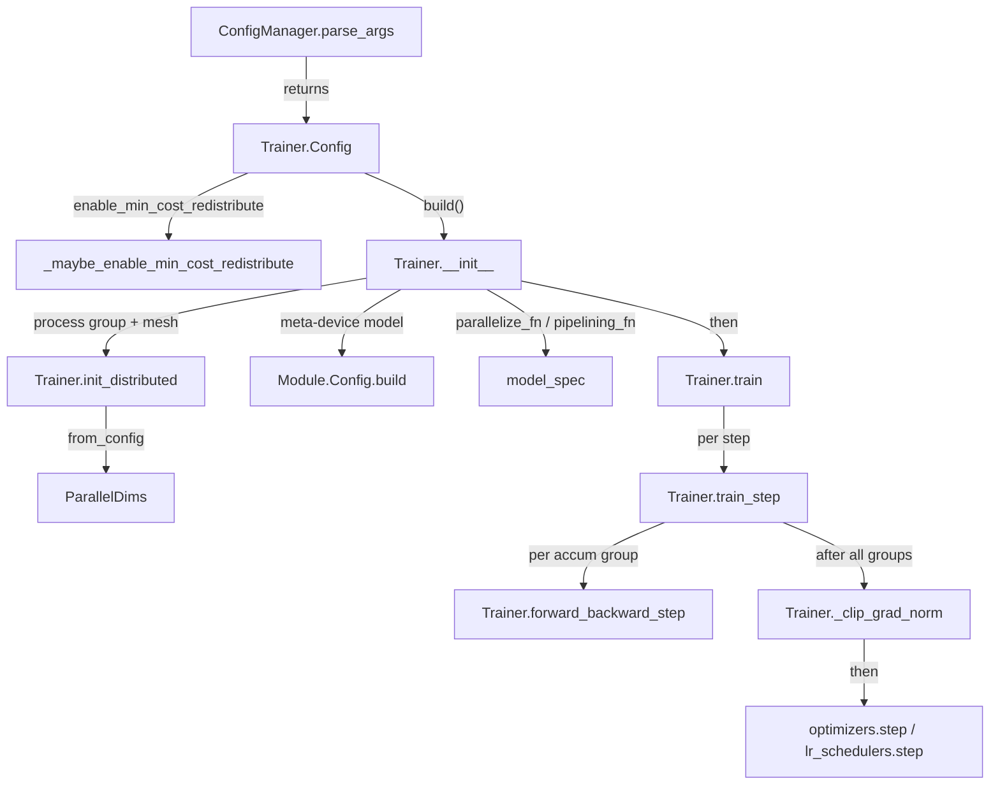

# Trainer and the train loop (torchtitan.train / Trainer)

<!-- connect:up:begin -->
> **Cross-repo concept:** part of [pipeline-parallelism](../../../concepts/pipeline-parallelism.md) across this wiki's repos.
<!-- connect:up:end -->
## Overview

[`Trainer`](../catalog/torchtitan/trainer.md#Trainer "torchtitan/trainer.py:L74") is torchtitan's single orchestration object. Its nested
[`Config`](../catalog/torchtitan/trainer.md#Trainer.Config "torchtitan/trainer.py:L76") ("Default container for training configuration") *is* the whole
job, and it is a [`Configurable`](../catalog/torchtitan/config/configurable.md#Configurable "torchtitan/config/configurable.py:L18"), so the trainer is constructed from its config
rather than from loose arguments. The key design idea is that **the trainer owns no model-specific
logic**: everything that differs per model - how to build it, how to shard / compile / checkpoint
activations, how to pipeline it, how to map HF weights - arrives through the
[`model_spec`](../catalog/torchtitan/trainer.md#Trainer.Config.model_spec "torchtitan/trainer.py:L83") field. The constructor
[`__init__`](../catalog/torchtitan/trainer.md#Trainer.__init__ "torchtitan/trainer.py:L344") is therefore a fixed recipe whose *order* is the contract, and the
loop ([`train`](../catalog/torchtitan/trainer.md#Trainer.train "torchtitan/trainer.py:L1129") -> [`train_step`](../catalog/torchtitan/trainer.md#Trainer.train_step "torchtitan/trainer.py:L913") ->
[`forward_backward_step`](../catalog/torchtitan/trainer.md#Trainer.forward_backward_step "torchtitan/trainer.py:L795") -> [`_clip_grad_norm`](../catalog/torchtitan/trainer.md#Trainer._clip_grad_norm "torchtitan/trainer.py:L1119"))
is small and generic. Specialised trainers - the TPU lane's `TPUTrainer` and `TpuGraphTrainer`,
graph_trainer, torchft, Flux - subclass it and override a subset of these methods (plus other hooks
where needed, e.g. torchft's `init_distributed` or Flux's `batch_generator`).

For the TPU-performance lens, the levers on this page are: where `parallelize_fn` / `pipelining_fn` run
relative to meta-device construction; the DTensor redistribution planner that
[`_maybe_enable_min_cost_redistribute`](../catalog/torchtitan/train.md#_maybe_enable_min_cost_redistribute "torchtitan/train.py:L19") can swap in before tracing; token-based
batch arithmetic that fixes microbatch size and gradient-accumulation steps; the explicit TPU transfer
stream; the deliberate absence of host syncs inside `train_step`; and the TPU subclass hooks that split
the XLA program (forward vs backward, standalone grad-norm graph, separate-graph optimizer).

## Diagram

Startup and the loop (control flow, base trainer):



Legend:
- `PA` - [`parse_args`](../catalog/torchtitan/config/manager.md#ConfigManager.parse_args "torchtitan/config/manager.py:L44")
- `CFG` - [`Config`](../catalog/torchtitan/trainer.md#Trainer.Config "torchtitan/trainer.py:L76")
- `MCR` - [`_maybe_enable_min_cost_redistribute`](../catalog/torchtitan/train.md#_maybe_enable_min_cost_redistribute "torchtitan/train.py:L19")
- `INIT` - [`__init__`](../catalog/torchtitan/trainer.md#Trainer.__init__ "torchtitan/trainer.py:L344")
- `ID` - [`init_distributed`](../catalog/torchtitan/trainer.md#Trainer.init_distributed "torchtitan/trainer.py:L756")
- `PD` - [`ParallelDims`](../catalog/torchtitan/distributed/parallel_dims.md#ParallelDims "torchtitan/distributed/parallel_dims.py:L112")
- `MB` - [`build`](../catalog/torchtitan/protocols/module.md#Module.Config.build "torchtitan/protocols/module.py:L98")
- `MS` - [`model_spec`](../catalog/torchtitan/trainer.md#Trainer.Config.model_spec "torchtitan/trainer.py:L83")
- `TRAIN` - [`train`](../catalog/torchtitan/trainer.md#Trainer.train "torchtitan/trainer.py:L1129")
- `STEP` - [`train_step`](../catalog/torchtitan/trainer.md#Trainer.train_step "torchtitan/trainer.py:L913")
- `FBS` - [`forward_backward_step`](../catalog/torchtitan/trainer.md#Trainer.forward_backward_step "torchtitan/trainer.py:L795")
- `CLIP` - [`_clip_grad_norm`](../catalog/torchtitan/trainer.md#Trainer._clip_grad_norm "torchtitan/trainer.py:L1119")
- `OPT` - (concept) the optimizer and lr-scheduler containers built in `__init__`

One optimizer step, showing where host waits and collectives happen:

```mermaid
sequenceDiagram
  participant S as train_step
  participant D as data iterator (CPU)
  participant X as transfer stream (TPU only)
  participant F as forward_backward_step
  participant C as _clip_grad_norm
  S->>D: next() x (grad_accum_steps x num_pp_microbatches)
  S->>S: sum num_valid_tokens, dist_sum over batch mesh (stays on device)
  loop each gradient-accumulation group
    S->>X: .contiguous().to(device, non_blocking) then synchronize()
    S->>F: plain fwd/bwd body or pp_schedule.step
    F-->>S: loss = local SUM / global_valid_tokens; AND into finite flag
  end
  S->>C: DTensor-aware clip_grad_norm_ (PP/EP aware)
  S->>S: MIN all-reduce finite flag over loss + pp meshes
  S->>S: _assert_async(finite), wait staging, optimizers.step, lr_schedulers.step
  S->>S: log steps only - dist_sum / dist_max of loss, grad_norm.item()
```

## Design rationale (why it's built this way)

- **Config is the job; the trainer is built from it.** Every swappable component (tokenizer,
  dataloader, optimizer, lr scheduler, checkpointer, validator, metrics, loss) is a `*.Config` field of
  [`Config`](../catalog/torchtitan/trainer.md#Trainer.Config "torchtitan/trainer.py:L76") that [`__init__`](../catalog/torchtitan/trainer.md#Trainer.__init__ "torchtitan/trainer.py:L344") builds with
  the runtime objects it needs (`parallel_dims`, `model_parts`, `dp_rank`, ...). A subclass trainer only
  has to subclass the config and override a method or two.
- **Meta-device first, then parallelize, then materialize.** The model is built under
  `torch.device("meta")` with the configured default dtype; `parallelize_fn` (or `pipelining_fn`) wraps
  it; only then `to_empty(device=...)` + `init_weights(...)` allocate storage. Weights are allocated
  already sharded, so no rank ever holds a full unsharded copy. [`build`](../catalog/torchtitan/protocols/module.md#Module.Config.build "torchtitan/protocols/module.py:L98")
  attaches each module's [`param_init`](../catalog/torchtitan/protocols/module.md#Module.Config.param_init "torchtitan/protocols/module.py:L95") so `init_weights` works on
  DTensor shards.
- **Order constraints are spelled out in comments.** Overrides are applied "before any component is
  built" but after `update_from_config`, because that call "sets sharding config on the pre-override
  modules"; the optimizer is built "after applying parallelisms to the model" (so it sees DTensor
  parameters); trainer state "must be initialized before checkpoint loading".
- **The min-cost planner must span tracing.** [`_maybe_enable_min_cost_redistribute`](../catalog/torchtitan/train.md#_maybe_enable_min_cost_redistribute "torchtitan/train.py:L19")
  "Must be entered before the model is built and compiled: the planner runs during tracing, so a plan
  chosen under the greedy planner is baked into the compiled graph and a later switch has no effect." It
  also clears the private plan cache because the context manager "only flips a global". The flag lives on
  [`ParallelismConfig`](../catalog/torchtitan/config/configs.md#ParallelismConfig "torchtitan/config/configs.py:L123"): for an HSDP gradient the greedy planner
  all-reduces on the replicate dim before reduce-scattering on the shard dim, while the min-cost planner
  reduce-scatters first - the docstring calls this a large win on multi-slice, where the replicate dim
  crosses DCN.
- **No host syncs on the hot path.** [`train_step`](../catalog/torchtitan/trainer.md#Trainer.train_step "torchtitan/trainer.py:L913") keeps the global
  valid-token count as a device tensor ("so loss normalization does not introduce a CPU
  synchronization"), accumulates finiteness on device and checks it with `torch._assert_async` ("without
  synchronizing the host on every step"), and calls `.item()` / cross-rank loss reductions only on steps
  where the metrics processor says it will log. On TPU, where a host read forces the pending graph to
  materialize, this is what keeps consecutive steps pipelined.
- **Token-based sizing.** Batch size is expressed in tokens
  (`num_tokens_per_microbatch_per_dp_rank`, `num_tokens_per_train_step`) on
  [`training`](../catalog/torchtitan/trainer.md#Trainer.Config.training "torchtitan/trainer.py:L113"); gradient-accumulation steps are *derived* and a
  non-divisible value is a hard error. The constructor also re-derives sample-based batch sizes because
  the fork's MoE auxiliary-loss normalization still needs them (comment cites upstream `d771abb0`).
- **TPU stream workaround is explicitly temporary.** The `transfer_stream`, its `synchronize()` and the
  `.contiguous()` before each `non_blocking` copy carry TODOs ("Remove when torch_tpu handles necessary
  synchronization on the default stream matching CUDA behavior"); the host tensors are kept alive until
  the synchronize per the PyTorch pinned-memory / non_blocking pattern.

## Entry points

- [`parse_args`](../catalog/torchtitan/config/manager.md#ConfigManager.parse_args "torchtitan/config/manager.py:L44") - reached from `python -m torchtitan.train --module <m>
  --config <fn> [--section.key value ...]`. It strips `--module/--config`, imports
  `<module>.config_registry`, calls the named function to get a default
  [`Config`](../catalog/torchtitan/trainer.md#Trainer.Config "torchtitan/trainer.py:L76"), and lets tyro apply the remaining CLI flags on top
  (precedence: CLI > registry defaults). The upstream entry then enters the planner and calls
  `config.build()`. (A test fake, [`parse_args`](../catalog/torchtitan/experiments/rl/tests/test_shutdown.md#_FakeConfigManager.parse_args "torchtitan/experiments/rl/tests/test_shutdown.py:L93"), stands in for it in RL shutdown tests.)
- [`_maybe_enable_min_cost_redistribute`](../catalog/torchtitan/train.md#_maybe_enable_min_cost_redistribute "torchtitan/train.py:L19") - entered in an `ExitStack` that
  wraps both trainer construction and `train()`. It is called from the upstream entry and, by the TPU
  lane's `start_trainer`, as a protected import, so both front ends share the same planner semantics.
- [`__init__`](../catalog/torchtitan/trainer.md#Trainer.__init__ "torchtitan/trainer.py:L344") - the constructor, reached via `config.build()` upstream and
  via a direct `trainer_cls(train_config)` call on the TPU lane. Subclass constructors
  ([`__init__`](../catalog/torchtitan/experiments/tpu/train.md#TPUTrainer.__init__ "torchtitan/experiments/tpu/train.py:L55"),
  [`__init__`](../catalog/torchtitan/experiments/tpu/graph_trainer/tpu_graph_trainer.md#TpuGraphTrainer.__init__ "torchtitan/experiments/tpu/graph_trainer/tpu_graph_trainer.py:L138"),
  [`__init__`](../catalog/torchtitan/experiments/graph_trainer/trainer.md#GraphTrainer.__init__ "torchtitan/experiments/graph_trainer/trainer.py:L149"),
  [`__init__`](../catalog/torchtitan/experiments/torchft/trainer.md#FaultTolerantTrainer.__init__ "torchtitan/experiments/torchft/trainer.py:L46"),
  [`__init__`](../catalog/torchtitan/models/flux/trainer.md#FluxTrainer.__init__ "torchtitan/models/flux/trainer.py:L49")) all call through it.
- [`train`](../catalog/torchtitan/trainer.md#Trainer.train "torchtitan/trainer.py:L1129") - the outer loop, called once after construction unless the run is
  creating a seed checkpoint (single device, checkpointing enabled), in which case the checkpointer saves
  step 0 instead.
- Loops that do *not* go through this one: [`train`](../catalog/torchtitan/experiments/jax/trainer.md#JaxTrainer.train "torchtitan/experiments/jax/trainer.py:L321") /
  [`train_step`](../catalog/torchtitan/experiments/jax/trainer.md#JaxTrainer.train_step "torchtitan/experiments/jax/trainer.py:L347") (pure JAX lane),
  [`train`](../catalog/torchtitan/experiments/tpu/train_minimal.md#TrainerMinimal.train "torchtitan/experiments/tpu/train_minimal.py:L295") ("Runs a simple training loop on the specified
  device" - the TPU lane's minimal trainer), and the RL actor
  [`__init__`](../catalog/torchtitan/experiments/rl/actors/trainer.md#PolicyTrainer.__init__ "torchtitan/experiments/rl/actors/trainer.py:L95") /
  [`__init__`](../catalog/torchtitan/experiments/tpu/rl_nc_ray/trainer.md#RayTPUPolicyTrainer.__init__ "torchtitan/experiments/tpu/rl_nc_ray/trainer.py:L122").

## Mechanism (step-by-step)

1. **Parse and select the recipe.** [`parse_args`](../catalog/torchtitan/config/manager.md#ConfigManager.parse_args "torchtitan/config/manager.py:L44")
   loads the `--config` registry function's [`Config`](../catalog/torchtitan/trainer.md#Trainer.Config "torchtitan/trainer.py:L76"),
   applies CLI overrides with tyro, then runs `_validate_config` (HF-assets path checks). `model_spec`
   is CLI-suppressed: the model and its [`model`](../catalog/torchtitan/protocols/model_spec.md#ModelSpec.model "torchtitan/protocols/model_spec.py:L38") config tree are chosen only
   by the registry function. `Config.__post_init__` rejects incompatible knob combinations up front.

2. **Enter the planner.** Inside an `ExitStack`,
   [`_maybe_enable_min_cost_redistribute`](../catalog/torchtitan/train.md#_maybe_enable_min_cost_redistribute "torchtitan/train.py:L19") is a no-op unless
   [`parallelism`](../catalog/torchtitan/trainer.md#Trainer.Config.parallelism "torchtitan/trainer.py:L114") sets `enable_min_cost_redistribute`; otherwise
   it enters `use_min_cost_redistribution_plan(True)`, clears `_gen_transform_infos`'s cache and logs via
   [`logger`](../catalog/torchtitan/tools/logging.md#logger "torchtitan/tools/logging.py:L12"). Because the stack also wraps construction, every
   `parallelize_fn` trace and `torch.compile` happens under the chosen planner.

3. **Device, process group, mesh.** [`__init__`](../catalog/torchtitan/trainer.md#Trainer.__init__ "torchtitan/trainer.py:L344")
   sets the local device, creates a dedicated transfer stream only when the device type is `tpu`, then
   calls [`init_distributed`](../catalog/torchtitan/trainer.md#Trainer.init_distributed "torchtitan/trainer.py:L756"), which initializes the process group from
   the comm config and returns `ParallelDims.from_config(parallelism, world_size)`. The resulting
   [`ParallelDims`](../catalog/torchtitan/distributed/parallel_dims.md#ParallelDims "torchtitan/distributed/parallel_dims.py:L112") holds the degrees (dp_replicate, dp_shard, cp, tp, pp,
   ep) and lazily slices named sub-meshes (`batch`, `loss`, `pp`, ...). The torchft override
   [`init_distributed`](../catalog/torchtitan/experiments/torchft/trainer.md#FaultTolerantTrainer.init_distributed "torchtitan/experiments/torchft/trainer.py:L426") initializes the process group restricted to
   one replica's ranks (when fault tolerance is on), then builds the FT manager before returning the
   `ParallelDims`. Right after, the constructor requires tokens per microbatch to
   divide by `tp` (with sequence parallel) x `2 x cp` (with CP), sets the SPMD backend, seeds RNG with
   `distinct_seed_mesh_dims=["pp"]`, and takes over Python GC to avoid stragglers.

4. **Let the model see the job, apply overrides, build on meta.** Batch sizes derived from
   [`training`](../catalog/torchtitan/trainer.md#Trainer.Config.training "torchtitan/trainer.py:L113") are pushed into the model config with
   `update_from_config(...)`; config overrides (if `override.imports` is set) are applied to the full tree
   and `__post_init__` re-run ("Overrides may change any config field"). The model is then built under
   `torch.device("meta")` via [`build`](../catalog/torchtitan/protocols/module.md#Module.Config.build "torchtitan/protocols/module.py:L98") and
   `verify_module_protocol()` checks every submodule is a [`Module`](../catalog/torchtitan/protocols/module.md#Module "torchtitan/protocols/module.py:L43")
   ("Base class for all configurable nn.Module components"). Parameter count and FLOPs-per-token for MFU
   are computed on this meta model at `max_context_length`.

5. **Batch arithmetic and parallelization.** Still in
   [`__init__`](../catalog/torchtitan/trainer.md#Trainer.__init__ "torchtitan/trainer.py:L344"), the loss is built, `num_pp_microbatches` is fixed (1 when PP
   is off), and `gradient_accumulation_steps = num_tokens_per_train_step / (tokens_per_dp_rank x
   num_pp_microbatches x dp_degree)`. With PP, [`model_spec`](../catalog/torchtitan/trainer.md#Trainer.Config.model_spec "torchtitan/trainer.py:L83")'s
   `pipelining_fn` splits the model into stages, applies `parallelize_fn` per stage and returns the
   schedule, `model_parts` and first/last-stage flags; without PP, `parallelize_fn(model, parallel_dims=,
   training=, parallelism=, compile_config=, ac_config=, dump_folder=)` runs once - the single place where
   FSDP / TP / CP / EP, activation checkpointing, mixed precision and `torch.compile` are applied (skipped
   for seed checkpoints). Each part is then `to_empty`'d onto the init device (CPU for CPU-offload or
   seed checkpoints) and `init_weights` runs under `no_grad`.

6. **Wire the rest and pick the step body.** A `ChunkedLossWrapper` loss gets the `lm_head` and the
   model part skips its own (on PP, only the last stage). Peak FLOPS for MFU come from the device name.
   The optimizer is built from `model_parts` (then `post_optimizer_build_fn`), followed by lr schedulers,
   the optional SDC replayer, tokenizer, a dataloader sharded by `batch`-mesh rank, the checkpointer (with
   `train_state` = the trainer itself) and validator. `train_context` is the SPMD context from
   [`ParallelDims`](../catalog/torchtitan/distributed/parallel_dims.md#ParallelDims "torchtitan/distributed/parallel_dims.py:L112"); `fwd_bwd_fn` is bound to the PP or
   non-PP body and wrapped for CUDA graphs unless `training.disable_cuda_graphs`. All of this is in
   [`__init__`](../catalog/torchtitan/trainer.md#Trainer.__init__ "torchtitan/trainer.py:L344").

7. **The outer loop.** [`train`](../catalog/torchtitan/trainer.md#Trainer.train "torchtitan/trainer.py:L1129") loads a checkpoint (restoring `step`
   and `ntokens_seen`), records `loaded_step`, builds the profiler context, wraps the dataloader in a
   CPU-side batch generator, and loops while `step < training.steps`: GC handler, `train_step`,
   `checkpointer.save(...)`, optional validation, `profiler.step()`. A `DataloaderExhaustedError`
   (data ran out mid-accumulation) cancels that step and ends training. After the first step *of this
   process* (relative step 1, so it also fires on resume) process-group timeouts are tightened to
   `comm.train_timeout_seconds` - except on `tpu` and `cpu`, where a TODO notes TPU does not support
   `set_pg_timeouts` yet.

8. **Gather the step's data and the token denominator.** [`train_step`](../catalog/torchtitan/trainer.md#Trainer.train_step "torchtitan/trainer.py:L913")
   zeroes grads (`set_to_none` only when CUDA graphs are off), reads lr metrics, asks `should_log`, and
   pulls `gradient_accumulation_steps x num_pp_microbatches` CPU batches, popping each one's
   `num_valid_tokens`. The sum becomes an `int64` device tensor and is `dist_sum`'d over the `batch` mesh;
   `AuxLoss.set_step_denominator` receives the same tensor so MoE aux losses scale independently of
   parallelism degrees.

9. **Per accumulation group: transfer, then fwd/bwd.** For each group,
   [`train_step`](../catalog/torchtitan/trainer.md#Trainer.train_step "torchtitan/trainer.py:L913") copies tensors under the transfer stream
   (`.contiguous().to(device, non_blocking=True)`), synchronizes that stream once per group on TPU, and
   toggles `set_requires_all_reduce` so the HSDP replicate all-reduce fires only on the last group. It
   then calls [`forward_backward_step`](../catalog/torchtitan/trainer.md#Trainer.forward_backward_step "torchtitan/trainer.py:L795"): non-PP calls
   `preprocess_inputs`, counts `ntokens_seen`, and runs `model(inputs)`, the loss and `loss.backward()`
   inside `train_context()` (backward under `spmd.no_typecheck()`); PP builds per-microbatch arg / kwarg /
   target lists and calls `pp_schedule.step(...)`, returning the summed detached loss on the last stage
   and a `-1` sentinel elsewhere. The returned loss is "local SUM loss / global_valid_tokens", so summing
   it over groups and ranks yields the global mean with no extra division. Each group ANDs
   `isfinite(loss)` into an `int32` flag; the loss is only accumulated when logging.

10. **Clip, safety check, update.** Under the `optim` span,
    [`_clip_grad_norm`](../catalog/torchtitan/trainer.md#Trainer._clip_grad_norm "torchtitan/trainer.py:L1119") calls the distributed `clip_grad_norm_` over all
    `model_parts` parameters with `foreach=True`, the `pp` mesh and `ep_enabled` (so the norm is
    world-reduced across DTensor shards, stages and expert groups). The finite flag is MIN-all-reduced
    over the `loss` mesh (last stage only) and then the `pp` mesh, ANDed with `isfinite(grad_norm)` and
    passed to `torch._assert_async`; the trainer waits for any async-checkpoint staging and then runs
    `optimizers.step()` and `lr_schedulers.step()` - all in
    [`train_step`](../catalog/torchtitan/trainer.md#Trainer.train_step "torchtitan/trainer.py:L913").

11. **Metrics (log steps only).** On non-log steps
    [`train_step`](../catalog/torchtitan/trainer.md#Trainer.train_step "torchtitan/trainer.py:L913") returns right after the optimizer. On log steps it
    computes the global average loss (`dist_sum` of the accumulated loss over the `loss` mesh), the max
    of per-rank average losses (`dist_max` of `accumulated_loss x global_valid_tokens /
    local_valid_tokens`), global `ntokens_seen`, aux-loss and MoE load-balancing metrics, and calls
    `grad_norm.item()` - the step's only forced host reads.

12. **TPUTrainer overrides (regular TPU lane).** [`__init__`](../catalog/torchtitan/experiments/tpu/train.md#TPUTrainer.__init__ "torchtitan/experiments/tpu/train.py:L55")
    runs the base constructor and then, for a `TPUTrainerConfig`, replaces `loss_fn` with the TPU
    cross-entropy builder (Pallas cross-entropy when the recipe selects it), creates a compiled grad-norm
    helper when `compile.compile_grad_norm`, and applies the separate-graph compiled optimizer when
    `compile.optimizer_compile == "separate_graph"`.
    [`_clip_grad_norm`](../catalog/torchtitan/experiments/tpu/train.md#TPUTrainer._clip_grad_norm "torchtitan/experiments/tpu/train.py:L72") then computes "the DTensor-aware global
    gradient norm as a standalone static XLA graph" while "In-place clipping remains on PyTorch's eager
    path". [`forward_backward_step`](../catalog/torchtitan/experiments/tpu/train.md#TPUTrainer.forward_backward_step "torchtitan/experiments/tpu/train.py:L81") always sets the
    unflatten sequence-length shim, and with `compile.materialize_forward_before_backward` (non-PP only)
    re-implements the non-PP body with `synchronize(loss, wait=False)` between forward+loss and
    `loss.backward()`: "This splits the monolithic XLA computation graph into two smaller graphs (forward
    and backward), significantly reducing first-step XLA compilation time", without breaking autograd.

13. **TpuGraphTrainer overrides (graph-trainer TPU lane).**
    [`__init__`](../catalog/torchtitan/experiments/tpu/graph_trainer/tpu_graph_trainer.md#TpuGraphTrainer.__init__ "torchtitan/experiments/tpu/graph_trainer/tpu_graph_trainer.py:L138") ("adding TPU pipeline registration, Pallas loss, and
    opt-in-graph setup") rejects `ChunkedLossWrapper` ("FX unrolls its loop and defeats bounded-memory
    execution"), wraps `parallelize_fn` to apply TPU patches, registers the `tpu` pass pipeline before the
    parent [`__init__`](../catalog/torchtitan/experiments/graph_trainer/trainer.md#GraphTrainer.__init__ "torchtitan/experiments/graph_trainer/trainer.py:L149") traces, marks optimizer groups
    `capturable`, and sets up the compiled grad norm, graph splitter, separate-graph optimizer and MFU
    benchmark. Its [`train_step`](../catalog/torchtitan/experiments/tpu/graph_trainer/tpu_graph_trainer.md#TpuGraphTrainer.train_step "torchtitan/experiments/tpu/graph_trainer/tpu_graph_trainer.py:L207")
    ("Run the in-graph optimizer loop when that execution mode is selected") either defers to the base
    loop or, with `optimizer_compile == "in_graph"`, runs a separate loop in which
    [`forward_backward_step`](../catalog/torchtitan/experiments/tpu/graph_trainer/tpu_graph_trainer.md#TpuGraphTrainer.forward_backward_step "torchtitan/experiments/tpu/graph_trainer/tpu_graph_trainer.py:L342")
    ("Include AdamW when the in-graph optimizer mode is selected") lowers one joint
    fwd + loss + bwd + AdamW graph per microbatch. Its
    [`_clip_grad_norm`](../catalog/torchtitan/experiments/tpu/graph_trainer/tpu_graph_trainer.md#TpuGraphTrainer._clip_grad_norm "torchtitan/experiments/tpu/graph_trainer/tpu_graph_trainer.py:L456") is the same compiled-norm switch as
    the regular TPU trainer. Upstream graph_trainer's own
    [`forward_backward_step`](../catalog/torchtitan/experiments/graph_trainer/trainer.md#GraphTrainer.forward_backward_step "torchtitan/experiments/graph_trainer/trainer.py:L178") replaces eager fwd/bwd with a
    make_fx-traced joint graph only for non-PP `aot_fx_trace`, and its
    [`train_step`](../catalog/torchtitan/experiments/graph_trainer/trainer.md#GraphTrainer.train_step "torchtitan/experiments/graph_trainer/trainer.py:L457") just runs pass-pipeline hooks before the base step.

> [!inferred]
> The TPU lane's `start_trainer` (not in this packet's subgraph) is the front end that constructs
> these subclasses: it picks `FluxTrainer`, `TpuGraphTrainer` or `TPUTrainer`, wraps `parallelize_fn`
> with TPU patches (and passes `tpu_compile_mode` for some models), shrinks RoPE caches to
> `max_context_length`, inserts a `dist.barrier()` before construction to avoid a rank-0 compile race
> into `set_determinism`'s broadcast, and defaults `debug.seed` to 42 to avoid a TPU hang. See
> [tpu-trainer-and-job-config](tpu-trainer-and-job-config.md).

## Key data structures

- [`Config`](../catalog/torchtitan/trainer.md#Trainer.Config "torchtitan/trainer.py:L76") - the job config: `model_spec`, `hf_assets_path`,
  `dump_folder`, and one sub-config per component (`profiler`, `metrics`, `tokenizer`, `dataloader`,
  `optimizer`, `lr_scheduler`, `training`, `parallelism`, `checkpoint`, `activation_checkpoint`,
  `compile`, `comm`, `validator`, `debug`, `override`, `loss`, plus the CLI-suppressed `sdc_replayer`).
- [`training`](../catalog/torchtitan/trainer.md#Trainer.Config.training "torchtitan/trainer.py:L113") - token-based batch sizing
  (`num_tokens_per_microbatch_per_dp_rank`, `num_tokens_per_train_step`, `max_context_length`), `steps`,
  `dtype`, `max_norm`, `enable_cpu_offload`, `disable_cuda_graphs`, GC frequency.
- [`parallelism`](../catalog/torchtitan/trainer.md#Trainer.Config.parallelism "torchtitan/trainer.py:L114") ([`ParallelismConfig`](../catalog/torchtitan/config/configs.md#ParallelismConfig "torchtitan/config/configs.py:L123")) -
  parallelism degrees, PP schedule and microbatch count, `spmd_backend`, `enable_min_cost_redistribute`;
  turned into a [`ParallelDims`](../catalog/torchtitan/distributed/parallel_dims.md#ParallelDims "torchtitan/distributed/parallel_dims.py:L112").
- [`model_spec`](../catalog/torchtitan/trainer.md#Trainer.Config.model_spec "torchtitan/trainer.py:L83") - `name`, `flavor`, the
  [`model`](../catalog/torchtitan/protocols/model_spec.md#ModelSpec.model "torchtitan/protocols/model_spec.py:L38") config tree, and the hooks `parallelize_fn`,
  `pipelining_fn`, `post_optimizer_build_fn`, `state_dict_adapter`.
- Trainer runtime state - `model_parts` (one entry without PP, one per local stage with PP),
  `gradient_accumulation_steps`, `num_pp_microbatches`, `pp_has_first_stage` / `pp_has_last_stage`,
  `fwd_bwd_fn`, `train_context`, `transfer_stream` (TPU only), and the checkpointed `step` /
  `ntokens_seen` (the trainer is registered with the checkpointer as `train_state`).

## Dynamics (design intent)

- **Gradient accumulation and PP microbatching multiply.** One optimizer step consumes
  `gradient_accumulation_steps x num_pp_microbatches` dataloader batches; each accumulation group is one
  full pipeline schedule under PP.
- **Host-side data stays on CPU** until its group needs it (the batch generator's docstring: "This
  allows for more efficient memory usage when doing gradient accumulation"); on TPU that costs one
  transfer-stream wait per group, not per tensor.
- **HSDP replicate all-reduce is deferred** to the last group, except under CUDA graphs with
  accumulation > 1, where "the graph is captured on the first group and replayed".
- **Only the first accumulation group is SDC-replay-checked**; later groups "exercise the same compute
  and communication paths".
- **Compiled grad norm is traced once.** On the TPU subclasses the norm graph is traced on first use
  (gradients only exist after backward) and a later change in gradient shape / dtype / placement raises
  rather than retraces, since retracing a collective independently on ranks could diverge.
- **Tests:** test trainers ([`train_step`](../catalog/torchtitan_recipes/tests/features.md#SDCReplayMismatchTrainer.train_step "torchtitan_recipes/tests/features.py:L79"),
  [`forward_backward_step`](../catalog/torchtitan_recipes/tests/features.md#SDCReplayMismatchTrainer.forward_backward_step "torchtitan_recipes/tests/features.py:L51")) override the same hooks to inject
  SDC mismatches, which shows these methods are the intended extension seams.

## Edge cases

- `--config` registry functions run at parse time, before CLI flags apply: anything a recipe derives
  from another field at recipe time is frozen and will not follow a later CLI flag.
- Seed checkpoints require `WORLD_SIZE == 1` and `checkpoint.enable`; `parallelize_fn` is skipped, so
  a seed checkpoint carries no sharding, AC or compile state.
- PP requires `model_spec.pipelining_fn`; otherwise construction raises "does not support pipelining".
- `num_tokens_per_train_step` must be a multiple of tokens-per-accumulation-group x dp degree, and
  tokens per microbatch must divide by the SP / CP divisor; both are hard errors in `__init__`.
- A non-finite loss or grad norm on any rank aborts *before* the optimizer update, but via
  `_assert_async`, so the error surfaces at the next device sync rather than on the offending line.
- On TPU, process-group timeouts are never lowered after step 1, so a hang waits for the init-time
  timeout.
- `TPUTrainer` swaps `loss_fn` *after* the base constructor has already wired `ChunkedLossWrapper`'s
  `lm_head` and passed the original loss to the validator; the replacement is not re-wired there.
- The compiled grad-norm path calls its own `clip_grad_norm_` without the `pp` mesh / `ep_enabled`
  arguments the base `_clip_grad_norm` passes.
- In `TpuGraphTrainer`'s in-graph-optimizer loop there is no grad clipping or `_assert_async` finite
  check, inputs are copied with a plain `.to(device)` (no transfer stream), and grad norm is logged as
  `0.0`.
- `TPUTrainer`'s fwd/bwd split is ignored with PP (it falls back to the base body).

## Open questions

- `main` in `torchtitan/train.py`, `Configurable.Config.build`, the private bodies
  `_forward_backward_body` / `_pp_forward_backward_body`, `batch_generator`, the TPU lane's
  `start_trainer`, `CompiledGradNorm`, `apply_compiled_optimizer` and `build_cross_entropy_loss` are not
  in this packet's subgraph; they are described from source around the cited methods.
- Whether the per-group transfer-stream `synchronize()` measurably serializes host-to-device copies with
  compute on TPU is not settled statically.
- Whether skipping the `pp` mesh / `ep_enabled` arguments in the compiled grad-norm path is correct
  under PP or EP (or simply unsupported there) is not documented in the source.
- The min-cost planner's effect on the TorchTPU compile path (vs. CUDA) is not documented in this repo.

## See also

- [job-config](job-config.md) - the config dataclasses and `Configurable` machinery the trainer is built from
- [config-overrides](config-overrides.md) - the override modules applied in step 4
- [parallel-dims-and-parallelization](parallel-dims-and-parallelization.md) - `ParallelDims` and `parallelize_fn`
- [model-spec-protocols](model-spec-protocols.md) - `ModelSpec` and the hooks the trainer calls
- [training-components](training-components.md), [checkpointing](checkpointing.md),
  [optimizers-and-lr-schedulers](optimizers-and-lr-schedulers.md), [data-loading](data-loading.md)
- [tpu-trainer-and-job-config](tpu-trainer-and-job-config.md) - `TPUTrainerConfig` and `start_trainer`
- [tpu-graph-trainer](tpu-graph-trainer.md), [graph-trainer](graph-trainer.md) - traced-graph trainers
- [jax-lane](jax-lane.md), [rl-training](rl-training.md) - alternate loops
- [observability](observability.md), [debug-and-profiling-tools](debug-and-profiling-tools.md)
