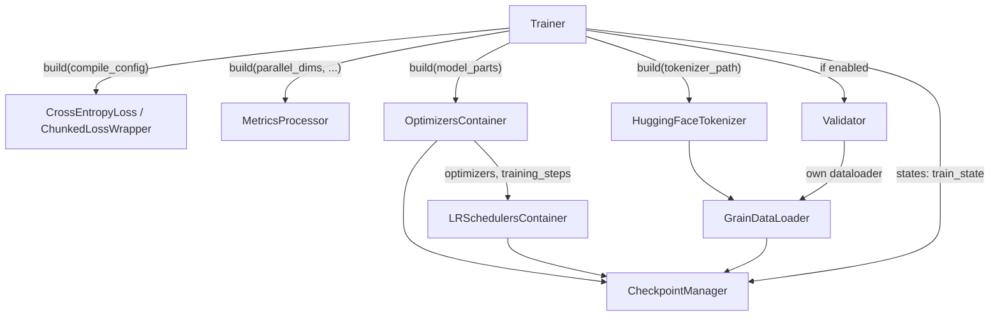
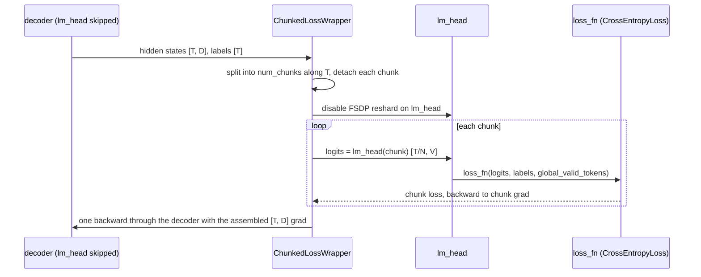

# Training components (torchtitan/components)

## Overview

`torchtitan/components` holds everything a training job needs besides the model and the parallelism code: the loss ([`BaseLoss`](../catalog/torchtitan/components/loss.md#BaseLoss "torchtitan/components/loss.py:L236") and its subclasses), the optimizer and LR-schedule containers ([`OptimizersContainer`](../catalog/torchtitan/components/optimizer/optimizer.md#OptimizersContainer "torchtitan/components/optimizer/optimizer.py:L84"), [`LRSchedulersContainer`](../catalog/torchtitan/components/optimizer/lr_scheduler.md#LRSchedulersContainer "torchtitan/components/optimizer/lr_scheduler.py:L25")), data ([`GrainDataLoader`](../catalog/torchtitan/components/data/loader.md#GrainDataLoader "torchtitan/components/data/loader.py:L61"), [`HuggingFaceTokenizer`](../catalog/torchtitan/components/tokenizer.md#HuggingFaceTokenizer "torchtitan/components/tokenizer.py:L94")), checkpointing ([`CheckpointManager`](../catalog/torchtitan/components/checkpointer/dcp.md#CheckpointManager "torchtitan/components/checkpointer/dcp.py:L89")), logging ([`MetricsProcessor`](../catalog/torchtitan/components/metrics.md#MetricsProcessor "torchtitan/components/metrics.py:L265")) and evaluation ([`Validator`](../catalog/torchtitan/components/validate.md#Validator "torchtitan/components/validate.py:L57")); quantization and LoRA converters also live here (see [quantization](quantization.md)). The unifying idea is the same as for model code: **each component is a [`Configurable`](../catalog/torchtitan/config/configurable.md#Configurable "torchtitan/config/configurable.py:L18") whose Config is a plain field of the trainer config, and the [`Trainer`](../catalog/torchtitan/trainer.md#Trainer "torchtitan/trainer.py:L74") builds each one with `config.build(**runtime_objects)`** - the config holds what a user tunes, the kwargs hold what only exists at runtime (model parts, optimizers, dp rank, tokenizer). Components that carry training progress (optimizers, LR schedulers, dataloader, the trainer itself) implement `Stateful`, and the checkpointer simply aggregates them into one state dict. For TPU performance the interesting parts are not the plumbing but the knobs it exposes: how the loss is normalized and chunked, which optimizer implementation runs, how MFU is computed, and which of these the TPU lane overrides.

## Diagram

Build order and dependencies inside the trainer's constructor:

Legend:
- `T` - [`Trainer`](../catalog/torchtitan/trainer.md#Trainer "torchtitan/trainer.py:L74")
- `LOSS` - [`CrossEntropyLoss`](../catalog/torchtitan/components/loss.md#CrossEntropyLoss "torchtitan/components/loss.py:L287"), [`ChunkedLossWrapper`](../catalog/torchtitan/components/loss.md#ChunkedLossWrapper "torchtitan/components/loss.py:L515")
- `MET` - [`MetricsProcessor`](../catalog/torchtitan/components/metrics.md#MetricsProcessor "torchtitan/components/metrics.py:L265")
- `OPT` - [`OptimizersContainer`](../catalog/torchtitan/components/optimizer/optimizer.md#OptimizersContainer "torchtitan/components/optimizer/optimizer.py:L84")
- `LRS` - [`LRSchedulersContainer`](../catalog/torchtitan/components/optimizer/lr_scheduler.md#LRSchedulersContainer "torchtitan/components/optimizer/lr_scheduler.py:L25")
- `TOK` - [`HuggingFaceTokenizer`](../catalog/torchtitan/components/tokenizer.md#HuggingFaceTokenizer "torchtitan/components/tokenizer.py:L94")
- `DL` - [`GrainDataLoader`](../catalog/torchtitan/components/data/loader.md#GrainDataLoader "torchtitan/components/data/loader.py:L61")
- `CKPT` - [`CheckpointManager`](../catalog/torchtitan/components/checkpointer/dcp.md#CheckpointManager "torchtitan/components/checkpointer/dcp.py:L89")
- `VAL` - [`Validator`](../catalog/torchtitan/components/validate.md#Validator "torchtitan/components/validate.py:L57")

What [`ChunkedLossWrapper`](../catalog/torchtitan/components/loss.md#ChunkedLossWrapper "torchtitan/components/loss.py:L515") does per step (from its docstring "The flow"):

Legend:
- `W` - [`ChunkedLossWrapper`](../catalog/torchtitan/components/loss.md#ChunkedLossWrapper "torchtitan/components/loss.py:L515")
- `L` - [`loss_fn`](../catalog/torchtitan/components/loss.md#ChunkedLossWrapper.Config.loss_fn "torchtitan/components/loss.py:L564") (default [`CrossEntropyLoss`](../catalog/torchtitan/components/loss.md#CrossEntropyLoss "torchtitan/components/loss.py:L287"))
- `M`, `H` - (concept) the model's decoder trunk and its `lm_head` module

## Design rationale (why it's built this way)

- **Config vs. runtime kwargs is enforced.** The base [`Configurable`](../catalog/torchtitan/config/configurable.md#Configurable "torchtitan/config/configurable.py:L18") `build()` forwards kwargs to the owner's constructor and raises if a kwarg overlaps a config field ("Put these values in the Config, not in build() kwargs"). So [`GrainDataLoader`](../catalog/torchtitan/components/data/loader.md#GrainDataLoader "torchtitan/components/data/loader.py:L61") gets `dp_rank`/`tokenizer` at build time, and the LR container's own [`build`](../catalog/torchtitan/components/optimizer/lr_scheduler.md#LRSchedulersContainer.Config.build "torchtitan/components/optimizer/lr_scheduler.py:L90") takes `optimizers` and `training_steps`. Recipes (e.g. TPU [`qwen3_8b`](../catalog/torchtitan/experiments/tpu/qwen3/config_registry.md#qwen3_8b "torchtitan/experiments/tpu/qwen3/config_registry.py:L555"), [`llama3_70b`](../catalog/torchtitan/experiments/tpu/llama3/config_registry.md#llama3_70b "torchtitan/experiments/tpu/llama3/config_registry.py:L269")) are then nothing but nested Config literals.
- **Sum-reduced loss, normalized once by global token count.** [`CrossEntropyLoss`](../catalog/torchtitan/components/loss.md#CrossEntropyLoss "torchtitan/components/loss.py:L287") is "Cross-entropy loss with sum reduction for token-based normalization": [`BaseLoss`](../catalog/torchtitan/components/loss.md#BaseLoss "torchtitan/components/loss.py:L236") divides the summed loss by `global_valid_tokens` for the step. This makes the loss (and gradient) independent of how tokens are split across DP ranks, PP microbatches and gradient-accumulation steps, so changing parallelism does not change numerics.
- **Containers mimic single torch objects.** [`OptimizersContainer`](../catalog/torchtitan/components/optimizer/optimizer.md#OptimizersContainer "torchtitan/components/optimizer/optimizer.py:L84") and [`LRSchedulersContainer`](../catalog/torchtitan/components/optimizer/lr_scheduler.md#LRSchedulersContainer "torchtitan/components/optimizer/lr_scheduler.py:L25") keep `step()/zero_grad()/state_dict()` signatures so the train loop and checkpointer treat "one optimizer per PP model part per optimizer type" as a single object. The [`CheckpointManager`](../catalog/torchtitan/components/checkpointer/dcp.md#CheckpointManager "torchtitan/components/checkpointer/dcp.py:L89") docstring explains why flattening is needed: per-PP-rank optimizers index `param_group[0]` differently, so state is flattened to FQN-keyed dicts to avoid collisions.
- **Checkpoint managers must redeclare Config.** [`BaseCheckpointManager`](../catalog/torchtitan/components/checkpointer/base.md#BaseCheckpointManager "torchtitan/components/checkpointer/base.py:L194") warns that a subclass inheriting `Config` unchanged "would build this abstract base instead", because `build()` constructs the class that declared the Config - a direct consequence of the auto-wiring in `Configurable`.

> [!inferred]
> The chunked-loss design trades a Python loop for memory: peak logits memory drops "from O(T*V) to O(T/N*V)" (docstring), which matters most for large vocabularies. That loop is exactly what a whole-graph compiler cannot keep bounded: the TPU graph trainer rejects [`ChunkedLossWrapper`](../catalog/torchtitan/components/loss.md#ChunkedLossWrapper "torchtitan/components/loss.py:L515") because "FX unrolls its loop and defeats bounded-memory execution", and points users to plain cross-entropy or a Pallas fused cross-entropy kernel instead. See [TPU Pallas kernels](tpu-pallas-kernels.md) and [TPU graph trainer](tpu-graph-trainer.md).

## Entry points

- [`LRSchedulersContainer`](../catalog/torchtitan/components/optimizer/lr_scheduler.md#LRSchedulersContainer "torchtitan/components/optimizer/lr_scheduler.py:L25") / its [`Config`](../catalog/torchtitan/components/optimizer/lr_scheduler.md#LRSchedulersContainer.Config "torchtitan/components/optimizer/lr_scheduler.py:L51") - the most-referenced component; recipes typically set [`warmup_steps`](../catalog/torchtitan/components/optimizer/lr_scheduler.md#LRSchedulersContainer.Config.warmup_steps "torchtitan/components/optimizer/lr_scheduler.py:L52"), [`decay_ratio`](../catalog/torchtitan/components/optimizer/lr_scheduler.md#LRSchedulersContainer.Config.decay_ratio "torchtitan/components/optimizer/lr_scheduler.py:L65"), [`decay_type`](../catalog/torchtitan/components/optimizer/lr_scheduler.md#LRSchedulersContainer.Config.decay_type "torchtitan/components/optimizer/lr_scheduler.py:L74") and [`min_lr_factor`](../catalog/torchtitan/components/optimizer/lr_scheduler.md#LRSchedulersContainer.Config.min_lr_factor "torchtitan/components/optimizer/lr_scheduler.py:L82"). Built by the trainer right after the optimizers.
- [`CheckpointManager`](../catalog/torchtitan/components/checkpointer/dcp.md#CheckpointManager "torchtitan/components/checkpointer/dcp.py:L89") / its [`Config`](../catalog/torchtitan/components/checkpointer/dcp.md#CheckpointManager.Config "torchtitan/components/checkpointer/dcp.py:L136") - the DCP-backed default; [`enable`](../catalog/torchtitan/components/checkpointer/base.md#BaseCheckpointManager.Config.enable "torchtitan/components/checkpointer/base.py:L532"), [`interval`](../catalog/torchtitan/components/checkpointer/base.md#BaseCheckpointManager.Config.interval "torchtitan/components/checkpointer/base.py:L538") and [`last_save_model_only`](../catalog/torchtitan/components/checkpointer/base.md#BaseCheckpointManager.Config.last_save_model_only "torchtitan/components/checkpointer/base.py:L553") are the fields recipes touch. Built after the optimizers, LR schedulers and dataloader, because it needs every stateful component (only the optional validator is built after it).
- [`GrainDataLoader`](../catalog/torchtitan/components/data/loader.md#GrainDataLoader "torchtitan/components/data/loader.py:L61") / its [`Config`](../catalog/torchtitan/components/data/loader.md#GrainDataLoader.Config "torchtitan/components/data/loader.py:L65") - "Batches and checkpoints one composed Grain dataset graph"; the [`dataset`](../catalog/torchtitan/components/data/loader.md#GrainDataLoader.Config.dataset "torchtitan/components/data/loader.py:L66") field is usually a [`ConcatThenSplitPackingConfig`](../catalog/torchtitan/components/data/packing.md#ConcatThenSplitPackingConfig "torchtitan/components/data/packing.py:L22"). Iterated once per microbatch by the train loop.
- [`CrossEntropyLoss`](../catalog/torchtitan/components/loss.md#CrossEntropyLoss "torchtitan/components/loss.py:L287") / its [`Config`](../catalog/torchtitan/components/loss.md#CrossEntropyLoss.Config "torchtitan/components/loss.py:L291") - called once per microbatch with `(pred, labels, global_valid_tokens)`; [`global_vocab_size`](../catalog/torchtitan/components/loss.md#CrossEntropyLoss.Config.global_vocab_size "torchtitan/components/loss.py:L292") is "needed for spmd_types loss-parallel CE". Usually wrapped by [`ChunkedLossWrapper`](../catalog/torchtitan/components/loss.md#ChunkedLossWrapper "torchtitan/components/loss.py:L515") via its [`Config`](../catalog/torchtitan/components/loss.md#ChunkedLossWrapper.Config "torchtitan/components/loss.py:L560").
- [`default_adamw`](../catalog/torchtitan/components/optimizer/optimizer.md#default_adamw "torchtitan/components/optimizer/optimizer.py:L396") - the convenience used by nearly every recipe: one catch-all AdamW group (betas 0.9/0.95, eps 1e-8, weight decay 0.1) with an optional `implementation` override.
- [`log`](../catalog/torchtitan/components/metrics.md#MetricsProcessor.log "torchtitan/components/metrics.py:L467") and [`validate`](../catalog/torchtitan/components/validate.md#Validator.validate "torchtitan/components/validate.py:L142") - called from the train loop every [`log_freq`](../catalog/torchtitan/components/metrics.md#MetricsProcessor.Config.log_freq "torchtitan/components/metrics.py:L284") steps and every validation interval, respectively.
- [`load`](../catalog/torchtitan/components/checkpointer/base.md#BaseCheckpointManager.load "torchtitan/components/checkpointer/base.py:L230") / [`_save`](../catalog/torchtitan/components/checkpointer/dcp.md#CheckpointManager._save "torchtitan/components/checkpointer/dcp.py:L405") - restore at startup and save per step (the save is a no-op unless the step is a multiple of the interval - which includes step 0 - or is the last step, or is step 1 with `enable_first_step_checkpoint`).

## Mechanism (step-by-step)

1. **Loss built with compile awareness.** Right after building the metrics processor and computing FLOPs per token (step 2), the trainer builds the loss with the compile config; [`BaseLoss`](../catalog/torchtitan/components/loss.md#BaseLoss "torchtitan/components/loss.py:L236") wraps its leaf function in `torch.compile(backend=compile_config.backend)` when `"loss"` is in the compile components. [`ChunkedLossWrapper`](../catalog/torchtitan/components/loss.md#ChunkedLossWrapper "torchtitan/components/loss.py:L515") builds its inner [`loss_fn`](../catalog/torchtitan/components/loss.md#ChunkedLossWrapper.Config.loss_fn "torchtitan/components/loss.py:L564") the same way ("the inner loss_fn can be compiled independently; lm_head is not compiled"). After the model is parallelized, the trainer hands the wrapper the model's `lm_head` and sets the model's skip-lm-head flag so forward returns hidden states.

2. **Metrics processor and MFU denominator.** [`MetricsProcessor`](../catalog/torchtitan/components/metrics.md#MetricsProcessor "torchtitan/components/metrics.py:L265") is built with the parallel dims and the full config dict; the trainer then stores the model's FLOPs-per-token on it. Each [`log`](../catalog/torchtitan/components/metrics.md#MetricsProcessor.log "torchtitan/components/metrics.py:L467") computes tokens/sec *per device* by dividing tokens seen by elapsed time times the non-data-parallel size, `tflops = flops_per_token * tps / 1e12`, and `mfu = 100 * flops_per_token * tps / peak_flops` (PaLM definition). MFU is suppressed (`None`) when quantization is active, since it is defined against BF16 peak. It also reports data-loading time share and peak/reserved device memory, OOM and alloc-retry counts, then resets the peak counters.

3. **Optimizers, then LR schedulers.** [`OptimizersContainer`](../catalog/torchtitan/components/optimizer/optimizer.md#OptimizersContainer "torchtitan/components/optimizer/optimizer.py:L84") matches parameters to groups by regex (first match wins) and batches groups of the same optimizer type into one instance "for performance". The `implementation` field picks `for-loop`, `foreach`, `fused` ("CUDA only") or `fused_opt_states_bf16` (bf16 Adam moments via a step pre-hook). TPU recipes built with [`default_adamw`](../catalog/torchtitan/components/optimizer/optimizer.md#default_adamw "torchtitan/components/optimizer/optimizer.py:L396") pass `implementation="foreach"` (e.g. [`reg_trainer_qwen3_8b`](../catalog/torchtitan/experiments/tpu/qwen3/config_registry.md#reg_trainer_qwen3_8b "torchtitan/experiments/tpu/qwen3/config_registry.py:L344")), since the default `fused` path is CUDA-only. The LR container's [`build`](../catalog/torchtitan/components/optimizer/lr_scheduler.md#LRSchedulersContainer.Config.build "torchtitan/components/optimizer/lr_scheduler.py:L90") turns [`warmup_steps`](../catalog/torchtitan/components/optimizer/lr_scheduler.md#LRSchedulersContainer.Config.warmup_steps "torchtitan/components/optimizer/lr_scheduler.py:L52") / [`decay_ratio`](../catalog/torchtitan/components/optimizer/lr_scheduler.md#LRSchedulersContainer.Config.decay_ratio "torchtitan/components/optimizer/lr_scheduler.py:L65") / [`decay_type`](../catalog/torchtitan/components/optimizer/lr_scheduler.md#LRSchedulersContainer.Config.decay_type "torchtitan/components/optimizer/lr_scheduler.py:L74") into a warmup-stable-decay `LambdaLR` per optimizer (clamping warmup and decay to the total with a warning, and adding "a virtual last step to prevent the learning rate from dropping to 0"). On checkpoint only `last_epoch` is saved, so schedulers recompute lr from their own `base_lrs` after a reshard.

4. **Tokenizer and packed data.** [`HuggingFaceTokenizer`](../catalog/torchtitan/components/tokenizer.md#HuggingFaceTokenizer "torchtitan/components/tokenizer.py:L94") (a [`BaseTokenizer`](../catalog/torchtitan/components/tokenizer.md#BaseTokenizer "torchtitan/components/tokenizer.py:L19")) adds BOS/EOS itself rather than relying on the HF tokenizer's specials. [`GrainDataLoader`](../catalog/torchtitan/components/data/loader.md#GrainDataLoader "torchtitan/components/data/loader.py:L61") builds the dataset graph with the DP rank and world size (the leaf node owns shuffle, repeat and DP sharding), runs row transforms through a [`SampleProcessor`](../catalog/torchtitan/components/data/dataset.md#SampleProcessor "torchtitan/components/data/dataset.py:L67") with Grain's deterministic RNG, and with [`ConcatThenSplitPackingConfig`](../catalog/torchtitan/components/data/packing.md#ConcatThenSplitPackingConfig "torchtitan/components/data/packing.py:L22") "Concatenates documents, chunking them into fixed-length rows" of `num_tokens_per_batch` tokens (fields `input_ids`, `labels`, `positions`, `padding_mask`). The per-document `positions` are what the model turns into flex/varlen/splash document masks, so packing costs no padding FLOPs. Batches are collated and prefetched on a thread (`num_prefetch_batches`, default 2) so host-side data work overlaps the device step; the data-loading percentage in the metrics is the check that it does.

5. **Checkpointer aggregates state.** [`__init__`](../catalog/torchtitan/components/checkpointer/dcp.md#CheckpointManager.__init__ "torchtitan/components/checkpointer/dcp.py:L151") returns immediately when disabled; otherwise it registers model (wrapped across PP parts), optimizer, dataloader, LR scheduler and `train_state` (the trainer) as its states, creates a gloo process group for async modes, and, when `keep_latest_k > 0`, starts a daemon [`purge_thread`](../catalog/torchtitan/components/checkpointer/torch_checkpointing.md#TorchCheckpointingManager.purge_thread "torchtitan/components/checkpointer/torch_checkpointing.py:L241")-style worker that deletes checkpoints beyond `keep_latest_k`. [`_save`](../catalog/torchtitan/components/checkpointer/dcp.md#CheckpointManager._save "torchtitan/components/checkpointer/dcp.py:L405") first waits for any in-flight save, purges stale steps, then saves synchronously, or stages and saves asynchronously (`async_mode="async"` or `"async_with_pinned_mem"`, the latter using a pinned/shared-memory stager after a GC). The final step can save model-only, in an export dtype or HF safetensors. [`load`](../catalog/torchtitan/components/checkpointer/base.md#BaseCheckpointManager.load "torchtitan/components/checkpointer/base.py:L230") resumes from the latest `step-N` folder, treats step 0 as a model-only seed, or falls back to an initial (optionally HF) load path. An alternative [`__init__`](../catalog/torchtitan/components/checkpointer/torch_checkpointing.md#TorchCheckpointingManager.__init__ "torchtitan/components/checkpointer/torch_checkpointing.py:L224") backs the same contract with `torch_checkpointing` (local filesystem by default; remote-URI folders are rejected, and remote storage must be passed programmatically as a `storage_config`).

6. **Chunked cross-entropy at loss time.** For each microbatch, [`ChunkedLossWrapper`](../catalog/torchtitan/components/loss.md#ChunkedLossWrapper "torchtitan/components/loss.py:L515") splits the *local* hidden-state shard into `num_chunks` (default 8; the local length must divide evenly), detaches each chunk, disables FSDP reshard on `lm_head` so its weight is all-gathered once for all chunks, runs `lm_head` + [`CrossEntropyLoss`](../catalog/torchtitan/components/loss.md#CrossEntropyLoss "torchtitan/components/loss.py:L287") + backward per chunk while accumulating an fp32 `[T, D]` gradient, keeps gradient sync off until the last chunk so a single reduce-scatter handles the lm_head gradient, and finally backpropagates once through the decoder. Under TP, the root norm has already gathered hidden states to replicated, and when logits are vocab-sharded the CE runs loss-parallel: each rank computes on its `V/tp` slice with all-reduced max and sum-exp for a stable global log-softmax, and a fused backward from saved local log-probs.

7. **Validation reuses the same pieces.** [`validate`](../catalog/torchtitan/components/validate.md#Validator.validate "torchtitan/components/validate.py:L142") puts model parts in eval mode, builds a fresh loader from its [`dataloader`](../catalog/torchtitan/components/validate.md#Validator.Config.dataloader "torchtitan/components/validate.py:L87") config (default: packed C4 validation, `repeat=False`), all-reduces the valid-token count over the batch mesh, and runs forward-only through the same loss (the chunked wrapper skips per-chunk backward when predictions do not require grad), logging through [`MetricsProcessor`](../catalog/torchtitan/components/metrics.md#MetricsProcessor "torchtitan/components/metrics.py:L265").

## Key data structures

| Structure | What it holds | Notes |
|---|---|---|
| [`LRSchedulersContainer`](../catalog/torchtitan/components/optimizer/lr_scheduler.md#LRSchedulersContainer "torchtitan/components/optimizer/lr_scheduler.py:L25") Config | WSD schedule | `total_steps` can decouple the schedule from `training.steps` for short debug runs. |
| [`OptimizersContainer`](../catalog/torchtitan/components/optimizer/optimizer.md#OptimizersContainer "torchtitan/components/optimizer/optimizer.py:L84") Config | `param_groups` (regex -> optimizer + kwargs), `implementation` | One optimizer instance per (model part, optimizer type). |
| [`CheckpointManager`](../catalog/torchtitan/components/checkpointer/dcp.md#CheckpointManager "torchtitan/components/checkpointer/dcp.py:L89") `states` | `model`, `optimizer`, `dataloader`, `lr_scheduler`, `train_state` | Model and optimizer state flattened to FQN keys for PP. |
| [`GrainDataLoader`](../catalog/torchtitan/components/data/loader.md#GrainDataLoader "torchtitan/components/data/loader.py:L61") state | `version`, `dp_world_size`, per-rank iterator state under [`_rank_id`](../catalog/torchtitan/components/data/loader.md#GrainDataLoader._rank_id "torchtitan/components/data/loader.py:L106") | Resume requires the same effective DP degree. |
| [`MetricsProcessor`](../catalog/torchtitan/components/metrics.md#MetricsProcessor "torchtitan/components/metrics.py:L265") | `num_flops_per_token`, `gpu_peak_flops`, `ntokens_since_last_log`, data-loading times, device memory monitor | Source of the tps / tflops / MFU numbers. |
| [`BaseDataLoader`](../catalog/torchtitan/components/data/loader.md#BaseDataLoader "torchtitan/components/data/loader.py:L39") | `max_num_documents` | Caps document segments per local batch (sizes varlen metadata). |

## Dynamics (design intent)

- **Overlap points.** Data prefetch runs on a thread; async checkpointing stages and writes on a separate gloo group so the next steps run during the write, and `_save` blocks only if the previous save is still in flight. The checkpoint docstring of `keep_latest_k` validation requires at least 2 retained checkpoints "as the last one may be in the process of being saved."
- **Numerics invariance across parallelism.** Sum reduction plus a single division by the global valid-token count, and the trainer's all-reduced token count, keep the loss comparable across DP/PP/grad-accumulation layouts; the chunked wrapper preserves this by passing `global_valid_tokens` to each chunk.
- **TPU lane differences.** TPU recipes use `foreach` AdamW; the TPU graph trainer rejects the chunked loss and the eager TPU trainer rebuilds the loss as plain cross-entropy (as the TPU muse_glimmer recipe docstring notes, "which drops ChunkedLossWrapper"), relying on Pallas fused cross-entropy kernels for large-vocab memory instead. Example TPU recipes such as [`sft_llama3_8b_metamath`](../catalog/torchtitan/experiments/tpu/llama3/config_registry.md#sft_llama3_8b_metamath "torchtitan/experiments/tpu/llama3/config_registry.py:L399") still assemble the same component configs.

## Edge cases

- [`GrainDataLoader`](../catalog/torchtitan/components/data/loader.md#GrainDataLoader "torchtitan/components/data/loader.py:L61") refuses `repeat=False` with DP > 1 ("can exhaust ranks at different steps and hang collectives"), and refuses to resume after the effective DP degree changes.
- Checkpoint config validation ([`__post_init__`](../catalog/torchtitan/components/checkpointer/base.md#BaseCheckpointManager.Config.__post_init__ "torchtitan/components/checkpointer/base.py:L584")): `interval >= 1`, `keep_latest_k != 1`, LR scheduler must be excluded from loading whenever the optimizer is, `initial_load_path` must be absolute or a remote URI, HF load/save requires model-only, and HF safetensors are not supported on remote folders.
- [`ChunkedLossWrapper`](../catalog/torchtitan/components/loss.md#ChunkedLossWrapper "torchtitan/components/loss.py:L515") needs the local token count divisible by `num_chunks`, requires `set_lm_head` before first use, and all predictions in a multi-output call must agree on `requires_grad`.
- MFU is reported as N/A whenever any quantization converter is active, even though tps and tflops are still logged.
- The `fused` optimizer implementation is CUDA-only; on other devices recipes must choose `foreach` or `for-loop`.

## Open questions

- The train loop that calls these components (`Trainer.train_step`, forward/backward body, gradient clipping) is outside this packet's subgraph; see [trainer and train loop](trainer-and-train-loop.md).
- `OptimizersContainer.Config` fields, `ParamGroupConfig`, and the MoE load-balancing optimizer hook are not in the subgraph; only their roles are described here.
- How `gpu_peak_flops` is obtained for TPU device names (the MFU denominator) is decided in `tools/utils.py`, outside this subsystem.

## See also

- [Trainer and train loop](trainer-and-train-loop.md)
- [Optimizers and LR schedulers](optimizers-and-lr-schedulers.md)
- [Data loading](data-loading.md) and [HF datasets](hf-datasets.md)
- [Checkpointing](checkpointing.md)
- [Observability](observability.md)
- [Quantization](quantization.md)
- [Model spec protocols](model-spec-protocols.md)
- [TPU trainer and job config](tpu-trainer-and-job-config.md)
- [TPU graph trainer](tpu-graph-trainer.md)
