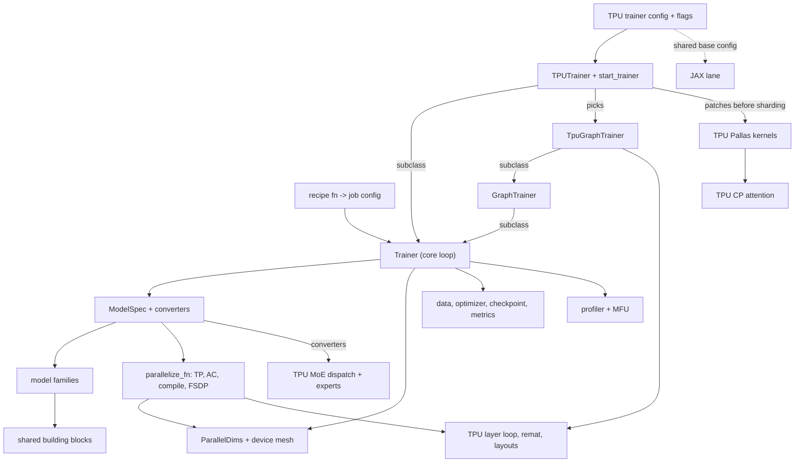

# torchtitan - what it is and how it fits together

## In one paragraph
This checkout is Google's distribution of upstream TorchTitan: upstream code is kept working and synced, and everything TPU-specific lives in one directory, `torchtitan/experiments/tpu` ([distribution model](doc-concepts/torchtitan-tpu-distribution.md)). A run is a Python **recipe** function that returns a complete job config: model, parallelism degrees, kernels and (in the TPU lane) the libtpu/XLA flags it was measured with. The model is itself a tree of dataclass configs that a backend can rewrite before anything is built, so the TPU lane never forks model code: it swaps config nodes (converters), patches kernels into the built model just before sharding, and replaces the trainer at three seams. Every trainer builds the model on the meta device, applies the model's `parallelize_fn` over named views of one device mesh, then materializes already-sharded weights. On TPU the central performance fact is that TorchTPU dispatches every XLA program from the host, so step time is decided by how much of the step is compiled into few large programs (per-block `torch.compile`, deferred eager fusion, or whole-step capture in the graph trainer) and by how memory and collectives are scheduled inside those programs.

## Performance-relevant surfaces
The knobs that move step time, MFU and peak HBM on TPU, grouped by what they act on. Defaults are the code defaults stated on the linked pages; shipped recipes often override them (the [recipe matrix](doc-concepts/tpu-recipe-matrix.md) shows what each recipe actually sets).

| Group | Surface (knob / API) | Default | Effect on perf | Page |
|---|---|---|---|---|
| Mesh | six degrees `dp_replicate`, `dp_shard`, `cp`, `tp`, `pp`, `ep` (`-1` = leftover for FSDP); `ep` must divide `dp_shard * cp * tp` | FSDP axis always exists, even at degree 1 | one world mesh unflattened into named views; FSDP doubles as the mixed-precision mechanism | [parallel dims](concepts/parallel-dims-and-parallelization.md), [job config](concepts/job-config.md) |
| Mesh | `parallelism.enable_tpu_topo_mesh` | recipes turn it on | physical rank order lets XLA use N-D SparseCore collectives instead of a slow 1-D ring | [parallel dims](concepts/parallel-dims-and-parallelization.md) |
| Mesh | min-cost DTensor redistribute planner | off | reduce-scatter before all-reduce for HSDP gradients; matters when the replicate dim crosses DCN | [trainer](concepts/trainer-and-train-loop.md), [multi-slice HSDP](doc-concepts/tpu-multislice-hsdp-over-dcn.md) |
| FSDP | `parallelism.use_simple_fsdp` | recipes turn it on | collectives become traced graph nodes that compile and graph passes can overlap; mixed precision `param_dtype=bfloat16`, `reduce_dtype=float32` | [SimpleFSDP on TPU](doc-concepts/tpu-simplefsdp-and-mixed-precision.md), [SimpleFSDP](doc-concepts/simple-fsdp.md) |
| FSDP schedule | `fsdp_reshard_after_forward` (`never` = Zero-2, `always` = Zero-3); graph-trainer `fsdp_barrier_policy` (`none` / `prefetch` / `interleave`); all-reduce+slice gradient patterns | SimpleFSDP defaults; barriers off | Zero-3 needed at 32B (Zero-2 keeps ~61 GiB of gathered weights); prefetch vs interleave trades ~0.3-2.3% step for GiBs of HBM; all-reduce+slice cut 14.33 -> 12.34 s at 512 devices | [SimpleFSDP schedules](doc-concepts/tpu-recipe-simplefsdp-schedules.md), [TPU graph trainer](concepts/tpu-graph-trainer.md) |
| Remat (regular trainer) | `activation_checkpoint` (`selective` / `region` / `full` / `memory-budget` / `none`); TPU swaps in `TPUSelectiveAC`, optional `AttentionSavingSelectiveAC` | recipes mostly use `full` | upstream SAC recomputes the Pallas attention (81 ms of an 840 ms step on Llama-3.2-1B); the TPU policy saves it | [layer loop, remat, layouts](concepts/tpu-layer-loop-remat-and-layouts.md) |
| Remat (graph trainer) | `compile.memory_policy` (`default`, `full`, `tpu_selective`, `*_offload`), `save_regions` / `save_last_n_layers` | `default` (Splash output recomputed) | `tpu_selective` = full recompute but keep Splash output+LSE and/or MoE routing; saving the last N layers trades step time for HBM roughly linearly | [memory policy and save regions](doc-concepts/tpu-recipe-memory-policy-and-save-regions.md), [graph-trainer memory policies](doc-concepts/tpu-graph-trainer-memory-policies.md) |
| Layer loop | `compile.use_scan_layers` (graph trainer); `jax_config.use_scan` (JAX lane) | graph trainer: off; JAX: on | one `while` body: compile time stops growing with depth and FSDP gathers one layer at a time; no TP/CP/PP/EP>1 or `tpu_selective` under scan | [TPU graph trainer](concepts/tpu-graph-trainer.md), [scan, splitter, offload](doc-concepts/tpu-scan-graph-splitter-cpu-offload.md) |
| Layer loop | graph splitter, CPU offload of saved activations | off | splitter narrows the compile window per layer group; offload is required above 8B on the Llama3 scan lane | [scan, splitter, offload](doc-concepts/tpu-scan-graph-splitter-cpu-offload.md) |
| Compile | `compile.enable`, `compile.mode` (`layer` / `fullgraph` / `whole` / `block`), `optimizer_compile` (`eager` / `separate_graph` / `in_graph`), `compile_grad_norm`, `materialize_forward_before_backward` | `layer`, `eager`, False, False | per-block compile is "mandatory" for perf; the glue (loss, optimizer, grad norm) has its own switches; forward/backward split cuts first-step compile time | [per-block compile](doc-concepts/tpu-per-block-torch-compile.md), [TPU trainer and config](concepts/tpu-trainer-and-job-config.md) |
| Compile | graph trainer (`compile.mode='aot_fx_trace'`, TPU pass pipeline) | used by Ironwood Qwen3 / Muse Glimmer recipes; OOMs on v6e Qwen3 | whole step (fwd + loss + bwd, optionally AdamW) is one XLA program; barriers decide memory and collective order before XLA sees it | [TPU graph trainer](concepts/tpu-graph-trainer.md), [graph trainer](concepts/graph-trainer.md) |
| Eager | `tpu_config.eager_mode` (`DEFER_AND_FUSE`, ...) | `""` (off); recipes use `DEFER_AND_FUSE` | defers ops and fuses the uncompiled glue around compiled blocks; measure per model | [defer-and-fuse](doc-concepts/tpu-defer-and-fuse-eager-mode.md), [dispatch-bound model](doc-concepts/tpu-dispatch-bound-mental-model.md) |
| Attention | `splash_attention_kernel.use_splash_attention_kernel` / `use_tokamax_splash_attention_kernel`; nine `sa_block_*` tiles; `sa_q/k/v_layout`; `sa_use_fused_bwd_kernel` | off; tiles 512; `HEAD_DIM_MINOR`; fused bwd on | tiles bounded by scoped VMEM (`xla_tpu_scoped_vmem_limit_kib`, 65536 recommended on v6e); Llama3 recipes use 2048 + `SEQ_MINOR` at seq 8192 | [Splash tiles and VMEM](doc-concepts/tpu-splash-attention-tiles-and-vmem.md), [kernel choices](doc-concepts/tpu-recipe-splash-and-loss-kernel-choices.md), [Pallas kernels](concepts/tpu-pallas-kernels.md) |
| Loss | fused Pallas linear + softmax CE (`loss_kernel.use_loss_kernel`, block sizes 1024/512/2048; Llama3 recipes install it directly) | off | logits never materialized: a memory tool that buys batch, roughly neutral when logits are small; token count must be a multiple of the block | [fused linear CE](doc-concepts/tpu-fused-linear-cross-entropy.md), [Pallas kernels](concepts/tpu-pallas-kernels.md) |
| Layout | `tpu_config.bld_block_layout`; `TpuPackedQKVConverter` | on; off | `[B, L]` views avoid T-minor layouts (~9% TPS on qwen3-8b); packed QKV -3.5% step and -19.7 GiB at qwen3-32b (TP=1 only) | [layer loop, remat, layouts](concepts/tpu-layer-loop-remat-and-layouts.md) |
| MoE | five switches: Pallas grouped matmul, paired gate/up, kernel-native weight layout, TPU dispatch/combine VJPs, fused route-score backward; `scale_before_down_proj` | grouped-mm knobs off; `tile_m` 1024, tgmm tiling `(128,128,128)` | stock dispatch VJPs ran at a few % of HBM bandwidth (83% of a Qwen3-30B-A3B step); recipes run EP=1 with tile 256 | [MoE kernel switches](doc-concepts/tpu-moe-kernel-switches.md), [MoE dispatch](concepts/tpu-moe-dispatch-and-grouped-experts.md) |
| Context parallel | CP strategy `all_gather` (head-tail load balancing) or `ulysses`; `reduce_dtype` | `float32` reduce | Splash is plugged in as the local kernel; no shipped recipe uses CP | [TPU CP attention](concepts/tpu-context-parallel-attention.md) |
| Flags | `libtpu_init_flags` / `xla_flags` on the config, `--extra-*` on the CLI, exported env vars; named bundles (SparseCore LHS, dual-SC / hierarchical RS, AG/RS pipelining, p-state 7) | recipe-specific | config < CLI extra < environment; flags must be rendered before the first TPU compile | [flag layering](doc-concepts/tpu-libtpu-xla-flag-layering.md), [recipe flag sets](doc-concepts/tpu-recipe-libtpu-flag-sets.md) |
| Precision | `mixed_precision_param` / `mixed_precision_reduce`; float8 via a TPU subclass of the torchao converter | bf16 / fp32 | float8 Llama3-70B: 1,636 vs 1,235 TPS/device at tpu7x-128; MXFP8 / NVFP4 converters are CUDA-gated | [float8](doc-concepts/float8-training.md), [quantization](concepts/quantization.md), [precision and accounting](doc-concepts/tpu-recipe-precision-and-throughput-accounting.md) |
| Optimizer | `implementation` (`fused` / `foreach`), bf16 optimizer states | `fused` | every TPU recipe pins `foreach`; compiled or in-graph AdamW removes optimizer dispatch | [optimizers](concepts/optimizers-and-lr-schedulers.md) |
| Measuring | MaxText-style FLOP count (`*maxtext*` recipes), per-device peak FLOPs, `enable_mfu_benchmark` window | torchtitan FLOP count | see traps below | [precision and accounting](doc-concepts/tpu-recipe-precision-and-throughput-accounting.md), [profiling tools](concepts/debug-and-profiling-tools.md) |

Traps that silently void a perf experiment:
- An exported `LIBTPU_INIT_ARGS` / `XLA_FLAGS` beats the recipe with only a warning, and flags applied after the first compile are ignored ([flag layering](doc-concepts/tpu-libtpu-xla-flag-layering.md)).
- MFU depends on the FLOP convention (Qwen3-30B-A3B: 18.02% MaxText vs 20.12% torchtitan), is per TensorCore on TPU7x, and is reported as N/A whenever a quantization converter is active ([precision and accounting](doc-concepts/tpu-recipe-precision-and-throughput-accounting.md), [training components](concepts/training-components.md)).
- Recipe functions run before the CLI is applied, so values a recipe derives (e.g. a converter reading `compile.enable`) do not follow later flags ([trainer](concepts/trainer-and-train-loop.md)).
- Kernel knobs must reach the kernel as compile-cache-key values; a misrouted Splash config once ran library-default tiles with no error ([Pallas kernels](concepts/tpu-pallas-kernels.md)).
- A scan that silently did not apply, or ZeRO-3 without scan/splitting/barriers, looks like a normal run; the graph trainer raises on both ([TPU graph trainer](concepts/tpu-graph-trainer.md)).
- The Megablox GMM path syncs the host once per MoE layer call; host syncs in the step loop (`.item()`, per-step logging) stall dispatch ([Pallas kernels](concepts/tpu-pallas-kernels.md), [dispatch-bound model](doc-concepts/tpu-dispatch-bound-mental-model.md)).
- With `optimizer_compile="in_graph"`, the logged `grad_norm` is 0.0 although clipping still runs ([SimpleFSDP schedules](doc-concepts/tpu-recipe-simplefsdp-schedules.md)).

## Core architecture

Legend:
- `RECIPE` - [job config](concepts/job-config.md), [full configuration recipes](doc-concepts/full-configuration-recipes.md)
- `TPUCFG` - [TPU trainer and job config](concepts/tpu-trainer-and-job-config.md)
- `TRAINER` - [trainer and train loop](concepts/trainer-and-train-loop.md)
- `TPUTR` - [TPU trainer and job config](concepts/tpu-trainer-and-job-config.md)
- `GT` - [graph trainer](concepts/graph-trainer.md)
- `TPUGT` - [TPU graph trainer](concepts/tpu-graph-trainer.md)
- `SPEC` - [model spec protocols](concepts/model-spec-protocols.md)
- `MODELS` - [models area](areas/models.md) (one concept page per family)
- `BLOCKS` - [model building blocks](concepts/model-building-blocks.md)
- `MESH` - [parallel dims and parallelization](concepts/parallel-dims-and-parallelization.md)
- `PAR` - [parallel dims and parallelization](concepts/parallel-dims-and-parallelization.md)
- `LOOP` - [TPU layer loop, remat and layouts](concepts/tpu-layer-loop-remat-and-layouts.md)
- `KERN` - [TPU Pallas kernels](concepts/tpu-pallas-kernels.md)
- `MOE` - [TPU MoE dispatch and grouped experts](concepts/tpu-moe-dispatch-and-grouped-experts.md)
- `CP` - [TPU context-parallel attention](concepts/tpu-context-parallel-attention.md)
- `COMP` - [training components](concepts/training-components.md)
- `TOOLS` - [debug and profiling tools](concepts/debug-and-profiling-tools.md)
- `JAX` - [JAX lane](concepts/jax-lane.md)

## How a TPU training step flows

```mermaid
flowchart LR
  ENTRY["entry wrapper: render flags, enter eager mode"]
  PARSE["parse --module/--config recipe"]
  START["start_trainer: pick trainer"]
  BUILD["build model on meta (converters applied)"]
  PATCH["apply_patches: Splash, fused CE, GMM"]
  SHARD["parallelize: AC, compile, SimpleFSDP"]
  INIT["materialize sharded weights"]
  DATA["fixed-shape token batch"]
  STEP["fwd+bwd: compiled blocks or captured graph"]
  OPT["optimizer + metrics on log steps"]
  ENTRY --> PARSE --> START --> BUILD --> PATCH --> SHARD --> INIT --> DATA --> STEP --> OPT
  OPT -->|next step| DATA
```

Legend:
- `ENTRY` - [flag layering](doc-concepts/tpu-libtpu-xla-flag-layering.md), [defer-and-fuse eager mode](doc-concepts/tpu-defer-and-fuse-eager-mode.md)
- `PARSE` - [job config](concepts/job-config.md)
- `START` - [TPU trainer and job config](concepts/tpu-trainer-and-job-config.md)
- `BUILD` - [model spec protocols](concepts/model-spec-protocols.md)
- `PATCH` - [TPU Pallas kernels](concepts/tpu-pallas-kernels.md)
- `SHARD` - [parallel dims and parallelization](concepts/parallel-dims-and-parallelization.md)
- `INIT` - [trainer and train loop](concepts/trainer-and-train-loop.md)
- `DATA` - [data loading](concepts/data-loading.md)
- `STEP` - [per-block compile](doc-concepts/tpu-per-block-torch-compile.md), [TPU graph trainer](concepts/tpu-graph-trainer.md)
- `OPT` - [optimizers and LR schedulers](concepts/optimizers-and-lr-schedulers.md), [observability](concepts/observability.md)

The order is load-bearing: flags before the first device use (libtpu latches them at first compile), patches after converters but before SimpleFSDP parametrization, optimizer after parallelize so it sees DTensor parameters. Graph-trainer recipes take the same path but carry their own parallelize function and trace the whole step on the first call.

## Main concepts

### A run is a full configuration, written as code
A recipe is a `config_registry` function that returns a complete `Trainer.Config`; the CLI (`--module`, `--config`, `--section.key value`) only overrides fields, and changing behavior means deriving a new function. Every component is a `Configurable` whose nested `Config` builds its owner, so the whole job is one tree of dataclasses that can be copied and rewritten before anything is instantiated. The TPU lane extends the tree with Splash tiles, the fused loss, eager mode, a TPU compile policy and the libtpu/XLA flag maps, so a benchmark is reproducible from the recipe name alone. See [job config](concepts/job-config.md), [full configuration recipes](doc-concepts/full-configuration-recipes.md), [TPU trainer and job config](concepts/tpu-trainer-and-job-config.md).

### A model is a config tree that a backend can retune
Models are assembled from shared components whose attention kernel, per-axis sharding, init and remat region names are fields of config nodes rather than code in `forward`. A `ModelSpec` bundles the model config with `parallelize_fn`, `pipelining_fn` and the HF state-dict adapter, and `ModelConfigConverter`s (quantization, TPU MoE, packed QKV) rewrite the tree before build. Upstream overrides follow the same pattern but are CUDA-only; the TPU lane ships its own. See [model building blocks](concepts/model-building-blocks.md), [model spec protocols](concepts/model-spec-protocols.md), [config overrides](concepts/config-overrides.md), [model folder contract](doc-concepts/model-folder-contract.md).

### One world mesh, many named views
`ParallelDims` validates six degrees against the world size and unflattens one 1-D mesh into the views each consumer asks for by name (batch, loss, dense, sparse/expert). CP folds into FSDP, EP borrows devices from the dense region, and FSDP always exists because it carries the mixed-precision policy. A model's parallelize function composes TP, then activation checkpointing, then per-block compile, then FSDP. On TPU, the topology-aware rank order and the AC save set matter most. FlexShard (DistMuon compute layouts) is the GPU-side generalization. See [parallel dims and parallelization](concepts/parallel-dims-and-parallelization.md), [declarative sharding config](doc-concepts/declarative-sharding-config.md), [flex-shard](concepts/flex-shard.md).

### The TPU lane specializes, it does not fork
`experiments/tpu` changes three seams: a config subclass, a launcher (`start_trainer`) that wraps `parallelize_fn` so kernel monkey patches land on the built model just before sharding, and a trainer subclass that changes only the loss, grad norm and forward/backward boundary. The shipped recipes share one stack: SimpleFSDP over all devices on the topology mesh, Splash attention, the `tpu` compile backend, fp32 master weights with bf16 compute. None uses TP, PP or CP, and the MoE runs at EP=1. Scale-out is tuned through FSDP schedules and SparseCore collective flags, not more parallelism axes. See [TPU trainer and job config](concepts/tpu-trainer-and-job-config.md), [recipe matrix](doc-concepts/tpu-recipe-matrix.md), [experiments area](areas/experiments.md).

### Compile, or be dispatch-bound
Uncompiled, every op is its own host-dispatched program and the TPU idles between them, so the optimization guide reduces tuning to two moves: more work per program and fewer dispatches. The ladder is per-block `torch.compile` (with AC between blocks), deferred-and-fused eager for the glue, compiled optimizer and grad norm, and finally the graph trainer, which captures forward, loss, backward and optionally AdamW as one program. Per-block compile plus fused kernels typically lands a dense model in the low-to-mid tens of percent MFU; the idle left over sits around the transformer, not in it. See [dispatch-bound mental model](doc-concepts/tpu-dispatch-bound-mental-model.md), [per-block compile](doc-concepts/tpu-per-block-torch-compile.md), [defer-and-fuse](doc-concepts/tpu-defer-and-fuse-eager-mode.md).

### Memory and collective order are decided on the joint graph
The upstream graph trainer's bet is that every optimization is a graph pass over one captured step, made possible by SimpleFSDP turning all-gathers and reduce-scatters into graph nodes. The TPU graph trainer adds a pass pipeline that inserts `optimization_barrier` dependencies, because XLA's latency-hiding scheduler otherwise merges forward and recomputed all-gathers, keeps two layers of recompute live, or bunches reduce-scatters behind all-gathers (each costing tens of GiB). Layer stacking + scan, the graph splitter and CPU offload give large models a structure that fits; graph memory policies (`tpu_selective` with save regions) replace eager AC. On the regular trainer, the TPU layer-loop seam, scan backward patch, TPU SAC policies and layout fixes do the same job. See [graph trainer](concepts/graph-trainer.md), [TPU graph trainer](concepts/tpu-graph-trainer.md), [TPU layer loop, remat and layouts](concepts/tpu-layer-loop-remat-and-layouts.md), [scan, splitter, offload](doc-concepts/tpu-scan-graph-splitter-cpu-offload.md).

### Pallas kernels written in JAX, configured through the cache key
The three hottest computations (attention, MoE expert matmuls, LM head + cross-entropy) are replaced by JAX Pallas/Mosaic kernels bridged into torch as custom ops with hand-written autograd, so they are opaque to Dynamo and schedulable by AC and compile. There are three interchangeable Splash backends (stock, Tokamax, the SBD fork with bias and dropout). The invariant behind most of the plumbing is that every tile size and mask choice reaches the kernel as part of its compile-cache key. Context parallelism wraps these kernels rather than changing them: the CP mixin owns the collectives and head-tail bookkeeping, and the kernel runs as the local attention. See [TPU Pallas kernels](concepts/tpu-pallas-kernels.md), [Splash tiles and VMEM](doc-concepts/tpu-splash-attention-tiles-and-vmem.md), [fused linear CE](doc-concepts/tpu-fused-linear-cross-entropy.md), [TPU CP attention](concepts/tpu-context-parallel-attention.md).

### MoE on TPU: rewrite the VJPs, then the matmuls
The TPU lane keeps the shared MoE structure and swaps three leaf configs through converters. Default autograd for sort-by-expert and top-K combine lowers to collision scatters that XLA runs at a few percent of HBM bandwidth. The TPU versions express every VJP as a whole-row gather with an FP32 sum over the fixed top-K axis, move the route-score multiply before W2 so remat does not replay W2, and add Pallas grouped matmuls with a kernel-native weight layout. "The dispatcher matters more than the experts." See [TPU MoE dispatch and grouped experts](concepts/tpu-moe-dispatch-and-grouped-experts.md), [MoE kernel switches](doc-concepts/tpu-moe-kernel-switches.md), [MoE sharding placements](doc-concepts/moe-sharding-placements.md).

### Other lanes and what has no TPU path
The JAX lane borrows TorchTitan's config but runs Flax NNX, optax and XLA SPMD sharding with scan by default. It is useful as an XLA-native reference for the same model and flags (Llama3 only; Splash off unless the recipe enables it). The HF transformers backend trains Hub models on TPU without porting, for bring-up. RL (TitanRL with vLLM generators) is GPU-only in this checkout apart from a non-colocated Ray example. Among model families, Llama3, Qwen3/3.5, Muse Glimmer and Flux have TPU recipes; DeepSeek-V4, Kimi K3 and GPT-OSS do not. See [JAX lane](concepts/jax-lane.md), [HF backend on TPU](doc-concepts/hf-transformers-backend-on-tpu.md), [RL training](concepts/rl-training.md), [non-colocated RL on TPU](doc-concepts/tpu-non-colocated-rl-ray.md), [model support overview](doc-concepts/model-support-overview.md).

## Map of the wiki
Start from an area page for a directory, a concept page for a mechanism, or a doc-concept for something the repo's READMEs and guides document.

| Part of the repo | Start here | Concept pages |
|---|---|---|
| TPU backend `experiments/tpu`, JAX lane, graph trainer, RL | [experiments area](areas/experiments.md) | [TPU trainer and config](concepts/tpu-trainer-and-job-config.md), [TPU graph trainer](concepts/tpu-graph-trainer.md), [TPU Pallas kernels](concepts/tpu-pallas-kernels.md), [TPU MoE](concepts/tpu-moe-dispatch-and-grouped-experts.md), [TPU CP](concepts/tpu-context-parallel-attention.md), [TPU layer loop](concepts/tpu-layer-loop-remat-and-layouts.md), [JAX lane](concepts/jax-lane.md), [graph trainer](concepts/graph-trainer.md), [RL](concepts/rl-training.md) |
| Trainer and config | [config area](areas/config.md) | [trainer and train loop](concepts/trainer-and-train-loop.md), [job config](concepts/job-config.md) |
| Models | [models area](areas/models.md), [protocols area](areas/protocols.md) | [building blocks](concepts/model-building-blocks.md), [model spec protocols](concepts/model-spec-protocols.md), [Llama3](concepts/llama3-model.md), [Qwen3](concepts/qwen3-model.md), [Qwen3.5](concepts/qwen3-5-model.md), [DeepSeek-V3](concepts/deepseek-v3-model.md), [DeepSeek-V4](concepts/deepseek-v4-model.md), [Kimi K2.x](concepts/kimi-k2-7-model.md), [Kimi K3](concepts/kimi-k3-model.md), [GPT-OSS](concepts/gpt-oss-model.md), [Muse Glimmer](concepts/muse-glimmer-model.md), [Flux](concepts/flux-diffusion-model.md) |
| Parallelism | [distributed area](areas/distributed.md) | [parallel dims and parallelization](concepts/parallel-dims-and-parallelization.md), [flex-shard](concepts/flex-shard.md) |
| Components | [components area](areas/components.md), [hf_datasets area](areas/hf_datasets.md) | [training components](concepts/training-components.md), [data loading](concepts/data-loading.md), [HF datasets](concepts/hf-datasets.md), [checkpointing](concepts/checkpointing.md), [optimizers](concepts/optimizers-and-lr-schedulers.md), [quantization](concepts/quantization.md) |
| Overrides | [overrides area](areas/overrides.md) | [config overrides](concepts/config-overrides.md) |
| Profiling, metrics, logging | [tools area](areas/tools.md), [observability area](areas/observability.md) | [debug and profiling tools](concepts/debug-and-profiling-tools.md), [observability](concepts/observability.md) |

For "where is X / who calls X", use the module map [catalog/index.md](catalog/index.md) and grep the symbol index (`catalog/symbols/*.tsv`) by anchor; the silo's `index.md` lists every concept and doc-concept page.

How the repo README's topics route:
- **Train on TPU** (environment, TorchTPU install Option A/B, single-host TPU VM, multi-host GKE with Cluster Toolkit, Docker image, profiling with TensorBoard, cleanup): [launch and profiling workflow](doc-concepts/tpu-launch-and-profiling-workflow.md); multi-slice: [multi-slice HSDP over DCN](doc-concepts/tpu-multislice-hsdp-over-dcn.md); "Configuring XLA and libtpu flags": [flag layering](doc-concepts/tpu-libtpu-xla-flag-layering.md).
- **Pick a recipe** (`experiments/tpu/recipes`): [recipe matrix](doc-concepts/tpu-recipe-matrix.md), then the per-technique recipe pages it links; long-context Mamba: [Mamba 256K recipes](doc-concepts/tpu-recipe-mamba-256k-long-context.md).
- **Tune a model** (the TorchTPU optimization guide): [dispatch-bound mental model](doc-concepts/tpu-dispatch-bound-mental-model.md) and the knob pages in the table above.
- **Issues and contributing** (TPU changes here, shared code upstream): [distribution model](doc-concepts/torchtitan-tpu-distribution.md), [experiments contract](doc-concepts/experiments-contribution-contract.md).
- **Everything else** (upstream's README and `docs/`, which this checkout links to externally) and the license: not covered by this wiki. Upstream code paths are covered by the concept pages; GPU-only launch guides are summarized on [A3 Mega GPU guides](doc-concepts/a3-mega-gpu-multinode-guides.md).

## Where to go for a given task

| Task | Start here | Then |
|---|---|---|
| Launch a TPU training run (TPU VM or GKE) | [launch and profiling workflow](doc-concepts/tpu-launch-and-profiling-workflow.md) | [recipe matrix](doc-concepts/tpu-recipe-matrix.md), [flag layering](doc-concepts/tpu-libtpu-xla-flag-layering.md) |
| Tune step time or MFU of a dense recipe | [dispatch-bound mental model](doc-concepts/tpu-dispatch-bound-mental-model.md) | [SimpleFSDP schedules](doc-concepts/tpu-recipe-simplefsdp-schedules.md), [Splash tiles and VMEM](doc-concepts/tpu-splash-attention-tiles-and-vmem.md), [recipe flag sets](doc-concepts/tpu-recipe-libtpu-flag-sets.md) |
| Fit a bigger model or batch in HBM | [scan, splitter, offload](doc-concepts/tpu-scan-graph-splitter-cpu-offload.md) | [TPU graph trainer](concepts/tpu-graph-trainer.md), [memory policy and save regions](doc-concepts/tpu-recipe-memory-policy-and-save-regions.md), [fused linear CE](doc-concepts/tpu-fused-linear-cross-entropy.md) |
| Speed up an MoE model on TPU | [MoE kernel switches](doc-concepts/tpu-moe-kernel-switches.md) | [TPU MoE dispatch and grouped experts](concepts/tpu-moe-dispatch-and-grouped-experts.md), [MoE sharding placements](doc-concepts/moe-sharding-placements.md) |
| Bring a new model onto the TPU lane | [model folder contract](doc-concepts/model-folder-contract.md) | [model spec protocols](concepts/model-spec-protocols.md), [TPU trainer and job config](concepts/tpu-trainer-and-job-config.md), [HF backend on TPU](doc-concepts/hf-transformers-backend-on-tpu.md) |
| Add or swap a kernel (attention, loss, module override) | [TPU Pallas kernels](concepts/tpu-pallas-kernels.md) | [override implementation contract](doc-concepts/override-implementation-contract.md), [config overrides](concepts/config-overrides.md) |
| Profile a run and decide whether its MFU is comparable | [precision and throughput accounting](doc-concepts/tpu-recipe-precision-and-throughput-accounting.md) | [debug and profiling tools](concepts/debug-and-profiling-tools.md), [observability](concepts/observability.md) |
| Compare against an XLA-native JAX run of the same model | [JAX lane](concepts/jax-lane.md) | [JAX mesh sharding](doc-concepts/jax-fsdp-tp-mesh-sharding.md), [JAX scan over layers](doc-concepts/jax-scan-over-layers.md) |
