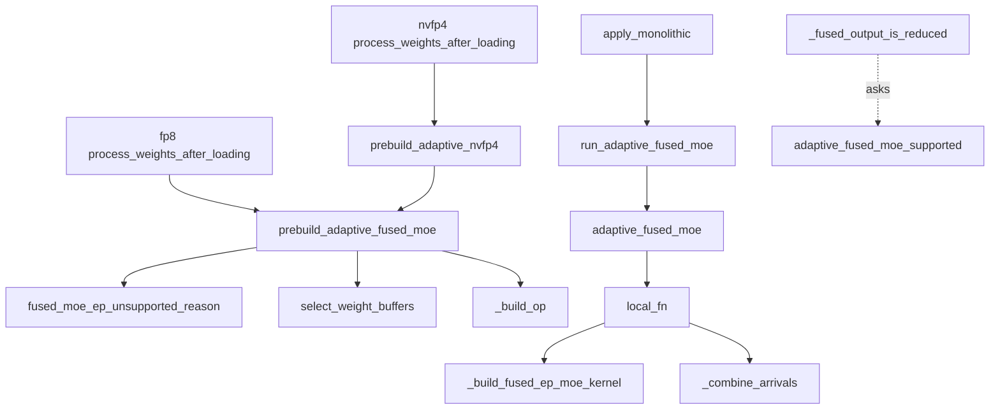
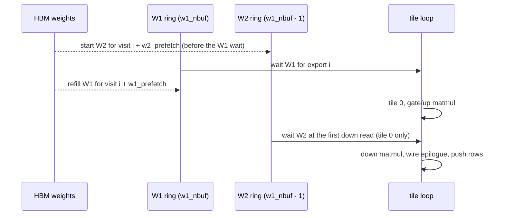

# Adaptive fused MoE kernel: the experimental fused-EP fork with VMEM-selected asymmetric W1/W2 weight rings

<!-- connect:up:begin -->
> **Cross-repo concept:** part of [expert-parallelism](../../../concepts/expert-parallelism.md), [pallas-kernel](../../../concepts/pallas-kernel.md), [vmem](../../../concepts/vmem.md), [vmem-budget](../../../concepts/vmem-budget.md) across this wiki's repos.
<!-- connect:up:end -->
## Overview

`src/vllm_torchtpu/kernels/experimental/adaptive_fused_moe` is a self-contained fork of the production fused expert-parallel MoE kernel (see [fused MoE kernels](fused-moe-kernels.md)). Its package docstring names the one idea it exists to test: "Experimental fused EP MoE with VMEM-selected asymmetric weight buffers." Everything structural is the same as v2 - a `shard_map` layer ([`adaptive_fused_moe`](../catalog/src/vllm_torchtpu/kernels/experimental/adaptive_fused_moe/layer.md#adaptive_fused_moe "src/vllm_torchtpu/kernels/experimental/adaptive_fused_moe/layer.py:L221")) that quantizes, routes, all-gathers rows plus one routing payload, builds a routing plan, and calls one Pallas kernel that streams expert weights, runs the gated FFN per tile and pushes result rows to their token owners by remote DMA, followed by a combine of the arrivals ([`_combine_arrivals`](../catalog/src/vllm_torchtpu/kernels/experimental/adaptive_fused_moe/layer.md#_combine_arrivals "src/vllm_torchtpu/kernels/experimental/adaptive_fused_moe/layer.py:L67")) that runs as a Pallas kernel when [`combine_step_tokens`](../catalog/src/vllm_torchtpu/kernels/experimental/adaptive_fused_moe/kernel.md#combine_step_tokens "src/vllm_torchtpu/kernels/experimental/adaptive_fused_moe/kernel.py:L1997") admits the token count and as an XLA gather + weighted sum otherwise. What changes is **how expert weights are buffered in VMEM**:

- v2 keeps one ring of `nbuf` slots that holds *both* an expert's gate/up slab (W1) and its down slab (W2), and shrinks the ring (down to a single slot with no prefetch) when VMEM is tight.
- adaptive keeps **two independent rings**, W1 with `w1_nbuf` slots and W2 with `w1_nbuf - 1`, chosen once at build time by [`select_weight_buffers`](../catalog/src/vllm_torchtpu/kernels/experimental/adaptive_fused_moe/host.md#select_weight_buffers "src/vllm_torchtpu/kernels/experimental/adaptive_fused_moe/host.py:L1534") ("Choose the deepest supported W1/W2 rings that fit the VMEM budget"). Because W2 is not needed until the second matmul, "even with a single W2 slot its DMA can run during the current expert's W1 computation." Dropping one W2 slot frees a whole down-projection slab of VMEM while keeping both refills in flight.

The rest of the fork is a deliberately narrower and stricter surface: softmax-only routing, the sharded routing plan always on, no route/compute stage split, the weight format inferred from the weight dtype, and a serving bridge in `vllm_adapter.py` that raises on every refusal rather than falling back to the grouped-matmul path.

## Diagram

Arming at weight load and serving per step:

Legend:
- `FP8PW` - [`process_weights_after_loading`](../catalog/src/vllm_torchtpu/layers/adapter/quantization/fp8.md#VllmFp8MoEMethodTPU.process_weights_after_loading "src/vllm_torchtpu/layers/adapter/quantization/fp8.py:L982") (outside this unit)
- `NVPW` - [`process_weights_after_loading`](../catalog/src/vllm_torchtpu/layers/adapter/quantization/nvfp4.md#VllmNvfp4MoEMethod.process_weights_after_loading "src/vllm_torchtpu/layers/adapter/quantization/nvfp4.py:L388") (outside this unit)
- `NV` - [`prebuild_adaptive_nvfp4`](../catalog/src/vllm_torchtpu/kernels/experimental/adaptive_fused_moe/vllm_adapter.md#prebuild_adaptive_nvfp4 "src/vllm_torchtpu/kernels/experimental/adaptive_fused_moe/vllm_adapter.py:L200")
- `PRE` - [`prebuild_adaptive_fused_moe`](../catalog/src/vllm_torchtpu/kernels/experimental/adaptive_fused_moe/vllm_adapter.md#prebuild_adaptive_fused_moe "src/vllm_torchtpu/kernels/experimental/adaptive_fused_moe/vllm_adapter.py:L81")
- `WHY` - [`fused_moe_ep_unsupported_reason`](../catalog/src/vllm_torchtpu/kernels/experimental/adaptive_fused_moe/vllm_adapter.md#fused_moe_ep_unsupported_reason "src/vllm_torchtpu/kernels/experimental/adaptive_fused_moe/vllm_adapter.py:L306")
- `SEL` - [`select_weight_buffers`](../catalog/src/vllm_torchtpu/kernels/experimental/adaptive_fused_moe/host.md#select_weight_buffers "src/vllm_torchtpu/kernels/experimental/adaptive_fused_moe/host.py:L1534")
- `OP` - [`_build_op`](../catalog/src/vllm_torchtpu/kernels/experimental/adaptive_fused_moe/vllm_adapter.md#_build_op "src/vllm_torchtpu/kernels/experimental/adaptive_fused_moe/vllm_adapter.py:L413")
- `APPLY` - [`apply_monolithic`](../catalog/src/vllm_torchtpu/layers/adapter/quantization/fp8.md#VllmFp8MoEMethodTPU.apply_monolithic "src/vllm_torchtpu/layers/adapter/quantization/fp8.py:L1108") (outside this unit; the NVFP4 method has the same hook)
- `RUN` - [`run_adaptive_fused_moe`](../catalog/src/vllm_torchtpu/kernels/experimental/adaptive_fused_moe/vllm_adapter.md#run_adaptive_fused_moe "src/vllm_torchtpu/kernels/experimental/adaptive_fused_moe/vllm_adapter.py:L513")
- `LAYER` - [`adaptive_fused_moe`](../catalog/src/vllm_torchtpu/kernels/experimental/adaptive_fused_moe/layer.md#adaptive_fused_moe "src/vllm_torchtpu/kernels/experimental/adaptive_fused_moe/layer.py:L221")
- `LOCAL` - [`local_fn`](../catalog/src/vllm_torchtpu/kernels/experimental/adaptive_fused_moe/layer.md#adaptive_fused_moe.local_fn "src/vllm_torchtpu/kernels/experimental/adaptive_fused_moe/layer.py:L430")
- `BUILD` - [`_build_fused_ep_moe_kernel`](../catalog/src/vllm_torchtpu/kernels/experimental/adaptive_fused_moe/kernel.md#_build_fused_ep_moe_kernel "src/vllm_torchtpu/kernels/experimental/adaptive_fused_moe/kernel.py:L514")
- `COMB` - [`_combine_arrivals`](../catalog/src/vllm_torchtpu/kernels/experimental/adaptive_fused_moe/layer.md#_combine_arrivals "src/vllm_torchtpu/kernels/experimental/adaptive_fused_moe/layer.py:L67")
- `RUNNER` - [`_fused_output_is_reduced`](../catalog/src/vllm_torchtpu/layers/adapter/custom_ops/moe_runner.md#VllmMoERunner._fused_output_is_reduced "src/vllm_torchtpu/layers/adapter/custom_ops/moe_runner.py:L81") (outside this unit)
- `SUP` - [`adaptive_fused_moe_supported`](../catalog/src/vllm_torchtpu/kernels/experimental/adaptive_fused_moe/vllm_adapter.md#adaptive_fused_moe_supported "src/vllm_torchtpu/kernels/experimental/adaptive_fused_moe/vllm_adapter.py:L195")

The asymmetric weight schedule inside one expert visit (W2 one slot shallower than W1):

## Design rationale (why it's built this way)

**Why split the ring.** In v2 a slot is "a whole expert's weights held in VMEM", so each step of prefetch depth costs W1+W2 bytes and the only lever under pressure is to drop depth for both. The adaptive fork's host module says W1 has the "Maximum W1 prefetch distance. The VMEM planner can reduce this to one; W2 uses one fewer buffer and its own prefetch distance and ring slots." The W2 slab is consumed only after the gate/up matmul, activation and requantization, so its DMA has a natural hiding window inside the *same* expert's visit; it needs less runway than W1. [`select_weight_buffers`](../catalog/src/vllm_torchtpu/kernels/experimental/adaptive_fused_moe/host.md#select_weight_buffers "src/vllm_torchtpu/kernels/experimental/adaptive_fused_moe/host.py:L1534") tries W1/W2 = 3/2 and then 2/1 against 98% of the chip's VMEM, "made once at kernel construction, from the same padded arrays used to declare scratch. No model names or runtime branches are involved."

**No zero-prefetch fallback.** Unlike v2's walk down to distance 0, the planner's floor is 2/1; below that it raises ("the kernel's minimum W1/W2=2/1 buffers need ... over the ... VMEM budget"). A build therefore always keeps a W1 refill in flight and an overlapped W2 DMA.

**Per-channel scales become resident.** For fp8/int8, [`vmem_scratch_arrays`](../catalog/src/vllm_torchtpu/kernels/experimental/adaptive_fused_moe/host.md#vmem_scratch_arrays "src/vllm_torchtpu/kernels/experimental/adaptive_fused_moe/host.py:L1310") sizes the scale tables per local expert (`[g_local, N]`) and the kernel loads them once in its prologue, instead of rotating them through weight slots. For fp4, "Both scale tables follow W1's prefetch window, independently of W2's depth."

**Strict by construction.** The bridge docstring: "the experimental path always builds sharded routing and never returns a GMM fallback." [`prebuild_adaptive_fused_moe`](../catalog/src/vllm_torchtpu/kernels/experimental/adaptive_fused_moe/vllm_adapter.md#prebuild_adaptive_fused_moe "src/vllm_torchtpu/kernels/experimental/adaptive_fused_moe/vllm_adapter.py:L81") is "Build the selected experimental path, raising on every refusal." Opting in is explicit (`MOE_FUSED_EP_KERNEL_IMPL=adaptive`), so a misconfiguration fails loudly at load instead of silently measuring a different kernel.

**Routing refusals over silent divergence.** The kernel scores with a plain softmax and its own top-k, so anything else vLLM's router could do is refused by name - the source's reasoning: "taking the fused path anyway routes tokens to a DIFFERENT set of experts with different gate weights, with nothing raised and nothing logged."

## Entry points

- [`prebuild_adaptive_fused_moe`](../catalog/src/vllm_torchtpu/kernels/experimental/adaptive_fused_moe/vllm_adapter.md#prebuild_adaptive_fused_moe "src/vllm_torchtpu/kernels/experimental/adaptive_fused_moe/vllm_adapter.py:L81") - called once per MoE layer at weight load from the fp8 MoE method's [`process_weights_after_loading`](../catalog/src/vllm_torchtpu/layers/adapter/quantization/fp8.md#VllmFp8MoEMethodTPU.process_weights_after_loading "src/vllm_torchtpu/layers/adapter/quantization/fp8.py:L982") when `MOE_FUSED_EP_KERNEL_IMPL=adaptive`. Requires EP weights, an EP mesh from [`build_ep_mesh`](../catalog/src/vllm_torchtpu/distributed/ep_mesh.md#build_ep_mesh "src/vllm_torchtpu/distributed/ep_mesh.py:L266"), a scheduler cap x (ep/pcp) of at least `MOE_FUSED_EP_KERNEL_MIN_TOKENS`, TPU generation >= 7, and a routing working set that fits SMEM.
- [`prebuild_adaptive_nvfp4`](../catalog/src/vllm_torchtpu/kernels/experimental/adaptive_fused_moe/vllm_adapter.md#prebuild_adaptive_nvfp4 "src/vllm_torchtpu/kernels/experimental/adaptive_fused_moe/vllm_adapter.py:L200") - the NVFP4 method's [`process_weights_after_loading`](../catalog/src/vllm_torchtpu/layers/adapter/quantization/nvfp4.md#VllmNvfp4MoEMethod.process_weights_after_loading "src/vllm_torchtpu/layers/adapter/quantization/nvfp4.py:L388") calls it "before committing runtime requantization": it builds `meta`-device tensors in the packed K-major fp4 layout (no extra copy of the checkpoint) at block [`U32_SUBLANE_TILE`](../catalog/src/vllm_torchtpu/kernels/experimental/adaptive_fused_moe/host.md#U32_SUBLANE_TILE "src/vllm_torchtpu/kernels/experimental/adaptive_fused_moe/host.py:L1281") x [`PACK4`](../catalog/src/vllm_torchtpu/kernels/experimental/adaptive_fused_moe/host.md#PACK4 "src/vllm_torchtpu/kernels/experimental/adaptive_fused_moe/host.py:L37") = 64 unless configured, and runs the full prebuild against them. FP4 weights select W4A8 automatically, with no separate opt-in.
- [`run_adaptive_fused_moe`](../catalog/src/vllm_torchtpu/kernels/experimental/adaptive_fused_moe/vllm_adapter.md#run_adaptive_fused_moe "src/vllm_torchtpu/kernels/experimental/adaptive_fused_moe/vllm_adapter.py:L513") - every MoE forward, from [`apply_monolithic`](../catalog/src/vllm_torchtpu/layers/adapter/quantization/fp8.md#VllmFp8MoEMethodTPU.apply_monolithic "src/vllm_torchtpu/layers/adapter/quantization/fp8.py:L1108") (fp8) or [`apply_monolithic`](../catalog/src/vllm_torchtpu/layers/adapter/quantization/nvfp4.md#VllmNvfp4MoEMethod.apply_monolithic "src/vllm_torchtpu/layers/adapter/quantization/nvfp4.py:L510") (NVFP4). "Execute a successfully prebuilt experimental op, or raise." It squeezes scales to the kernel layout and passes this rank's mesh index (from [`ep_mesh_index`](../catalog/src/vllm_torchtpu/distributed/ep_mesh.md#ep_mesh_index "src/vllm_torchtpu/distributed/ep_mesh.py:L217"), captured at prebuild) as a tensor operand.
- [`adaptive_fused_moe_supported`](../catalog/src/vllm_torchtpu/kernels/experimental/adaptive_fused_moe/vllm_adapter.md#adaptive_fused_moe_supported "src/vllm_torchtpu/kernels/experimental/adaptive_fused_moe/vllm_adapter.py:L195") - "Only a successfully prebuilt op owns vLLM's dispatch/combine." The MoE runner's [`_fused_output_is_reduced`](../catalog/src/vllm_torchtpu/layers/adapter/custom_ops/moe_runner.md#VllmMoERunner._fused_output_is_reduced "src/vllm_torchtpu/layers/adapter/custom_ops/moe_runner.py:L81") and [`_fused_ep_owns_pcp_collectives`](../catalog/src/vllm_torchtpu/layers/adapter/custom_ops/moe_runner.md#VllmMoERunner._fused_ep_owns_pcp_collectives "src/vllm_torchtpu/layers/adapter/custom_ops/moe_runner.py:L129") ask it per layer to decide whether vLLM's outer all-reduce / PCP collectives are skipped.
- [`adaptive_fused_moe`](../catalog/src/vllm_torchtpu/kernels/experimental/adaptive_fused_moe/layer.md#adaptive_fused_moe "src/vllm_torchtpu/kernels/experimental/adaptive_fused_moe/layer.py:L221") - "Run one MoE layer through the fused expert-parallel kernel"; the JAX entry the torch op wraps (and a JAX-native caller can import directly).

## Mechanism (step-by-step)

1. **Admission.** [`prebuild_adaptive_fused_moe`](../catalog/src/vllm_torchtpu/kernels/experimental/adaptive_fused_moe/vllm_adapter.md#prebuild_adaptive_fused_moe "src/vllm_torchtpu/kernels/experimental/adaptive_fused_moe/vllm_adapter.py:L81") infers the format from the weight dtype (`float4_e2m1fn_x2` -> fp4 with `rhs_qb = K / scale_blocks`; `float8_e4m3fn` -> fp8; anything else raises), then asks [`fused_moe_ep_unsupported_reason`](../catalog/src/vllm_torchtpu/kernels/experimental/adaptive_fused_moe/vllm_adapter.md#fused_moe_ep_unsupported_reason "src/vllm_torchtpu/kernels/experimental/adaptive_fused_moe/vllm_adapter.py:L306") ("Validate prepared (or meta) weights and routing before installation"). That check requires the `silu` activation, a block size that is a multiple of the 64-row packed tile and divides both contractions, per-output-channel fp8 scales, **no expert biases** ("dropping a bias is silent: the output is simply wrong by the bias term on every routed token"), and plain softmax routing with no custom routing function, no `e_score_correction_bias`, no grouped top-k, no hash routing, no routed scaling factor, and no routing simulator ([`_SIMULATION_STRATEGY`](../catalog/src/vllm_torchtpu/layers/adapter/moe_routing.md#_SIMULATION_STRATEGY "src/vllm_torchtpu/layers/adapter/moe_routing.py:L51") set would make the run "a profiling result that is quietly not the thing it claims to measure"). It then checks lane alignment against [`HIDDEN_LANE_BLOCK`](../catalog/src/vllm_torchtpu/kernels/experimental/adaptive_fused_moe/host.md#HIDDEN_LANE_BLOCK "src/vllm_torchtpu/kernels/experimental/adaptive_fused_moe/host.py:L63"), an SMEM budget of a fixed 236 KiB overhead plus the two token-gather windows ([`token_gather_window_rows`](../catalog/src/vllm_torchtpu/kernels/experimental/adaptive_fused_moe/host.md#token_gather_window_rows "src/vllm_torchtpu/kernels/experimental/adaptive_fused_moe/host.py:L154")), and runs [`select_weight_buffers`](../catalog/src/vllm_torchtpu/kernels/experimental/adaptive_fused_moe/host.md#select_weight_buffers "src/vllm_torchtpu/kernels/experimental/adaptive_fused_moe/host.py:L1534") so a shape that cannot fit fails here, at load. The chosen ring depths and the VMEM estimate are logged ("Experimental adaptive fused MoE armed | format=... W1=... W2=...").

2. **Op construction.** [`_build_op`](../catalog/src/vllm_torchtpu/kernels/experimental/adaptive_fused_moe/vllm_adapter.md#_build_op "src/vllm_torchtpu/kernels/experimental/adaptive_fused_moe/vllm_adapter.py:L413") caches one torch custom op per distinct closure (each gets its own qualname, because two ops under one name "silently share a dispatch entry"). It wraps [`adaptive_fused_moe`](../catalog/src/vllm_torchtpu/kernels/experimental/adaptive_fused_moe/layer.md#adaptive_fused_moe "src/vllm_torchtpu/kernels/experimental/adaptive_fused_moe/layer.py:L221") with `jax_op`, every operand and the output sharded on the EP axis, widens the gate logits to f32, returns a bare array (a one-tuple result would make torch specialize the dynamic token count "to whichever bucket compiled first"), and registers a fake that returns `empty_like(x)` so Dynamo never runs a real `jax.export` to learn the output shape.

3. **Layer.** [`adaptive_fused_moe`](../catalog/src/vllm_torchtpu/kernels/experimental/adaptive_fused_moe/layer.md#adaptive_fused_moe "src/vllm_torchtpu/kernels/experimental/adaptive_fused_moe/layer.py:L221") resolves the format record with [`weight_form`](../catalog/src/vllm_torchtpu/kernels/experimental/adaptive_fused_moe/host.md#weight_form "src/vllm_torchtpu/kernels/experimental/adaptive_fused_moe/host.py:L316") (inferring it from `w1.dtype` when omitted), validates shapes, and inside the `shard_map` runs [`local_fn`](../catalog/src/vllm_torchtpu/kernels/experimental/adaptive_fused_moe/layer.md#adaptive_fused_moe.local_fn "src/vllm_torchtpu/kernels/experimental/adaptive_fused_moe/layer.py:L430"): [`split`](../catalog/src/vllm_torchtpu/kernels/experimental/adaptive_fused_moe/token_parallel.md#TokenReplicaLayout.split "src/vllm_torchtpu/kernels/experimental/adaptive_fused_moe/token_parallel.py:L80") this rank's slice of replicated rows, [`rowquant_fp8`](../catalog/src/vllm_torchtpu/kernels/experimental/adaptive_fused_moe/kernel.md#rowquant_fp8 "src/vllm_torchtpu/kernels/experimental/adaptive_fused_moe/kernel.py:L183") where [`quantized_activations`](../catalog/src/vllm_torchtpu/kernels/experimental/adaptive_fused_moe/host.md#WeightForm.quantized_activations "src/vllm_torchtpu/kernels/experimental/adaptive_fused_moe/host.py:L279") holds, all-gather the wire rows, softmax + Pallas top-k, mask rows with no finite score, and one all-gather of the packed routing payload. The plan is always [`build_routing_tables_sharded`](../catalog/src/vllm_torchtpu/kernels/experimental/adaptive_fused_moe/host.md#build_routing_tables_sharded "src/vllm_torchtpu/kernels/experimental/adaptive_fused_moe/host.py:L789") fed from that payload ("Routing always uses the two complementary 1/ep plan slices and a small expert-count all-gather"); the replicated [`build_routing_tables`](../catalog/src/vllm_torchtpu/kernels/experimental/adaptive_fused_moe/host.md#build_routing_tables "src/vllm_torchtpu/kernels/experimental/adaptive_fused_moe/host.py:L491") remains in the host module but is not on this path.

4. **Kernel build with two rings.** [`_build_fused_ep_moe_kernel`](../catalog/src/vllm_torchtpu/kernels/experimental/adaptive_fused_moe/kernel.md#_build_fused_ep_moe_kernel "src/vllm_torchtpu/kernels/experimental/adaptive_fused_moe/kernel.py:L514") applies the same refusals as v2, then calls [`select_weight_buffers`](../catalog/src/vllm_torchtpu/kernels/experimental/adaptive_fused_moe/host.md#select_weight_buffers "src/vllm_torchtpu/kernels/experimental/adaptive_fused_moe/host.py:L1534") and sets `w1_prefetch = w1_nbuf - 1`, `w2_prefetch = w2_nbuf - 1`. Scratch comes from [`vmem_scratch_arrays`](../catalog/src/vllm_torchtpu/kernels/experimental/adaptive_fused_moe/host.md#vmem_scratch_arrays "src/vllm_torchtpu/kernels/experimental/adaptive_fused_moe/host.py:L1310") with `w1_vm [w1_nbuf, ...]` and `w2_vm [w2_nbuf, ...]`, separate DMA semaphore arrays per ring, and the same list [`vmem_estimate_bytes`](../catalog/src/vllm_torchtpu/kernels/experimental/adaptive_fused_moe/host.md#vmem_estimate_bytes "src/vllm_torchtpu/kernels/experimental/adaptive_fused_moe/host.py:L1483") sums (plus [`vmem_tile_body_arrays`](../catalog/src/vllm_torchtpu/kernels/experimental/adaptive_fused_moe/host.md#vmem_tile_body_arrays "src/vllm_torchtpu/kernels/experimental/adaptive_fused_moe/host.py:L1417")). [`make_call`](../catalog/src/vllm_torchtpu/kernels/experimental/adaptive_fused_moe/kernel.md#_build_fused_ep_moe_kernel.make_call "src/vllm_torchtpu/kernels/experimental/adaptive_fused_moe/kernel.py:L1764") bakes both depths into the kernel name (`..._w1b{n}_w2b{m}`), so the configuration is visible in a profile; [`fn`](../catalog/src/vllm_torchtpu/kernels/experimental/adaptive_fused_moe/kernel.md#_build_fused_ep_moe_kernel.fn "src/vllm_torchtpu/kernels/experimental/adaptive_fused_moe/kernel.py:L1827") is "The served ragged transport form; returns arrivals and scales."

5. **Kernel prologue.** The [`kernel`](../catalog/src/vllm_torchtpu/kernels/experimental/adaptive_fused_moe/kernel.md#_build_fused_ep_moe_kernel.kernel "src/vllm_torchtpu/kernels/experimental/adaptive_fused_moe/kernel.py:L673") body (scalar-prefetching [`N_PREFETCH`](../catalog/src/vllm_torchtpu/kernels/experimental/adaptive_fused_moe/kernel.md#N_PREFETCH "src/vllm_torchtpu/kernels/experimental/adaptive_fused_moe/kernel.py:L95") routing tables) synchronously lands the resident per-channel scale and bias tables, then for the first `w1_prefetch` visited experts starts W1 (and, for fp4, both block-scale tables) and, for the first `w2_prefetch`, W2 - all at the weight DMA priority that keeps them off the token-gather queue.

6. **Per expert: asymmetric refill.** [`expert_tiles`](../catalog/src/vllm_torchtpu/kernels/experimental/adaptive_fused_moe/kernel.md#_build_fused_ep_moe_kernel.kernel.expert_tiles "src/vllm_torchtpu/kernels/experimental/adaptive_fused_moe/kernel.py:L1095") indexes each ring by the contiguous visit counter (`slot = visit_i % w1_nbuf`, `w2_slot = visit_i % w2_nbuf`) while HBM is addressed by the real expert id. It first starts W2 for visit `i + w2_prefetch` - "With one W2 buffer this is the current expert; issue it before the W1 wait so W1 and activation can hide the DMA" - then waits W1 for expert `i`, then refills W1 for visit `i + w1_prefetch` into the slot the previous expert just retired.

7. **Per tile.** [`tile_body`](../catalog/src/vllm_torchtpu/kernels/experimental/adaptive_fused_moe/kernel.md#_build_fused_ep_moe_kernel.kernel.expert_tiles.tile_body "src/vllm_torchtpu/kernels/experimental/adaptive_fused_moe/kernel.py:L1286") keeps v2's pipeline: two [`OUT_PARITIES`](../catalog/src/vllm_torchtpu/kernels/experimental/adaptive_fused_moe/host.md#OUT_PARITIES "src/vllm_torchtpu/kernels/experimental/adaptive_fused_moe/host.py:L135"), next-tile token gather issued before compute, the next expert's gather window a tile early, transports in [`ROWBLK`](../catalog/src/vllm_torchtpu/kernels/experimental/adaptive_fused_moe/host.md#ROWBLK "src/vllm_torchtpu/kernels/experimental/adaptive_fused_moe/host.py:L60") = 2-row blocks. [`compute_tile`](../catalog/src/vllm_torchtpu/kernels/experimental/adaptive_fused_moe/kernel.md#_build_fused_ep_moe_kernel.kernel.expert_tiles.tile_body.compute_tile "src/vllm_torchtpu/kernels/experimental/adaptive_fused_moe/kernel.py:L1359") differs in one place: the down weights are reached through a reader that waits the W2 DMA **once per expert, at its first down read** (tile 0); "All later tiles reuse W2 without consuming the DMA again." The fp8, int8 ([`WIDEN_KCHUNK`](../catalog/src/vllm_torchtpu/kernels/experimental/adaptive_fused_moe/host.md#WIDEN_KCHUNK "src/vllm_torchtpu/kernels/experimental/adaptive_fused_moe/host.py:L47") chunks) and fp4 (default block [`QB4`](../catalog/src/vllm_torchtpu/kernels/experimental/adaptive_fused_moe/host.md#QB4 "src/vllm_torchtpu/kernels/experimental/adaptive_fused_moe/host.py:L33"), whole k-block reads) bodies all take this deferred-wait reader. Rows are then quantized for the wire and pushed to their owners as in v2.

8. **Drain and combine.** [`drain_transport`](../catalog/src/vllm_torchtpu/kernels/experimental/adaptive_fused_moe/kernel.md#_build_fused_ep_moe_kernel.kernel.drain_transport "src/vllm_torchtpu/kernels/experimental/adaptive_fused_moe/kernel.py:L1656") waits the remaining sends and arrivals by byte count. [`_combine_arrivals`](../catalog/src/vllm_torchtpu/kernels/experimental/adaptive_fused_moe/layer.md#_combine_arrivals "src/vllm_torchtpu/kernels/experimental/adaptive_fused_moe/layer.py:L67") folds each arrival row's scale with the router weight and, when [`combine_step_tokens`](../catalog/src/vllm_torchtpu/kernels/experimental/adaptive_fused_moe/kernel.md#combine_step_tokens "src/vllm_torchtpu/kernels/experimental/adaptive_fused_moe/kernel.py:L1997") admits the token count (>= 256), runs the Pallas [`_build_combine_kernel`](../catalog/src/vllm_torchtpu/kernels/experimental/adaptive_fused_moe/kernel.md#_build_combine_kernel "src/vllm_torchtpu/kernels/experimental/adaptive_fused_moe/kernel.py:L2021") instead of an XLA gather + weighted sum.

## Key data structures

| Structure | What it represents |
|---|---|
| Weight buffer plan `(w1_nbuf, w2_nbuf, vmem_bytes)` | The output of [`select_weight_buffers`](../catalog/src/vllm_torchtpu/kernels/experimental/adaptive_fused_moe/host.md#select_weight_buffers "src/vllm_torchtpu/kernels/experimental/adaptive_fused_moe/host.py:L1534"): 3/2 or 2/1, never less. Exported in the package's declared surface so a caller can predict fit. |
| VMEM weight scratch | fp4: `w1_vm [w1_nbuf, hidden/8, 2*inter]` u32, `w2_vm [w2_nbuf, inter/8, hidden]` u32, block scales `[w1_nbuf, K/qb, N]` f32. fp8/int8/bf16: `w1_vm [w1_nbuf, hidden, 2*inter]`, `w2_vm [w2_nbuf, inter, hidden]`, per-channel scales `[g_local, N]` resident. [`vmem_scratch_arrays`](../catalog/src/vllm_torchtpu/kernels/experimental/adaptive_fused_moe/host.md#vmem_scratch_arrays "src/vllm_torchtpu/kernels/experimental/adaptive_fused_moe/host.py:L1310") refuses `W1 < 2` or `W2` outside `[1, W1]`. |
| [`WeightFormat`](../catalog/src/vllm_torchtpu/kernels/experimental/adaptive_fused_moe/host.md#WeightFormat "src/vllm_torchtpu/kernels/experimental/adaptive_fused_moe/host.py:L223") / [`WEIGHT_FORMS`](../catalog/src/vllm_torchtpu/kernels/experimental/adaptive_fused_moe/host.md#WEIGHT_FORMS "src/vllm_torchtpu/kernels/experimental/adaptive_fused_moe/host.py:L300") | Same four formats as v2 ([`FP8`](../catalog/src/vllm_torchtpu/kernels/experimental/adaptive_fused_moe/host.md#WeightFormat.FP8 "src/vllm_torchtpu/kernels/experimental/adaptive_fused_moe/host.py:L235"), fp4, int8, bf16) and the same [`has_scales`](../catalog/src/vllm_torchtpu/kernels/experimental/adaptive_fused_moe/host.md#WeightForm.has_scales "src/vllm_torchtpu/kernels/experimental/adaptive_fused_moe/host.py:L274") / `quantized_activations` record; the serving bridge only admits fp8 and fp4. |
| Activation scale slab | One f32 per slab row, handed over in a dense `[rows/128, 128]` view sized by [`act_scale_slab_rows`](../catalog/src/vllm_torchtpu/kernels/experimental/adaptive_fused_moe/host.md#act_scale_slab_rows "src/vllm_torchtpu/kernels/experimental/adaptive_fused_moe/host.py:L197") - "ONE ROW MORE than the slab needs", because bounds checks are off and a tile may read into the next sublane. |
| Fused activation set | `silu` and the clamped GPT-OSS `swigluoai` only (v2 also has DeepSeek-V4's clamped silu); the bridge admits `silu`. |

## Dynamics (design intent)

- **Overlap budget per expert.** W2's DMA for the current (or next) expert is issued at the visit head and waited at the first down read, so it overlaps the W1 wait, the gate/up matmul over tile 0, the activation and the requantization. W1 keeps a one- or two-expert lookahead. Both rings use the weight DMA priority so they do not queue behind token gathers.
- **Build-time only.** The ring depths are chosen once per build from shapes and the device VMEM capacity; there are no runtime branches. Height rungs are fixed (no per-process override, unlike v2's env knob).
- **Compile caching.** As in v2, the kernel build and the layer `shard_map` are memoized per static config, and the build key includes the token-bucket-dependent slab stride, so one program is compiled per token bucket.

## Edge cases

- Any routing feature beyond softmax + renormalize, any expert bias, a non-`silu` activation, a non-EP layer, a missing EP group, or a scheduler cap below `MOE_FUSED_EP_KERNEL_MIN_TOKENS` raises at load - there is no fallback to the grouped-matmul path.
- A layer whose experts are not equal contiguous blocks per rank (`global_num_experts != local_experts * ep`) is refused.
- If even the 2/1 rings exceed 98% of VMEM, [`select_weight_buffers`](../catalog/src/vllm_torchtpu/kernels/experimental/adaptive_fused_moe/host.md#select_weight_buffers "src/vllm_torchtpu/kernels/experimental/adaptive_fused_moe/host.py:L1534") raises with the required size; the remaining levers are the tile height, the expert shape and the local expert count.
- FP4 runtime scales must keep their contraction-block axis even for a single block; [`run_adaptive_fused_moe`](../catalog/src/vllm_torchtpu/kernels/experimental/adaptive_fused_moe/vllm_adapter.md#run_adaptive_fused_moe "src/vllm_torchtpu/kernels/experimental/adaptive_fused_moe/vllm_adapter.py:L513") squeezes only the singleton axis of a 4-D scale.
- Division and modulo by the tile and block widths are written as shifts and masks, which is only valid for powers of two; [`pow2_shift`](../catalog/src/vllm_torchtpu/kernels/experimental/adaptive_fused_moe/host.md#pow2_shift "src/vllm_torchtpu/kernels/experimental/adaptive_fused_moe/host.py:L102") "refus[es] anything else by name" at import.

> [!inferred]
> Compared with v2's layer, the adaptive `local_fn` masks a non-routing row's *weights* to zero but does not redirect its selected expert ids to an out-of-range sentinel, and does not zero the combined output for such rows afterwards. Such rows (e.g. replica padding) would therefore still occupy slab rows and FFN work on the expert the selector fell back to, contributing zero-weighted terms. This is a reading of the two source files side by side, not a documented design statement.

## Open questions

- The package is explicitly experimental ("The production fused_moe.v2 package and its serving integration retain their original behavior") and the packet carries no tests or measurements, so whether the asymmetric rings beat v2's symmetric ring - and on which shapes - is not established by the source.
- The top-k selector, `shard_*` table cutters, `TokenReplicaLayout` class and per-format FFN bodies are not in this packet's subgraph.
- Mesh helpers the bridge relies on for rank ordering and PCP/DCP group discovery ([`get_pcp_group`](../catalog/src/vllm_torchtpu/distributed/pcp.md#get_pcp_group "src/vllm_torchtpu/distributed/pcp.py:L39"), [`get_pcp_world_size`](../catalog/src/vllm_torchtpu/distributed/pcp.md#get_pcp_world_size "src/vllm_torchtpu/distributed/pcp.py:L54"), [`get_dcp_group`](../catalog/src/vllm_torchtpu/distributed/dcp.md#get_dcp_group "src/vllm_torchtpu/distributed/dcp.py:L45"), [`_collect_rank_to_device_id`](../catalog/src/vllm_torchtpu/distributed/mesh_utils.md#_collect_rank_to_device_id "src/vllm_torchtpu/distributed/mesh_utils.py:L92"), [`_get_current_global_rank`](../catalog/src/vllm_torchtpu/distributed/mesh_utils.md#_get_current_global_rank "src/vllm_torchtpu/distributed/mesh_utils.py:L66")) appear in the packet as context; how PCP interacts with the adaptive path beyond the `ep // pcp` token cap is covered on the distributed pages.

## See also

- [Fused MoE kernels](fused-moe-kernels.md) - the production v2 kernel this forks; read it first for the routing plan, push transport and combine.
- [Quantization methods](quantization-methods.md) - the fp8 and NVFP4 MoE methods that select this path.
- [Distributed parallelism and meshes](distributed-parallelism-and-meshes.md) - EP mesh construction and rank ordering.
- [vLLM layer adapters](vllm-layer-adapters.md), [Custom ops](custom-ops.md)
