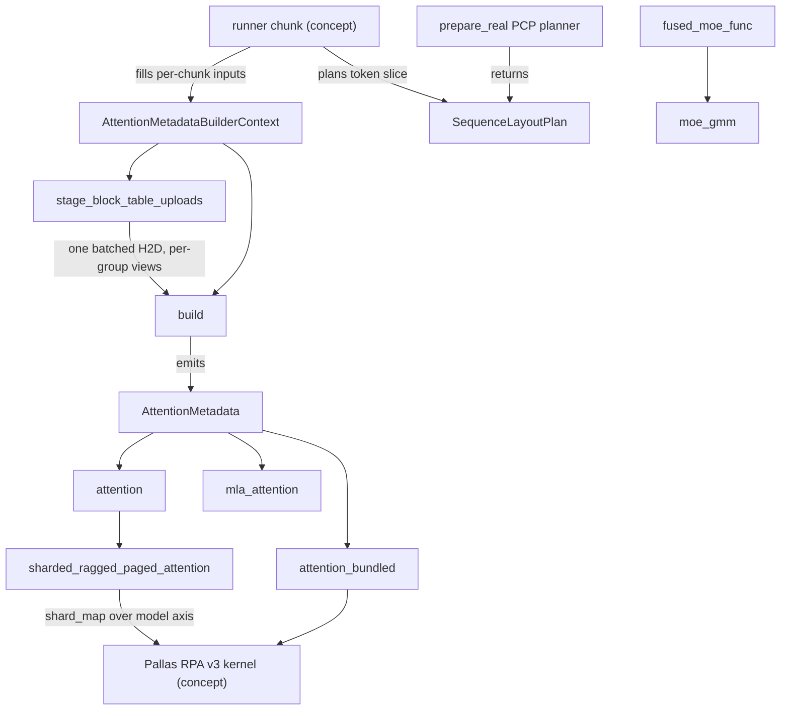

# Attention and layer core (layers/core)

<!-- connect:up:begin -->
> **Cross-repo concept:** part of [expert-parallelism](../../../concepts/expert-parallelism.md), [kv-cache](../../../concepts/kv-cache.md), [pallas-kernel](../../../concepts/pallas-kernel.md), [sharding](../../../concepts/sharding.md), [sparsecore](../../../concepts/sparsecore.md) across this wiki's repos.
<!-- connect:up:end -->
## Overview
`src/vllm_torchtpu/layers/core` is the shared "core" that sits under the torch-facing adapters (a torch-side metadata builder and quantization helpers plus JAX `shard_map` kernel wrappers): it owns the one metadata object every attention-like layer consumes ([`AttentionMetadata`](../catalog/src/vllm_torchtpu/layers/core/attention_metadata.md#AttentionMetadata "src/vllm_torchtpu/layers/core/attention_metadata.py:L80")), the builder that fills it once per runner chunk, and thin `shard_map` wrappers that place each Pallas kernel (ragged paged attention, MLA, GDN, grouped-GEMM MoE) on the device mesh. The key design idea is that *one small, fixed-shape pytree* - flattened block tables, per-request `seq_lens`, `query_start_loc`, and a 3-entry `request_distribution` - is enough for every kernel to find its pages and decide decode vs mixed work, so the whole forward can be AOT-compiled per padding bucket while the batch composition changes every step. Around that sit two supporting planes: sequence layout planners (which decide whether every device holds the whole token chunk or only a prefill-context-parallel slice) and quantization helpers (block-scaled FP8/INT and the TurboQuant compressed KV cache).

## Diagram

Legend:
- `RUN` - (concept) the model runner's per-chunk input preparation; it stashes [`_attn_metadata_builder_ctx`](../catalog/src/vllm_torchtpu/runner/tpu_runner.md#TPUModelRunner._attn_metadata_builder_ctx "src/vllm_torchtpu/runner/tpu_runner.py:L3463")
- `CTX` - [`AttentionMetadataBuilderContext`](../catalog/src/vllm_torchtpu/layers/core/attention_metadata.md#AttentionMetadataBuilderContext "src/vllm_torchtpu/layers/core/attention_metadata.py:L131")
- `PLAN` - [`SequenceLayoutPlan`](../catalog/src/vllm_torchtpu/layers/core/sequence_layout.md#SequenceLayoutPlan "src/vllm_torchtpu/layers/core/sequence_layout.py:L60")
- `PCPPR` - [`prepare_real`](../catalog/src/vllm_torchtpu/layers/core/pcp_sequence_layout.md#PcpSequenceLayoutPlanner.prepare_real "src/vllm_torchtpu/layers/core/pcp_sequence_layout.py:L382")
- `STAGE` - [`stage_block_table_uploads`](../catalog/src/vllm_torchtpu/layers/core/attention_metadata.md#stage_block_table_uploads "src/vllm_torchtpu/layers/core/attention_metadata.py:L562")
- `BUILD` - [`build`](../catalog/src/vllm_torchtpu/layers/core/attention_metadata.md#AttentionMetadataBuilder.build "src/vllm_torchtpu/layers/core/attention_metadata.py:L441")
- `MD` - [`AttentionMetadata`](../catalog/src/vllm_torchtpu/layers/core/attention_metadata.md#AttentionMetadata "src/vllm_torchtpu/layers/core/attention_metadata.py:L80")
- `ATT` - [`attention`](../catalog/src/vllm_torchtpu/layers/core/attention_interface.md#attention "src/vllm_torchtpu/layers/core/attention_interface.py:L607")
- `BUN` - [`attention_bundled`](../catalog/src/vllm_torchtpu/layers/core/attention_interface.md#attention_bundled "src/vllm_torchtpu/layers/core/attention_interface.py:L479")
- `MLA` - [`mla_attention`](../catalog/src/vllm_torchtpu/layers/core/attention_interface.md#mla_attention "src/vllm_torchtpu/layers/core/attention_interface.py:L678")
- `SRPA` - [`sharded_ragged_paged_attention`](../catalog/src/vllm_torchtpu/layers/core/attention_interface.md#sharded_ragged_paged_attention "src/vllm_torchtpu/layers/core/attention_interface.py:L353")
- `KER` - (concept) the ragged paged attention v3 Pallas kernel under `kernels/ragged_paged_attention/v3`
- `MOE` - [`fused_moe_func`](../catalog/src/vllm_torchtpu/layers/core/fused_moe_gmm.md#fused_moe_func "src/vllm_torchtpu/layers/core/fused_moe_gmm.py:L673")
- `GMM` - [`moe_gmm`](../catalog/src/vllm_torchtpu/layers/core/fused_moe_gmm.md#moe_gmm "src/vllm_torchtpu/layers/core/fused_moe_gmm.py:L492")

## Design rationale (why it's built this way)
- **Fixed-shape metadata, ragged content.** Every tensor field of [`AttentionMetadata`](../catalog/src/vllm_torchtpu/layers/core/attention_metadata.md#AttentionMetadata "src/vllm_torchtpu/layers/core/attention_metadata.py:L80") is sized by the compile bucket, not the live batch (`block_tables` is `(max_num_seqs * max_num_blocks_per_req,)`, `seq_lens` is `(max_num_seqs,)`, `query_start_loc` is `(max_num_seqs + 1,)`). Real request counts travel as *data* inside [`request_distribution`](../catalog/src/vllm_torchtpu/layers/core/attention_metadata.md#AttentionMetadata.request_distribution "src/vllm_torchtpu/layers/core/attention_metadata.py:L90"), so a step with 3 decodes and a step with 200 decodes hit the same compiled program.
- **Registered as a JAX dataclass with static layout fields.** The class is a `jax.tree_util.register_dataclass` with the tensors as `data_fields`, the sequence-layout kind/protocol/version as `meta_fields` (so a PCP-streaming batch compiles a different program than an all-tokens batch) and the CPU mirrors `query_start_loc_cpu` / `seq_lens_cpu` as `drop_fields` (host-only, never traced).
- **One builder for every KV-cache group.** The source calls the builder a "Single shared metadata builder for every TPU attention group"; attention groups and Mamba/GDN groups share the same code path and diverge only in Mamba-specific handling (a PCP-scaled target block size, checkpoint-widened block-table rows under speculative decoding, and the Mamba state/offset/distribution fields they emit). That keeps hybrid models (attention + linear attention) from paying for two metadata systems.
- **H2D transfers are the decode-step bottleneck, so they are batched.** [`stage_block_table_uploads`](../catalog/src/vllm_torchtpu/layers/core/attention_metadata.md#stage_block_table_uploads "src/vllm_torchtpu/layers/core/attention_metadata.py:L562") is documented as "One batched H2D transfer for every block table a walk will build" - it replaces one small upload per group per build with a single packed upload plus one compiled split program, and block tables are flattened on CPU "to avoid device-side as_strided/reshape materialization on every decode step".
- **Kernels shard along KV heads.** [`sharded_ragged_paged_attention`](../catalog/src/vllm_torchtpu/layers/core/attention_interface.md#sharded_ragged_paged_attention "src/vllm_torchtpu/layers/core/attention_interface.py:L353") ("Shards along KV heads.") puts Q/K/V and the KV cache on the `model` mesh axis and replicates all metadata; tensor parallelism therefore needs no collective inside attention.
- **Sequence layout is a pluggable planner, not a runner fork.** The all-tokens planner is the default; the PCP planner is only chosen when `prefill_context_parallel_size > 1` and falls back to the default planner for chunks that do not qualify.

> [!inferred]
> The `use_max_model_len` / "most model len" split (a narrower block-table width for the common case and the full width only when a request is long) exists to keep the per-step block-table upload and the attention kernel's page-index scan proportional to typical, not worst-case, context length.

## Entry points
- [`AttentionMetadata`](../catalog/src/vllm_torchtpu/layers/core/attention_metadata.md#AttentionMetadata "src/vllm_torchtpu/layers/core/attention_metadata.py:L80") - the pytree every attention-like custom op receives. Its tensor fields ([`block_tables`](../catalog/src/vllm_torchtpu/layers/core/attention_metadata.md#AttentionMetadata.block_tables "src/vllm_torchtpu/layers/core/attention_metadata.py:L84"), [`seq_lens`](../catalog/src/vllm_torchtpu/layers/core/attention_metadata.md#AttentionMetadata.seq_lens "src/vllm_torchtpu/layers/core/attention_metadata.py:L86"), [`query_start_loc`](../catalog/src/vllm_torchtpu/layers/core/attention_metadata.md#AttentionMetadata.query_start_loc "src/vllm_torchtpu/layers/core/attention_metadata.py:L88"), [`request_distribution`](../catalog/src/vllm_torchtpu/layers/core/attention_metadata.md#AttentionMetadata.request_distribution "src/vllm_torchtpu/layers/core/attention_metadata.py:L90")) are the most-referenced symbols in the subsystem; external constructors include the export path [`make_attention_metadata`](../catalog/src/vllm_torchtpu/experimental/export/universal_adapter.md#make_attention_metadata "src/vllm_torchtpu/experimental/export/universal_adapter.py:L61") and the DFlash drafter's warmup path ([`_dummy_kv_update_inputs`](../catalog/src/vllm_torchtpu/spec_decode/dflash.md#DFlashProposer._dummy_kv_update_inputs "src/vllm_torchtpu/spec_decode/dflash.py:L748")); the drafters' real path instead swaps in its own builder context and runs the builder walk ([`_build_attn_metadata_for_draft`](../catalog/src/vllm_torchtpu/spec_decode/dflash.md#DFlashProposer._build_attn_metadata_for_draft "src/vllm_torchtpu/spec_decode/dflash.py:L331")).
- [`AttentionMetadataBuilderContext`](../catalog/src/vllm_torchtpu/layers/core/attention_metadata.md#AttentionMetadataBuilderContext "src/vllm_torchtpu/layers/core/attention_metadata.py:L131") - "Per-call inputs the TPU metadata builder reads from the runner." The runner constructs one per chunk (and per draft walk) and stores it as [`_attn_metadata_builder_ctx`](../catalog/src/vllm_torchtpu/runner/tpu_runner.md#TPUModelRunner._attn_metadata_builder_ctx "src/vllm_torchtpu/runner/tpu_runner.py:L3463") before vLLM's generic metadata walk calls each group's builder.
- [`build`](../catalog/src/vllm_torchtpu/layers/core/attention_metadata.md#AttentionMetadataBuilder.build "src/vllm_torchtpu/layers/core/attention_metadata.py:L441") - the vLLM `AttentionMetadataBuilder.build` override; reached once per KV-cache group per walk, including warmup via [`_dummy_run`](../catalog/src/vllm_torchtpu/runner/tpu_runner.md#TPUModelRunner._dummy_run "src/vllm_torchtpu/runner/tpu_runner.py:L5822").
- [`attention`](../catalog/src/vllm_torchtpu/layers/core/attention_interface.md#attention "src/vllm_torchtpu/layers/core/attention_interface.py:L607"), [`attention_bundled`](../catalog/src/vllm_torchtpu/layers/core/attention_interface.md#attention_bundled "src/vllm_torchtpu/layers/core/attention_interface.py:L479"), [`mla_attention`](../catalog/src/vllm_torchtpu/layers/core/attention_interface.md#mla_attention "src/vllm_torchtpu/layers/core/attention_interface.py:L678") - the JAX attention interfaces called from the torch adapter's backend implementation ([`forward`](../catalog/src/vllm_torchtpu/layers/adapter/attention.md#PallasAttentionBackendImpl.forward "src/vllm_torchtpu/layers/adapter/attention.py:L1423") through [`_pallas_rpa_kernel_impl`](../catalog/src/vllm_torchtpu/layers/adapter/attention.md#_pallas_rpa_kernel_impl "src/vllm_torchtpu/layers/adapter/attention.py:L223")).
- [`fused_moe_func`](../catalog/src/vllm_torchtpu/layers/core/fused_moe_gmm.md#fused_moe_func "src/vllm_torchtpu/layers/core/fused_moe_gmm.py:L673") - "Run MoE with precomputed expert ids and weights."; the JAX body behind the torch fused-MoE bridge and the TP-decode MoE path.
- [`quantize_tensor`](../catalog/src/vllm_torchtpu/layers/core/quantization.md#quantize_tensor "src/vllm_torchtpu/layers/core/quantization.py:L245") - "Quantize a tensor with block scaling."; used by the pipelined MoE all-gather and the sparse-attention indexer ([`forward_oot`](../catalog/src/vllm_torchtpu/layers/adapter/custom_ops/mla_attention_op.md#VllmTPUSparseAttnIndexer.forward_oot "src/vllm_torchtpu/layers/adapter/custom_ops/mla_attention_op.py:L697")).

## Mechanism (step-by-step)
1. **Plan the token layout.** For a real chunk the runner asks the sequence-layout planner for a [`SequenceLayoutPlan`](../catalog/src/vllm_torchtpu/layers/core/sequence_layout.md#SequenceLayoutPlan "src/vllm_torchtpu/layers/core/sequence_layout.py:L60"). The default [`prepare_real`](../catalog/src/vllm_torchtpu/layers/core/sequence_layout.md#AllSequenceLayoutPlanner.prepare_real "src/vllm_torchtpu/layers/core/sequence_layout.py:L329") rounds the scheduled token count up to the first compile bucket (raised further to the data-parallel step's bucket so all DP ranks run the same shape) and returns a plan whose `token_slice` covers every token. Warmup uses [`prepare_dummy`](../catalog/src/vllm_torchtpu/layers/core/sequence_layout.md#AllSequenceLayoutPlanner.prepare_dummy "src/vllm_torchtpu/layers/core/sequence_layout.py:L378"), which uses the requested bucket verbatim. The plan's descriptor kind ([`SequenceLayoutKind`](../catalog/src/vllm_torchtpu/layers/core/sequence_layout.md#SequenceLayoutKind "src/vllm_torchtpu/layers/core/sequence_layout.py:L26") `ALL` or `PARTIAL`) later lands in the metadata's static fields.
2. **(PCP only) decide and repack.** With prefill context parallelism enabled, [`prepare_real`](../catalog/src/vllm_torchtpu/layers/core/pcp_sequence_layout.md#PcpSequenceLayoutPlanner.prepare_real "src/vllm_torchtpu/layers/core/pcp_sequence_layout.py:L382") first runs [`evaluate_runner_chunk`](../catalog/src/vllm_torchtpu/layers/core/pcp_sequence_layout.md#PcpSequenceLayoutEligibility.evaluate_runner_chunk "src/vllm_torchtpu/layers/core/pcp_sequence_layout.py:L149"): chunks with no scheduled tokens get `DISABLED` (and fall back to the all-tokens planner), chunks that cross the prompt/decode boundary raise, and the rest go to [`_evaluate_streaming_query`](../catalog/src/vllm_torchtpu/layers/core/pcp_sequence_layout.md#PcpSequenceLayoutEligibility._evaluate_streaming_query "src/vllm_torchtpu/layers/core/pcp_sequence_layout.py:L266"), which treats the chunk as one flat request-major token stream, computes each rank's token count under the interleave size, and pads the *largest* local count to a compile bucket (global padded = local padded x pcp size). [`prepare_pcp_sequence_layout`](../catalog/src/vllm_torchtpu/layers/core/pcp_sequence_layout.md#prepare_pcp_sequence_layout "src/vllm_torchtpu/layers/core/pcp_sequence_layout.py:L638") ("Prepare native PCP streaming host state for a real request.") then rewrites the host input-id/position buffers into rank-major order in place, records both permutation directions, and builds per-request logits indices plus an owner mask so only the rank holding a request's last token produces its logits. The plan is tagged [`PCP_STREAMING_SEQUENCE_LAYOUT_DESCRIPTOR`](../catalog/src/vllm_torchtpu/layers/core/pcp_sequence_layout.md#PCP_STREAMING_SEQUENCE_LAYOUT_DESCRIPTOR "src/vllm_torchtpu/layers/core/pcp_sequence_layout.py:L53") and sets `requires_hidden_state_gather`. Code that needs to move request-major gather indices into the rank-local frame uses [`localize_token_tensor_and_gather_indices`](../catalog/src/vllm_torchtpu/layers/core/sequence_layout.md#SequenceLayoutPlan.localize_token_tensor_and_gather_indices "src/vllm_torchtpu/layers/core/sequence_layout.py:L117"), which is the identity for `ALL` layouts.
3. **Stage the per-chunk context.** The runner fills an [`AttentionMetadataBuilderContext`](../catalog/src/vllm_torchtpu/layers/core/attention_metadata.md#AttentionMetadataBuilderContext "src/vllm_torchtpu/layers/core/attention_metadata.py:L131") with device copies of `seq_lens`, `query_start_loc` and `request_distribution`, the chunk's `start_index` / `num_reqs`, the [`use_max_model_len`](../catalog/src/vllm_torchtpu/layers/core/attention_metadata.md#AttentionMetadataBuilderContext.use_max_model_len "src/vllm_torchtpu/layers/core/attention_metadata.py:L144") flag (true when no "most model len" is configured or any request schedules more tokens than it in this chunk), optional Mamba slot data, and the sequence-layout descriptor. The context also carries per-chunk caches (`mamba_row_plans`, `staged_block_tables`, `staged_mamba_products`) whose validity depends on being rebuilt every chunk.
4. **Batch the block-table upload.** [`stage_block_table_uploads`](../catalog/src/vllm_torchtpu/layers/core/attention_metadata.md#stage_block_table_uploads "src/vllm_torchtpu/layers/core/attention_metadata.py:L562") walks the attention groups in build order, asks each builder for its [`_block_table_geometry`](../catalog/src/vllm_torchtpu/layers/core/attention_metadata.md#AttentionMetadataBuilder._block_table_geometry "src/vllm_torchtpu/layers/core/attention_metadata.py:L398") (the table object and target width: full `max_num_blocks_per_req` under `use_max_model_len`, otherwise the width implied by the most-model-len, widened by `window - 1` checkpoint blocks for Mamba groups under speculative decoding), packs every group's rows into one recycled pinned CPU buffer, and issues a single non-blocking host-to-device copy. A single compiled TPU program then splits it into per-group tables and, for the unified KV pool, gathers each Mamba group's state/checkpoint block ids. A one-group, no-Mamba walk skips the split program entirely. Dummy runs upload the same layout zero-filled so warmup dispatches exactly the program sequence serving will.
5. **Build per group.** [`build`](../catalog/src/vllm_torchtpu/layers/core/attention_metadata.md#AttentionMetadataBuilder.build "src/vllm_torchtpu/layers/core/attention_metadata.py:L441") picks its block table from the staged views (or, standalone, from a zeroed table for dummy positions or a per-call recycled buffer), then resolves Mamba state: the compact-Mamba path uses the runner's slot ids, the unified-pool path takes the staged products or derives them on device with [`_mamba_row_plan`](../catalog/src/vllm_torchtpu/layers/core/attention_metadata.md#AttentionMetadataBuilder._mamba_row_plan "src/vllm_torchtpu/layers/core/attention_metadata.py:L353") ("Row offsets into a mamba block table, cached and shared across groups.") plus one gather per group. It returns an [`AttentionMetadata`](../catalog/src/vllm_torchtpu/layers/core/attention_metadata.md#AttentionMetadata "src/vllm_torchtpu/layers/core/attention_metadata.py:L80") that shares the same `seq_lens` / `query_start_loc` / `request_distribution` device tensors across all groups.
6. **Dispatch dense / GQA attention.** [`attention`](../catalog/src/vllm_torchtpu/layers/core/attention_interface.md#attention "src/vllm_torchtpu/layers/core/attention_interface.py:L607") defaults `sm_scale` to `head_dim_original ** -0.5` (the pre-padding head dim) and calls [`sharded_ragged_paged_attention`](../catalog/src/vllm_torchtpu/layers/core/attention_interface.md#sharded_ragged_paged_attention "src/vllm_torchtpu/layers/core/attention_interface.py:L353"). That wrapper picks the head-dim-64 kernel when `q.shape[-1] == 64` (the only variant with attention-sink support), otherwise the caller-supplied `rpa_func` (default or batched RPA, optionally with a `SEQ_ALONG_LANE` KV layout that moves the sharded axis), and runs it under `shard_map` over the `model` axis - or directly on the local device when `shard=False`. On the unsharded speculative-draft path a `kv_block_cap` clamps the decode/mixed (and prefill when chunked) KV block sizes for VMEM relief. The kernel returns both the output and the in-place-updated KV cache.
7. **Dispatch the bundled cache variant.** [`attention_bundled`](../catalog/src/vllm_torchtpu/layers/core/attention_interface.md#attention_bundled "src/vllm_torchtpu/layers/core/attention_interface.py:L479") "Dispatches ragged paged attention over the bundled block-major KV cache across the TPU mesh": the whole model's KV cache is one `[num_pages, num_layers, page_size, num_kv_heads, p, head_dim]` array, a dynamic scalar `layer_idx` selects the layer, and only the KV-head dim is sharded.
8. **Dispatch MLA.** [`mla_attention`](../catalog/src/vllm_torchtpu/layers/core/attention_interface.md#mla_attention "src/vllm_torchtpu/layers/core/attention_interface.py:L678") ("Main shared interface for Multi-Head Latent Attention (MLA).") shards queries by head but keeps the latent KV cache replicated. Inside [`_mla_ragged_paged_attention`](../catalog/src/vllm_torchtpu/layers/core/attention_interface.md#mla_attention._mla_ragged_paged_attention "src/vllm_torchtpu/layers/core/attention_interface.py:L746") it looks up tuned block parameters for the batched-decode and mixed cases (overridable via `MIXED_NUM_KV_PAGES_PER_BLOCK`, `MIXED_NUM_QUERIES_PER_BLOCK`, `MIXED_Q_SPLIT`), transposes Q to head-major for the kernel and back, and optionally returns per-(token, head) log-sum-exp so DCP partial outputs can be merged. The sparse (DSA) MLA variant's DCP path runs a per-shard [`_local`](../catalog/src/vllm_torchtpu/layers/core/attention_interface.md#sparse_mla_attention_dcp._local "src/vllm_torchtpu/layers/core/attention_interface.py:L1169") body.
9. **Dispatch GDN under PCP.** For Gated DeltaNet prefill with PCP, [`run_jax_gdn_attention_pcp_tp_prefill`](../catalog/src/vllm_torchtpu/layers/core/gdn_attention.md#run_jax_gdn_attention_pcp_tp_prefill "src/vllm_torchtpu/layers/core/gdn_attention.py:L531") ("GDN PCP prefill using an op-local PCP mesh.") turns token parallelism into head parallelism inside the op: [`_pcp_prefill_fn`](../catalog/src/vllm_torchtpu/layers/core/gdn_attention.md#run_jax_gdn_attention_pcp_tp_prefill._pcp_prefill_fn "src/vllm_torchtpu/layers/core/gdn_attention.py:L603") reorders the packed QKV with [`_reorder_gdn_qkv_for_pcp`](../catalog/src/vllm_torchtpu/layers/core/gdn_attention.md#_reorder_gdn_qkv_for_pcp "src/vllm_torchtpu/layers/core/gdn_attention.py:L244") (Q/K shards repeat when there are fewer KQ heads than ranks, V stays unique), reconstructs the rank-major token order from replicated `query_start_loc`, and runs a ragged all-to-all so each rank ends up with all tokens for its head shard. The unified-pool variant runs the same reorder-and-exchange over the pooled state in [`_pooled_pcp_prefill_fn`](../catalog/src/vllm_torchtpu/layers/core/gdn_attention.md#run_jax_gdn_attention_pooled_pcp_prefill._pooled_pcp_prefill_fn "src/vllm_torchtpu/layers/core/gdn_attention.py:L1309"), and [`run_jax_gdn_attention_pooled_pcp_prefill_projection`](../catalog/src/vllm_torchtpu/layers/core/gdn_attention.md#run_jax_gdn_attention_pooled_pcp_prefill_projection "src/vllm_torchtpu/layers/core/gdn_attention.py:L1041") additionally fuses the QKVZ projection into the same op.
10. **Dispatch MoE.** [`fused_moe_func`](../catalog/src/vllm_torchtpu/layers/core/fused_moe_gmm.md#fused_moe_func "src/vllm_torchtpu/layers/core/fused_moe_gmm.py:L673") remaps global expert ids to local ones under EP (with `experts_start` passed as *traced data* so all EP ranks compile an identical program), optionally short-circuits small decode batches to an experimental dense-expert kernel, then builds the routing layout with [`prepare_routed_gmm_inputs`](../catalog/src/vllm_torchtpu/layers/core/fused_moe_gmm.md#prepare_routed_gmm_inputs "src/vllm_torchtpu/layers/core/fused_moe_gmm.py:L332") - a counting sort over `local_num_experts + 1` keys, a packed single sort, or the original three-sort form depending on row count and env flags - and runs [`moe_gmm`](../catalog/src/vllm_torchtpu/layers/core/fused_moe_gmm.md#moe_gmm "src/vllm_torchtpu/layers/core/fused_moe_gmm.py:L492"): grouped GEMM 1 with the activation fused, grouped GEMM 2, then a combine: under EP with SparseCore, a TensorCore one-hot matmul (small row counts) or a SparseCore ragged gather-reduce; without EP, a local SparseCore ragged gather-reduce when its shape and VMEM conditions hold; in every other case (including EP without SparseCore) a plain gather plus weighted sum.

## Key data structures
- [`AttentionMetadata`](../catalog/src/vllm_torchtpu/layers/core/attention_metadata.md#AttentionMetadata "src/vllm_torchtpu/layers/core/attention_metadata.py:L80") - `input_positions`; [`block_tables`](../catalog/src/vllm_torchtpu/layers/core/attention_metadata.md#AttentionMetadata.block_tables "src/vllm_torchtpu/layers/core/attention_metadata.py:L84") as a *flat* `num_reqs x width` int32 vector (kernels reshape by `pages_per_seq = len // max_num_seqs`); [`seq_lens`](../catalog/src/vllm_torchtpu/layers/core/attention_metadata.md#AttentionMetadata.seq_lens "src/vllm_torchtpu/layers/core/attention_metadata.py:L86") = total KV length per request including this step's tokens; [`query_start_loc`](../catalog/src/vllm_torchtpu/layers/core/attention_metadata.md#AttentionMetadata.query_start_loc "src/vllm_torchtpu/layers/core/attention_metadata.py:L88") = cumulative query offsets; [`request_distribution`](../catalog/src/vllm_torchtpu/layers/core/attention_metadata.md#AttentionMetadata.request_distribution "src/vllm_torchtpu/layers/core/attention_metadata.py:L90") = `[decode_end, static-verify end, mixed_end]`, the three segment boundaries the RPA v3 kernel uses to run its decode / prefill / mixed sub-kernels over a batch the runner has ordered decode-first. Mamba fields (`mamba_state_indices`, `mamba_slot_read_offsets`, `mamba_ckpt_indices`, `mamba_request_distribution`) are `None` for pure attention groups.
- [`AttentionMetadataBuilderContext`](../catalog/src/vllm_torchtpu/layers/core/attention_metadata.md#AttentionMetadataBuilderContext "src/vllm_torchtpu/layers/core/attention_metadata.py:L131") - per-chunk inputs plus three per-chunk caches; the source warns "Do not reuse a context across chunks" because the Mamba row-plan cache key omits `seq_lens`.
- [`SequenceLayoutPlan`](../catalog/src/vllm_torchtpu/layers/core/sequence_layout.md#SequenceLayoutPlan "src/vllm_torchtpu/layers/core/sequence_layout.py:L60") - global vs local token counts (real and padded), the rank-local `token_slice`, PCP logits index/owner tensors, and both packed<->request-major permutations.
- TurboQuant page geometry - a compressed KV page is `u8[page_words, 128]` per KV head, split into `[k_plane | v_plane | meta_plane]` and padded to 8-word multiples for `T(8, 128)` tiling; [`_WORD_SIZE`](../catalog/src/vllm_torchtpu/layers/core/turboquant.md#_WORD_SIZE "src/vllm_torchtpu/layers/core/turboquant.py:L57") is 128 bytes (one byte per vector lane) and [`_plane_word_counts`](../catalog/src/vllm_torchtpu/layers/core/turboquant.md#_plane_word_counts "src/vllm_torchtpu/layers/core/turboquant.py:L209") sizes the planes (for 64-token pages the metadata is spread one byte-field per word so two pages dequantize "with zero slice/concat overhead"). [`is_key_fp8`](../catalog/src/vllm_torchtpu/layers/core/turboquant.md#TQLayout.is_key_fp8 "src/vllm_torchtpu/layers/core/turboquant.py:L116") distinguishes the `k8v4` preset (raw FP8 keys) from the Hadamard-rotated Lloyd-Max presets.

## Dynamics (design intent)
- **Warmup and serving dispatch the same programs.** The staging function issues its split program "for every staged walk (dummy runs included) so warmup and lockstep ranks dispatch the same program sequence", and dummy runs upload a zero-filled buffer of the real layout. Anything that changes the walk order or skips a program only in serving breaks this.
- **Host buffers outlive their upload.** Because TorchTPU reads the CPU source of a non-blocking copy asynchronously without holding a reference, per-walk host buffers are parked until the runner's next input-staging fence and then recycled (cap of 64 registered buffers, sized for 1 target walk + up to K+1 draft walks + a DP dummy walk across two in-flight decode steps).
- **Shared device tensors across groups.** Every group's metadata points at the same `seq_lens` / `query_start_loc` / `request_distribution` device tensors; only block tables and Mamba indices are per group.
- **PCP is all-or-nothing per chunk.** A chunk either streams (every request has query tokens, none crosses the prompt boundary, no DCP) or uses the all-tokens layout; there is no per-request mix.
- **TurboQuant is a library, not yet wired to serving.** In this tree, [`tq_ragged_paged_attention`](../catalog/src/vllm_torchtpu/layers/core/turboquant.md#tq_ragged_paged_attention "src/vllm_torchtpu/layers/core/turboquant.py:L712") and its helpers are referenced only from `tests/layers/core/test_turboquant.py`. That function quantizes new tokens on XLA ([`_quantize_kv_components`](../catalog/src/vllm_torchtpu/layers/core/turboquant.md#_quantize_kv_components "src/vllm_torchtpu/layers/core/turboquant.py:L465")), merges them into pages token-by-token with [`_update_tq_page_vreg`](../catalog/src/vllm_torchtpu/layers/core/turboquant.md#_update_tq_page_vreg "src/vllm_torchtpu/layers/core/turboquant.py:L580"), dequantizes all referenced pages with [`_dequant_tq_page_vreg`](../catalog/src/vllm_torchtpu/layers/core/turboquant.md#_dequant_tq_page_vreg "src/vllm_torchtpu/layers/core/turboquant.py:L302"), and hands a dense pool to an `rpa_fn` (the module docstring describes the intended in-kernel use inside RPA v3). Queries are pre-rotated once by the Hadamard matrix built in [`make_tables`](../catalog/src/vllm_torchtpu/layers/core/turboquant.md#make_tables "src/vllm_torchtpu/layers/core/turboquant.py:L178") because `q . k == (q H) . (k H)`.

## Edge cases
- **Mamba row width under spec decode.** If the block-table width is not widened by `window - 1`, the `in_row` mask "silently redirects checkpoints to the null block, costing rollback accuracy with no error" (comment in [`_block_table_geometry`](../catalog/src/vllm_torchtpu/layers/core/attention_metadata.md#AttentionMetadataBuilder._block_table_geometry "src/vllm_torchtpu/layers/core/attention_metadata.py:L398")).
- **Attention sinks require head_dim 64.** [`sharded_ragged_paged_attention`](../catalog/src/vllm_torchtpu/layers/core/attention_interface.md#sharded_ragged_paged_attention "src/vllm_torchtpu/layers/core/attention_interface.py:L353") raises `NotImplementedError` for sinks on any other head dim, and the batched RPA kernel has no hd64 variant.
- **Compile-bucket overflow.** If a chunk's (local) token count exceeds the largest compile bucket, the planners raise rather than recompile; PCP additionally raises when the local padded count exceeds the runner's max token buffer.
- **Quantization corner cases.** [`quantize_tensor`](../catalog/src/vllm_torchtpu/layers/core/quantization.md#quantize_tensor "src/vllm_torchtpu/layers/core/quantization.py:L245") requires the axis to divide by `block_size`, uses an explicit fp32 reciprocal multiply because "plain division can land one ULP lower and change tie-point buckets", rounds e8m0 scales *up* to a power of two (repairing `log2` imprecision), keeps all-zero blocks as exact zeros, and rounds half-to-even before integer casts.
- **EP one-hot NaN containment.** On the one-hot permute path non-finite hidden states and routing weights are zeroed first, since `0 * NaN == NaN` would otherwise poison every token in the matmul.
- **TurboQuant shape limits.** `head_dim` must be a multiple of 128 (power of two for MSE presets); page sizes are 16/32/64 for FP8 keys and 16/64 otherwise.

## Open questions
- The sparse MLA (DSA) wrapper, the flash/splash/paged-attention helpers, and the per-group H2D buffer pool live in the same modules but are not in this packet's subgraph; their call sites are covered by the [mla-attention-kernels](mla-attention-kernels.md) and [kv-cache-layout-and-hbm-budget](kv-cache-layout-and-hbm-budget.md) pages.
- Whether the TurboQuant VREG helpers are already called from inside the RPA v3 Pallas kernel in another branch is not visible here; in this tree only tests exercise them.
- The middle `request_distribution` segment is described by the runner as a "static-q verify" range and by the kernel as a prefill range; how the two interpretations reconcile for non-spec-decode runs (where it is empty) is implicit.

## See also
- [tpu-model-runner](tpu-model-runner.md) - builds the context and drives the metadata walk.
- [vllm-layer-adapters](vllm-layer-adapters.md) - the torch-facing layers that call into this core.
- [custom-ops](custom-ops.md) - the torch custom-op boundary these JAX functions run behind.
- [ragged-paged-attention-kernel](ragged-paged-attention-kernel.md), [batched-ragged-paged-attention-kernel](batched-ragged-paged-attention-kernel.md), [pcp-streaming-rpa-kernel](pcp-streaming-rpa-kernel.md), [mla-attention-kernels](mla-attention-kernels.md)
- [fused-moe-kernels](fused-moe-kernels.md), [sparsecore-ragged-gather-scatter](sparsecore-ragged-gather-scatter.md), [gated-deltanet-kernels](gated-deltanet-kernels.md), [gdn-pcp-fused-kernel](gdn-pcp-fused-kernel.md)
- [kv-cache-layout-and-hbm-budget](kv-cache-layout-and-hbm-budget.md), [quantization-methods](quantization-methods.md), [distributed-parallelism-and-meshes](distributed-parallelism-and-meshes.md), [speculative-decoding](speculative-decoding.md)
