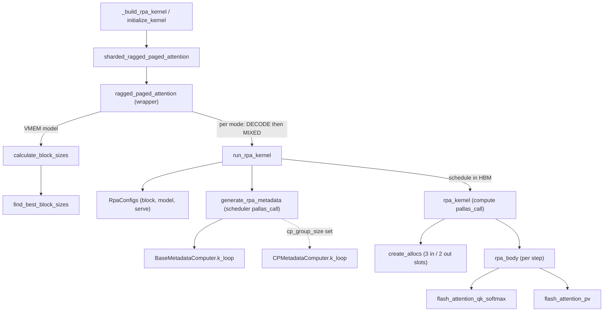
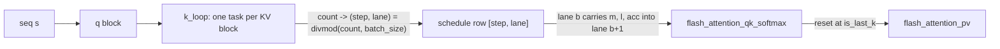

# Batched ragged paged attention (batched RPA) kernel

<!-- connect:up:begin -->
> **Cross-repo concept:** part of [continuous-batching](../../../concepts/continuous-batching.md), [flash-attention](../../../concepts/flash-attention.md), [kv-cache](../../../concepts/kv-cache.md), [pallas-kernel](../../../concepts/pallas-kernel.md), [vmem-budget](../../../concepts/vmem-budget.md) across this wiki's repos.
<!-- connect:up:end -->
## Overview

`kernels/experimental/batched_rpa` is a second-generation ragged paged attention (RPA) kernel for
vLLM's paged KV cache, opted into with `--attention-backend CUSTOM` (the package `__init__` marks it
"experimental and not fully tested"). Its key idea is to **split attention into two Pallas calls**:
a tiny scalar *scheduler* kernel ([`generate_rpa_metadata`](../catalog/src/vllm_torchtpu/kernels/experimental/batched_rpa/schedule.md#generate_rpa_metadata "src/vllm_torchtpu/kernels/experimental/batched_rpa/schedule.py:L952"))
walks every sequence's ragged (query-block, KV-block) pairs once and writes a flat table of DMA
descriptors to HBM, and the *compute* kernel ([`rpa_kernel`](../catalog/src/vllm_torchtpu/kernels/experimental/batched_rpa/kernel.md#rpa_kernel "src/vllm_torchtpu/kernels/experimental/batched_rpa/kernel.py:L821"))
replays that table through a hand-rolled triple-buffered pipeline, processing `batch_size`
consecutive tiles per step so the MXU sees batched matmuls even when individual sequences are
decode-sized. Everything shape-related (block sizes, VMEM buffers, schedule capacity, KV layout) is
derived from one frozen config object, [`RpaConfigs`](../catalog/src/vllm_torchtpu/kernels/experimental/batched_rpa/configs.md#RpaConfigs "src/vllm_torchtpu/kernels/experimental/batched_rpa/configs.py:L221").
The public entry is the jitted wrapper [`ragged_paged_attention`](../catalog/src/vllm_torchtpu/kernels/experimental/batched_rpa/wrapper.md#ragged_paged_attention "src/vllm_torchtpu/kernels/experimental/batched_rpa/wrapper.py:L518"),
which runs the pair (scheduler, compute) twice: once for decode sequences and once for everything else.

## Diagram

Legend:
- `ADP` - [`_build_rpa_kernel`](../catalog/src/vllm_torchtpu/layers/adapter/attention.md#PallasAttentionBackendImpl._build_rpa_kernel "src/vllm_torchtpu/layers/adapter/attention.py:L930") / [`initialize_kernel`](../catalog/src/vllm_torchtpu/layers/adapter/attention.md#PallasAttentionBackendImpl.initialize_kernel "src/vllm_torchtpu/layers/adapter/attention.py:L1329")
- `SHARD` - [`sharded_ragged_paged_attention`](../catalog/src/vllm_torchtpu/layers/core/attention_interface.md#sharded_ragged_paged_attention "src/vllm_torchtpu/layers/core/attention_interface.py:L353")
- `WRAP` - [`ragged_paged_attention`](../catalog/src/vllm_torchtpu/kernels/experimental/batched_rpa/wrapper.md#ragged_paged_attention "src/vllm_torchtpu/kernels/experimental/batched_rpa/wrapper.py:L518")
- `CBS` - [`calculate_block_sizes`](../catalog/src/vllm_torchtpu/kernels/experimental/batched_rpa/wrapper.md#calculate_block_sizes "src/vllm_torchtpu/kernels/experimental/batched_rpa/wrapper.py:L226")
- `FBB` - [`find_best_block_sizes`](../catalog/src/vllm_torchtpu/kernels/experimental/batched_rpa/wrapper.md#calculate_block_sizes.find_best_block_sizes "src/vllm_torchtpu/kernels/experimental/batched_rpa/wrapper.py:L372")
- `RUN` - [`run_rpa_kernel`](../catalog/src/vllm_torchtpu/kernels/experimental/batched_rpa/wrapper.md#ragged_paged_attention.run_rpa_kernel "src/vllm_torchtpu/kernels/experimental/batched_rpa/wrapper.py:L767")
- `CFG` - [`RpaConfigs`](../catalog/src/vllm_torchtpu/kernels/experimental/batched_rpa/configs.md#RpaConfigs "src/vllm_torchtpu/kernels/experimental/batched_rpa/configs.py:L221")
- `GEN` - [`generate_rpa_metadata`](../catalog/src/vllm_torchtpu/kernels/experimental/batched_rpa/schedule.md#generate_rpa_metadata "src/vllm_torchtpu/kernels/experimental/batched_rpa/schedule.py:L952")
- `KL` - [`k_loop`](../catalog/src/vllm_torchtpu/kernels/experimental/batched_rpa/schedule.md#BaseMetadataComputer.k_loop "src/vllm_torchtpu/kernels/experimental/batched_rpa/schedule.py:L590")
- `KLCP` - [`k_loop`](../catalog/src/vllm_torchtpu/kernels/experimental/batched_rpa/schedule_cp.md#CPMetadataComputer.k_loop "src/vllm_torchtpu/kernels/experimental/batched_rpa/schedule_cp.py:L101")
- `RPA` - [`rpa_kernel`](../catalog/src/vllm_torchtpu/kernels/experimental/batched_rpa/kernel.md#rpa_kernel "src/vllm_torchtpu/kernels/experimental/batched_rpa/kernel.py:L821")
- `ALLOC` - [`create_allocs`](../catalog/src/vllm_torchtpu/kernels/experimental/batched_rpa/kernel.md#create_allocs "src/vllm_torchtpu/kernels/experimental/batched_rpa/kernel.py:L718")
- `BODY` - [`rpa_body`](../catalog/src/vllm_torchtpu/kernels/experimental/batched_rpa/kernel.md#rpa_body "src/vllm_torchtpu/kernels/experimental/batched_rpa/kernel.py:L413")
- `QK` - [`flash_attention_qk_softmax`](../catalog/src/vllm_torchtpu/kernels/experimental/batched_rpa/flash_attention.md#flash_attention_qk_softmax "src/vllm_torchtpu/kernels/experimental/batched_rpa/flash_attention.py:L23")
- `PV` - [`flash_attention_pv`](../catalog/src/vllm_torchtpu/kernels/experimental/batched_rpa/flash_attention.md#flash_attention_pv "src/vllm_torchtpu/kernels/experimental/batched_rpa/flash_attention.py:L124")

A second view: how one pipeline step's `batch_size` lanes relate to the flat task list the scheduler
writes (k innermost, so consecutive lanes usually continue the same query block).

Legend:
- `SEQ` - (concept) one request in the ragged batch
- `Q` - (concept) a `bq_sz`-token query block
- `K` - [`k_loop`](../catalog/src/vllm_torchtpu/kernels/experimental/batched_rpa/schedule.md#BaseMetadataComputer.k_loop "src/vllm_torchtpu/kernels/experimental/batched_rpa/schedule.py:L590")
- `SLOT` - [`batch_size`](../catalog/src/vllm_torchtpu/kernels/experimental/batched_rpa/configs.md#RpaConfigs.batch_size "src/vllm_torchtpu/kernels/experimental/batched_rpa/configs.py:L243")
- `QK2` - [`flash_attention_qk_softmax`](../catalog/src/vllm_torchtpu/kernels/experimental/batched_rpa/flash_attention.md#flash_attention_qk_softmax "src/vllm_torchtpu/kernels/experimental/batched_rpa/flash_attention.py:L23")
- `PV2` - [`flash_attention_pv`](../catalog/src/vllm_torchtpu/kernels/experimental/batched_rpa/flash_attention.md#flash_attention_pv "src/vllm_torchtpu/kernels/experimental/batched_rpa/flash_attention.py:L124")

## Design rationale (why it's built this way)

**Scheduling is hoisted out of the compute kernel.** A ragged batch mixes 1-token decodes with
multi-thousand-token prefills, so a static Pallas grid over sequences wastes steps. Instead the
scheduler kernel enumerates only the (query-block, KV-block) pairs that survive causal and
sliding-window trimming, and precomputes every DMA source/destination/size. The compute kernel then
drives its DMAs from those SMEM descriptors, recomputing only a few per-lane scalars (stitch
boundaries, causal mask offsets) itself. The schedule is too large for scalar prefetch, so its
`in_specs` place it in HBM and the compute kernel DMAs chunks of it into SMEM on demand ("Since we use
maximum upper bound when allocating scheduler data, it is not feasible to use scalar prefetch").

**Batching tiles, not sequences.** Each step handles `batch_size` tasks taken in order from the flat
list ([`k_loop`](../catalog/src/vllm_torchtpu/kernels/experimental/batched_rpa/schedule.md#BaseMetadataComputer.k_loop "src/vllm_torchtpu/kernels/experimental/batched_rpa/schedule.py:L590")
maps the running task counter to `(step, lane) = divmod(count, batch_size)`). The QK and PV matmuls
in [`flash_attention_qk_softmax`](../catalog/src/vllm_torchtpu/kernels/experimental/batched_rpa/flash_attention.md#flash_attention_qk_softmax "src/vllm_torchtpu/kernels/experimental/batched_rpa/flash_attention.py:L23")
fold the batch and KV-head axes into one batched `lax.dot`, while the cheap online-softmax recurrence
runs serially across lanes. A single m/l/acc scratch (no batch axis in `lm_scratch_shape`) is enough
because the k loop is innermost: lane b+1 usually continues lane b's query block. Whenever a lane is
`is_last_k`, `m` is reset to `-inf` with a select (so the next lane's `alpha` is 0); `l` and `acc` are
additionally select-reset only in decode (`fuse_accum`). Decode uses `batch_size=8`, prefill `2`
("Fixed value based on experimental results").

**Decode and MIXED are separate compiled kernels.** The wrapper runs DECODE over
`[0, distribution[0])` and MIXED over `[distribution[0], distribution[2])`; there is no
prefill-only specialization ([`RpaCase`](../catalog/src/vllm_torchtpu/kernels/experimental/batched_rpa/configs.md#RpaCase "src/vllm_torchtpu/kernels/experimental/batched_rpa/configs.py:L103")
keeps PREFILL only because "distribution still has three entries and RPA v3 / MLA use it"). The
decode kernel gets its own block sizes (`bq_sz = decode_query_size`, so speculative-decoding verify
tokens ride in the decode stage), fused accumulation, and a cheaper new-KV DMA shape.

**One aggregated semaphore wait per buffer per step.** The scheduler's
[`body`](../catalog/src/vllm_torchtpu/kernels/experimental/batched_rpa/schedule.md#_compute_waits.body "src/vllm_torchtpu/kernels/experimental/batched_rpa/schedule.py:L411")
precomputes the total bytes every step will move (in 512-byte lane rows) for KV-in, KV-out, Q-in,
O-out and LSE-out, so the pipeline issues many variable-sized DMAs per step but waits once with a
single sized descriptor rather than tracking each copy.

**Triple-buffered inputs, double-buffered outputs.** `configs.NUM_INPUT_SLOTS = 3` because "the
fetch for a tile is issued throughout the preceding tile rather than all at once ... it needs one
extra tile in flight", while outputs need only two slots since a writeback issued at step N is
awaited at step N+2. Pallas refuses output `buffer_count > 2`, so `bref_override` subclasses
`BufferedRef` to bypass the check and drive DMAs explicitly from the schedule.

**Two KV layouts.** [`KVLayout`](../catalog/src/vllm_torchtpu/kernels/experimental/batched_rpa/configs.md#KVLayout "src/vllm_torchtpu/kernels/experimental/batched_rpa/configs.py:L84")
selects [`HEAD_ALONG_SUBLANE`](../catalog/src/vllm_torchtpu/kernels/experimental/batched_rpa/configs.md#KVLayout.HEAD_ALONG_SUBLANE "src/vllm_torchtpu/kernels/experimental/batched_rpa/configs.py:L91")
("snh": token-major pages, K/V heads interleaved on sublanes, head_dim on lanes; single tokens are
addressable) or [`SEQ_ALONG_LANE`](../catalog/src/vllm_torchtpu/kernels/experimental/batched_rpa/configs.md#KVLayout.SEQ_ALONG_LANE "src/vllm_torchtpu/kernels/experimental/batched_rpa/configs.py:L92")
("nhs": tokens packed along the 128-lane axis, head_dim on sublanes). SEQ_ALONG_LANE is the layout
that supports per-token KV scales (co-located as extra head_dim channels) and packed fp4, at the
cost of 128-token DMA granularity and an in-VMEM lane "stitch" to splice new tokens next to cached
ones.

> [!inferred]
> The split scheduler/compute design trades one extra small Pallas launch per mode for a compute
> kernel whose inner loop is pure SMEM-indexed DMA + matmul; the payoff is largest when the batch is
> highly ragged (many short decodes beside a few long prefills), which is exactly the continuous
> batching case vLLM produces.

## Entry points

- [`ragged_paged_attention`](../catalog/src/vllm_torchtpu/kernels/experimental/batched_rpa/wrapper.md#ragged_paged_attention "src/vllm_torchtpu/kernels/experimental/batched_rpa/wrapper.py:L518") -
  the jitted public API (donates only `kv_cache`; "Donation of transient inputs can fail for some
  runtime buffer layouts"). Takes vLLM-shaped `queries/keys/values [T, H, D]`, the paged `kv_cache`,
  `kv_lens`, flat `page_indices`, `cu_q_lens` and the 3-entry `distribution`, and returns
  `(out, new_kv_cache[, lse])`. Reached through
  [`sharded_ragged_paged_attention`](../catalog/src/vllm_torchtpu/layers/core/attention_interface.md#sharded_ragged_paged_attention "src/vllm_torchtpu/layers/core/attention_interface.py:L353")
  ("Shards along KV heads"), which passes `kv_layout` and shards the cache on the head axis.
- [`_build_rpa_kernel`](../catalog/src/vllm_torchtpu/layers/adapter/attention.md#PallasAttentionBackendImpl._build_rpa_kernel "src/vllm_torchtpu/layers/adapter/attention.py:L930") and
  [`initialize_kernel`](../catalog/src/vllm_torchtpu/layers/adapter/attention.md#PallasAttentionBackendImpl.initialize_kernel "src/vllm_torchtpu/layers/adapter/attention.py:L1329") -
  the vLLM adapter "Pre-build[s] the RPA kernel before torch.compile traces the model", keyed on
  scales, sliding window, `skip_kv_update`, layout and `decode_query_size`; the batched subclass uses
  op prefix `pallas::rpa_kernel_batched` so it never collides with the RPA v3 op.
- [`build_dcp_kernels`](../catalog/src/vllm_torchtpu/layers/adapter/cp_attention.md#build_dcp_kernels "src/vllm_torchtpu/layers/adapter/cp_attention.py:L189") /
  [`forward_with_dcp`](../catalog/src/vllm_torchtpu/layers/adapter/cp_attention.md#forward_with_dcp "src/vllm_torchtpu/layers/adapter/cp_attention.py:L274") -
  decode context parallelism builds a CACHE_ONLY and a NEW_TOKENS_ONLY instance of this kernel
  (`return_lse=True`) and merges them ("Two-pass DCP attention forward").
- [`get_kv_cache_shape`](../catalog/src/vllm_torchtpu/kernels/experimental/batched_rpa/wrapper.md#get_kv_cache_shape "src/vllm_torchtpu/kernels/experimental/batched_rpa/wrapper.py:L175") -
  the allocator-facing contract for the cache tensor per layout (defaults to TPU7x lane/sublane
  geometry when sizing).
- [`_attention_schedule_capacity`](../catalog/src/vllm_torchtpu/runner/tpu_runner.md#TPUModelRunner._attention_schedule_capacity "src/vllm_torchtpu/runner/tpu_runner.py:L6072") -
  computes and caches "(pairs, bq, bkv) the batched attention kernel can schedule in one step" per
  mode; the runner's step check `_check_attention_schedule` compares each step against it and refuses
  a step whose schedule would overrun SMEM (which "halts the TPU core").
- The sibling PCP streaming kernel reuses this package's layout and config vocabulary, e.g.
  [`sharded_pcp_ragged_paged_attention`](../catalog/src/vllm_torchtpu/kernels/experimental/pcp_streaming_rpa/wrapper.md#sharded_pcp_ragged_paged_attention "src/vllm_torchtpu/kernels/experimental/pcp_streaming_rpa/wrapper.py:L626")
  and [`make_pcp_streaming_rpa_kernel`](../catalog/src/vllm_torchtpu/kernels/experimental/pcp_streaming_rpa/vllm_adapter.md#make_pcp_streaming_rpa_kernel "src/vllm_torchtpu/kernels/experimental/pcp_streaming_rpa/vllm_adapter.py:L188").

## Mechanism (step-by-step)

1. **Normalize inputs into the cache's physical layout.** The wrapper
   [`ragged_paged_attention`](../catalog/src/vllm_torchtpu/kernels/experimental/batched_rpa/wrapper.md#ragged_paged_attention "src/vllm_torchtpu/kernels/experimental/batched_rpa/wrapper.py:L518")
   rejects unsupported knobs (`use_causal_mask=False`, `chunk_prefill_size`, `debug_mode`), maps
   `update_kv_cache=False` to `skip_kv_update=True` (KV sharing), and calls `prepare_inputs`. Q is
   reshaped to `(H_kv, T, G/packing_q, packing_q, D_aligned)` with the GQA group padded to the dtype
   packing from [`get_dtype_packing`](../catalog/src/vllm_torchtpu/kernels/experimental/batched_rpa/utils.md#get_dtype_packing "src/vllm_torchtpu/kernels/experimental/batched_rpa/utils.py:L63")
   (`32 // bits`) and head_dim padded to 128 lanes by
   [`align_to`](../catalog/src/vllm_torchtpu/kernels/experimental/batched_rpa/utils.md#align_to "src/vllm_torchtpu/kernels/experimental/batched_rpa/utils.py:L22");
   this padded Q buffer is also the output buffer (it is aliased to output 0). New K and V are
   concatenated per KV head so K and V of a head sit side by side (`2 * H_kv` rows), optionally with
   per-token scales bitcast into extra head_dim channels, and for SEQ_ALONG_LANE transposed to
   head-major and padded to `max(128, page_size)` tokens.

2. **Pick block sizes from a VMEM model.** [`calculate_block_sizes`](../catalog/src/vllm_torchtpu/kernels/experimental/batched_rpa/wrapper.md#calculate_block_sizes "src/vllm_torchtpu/kernels/experimental/batched_rpa/wrapper.py:L226")
   models VMEM as `NUM_INPUT_SLOTS` x (Q + KV tile) + `NUM_OUTPUT_SLOTS` x O tile (+ LSE), plus live
   compute values (loaded Q, K/V, the `bq x bkv x H_q` score matrix, scales), all times
   `batch_size`, plus the shared m/l/acc scratch. [`find_best_block_sizes`](../catalog/src/vllm_torchtpu/kernels/experimental/batched_rpa/wrapper.md#calculate_block_sizes.find_best_block_sizes "src/vllm_torchtpu/kernels/experimental/batched_rpa/wrapper.py:L372")
   caps the budget at 80% ("we want to avoid OOM at all costs"), first lowers `batch_size` until the
   smallest tile fits, then grows `bkv_sz` from the MXU column size (rounded up to `page_size` for
   SEQ_ALONG_LANE) in MXU-sized strides, keeping `bq_sz == bkv_sz` for prefill so neither a whole
   query tile nor a whole KV tile is fully masked, with a temporary 4096 cap. Finally it splits `bq_sz`
   into equal `bq_c_sz` compute chunks until per-chunk MXU work drops under a generation threshold
   (1500 on v7, 800 on v8i, scaled up by the fp8/bf16 throughput ratio for 8-bit queries). Callers may
   override with explicit `decode_block_sizes` / `prefill_block_sizes`.

3. **Build one frozen config per mode and validate.** [`run_rpa_kernel`](../catalog/src/vllm_torchtpu/kernels/experimental/batched_rpa/wrapper.md#ragged_paged_attention.run_rpa_kernel "src/vllm_torchtpu/kernels/experimental/batched_rpa/wrapper.py:L767")
   assembles [`RpaConfigs`](../catalog/src/vllm_torchtpu/kernels/experimental/batched_rpa/configs.md#RpaConfigs "src/vllm_torchtpu/kernels/experimental/batched_rpa/configs.py:L221")
   from [`block`](../catalog/src/vllm_torchtpu/kernels/experimental/batched_rpa/configs.md#RpaConfigs.block "src/vllm_torchtpu/kernels/experimental/batched_rpa/configs.py:L222"),
   [`model`](../catalog/src/vllm_torchtpu/kernels/experimental/batched_rpa/configs.md#RpaConfigs.model "src/vllm_torchtpu/kernels/experimental/batched_rpa/configs.py:L223") and
   [`serve`](../catalog/src/vllm_torchtpu/kernels/experimental/batched_rpa/configs.md#RpaConfigs.serve "src/vllm_torchtpu/kernels/experimental/batched_rpa/configs.py:L224")
   and calls [`validate_inputs`](../catalog/src/vllm_torchtpu/kernels/experimental/batched_rpa/configs.md#RpaConfigs.validate_inputs "src/vllm_torchtpu/kernels/experimental/batched_rpa/configs.py:L545"),
   which checks the cache shape against the layout (SEQ_ALONG_LANE needs `page_size % 128 == 0` and
   `bkv_sz % page_size == 0`), int32 metadata, per-token scales only with SEQ_ALONG_LANE, and that
   context parallelism is never combined with `AttentionScope.FULL` or a sliding window. It then picks
   `CPMetadataComputer` when `cp_group_size` is set, else `BaseMetadataComputer`.

4. **Scheduler kernel: enumerate tiles and emit DMA descriptors.**
   [`generate_rpa_metadata`](../catalog/src/vllm_torchtpu/kernels/experimental/batched_rpa/schedule.md#generate_rpa_metadata "src/vllm_torchtpu/kernels/experimental/batched_rpa/schedule.py:L952")
   launches a scalar-prefetch `pallas_call` named `rpa_metadata_schedule`. Its seq -> q -> k loops
   trim the KV range per query block to the causal end and, with a sliding window or
   [`AttentionScope`](../catalog/src/vllm_torchtpu/kernels/experimental/batched_rpa/configs.md#AttentionScope "src/vllm_torchtpu/kernels/experimental/batched_rpa/configs.py:L71")
   `NEW_TOKENS_ONLY`, to a later start. The innermost
   [`k_loop`](../catalog/src/vllm_torchtpu/kernels/experimental/batched_rpa/schedule.md#BaseMetadataComputer.k_loop "src/vllm_torchtpu/kernels/experimental/batched_rpa/schedule.py:L590")
   writes, for the task's `(step, lane)` slot: sequence/q/k indices, `is_last_k`, the Q source and
   size, one `(page, vmem offset, size)` triple per cached page
   ([`bkv_p_cache`](../catalog/src/vllm_torchtpu/kernels/experimental/batched_rpa/configs.md#RpaConfigs.bkv_p_cache "src/vllm_torchtpu/kernels/experimental/batched_rpa/configs.py:L330")
   entries, looked up through the page table), and per-page new-KV fetch/writeback entries
   ([`bkv_p_new`](../catalog/src/vllm_torchtpu/kernels/experimental/batched_rpa/configs.md#RpaConfigs.bkv_p_new "src/vllm_torchtpu/kernels/experimental/batched_rpa/configs.py:L336")
   entries of [`dma_kv_new_size`](../catalog/src/vllm_torchtpu/kernels/experimental/batched_rpa/configs.md#RpaConfigs.dma_kv_new_size "src/vllm_torchtpu/kernels/experimental/batched_rpa/configs.py:L500")
   int32 fields each, filled by [`fill_dma_kv_new`](../catalog/src/vllm_torchtpu/kernels/experimental/batched_rpa/schedule.md#BaseMetadataComputer.fill_dma_kv_new "src/vllm_torchtpu/kernels/experimental/batched_rpa/schedule.py:L653")).
   New tokens are contiguous in HBM, so one fetch DMA covers them all, but writeback stays per page
   because the page table scatters destinations (`wb_hbm` packs `page << log2(page_size) | offset`).
   The writeback rule is "each new k block is written back by the first q block that attends to it",
   so each new token is stored exactly once. The page table itself is streamed into SMEM in
   double-buffered windows rather than prefetched whole.

5. **Schedule chunking, padding and wait precomputation.** The SMEM schedule holds
   `max_steps_ub` steps (sized from a third of SMEM by default, rounded to a multiple of 128); when
   the counter fills it, the computer flushes the chunk to HBM, and the HBM schedule is sized at
   `max_schedule_size_multiplier` (16) times that. At the end, unvisited lanes of the last step are
   blanked by [`_mask_out_steps`](../catalog/src/vllm_torchtpu/kernels/experimental/batched_rpa/schedule.md#_mask_out_steps "src/vllm_torchtpu/kernels/experimental/batched_rpa/schedule.py:L319")
   (`s_idx = -1`, all sizes 0) and [`body`](../catalog/src/vllm_torchtpu/kernels/experimental/batched_rpa/schedule.md#_compute_waits.body "src/vllm_torchtpu/kernels/experimental/batched_rpa/schedule.py:L411")
   fills per-step aggregate wait sizes using
   [`kv_bytes_per_token`](../catalog/src/vllm_torchtpu/kernels/experimental/batched_rpa/configs.md#RpaConfigs.kv_bytes_per_token "src/vllm_torchtpu/kernels/experimental/batched_rpa/configs.py:L411").
   `actual_steps` records how many steps the compute kernel must replay.

6. **Compute kernel: replay the schedule through a manual pipeline.**
   [`rpa_kernel`](../catalog/src/vllm_torchtpu/kernels/experimental/batched_rpa/kernel.md#rpa_kernel "src/vllm_torchtpu/kernels/experimental/batched_rpa/kernel.py:L821")
   is a single-invocation `pallas_call` (Q and KV cache aliased to outputs, `disable_bounds_checks=True`,
   `XLA_TPU_EVENLY_DISTRIBUTE_CRITICAL_NODES`) whose name encodes the config, e.g.
   `RPAd-snh-p128-b8-q1-k...` (mode, layout, page, batch, bq, bkv), which is what shows up in a
   profile. [`create_allocs`](../catalog/src/vllm_torchtpu/kernels/experimental/batched_rpa/kernel.md#create_allocs "src/vllm_torchtpu/kernels/experimental/batched_rpa/kernel.py:L718")
   allocates 3-slot Q and KV windows (KV window shape from
   [`kv_vmem_shape`](../catalog/src/vllm_torchtpu/kernels/experimental/batched_rpa/configs.md#RpaConfigs.kv_vmem_shape "src/vllm_torchtpu/kernels/experimental/batched_rpa/configs.py:L482"))
   and 2-slot O/LSE windows. Scratch and windows are zeroed first so stale NaNs in uninitialized VMEM
   cannot poison `l`/`acc` ("0 * NaN = NaN"). The kernel then loops over schedule chunks of
   `max_steps_ub`, DMAing each chunk into SMEM and running the triple-buffer loop: wait inputs for
   step N, wait the output written at N-2, run the body, which starts the fetch for N+2.

7. **Per-step body: stitch, write back, load, attend.** [`rpa_body`](../catalog/src/vllm_torchtpu/kernels/experimental/batched_rpa/kernel.md#rpa_body "src/vllm_torchtpu/kernels/experimental/batched_rpa/kernel.py:L413")
   first reads stitch metadata, then enters
   [`_kv_store_fence`](../catalog/src/vllm_torchtpu/kernels/experimental/batched_rpa/kernel.md#rpa_body._kv_store_fence "src/vllm_torchtpu/kernels/experimental/batched_rpa/kernel.py:L467"),
   an always-true `pl.when` that creates a basic-block boundary: for SEQ_ALONG_LANE it lane-rotates
   the freshly fetched new tokens next to the cached ones, then starts the KV writeback as early as
   possible, and the boundary guarantees stitch stores land before later loads (the window is
   annotated `no_hazard_no_deps`). Only then does it start the next fetch and read mask scalars via
   [`fetch_compute_metadata`](../catalog/src/vllm_torchtpu/kernels/experimental/batched_rpa/kernel.md#fetch_compute_metadata "src/vllm_torchtpu/kernels/experimental/batched_rpa/kernel.py:L314")
   ("Fetches the scalars consumed by the QK mask"), so mask math overlaps the in-flight writeback. K
   and V are pulled out of the interleaved window with strided loads ("to avoid the expensive
   transpose"), using a bank-conflict-adjusted row stride, and invalid V slices are zeroed when
   `mask_invalid_v` is on (default for SEQ_ALONG_LANE).

8. **Chunked online softmax with PV software-pipelined one chunk behind.** For each `bq_c_sz` chunk,
   [`flash_attention_qk_softmax`](../catalog/src/vllm_torchtpu/kernels/experimental/batched_rpa/flash_attention.md#flash_attention_qk_softmax "src/vllm_torchtpu/kernels/experimental/batched_rpa/flash_attention.py:L23")
   computes QK in fp32, applies `sm_scale`, Q/K scales and soft cap, masks per lane, and updates
   m/l serially across lanes; [`flash_attention_pv`](../catalog/src/vllm_torchtpu/kernels/experimental/batched_rpa/flash_attention.md#flash_attention_pv "src/vllm_torchtpu/kernels/experimental/batched_rpa/flash_attention.py:L124")
   for the *previous* chunk is issued after the current chunk's QK, so the two matmuls interleave.
   Per-token V scales multiply `p` before the matmul ("p will be smaller especially for decode"),
   whereas per-tensor V scale multiplies the result. In decode (`fuse_accum`), the state reset uses a
   select instead of relying on `alpha == 0` because a corrupted MTP draft can write NaN into one
   sequence's KV and would otherwise leak into every later lane. The final `acc / l` normalization
   runs unconditionally in decode and under a per-lane `cond` in MIXED ("Adding a conditional causes
   a scheduling barrier").

9. **Context-parallel variant.** [`k_loop`](../catalog/src/vllm_torchtpu/kernels/experimental/batched_rpa/schedule_cp.md#CPMetadataComputer.k_loop "src/vllm_torchtpu/kernels/experimental/batched_rpa/schedule_cp.py:L101")
   overrides only the descriptor math: pages are owned round-robin (`page_idx % cp_group_size == rank`),
   cached-page DMAs and writebacks are zeroed for non-owned pages, and its
   [`fill_dma_kv_new`](../catalog/src/vllm_torchtpu/kernels/experimental/batched_rpa/schedule_cp.md#CPMetadataComputer.fill_dma_kv_new "src/vllm_torchtpu/kernels/experimental/batched_rpa/schedule_cp.py:L184")
   carries separate fetch and writeback sizes (5 fields instead of 4 for HEAD_ALONG_SUBLANE) so the
   generic copy-out path needs no CP logic. With `return_lse=True` the two scope-restricted passes
   can be merged by log-sum-exp outside the kernel.

10. **Unpack the output.** After both mode calls the wrapper
    [`ragged_paged_attention`](../catalog/src/vllm_torchtpu/kernels/experimental/batched_rpa/wrapper.md#ragged_paged_attention "src/vllm_torchtpu/kernels/experimental/batched_rpa/wrapper.py:L518") reshapes the aliased Q/O buffer back to
    `[T, H_q, D]`, slicing off GQA and head_dim padding, and optionally extracts LSE from lane 0 of
    the LSE buffer. The KV cache tensor is returned updated in place (donated).

## Key data structures

- [`RpaConfigs`](../catalog/src/vllm_torchtpu/kernels/experimental/batched_rpa/configs.md#RpaConfigs "src/vllm_torchtpu/kernels/experimental/batched_rpa/configs.py:L221") -
  frozen, hashable bundle of `BlockSizes` ([`bkv_sz`](../catalog/src/vllm_torchtpu/kernels/experimental/batched_rpa/configs.md#RpaConfigs.bkv_sz "src/vllm_torchtpu/kernels/experimental/batched_rpa/configs.py:L239"),
  `bq_sz`, `bq_c_sz`, [`batch_size`](../catalog/src/vllm_torchtpu/kernels/experimental/batched_rpa/configs.md#RpaConfigs.batch_size "src/vllm_torchtpu/kernels/experimental/batched_rpa/configs.py:L243")),
  `ModelConfigs` (heads incl. [`num_kv_heads`](../catalog/src/vllm_torchtpu/kernels/experimental/batched_rpa/configs.md#ModelConfigs.num_kv_heads "src/vllm_torchtpu/kernels/experimental/batched_rpa/configs.py:L59"),
  head_dim, sm_scale, soft cap, sliding window), `ServingConfigs` and the mode. All buffer shapes
  and schedule sizes are derived properties, so the config fully determines the compiled kernel.
- `ServingConfigs` fields that matter for perf: [`page_size`](../catalog/src/vllm_torchtpu/kernels/experimental/batched_rpa/configs.md#ServingConfigs.page_size "src/vllm_torchtpu/kernels/experimental/batched_rpa/configs.py:L156"),
  [`dtype_kv`](../catalog/src/vllm_torchtpu/kernels/experimental/batched_rpa/configs.md#ServingConfigs.dtype_kv "src/vllm_torchtpu/kernels/experimental/batched_rpa/configs.py:L160")
  (with [`packing_kv`](../catalog/src/vllm_torchtpu/kernels/experimental/batched_rpa/configs.md#ServingConfigs.packing_kv "src/vllm_torchtpu/kernels/experimental/batched_rpa/configs.py:L207")
  = values per 32-bit word), [`kv_layout`](../catalog/src/vllm_torchtpu/kernels/experimental/batched_rpa/configs.md#ServingConfigs.kv_layout "src/vllm_torchtpu/kernels/experimental/batched_rpa/configs.py:L167"),
  `decode_query_size`, `cp_group_size`, `attention_scope`, `return_lse`, `skip_kv_update`, and the
  SMEM knobs `smem_fraction_limit_for_schedule_generation` (0.33) and `max_schedule_size_multiplier` (16).
- Layout-derived geometry: [`kv_hbm_stride`](../catalog/src/vllm_torchtpu/kernels/experimental/batched_rpa/configs.md#RpaConfigs.kv_hbm_stride "src/vllm_torchtpu/kernels/experimental/batched_rpa/configs.py:L400")
  (packed rows per token in HBM), [`aligned_kv_head_dim`](../catalog/src/vllm_torchtpu/kernels/experimental/batched_rpa/configs.md#RpaConfigs.aligned_kv_head_dim "src/vllm_torchtpu/kernels/experimental/batched_rpa/configs.py:L369")
  (storage head_dim, including scale channels and fp4 halving) versus
  [`compute_kv_head_dim`](../catalog/src/vllm_torchtpu/kernels/experimental/batched_rpa/configs.md#RpaConfigs.compute_kv_head_dim "src/vllm_torchtpu/kernels/experimental/batched_rpa/configs.py:L358")
  (what the matmul sees), and [`kv_token_align`](../catalog/src/vllm_torchtpu/kernels/experimental/batched_rpa/configs.md#RpaConfigs.kv_token_align "src/vllm_torchtpu/kernels/experimental/batched_rpa/configs.py:L459")
  ("the 128-lane tile for SEQ_ALONG_LANE, else 1"). For SEQ_ALONG_LANE the KV window carries two
  extra 128-lane cells (`bkv_sz + 2 * 128`) because fetches land on lane boundaries.
- The schedule (`RpaSchedule`, built by [`generate_rpa_metadata`](../catalog/src/vllm_torchtpu/kernels/experimental/batched_rpa/schedule.md#generate_rpa_metadata "src/vllm_torchtpu/kernels/experimental/batched_rpa/schedule.py:L952")) -
  flat int32 arrays indexed `[step, lane, ...]`: `s_idx/q_idx/k_idx/is_last_k/do_writeback`,
  `dma_q [.., 2]`, `dma_kv_cache [.., bkv_p_cache, 3]`, `dma_kv_new` (array of structs), five
  per-step aggregate wait counts, and `actual_steps`.
- [`KVLayout`](../catalog/src/vllm_torchtpu/kernels/experimental/batched_rpa/configs.md#KVLayout "src/vllm_torchtpu/kernels/experimental/batched_rpa/configs.py:L84"),
  [`RpaCase`](../catalog/src/vllm_torchtpu/kernels/experimental/batched_rpa/configs.md#RpaCase "src/vllm_torchtpu/kernels/experimental/batched_rpa/configs.py:L103"),
  [`AttentionScope`](../catalog/src/vllm_torchtpu/kernels/experimental/batched_rpa/configs.md#AttentionScope "src/vllm_torchtpu/kernels/experimental/batched_rpa/configs.py:L71") -
  the three enums that pick compiled variants. KV cache shape per layout is in
  [`get_kv_cache_shape`](../catalog/src/vllm_torchtpu/kernels/experimental/batched_rpa/wrapper.md#get_kv_cache_shape "src/vllm_torchtpu/kernels/experimental/batched_rpa/wrapper.py:L175"):
  HEAD_ALONG_SUBLANE `(pages, page_size, ceil(2*H_kv/packing), packing, align128(D))`,
  SEQ_ALONG_LANE `(pages, 2*H_kv, align(D + scale_ch, 8*packing)/packing, packing, page_size)`.

## Dynamics (design intent)

- **Pipeline timing.** Inputs for step N+2 are started inside step N's body (after the writeback
  fence), so DMA of tile N+2 overlaps compute of N and N+1; KV writeback for step N is started early
  in the body and awaited at the end of the same step (`wait_out_kv`), while O writeback is awaited two
  steps later. Prologue/epilogue steps are handled by clamping to block 0 with all sizes forced to 0.
- **State flow.** Online-softmax state flows lane 0 -> lane B-1 within a step and from lane B-1 into
  the next step through scratch; this is only correct because the scheduler emits all KV blocks of a
  query block consecutively and marks the last with `is_last_k`
  ([`k_loop`](../catalog/src/vllm_torchtpu/kernels/experimental/batched_rpa/schedule.md#BaseMetadataComputer.k_loop "src/vllm_torchtpu/kernels/experimental/batched_rpa/schedule.py:L590")).
- **Decode vs MIXED cost shape.** Decode tiles use `bkv_p_new = min(max_decode_bkv_p_new, bkv_p)`
  (normally 1 page of new KV per tile) and fused accumulation; MIXED tiles carry up to `bkv_p (+1 for
  SEQ_ALONG_LANE)` new-KV entries, which also raises per-step SMEM cost and lowers `max_steps_ub`.
- **SMEM capacity is a hard limit.** The number of (q-block, k-block) pairs a step may contain is
  bounded by the HBM schedule (16 x SMEM chunk); the runner checks this before launching via
  [`_attention_schedule_capacity`](../catalog/src/vllm_torchtpu/runner/tpu_runner.md#TPUModelRunner._attention_schedule_capacity "src/vllm_torchtpu/runner/tpu_runner.py:L6072")
  and tells the user to lower `--max-num-batched-tokens` or long-context requests per step.

## Edge cases

- Only causal attention; `chunk_prefill_size` and `debug_mode` raise. `k_scale` and
  `dynamic_k_scale` (likewise V) are mutually exclusive.
- SEQ_ALONG_LANE requires `page_size % 128 == 0` and `bkv_sz % page_size == 0`; per-token scales
  require SEQ_ALONG_LANE. The backend docstring notes that under `VLLM_KV_CACHE_LAYOUT=HND` the
  non-PCP kernel accepts only page size 128.
- head_dim 64 is not served by this kernel: the attention interface reroutes it to the hd64 RPA v3
  kernel, and the batched backend skips the speculative `decode_query_size` bump for it.
- Context parallelism: no `AttentionScope.FULL`, no sliding window, and
  `cp_local_cache_len` assumes `cp_kv_cache_interleave_size == page_size`.
- `skip_kv_update` (KV-sharing layers) reads every token, including this step's, from the cache and
  never writes back; it is part of the adapter's op registry key so read-only layers never share an
  op with KV-owning ones.
- `find_best_block_sizes` raises if even `batch_size=1` with the minimum tile does not fit the 80%
  VMEM cap.

## Open questions

- `_attention_schedule_capacity` calls `rpa_batched.schedule_capacity(...)`, but no
  `schedule_capacity` is defined in `batched_rpa/wrapper.py` at this pin; the repo's pyrefly baseline
  records "No attribute `schedule_capacity`" and the runner test monkeypatches it with
  `raising=False`. Whether the guard works in a real run with the CUSTOM backend is not settled by
  the source.
- The scheduler docstring says tasks are assigned to lanes "based on current lane occupancy to ensure
  balanced execution", but the code assigns strictly by running counter; whether a smarter balancing
  pass was intended is unclear.
- The `bkv_sz <= 4096` cap in `find_best_block_sizes` is labelled `TEMP PATCH` without a reason.
- The decode/prefill batch sizes (8 / 2) and the 1500 / 800 chunk thresholds are empirical; no tuning
  table or per-model override exists in this package.

## See also

- [ragged-paged-attention-kernel](ragged-paged-attention-kernel.md) - the RPA v3 kernel (and hd64 variant) this one replaces on the CUSTOM backend
- [pcp-streaming-rpa-kernel](pcp-streaming-rpa-kernel.md) - prefill context-parallel streaming RPA built on this package's layouts
- [kv-cache-layout-and-hbm-budget](kv-cache-layout-and-hbm-budget.md)
- [attention-and-layer-core](attention-and-layer-core.md)
- [vllm-layer-adapters](vllm-layer-adapters.md)
- [tpu-model-runner](tpu-model-runner.md)
- [speculative-decoding](speculative-decoding.md)
- [distributed-parallelism-and-meshes](distributed-parallelism-and-meshes.md)
- [mla-attention-kernels](mla-attention-kernels.md)
