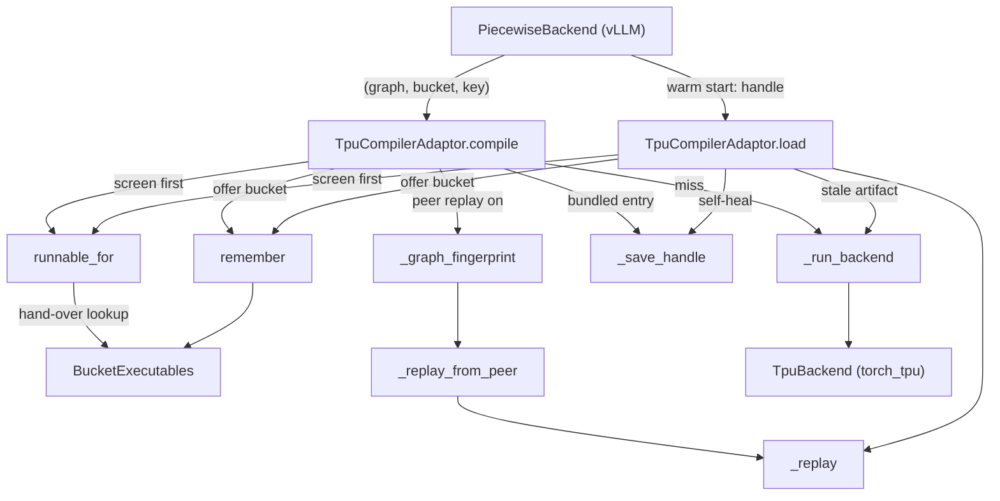

# Compilation and graph capture: the TPU compiler adaptor, token-bucket shape variants, compile cache and kernel hot-reload

## Overview

vllm-torchtpu runs the model under vLLM's own `VLLM_COMPILE` mode: Dynamo traces the model once with the token dimension dynamic and all guards dropped, and vLLM's `PiecewiseBackend` then compiles that single FX graph once for every entry of `compile_sizes` - the **token-bucket ladder** the [TPU platform](tpu-platform.md) chose. The `compilation/` package is the TPU side of that contract. Its core is the compiler adaptor the platform names as vLLM's compile backend (`TpuCompilerAdaptor`, whose [`compile`](../catalog/src/vllm_torchtpu/compilation/tpu_compiler.md#TpuCompilerAdaptor.compile "src/vllm_torchtpu/compilation/tpu_compiler.py:L791") / [`load`](../catalog/src/vllm_torchtpu/compilation/tpu_compiler.md#TpuCompilerAdaptor.load "src/vllm_torchtpu/compilation/tpu_compiler.py:L913") methods vLLM calls once per (subgraph, bucket)), which lowers through TorchTPU's FX -> MLIR -> PjRt pipeline and persists a bundled artifact so a warm start is "minutes rather than tens of minutes".

Around that core sit three mechanisms, each answering a TPU-specific problem. **The compilation hash** ([`compute_tpu_compilation_hash`](../catalog/src/vllm_torchtpu/compilation/tpu_compiler.md#compute_tpu_compilation_hash "src/vllm_torchtpu/compilation/tpu_compiler.py:L417")) folds everything Dynamo cannot see - Pallas kernel sources behind custom-op boundaries, TPU env vars, library versions, KV block count - into every cache key. **Shape variants** (`shape_variants.py`) fix a correctness hole in "trace once, compile per bucket": if the model decides anything from the token count while tracing, every bucket would inherit the traced bucket's decision, so a graph is only allowed to build the buckets its recorded shape guards accept, and the rest are built by re-traces and handed back so the live graph still owns exactly one executable per bucket. **Kernel hot-reload** ([`reload_kernels`](../catalog/src/vllm_torchtpu/compilation/kernel_reload.md#reload_kernels "src/vllm_torchtpu/compilation/kernel_reload.py:L139")) lets a kernel developer swap a Pallas attention kernel in a running server.

The performance lens: each bucket is one TPU program holding an HBM program region for the life of the process, so the number of executables is the budget everything here protects; precompile time and warm-start cache hits decide time-to-serve; and peer replay plus trace-first deferral exist to spread the dominant cost (XLA compiles of the biggest buckets) across a host's ranks.

## Diagram

The per-(subgraph, bucket) compile path inside the adaptor:



Legend:
- `PB` - (concept) vLLM's piecewise backend; one call per (subgraph, bucket)
- `COMP` - [`compile`](../catalog/src/vllm_torchtpu/compilation/tpu_compiler.md#TpuCompilerAdaptor.compile "src/vllm_torchtpu/compilation/tpu_compiler.py:L791")
- `LOAD` - [`load`](../catalog/src/vllm_torchtpu/compilation/tpu_compiler.md#TpuCompilerAdaptor.load "src/vllm_torchtpu/compilation/tpu_compiler.py:L913")
- `RF` - [`runnable_for`](../catalog/src/vllm_torchtpu/compilation/shape_variants.md#runnable_for "src/vllm_torchtpu/compilation/shape_variants.py:L256")
- `BE` - [`BucketExecutables`](../catalog/src/vllm_torchtpu/compilation/shape_variants.md#BucketExecutables "src/vllm_torchtpu/compilation/shape_variants.py:L186")
- `FP` - [`_graph_fingerprint`](../catalog/src/vllm_torchtpu/compilation/tpu_compiler.md#_graph_fingerprint "src/vllm_torchtpu/compilation/tpu_compiler.py:L114")
- `PEER` - [`_replay_from_peer`](../catalog/src/vllm_torchtpu/compilation/tpu_compiler.md#TpuCompilerAdaptor._replay_from_peer "src/vllm_torchtpu/compilation/tpu_compiler.py:L746")
- `REPLAY` - [`_replay`](../catalog/src/vllm_torchtpu/compilation/tpu_compiler.md#TpuCompilerAdaptor._replay "src/vllm_torchtpu/compilation/tpu_compiler.py:L658")
- `RB` - [`_run_backend`](../catalog/src/vllm_torchtpu/compilation/tpu_compiler.md#TpuCompilerAdaptor._run_backend "src/vllm_torchtpu/compilation/tpu_compiler.py:L555")
- `TB` - (concept) torch_tpu's `TpuBackend`: aot_autograd + FX -> MLIR -> PjRt compile
- `SAVE` - [`_save_handle`](../catalog/src/vllm_torchtpu/compilation/tpu_compiler.md#TpuCompilerAdaptor._save_handle "src/vllm_torchtpu/compilation/tpu_compiler.py:L616")
- `REM` - [`remember`](../catalog/src/vllm_torchtpu/compilation/shape_variants.md#remember "src/vllm_torchtpu/compilation/shape_variants.py:L299")

The backbone precompile ladder that drives it (the runner's `_precompile_backbone`), with and without `TPU_PRECOMPILE_TRACE_FIRST`:

```mermaid
sequenceDiagram
  participant R as _precompile_backbone
  participant SV as warmup / retrace
  participant PB as compile_all_ranges
  participant D as defer / DeferredTraces
  participant A as TpuCompilerAdaptor.compile
  R->>SV: enter warmup() (and trace_only() if trace-first)
  loop each token bucket
    R->>SV: needs_retrace(bucket)? then retrace(model)
    R->>PB: dummy forward triggers Dynamo trace
    alt trace-first
      PB->>D: defer(backend): mark compile / hand_over, run placeholder zeros
    else normal
      PB->>A: compile each bucket; refused ones get a raising closure
    end
  end
  R->>R: any bucket still refused? raise ShapeSpecializationError
  opt trace-first
    R->>D: DeferredTraces.compile() compiles every trace's buckets in one pass
    R->>R: second pass runs every bucket once
  end
```

Legend:
- `R` - [`_precompile_backbone`](../catalog/src/vllm_torchtpu/runner/tpu_runner.md#TPUModelRunner._precompile_backbone "src/vllm_torchtpu/runner/tpu_runner.py:L7164")
- `SV` - [`warmup`](../catalog/src/vllm_torchtpu/compilation/shape_variants.md#warmup "src/vllm_torchtpu/compilation/shape_variants.py:L245"), [`retrace`](../catalog/src/vllm_torchtpu/compilation/shape_variants.md#retrace "src/vllm_torchtpu/compilation/shape_variants.py:L321")
- `PB` - [`compile_all_ranges`](../catalog/src/vllm_torchtpu/__init__.md#_patch_vllm_compile_all_ranges.compile_all_ranges "src/vllm_torchtpu/__init__.py:L578")
- `D` - [`defer`](../catalog/src/vllm_torchtpu/compilation/shape_variants.md#defer "src/vllm_torchtpu/compilation/shape_variants.py:L428"), [`DeferredTraces`](../catalog/src/vllm_torchtpu/compilation/shape_variants.md#DeferredTraces "src/vllm_torchtpu/compilation/shape_variants.py:L372")
- `A` - [`compile`](../catalog/src/vllm_torchtpu/compilation/tpu_compiler.md#TpuCompilerAdaptor.compile "src/vllm_torchtpu/compilation/tpu_compiler.py:L791")

## Design rationale (why it's built this way)

- **One executable per bucket is the invariant.** Each compiled bucket is a TPU program with its own HBM program region, so everything that could create a second executable for the same bucket is designed out: a handed-over runnable is reused as the object itself rather than reloaded from disk ([`BucketExecutables`](../catalog/src/vllm_torchtpu/compilation/shape_variants.md#BucketExecutables "src/vllm_torchtpu/compilation/shape_variants.py:L186"): "Handing the object over rather than reloading the pickled artifact keeps one executable, and so one HBM program region, per bucket"), a loaded bucket is offered to later traces "instead of replaying the artifact into a second HBM program region", and the deep-copy that torch would do on deserialize is short-circuited because it "loads a second PJRT executable per graph". Re-tracing multiplies Dynamo traces only - "the number of TPU programs ... is unchanged".
- **Wrapper and executable are persisted as one object.** The on-disk artifact is torch's bundled AOTAutograd cache entry. The `compile` comment explains why it must be bundled: rebuilding a wrapper from a fresh trace and pairing it with a separately fetched executable cannot be checked, and a mismatch "is only observable once the program runs - as e0102 RuntimeProgramInputMismatch if the padded input buffers differ in size, and as a silently wrong result if they happen not to".
- **Dynamo cannot see kernels, so the hash must.** Pallas implementations "execute behind torch custom-op boundaries, so Dynamo's traced-file validation cannot see their source changes"; [`compute_tpu_compilation_hash`](../catalog/src/vllm_torchtpu/compilation/tpu_compiler.md#compute_tpu_compilation_hash "src/vllm_torchtpu/compilation/tpu_compiler.py:L417") therefore hashes the bytes of those source files. Conversely, orchestration-only env vars are excluded, otherwise the build "would recompile the world whenever an operator retuned a port".
- **The partition must be identical on every rank.** Shape-variant decisions come only from the trace's ShapeEnv guards, "so every DP/TP rank derives the same one and stays in lockstep through the collectives inside the specialized region". That is also why the decision has to come from a tensor shape: a branch on another Python value is guarded outside the ShapeEnv, vLLM drops that guard, "and nothing here can see it".
- **Rejecting an artifact is cheap; replaying a wrong one is not.** [`_replay`](../catalog/src/vllm_torchtpu/compilation/tpu_compiler.md#TpuCompilerAdaptor._replay "src/vllm_torchtpu/compilation/tpu_compiler.py:L658") is "deliberately strict" because "every rejection here costs one recompile and nothing else". Saves are non-fatal for the same reason: "a failed save costs a recompile next run, which is strictly better than persisting something unloadable".
- **Kernel iteration should cost one kernel compile, not a restart.** In `TPU_KERNEL_ITER_MODE` the platform splits the graph at the Pallas RPA custom ops so they run eagerly outside the compiled pieces; the reloadable kernel files are dropped from the cache key so a kernel edit reuses the cached backbone executables; and live ops dispatch through an indirection that [`reload_kernels`](../catalog/src/vllm_torchtpu/compilation/kernel_reload.md#reload_kernels "src/vllm_torchtpu/compilation/kernel_reload.py:L139") swaps.

## Entry points

- [`compile`](../catalog/src/vllm_torchtpu/compilation/tpu_compiler.md#TpuCompilerAdaptor.compile "src/vllm_torchtpu/compilation/tpu_compiler.py:L791") - vLLM's `CompilerInterface.compile`, called once per (subgraph, bucket) on a cold cache: "Compile a Dynamo-level FX graph to a TPU PjRt executable." Returns `(runnable, handle)`; `(fn, None)` means "usable now, but nothing was persisted".
- [`load`](../catalog/src/vllm_torchtpu/compilation/tpu_compiler.md#TpuCompilerAdaptor.load "src/vllm_torchtpu/compilation/tpu_compiler.py:L913") - the warm-start path, called with the handle a previous process's `compile` returned.
- [`compute_hash`](../catalog/src/vllm_torchtpu/compilation/tpu_compiler.md#TpuCompilerAdaptor.compute_hash "src/vllm_torchtpu/compilation/tpu_compiler.py:L539") / [`compute_tpu_compilation_hash`](../catalog/src/vllm_torchtpu/compilation/tpu_compiler.md#compute_tpu_compilation_hash "src/vllm_torchtpu/compilation/tpu_compiler.py:L417") - called by vLLM to name the piecewise cache directory, by the AOT cache-key patch [`tpu_aot_compile_hash_factors`](../catalog/src/vllm_torchtpu/__init__.md#_patch_vllm_aot_compile_cache_key.tpu_aot_compile_hash_factors "src/vllm_torchtpu/__init__.py:L189") (together with [`aot_cache_tag`](../catalog/src/vllm_torchtpu/compilation/shape_variants.md#aot_cache_tag "src/vllm_torchtpu/compilation/shape_variants.py:L307")), and by the runner's [`_profile_isolated_cache`](../catalog/src/vllm_torchtpu/runner/tpu_runner.md#TPUModelRunner._profile_isolated_cache "src/vllm_torchtpu/runner/tpu_runner.py:L7899") to isolate the kv=0 profile-run compile in its own `profile_cache/<hash>` directory.
- [`warmup`](../catalog/src/vllm_torchtpu/compilation/shape_variants.md#warmup "src/vllm_torchtpu/compilation/shape_variants.py:L245"), [`retrace`](../catalog/src/vllm_torchtpu/compilation/shape_variants.md#retrace "src/vllm_torchtpu/compilation/shape_variants.py:L321"), [`trace_only`](../catalog/src/vllm_torchtpu/compilation/shape_variants.md#trace_only "src/vllm_torchtpu/compilation/shape_variants.py:L411") - entered only by the runner's [`_precompile_backbone`](../catalog/src/vllm_torchtpu/runner/tpu_runner.md#TPUModelRunner._precompile_backbone "src/vllm_torchtpu/runner/tpu_runner.py:L7164") ("Compile the backbone for every token bucket").
- [`defer`](../catalog/src/vllm_torchtpu/compilation/shape_variants.md#defer "src/vllm_torchtpu/compilation/shape_variants.py:L428") - called by the patched `PiecewiseBackend` [`compile_all_ranges`](../catalog/src/vllm_torchtpu/__init__.md#_patch_vllm_compile_all_ranges.compile_all_ranges "src/vllm_torchtpu/__init__.py:L578") when a backend is traced inside `trace_only`.
- [`aot_cache_tag`](../catalog/src/vllm_torchtpu/compilation/shape_variants.md#aot_cache_tag "src/vllm_torchtpu/compilation/shape_variants.py:L307") - also read by model code to know it is being traced inside the backbone warmup, e.g. Qwen3.5's attention/MoE overlap [`_overlap_forward`](../catalog/src/vllm_torchtpu/models/vllm/qwen3_5_patch.md#_overlap_forward "src/vllm_torchtpu/models/vllm/qwen3_5_patch.py:L93"), which only takes its token-count-dependent reduce-scatter path when each side of the branch can get its own trace.
- [`reload_kernels`](../catalog/src/vllm_torchtpu/compilation/kernel_reload.md#reload_kernels "src/vllm_torchtpu/compilation/kernel_reload.py:L139") - called on every worker by [`reload_kernels`](../catalog/src/vllm_torchtpu/worker/tpu_worker.md#TPUWorker.reload_kernels "src/vllm_torchtpu/worker/tpu_worker.py:L814") via collective RPC from the `/reload_kernel` dev endpoint.

## Mechanism (step-by-step)

1. **Screening before compiling.** For a single-size compile range, [`compile`](../catalog/src/vllm_torchtpu/compilation/tpu_compiler.md#TpuCompilerAdaptor.compile "src/vllm_torchtpu/compilation/tpu_compiler.py:L791") first asks [`runnable_for`](../catalog/src/vllm_torchtpu/compilation/shape_variants.md#runnable_for "src/vllm_torchtpu/compilation/shape_variants.py:L256") whether this bucket should be built here at all. If an earlier trace in the current warmup already built `(cache_dir, key)`, [`get`](../catalog/src/vllm_torchtpu/compilation/shape_variants.md#BucketExecutables.get "src/vllm_torchtpu/compilation/shape_variants.py:L203") returns that runnable after checking the input [`_signature`](../catalog/src/vllm_torchtpu/compilation/shape_variants.md#_signature "src/vllm_torchtpu/compilation/shape_variants.py:L152") matches (symbolic dims compare as `"?"`, so the token dim matches across traces but a structural split difference does not). Otherwise [`unsupported_reason`](../catalog/src/vllm_torchtpu/compilation/shape_variants.md#unsupported_reason "src/vllm_torchtpu/compilation/shape_variants.py:L117") substitutes the bucket size for every symbol of the trace's ShapeEnv (found by [`trace_shape_env`](../catalog/src/vllm_torchtpu/compilation/shape_variants.md#trace_shape_env "src/vllm_torchtpu/compilation/shape_variants.py:L87") on the placeholders' fake mode) - the same substitution vLLM's `create_concrete_args` does - and checks the symbols' value ranges (ignoring the `>= 2` bound that only dodges 0/1 specialization) and every recorded guard. Undecidable expressions count as satisfied: it "only ever refuses a bucket it can prove wrong". A refused bucket inside a warmup is added to [`refused`](../catalog/src/vllm_torchtpu/compilation/shape_variants.md#BucketExecutables.refused "src/vllm_torchtpu/compilation/shape_variants.py:L200") and gets a raising closure ([`refuse`](../catalog/src/vllm_torchtpu/compilation/shape_variants.md#runnable_for.refuse "src/vllm_torchtpu/compilation/shape_variants.py:L290")); outside a warmup it raises [`ShapeSpecializationError`](../catalog/src/vllm_torchtpu/compilation/shape_variants.md#ShapeSpecializationError "src/vllm_torchtpu/compilation/shape_variants.py:L63") immediately, because only the backbone is re-traced per bucket group. [`load`](../catalog/src/vllm_torchtpu/compilation/tpu_compiler.md#TpuCompilerAdaptor.load "src/vllm_torchtpu/compilation/tpu_compiler.py:L913") runs the same screen, for an extra reason: vLLM's cache key is "(subgraph, bucket) with no graph identity", so without it a re-traced variant would adopt another trace's artifact and fail on TPU as "Donation requested for invalid buffer".

2. **Peer replay (optional).** With caching on and `TPU_PRECOMPILE_PEER_REPLAY=1`, `compile` computes [`_graph_fingerprint`](../catalog/src/vllm_torchtpu/compilation/tpu_compiler.md#_graph_fingerprint "src/vllm_torchtpu/compilation/tpu_compiler.py:L114") - a sha256 over the code of the graph and every submodule plus its `get_attr` constants (values for tensors up to 65536 elements, dtype + shape for larger ones, which are weights). Two ranks with equal fingerprints traced the same program; a rank-dependent Python int baked into the graph changes the code and so the hash. [`_replay_from_peer`](../catalog/src/vllm_torchtpu/compilation/tpu_compiler.md#TpuCompilerAdaptor._replay_from_peer "src/vllm_torchtpu/compilation/tpu_compiler.py:L746") looks for the same `key` under sibling `rank_<r>_<dp>` cache directories, polling every 0.5 s up to `TPU_PRECOMPILE_PEER_WAIT_S` (default 600 s) when inside the wait scope, and replays it through [`_replay`](../catalog/src/vllm_torchtpu/compilation/tpu_compiler.md#TpuCompilerAdaptor._replay "src/vllm_torchtpu/compilation/tpu_compiler.py:L658") with the fingerprint check. On success this rank's cache entry becomes a hard link (or copy) of the peer's file. A timeout costs one redundant compile, never a stalled start. The patched `compile_all_ranges` (under `TPU_PARALLEL_PRECOMPILE`) is what makes this pay: it deals a host's buckets in a snake order across local ranks (biggest-first only with `TPU_PRECOMPILE_BIGGEST_FIRST=1`; the default keeps vLLM's order), each rank compiles its own share, then replays the rest.

3. **Compile through TorchTPU.** On a miss, [`_run_backend`](../catalog/src/vllm_torchtpu/compilation/tpu_compiler.md#TpuCompilerAdaptor._run_backend "src/vllm_torchtpu/compilation/tpu_compiler.py:L555") receives the graph `compile` / `load` already deep-copied and rewrote to return a tuple (aot_autograd requires tuples; those callers unwrap the result side again), builds a tracing context from the example inputs' own fake mode and gives it an empty ShapeEnv if it has none (otherwise the bundled AOTAutogradCache bypasses with "No shape env", fatal for these static graphs), resets the DeepSeek-V4 top-k kernels' scheduling-group counters so "the HLO, and with it torch_tpu's cache key, does not depend on what this process compiled before" (letting every rank hit an executable another rank put in torch_tpu's Tier-2 cache), and calls torch_tpu's `TpuBackend`. It reads `serialize()` off the returned object before any wrapping; graphs with dynamic symints and debug-mode compiles carry none and are simply not persisted.

4. **Persist the bundled artifact.** [`_save_handle`](../catalog/src/vllm_torchtpu/compilation/tpu_compiler.md#TpuCompilerAdaptor._save_handle "src/vllm_torchtpu/compilation/tpu_compiler.py:L616") pickles a handle holding the bundled entry, the graph's input signature, the output-wrapping flag and (under peer replay) the fingerprint into vLLM's per-rank cache directory ([`cache_dir`](../catalog/src/vllm_torchtpu/compilation/tpu_compiler.md#TpuCompilerAdaptor.cache_dir "src/vllm_torchtpu/compilation/tpu_compiler.py:L530")), writing to a PID-unique temp file and renaming, since a crash "partway through pickling a 400 MB entry would otherwise leave a truncated file". Finally `compile` calls [`remember`](../catalog/src/vllm_torchtpu/compilation/shape_variants.md#remember "src/vllm_torchtpu/compilation/shape_variants.py:L299"), which [`put`](../catalog/src/vllm_torchtpu/compilation/shape_variants.md#BucketExecutables.put "src/vllm_torchtpu/compilation/shape_variants.py:L220")s the runnable into the warmup's hand-over table.

5. **Warm start.** [`load`](../catalog/src/vllm_torchtpu/compilation/tpu_compiler.md#TpuCompilerAdaptor.load "src/vllm_torchtpu/compilation/tpu_compiler.py:L913") replays the handle with [`_replay`](../catalog/src/vllm_torchtpu/compilation/tpu_compiler.md#TpuCompilerAdaptor._replay "src/vllm_torchtpu/compilation/tpu_compiler.py:L658"), which accepts the artifact only if it is the current handle type, has an entry, and matches this graph's input signature and output wrapping. The signature check exists because nothing else validates the entry against the graph ("torch_tpu injects a synthetic cache_info and stubs out generate_guards_expression"); it compares placeholders only, so a changed graph *body* is the compilation hash's job. Any rejection falls back to [`_run_backend`](../catalog/src/vllm_torchtpu/compilation/tpu_compiler.md#TpuCompilerAdaptor._run_backend "src/vllm_torchtpu/compilation/tpu_compiler.py:L555") and then self-heals by overwriting the stale artifact - "Without this a single stale entry recompiles forever". With torch_tpu's Tier-3 persistent cache active, that fallback is cheap because the PJRT binary is served natively.

6. **The cache key.** [`compute_tpu_compilation_hash`](../catalog/src/vllm_torchtpu/compilation/tpu_compiler.md#compute_tpu_compilation_hash "src/vllm_torchtpu/compilation/tpu_compiler.py:L417") hashes (sha256, truncated to 10 hex chars): torch / torch_tpu / jax / jaxlib versions and the loaded libtpu build ([`get_libtpu_cache_key`](../catalog/src/vllm_torchtpu/tpu_info.md#get_libtpu_cache_key "src/vllm_torchtpu/tpu_info.py:L153"), path-independent); every plugin env var in the [`environment_variables`](../catalog/src/vllm_torchtpu/envs.md#environment_variables.environment_variables "src/vllm_torchtpu/envs.py:L435") registry except an explicit ignore list ([`_tpu_compile_env_factors`](../catalog/src/vllm_torchtpu/compilation/tpu_compiler.md#_tpu_compile_env_factors "src/vllm_torchtpu/compilation/tpu_compiler.py:L402")); the native compiler env `LIBTPU_INIT_ARGS`, `XLA_FLAGS`, `TORCH_TPU_INTERNAL_XLA_OPTIONS`, `TORCH_TPU_INTERNAL_MATERIALIZE_COLLECTIVE_TENSORS`; the effective DP size ([`get_dp_size`](../catalog/src/vllm_torchtpu/utils.md#get_dp_size "src/vllm_torchtpu/utils.py:L68")); `gpu_memory_utilization` and the resolved `num_gpu_blocks` ("TPU AOT graphs embed the KV tensor extent as a literal" - the resolved count is shared by all ranks, whereas the per-worker override differs by a few blocks and "would split ranks into separate cache dirs"); `max_model_len`, `max_num_batched_tokens`, `max_num_seqs`; the speculative model, draft TP and token count; and finally the bytes of every runtime source file from [`_iter_runtime_cache_key_files`](../catalog/src/vllm_torchtpu/compilation/tpu_compiler.md#_iter_runtime_cache_key_files "src/vllm_torchtpu/compilation/tpu_compiler.py:L338") - `kernels/`, `layers/core/`, the attention, fused-MoE, EP-MoE, TP-decode-MoE, router and quantization adapters, the EP / PCP / DCP mesh builders, DeepSeek-V4 attention and Kimi-K3 ops - minus vLLM-Omni diffusion paths, and minus the reloadable kernel modules in kernel-iteration mode ([`_reloadable_kernel_relpaths`](../catalog/src/vllm_torchtpu/compilation/tpu_compiler.md#_reloadable_kernel_relpaths "src/vllm_torchtpu/compilation/tpu_compiler.py:L372")). The same value feeds the outer AOT key via [`tpu_aot_compile_hash_factors`](../catalog/src/vllm_torchtpu/__init__.md#_patch_vllm_aot_compile_cache_key.tpu_aot_compile_hash_factors "src/vllm_torchtpu/__init__.py:L189").

7. **Per-bucket re-tracing in the warmup ladder.** [`_precompile_backbone`](../catalog/src/vllm_torchtpu/runner/tpu_runner.md#TPUModelRunner._precompile_backbone "src/vllm_torchtpu/runner/tpu_runner.py:L7164") opens [`warmup`](../catalog/src/vllm_torchtpu/compilation/shape_variants.md#warmup "src/vllm_torchtpu/compilation/shape_variants.py:L245") (which installs a fresh [`BucketExecutables`](../catalog/src/vllm_torchtpu/compilation/shape_variants.md#BucketExecutables "src/vllm_torchtpu/compilation/shape_variants.py:L186") as [`_session`](../catalog/src/vllm_torchtpu/compilation/shape_variants.md#_session._session "src/vllm_torchtpu/compilation/shape_variants.py:L241")) and walks the bucket ladder with dummy forwards. Before a bucket that the current graph refused and no trace has yet built, it calls [`retrace`](../catalog/src/vllm_torchtpu/compilation/shape_variants.md#retrace "src/vllm_torchtpu/compilation/shape_variants.py:L321"): this bumps [`traces`](../catalog/src/vllm_torchtpu/compilation/shape_variants.md#BucketExecutables.traces "src/vllm_torchtpu/compilation/shape_variants.py:L201"), clears the refusals, drops every `TorchCompileWithNoGuardsWrapper`'s bytecode hook (for per-layer models that is every decoder layer), rebuilds the compile wrappers via vLLM's `reset_compile_wrapper` (a `VllmBackend` "can only be called once"), and pins the cache directories so the new trace's hand-over lookups land in the same place. Because the AOT artifact path is keyed only by config and forward code, [`aot_cache_tag`](../catalog/src/vllm_torchtpu/compilation/shape_variants.md#aot_cache_tag "src/vllm_torchtpu/compilation/shape_variants.py:L307") adds `trace<N>` while a warmup is open - otherwise "the second trace loads the first's artifact instead of tracing". The ordinal is safe across ranks and warm starts because the partition replays identically. If any bucket is still refused at the end, the start fails with `ShapeSpecializationError` rather than leaving a raising closure in the live graph.

8. **Trace-first deferred precompile.** With `TPU_PRECOMPILE_TRACE_FIRST=1` (requires `TPU_PARALLEL_PRECOMPILE=1`; incompatible with `VLLM_USE_MEGA_AOT_ARTIFACT=1`, which would save an empty artifact), the ladder runs inside [`trace_only`](../catalog/src/vllm_torchtpu/compilation/shape_variants.md#trace_only "src/vllm_torchtpu/compilation/shape_variants.py:L411"). Each freshly traced backend calls [`defer`](../catalog/src/vllm_torchtpu/compilation/shape_variants.md#defer "src/vllm_torchtpu/compilation/shape_variants.py:L428") instead of compiling: buckets its guards accept are marked `compile` and recorded in [`accepted`](../catalog/src/vllm_torchtpu/compilation/shape_variants.md#DeferredTraces.accepted "src/vllm_torchtpu/compilation/shape_variants.py:L389") as (subgraph index, bucket); buckets an earlier trace accepted, or that this trace refuses, are marked `hand_over`. Every entry temporarily runs [`_placeholder_runnable`](../catalog/src/vllm_torchtpu/compilation/shape_variants.md#_placeholder_runnable "src/vllm_torchtpu/compilation/shape_variants.py:L477") - its [`for_size`](../catalog/src/vllm_torchtpu/compilation/shape_variants.md#_placeholder_runnable.for_size "src/vllm_torchtpu/compilation/shape_variants.py:L509") closure returns zeros in the traced output shapes with every symbol set to the token count - so the warmup forward completes "without executing anything on the device". After all groups are traced back to back, [`compile`](../catalog/src/vllm_torchtpu/compilation/shape_variants.md#DeferredTraces.compile "src/vllm_torchtpu/compilation/shape_variants.py:L391") hands the recorded [`backends`](../catalog/src/vllm_torchtpu/compilation/shape_variants.md#DeferredTraces.backends "src/vllm_torchtpu/compilation/shape_variants.py:L386") to the registered [`_deferred_compiler`](../catalog/src/vllm_torchtpu/compilation/shape_variants.md#_deferred_compiler._deferred_compiler "src/vllm_torchtpu/compilation/shape_variants.py:L402"), which compiles every bucket of every trace in one rank-parallel pass and hands refused buckets over only for the live (last) trace; a second pass then runs each bucket once.

9. **Kernel hot-reload.** In `TPU_KERNEL_ITER_MODE`, reloadable custom ops are registered against a per-call dispatch indirection that looks up [`_LIVE`](../catalog/src/vllm_torchtpu/compilation/kernel_reload.md#_LIVE._LIVE "src/vllm_torchtpu/compilation/kernel_reload.py:L65")`[name]`, so "the op name baked into captured graphs never changes". [`reload_kernels`](../catalog/src/vllm_torchtpu/compilation/kernel_reload.md#reload_kernels "src/vllm_torchtpu/compilation/kernel_reload.py:L139") `importlib.reload`s the module list from [`default_reload_modules`](../catalog/src/vllm_torchtpu/compilation/kernel_reload.md#default_reload_modules "src/vllm_torchtpu/compilation/kernel_reload.py:L74") (`TPU_KERNEL_RELOAD_MODULES`, or by default the experimental batched-RPA and PCP-streaming-RPA kernel modules in dependency order, or a per-request override), then calls each registered zero-argument builder in [`_BUILDERS`](../catalog/src/vllm_torchtpu/compilation/kernel_reload.md#_BUILDERS._BUILDERS "src/vllm_torchtpu/compilation/kernel_reload.py:L67") to rebuild its live callable, and returns re-import / rebuild timings. The swapped kernel lowers and compiles lazily on its next call, so "the caller's next request pays the kernel compile and nothing else".

## Key data structures

- **Compile handle on disk** - the pickled `TpuCompilationHandle` (`key`, bundled `entry`, input `signature`, `was_wrapped`, `fingerprint`), referenced by vLLM through a `(key, path, was_wrapped)` tuple. Its defaults are "deliberately unusable": an older pickle missing a field picks up the class default and fails validation rather than being replayed.
- **[`BucketExecutables`](../catalog/src/vllm_torchtpu/compilation/shape_variants.md#BucketExecutables "src/vllm_torchtpu/compilation/shape_variants.py:L186")** - warmup-scoped table `(cache_dir, key) -> (runnable, signature)` plus [`refused`](../catalog/src/vllm_torchtpu/compilation/shape_variants.md#BucketExecutables.refused "src/vllm_torchtpu/compilation/shape_variants.py:L200") (buckets a graph refused that no trace has built since the last retrace) and [`traces`](../catalog/src/vllm_torchtpu/compilation/shape_variants.md#BucketExecutables.traces "src/vllm_torchtpu/compilation/shape_variants.py:L201") (the trace ordinal behind [`aot_cache_tag`](../catalog/src/vllm_torchtpu/compilation/shape_variants.md#aot_cache_tag "src/vllm_torchtpu/compilation/shape_variants.py:L307")). Compile-time only: "nothing reads it while serving".
- **[`DeferredTraces`](../catalog/src/vllm_torchtpu/compilation/shape_variants.md#DeferredTraces "src/vllm_torchtpu/compilation/shape_variants.py:L372")** - the deferred backends and the `accepted` (subgraph, bucket) set, held in the module global [`_deferred`](../catalog/src/vllm_torchtpu/compilation/shape_variants.md#_deferred._deferred "src/vllm_torchtpu/compilation/shape_variants.py:L401") only inside `trace_only`.
- **[`_LIVE`](../catalog/src/vllm_torchtpu/compilation/kernel_reload.md#_LIVE._LIVE "src/vllm_torchtpu/compilation/kernel_reload.py:L65") / [`_BUILDERS`](../catalog/src/vllm_torchtpu/compilation/kernel_reload.md#_BUILDERS._BUILDERS "src/vllm_torchtpu/compilation/kernel_reload.py:L67")** - op name -> current callable, and op name -> rebuild recipe. Builders must resolve modules with `importlib.import_module` inside the builder; "a closure over module attributes would keep pre-reload objects alive".
- **The env ignore list** (`_TPU_COMPILE_ENV_IGNORED`) - the plugin env vars that do *not* enter the cache key: profiler levels, scheduler/SRPT knobs, KV-transfer ports and pool sizes, Raiden orchestration ids, precompile orchestration (`TPU_PARALLEL_PRECOMPILE`, `TPU_PRECOMPILE_*`), PP hand-off/chunk knobs, `TPU_LIBRARY_PATH` (identified by build instead). Every other registry entry is hashed.

## Dynamics (design intent)

- **Lockstep across ranks.** The bucket ladder, the shape-variant partition and the trace ordinals are all functions of config, env and guards, so every DP/TP rank compiles the same sequence of programs and meets the same collectives during warmup. Keeping HLO independent of compile history (the scheduling-group reset) extends this to torch_tpu's own executable cache.
- **Peer replay ordering.** Under `TPU_PARALLEL_PRECOMPILE`, a rank compiles the buckets it owns first, then enters the wait scope and replays the others "in the order the owners finish them: by turn, small first". With `TPU_PRECOMPILE_BIGGEST_FIRST=1` the biggest bucket goes to local rank 0 first because it "bounds startup".
- **Per-rank cache directories, shared bodies.** vLLM gives each rank `<hash>/rank_<rank>_<dp_rank>/<prefix>`; peer replay only sees directories on the same disk unless the cache root is shared, and any DP rank's artifact is acceptable if its fingerprint matches.
- **Reload is serialized against serving** by the API-server endpoint draining requests before the collective RPC; there is no eager re-warm because "a pre-warm compiles a program serving would not reuse".

## Edge cases

- A model whose structure depends on a non-tensor Python value at trace time is invisible to shape variants (no ShapeEnv guard) and will silently share the traced bucket's structure.
- Only the backbone is re-traced per bucket group. Any other compiled module (e.g. the MTP drafter, which compiles outside warmup) that branches on token count fails with `ShapeSpecializationError` at its first unsupported bucket.
- A split graph (kernel-iteration mode) whose subgraph boundaries move with the specialization cannot hand buckets between traces: [`get`](../catalog/src/vllm_torchtpu/compilation/shape_variants.md#BucketExecutables.get "src/vllm_torchtpu/compilation/shape_variants.py:L203") raises and tells you to "unset TPU_KERNEL_ITER_MODE to serve this model".
- `TPU_PRECOMPILE_PEER_REPLAY=1` needs vLLM's compile cache; `VLLM_DISABLE_COMPILE_CACHE=1` is rejected at launch, and a cache disabled for any other reason degrades to "every rank compiles every range itself" with a warning.
- A deferred trace whose output dimension stays symbolic after substitution raises from the placeholder runnable.
- Signature-changing kernel edits still need a restart: captured graphs and the ops' fake implementations keep the original schema.
- Changing `--gpu-memory-utilization`, `--max-model-len`, `--max-num-seqs`, `--max-num-batched-tokens`, any hashed TPU env var, `XLA_FLAGS`/`LIBTPU_INIT_ARGS`, or any hashed kernel source invalidates every cached executable.

## Open questions

- The adaptor class `TpuCompilerAdaptor` itself, the `TpuCompilationHandle` dataclass, the `wait_for_peer_artifact` scope, the dispatch indirection (`_KernelDispatch`) and the `compile_deferred` / `compile_ranges` helpers of the `compile_all_ranges` patch are not in this packet's subgraph; their behavior is described from source.
- How large the per-bucket HBM program region is, and how it is accounted against the KV budget, is not settled here; see [KV cache layout and HBM budget](kv-cache-layout-and-hbm-budget.md).
- No tests in the configured test paths reference this subgraph.

## See also

- [TPU platform](tpu-platform.md) - chooses `VLLM_COMPILE`, `splitting_ops`, the token-bucket ladder and the dynamic-shapes mode this subsystem compiles.
- [TPU model runner](tpu-model-runner.md) - pads every step to a bucket and owns the precompile ladder.
- [Ragged paged attention kernel](ragged-paged-attention-kernel.md), [Batched ragged paged attention kernel](batched-ragged-paged-attention-kernel.md), [PCP streaming RPA kernel](pcp-streaming-rpa-kernel.md) - the hot-reloadable kernels.
- [Model export and Rust launcher](model-export-and-rust-launcher.md), [vLLM model patches](vllm-model-patches.md), [Custom ops](custom-ops.md).
