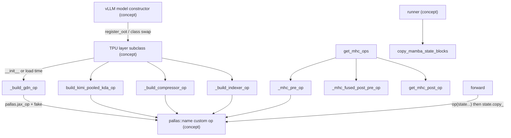

# Custom ops (layers/adapter/custom_ops)

<!-- connect:up:begin -->
> **Cross-repo concept:** part of [kv-cache](../../../concepts/kv-cache.md), [pallas-kernel](../../../concepts/pallas-kernel.md) across this wiki's repos.
<!-- connect:up:end -->
## Overview
`src/vllm_torchtpu/layers/adapter/custom_ops` holds the layers whose core math cannot be expressed as plain torch ops that torch_tpu lowers well, so each one hands a JAX function (usually a Pallas kernel) to torch_tpu's `pallas.jax_op`, which registers it as an opaque `pallas::<name>` torch custom op. Every module follows the same recipe: **(1)** build the op once, outside the compiled region, under a name that encodes every constant baked into the trace; **(2)** register a fake (shape-only) implementation so Dynamo can trace through it; **(3)** donate the cache/state operands and write the returned buffer back with `copy_`, which XLA turns into an in-place update; **(4)** plug the layer into vLLM by subclassing the upstream module and registering it with vLLM's `register_oot` hook (or by temporarily swapping the class vLLM constructs). The families covered are MLA and its sparse indexer, Gated DeltaNet (Qwen3-Next style) and Kimi Delta Attention, DeepSeek-V4's compressor / indexer / sliding-window cache / mHC residual mixing, the MoE runner, and small utility ops (pool block copy, LoRA slot write, XLA optimization barrier).

## Diagram

Legend:
- `VLLM` - (concept) upstream vLLM model construction
- `LAYER` - (concept) a TPU subclass such as the GDN, MLA wrapper, compressor or indexer layer
- `BUILD` - [`_build_gdn_op`](../catalog/src/vllm_torchtpu/layers/adapter/custom_ops/gdn_attention_op.md#VllmGatedDeltaNetAttention._build_gdn_op "src/vllm_torchtpu/layers/adapter/custom_ops/gdn_attention_op.py:L553")
- `KDAB` - [`build_kimi_pooled_kda_op`](../catalog/src/vllm_torchtpu/layers/adapter/custom_ops/kda_attention_op.md#build_kimi_pooled_kda_op "src/vllm_torchtpu/layers/adapter/custom_ops/kda_attention_op.py:L736")
- `COMPB` - [`_build_compressor_op`](../catalog/src/vllm_torchtpu/layers/adapter/custom_ops/deepseek_v4/deepseek_v4_compressor.md#VllmDeepseekCompressor._build_compressor_op "src/vllm_torchtpu/layers/adapter/custom_ops/deepseek_v4/deepseek_v4_compressor.py:L476")
- `IDXB` - [`_build_indexer_op`](../catalog/src/vllm_torchtpu/layers/adapter/custom_ops/deepseek_v4/deepseek_v4_indexer.md#VllmDeepseekV4Indexer._build_indexer_op "src/vllm_torchtpu/layers/adapter/custom_ops/deepseek_v4/deepseek_v4_indexer.py:L215")
- `MHC` - [`get_mhc_ops`](../catalog/src/vllm_torchtpu/layers/adapter/custom_ops/deepseek_v4/deepseek_v4_mhc_op.md#get_mhc_ops "src/vllm_torchtpu/layers/adapter/custom_ops/deepseek_v4/deepseek_v4_mhc_op.py:L294")
- `PRE` - [`_mhc_pre_op`](../catalog/src/vllm_torchtpu/layers/adapter/custom_ops/deepseek_v4/deepseek_v4_mhc_op.md#_mhc_pre_op "src/vllm_torchtpu/layers/adapter/custom_ops/deepseek_v4/deepseek_v4_mhc_op.py:L173")
- `FUSED` - [`_mhc_fused_post_pre_op`](../catalog/src/vllm_torchtpu/layers/adapter/custom_ops/deepseek_v4/deepseek_v4_mhc_op.md#_mhc_fused_post_pre_op "src/vllm_torchtpu/layers/adapter/custom_ops/deepseek_v4/deepseek_v4_mhc_op.py:L233")
- `POST` - [`get_mhc_post_op`](../catalog/src/vllm_torchtpu/layers/adapter/custom_ops/deepseek_v4/deepseek_v4_mhc_op.md#get_mhc_post_op "src/vllm_torchtpu/layers/adapter/custom_ops/deepseek_v4/deepseek_v4_mhc_op.py:L208")
- `OP` - (concept) the registered `pallas::<name>` torch custom op
- `FWD` - [`forward`](../catalog/src/vllm_torchtpu/layers/adapter/custom_ops/deepseek_v4/deepseek_v4_compressor.md#VllmDeepseekCompressor.forward "src/vllm_torchtpu/layers/adapter/custom_ops/deepseek_v4/deepseek_v4_compressor.py:L606") (representative layer forward)
- `RUNNER` - (concept) the model runner's KV / state block management
- `COPY` - [`copy_mamba_state_blocks`](../catalog/src/vllm_torchtpu/layers/adapter/custom_ops/mamba_state_copy_op.md#copy_mamba_state_blocks "src/vllm_torchtpu/layers/adapter/custom_ops/mamba_state_copy_op.py:L54")

## Design rationale (why it's built this way)
- **Opaque op boundary.** A Pallas kernel cannot be traced by Dynamo, and torch_tpu's MLIR builder cannot capture closures over weights; wrapping the JAX function as a named custom op keeps the kernel out of the torch graph while still letting the whole forward compile as one program. The MoE runner makes the same point negatively: upstream's `torch.ops.vllm.moe_forward` op "captures weight tensors as closures and trips torch_tpu's MLIR builder", so the TPU MoE runner selects the direct forward path instead.
- **Build outside the trace.** [`get_mhc_ops`](../catalog/src/vllm_torchtpu/layers/adapter/custom_ops/deepseek_v4/deepseek_v4_mhc_op.md#get_mhc_ops "src/vllm_torchtpu/layers/adapter/custom_ops/deepseek_v4/deepseek_v4_mhc_op.py:L294") says it "Must be called outside the compiled region: the builders construct jax `PartitionSpec`s, which Dynamo cannot trace, so a cold cache inside a compiled forward is a hard error rather than a graph break." The sparse indexer builds eagerly in `__init__` because `pallas.jax_op` runs `inspect.signature()`, which Dynamo cannot trace. The model-side holder [`mhc_ops`](../catalog/src/vllm_torchtpu/models/vllm/deepseek_v4/model.md#DeepseekV4DecoderLayer.mhc_ops "src/vllm_torchtpu/models/vllm/deepseek_v4/model.py:L135") is "This layer's mHC Pallas ops, built once outside the trace."
- **Op names are cache keys.** Constants are baked into the traced JAX function, so they go into the op name (mHC gate epsilons, compressor variant/head dim/ratio/state block size, indexer top-k/ratio/heads/scale/verify length, KDA variant/conv dtype/window). The KDA builder explains why: "vLLM's compile cache is keyed on the model config and not on the op body, so the kernel variant goes in the op name ... A pooled program cached from the unfused era would otherwise be served stale." Module-level dicts (e.g. [`_mhc_op_cache`](../catalog/src/vllm_torchtpu/layers/adapter/custom_ops/deepseek_v4/deepseek_v4_mhc_op.md#_mhc_op_cache._mhc_op_cache "src/vllm_torchtpu/layers/adapter/custom_ops/deepseek_v4/deepseek_v4_mhc_op.py:L43")) then reuse one op across all layers with the same name.
- **Donation + `copy_` for state.** Ops donate their cache/state arguments (`donate_argnums`) and return new buffers that the torch side copies back - the "plain donation + copy_ writeback (aliased in-place by XLA)" idiom - so multi-GB KV caches and recurrent-state pools are updated in place rather than duplicated.
- **Weights are re-laid-out once at load.** Several layers transpose or re-buffer weights at load time (e.g. the compressor stores its fused projection transposed because "Transposing in the forward pass makes XLA materialize the transposed copy on every step") and give them fresh buffers so torch_tpu does not re-materialize a view chain at the op boundary every step.
- **Batch small device programs.** [`copy_mamba_state_blocks`](../catalog/src/vllm_torchtpu/layers/adapter/custom_ops/mamba_state_copy_op.md#copy_mamba_state_blocks "src/vllm_torchtpu/layers/adapter/custom_ops/mamba_state_copy_op.py:L54") copies blocks on every raw pool buffer "as one program", and the LoRA slot-update op replaces "about 800 writes for Qwen3-0.6B" with one transfer and one program that takes the slot index as data so one compile serves every slot.

## Entry points
- [`static_verify_q_len`](../catalog/src/vllm_torchtpu/layers/adapter/custom_ops/deepseek_v4/deepseek_v4_indexer.md#static_verify_q_len "src/vllm_torchtpu/layers/adapter/custom_ops/deepseek_v4/deepseek_v4_indexer.py:L60") - "Query length of a full speculative verify window, 1 + K, or None." The most-called symbol in this unit: the runner, the DeepSeek-V4 attention op ([`_build_attn_op`](../catalog/src/vllm_torchtpu/models/vllm/deepseek_v4/attention.md#VllmDeepseekV4MLAAttention._build_attn_op "src/vllm_torchtpu/models/vllm/deepseek_v4/attention.py:L304")) and the indexer all call it so the static-verify gate and the `+ 1` "cannot drift apart".
- [`VllmDeepseekCompressor`](../catalog/src/vllm_torchtpu/layers/adapter/custom_ops/deepseek_v4/deepseek_v4_compressor.md#VllmDeepseekCompressor "src/vllm_torchtpu/layers/adapter/custom_ops/deepseek_v4/deepseek_v4_compressor.py:L405") - "TPU compressor: projects, saves state, compresses and stores."; constructed by the DeepSeek-V4 attention ([`__init__`](../catalog/src/vllm_torchtpu/models/vllm/deepseek_v4/attention.md#VllmDeepseekV4MLAAttention.__init__ "src/vllm_torchtpu/models/vllm/deepseek_v4/attention.py:L158")) and the indexer.
- [`VllmDeepseekV4SWACache`](../catalog/src/vllm_torchtpu/layers/adapter/custom_ops/deepseek_v4/deepseek_v4_attention_op.md#VllmDeepseekV4SWACache "src/vllm_torchtpu/layers/adapter/custom_ops/deepseek_v4/deepseek_v4_attention_op.py:L287") - "Sliding-window KV cache, paged to fit inside a CSA main page."; its spec is queried during KV cache initialization.
- [`copy_pool_blocks`](../catalog/src/vllm_torchtpu/layers/adapter/custom_ops/mamba_state_copy_op.md#copy_pool_blocks "src/vllm_torchtpu/layers/adapter/custom_ops/mamba_state_copy_op.py:L74") - alias of the block copy for attention KV callers; used by the runner's prefix-cache copy-on-write path ([`_apply_dense_kv_cache_block_copies`](../catalog/src/vllm_torchtpu/runner/tpu_runner.md#TPUModelRunner._apply_dense_kv_cache_block_copies "src/vllm_torchtpu/runner/tpu_runner.py:L2360"), warmed by [`_precompile_dense_kv_cache_block_copies`](../catalog/src/vllm_torchtpu/runner/tpu_runner.md#TPUModelRunner._precompile_dense_kv_cache_block_copies "src/vllm_torchtpu/runner/tpu_runner.py:L2383")).
- [`get_mhc_ops`](../catalog/src/vllm_torchtpu/layers/adapter/custom_ops/deepseek_v4/deepseek_v4_mhc_op.md#get_mhc_ops "src/vllm_torchtpu/layers/adapter/custom_ops/deepseek_v4/deepseek_v4_mhc_op.py:L294") / [`get_mhc_post_op`](../catalog/src/vllm_torchtpu/layers/adapter/custom_ops/deepseek_v4/deepseek_v4_mhc_op.md#get_mhc_post_op "src/vllm_torchtpu/layers/adapter/custom_ops/deepseek_v4/deepseek_v4_mhc_op.py:L208") - built lazily, not at construction: the decoder layer's [`mhc_ops`](../catalog/src/vllm_torchtpu/models/vllm/deepseek_v4/model.md#DeepseekV4DecoderLayer.mhc_ops "src/vllm_torchtpu/models/vllm/deepseek_v4/model.py:L135") property calls `get_mhc_ops` on first access (and the model's `mhc_post_op` property calls `get_mhc_post_op`); the runner touches these properties before the first compiled forward so the ops exist outside the trace.
- [`build_kimi_pooled_kda_op`](../catalog/src/vllm_torchtpu/layers/adapter/custom_ops/kda_attention_op.md#build_kimi_pooled_kda_op "src/vllm_torchtpu/layers/adapter/custom_ops/kda_attention_op.py:L736") and [`build_kimi_dispatched_kda_op`](../catalog/src/vllm_torchtpu/layers/adapter/custom_ops/kda_attention_op.md#build_kimi_dispatched_kda_op "src/vllm_torchtpu/layers/adapter/custom_ops/kda_attention_op.py:L450") - called by the Kimi KDA layer, which stores the results as [`pooled_kda_op`](../catalog/src/vllm_torchtpu/models/vllm/kimi_k3/attention.md#KimiDeltaAttention.pooled_kda_op "src/vllm_torchtpu/models/vllm/kimi_k3/attention.py:L597") and [`dispatched_kda_op`](../catalog/src/vllm_torchtpu/models/vllm/kimi_k3/attention.md#KimiDeltaAttention.dispatched_kda_op "src/vllm_torchtpu/models/vllm/kimi_k3/attention.py:L582").
- Layer forwards reached every step: GDN [`forward`](../catalog/src/vllm_torchtpu/layers/adapter/custom_ops/gdn_attention_op.md#VllmGatedDeltaNetAttention.forward "src/vllm_torchtpu/layers/adapter/custom_ops/gdn_attention_op.py:L1118"), MLA wrapper [`forward`](../catalog/src/vllm_torchtpu/layers/adapter/custom_ops/mla_attention_op.md#VllmTPUMultiHeadLatentAttentionWrapper.forward "src/vllm_torchtpu/layers/adapter/custom_ops/mla_attention_op.py:L1209"), sparse indexer [`forward_oot`](../catalog/src/vllm_torchtpu/layers/adapter/custom_ops/mla_attention_op.md#VllmTPUSparseAttnIndexer.forward_oot "src/vllm_torchtpu/layers/adapter/custom_ops/mla_attention_op.py:L697"), and compressor [`forward`](../catalog/src/vllm_torchtpu/layers/adapter/custom_ops/deepseek_v4/deepseek_v4_compressor.md#VllmDeepseekCompressor.forward "src/vllm_torchtpu/layers/adapter/custom_ops/deepseek_v4/deepseek_v4_compressor.py:L606").

## Mechanism (step-by-step)
1. **Registration into vLLM.** Importing the package triggers each module's decorators; the GDN layer, the MLA wrapper, the sparse indexer and the MoE runner subclass vLLM's classes and register with `register_oot`, so vLLM constructs the TPU class wherever a model asks for the upstream one. Classes without a hook are reached by swapping the module-level class for the duration of the parent constructor: [`VllmDeepseekCompressor`](../catalog/src/vllm_torchtpu/layers/adapter/custom_ops/deepseek_v4/deepseek_v4_compressor.md#VllmDeepseekCompressor "src/vllm_torchtpu/layers/adapter/custom_ops/deepseek_v4/deepseek_v4_compressor.py:L405") swaps in its own state-cache class, and the DeepSeek-V4 indexer's [`__init__`](../catalog/src/vllm_torchtpu/layers/adapter/custom_ops/deepseek_v4/deepseek_v4_indexer.md#VllmDeepseekV4Indexer.__init__ "src/vllm_torchtpu/layers/adapter/custom_ops/deepseek_v4/deepseek_v4_indexer.py:L202") swaps in the TPU compressor and indexer cache, then builds its op.
2. **Op construction and naming.** Builders resolve the op mesh via [`get_pallas_op_mesh`](../catalog/src/vllm_torchtpu/models/vllm/vllm_model_wrapper_context.md#get_pallas_op_mesh "src/vllm_torchtpu/models/vllm/vllm_model_wrapper_context.py:L48") or the wrapper context, bind static constants with `functools.partial`, compose a name from them, consult a module-level cache, and otherwise call `pallas.jax_op(name, fn, mesh=..., input_partition_specs=..., donate_argnums=...)` and `register_fake`. The mHC family shows the pattern cleanly: [`_mhc_pre_op`](../catalog/src/vllm_torchtpu/layers/adapter/custom_ops/deepseek_v4/deepseek_v4_mhc_op.md#_mhc_pre_op "src/vllm_torchtpu/layers/adapter/custom_ops/deepseek_v4/deepseek_v4_mhc_op.py:L173"), [`get_mhc_post_op`](../catalog/src/vllm_torchtpu/layers/adapter/custom_ops/deepseek_v4/deepseek_v4_mhc_op.md#get_mhc_post_op "src/vllm_torchtpu/layers/adapter/custom_ops/deepseek_v4/deepseek_v4_mhc_op.py:L208") and the seam op [`_mhc_fused_post_pre_op`](../catalog/src/vllm_torchtpu/layers/adapter/custom_ops/deepseek_v4/deepseek_v4_mhc_op.md#_mhc_fused_post_pre_op "src/vllm_torchtpu/layers/adapter/custom_ops/deepseek_v4/deepseek_v4_mhc_op.py:L233") - which runs one layer's post-mix together with the next layer's pre-mix in a single pass over the residual streams - all shard token-major tensors on [`ATTN_DATA_AXIS`](../catalog/src/vllm_torchtpu/layers/adapter/custom_ops/deepseek_v4/deepseek_v4_mhc_op.md#ATTN_DATA_AXIS "src/vllm_torchtpu/layers/adapter/custom_ops/deepseek_v4/deepseek_v4_mhc_op.py:L41"), which resolves to `None` today (no attention-DP axis on the mesh).
3. **Lazy builds where geometry is late.** Some constants are not final at construction. The compressor's op is "Built on first use, since `state_block_size` is baked in statically" - the block size is only correct after KV cache init calls `get_kv_cache_spec` and [`block_size`](../catalog/src/vllm_torchtpu/layers/adapter/custom_ops/deepseek_v4/deepseek_v4_compressor.md#VllmCompressorStateCache.block_size "src/vllm_torchtpu/layers/adapter/custom_ops/deepseek_v4/deepseek_v4_compressor.py:L388") is derived. [`_build_compressor_op`](../catalog/src/vllm_torchtpu/layers/adapter/custom_ops/deepseek_v4/deepseek_v4_compressor.md#VllmDeepseekCompressor._build_compressor_op "src/vllm_torchtpu/layers/adapter/custom_ops/deepseek_v4/deepseek_v4_compressor.py:L476") then picks one of three variants - CSA (head_dim 512 with overlap, separate NoPE/RoPE caches), HCA (512 without overlap, state overlaid on a CSA array) or the lightning indexer (128) - and donates the cache plus the companion RoPE/state cache. The pooled KDA op reads the manager block size per call for the same reason.
4. **GDN: dense, pooled, and PCP variants.** The GDN layer's [`forward`](../catalog/src/vllm_torchtpu/layers/adapter/custom_ops/gdn_attention_op.md#VllmGatedDeltaNetAttention.forward "src/vllm_torchtpu/layers/adapter/custom_ops/gdn_attention_op.py:L1118") builds every applicable op in `__init__` and picks one per call from the bound `kv_cache` layout and attention metadata; outside the pooled PCP case it runs the QKVZ / BA projections in torch first. The ops: [`_build_gdn_op`](../catalog/src/vllm_torchtpu/layers/adapter/custom_ops/gdn_attention_op.md#VllmGatedDeltaNetAttention._build_gdn_op "src/vllm_torchtpu/layers/adapter/custom_ops/gdn_attention_op.py:L553") for separate conv/recurrent state caches (with a PCP-prefill variant on an op-local mesh with axes [`_GDN_PCP_AXIS_NAME`](../catalog/src/vllm_torchtpu/layers/adapter/custom_ops/gdn_attention_op.md#_GDN_PCP_AXIS_NAME "src/vllm_torchtpu/layers/adapter/custom_ops/gdn_attention_op.py:L73") and [`_GDN_TP_AXIS_NAME`](../catalog/src/vllm_torchtpu/layers/adapter/custom_ops/gdn_attention_op.md#_GDN_TP_AXIS_NAME "src/vllm_torchtpu/layers/adapter/custom_ops/gdn_attention_op.py:L74")), [`_build_pooled_gdn_op`](../catalog/src/vllm_torchtpu/layers/adapter/custom_ops/gdn_attention_op.md#VllmGatedDeltaNetAttention._build_pooled_gdn_op "src/vllm_torchtpu/layers/adapter/custom_ops/gdn_attention_op.py:L702") when state lives in the unified attention-shaped pool (speculative verify windows keep one checkpoint per window position inside the request's state block), and [`_build_pooled_pcp_gdn_op`](../catalog/src/vllm_torchtpu/layers/adapter/custom_ops/gdn_attention_op.md#VllmGatedDeltaNetAttention._build_pooled_pcp_gdn_op "src/vllm_torchtpu/layers/adapter/custom_ops/gdn_attention_op.py:L849") for the pooled PCP case, which [`_forward_fused_pooled_pcp`](../catalog/src/vllm_torchtpu/layers/adapter/custom_ops/gdn_attention_op.md#VllmGatedDeltaNetAttention._forward_fused_pooled_pcp "src/vllm_torchtpu/layers/adapter/custom_ops/gdn_attention_op.py:L1076") ("Run the mandatory fused path for an allocated pooled PCP call.") drives with the QKVZ projection fused into the op. Head partitioning comes from [`tp_head_geometry`](../catalog/src/vllm_torchtpu/layers/adapter/custom_ops/gdn_attention_op.md#VllmGatedDeltaNetAttention.tp_head_geometry "src/vllm_torchtpu/layers/adapter/custom_ops/gdn_attention_op.py:L424"); the [`conv1d`](../catalog/src/vllm_torchtpu/layers/adapter/custom_ops/gdn_attention_op.md#VllmGatedDeltaNetAttention.conv1d "src/vllm_torchtpu/layers/adapter/custom_ops/gdn_attention_op.py:L375") weight is replaced before loading so it partitions like the QKV projection, and [`get_kv_cache_spec`](../catalog/src/vllm_torchtpu/layers/adapter/custom_ops/gdn_attention_op.md#VllmGatedDeltaNetAttention.get_kv_cache_spec "src/vllm_torchtpu/layers/adapter/custom_ops/gdn_attention_op.py:L491") localizes the Mamba state spec for PCP. Pooled state regions are sized by [`derive_pooled_gdn_state_layout`](../catalog/src/vllm_torchtpu/gdn_pool_layout.md#derive_pooled_gdn_state_layout "src/vllm_torchtpu/gdn_pool_layout.py:L150").
5. **KDA on the fused conv1d + GDN v3 kernel.** [`_build_fused_core`](../catalog/src/vllm_torchtpu/layers/adapter/custom_ops/kda_attention_op.md#_build_fused_core "src/vllm_torchtpu/layers/adapter/custom_ops/kda_attention_op.py:L322") ("The same op, on the fused conv1d + GDN v3 kernel.") returns a [`fused_core`](../catalog/src/vllm_torchtpu/layers/adapter/custom_ops/kda_attention_op.md#_build_fused_core.fused_core "src/vllm_torchtpu/layers/adapter/custom_ops/kda_attention_op.py:L335") whose [`run_kernel`](../catalog/src/vllm_torchtpu/layers/adapter/custom_ops/kda_attention_op.md#_build_fused_core.fused_core.run_kernel "src/vllm_torchtpu/layers/adapter/custom_ops/kda_attention_op.py:L384") calls [`fused_conv1d_gdn`](../catalog/src/vllm_torchtpu/kernels/gdn/v3/wrapper.md#fused_conv1d_gdn "src/vllm_torchtpu/kernels/gdn/v3/wrapper.py:L333") in KDA mode; the kernel owns the convolution, activations, L2 norms, both recurrences and the state write-back, leaving only the gated output norm outside. With speculative decoding the batched (verify-window) and per-sequence (prefill) programs are invoked separately behind `lax.cond` guards, so empty segments "do not touch state". [`build_kimi_dispatched_kda_op`](../catalog/src/vllm_torchtpu/layers/adapter/custom_ops/kda_attention_op.md#build_kimi_dispatched_kda_op "src/vllm_torchtpu/layers/adapter/custom_ops/kda_attention_op.py:L450") wraps this with dense state caches (donating both), while [`build_kimi_pooled_kda_op`](../catalog/src/vllm_torchtpu/layers/adapter/custom_ops/kda_attention_op.md#build_kimi_pooled_kda_op "src/vllm_torchtpu/layers/adapter/custom_ops/kda_attention_op.py:L736") runs [`_pooled_kda_core`](../catalog/src/vllm_torchtpu/layers/adapter/custom_ops/kda_attention_op.md#_pooled_kda_core "src/vllm_torchtpu/layers/adapter/custom_ops/kda_attention_op.py:L528"), which gathers state regions out of the unified pool ([`gather_region`](../catalog/src/vllm_torchtpu/kernels/pool_adapters.md#gather_region "src/vllm_torchtpu/kernels/pool_adapters.py:L82")), runs the same fused kernel and scatters them back ([`scatter_region`](../catalog/src/vllm_torchtpu/kernels/pool_adapters.md#scatter_region "src/vllm_torchtpu/kernels/pool_adapters.py:L316")).
6. **MLA and the sparse indexer.** The MLA wrapper's [`forward`](../catalog/src/vllm_torchtpu/layers/adapter/custom_ops/mla_attention_op.md#VllmTPUMultiHeadLatentAttentionWrapper.forward "src/vllm_torchtpu/layers/adapter/custom_ops/mla_attention_op.py:L1209") runs the fused Q/KV-A projection (or a Kimi preprocess kernel) and then its [`mla_attn`](../catalog/src/vllm_torchtpu/layers/adapter/custom_ops/mla_attention_op.md#VllmTPUMultiHeadLatentAttentionWrapper.mla_attn "src/vllm_torchtpu/layers/adapter/custom_ops/mla_attention_op.py:L1175") module, whose [`process_weights_after_loading`](../catalog/src/vllm_torchtpu/layers/adapter/custom_ops/mla_attention_op.md#VllmTPUMLAAttention.process_weights_after_loading "src/vllm_torchtpu/layers/adapter/custom_ops/mla_attention_op.py:L967") absorbs `W_UK`/`W_UV` and, under DCP query replication, all-gathers the absorbed key weight (and [`W_UK_T_dcp_qrep_scale`](../catalog/src/vllm_torchtpu/layers/adapter/custom_ops/mla_attention_op.md#VllmTPUMLAAttention.W_UK_T_dcp_qrep_scale "src/vllm_torchtpu/layers/adapter/custom_ops/mla_attention_op.py:L1023")) once at load "rather than gathering q every step". The sparse indexer's [`forward_oot`](../catalog/src/vllm_torchtpu/layers/adapter/custom_ops/mla_attention_op.md#VllmTPUSparseAttnIndexer.forward_oot "src/vllm_torchtpu/layers/adapter/custom_ops/mla_attention_op.py:L697") quantizes K to FP8 with a UE8M0 scale byte per row, packs value bytes + scale into one uint8 row, and calls the streamindex top-k op built by [`_build_streamidx_op`](../catalog/src/vllm_torchtpu/layers/adapter/custom_ops/mla_attention_op.md#VllmTPUSparseAttnIndexer._build_streamidx_op "src/vllm_torchtpu/layers/adapter/custom_ops/mla_attention_op.py:L442") (its JAX body [`_streamidx_topk_jax`](../catalog/src/vllm_torchtpu/layers/adapter/custom_ops/mla_attention_op.md#VllmTPUSparseAttnIndexer._streamidx_topk_jax "src/vllm_torchtpu/layers/adapter/custom_ops/mla_attention_op.py:L458") appends this step's K rows to the cache and ranks positions) or, under DCP, [`_build_streamidx_dcp_op`](../catalog/src/vllm_torchtpu/layers/adapter/custom_ops/mla_attention_op.md#VllmTPUSparseAttnIndexer._build_streamidx_dcp_op "src/vllm_torchtpu/layers/adapter/custom_ops/mla_attention_op.py:L550") / [`_streamidx_topk_dcp_jax`](../catalog/src/vllm_torchtpu/layers/adapter/custom_ops/mla_attention_op.md#VllmTPUSparseAttnIndexer._streamidx_topk_dcp_jax "src/vllm_torchtpu/layers/adapter/custom_ops/mla_attention_op.py:L576"), which returns rank-local indices for a log-sum-exp merge. The indexer K-cache writer is chosen by [`_resolve_indexer_kv_cache_mode`](../catalog/src/vllm_torchtpu/layers/adapter/custom_ops/mla_attention_op.md#_resolve_indexer_kv_cache_mode "src/vllm_torchtpu/layers/adapter/custom_ops/mla_attention_op.py:L164") from `VLLM_TPU_INDEXER_KV_CACHE_MODE` (`xla`, `has` = head-along-sublane Pallas, `sal` = seq-along-lane Pallas), with XLA fallback only for the head-along-sublane layout; [`_log_indexer_kv_cache_once`](../catalog/src/vllm_torchtpu/layers/adapter/custom_ops/mla_attention_op.md#_log_indexer_kv_cache_once "src/vllm_torchtpu/layers/adapter/custom_ops/mla_attention_op.py:L127") reports the choice per geometry.
7. **DeepSeek-V4 compress, index and window.** Each step the compressor's [`forward`](../catalog/src/vllm_torchtpu/layers/adapter/custom_ops/deepseek_v4/deepseek_v4_compressor.md#VllmDeepseekCompressor.forward "src/vllm_torchtpu/layers/adapter/custom_ops/deepseek_v4/deepseek_v4_compressor.py:L606") looks up *its own* layer's metadata for both the state cache and the compressed-K cache (borrowing another layer's "would scatter rows into that layer's pages"), bitcasts byte-wide caches to uint8 views, and calls the compress-and-store op, copying back one or two caches. The DeepSeek-V4 indexer op ([`_build_indexer_op`](../catalog/src/vllm_torchtpu/layers/adapter/custom_ops/deepseek_v4/deepseek_v4_indexer.md#VllmDeepseekV4Indexer._build_indexer_op "src/vllm_torchtpu/layers/adapter/custom_ops/deepseek_v4/deepseek_v4_indexer.py:L215")) shards query heads on `model` and, per shard, runs [`_indexer_local`](../catalog/src/vllm_torchtpu/layers/adapter/custom_ops/deepseek_v4/deepseek_v4_indexer.md#_indexer_jax._indexer_local "src/vllm_torchtpu/layers/adapter/custom_ops/deepseek_v4/deepseek_v4_indexer.py:L124"), which rotates and FP8-quantizes queries in one kernel before scoring; when [`static_verify_q_len`](../catalog/src/vllm_torchtpu/layers/adapter/custom_ops/deepseek_v4/deepseek_v4_indexer.md#static_verify_q_len "src/vllm_torchtpu/layers/adapter/custom_ops/deepseek_v4/deepseek_v4_indexer.py:L60") is set, the verify windows in `request_distribution`'s middle segment are scored in one static query-length pass. [`VllmDeepseekV4SWACache`](../catalog/src/vllm_torchtpu/layers/adapter/custom_ops/deepseek_v4/deepseek_v4_attention_op.md#VllmDeepseekV4SWACache "src/vllm_torchtpu/layers/adapter/custom_ops/deepseek_v4/deepseek_v4_attention_op.py:L287") keeps sliding-window KV in raw bf16 and sizes its block as `csa_block / 4 / 2` (capped by the window) so it overlays the CSA NoPE array's `[num_pages, page_size, 4, 128]` uint8 pages.
8. **MoE runner integration.** [`_fused_output_is_reduced`](../catalog/src/vllm_torchtpu/layers/adapter/custom_ops/moe_runner.md#VllmMoERunner._fused_output_is_reduced "src/vllm_torchtpu/layers/adapter/custom_ops/moe_runner.py:L81") answers vLLM's "is the routed output already all-reduced?" question per layer: true for layers armed by the fused-decode or TP-decode MoE kernels and for fused-EP / adaptive fused MoE layers (which push results back to the token-owning chip), upstream's answer otherwise. The upstream property is captured at import because "reading the upstream property from inside the trace does not reliably produce upstream's answer". The same runner also suppresses vLLM's explicit PCP all-gather pair when an armed fused kernel already owns those collectives.
9. **Block-copy and utility ops.** [`copy_mamba_state_blocks`](../catalog/src/vllm_torchtpu/layers/adapter/custom_ops/mamba_state_copy_op.md#copy_mamba_state_blocks "src/vllm_torchtpu/layers/adapter/custom_ops/mamba_state_copy_op.py:L54") ("``pool[dst[i]] = pool[src[i]]`` on every pool, as one program.") is a `torch.compile(backend="tpu", fullgraph=True)` function that loops a donating `pallas::mamba_state_block_copy` op over every raw pool buffer; the runner calls it to seed a GDN state block when the request's state block advances (chunk boundary, decode crossing, prefix-cache resume) and, as [`copy_pool_blocks`](../catalog/src/vllm_torchtpu/layers/adapter/custom_ops/mamba_state_copy_op.md#copy_pool_blocks "src/vllm_torchtpu/layers/adapter/custom_ops/mamba_state_copy_op.py:L74"), for attention-KV copy-on-write. A row-copy variant for the merged block-major pool chunks each row copy to fit a VMEM step budget (half of VMEM, split over four double-buffered blocks).

## Key data structures
- **Op caches** - module-level `name -> op` dicts per family ([`_mhc_op_cache`](../catalog/src/vllm_torchtpu/layers/adapter/custom_ops/deepseek_v4/deepseek_v4_mhc_op.md#_mhc_op_cache._mhc_op_cache "src/vllm_torchtpu/layers/adapter/custom_ops/deepseek_v4/deepseek_v4_mhc_op.py:L43") and siblings for compressor/indexer); the name string is the full identity of the compiled kernel variant.
- **mHC op triple** - `pre`, `post`, and the seam `fused` op for one set of gate constants, returned by [`get_mhc_ops`](../catalog/src/vllm_torchtpu/layers/adapter/custom_ops/deepseek_v4/deepseek_v4_mhc_op.md#get_mhc_ops "src/vllm_torchtpu/layers/adapter/custom_ops/deepseek_v4/deepseek_v4_mhc_op.py:L294"); `pre` maps `(..., hc_mult, hidden)` bf16 residual streams to post/comb mixes (f32) and the layer input.
- **DeepSeek-V4 caches** - compressor state stored as uint8 rows of raw f32 bytes (`state_dim * 4`, 128-aligned) so the byte budget matches the packed host layout; SWA cache as raw bf16 packed into uint8 1024-wide rows.
- **Indexer K rows** - per-token `head_dim` FP8 bytes + 1 UE8M0 scale byte, padded to a 128 multiple in the cache.

## Dynamics (design intent)
- Ops are built during construction or load and only *invoked* inside the compiled forward; a cache miss inside the trace is an error by design.
- Because op identity is name-based and the compile cache is keyed on model config, changing a kernel body without changing its op name can serve a stale compiled program - which is why variants are encoded in names.
- Fake implementations return `empty_like` buffers of the state shapes plus the output shape, keeping Dynamo's graph shape-correct while the real kernel runs at execution time.
- `copy_mamba_state_blocks` is compiled with `dynamic=False`, so each `(num pools, pair count)` shape compiles separately; the runner precompiles the dense copy at every bucket length.

## Edge cases
- The compressor refuses vLLM's `use_fp4_indexer_cache` (the TPU kernel only emits the FP8/UE8M0 layout) and requires the KV block size to be a multiple of the compress ratio; it asserts the fused projection was transposed at load because that layer has no quant method and so never gets the generic `(k, n)` flip.
- The sparse indexer cannot run with both PCP and DCP > 1 ("no layout for two at once").
- The indexer K-cache `sal` layout on a non-TPU backend or unsupported geometry raises instead of falling back to XLA.
- The KDA pooled op requires read offsets and checkpoint indices when speculative tokens are configured; pooled GDN requires PCP-streaming metadata when PCP is configured with a unified pool.
- [`static_verify_q_len`](../catalog/src/vllm_torchtpu/layers/adapter/custom_ops/deepseek_v4/deepseek_v4_indexer.md#static_verify_q_len "src/vllm_torchtpu/layers/adapter/custom_ops/deepseek_v4/deepseek_v4_indexer.py:L60") looks at the *target* model's config even while building draft layers, because draft context-KV inserts run on the target's verify metadata; `TPU_SPEC_STATIC_VERIFY=0` can turn the pass off but cannot turn it on for other models.

## Open questions
- The LoRA slot-update and optimization-barrier ops, and the DeepSeek-V4 attention op body, are in this unit's modules but not in this packet's subgraph; their call sites are not traced here.
- The GDN unified-pool op's speculative rollback contract (checkpoint selection via slot read offsets) is described in comments; the kernel side is covered by [gated-deltanet-kernels](gated-deltanet-kernels.md).

## See also
- [vllm-layer-adapters](vllm-layer-adapters.md) - the attention backends, quant methods and MoE arming that sit beside these ops.
- [attention-and-layer-core](attention-and-layer-core.md) - the JAX functions (MLA, GDN PCP, metadata) several ops call.
- [compilation-and-graph-capture](compilation-and-graph-capture.md) - how the compiled forward treats these op boundaries.
- [deepseek-v4-model](deepseek-v4-model.md), [deepseek-v4-compress-and-store-kernel](deepseek-v4-compress-and-store-kernel.md), [deepseek-v4-streamindex-topk-kernel](deepseek-v4-streamindex-topk-kernel.md)
- [kimi-k3-model](kimi-k3-model.md), [kimi-k3-kernels](kimi-k3-kernels.md), [gated-deltanet-kernels](gated-deltanet-kernels.md), [gdn-pcp-fused-kernel](gdn-pcp-fused-kernel.md), [mla-attention-kernels](mla-attention-kernels.md)
- [kv-cache-layout-and-hbm-budget](kv-cache-layout-and-hbm-budget.md), [fused-moe-kernels](fused-moe-kernels.md), [speculative-decoding](speculative-decoding.md)
