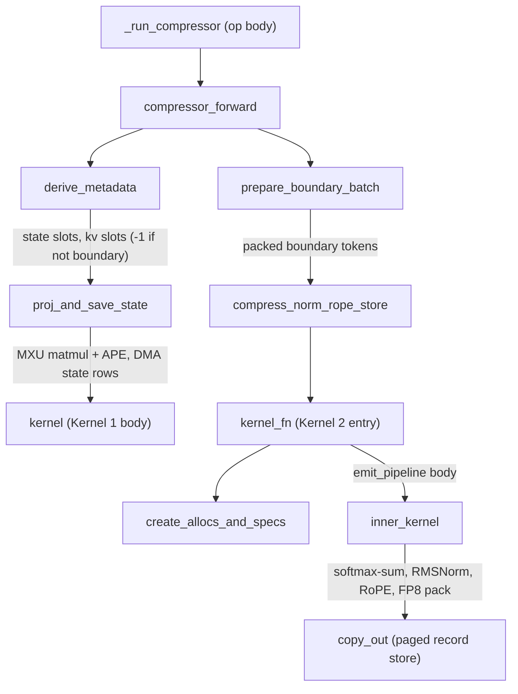
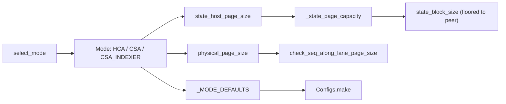

# DeepSeek-V4 compress-and-store kernels: project-and-save-state + compress/norm/RoPE/store into the paged KV cache

<!-- connect:up:begin -->
> **Cross-repo concept:** part of [kv-cache](../../../concepts/kv-cache.md), [pallas-kernel](../../../concepts/pallas-kernel.md), [vmem](../../../concepts/vmem.md) across this wiki's repos.
<!-- connect:up:end -->
## Overview

DeepSeek-V4 attention reads a **compressed** KV cache: every `compress_ratio` tokens are folded into one record by a learned, softmax-gated weighted sum over a window of per-token states. `src/vllm_torchtpu/kernels/deepseek_v4/compress_and_store/` implements that compressor for TPU as a two-kernel pipeline behind [`compressor_forward`](../catalog/src/vllm_torchtpu/kernels/deepseek_v4/compress_and_store/compressor_v1.md#compressor_forward "src/vllm_torchtpu/kernels/deepseek_v4/compress_and_store/compressor_v1.py:L229") ("Projects, saves state, then compresses and stores the boundary records"). Kernel 1, [`proj_and_save_state`](../catalog/src/vllm_torchtpu/kernels/deepseek_v4/compress_and_store/proj_and_save_state.md#proj_and_save_state "src/vllm_torchtpu/kernels/deepseek_v4/compress_and_store/proj_and_save_state.py:L342"), runs for **every** token: one matmul against the fused `wkv || wgate` weight produces an f32 KV half and an f32 score half (plus an absolute position embedding on the score half), DMA'd straight into a paged f32 state cache. Kernel 2, [`compress_norm_rope_store`](../catalog/src/vllm_torchtpu/kernels/deepseek_v4/compress_and_store/kernel.md#compress_norm_rope_store "src/vllm_torchtpu/kernels/deepseek_v4/compress_and_store/kernel.py:L376"), runs only for **boundary** tokens (`(position + 1) % compress_ratio == 0`): it gathers the window of saved states back into VMEM, computes the softmax-weighted sum, RMSNorm, RoPE, quantizes and packs the record, and writes it into the compressed-KV page.

The key design idea is that **the state cache and the compressed-KV cache are the same physical HBM array** (or, for HCA, a CSA array borrowed for the purpose): vLLM never allocates a separate state buffer, so all geometry - rows per page, rows per token state, records per row - is re-derived inside the kernels from `cache.shape[1]` by one layout model, [`Configs`](../catalog/src/vllm_torchtpu/kernels/deepseek_v4/compress_and_store/config.md#Configs "src/vllm_torchtpu/kernels/deepseek_v4/compress_and_store/config.py:L287"), keyed by a storage [`Mode`](../catalog/src/vllm_torchtpu/kernels/deepseek_v4/compress_and_store/config.md#Mode "src/vllm_torchtpu/kernels/deepseek_v4/compress_and_store/config.py:L66"). Everything that computes a slot index (the block tables, the metadata derivation, the KV-cache allocator) must agree with that model or "writes land on the wrong page".

## Diagram

The two-kernel pipeline and the metadata between them:

Legend:
- `RC` - [`_run_compressor`](../catalog/src/vllm_torchtpu/layers/adapter/custom_ops/deepseek_v4/deepseek_v4_compressor.md#_run_compressor "src/vllm_torchtpu/layers/adapter/custom_ops/deepseek_v4/deepseek_v4_compressor.py:L54")
- `CF` - [`compressor_forward`](../catalog/src/vllm_torchtpu/kernels/deepseek_v4/compress_and_store/compressor_v1.md#compressor_forward "src/vllm_torchtpu/kernels/deepseek_v4/compress_and_store/compressor_v1.py:L229")
- `DM` - [`derive_metadata`](../catalog/src/vllm_torchtpu/kernels/deepseek_v4/compress_and_store/compressor_v1.md#derive_metadata "src/vllm_torchtpu/kernels/deepseek_v4/compress_and_store/compressor_v1.py:L31")
- `PS` - [`proj_and_save_state`](../catalog/src/vllm_torchtpu/kernels/deepseek_v4/compress_and_store/proj_and_save_state.md#proj_and_save_state "src/vllm_torchtpu/kernels/deepseek_v4/compress_and_store/proj_and_save_state.py:L342")
- `PK` - [`kernel`](../catalog/src/vllm_torchtpu/kernels/deepseek_v4/compress_and_store/proj_and_save_state.md#kernel "src/vllm_torchtpu/kernels/deepseek_v4/compress_and_store/proj_and_save_state.py:L104")
- `PB` - [`prepare_boundary_batch`](../catalog/src/vllm_torchtpu/kernels/deepseek_v4/compress_and_store/compressor_v1.md#prepare_boundary_batch "src/vllm_torchtpu/kernels/deepseek_v4/compress_and_store/compressor_v1.py:L159")
- `CN` - [`compress_norm_rope_store`](../catalog/src/vllm_torchtpu/kernels/deepseek_v4/compress_and_store/kernel.md#compress_norm_rope_store "src/vllm_torchtpu/kernels/deepseek_v4/compress_and_store/kernel.py:L376")
- `KF` - [`kernel_fn`](../catalog/src/vllm_torchtpu/kernels/deepseek_v4/compress_and_store/kernel.md#kernel_fn "src/vllm_torchtpu/kernels/deepseek_v4/compress_and_store/kernel.py:L212")
- `CA` - [`create_allocs_and_specs`](../catalog/src/vllm_torchtpu/kernels/deepseek_v4/compress_and_store/buffered_ref.md#create_allocs_and_specs "src/vllm_torchtpu/kernels/deepseek_v4/compress_and_store/buffered_ref.py:L437")
- `IK` - [`inner_kernel`](../catalog/src/vllm_torchtpu/kernels/deepseek_v4/compress_and_store/kernel.md#inner_kernel "src/vllm_torchtpu/kernels/deepseek_v4/compress_and_store/kernel.py:L37")
- `CO` - [`copy_out`](../catalog/src/vllm_torchtpu/kernels/deepseek_v4/compress_and_store/buffered_ref.md#OutputRef.copy_out "src/vllm_torchtpu/kernels/deepseek_v4/compress_and_store/buffered_ref.py:L211")

The storage modes and the page-geometry functions every caller has to agree on:

Legend:
- `SM` - [`select_mode`](../catalog/src/vllm_torchtpu/kernels/deepseek_v4/compress_and_store/config.md#select_mode "src/vllm_torchtpu/kernels/deepseek_v4/compress_and_store/config.py:L100")
- `MO` - [`Mode`](../catalog/src/vllm_torchtpu/kernels/deepseek_v4/compress_and_store/config.md#Mode "src/vllm_torchtpu/kernels/deepseek_v4/compress_and_store/config.py:L66")
- `MD` - [`_MODE_DEFAULTS`](../catalog/src/vllm_torchtpu/kernels/deepseek_v4/compress_and_store/config.md#_MODE_DEFAULTS._MODE_DEFAULTS "src/vllm_torchtpu/kernels/deepseek_v4/compress_and_store/config.py:L72")
- `PP` - [`physical_page_size`](../catalog/src/vllm_torchtpu/kernels/deepseek_v4/compress_and_store/config.md#physical_page_size "src/vllm_torchtpu/kernels/deepseek_v4/compress_and_store/config.py:L118")
- `SH` - [`state_host_page_size`](../catalog/src/vllm_torchtpu/kernels/deepseek_v4/compress_and_store/config.md#state_host_page_size "src/vllm_torchtpu/kernels/deepseek_v4/compress_and_store/config.py:L151")
- `SC` - [`_state_page_capacity`](../catalog/src/vllm_torchtpu/kernels/deepseek_v4/compress_and_store/config.md#_state_page_capacity "src/vllm_torchtpu/kernels/deepseek_v4/compress_and_store/config.py:L185")
- `SB` - [`state_block_size`](../catalog/src/vllm_torchtpu/kernels/deepseek_v4/compress_and_store/config.md#state_block_size "src/vllm_torchtpu/kernels/deepseek_v4/compress_and_store/config.py:L204")
- `CK` - [`check_seq_along_lane_page_size`](../catalog/src/vllm_torchtpu/kernels/deepseek_v4/compress_and_store/config.md#check_seq_along_lane_page_size "src/vllm_torchtpu/kernels/deepseek_v4/compress_and_store/config.py:L107")
- `MK` - [`make`](../catalog/src/vllm_torchtpu/kernels/deepseek_v4/compress_and_store/config.md#Configs.make "src/vllm_torchtpu/kernels/deepseek_v4/compress_and_store/config.py:L295")

## Design rationale (why it's built this way)

- **Split into "every token" and "boundary tokens only".** The projection is a dense GEMM over all tokens and is MXU work; compression only produces one record per `compress_ratio` tokens and is gather/VPU work. Splitting them lets Kernel 1 stream the weight with large token tiles while Kernel 2's grid shrinks to the boundary count: [`compress_norm_rope_store`](../catalog/src/vllm_torchtpu/kernels/deepseek_v4/compress_and_store/kernel.md#compress_norm_rope_store "src/vllm_torchtpu/kernels/deepseek_v4/compress_and_store/kernel.py:L376") sizes its grid from the highest valid `kv_slot_mapping` index, so with compress ratio 128 (HCA) a decode step with no boundary token launches zero grid steps.
- **State lives in the KV array (overlay).** The allocator's docstring ([`_initialize_ds_v4_kv_cache`](../catalog/src/vllm_torchtpu/runner/kv_cache_dsv4.md#DsV4KVCacheAllocator._initialize_ds_v4_kv_cache "src/vllm_torchtpu/runner/kv_cache_dsv4.py:L156")) states the arrangement: every CSA / indexer compressor state cache maps onto its own compressed-KV array ("the compressor kernel writes the f32 state rows and the compressed KV through that one buffer"; state and full-attention groups never own the same block id), and the i-th HCA state maps onto the i-th CSA NoPE array, because an HCA page (one record per 128 tokens) is "far too small to host their state cache". Overlays are planned before allocating since "allocating an array and aliasing it afterwards still counts against peak HBM". [`state_host_page_size`](../catalog/src/vllm_torchtpu/kernels/deepseek_v4/compress_and_store/config.md#state_host_page_size "src/vllm_torchtpu/kernels/deepseek_v4/compress_and_store/config.py:L151") encodes the HCA-on-CSA rule.
- **CSA and indexer share a block size.** [`state_block_size`](../catalog/src/vllm_torchtpu/kernels/deepseek_v4/compress_and_store/config.md#state_block_size "src/vllm_torchtpu/kernels/deepseek_v4/compress_and_store/config.py:L204") returns `min(own, peer)` for CSA and the CSA indexer: "vLLM buckets DeepSeek-V4 cache groups by `(block_size, sliding_window)`", so flooring both to the smaller capacity lands them in the same KV-cache group. The adapter's block-size derivation ([`_derive_block_size`](../catalog/src/vllm_torchtpu/layers/adapter/custom_ops/deepseek_v4/deepseek_v4_compressor.md#VllmCompressorStateCache._derive_block_size "src/vllm_torchtpu/layers/adapter/custom_ops/deepseek_v4/deepseek_v4_compressor.py:L324")) explicitly says it is "Not a closed form" and asks this layout model instead of guessing.
- **Per-mode precision.** [`_MODE_DEFAULTS`](../catalog/src/vllm_torchtpu/kernels/deepseek_v4/compress_and_store/config.md#_MODE_DEFAULTS._MODE_DEFAULTS "src/vllm_torchtpu/kernels/deepseek_v4/compress_and_store/config.py:L72") fixes HCA at head_dim 512 / ratio 128 / no quantization (raw bf16 record, 1024 B), CSA at 512 / ratio 4 / overlapping windows / FP8 with 64-wide quant blocks and a separate RoPE cache, and the CSA indexer at 128 / ratio 4 / overlapping / FP8 with one scale per 128. CSA uses **lane-periodic** e8m0 scales so "the attention kernel then reads the scales as a tile it can rotate into place instead of expanding them with a one-hot matmul" (from `compute.py`).
- **Byte-level layout constants.** Pages are uint8 slabs `[num_pages, rows, 4, 128]` (`[.., 4, 256]` for the indexer), i.e. one physical row is `4 x` [`LANE`](../catalog/src/vllm_torchtpu/kernels/deepseek_v4/compress_and_store/config.md#LANE "src/vllm_torchtpu/kernels/deepseek_v4/compress_and_store/config.py:L55") bytes = 512 B (1 KiB for the indexer). Records smaller than a row are packed several per row, which is what forces the read-modify-write and first-writer logic below.
- **Golden references kept alongside.** [`ref_compress_norm_rope_store`](../catalog/src/vllm_torchtpu/kernels/deepseek_v4/compress_and_store/compress_store_ref.md#ref_compress_norm_rope_store "src/vllm_torchtpu/kernels/deepseek_v4/compress_and_store/compress_store_ref.py:L177") is the "Golden JAX reference for Kernel 2 (compress + store)", operating on the same uint8 cache layout, for parity testing.

## Entry points

- [`compressor_forward`](../catalog/src/vllm_torchtpu/kernels/deepseek_v4/compress_and_store/compressor_v1.md#compressor_forward "src/vllm_torchtpu/kernels/deepseek_v4/compress_and_store/compressor_v1.py:L229") - the only runtime entry. Called from the adapter's shared op body [`_run_compressor`](../catalog/src/vllm_torchtpu/layers/adapter/custom_ops/deepseek_v4/deepseek_v4_compressor.md#_run_compressor "src/vllm_torchtpu/layers/adapter/custom_ops/deepseek_v4/deepseek_v4_compressor.py:L54"), which is wrapped in three registered op variants (CSA compressor, HCA compressor, CSA indexer compressor) and runs once per compressed attention layer per forward, after the indexer and before the attention op (see [DeepSeek-V4 model](deepseek-v4-model.md)).
- [`select_mode`](../catalog/src/vllm_torchtpu/kernels/deepseek_v4/compress_and_store/config.md#select_mode "src/vllm_torchtpu/kernels/deepseek_v4/compress_and_store/config.py:L100") and [`state_block_size`](../catalog/src/vllm_torchtpu/kernels/deepseek_v4/compress_and_store/config.md#state_block_size "src/vllm_torchtpu/kernels/deepseek_v4/compress_and_store/config.py:L204") - called at KV-cache-spec time by the compressor state cache's block-size derivation, so vLLM builds state block tables at a granularity the kernels can index. `select_mode` returns `CSA_INDEXER` when `head_dim == 128`, else `CSA` if windows overlap, else `HCA`.
- [`SAL_PAGE_SIZE`](../catalog/src/vllm_torchtpu/kernels/deepseek_v4/compress_and_store/config.md#SAL_PAGE_SIZE "src/vllm_torchtpu/kernels/deepseek_v4/compress_and_store/config.py:L62"), [`SAL_SUBLANE_GROUPS`](../catalog/src/vllm_torchtpu/kernels/deepseek_v4/compress_and_store/config.md#SAL_SUBLANE_GROUPS "src/vllm_torchtpu/kernels/deepseek_v4/compress_and_store/config.py:L63") and [`check_seq_along_lane_page_size`](../catalog/src/vllm_torchtpu/kernels/deepseek_v4/compress_and_store/config.md#check_seq_along_lane_page_size "src/vllm_torchtpu/kernels/deepseek_v4/compress_and_store/config.py:L107") - the SEQ_ALONG_LANE indexer-cache constants (256 tokens per page, 33 sublane groups) read by the KV-cache allocator when it shapes the indexer array, by the indexer cache spec, and by the indexer op, which rejects any cache whose `shape[1]` is not 33.

## Mechanism (step-by-step)

1. **Derive slot mappings from the one layout model.** [`derive_metadata`](../catalog/src/vllm_torchtpu/kernels/deepseek_v4/compress_and_store/compressor_v1.md#derive_metadata "src/vllm_torchtpu/kernels/deepseek_v4/compress_and_store/compressor_v1.py:L31") builds a [`Configs`](../catalog/src/vllm_torchtpu/kernels/deepseek_v4/compress_and_store/config.md#Configs "src/vllm_torchtpu/kernels/deepseek_v4/compress_and_store/config.py:L287") from `cache.shape[1]` (and the state cache's, if separate) - its docstring warns the page geometry "must not be recomputed from a separate model here: the three only agree for CSA, and diverge by 2x (HCA) and 4x (indexer) otherwise". It maps each token of the ragged batch to its request, computes the state-cache physical row (`page * page_rows + (pos % state_block_size) * state_rows_per_token`) and the compressed-KV sub-slot (`kv_page * kv_block_size * kv_stride + offset * kv_stride`), and sets the KV slot to `-1` for every non-boundary token. It asserts `state_block_size <= state_page_capacity` - fewer states per page than vLLM's block size "is a bug; more is the deliberate slack left when a mode is floored to its peer's page size".

2. **Kernel 1: project every token and write its f32 state.** [`compressor_forward`](../catalog/src/vllm_torchtpu/kernels/deepseek_v4/compress_and_store/compressor_v1.md#compressor_forward "src/vllm_torchtpu/kernels/deepseek_v4/compress_and_store/compressor_v1.py:L229") masks padding tokens (beyond `query_start_loc[distribution[2]]`) to slot `-1` and calls [`proj_and_save_state`](../catalog/src/vllm_torchtpu/kernels/deepseek_v4/compress_and_store/proj_and_save_state.md#proj_and_save_state "src/vllm_torchtpu/kernels/deepseek_v4/compress_and_store/proj_and_save_state.py:L342"). Its tiling: `tile_m = state_width` (one m-tile for the KV field, one for the score field), `tile_k` = the largest 128-aligned divisor of `hidden_size` up to 3584, and `tile_n = min(512, padded tokens)` because "Every token tile streams the whole weight again, so tiles stay large". In the body [`kernel`](../catalog/src/vllm_torchtpu/kernels/deepseek_v4/compress_and_store/proj_and_save_state.md#kernel "src/vllm_torchtpu/kernels/deepseek_v4/compress_and_store/proj_and_save_state.py:L104") ("Inner kernel executing matmul, APE addition, and paged writes"), the f32 accumulator is double-buffered by output tile; on the first k-step of tile `i` it launches async DMAs that copy tile `i-1`'s accumulator rows to each token's paged slot, intending the writeback to overlap the next tile's matmuls (its docstring notes that overlap is still "awaiting RAW no-hazard flag to land"). On the last k-step of the score tile it adds the APE row `ape[pos % compress_ratio]`, selected with a one-hot matmul because the gather path "doesn't work for compiler reasons?". The cache is aliased input->output so the write is in place.

3. **Pack the boundary tokens.** [`prepare_boundary_batch`](../catalog/src/vllm_torchtpu/kernels/deepseek_v4/compress_and_store/compressor_v1.md#prepare_boundary_batch "src/vllm_torchtpu/kernels/deepseek_v4/compress_and_store/compressor_v1.py:L159") ("Generates a combined batch of boundary tokens in a single scatter") compacts boundary tokens into one array laid out `[decode tokens | pad to 4 | prefill tokens row-tiled | pad]`: decode boundary tokens go first, packed; prefill boundary tokens are placed so tokens that share a 4-token RoPE row land in the same 4-aligned tile. That alignment is what lets one tile own a whole packed physical row, so the store needs only intra-tile merging.

4. **Kernel 2 setup: per-token page lists, first-writer masks, dynamic grid.** [`compress_norm_rope_store`](../catalog/src/vllm_torchtpu/kernels/deepseek_v4/compress_and_store/kernel.md#compress_norm_rope_store "src/vllm_torchtpu/kernels/deepseek_v4/compress_and_store/kernel.py:L376") rebuilds the [`Configs`](../catalog/src/vllm_torchtpu/kernels/deepseek_v4/compress_and_store/config.md#Configs "src/vllm_torchtpu/kernels/deepseek_v4/compress_and_store/config.py:L287") via [`make`](../catalog/src/vllm_torchtpu/kernels/deepseek_v4/compress_and_store/config.md#Configs.make "src/vllm_torchtpu/kernels/deepseek_v4/compress_and_store/config.py:L295") with [`tile_n`](../catalog/src/vllm_torchtpu/kernels/deepseek_v4/compress_and_store/config.md#TileSizes.tile_n "src/vllm_torchtpu/kernels/deepseek_v4/compress_and_store/config.py:L242") = 4 (CSA modes require a multiple of 4). It precomputes, outside the kernel, each token's window pages (`pages_to_buffer_per_token` entries, oldest first) so the kernel keeps only those in SMEM - "the full block table does not fit at long context lengths". It computes two first-writer masks: when several tokens of a tile map to the same packed physical row, only the first writes the merged row back. All of this goes in as scalar prefetch; the cache and RoPE cache are donated and aliased to the outputs, and bounds checks are disabled.

5. **Pipeline allocation.** [`kernel_fn`](../catalog/src/vllm_torchtpu/kernels/deepseek_v4/compress_and_store/kernel.md#kernel_fn "src/vllm_torchtpu/kernels/deepseek_v4/compress_and_store/kernel.py:L212") ("Pallas kernel entry point") calls [`create_allocs_and_specs`](../catalog/src/vllm_torchtpu/kernels/deepseek_v4/compress_and_store/buffered_ref.md#create_allocs_and_specs "src/vllm_torchtpu/kernels/deepseek_v4/compress_and_store/buffered_ref.py:L437") to build custom double-buffered refs (each carrying [`cfgs`](../catalog/src/vllm_torchtpu/kernels/deepseek_v4/compress_and_store/buffered_ref.md#_BufferedRef.cfgs "src/vllm_torchtpu/kernels/deepseek_v4/compress_and_store/buffered_ref.py:L30")): a cos/sin ref, a page-buffer ref that DMAs each valid token's window pages whole out of the **state** array (sized by the state page, not the KV page), an output ref (input-output for the HEAD_ALONG_SUBLANE indexer, which read-modify-writes 4-token rows; output-only otherwise), and a RoPE output ref for CSA. Int32 CSA arrays are viewed as uint8 slabs ([`as_u8_slabs`](../catalog/src/vllm_torchtpu/kernels/deepseek_v4/csa_cache_layout.md#as_u8_slabs "src/vllm_torchtpu/kernels/deepseek_v4/csa_cache_layout.py:L67")). These refs drive a `pltpu.emit_pipeline` over the dynamic grid, so page fetches for tile `i+1` overlap the compute of tile `i`.

6. **Compress, normalize, rotate.** For each tile, [`inner_kernel`](../catalog/src/vllm_torchtpu/kernels/deepseek_v4/compress_and_store/kernel.md#inner_kernel "src/vllm_torchtpu/kernels/deepseek_v4/compress_and_store/kernel.py:L37") gathers the KV and score rows for positions `pos - window + 1 .. pos` from the page buffer into the f32 window scratch ([`window_shape`](../catalog/src/vllm_torchtpu/kernels/deepseek_v4/compress_and_store/config.md#Configs.window_shape "src/vllm_torchtpu/kernels/deepseek_v4/compress_and_store/config.py:L495") = `(2 fields, tile, window, head_tiles, 128)`), where [`window`](../catalog/src/vllm_torchtpu/kernels/deepseek_v4/compress_and_store/config.md#Configs.window "src/vllm_torchtpu/kernels/deepseek_v4/compress_and_store/config.py:L360") is `compress_ratio x 2` when windows overlap (each saved state holds a "prev" and a "curr" copy, and the first half of the window reads the prev copy). It masks negative positions to `-inf`, takes a softmax over the window axis, sums `weights x kv`, applies RMSNorm with the learned weight, and applies interleaved RoPE to the last head tile only (the rope slot) when [`has_rope`](../catalog/src/vllm_torchtpu/kernels/deepseek_v4/compress_and_store/config.md#Dimensions.has_rope "src/vllm_torchtpu/kernels/deepseek_v4/compress_and_store/config.py:L273").

7. **Quantize, pack and store.** Still in [`inner_kernel`](../catalog/src/vllm_torchtpu/kernels/deepseek_v4/compress_and_store/kernel.md#inner_kernel "src/vllm_torchtpu/kernels/deepseek_v4/compress_and_store/kernel.py:L37"): HCA bitcasts bf16 to uint8 and fills the output block ([`record_rows`](../catalog/src/vllm_torchtpu/kernels/deepseek_v4/compress_and_store/config.md#Configs.record_rows "src/vllm_torchtpu/kernels/deepseek_v4/compress_and_store/config.py:L399") = 2 rows per record). CSA quantizes the first [`nope_store_dim`](../catalog/src/vllm_torchtpu/kernels/deepseek_v4/compress_and_store/config.md#Configs.nope_store_dim "src/vllm_torchtpu/kernels/deepseek_v4/compress_and_store/config.py:L371") (448) dims to FP8 with lane-periodic e8m0 scales into a 512-byte record ([`record_bytes`](../catalog/src/vllm_torchtpu/kernels/deepseek_v4/compress_and_store/config.md#Configs.record_bytes "src/vllm_torchtpu/kernels/deepseek_v4/compress_and_store/config.py:L391")), and merges each token's 64 bf16 RoPE channels into a shared 4-token RoPE row (first-writer only), since [`has_rope_cache`](../catalog/src/vllm_torchtpu/kernels/deepseek_v4/compress_and_store/config.md#Dimensions.has_rope_cache "src/vllm_torchtpu/kernels/deepseek_v4/compress_and_store/config.py:L260") is set. The HEAD_ALONG_SUBLANE indexer packs four 256-byte records per 1 KiB row and merges them in VMEM. The pipeline's [`copy_out`](../catalog/src/vllm_torchtpu/kernels/deepseek_v4/compress_and_store/buffered_ref.md#OutputRef.copy_out "src/vllm_torchtpu/kernels/deepseek_v4/compress_and_store/buffered_ref.py:L211") then issues one async DMA per record row to `cache[page, row]` for valid (and, for the indexer, first-writer) tokens, and [`wait_out`](../catalog/src/vllm_torchtpu/kernels/deepseek_v4/compress_and_store/buffered_ref.md#OutputRef.wait_out "src/vllm_torchtpu/kernels/deepseek_v4/compress_and_store/buffered_ref.py:L265") waits on exactly the same set.

8. **SEQ_ALONG_LANE indexer: stage, then store after the pipeline.** When [`seq_along_lane`](../catalog/src/vllm_torchtpu/kernels/deepseek_v4/compress_and_store/config.md#Dimensions.seq_along_lane "src/vllm_torchtpu/kernels/deepseek_v4/compress_and_store/config.py:L263") is set (indexer only, which is the layout the KV-cache allocator always gives the indexer cache), token `t` of a page is **lane** `t` across 33 sublane groups (32 groups of FP8 key bytes + 1 scale group). One 128-lane tile then holds tokens from many grid steps, so per-step writes would race with the pipeline prefetching the same tile. [`kernel_fn`](../catalog/src/vllm_torchtpu/kernels/deepseek_v4/compress_and_store/kernel.md#kernel_fn "src/vllm_torchtpu/kernels/deepseek_v4/compress_and_store/kernel.py:L212") therefore has each step copy its records into a cache-shaped VMEM staging buffer ([`records_t_shape`](../catalog/src/vllm_torchtpu/kernels/deepseek_v4/compress_and_store/config.md#Configs.records_t_shape "src/vllm_torchtpu/kernels/deepseek_v4/compress_and_store/config.py:L521") = `(33, 4, padded_tokens)`), and after the pipeline finds contiguous destination runs with [`_find_runs`](../catalog/src/vllm_torchtpu/kernels/deepseek_v4/streamindex_topk/kv_cache_append.md#_find_runs "src/vllm_torchtpu/kernels/deepseek_v4/streamindex_topk/kv_cache_append.py:L351") (shared with the indexer's KV append) and writes them in read-modify-write waves of up to 128 lane tiles. [`kv_block_size`](../catalog/src/vllm_torchtpu/kernels/deepseek_v4/compress_and_store/config.md#Configs.kv_block_size "src/vllm_torchtpu/kernels/deepseek_v4/compress_and_store/config.py:L473") is pinned to [`SAL_PAGE_SIZE`](../catalog/src/vllm_torchtpu/kernels/deepseek_v4/compress_and_store/config.md#SAL_PAGE_SIZE "src/vllm_torchtpu/kernels/deepseek_v4/compress_and_store/config.py:L62") in this layout.

9. **Publish the caches with an ordering edge.** When the state lives in a separate array (HCA), [`compressor_forward`](../catalog/src/vllm_torchtpu/kernels/deepseek_v4/compress_and_store/compressor_v1.md#compressor_forward "src/vllm_torchtpu/kernels/deepseek_v4/compress_and_store/compressor_v1.py:L229") returns the state through a `jax.lax.optimization_barrier` with the KV cache. The comment explains: Kernel 2 only reads that state array, and the same physical array hosts another layer's SWA cache whose kernel takes whole-buffer ownership via `input_output_aliases`; without a version downstream of the read, XLA's copy insertion "cannot prove the read completes first", so the barrier "supplies the missing ordering edge".

## Key data structures

- **[`Configs`](../catalog/src/vllm_torchtpu/kernels/deepseek_v4/compress_and_store/config.md#Configs "src/vllm_torchtpu/kernels/deepseek_v4/compress_and_store/config.py:L287")** - a frozen, JAX-pytree dataclass of [`tile_sizes`](../catalog/src/vllm_torchtpu/kernels/deepseek_v4/compress_and_store/config.md#Configs.tile_sizes "src/vllm_torchtpu/kernels/deepseek_v4/compress_and_store/config.py:L290") + [`dims`](../catalog/src/vllm_torchtpu/kernels/deepseek_v4/compress_and_store/config.md#Configs.dims "src/vllm_torchtpu/kernels/deepseek_v4/compress_and_store/config.py:L291") ("True inputs only. Anything derivable is a property below"), with [`mode`](../catalog/src/vllm_torchtpu/kernels/deepseek_v4/compress_and_store/config.md#Dimensions.mode "src/vllm_torchtpu/kernels/deepseek_v4/compress_and_store/config.py:L250") static. Its properties are the "single source of truth for every reshape / BlockSpec": [`head_tiles`](../catalog/src/vllm_torchtpu/kernels/deepseek_v4/compress_and_store/config.md#Configs.head_tiles "src/vllm_torchtpu/kernels/deepseek_v4/compress_and_store/config.py:L355") (head_dim / 128), [`row_size_bytes`](../catalog/src/vllm_torchtpu/kernels/deepseek_v4/compress_and_store/config.md#Configs.row_size_bytes "src/vllm_torchtpu/kernels/deepseek_v4/compress_and_store/config.py:L405") and [`last_dim_size`](../catalog/src/vllm_torchtpu/kernels/deepseek_v4/compress_and_store/config.md#Configs.last_dim_size "src/vllm_torchtpu/kernels/deepseek_v4/compress_and_store/config.py:L415"), [`tokens_in_second_minor`](../catalog/src/vllm_torchtpu/kernels/deepseek_v4/compress_and_store/config.md#Configs.tokens_in_second_minor "src/vllm_torchtpu/kernels/deepseek_v4/compress_and_store/config.py:L425") (records per physical row), [`state_rows_per_token`](../catalog/src/vllm_torchtpu/kernels/deepseek_v4/compress_and_store/config.md#Configs.state_rows_per_token "src/vllm_torchtpu/kernels/deepseek_v4/compress_and_store/config.py:L449") and [`field_rows`](../catalog/src/vllm_torchtpu/kernels/deepseek_v4/compress_and_store/config.md#Configs.field_rows "src/vllm_torchtpu/kernels/deepseek_v4/compress_and_store/config.py:L457"), [`kv_block_size`](../catalog/src/vllm_torchtpu/kernels/deepseek_v4/compress_and_store/config.md#Configs.kv_block_size "src/vllm_torchtpu/kernels/deepseek_v4/compress_and_store/config.py:L473"), and [`pages_to_buffer_per_token`](../catalog/src/vllm_torchtpu/kernels/deepseek_v4/compress_and_store/config.md#Configs.pages_to_buffer_per_token "src/vllm_torchtpu/kernels/deepseek_v4/compress_and_store/config.py:L486") (`ceil(window / state_block_size) + 1`, the "+1 guard").
- **Per-token state.** Two fields (KV and score), each `state_width = head_dim x (1 + overlap)` f32 values; [`state_rows_per_token`](../catalog/src/vllm_torchtpu/kernels/deepseek_v4/compress_and_store/config.md#state_rows_per_token "src/vllm_torchtpu/kernels/deepseek_v4/compress_and_store/config.py:L179") converts that to physical rows (e.g. CSA: 2 x 1024 x 4 B = 8 KiB = 16 rows of 512 B). The module docstring gives the per-mode state sizes: HCA 4096 B, CSA 8192 B, indexer 2048 B.
- **Mode table (from `config.py`).**

  | Mode | head_dim | ratio | overlap | record | cache page shape (uint8 view) |
  |---|---|---|---|---|---|
  | HCA | 512 | 128 | no | 1024 B raw bf16 | `[N, T*2, 4, 128]` |
  | CSA | 512 | 4 | yes | 448 fp8 + 64 scales = 512 B, plus 128 B RoPE row share | `[N, T, 4, 128]` (int32 `[N, T, 128]`) + RoPE `[N, T/4, 4, 128]` |
  | CSA_INDEXER (head-along-sublane) | 128 | 4 | yes | 128 fp8 + 1 scale -> 256 B | `[N, T/4, 4, 256]` |
  | CSA_INDEXER (SEQ_ALONG_LANE) | 128 | 4 | yes | 132 B per token as one lane | `[N, 33, 4, 256]`, T == 256 |

- **[`CSA`](../catalog/src/vllm_torchtpu/kernels/deepseek_v4/compress_and_store/config.md#Mode.CSA "src/vllm_torchtpu/kernels/deepseek_v4/compress_and_store/config.py:L68") vs [`CSA_INDEXER`](../catalog/src/vllm_torchtpu/kernels/deepseek_v4/compress_and_store/config.md#Mode.CSA_INDEXER "src/vllm_torchtpu/kernels/deepseek_v4/compress_and_store/config.py:L69")** - same compression ratio, different consumers: CSA records feed sparse MLA attention; indexer records feed the [streamindex top-k kernel](deepseek-v4-streamindex-topk-kernel.md) that chooses which CSA rows to attend.

## Dynamics (design intent)

- **Overlap of DMA and compute in both kernels.** Kernel 1 explicitly writes back tile `i-1` while computing tile `i` (its docstring notes full pipelining is "awaiting RAW no-hazard flag to land"); Kernel 2 relies on `emit_pipeline` double buffering for page fetches and record stores.
- **Work scales with boundaries, not tokens, in Kernel 2.** The grid is `ceil((max_valid_index + 1) / 4)`, and the boundary batch puts decode boundaries first, so a decode-heavy batch has a short grid. Kernel 1 always processes every (padded) token.
- **Static vs dynamic.** `compress_ratio`, `overlap`, `quant_block`, `state_block_size`, `seq_along_lane` and the block-table stride are static jit arguments, so each layer kind compiles one kernel; token count and grid size are dynamic.

## Edge cases

- **Block size too small.** At construction time vLLM's `cache_config.block_size` is still a small default, at which "every mode's state page floors to zero rows"; the state cache's block size is therefore recomputed from the finalized config before the op is built. [`state_block_size`](../catalog/src/vllm_torchtpu/kernels/deepseek_v4/compress_and_store/config.md#state_block_size "src/vllm_torchtpu/kernels/deepseek_v4/compress_and_store/config.py:L204") returning 0 is treated as an error by the caller.
- **SEQ_ALONG_LANE is all-or-nothing.** [`check_seq_along_lane_page_size`](../catalog/src/vllm_torchtpu/kernels/deepseek_v4/compress_and_store/config.md#check_seq_along_lane_page_size "src/vllm_torchtpu/kernels/deepseek_v4/compress_and_store/config.py:L107") raises unless exactly 256 compressed tokens per page; [`make`](../catalog/src/vllm_torchtpu/kernels/deepseek_v4/compress_and_store/config.md#Configs.make "src/vllm_torchtpu/kernels/deepseek_v4/compress_and_store/config.py:L295") raises unless mode is the indexer with head_dim 128 and the page has exactly [`SAL_SUBLANE_GROUPS`](../catalog/src/vllm_torchtpu/kernels/deepseek_v4/compress_and_store/config.md#SAL_SUBLANE_GROUPS "src/vllm_torchtpu/kernels/deepseek_v4/compress_and_store/config.py:L63") rows. With a 256-token page the f32 state still addresses the array as `(33, 4, 256)` rows.
- **Profiling-shape calls.** The adapter op variants return the caches unchanged when `cache.shape[0] == 0`, so the profiling forward never launches these kernels.
- **Missing RoPE cache.** CSA (`has_rope_cache`) raises if no RoPE cache is passed; HCA forces `quant_block = 0` regardless of overrides.
- **Shared row writes.** Without the first-writer masks, two tokens of one tile that pack into the same physical row would each DMA a partially merged row and overwrite each other.

## Open questions

- Packet gaps: the `compute.py` helpers (`gather_from_page_buffer`, `quantize_fp8_lane_periodic`, `quantize_fp8_tiled`, `merge_rope_row`, `stage_sal_columns`), `compute_is_first_mask`, the other buffered refs (`PageBufferRef`, `RoPEOutputRef`), the Kernel 1 golden reference, and the three adapter op variants are not in this packet's subgraph and are described without catalog links.
- Kernel 1's previous-tile DMA computes `prev_n_idx = prev_tile_idx >> 1` and `prev_m_idx = prev_tile_idx & 1`, which hard-codes `num_m == 2` (one KV tile and one score tile); this holds because `tile_m = state_width`, but nothing asserts it.
- The relative cost of Kernel 1 (dense, every token) vs Kernel 2 (gather-bound, boundary tokens) per layer kind is not stated in the repo.

## See also

- [DeepSeek-V4 model](deepseek-v4-model.md) - where the compressor sits in the attention layer
- [DeepSeek-V4 streamindex top-k kernel](deepseek-v4-streamindex-topk-kernel.md) - consumer of the indexer records; shares the SEQ_ALONG_LANE run-writer
- [MLA attention kernels](mla-attention-kernels.md) - consumers of the CSA and HCA records
- [KV cache layout and HBM budget](kv-cache-layout-and-hbm-budget.md) - the DSv4 cache overlays and allocation
- [Custom ops](custom-ops.md)
