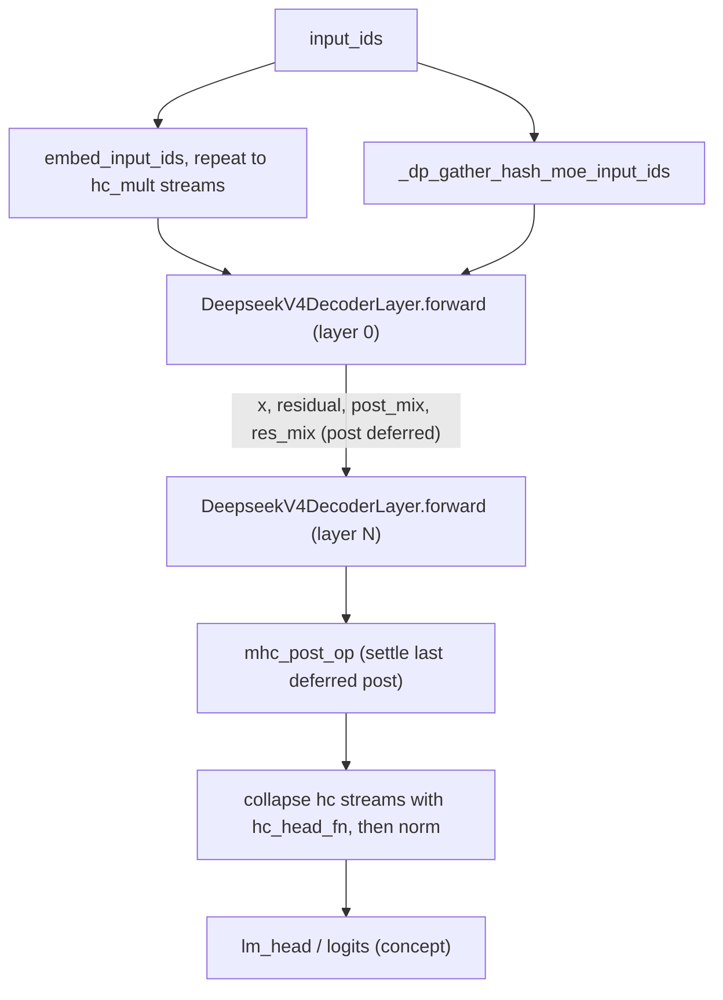
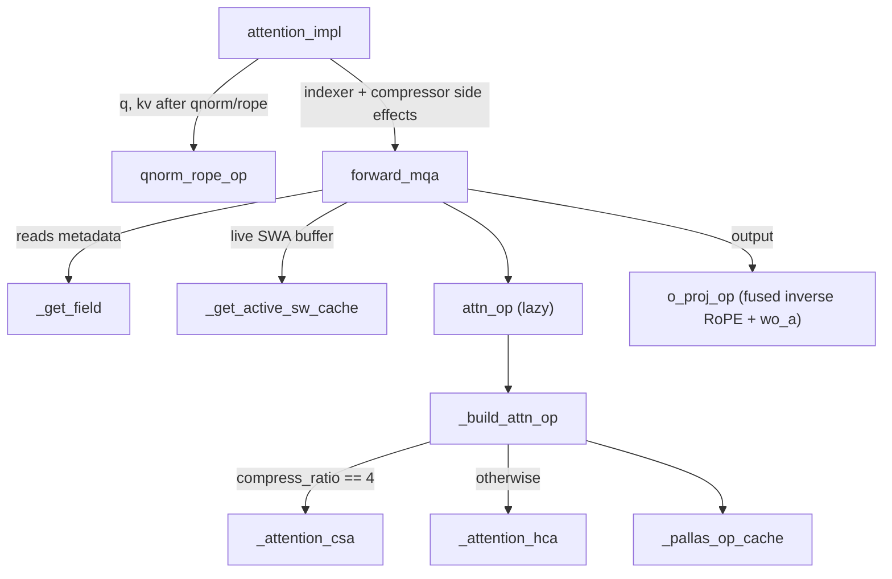

# DeepSeek-V4 native TPU model: mHC residual chain, sparse MLA attention ops, hash MoE, DSpark draft

<!-- connect:up:begin -->
> **Cross-repo concept:** part of [expert-parallelism](../../../concepts/expert-parallelism.md), [kv-cache](../../../concepts/kv-cache.md), [pallas-kernel](../../../concepts/pallas-kernel.md), [sparsecore](../../../concepts/sparsecore.md) across this wiki's repos.
<!-- connect:up:end -->
## Overview

`src/vllm_torchtpu/models/vllm/deepseek_v4/` is the plugin's own DeepSeek-V4 (DSv4) implementation. It reuses upstream vLLM's DSv4 attention module tree and layer classes, but swaps every hot path for a TorchTPU-native piece: the multi-stream residual ("mHC", `hc_mult` parallel residual streams mixed by learned gates) runs as registered Pallas ops, attention runs as **one Pallas op per layer** that does the sliding-window pass and the compressed-KV pass back to back, and the MoE goes through vLLM's fused-MoE factory with a hash-routing table for the first `num_hash_layers` layers. The single most important design idea is **deferral for fusion**: each decoder layer leaves its last mHC `post` unsettled and hands `(residual, post_mix, res_mix)` to the next layer, whose `pre` folds it in, so every post/pre seam is one kernel instead of two passes over the `hc_mult x hidden` residual ([`forward`](../catalog/src/vllm_torchtpu/models/vllm/deepseek_v4/model.md#DeepseekV4DecoderLayer.forward "src/vllm_torchtpu/models/vllm/deepseek_v4/model.py:L168")). The second is that all Pallas ops are **built outside the trace, lazily, and cached by a name that encodes their static geometry** ([`_pallas_op_cache`](../catalog/src/vllm_torchtpu/models/vllm/deepseek_v4/attention.md#_pallas_op_cache._pallas_op_cache "src/vllm_torchtpu/models/vllm/deepseek_v4/attention.py:L69")), so the compiled graph only ever sees a stable torch op call.

The layer type that decides which attention flavour runs is the per-layer `compress_ratio` (inherited from upstream config): `<= 1` is SWA-only, `== 4` is CSA (sparse top-k over an FP8-packed compressed cache, fed by the indexer), anything else is HCA (dense attention over a raw-bf16 compressed latent cache). The DSpark draft model ([`forward`](../catalog/src/vllm_torchtpu/models/vllm/deepseek_v4/dspark.md#DSparkDeepseekV4Model.forward "src/vllm_torchtpu/models/vllm/deepseek_v4/dspark.py:L281")) is the same decoder layer stacked 3x (default) with SWA-only, non-causal in-block attention.

## Diagram

One target-model forward, from tokens to the collapsed hidden state:

Legend:
- `IDS` - (concept) the token ids for this step's flattened batch
- `EMB` - [`embed_input_ids`](../catalog/src/vllm_torchtpu/models/vllm/deepseek_v4/model.md#DeepseekV4Model.embed_input_ids "src/vllm_torchtpu/models/vllm/deepseek_v4/model.py:L372"), called from [`forward`](../catalog/src/vllm_torchtpu/models/vllm/deepseek_v4/model.md#DeepseekV4Model.forward "src/vllm_torchtpu/models/vllm/deepseek_v4/model.py:L424")
- `HASH` - [`_dp_gather_hash_moe_input_ids`](../catalog/src/vllm_torchtpu/models/vllm/deepseek_v4/model.md#DeepseekV4Model._dp_gather_hash_moe_input_ids "src/vllm_torchtpu/models/vllm/deepseek_v4/model.py:L375")
- `L0` - [`DeepseekV4DecoderLayer`](../catalog/src/vllm_torchtpu/models/vllm/deepseek_v4/model.md#DeepseekV4DecoderLayer "src/vllm_torchtpu/models/vllm/deepseek_v4/model.py:L69") via [`forward`](../catalog/src/vllm_torchtpu/models/vllm/deepseek_v4/model.md#DeepseekV4DecoderLayer.forward "src/vllm_torchtpu/models/vllm/deepseek_v4/model.py:L168") (first layer, opens the chain)
- `LN` - [`DeepseekV4DecoderLayer`](../catalog/src/vllm_torchtpu/models/vllm/deepseek_v4/model.md#DeepseekV4DecoderLayer "src/vllm_torchtpu/models/vllm/deepseek_v4/model.py:L69") via [`forward`](../catalog/src/vllm_torchtpu/models/vllm/deepseek_v4/model.md#DeepseekV4DecoderLayer.forward "src/vllm_torchtpu/models/vllm/deepseek_v4/model.py:L168") (any later layer)
- `POST` - [`mhc_post_op`](../catalog/src/vllm_torchtpu/models/vllm/deepseek_v4/model.md#DeepseekV4Model.mhc_post_op "src/vllm_torchtpu/models/vllm/deepseek_v4/model.py:L359")
- `HEAD` - [`hc_head_fn`](../catalog/src/vllm_torchtpu/models/vllm/deepseek_v4/model.md#DeepseekV4Model.hc_head_fn "src/vllm_torchtpu/models/vllm/deepseek_v4/model.py:L332"), [`norm`](../catalog/src/vllm_torchtpu/models/vllm/deepseek_v4/model.md#DeepseekV4Model.norm "src/vllm_torchtpu/models/vllm/deepseek_v4/model.py:L328")
- `LM` - (concept) the LM head and logits processor of the causal-LM wrapper

Inside one attention sublayer (the `attn` call above), down to the per-layer Pallas op:

Legend:
- `AI` - [`attention_impl`](../catalog/src/vllm_torchtpu/models/vllm/deepseek_v4/attention.md#VllmDeepseekV4MLAAttention.attention_impl "src/vllm_torchtpu/models/vllm/deepseek_v4/attention.py:L549")
- `QR` - [`qnorm_rope_op`](../catalog/src/vllm_torchtpu/models/vllm/deepseek_v4/attention.md#VllmDeepseekV4MLAAttention.qnorm_rope_op "src/vllm_torchtpu/models/vllm/deepseek_v4/attention.py:L477")
- `FM` - [`forward_mqa`](../catalog/src/vllm_torchtpu/models/vllm/deepseek_v4/attention.md#VllmDeepseekV4MLAAttention.forward_mqa "src/vllm_torchtpu/models/vllm/deepseek_v4/attention.py:L604")
- `GF` - [`_get_field`](../catalog/src/vllm_torchtpu/models/vllm/deepseek_v4/attention.md#VllmDeepseekV4MLAAttention._get_field "src/vllm_torchtpu/models/vllm/deepseek_v4/attention.py:L619")
- `SW` - [`_get_active_sw_cache`](../catalog/src/vllm_torchtpu/models/vllm/deepseek_v4/attention.md#VllmDeepseekV4MLAAttention._get_active_sw_cache "src/vllm_torchtpu/models/vllm/deepseek_v4/attention.py:L595")
- `AO` - [`attn_op`](../catalog/src/vllm_torchtpu/models/vllm/deepseek_v4/attention.md#VllmDeepseekV4MLAAttention.attn_op "src/vllm_torchtpu/models/vllm/deepseek_v4/attention.py:L281")
- `BO` - [`_build_attn_op`](../catalog/src/vllm_torchtpu/models/vllm/deepseek_v4/attention.md#VllmDeepseekV4MLAAttention._build_attn_op "src/vllm_torchtpu/models/vllm/deepseek_v4/attention.py:L304")
- `CSA` - [`_attention_csa`](../catalog/src/vllm_torchtpu/layers/adapter/custom_ops/deepseek_v4/deepseek_v4_attention_op.md#_attention_csa "src/vllm_torchtpu/layers/adapter/custom_ops/deepseek_v4/deepseek_v4_attention_op.py:L182")
- `HCA` - [`_attention_hca`](../catalog/src/vllm_torchtpu/layers/adapter/custom_ops/deepseek_v4/deepseek_v4_attention_op.md#_attention_hca "src/vllm_torchtpu/layers/adapter/custom_ops/deepseek_v4/deepseek_v4_attention_op.py:L98")
- `CACHE` - [`_pallas_op_cache`](../catalog/src/vllm_torchtpu/models/vllm/deepseek_v4/attention.md#_pallas_op_cache._pallas_op_cache "src/vllm_torchtpu/models/vllm/deepseek_v4/attention.py:L69")
- `OP` - [`o_proj_op`](../catalog/src/vllm_torchtpu/models/vllm/deepseek_v4/attention.md#VllmDeepseekV4MLAAttention.o_proj_op "src/vllm_torchtpu/models/vllm/deepseek_v4/attention.py:L753")

## Design rationale (why it's built this way)

- **Post deferred into the next pre.** The mHC block around each sublayer is `pre` (gate the `hc_mult` residual streams into one sublayer input) and `post` (recombine the sublayer output back into the streams). Done naively that is two full reads/writes of a `[tokens, hc_mult, hidden]` tensor per seam. The decoder layer's docstring states the strategy: "Defer each post into the next pre so the pair is one kernel." Only the very first `pre` (layer 0 attention) runs standalone through [`hc_pre`](../catalog/src/vllm_torchtpu/models/vllm/deepseek_v4/model.md#DeepseekV4DecoderLayer.hc_pre "src/vllm_torchtpu/models/vllm/deepseek_v4/model.py:L153"), and the model closes the chain with [`mhc_post_op`](../catalog/src/vllm_torchtpu/models/vllm/deepseek_v4/model.md#DeepseekV4Model.mhc_post_op "src/vllm_torchtpu/models/vllm/deepseek_v4/model.py:L359"), which "settles the post the last decoder layer deferred". For a 61-layer model that is ~2 x 61 seams collapsed into fused post+pre kernels.
- **Ops are built outside the compiled region.** [`mhc_ops`](../catalog/src/vllm_torchtpu/models/vllm/deepseek_v4/model.md#DeepseekV4DecoderLayer.mhc_ops "src/vllm_torchtpu/models/vllm/deepseek_v4/model.py:L135") is "built once outside the trace"; [`get_mhc_ops`](../catalog/src/vllm_torchtpu/layers/adapter/custom_ops/deepseek_v4/deepseek_v4_mhc_op.md#get_mhc_ops "src/vllm_torchtpu/layers/adapter/custom_ops/deepseek_v4/deepseek_v4_mhc_op.py:L294") explains why: the builders construct JAX `PartitionSpec`s that Dynamo cannot trace, so a cold cache inside a compiled forward is a hard error, not a graph break. The cached op objects are stashed with `object.__setattr__` into `__dict__` so they are not registered as submodules or parameters.
- **One attention op per (geometry, mode).** [`_build_attn_op`](../catalog/src/vllm_torchtpu/models/vllm/deepseek_v4/attention.md#VllmDeepseekV4MLAAttention._build_attn_op "src/vllm_torchtpu/models/vllm/deepseek_v4/attention.py:L304") encodes everything static into the op name: `pallas::deepseek_v4_attention_{swa|csa|hca}_p<logical_page_size>[_aliased][_ncb][_vq<verify_q_len>][_prof]`. Layers with identical geometry share one registered op and one compiled kernel; layers that differ (e.g. CSA vs HCA, draft non-causal vs target causal) get separate ops instead of runtime branches inside the kernel.
- **A profiling op and a real op.** Before vLLM allocates KV caches it runs a profiling forward against `numel == 0` placeholders. [`_live_cache`](../catalog/src/vllm_torchtpu/models/vllm/deepseek_v4/attention.md#_live_cache "src/vllm_torchtpu/models/vllm/deepseek_v4/attention.py:L137") reports those as absent, [`attn_op`](../catalog/src/vllm_torchtpu/models/vllm/deepseek_v4/attention.md#VllmDeepseekV4MLAAttention.attn_op "src/vllm_torchtpu/models/vllm/deepseek_v4/attention.py:L281") builds a `_prof` variant for that pass, and only caches the "real" op permanently once it is built against live caches - "built lazily on first forward with final runtime geometry". The kernels themselves short-circuit on zero-row caches (see [`_attention_hca`](../catalog/src/vllm_torchtpu/layers/adapter/custom_ops/deepseek_v4/deepseek_v4_attention_op.md#_attention_hca "src/vllm_torchtpu/layers/adapter/custom_ops/deepseek_v4/deepseek_v4_attention_op.py:L98")).
- **HCA stores raw bf16 latents, CSA stores packed FP8.** The cache spec comment in `attention.py` says HCA "stores raw bf16 latents rather than pay for DSv4 FP8 quantization and dequantization on every access. Its cache is a small share of the total, so the extra width is cheap"; CSA uses a 128-byte-aligned packed NoPE record plus a separate RoPE companion array. The backend advertises a single KV layout via [`supported_kv_cache_layouts`](../catalog/src/vllm_torchtpu/models/vllm/deepseek_v4/attention.md#DeepseekV4TPUAttentionBackend.supported_kv_cache_layouts "src/vllm_torchtpu/models/vllm/deepseek_v4/attention.py:L74") (`KVCacheLayout.BLHNC`).
- **Upstream classes, TPU submodules.** [`VllmDeepseekV4MLAAttention`](../catalog/src/vllm_torchtpu/models/vllm/deepseek_v4/attention.md#VllmDeepseekV4MLAAttention "src/vllm_torchtpu/models/vllm/deepseek_v4/attention.py:L146") subclasses upstream `DeepseekV4Attention` but, for the duration of its constructor, monkeypatches upstream's indexer / compressor / SWA-cache classes to the TPU-native ones and stubs `torch.cuda.Event` (upstream allocates events for a CUDA aux-stream fan-out that this backend replaces). It also binds [`mla_attn`](../catalog/src/vllm_torchtpu/models/vllm/deepseek_v4/attention.md#VllmDeepseekV4MLAAttention.mla_attn "src/vllm_torchtpu/models/vllm/deepseek_v4/attention.py:L154") to itself, so code written against upstream's `self.mla_attn.*` indirection keeps working.

> [!inferred]
> Collapsing upstream's separate indexer/compressor/attention kernels into "indexer op, compressor op, one attention op" keeps the number of custom-call boundaries per layer small, which matters for a 61-layer model captured as a single compiled graph; the code comment in `model.py` about raising the recursion limit "Tracing 61 layers at long context" shows graph size is already a real constraint.

## Entry points

- [`DeepseekV4TPUAttentionBackend`](../catalog/src/vllm_torchtpu/models/vllm/deepseek_v4/attention.md#DeepseekV4TPUAttentionBackend "src/vllm_torchtpu/models/vllm/deepseek_v4/attention.py:L72") - the attention backend class returned for every DSv4 main attention layer; subclasses the generic [`PallasAttentionBackend`](../catalog/src/vllm_torchtpu/layers/adapter/attention.md#PallasAttentionBackend "src/vllm_torchtpu/layers/adapter/attention.py:L562") and overrides only [`supported_kv_cache_layouts`](../catalog/src/vllm_torchtpu/models/vllm/deepseek_v4/attention.md#DeepseekV4TPUAttentionBackend.supported_kv_cache_layouts "src/vllm_torchtpu/models/vllm/deepseek_v4/attention.py:L74"). Reached by the runner / KV-cache manager when it asks a layer for its backend and layout (the most-external callers of this unit).
- [`forward`](../catalog/src/vllm_torchtpu/models/vllm/deepseek_v4/model.md#DeepseekV4Model.forward "src/vllm_torchtpu/models/vllm/deepseek_v4/model.py:L424") - the backbone forward of the target model; it is the `support_torch_compile` region (dynamic on dim 0 of `input_ids` / `positions` / `inputs_embeds`) that the model runner captures and compiles per token bucket.
- [`forward`](../catalog/src/vllm_torchtpu/models/vllm/deepseek_v4/dspark.md#DSparkDeepseekV4Model.forward "src/vllm_torchtpu/models/vllm/deepseek_v4/dspark.py:L281") and [`precompute_and_store_context_kv`](../catalog/src/vllm_torchtpu/models/vllm/deepseek_v4/dspark.md#DSparkDeepseekV4Model.precompute_and_store_context_kv "src/vllm_torchtpu/models/vllm/deepseek_v4/dspark.py:L261") - the DSpark draft's propose step and its "insert the sliding-window context KV for every draft layer" step, driven by the speculative-decoding proposer when the speculative config names the DSpark draft architecture.
- [`load_weights`](../catalog/src/vllm_torchtpu/models/vllm/deepseek_v4/dspark.md#DSparkDeepseekV4ForCausalLM.load_weights "src/vllm_torchtpu/models/vllm/deepseek_v4/dspark.py:L395") - loads the draft's `mtp.{i}.*` tensors out of the target checkpoint ("Load ``mtp.{i}.*`` draft weights from the target checkpoint"), rewriting names and then delegating to the target's own layer loader.

## Mechanism (step-by-step)

1. **Embed and fan out to `hc_mult` streams.** On the first pipeline rank, [`forward`](../catalog/src/vllm_torchtpu/models/vllm/deepseek_v4/model.md#DeepseekV4Model.forward "src/vllm_torchtpu/models/vllm/deepseek_v4/model.py:L424") embeds via [`embed_input_ids`](../catalog/src/vllm_torchtpu/models/vllm/deepseek_v4/model.md#DeepseekV4Model.embed_input_ids "src/vllm_torchtpu/models/vllm/deepseek_v4/model.py:L372") and repeats the `[T, H]` embedding into `[T, hc_mult, H]` ([`hc_mult`](../catalog/src/vllm_torchtpu/models/vllm/deepseek_v4/model.md#DeepseekV4Model.hc_mult "src/vllm_torchtpu/models/vllm/deepseek_v4/model.py:L296") comes from the HF [`config`](../catalog/src/vllm_torchtpu/models/vllm/deepseek_v4/model.md#DeepseekV4Model.config "src/vllm_torchtpu/models/vllm/deepseek_v4/model.py:L293")). Later pipeline ranks receive the multi-stream tensor as `IntermediateTensors` instead. This is the activation that every mHC kernel reads; its width is `hc_mult x hidden_size`, which is why the post/pre fusion below pays off.

2. **Gather hash-MoE token ids under data parallelism.** The first `num_hash_layers` MoE layers route by `hash_indices_table[input_ids]`, so the ids have to line up row-for-row with the hidden states the experts receive. [`_dp_gather_hash_moe_input_ids`](../catalog/src/vllm_torchtpu/models/vllm/deepseek_v4/model.md#DeepseekV4Model._dp_gather_hash_moe_input_ids "src/vllm_torchtpu/models/vllm/deepseek_v4/model.py:L375") asks each hash layer's [`ffn`](../catalog/src/vllm_torchtpu/models/vllm/deepseek_v4/model.md#DeepseekV4DecoderLayer.ffn "src/vllm_torchtpu/models/vllm/deepseek_v4/model.py:L99") whether the MoE runner DP-gathers tokens; if yes it does one `all_gather(dim=0)` over the DP group (matching the hidden-state gather), if the fused EP kernel owns dispatch it keeps the local ids. It asserts all hash layers agree, because one gather serves all of them and a disagreement "would be a silent shape mismatch deep in a layer". The gather happens once per forward, not per layer.

3. **Open the mHC chain and run attention.** In [`forward`](../catalog/src/vllm_torchtpu/models/vllm/deepseek_v4/model.md#DeepseekV4DecoderLayer.forward "src/vllm_torchtpu/models/vllm/deepseek_v4/model.py:L168"), layer 0 sees `residual is None` and runs a standalone [`hc_pre`](../catalog/src/vllm_torchtpu/models/vllm/deepseek_v4/model.md#DeepseekV4DecoderLayer.hc_pre "src/vllm_torchtpu/models/vllm/deepseek_v4/model.py:L153") with the attention gates; every later layer instead calls `mhc_ops.fused(...)`, which settles the previous layer's deferred FFN post and computes this layer's attention pre in one pass. The result goes through [`attn_norm`](../catalog/src/vllm_torchtpu/models/vllm/deepseek_v4/model.md#DeepseekV4DecoderLayer.attn_norm "src/vllm_torchtpu/models/vllm/deepseek_v4/model.py:L101") and [`attn`](../catalog/src/vllm_torchtpu/models/vllm/deepseek_v4/model.md#DeepseekV4DecoderLayer.attn "src/vllm_torchtpu/models/vllm/deepseek_v4/model.py:L93"). The gate constants (`rms_norm_eps`, `hc_eps`, `hc_post_alpha`, Sinkhorn iterations) are baked into the op by [`mhc_ops`](../catalog/src/vllm_torchtpu/models/vllm/deepseek_v4/model.md#DeepseekV4DecoderLayer.mhc_ops "src/vllm_torchtpu/models/vllm/deepseek_v4/model.py:L135") (from [`rms_norm_eps`](../catalog/src/vllm_torchtpu/models/vllm/deepseek_v4/model.md#DeepseekV4DecoderLayer.rms_norm_eps "src/vllm_torchtpu/models/vllm/deepseek_v4/model.py:L87") and the HF config), so only tensors cross the op boundary.

4. **Attention: projections, fused q-norm + RoPE, indexer, compressor.** The attention forward does one fused `wq_a || wkv` GEMM, splits `qr` / `kv`, normalizes both, and calls [`attention_impl`](../catalog/src/vllm_torchtpu/models/vllm/deepseek_v4/attention.md#VllmDeepseekV4MLAAttention.attention_impl "src/vllm_torchtpu/models/vllm/deepseek_v4/attention.py:L549") ("Execute indexing, state compression, and kernel attention dispatch"). That projects `q` through `wq_b`, applies [`qnorm_rope_op`](../catalog/src/vllm_torchtpu/models/vllm/deepseek_v4/attention.md#VllmDeepseekV4MLAAttention.qnorm_rope_op "src/vllm_torchtpu/models/vllm/deepseek_v4/attention.py:L477") (per-head weightless RMSNorm fused with RoPE, head-sharded on the `model` mesh axis) and a separate KV RoPE op, then runs the indexer (CSA layers only - produces `topk_indices`, see [streamindex top-k](deepseek-v4-streamindex-topk-kernel.md)) and the compressor (writes compressed KV into the main cache, see [compress-and-store](deepseek-v4-compress-and-store-kernel.md)). The compressor is a side effect on the cache; only the top-k indices flow on into attention.

5. **Assemble operands and dispatch the per-layer Pallas op.** [`forward_mqa`](../catalog/src/vllm_torchtpu/models/vllm/deepseek_v4/attention.md#VllmDeepseekV4MLAAttention.forward_mqa "src/vllm_torchtpu/models/vllm/deepseek_v4/attention.py:L604") ("Prepare metadata operands and dispatch the Pallas attention op") pulls per-layer metadata out of the forward context with [`_get_field`](../catalog/src/vllm_torchtpu/models/vllm/deepseek_v4/attention.md#VllmDeepseekV4MLAAttention._get_field "src/vllm_torchtpu/models/vllm/deepseek_v4/attention.py:L619") - the SWA cache layer and the main layer have separate metadata entries keyed by prefix ([`custom_prefix`](../catalog/src/vllm_torchtpu/models/vllm/deepseek_v4/attention.md#VllmDeepseekV4MLAAttention.custom_prefix "src/vllm_torchtpu/models/vllm/deepseek_v4/attention.py:L184") and the SWA layer's own prefix). It gets the live SWA buffer from [`_get_active_sw_cache`](../catalog/src/vllm_torchtpu/models/vllm/deepseek_v4/attention.md#VllmDeepseekV4MLAAttention._get_active_sw_cache "src/vllm_torchtpu/models/vllm/deepseek_v4/attention.py:L595") (bitcast to `uint8`), divides main `seq_lens` by `compress_ratio` to get compressed lengths, and builds a 14-operand tuple (15 for CSA, which appends the RoPE companion array). The `extra` operand is `topk_indices` for CSA and `(positions + 1) // compress_ratio` (compressed KV length to attend) for HCA/SWA. Missing caches are replaced by **clones**, never aliases, because "XLA dedupes identical inputs into one operand and desyncs the declared signature". After [`attn_op`](../catalog/src/vllm_torchtpu/models/vllm/deepseek_v4/attention.md#VllmDeepseekV4MLAAttention.attn_op "src/vllm_torchtpu/models/vllm/deepseek_v4/attention.py:L281") returns `(output, new_sw_cache)`, the updated SWA buffer is copied back into the bound cache tensor.

6. **Build (once) the attention op for this geometry.** On first use, [`_build_attn_op`](../catalog/src/vllm_torchtpu/models/vllm/deepseek_v4/attention.md#VllmDeepseekV4MLAAttention._build_attn_op "src/vllm_torchtpu/models/vllm/deepseek_v4/attention.py:L304") reads the wrapper context ([`get_vllm_model_wrapper_context`](../catalog/src/vllm_torchtpu/models/vllm/vllm_model_wrapper_context.md#get_vllm_model_wrapper_context "src/vllm_torchtpu/models/vllm/vllm_model_wrapper_context.py:L39")) and mesh ([`get_pallas_op_mesh`](../catalog/src/vllm_torchtpu/models/vllm/vllm_model_wrapper_context.md#get_pallas_op_mesh "src/vllm_torchtpu/models/vllm/vllm_model_wrapper_context.py:L48")), recomputes the SWA logical page size from the cache config, detects whether the SWA and main caches **share one buffer** (`data_ptr` equality - then the compressed pass must read the SWA kernel's fresh write), reads `non_causal_multi_token_decode` (DSpark draft layers) and the speculative verify length from [`static_verify_q_len`](../catalog/src/vllm_torchtpu/layers/adapter/custom_ops/deepseek_v4/deepseek_v4_indexer.md#static_verify_q_len "src/vllm_torchtpu/layers/adapter/custom_ops/deepseek_v4/deepseek_v4_indexer.py:L60"), and partially applies [`_attention_csa`](../catalog/src/vllm_torchtpu/layers/adapter/custom_ops/deepseek_v4/deepseek_v4_attention_op.md#_attention_csa "src/vllm_torchtpu/layers/adapter/custom_ops/deepseek_v4/deepseek_v4_attention_op.py:L182") or [`_attention_hca`](../catalog/src/vllm_torchtpu/layers/adapter/custom_ops/deepseek_v4/deepseek_v4_attention_op.md#_attention_hca "src/vllm_torchtpu/layers/adapter/custom_ops/deepseek_v4/deepseek_v4_attention_op.py:L98"). The op is registered with `pallas.jax_op` with `q` head-sharded on `model`, attention sinks sharded on `model`, everything else replicated, and **`donate_argnums=(2,)`** so the SWA cache is updated in place. Result goes into [`_pallas_op_cache`](../catalog/src/vllm_torchtpu/models/vllm/deepseek_v4/attention.md#_pallas_op_cache._pallas_op_cache "src/vllm_torchtpu/models/vllm/deepseek_v4/attention.py:L69").

7. **Inside the op: SWA pass, then compressed pass merged into one softmax.** Both wrapped functions first run the sliding-window kernel ([`mla_sliding_window_ragged_paged_attention`](../catalog/src/vllm_torchtpu/kernels/deepseek_v4/core_attention/mla_swa.md#mla_sliding_window_ragged_paged_attention "src/vllm_torchtpu/kernels/deepseek_v4/core_attention/mla_swa.py:L1462")), which writes the new tokens into the SWA cache and, when a compressed pass follows, leaves its output unnormalized with running `l` / `m` statistics. HCA then calls [`mla_ragged_paged_attention`](../catalog/src/vllm_torchtpu/kernels/deepseek_v4/core_attention/mla.md#mla_ragged_paged_attention "src/vllm_torchtpu/kernels/deepseek_v4/core_attention/mla.py:L710") over the dense compressed cache; CSA calls [`sparse_ragged_paged_attention`](../catalog/src/vllm_torchtpu/kernels/deepseek_v4/core_attention/sparse_mla.md#sparse_ragged_paged_attention "src/vllm_torchtpu/kernels/deepseek_v4/core_attention/sparse_mla.py:L657") over the top-k gathered rows. Both fold the SWA partials into their own accumulation, so the layer pays one final normalization. CSA inserts a `jax.lax.optimization_barrier` on `(topk, swa_output)` so the SparseCore top-k can finish behind the q projection and SWA pass "instead of stalling the TensorCore before them". The block sizes (`num_kv_pages_per_block`, `num_queries_per_block`, CSA gather chunk 32/64/128 by token count) are hard-coded "tuned based on microbenchmark results". See [MLA attention kernels](mla-attention-kernels.md).

8. **Output projection, FFN, deferred post.** The attention output goes through [`o_proj_op`](../catalog/src/vllm_torchtpu/models/vllm/deepseek_v4/attention.md#VllmDeepseekV4MLAAttention.o_proj_op "src/vllm_torchtpu/models/vllm/deepseek_v4/attention.py:L753") - "The fused inverse-RoPE + `wo_a` projection op", which also quantizes activations to FP8 in-kernel and multiplies against an FP8 `wo_a` - then `wo_b`. Back in [`forward`](../catalog/src/vllm_torchtpu/models/vllm/deepseek_v4/model.md#DeepseekV4DecoderLayer.forward "src/vllm_torchtpu/models/vllm/deepseek_v4/model.py:L168"), a second `mhc_ops.fused` settles the attention post and computes the FFN pre, [`ffn_norm`](../catalog/src/vllm_torchtpu/models/vllm/deepseek_v4/model.md#DeepseekV4DecoderLayer.ffn_norm "src/vllm_torchtpu/models/vllm/deepseek_v4/model.py:L102") runs, and the MoE [`ffn`](../catalog/src/vllm_torchtpu/models/vllm/deepseek_v4/model.md#DeepseekV4DecoderLayer.ffn "src/vllm_torchtpu/models/vllm/deepseek_v4/model.py:L99") executes: its [`experts`](../catalog/src/vllm_torchtpu/models/vllm/deepseek_v4/moe.md#DeepseekV4MoE.experts "src/vllm_torchtpu/models/vllm/deepseek_v4/moe.py:L98") are a fused-MoE layer built from the [`gate`](../catalog/src/vllm_torchtpu/models/vllm/deepseek_v4/moe.md#DeepseekV4MoE.gate "src/vllm_torchtpu/models/vllm/deepseek_v4/moe.py:L53") (fp32 router logits, `sqrtsoftplus` scoring by default) and optional [`shared_experts`](../catalog/src/vllm_torchtpu/models/vllm/deepseek_v4/moe.md#DeepseekV4MoE.shared_experts "src/vllm_torchtpu/models/vllm/deepseek_v4/moe.py:L82"). The layer returns the FFN output raw, with its post still owed.

9. **Close the chain and collapse the streams.** After the last layer, [`forward`](../catalog/src/vllm_torchtpu/models/vllm/deepseek_v4/model.md#DeepseekV4Model.forward "src/vllm_torchtpu/models/vllm/deepseek_v4/model.py:L424") runs [`mhc_post_op`](../catalog/src/vllm_torchtpu/models/vllm/deepseek_v4/model.md#DeepseekV4Model.mhc_post_op "src/vllm_torchtpu/models/vllm/deepseek_v4/model.py:L359") (shared cache entry from [`get_mhc_post_op`](../catalog/src/vllm_torchtpu/layers/adapter/custom_ops/deepseek_v4/deepseek_v4_mhc_op.md#get_mhc_post_op "src/vllm_torchtpu/layers/adapter/custom_ops/deepseek_v4/deepseek_v4_mhc_op.py:L208")), then collapses the `hc_mult` streams with a sigmoid-gated weighted sum driven by [`hc_head_fn`](../catalog/src/vllm_torchtpu/models/vllm/deepseek_v4/model.md#DeepseekV4Model.hc_head_fn "src/vllm_torchtpu/models/vllm/deepseek_v4/model.py:L332") (plain PyTorch, since upstream only ships GPU kernels for this head), and applies the final [`norm`](../catalog/src/vllm_torchtpu/models/vllm/deepseek_v4/model.md#DeepseekV4Model.norm "src/vllm_torchtpu/models/vllm/deepseek_v4/model.py:L328"). If eagle-family aux hidden-state layers are tagged, the post is settled at those layers too and the stream-mean is returned alongside; the tag must be set before warmup "so the captured forward is the one that compiles".

10. **DSpark draft: context-KV insert, then a short non-causal stack.** [`precompute_and_store_context_kv`](../catalog/src/vllm_torchtpu/models/vllm/deepseek_v4/dspark.md#DSparkDeepseekV4Model.precompute_and_store_context_kv "src/vllm_torchtpu/models/vllm/deepseek_v4/dspark.py:L261") combines tagged target hidden states, projects the latent KV per draft layer, and writes it into each draft layer's SWA cache **by running the full attention op with a zero query and discarding the output** - the in-code TODO says this should become a dedicated paged-cache insert kernel. The draft [`forward`](../catalog/src/vllm_torchtpu/models/vllm/deepseek_v4/dspark.md#DSparkDeepseekV4Model.forward "src/vllm_torchtpu/models/vllm/deepseek_v4/dspark.py:L281") then runs its [`layers`](../catalog/src/vllm_torchtpu/models/vllm/deepseek_v4/dspark.md#DSparkDeepseekV4Model.layers "src/vllm_torchtpu/models/vllm/deepseek_v4/dspark.py:L173") (built as `DeepseekV4DecoderLayer`s indexed after the target's layers, each flagged non-causal so `_build_attn_op` picks the `_ncb` op), settles the post via the borrowed [`mhc_post_op`](../catalog/src/vllm_torchtpu/models/vllm/deepseek_v4/dspark.md#DSparkDeepseekV4Model.mhc_post_op "src/vllm_torchtpu/models/vllm/deepseek_v4/dspark.py:L238"), and collapses the head. Embeddings come from [`embed_input_ids`](../catalog/src/vllm_torchtpu/models/vllm/deepseek_v4/dspark.md#DSparkDeepseekV4Model.embed_input_ids "src/vllm_torchtpu/models/vllm/deepseek_v4/dspark.py:L242") over the target's aliased embedding table.

## Key data structures

- **mHC carry `(x, residual, post_mix, res_mix)`.** Threaded through every [`DeepseekV4DecoderLayer`](../catalog/src/vllm_torchtpu/models/vllm/deepseek_v4/model.md#DeepseekV4DecoderLayer "src/vllm_torchtpu/models/vllm/deepseek_v4/model.py:L69") call: `x` is the previous sublayer's raw output, `residual` the `[T, hc_mult, H]` streams, `post_mix` `[T, hc_mult, 1]` and `res_mix` `[T, hc_mult, hc_mult]` (fp32) the mixing weights the deferred post still has to apply. Each layer owns six fp32 gate parameters (`hc_{attn,ffn}_{fn,base,scale}`), with `fn` of shape `[(2 + hc_mult) * hc_mult, hc_mult * H]`.
- **Per-layer KV entry.** SWA-only and HCA layers bind one tensor; a CSA layer's `kv_cache` is a `(nope, rope)` tuple. [`forward_mqa`](../catalog/src/vllm_torchtpu/models/vllm/deepseek_v4/attention.md#VllmDeepseekV4MLAAttention.forward_mqa "src/vllm_torchtpu/models/vllm/deepseek_v4/attention.py:L604") raises if a CSA layer has a live NoPE array but no RoPE companion - falling through "would hand the kernel the NoPE array as its RoPE operand and silently attend to the wrong channels". The SWA cache is a separate cache layer that may overlay the CSA main page.
- **Op caches.** [`_pallas_op_cache`](../catalog/src/vllm_torchtpu/models/vllm/deepseek_v4/attention.md#_pallas_op_cache._pallas_op_cache "src/vllm_torchtpu/models/vllm/deepseek_v4/attention.py:L69") is a module-global `dict[str, op]` keyed by the encoded op name (attention, q-norm/RoPE with eps in the name, KV RoPE, o-proj with head_dim in the name). Per-instance shortcuts (`_attn_op_instance`, `_attn_op_prof_instance`, `_qnorm_rope_op_instance`, `_mhc_ops_instance`) live in `__dict__`.
- **`topk_indices_buffer`.** A model-level `[max_num_batched_tokens, index_topk]` int32 buffer shared by every layer's indexer (allocated in the backbone constructor and passed to each decoder layer).

## Dynamics (design intent)

- **Lockstep requirement for intra-chip TP.** When `TPU_DSV4_ATTN_INTRA_CHIP_TP=1`, [`attn`](../catalog/src/vllm_torchtpu/models/vllm/deepseek_v4/model.md#DeepseekV4DecoderLayer.attn "src/vllm_torchtpu/models/vllm/deepseek_v4/model.py:L93") is the intra-chip variant, which splits `wq_b`, `wo_a`, `wo_b` across the two TensorCores of a dual-chiplet chip (the module docstring names Ironwood) while keeping KV and attention data-parallel. Its [`_o_proj`](../catalog/src/vllm_torchtpu/models/vllm/deepseek_v4/attn_intra_chip.md#VllmDeepseekV4MLAAttentionIntraChip._o_proj "src/vllm_torchtpu/models/vllm/deepseek_v4/attn_intra_chip.py:L217") swaps head halves with the peer core (2-rank all-gather), all-gathers positions, runs the fused `wo_a` op over 8 groups, applies its half of [`wo_b`](../catalog/src/vllm_torchtpu/models/vllm/deepseek_v4/attn_intra_chip.md#VllmDeepseekV4MLAAttentionIntraChip.wo_b "src/vllm_torchtpu/models/vllm/deepseek_v4/attn_intra_chip.py:L170"), and reduce-scatters the partials. Because every layer exchanges activations, both cores must run every forward at the same padded token count; the constructor therefore requires TP size 1 and DP > 1 with expert parallelism (the only mode in which the runner keeps DP ranks in lockstep), otherwise "the exchange hangs or pairs tensors from different steps". The docstring labels it experimental.
- **Op build order.** mHC ops must exist before the first compiled forward (the runner materializes them); attention ops are built on first forward and rebuilt exactly once more when the real caches appear (profiling op first, real op second).
- **Verify windows.** With speculative decoding, verify windows of exactly `1 + K` tokens occupy the request distribution's middle segment and run the kernels' static query-length pass (`_vq<K+1>` op variant); `TPU_SPEC_STATIC_VERIFY=0` turns this off. Draft layers get the same length because their context-KV insert runs on the target's verify metadata.

## Edge cases

- **Two caches, one buffer.** If the SWA cache and the main compressed cache resolve to the same `data_ptr`, the op is built `_aliased` and the compressed pass reads the SWA kernel's updated buffer rather than the pre-write snapshot - otherwise it would miss the tokens written this step.
- **DSpark window bound.** The draft model rejects `num_speculative_tokens + 1 > window_size`, because the SWA kernel's non-causal block mode walks key blocks sized from the window and "would silently lose its earliest in-block keys". Draft layers must be SWA-only (`compress_ratio <= 1`, asserted on insert).
- **Weight loading leaks HBM without host staging.** On this backend, `copy_()` into a slice/view of a device tensor allocates a fresh buffer per call. The backbone's loader therefore stages every parameter on host, lets vLLM's per-expert / per-shard loaders write slices there, and flushes each parameter with one whole-tensor device copy. FP8 E8M0 expert scales are viewed as `uint8` so `copy_()` does not numerically convert exponent bytes (2^-7 -> 0). [`load_weights`](../catalog/src/vllm_torchtpu/models/vllm/deepseek_v4/dspark.md#DSparkDeepseekV4ForCausalLM.load_weights "src/vllm_torchtpu/models/vllm/deepseek_v4/dspark.py:L395") borrows the same loader for draft layers, and drops the confidence head if its weights were not found ("Uninitialized weights would score drafts at random").
- **Fused o-projection preconditions.** The o-proj kernel is the only `wo_a` path, so an FP8 `float8_e4m3fn` weight with per-output-channel scales, exactly 8 heads per group, `head_dim % 128 == 0` and even `rotary_dim <= 128` are hard asserts. Setting `REQUANTIZE_WEIGHT_DTYPE` or `REQUANTIZE_BLOCK_SIZE` (blockwise requantization) breaks it.
- **Hash MoE requires ids.** A hash layer called without `input_ids` raises; with DP > 1 the ids must be DP-gathered exactly when hidden states are.

## Open questions

- Packet gaps: the causal-LM wrapper (`DeepseekV4ForCausalLM`, the registered architecture), the backbone class itself, the host-staging helper, the MoE class, the intra-chip attention class, the DSpark wrapper/model classes, the draft context-KV insert helper, `get_kv_cache_spec`, `process_weights_after_loading` and the stream-collapse head helper in `layers.py` are not in this packet's subgraph, so they are described above without catalog links.
- How much of a decode step the 14/15-operand attention op spends on the SWA pass vs the compressed pass is not visible statically; the hard-coded block sizes are described only as microbenchmark-tuned.
- The context-KV insert for DSpark runs a full attention op per draft layer per step; the cost of that (vs a dedicated insert kernel) is flagged by a TODO but not quantified in the repo.

## See also

- [MLA attention kernels](mla-attention-kernels.md) - the SWA, dense-MLA and sparse-MLA kernels the per-layer op calls
- [DeepSeek-V4 compress-and-store kernel](deepseek-v4-compress-and-store-kernel.md) - the compressor that fills the main KV cache
- [DeepSeek-V4 streamindex top-k kernel](deepseek-v4-streamindex-topk-kernel.md) - the indexer that produces CSA top-k indices
- [KV cache layout and HBM budget](kv-cache-layout-and-hbm-budget.md)
- [Fused MoE kernels](fused-moe-kernels.md) and [adaptive fused MoE kernel](adaptive-fused-moe-kernel.md)
- [Speculative decoding](speculative-decoding.md) - the DSpark proposer and static verify windows
- [Custom ops](custom-ops.md) and [vLLM layer adapters](vllm-layer-adapters.md) - `pallas.jax_op` registration pattern
- [Compilation and graph capture](compilation-and-graph-capture.md)
- [Distributed parallelism and meshes](distributed-parallelism-and-meshes.md)
- [SparseCore ragged gather/scatter](sparsecore-ragged-gather-scatter.md)
