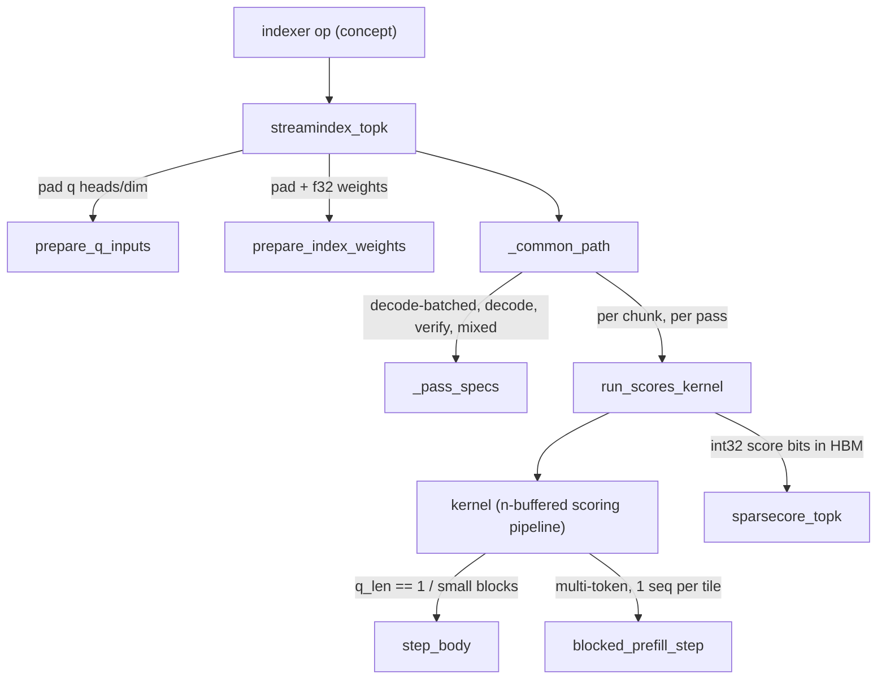
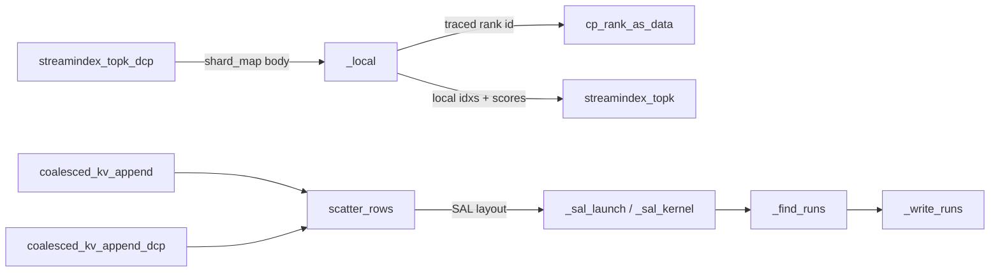

# StreamIndex top-k: FP8 indexer scoring on the TensorCore, exact top-k on the SparseCore, and the packed indexer K cache

<!-- connect:up:begin -->
> **Cross-repo concept:** part of [kv-cache](../../../concepts/kv-cache.md), [pallas-kernel](../../../concepts/pallas-kernel.md), [sparsecore](../../../concepts/sparsecore.md), [vmem](../../../concepts/vmem.md) across this wiki's repos.
<!-- connect:up:end -->
## Overview

DeepSeek-style sparse attention (DSv4's CSA layers, and the DeepSeek-V3.2-style sparse indexer used for GLM-5.2) does not attend over the whole compressed KV cache: for each query token an **indexer** scores every visible compressed position as `sum_h w_h * relu(q_h . k)` (k is one FP8 key per position, `w_h` per-head indexer weights) and keeps the top `k` positions, which the sparse MLA kernel then gathers. `src/vllm_torchtpu/kernels/deepseek_v4/streamindex_topk/` is that indexer. [`streamindex_topk`](../catalog/src/vllm_torchtpu/kernels/deepseek_v4/streamindex_topk/streamindex_topk.md#streamindex_topk "src/vllm_torchtpu/kernels/deepseek_v4/streamindex_topk/streamindex_topk.py:L1053") ("StreamIndex Top-K retrieval") splits the job across the two TPU engines: a Pallas TensorCore pipeline streams the paged FP8 key cache and writes a dense `[tokens, positions]` score matrix to HBM, and a SparseCore kernel ([`sparsecore_topk`](../catalog/src/vllm_torchtpu/kernels/deepseek_v4/sparsecore_topk.md#sparsecore_topk "src/vllm_torchtpu/kernels/deepseek_v4/sparsecore_topk.py:L808")) extracts the exact top-k per row. Scoring is a streaming read of the whole visible key cache per query block, so it is HBM-bandwidth bound; the central performance idea of the subsystem is therefore the **cache layout** ([`KVLayout`](../catalog/src/vllm_torchtpu/kernels/deepseek_v4/streamindex_topk/config.md#KVLayout "src/vllm_torchtpu/kernels/deepseek_v4/streamindex_topk/config.py:L42")): [`SEQ_ALONG_LANE`](../catalog/src/vllm_torchtpu/kernels/deepseek_v4/streamindex_topk/config.md#KVLayout.SEQ_ALONG_LANE "src/vllm_torchtpu/kernels/deepseek_v4/streamindex_topk/config.py:L66") stores 132 bytes per token instead of the 256 that [`HEAD_ALONG_SUBLANE`](../catalog/src/vllm_torchtpu/kernels/deepseek_v4/streamindex_topk/config.md#KVLayout.HEAD_ALONG_SUBLANE "src/vllm_torchtpu/kernels/deepseek_v4/streamindex_topk/config.py:L65") needs, and puts keys in the MXU-native contraction layout.

Three further pieces complete the subsystem: a context-parallel variant ([`streamindex_topk_dcp`](../catalog/src/vllm_torchtpu/kernels/deepseek_v4/streamindex_topk/streamindex_topk.md#streamindex_topk_dcp "src/vllm_torchtpu/kernels/deepseek_v4/streamindex_topk/streamindex_topk.py:L1657")) that computes the exact global top-k over a cache sharded across DCP ranks; the cache geometry helpers ([`get_kv_cache_shape`](../catalog/src/vllm_torchtpu/kernels/deepseek_v4/streamindex_topk/streamindex_topk.md#get_kv_cache_shape "src/vllm_torchtpu/kernels/deepseek_v4/streamindex_topk/streamindex_topk.py:L923"), [`indexer_kv_layout`](../catalog/src/vllm_torchtpu/kernels/deepseek_v4/streamindex_topk/streamindex_topk.md#indexer_kv_layout "src/vllm_torchtpu/kernels/deepseek_v4/streamindex_topk/streamindex_topk.py:L847")) that the allocator and ops share; and a Pallas writer ([`scatter_rows`](../catalog/src/vllm_torchtpu/kernels/deepseek_v4/streamindex_topk/kv_cache_append.md#scatter_rows "src/vllm_torchtpu/kernels/deepseek_v4/streamindex_topk/kv_cache_append.py:L781") behind [`coalesced_kv_append`](../catalog/src/vllm_torchtpu/kernels/deepseek_v4/streamindex_topk/kv_cache_append.md#coalesced_kv_append "src/vllm_torchtpu/kernels/deepseek_v4/streamindex_topk/kv_cache_append.py:L870")) that appends new key rows into the 4-token-packed cache. (In DSv4 the indexer cache is instead written by the compressor kernel, see [compress-and-store](deepseek-v4-compress-and-store-kernel.md).)

## Diagram

One top-k call (unsharded), with the optional chunked TensorCore/SparseCore overlap:

Legend:
- `CALL` - (concept) the DSv4 indexer op or the sparse-attention indexer op that wraps this kernel
- `ST` - [`streamindex_topk`](../catalog/src/vllm_torchtpu/kernels/deepseek_v4/streamindex_topk/streamindex_topk.md#streamindex_topk "src/vllm_torchtpu/kernels/deepseek_v4/streamindex_topk/streamindex_topk.py:L1053")
- `PQ` - [`prepare_q_inputs`](../catalog/src/vllm_torchtpu/kernels/deepseek_v4/streamindex_topk/streamindex_topk.md#prepare_q_inputs "src/vllm_torchtpu/kernels/deepseek_v4/streamindex_topk/streamindex_topk.py:L780")
- `PW` - [`prepare_index_weights`](../catalog/src/vllm_torchtpu/kernels/deepseek_v4/streamindex_topk/streamindex_topk.md#prepare_index_weights "src/vllm_torchtpu/kernels/deepseek_v4/streamindex_topk/streamindex_topk.py:L799")
- `CP` - [`_common_path`](../catalog/src/vllm_torchtpu/kernels/deepseek_v4/streamindex_topk/streamindex_topk.md#streamindex_topk._common_path "src/vllm_torchtpu/kernels/deepseek_v4/streamindex_topk/streamindex_topk.py:L1497")
- `PS` - [`_pass_specs`](../catalog/src/vllm_torchtpu/kernels/deepseek_v4/streamindex_topk/streamindex_topk.md#streamindex_topk._pass_specs "src/vllm_torchtpu/kernels/deepseek_v4/streamindex_topk/streamindex_topk.py:L1378")
- `RS` - [`run_scores_kernel`](../catalog/src/vllm_torchtpu/kernels/deepseek_v4/streamindex_topk/streamindex_topk.md#streamindex_topk.run_scores_kernel "src/vllm_torchtpu/kernels/deepseek_v4/streamindex_topk/streamindex_topk.py:L1261")
- `K` - [`kernel`](../catalog/src/vllm_torchtpu/kernels/deepseek_v4/streamindex_topk/streamindex_topk.md#kernel "src/vllm_torchtpu/kernels/deepseek_v4/streamindex_topk/streamindex_topk.py:L183")
- `SB` - [`step_body`](../catalog/src/vllm_torchtpu/kernels/deepseek_v4/streamindex_topk/streamindex_topk.md#kernel.step_body "src/vllm_torchtpu/kernels/deepseek_v4/streamindex_topk/streamindex_topk.py:L490")
- `BP` - [`blocked_prefill_step`](../catalog/src/vllm_torchtpu/kernels/deepseek_v4/streamindex_topk/streamindex_topk.md#kernel.blocked_prefill_step "src/vllm_torchtpu/kernels/deepseek_v4/streamindex_topk/streamindex_topk.py:L555")
- `TOPK` - [`sparsecore_topk`](../catalog/src/vllm_torchtpu/kernels/deepseek_v4/sparsecore_topk.md#sparsecore_topk "src/vllm_torchtpu/kernels/deepseek_v4/sparsecore_topk.py:L808")

The DCP variant and the cache writer:

Legend:
- `DCP` - [`streamindex_topk_dcp`](../catalog/src/vllm_torchtpu/kernels/deepseek_v4/streamindex_topk/streamindex_topk.md#streamindex_topk_dcp "src/vllm_torchtpu/kernels/deepseek_v4/streamindex_topk/streamindex_topk.py:L1657")
- `LOC` - [`_local`](../catalog/src/vllm_torchtpu/kernels/deepseek_v4/streamindex_topk/streamindex_topk.md#streamindex_topk_dcp._local "src/vllm_torchtpu/kernels/deepseek_v4/streamindex_topk/streamindex_topk.py:L1777")
- `CPR` - [`cp_rank_as_data`](../catalog/src/vllm_torchtpu/kernels/deepseek_v4/streamindex_topk/streamindex_topk.md#cp_rank_as_data "src/vllm_torchtpu/kernels/deepseek_v4/streamindex_topk/streamindex_topk.py:L59")
- `ST2` - [`streamindex_topk`](../catalog/src/vllm_torchtpu/kernels/deepseek_v4/streamindex_topk/streamindex_topk.md#streamindex_topk "src/vllm_torchtpu/kernels/deepseek_v4/streamindex_topk/streamindex_topk.py:L1053")
- `APP` - [`coalesced_kv_append`](../catalog/src/vllm_torchtpu/kernels/deepseek_v4/streamindex_topk/kv_cache_append.md#coalesced_kv_append "src/vllm_torchtpu/kernels/deepseek_v4/streamindex_topk/kv_cache_append.py:L870")
- `APPD` - [`coalesced_kv_append_dcp`](../catalog/src/vllm_torchtpu/kernels/deepseek_v4/streamindex_topk/kv_cache_append.md#coalesced_kv_append_dcp "src/vllm_torchtpu/kernels/deepseek_v4/streamindex_topk/kv_cache_append.py:L912")
- `SR` - [`scatter_rows`](../catalog/src/vllm_torchtpu/kernels/deepseek_v4/streamindex_topk/kv_cache_append.md#scatter_rows "src/vllm_torchtpu/kernels/deepseek_v4/streamindex_topk/kv_cache_append.py:L781")
- `SL` - [`_sal_launch`](../catalog/src/vllm_torchtpu/kernels/deepseek_v4/streamindex_topk/kv_cache_append.md#_sal_launch "src/vllm_torchtpu/kernels/deepseek_v4/streamindex_topk/kv_cache_append.py:L672"), [`_sal_kernel`](../catalog/src/vllm_torchtpu/kernels/deepseek_v4/streamindex_topk/kv_cache_append.md#_sal_kernel "src/vllm_torchtpu/kernels/deepseek_v4/streamindex_topk/kv_cache_append.py:L524")
- `FR` - [`_find_runs`](../catalog/src/vllm_torchtpu/kernels/deepseek_v4/streamindex_topk/kv_cache_append.md#_find_runs "src/vllm_torchtpu/kernels/deepseek_v4/streamindex_topk/kv_cache_append.py:L351")
- `WR` - [`_write_runs`](../catalog/src/vllm_torchtpu/kernels/deepseek_v4/streamindex_topk/kv_cache_append.md#_write_runs "src/vllm_torchtpu/kernels/deepseek_v4/streamindex_topk/kv_cache_append.py:L428")

## Design rationale (why it's built this way)

- **Layout is the roofline.** The [`KVLayout`](../catalog/src/vllm_torchtpu/kernels/deepseek_v4/streamindex_topk/config.md#KVLayout "src/vllm_torchtpu/kernels/deepseek_v4/streamindex_topk/config.py:L42") docstring is explicit: HEAD_ALONG_SUBLANE puts tokens on sublanes and the 128 FP8 key bytes + 1 UE8M0 scale byte on lanes, so the record pads to 256 bytes - "half of the HBM traffic is padding and the kernel can never exceed ~0.5 of the HBM roofline". SEQ_ALONG_LANE puts tokens on lanes and head dims on sublanes, so the scale costs only one extra packed sublane group: `head_dim + 4` = 132 bytes per token (a layout comment beside the cache-geometry helpers calls this "a 1.94x reduction in HBM bytes per token"). It also "makes the QK product the MXU-native `[n, d] x [d, m]` form and yields the per-token scales directly as a `[1, bkv_sz]` row vector, so the lane broadcast of the dequantization scale becomes free". The kernel docstring summarizes: SEQ_ALONG_LANE "is therefore substantially faster whenever the kernel is HBM bound".
- **Score on the TensorCore, select on the SparseCore.** Top-k over tens of thousands of positions per row is a sort/select workload, not matmul work. The TensorCore writes scores as **raw int32 bits of f32** because "The SparseCore top-k compares bits, and this is the dtype it wants to read, so nothing has to reformat HBM scores" ([`_common_path`](../catalog/src/vllm_torchtpu/kernels/deepseek_v4/streamindex_topk/streamindex_topk.md#streamindex_topk._common_path "src/vllm_torchtpu/kernels/deepseek_v4/streamindex_topk/streamindex_topk.py:L1497")).
- **No masking, no pre-fill.** Scores for positions a token cannot see are left as garbage: the SparseCore top-k reads each row only up to its row length (the causal and end-of-sequence limit), so masking "would only cost a pass over every diagonal block". Likewise the score buffer is not pre-filled with `-inf`: that "would write all of HBM scores, and XLA would common the identical per-chunk fills into one buffer then clone it back out (~370us on 1GB of scores)".
- **Separate passes per request class.** The request `distribution` splits sequences into decode, chunked-prefill (or speculative-verify) and mixed segments; [`_pass_specs`](../catalog/src/vllm_torchtpu/kernels/deepseek_v4/streamindex_topk/streamindex_topk.md#streamindex_topk._pass_specs "src/vllm_torchtpu/kernels/deepseek_v4/streamindex_topk/streamindex_topk.py:L1378") gives each its own static block sizes, buffer count and query length, and later passes alias the earlier pass's HBM buffer so all passes fill one score matrix. Default buffer counts [`DEFAULT_BUFFER_COUNT`](../catalog/src/vllm_torchtpu/kernels/deepseek_v4/streamindex_topk/streamindex_topk.md#DEFAULT_BUFFER_COUNT "src/vllm_torchtpu/kernels/deepseek_v4/streamindex_topk/streamindex_topk.py:L51") are `(4, 3, 3)` for (decode, prefill, mixed), "Determined from microbenchmarks for 8k/1k and 256k/1k".
- **DCP: exchange scores, not indices.** [`streamindex_topk_dcp`](../catalog/src/vllm_torchtpu/kernels/deepseek_v4/streamindex_topk/streamindex_topk.md#streamindex_topk_dcp "src/vllm_torchtpu/kernels/deepseek_v4/streamindex_topk/streamindex_topk.py:L1657") relies on the observation in its docstring that a true global top-k winner "is beaten by at most `k - 1` positions globally, and therefore by at most `k - 1` positions on its owner rank", so every winner survives into its owner's local top-k. Only the `[T, k]` candidate scores cross the network; each rank then keeps the global winners it owns, delivered as local cache indices so the attention side never converts coordinates.
- **Granule writer instead of per-token DMA.** Both cache layouts pack 4 tokens per 32-bit word, "so a single token is not DMA-addressable" (module docstring of `kv_cache_append.py`). The writer works in granules (a 4-row quad for HAS, a 128-lane tile for SAL) with read-modify-write; building the run table in the kernel's scalar core instead of XLA measured "~13 us" vs "~120 us at 1024 tokens on TPU7x".

## Entry points

- [`streamindex_topk`](../catalog/src/vllm_torchtpu/kernels/deepseek_v4/streamindex_topk/streamindex_topk.md#streamindex_topk "src/vllm_torchtpu/kernels/deepseek_v4/streamindex_topk/streamindex_topk.py:L1053") - the unsharded scoring + top-k. The DSv4 indexer op's body ([`_indexer_local`](../catalog/src/vllm_torchtpu/layers/adapter/custom_ops/deepseek_v4/deepseek_v4_indexer.md#_indexer_jax._indexer_local "src/vllm_torchtpu/layers/adapter/custom_ops/deepseek_v4/deepseek_v4_indexer.py:L124")) calls it once per CSA layer per forward, after fusing RoPE + FP8 quantization of the queries and folding the query scales into the weights; it hard-codes `kv_layout=SEQ_ALONG_LANE`, `num_kv_pages_per_block=(32, 64, 32)`, `num_queries_per_block=(1, 32, 32)` ("tuned based on microbenchmark results") and passes the speculative verify length as `uniform_q_len`.
- [`streamindex_topk_dcp`](../catalog/src/vllm_torchtpu/kernels/deepseek_v4/streamindex_topk/streamindex_topk.md#streamindex_topk_dcp "src/vllm_torchtpu/kernels/deepseek_v4/streamindex_topk/streamindex_topk.py:L1657") - built by the sparse-attention indexer's DCP op builder ([`_build_streamidx_dcp_op`](../catalog/src/vllm_torchtpu/layers/adapter/custom_ops/mla_attention_op.md#VllmTPUSparseAttnIndexer._build_streamidx_dcp_op "src/vllm_torchtpu/layers/adapter/custom_ops/mla_attention_op.py:L550")) when `decode_context_parallel_size > 1`; its rank-local output feeds [`sparse_mla_attention_dcp`](../catalog/src/vllm_torchtpu/layers/core/attention_interface.md#sparse_mla_attention_dcp "src/vllm_torchtpu/layers/core/attention_interface.py:L1060").
- [`get_kv_cache_shape`](../catalog/src/vllm_torchtpu/kernels/deepseek_v4/streamindex_topk/streamindex_topk.md#get_kv_cache_shape "src/vllm_torchtpu/kernels/deepseek_v4/streamindex_topk/streamindex_topk.py:L923") and [`indexer_kv_layout`](../catalog/src/vllm_torchtpu/kernels/deepseek_v4/streamindex_topk/streamindex_topk.md#indexer_kv_layout "src/vllm_torchtpu/kernels/deepseek_v4/streamindex_topk/streamindex_topk.py:L847") - reached at KV-cache-spec / allocation time (e.g. the DSv4 indexer cache's [`get_kv_cache_spec`](../catalog/src/vllm_torchtpu/layers/adapter/custom_ops/deepseek_v4/deepseek_v4_indexer.md#VllmDeepseekV4IndexerCache.get_kv_cache_spec "src/vllm_torchtpu/layers/adapter/custom_ops/deepseek_v4/deepseek_v4_indexer.py:L181") sizes its per-token record from the SAL shape) and again at op time by [`_resolve_indexer_kv_cache_mode`](../catalog/src/vllm_torchtpu/layers/adapter/custom_ops/mla_attention_op.md#_resolve_indexer_kv_cache_mode "src/vllm_torchtpu/layers/adapter/custom_ops/mla_attention_op.py:L164"), so allocation and execution "always agree on the layout".
- [`coalesced_kv_append`](../catalog/src/vllm_torchtpu/kernels/deepseek_v4/streamindex_topk/kv_cache_append.md#coalesced_kv_append "src/vllm_torchtpu/kernels/deepseek_v4/streamindex_topk/kv_cache_append.py:L870") / [`coalesced_kv_append_dcp`](../catalog/src/vllm_torchtpu/kernels/deepseek_v4/streamindex_topk/kv_cache_append.md#coalesced_kv_append_dcp "src/vllm_torchtpu/kernels/deepseek_v4/streamindex_topk/kv_cache_append.py:L912") - "Appends this step's K rows into an unsharded paged indexer cache" (and the DCP twin that "writes the rows this rank owns"); called by the sparse-attention indexer op before scoring when the writer mode is `sal` or `has`.

## Mechanism (step-by-step)

1. **Pick and validate the layout.** [`indexer_kv_layout`](../catalog/src/vllm_torchtpu/kernels/deepseek_v4/streamindex_topk/streamindex_topk.md#indexer_kv_layout "src/vllm_torchtpu/kernels/deepseek_v4/streamindex_topk/streamindex_topk.py:L847") resolves [`VLLM_TPU_INDEXER_KV_CACHE_MODE`](../catalog/src/vllm_torchtpu/envs.md#VLLM_TPU_INDEXER_KV_CACHE_MODE "src/vllm_torchtpu/envs.py:L131") (`sal` default, `has`, `xla`) to a layout: `sal` falls back to HEAD_ALONG_SUBLANE with a one-time warning when `block_size` is not a positive multiple of 128 or when the Raiden GLM admission path is on, and raises if `sal` was set explicitly (checked via [`is_indexer_kv_cache_mode_explicit`](../catalog/src/vllm_torchtpu/envs.md#is_indexer_kv_cache_mode_explicit "src/vllm_torchtpu/envs.py:L1281")) in that incompatible case. [`get_kv_cache_shape`](../catalog/src/vllm_torchtpu/kernels/deepseek_v4/streamindex_topk/streamindex_topk.md#get_kv_cache_shape "src/vllm_torchtpu/kernels/deepseek_v4/streamindex_topk/streamindex_topk.py:L923") then gives the uint8 shape: SAL `[pages, D/4 + 1, 4, page_size]` (needs `page_size % 128 == 0`), HAS `[pages, page_size/4, 4, align_to(D + D/128, 128)]` with [`KV_PACKING`](../catalog/src/vllm_torchtpu/kernels/deepseek_v4/streamindex_topk/streamindex_topk.md#KV_PACKING "src/vllm_torchtpu/kernels/deepseek_v4/streamindex_topk/streamindex_topk.py:L841") = 4 tokens per 32-bit word. [`parse`](../catalog/src/vllm_torchtpu/kernels/deepseek_v4/streamindex_topk/config.md#KVLayout.parse "src/vllm_torchtpu/kernels/deepseek_v4/streamindex_topk/config.py:L69") accepts string forms (and tolerates the typo `seq_alone_lane`).

2. **Normalize inputs and plan the passes.** [`streamindex_topk`](../catalog/src/vllm_torchtpu/kernels/deepseek_v4/streamindex_topk/streamindex_topk.md#streamindex_topk "src/vllm_torchtpu/kernels/deepseek_v4/streamindex_topk/streamindex_topk.py:L1053") pads q heads to the dtype packing and head_dim to 128 ([`prepare_q_inputs`](../catalog/src/vllm_torchtpu/kernels/deepseek_v4/streamindex_topk/streamindex_topk.md#prepare_q_inputs "src/vllm_torchtpu/kernels/deepseek_v4/streamindex_topk/streamindex_topk.py:L780")), casts and pads the weights to f32 ([`prepare_index_weights`](../catalog/src/vllm_torchtpu/kernels/deepseek_v4/streamindex_topk/streamindex_topk.md#prepare_index_weights "src/vllm_torchtpu/kernels/deepseek_v4/streamindex_topk/streamindex_topk.py:L799")), checks the SAL shape, and requires `page_size x bkv_p` to be a multiple of 128 and `compression_ratio` a power of 2. [`_pass_specs`](../catalog/src/vllm_torchtpu/kernels/deepseek_v4/streamindex_topk/streamindex_topk.md#streamindex_topk._pass_specs "src/vllm_torchtpu/kernels/deepseek_v4/streamindex_topk/streamindex_topk.py:L1378") then lays out up to four passes over the `distribution` segments: a batched decode pass that scores `decode_req_batch_size` (default 4) single-token sequences per pipeline step, a remainder decode pass, an optional uniform pass for verify windows (static q length, the prefill block sizes), and the mixed pass. A per-pass schedule (sequence tile, q block, kv block for every pipeline step) is precomputed in plain JAX and passed as scalar prefetch; it covers every KV block up to the sequence tile's compressed KV length for each q block (no per-q-block causal trimming - the causal limit is applied later through the top-k row lengths).

3. **Run the scoring pipeline per pass.** [`run_scores_kernel`](../catalog/src/vllm_torchtpu/kernels/deepseek_v4/streamindex_topk/streamindex_topk.md#streamindex_topk.run_scores_kernel "src/vllm_torchtpu/kernels/deepseek_v4/streamindex_topk/streamindex_topk.py:L1261") launches a single-program `pallas_call` (wrapped in a named scope like `StreamIdxTC-m-bq_32-bkvp_32-sal[-cN]`, so each pass and chunk count is distinguishable in a profile) with a 100 MiB VMEM limit and bounds checks disabled. Inside, [`kernel`](../catalog/src/vllm_torchtpu/kernels/deepseek_v4/streamindex_topk/streamindex_topk.md#kernel "src/vllm_torchtpu/kernels/deepseek_v4/streamindex_topk/streamindex_topk.py:L183") ("Executes the n-buffered Pallas scoring pipeline") builds custom buffered refs: q and weights blocks with lookahead, a KV ref whose [`copy_in`](../catalog/src/vllm_torchtpu/kernels/deepseek_v4/streamindex_topk/bref_override.md#StreamIndexKVSeqAlongLaneBufferedRef.copy_in "src/vllm_torchtpu/kernels/deepseek_v4/streamindex_topk/bref_override.py:L294") resolves `bkv_p` page-table entries and DMAs each whole page into consecutive 128-aligned lane ranges of the block (the HAS twin [`copy_in`](../catalog/src/vllm_torchtpu/kernels/deepseek_v4/streamindex_topk/bref_override.md#StreamIndexKVBufferedRef.copy_in "src/vllm_torchtpu/kernels/deepseek_v4/streamindex_topk/bref_override.py:L138") copies sublane-row ranges instead), and a score output ref whose [`copy_out`](../catalog/src/vllm_torchtpu/kernels/deepseek_v4/streamindex_topk/bref_override.md#StreamIndexOBufferedRef.copy_out "src/vllm_torchtpu/kernels/deepseek_v4/streamindex_topk/bref_override.py:L558") writes only the real token rows of a step into `scores[token, kv_block sublanes]`. `emit_pipeline` runs these over `num_steps` with `buffer_count` deep buffering, so page gathers for later steps overlap the current step's math.

4. **Score one step (decode / small blocks).** [`step_body`](../catalog/src/vllm_torchtpu/kernels/deepseek_v4/streamindex_topk/streamindex_topk.md#kernel.step_body "src/vllm_torchtpu/kernels/deepseek_v4/streamindex_topk/streamindex_topk.py:L490") decodes keys straight out of the packed block: under SAL a sublane-strided load of u32 rows gives `[head_dim, 128]` words per lane tile that bitcast to FP8 "exactly the MXU-native packed layout -- so no relayout is needed on the key path", and the scale row decodes UE8M0 by shifting byte 0 into the f32 exponent field (`(w & 0xFF) << 23`), which avoids a select the comment prices at "~4% of SAL decode at batch 32". It computes `q @ k` on the MXU, applies `relu`, multiplies by the per-head weight, sums over heads, multiplies by the per-token scale, and stores int32 bits. For multi-token blocks it caches a head-major copy of q once per q block (the grid iterates KV innermost), padding tokens per head to a multiple of 8 so each head's slice stays vreg-aligned "at the 7-token verify window".

5. **Score one step (prefill / mixed).** When one sequence occupies a tile and the token block fits the sublane tiling, [`blocked_prefill_step`](../catalog/src/vllm_torchtpu/kernels/deepseek_v4/streamindex_topk/streamindex_topk.md#kernel.blocked_prefill_step "src/vllm_torchtpu/kernels/deepseek_v4/streamindex_topk/streamindex_topk.py:L555") ("Scores one (q block, kv block) step of the multi-token path") takes over. Heads are dealt round-robin into one group per MXU so each 256-lane KV chunk's `q @ k` is one matmul per head group spread over the MXUs, and the per-head accumulation drains every MXU at the rate it produces results. For FP8 queries the head reduction runs as bf16 x bf16 products accumulated in f32, which "halves the VPU work of the reduction"; the score block uses a padded row pitch (`8 mod 16`) so strided stores do not collide on VMEM banks.

6. **Select top-k on the SparseCore, optionally pipelined in chunks.** [`_common_path`](../catalog/src/vllm_torchtpu/kernels/deepseek_v4/streamindex_topk/streamindex_topk.md#streamindex_topk._common_path "src/vllm_torchtpu/kernels/deepseek_v4/streamindex_topk/streamindex_topk.py:L1497") computes each row's visible length (`min(kv_len, (token_pos + 1) // compression_ratio)`, rank-local under CP), then calls [`sparsecore_topk`](../catalog/src/vllm_torchtpu/kernels/deepseek_v4/sparsecore_topk.md#sparsecore_topk "src/vllm_torchtpu/kernels/deepseek_v4/sparsecore_topk.py:L808") ("Exact top-k indices per row, unsorted, -1 suffix-padded") on the score matrix. With `chunk_tokens` set (from `TPU_STREAMIDX_CHUNK_TOKENS` in both callers) and dividing the token count, the token axis is cut into chunks, each with its own score buffer and top-k, and chunk `g`'s SparseCore top-k shares an XLA scheduling group with chunk `g+1`'s TensorCore scoring, "so the scheduler emits `sc(g).start, tc(g+1), sc(g).done`". With `enable_early_exit`, a `lax.cond` skips scoring entirely when every sequence has at most `k` visible positions.

7. **DCP: local top-k, score exchange, owner filter.** Inside a `shard_map` over the [`DCP_AXIS_NAME`](../catalog/src/vllm_torchtpu/kernels/deepseek_v4/streamindex_topk/streamindex_topk.md#DCP_AXIS_NAME "src/vllm_torchtpu/kernels/deepseek_v4/streamindex_topk/streamindex_topk.py:L53") axis (cache sharded, queries replicated), [`_local`](../catalog/src/vllm_torchtpu/kernels/deepseek_v4/streamindex_topk/streamindex_topk.md#streamindex_topk_dcp._local "src/vllm_torchtpu/kernels/deepseek_v4/streamindex_topk/streamindex_topk.py:L1777") gets its rank as traced data from [`cp_rank_as_data`](../catalog/src/vllm_torchtpu/kernels/deepseek_v4/streamindex_topk/streamindex_topk.md#cp_rank_as_data "src/vllm_torchtpu/kernels/deepseek_v4/streamindex_topk/streamindex_topk.py:L59") (so one compiled program serves every rank), maps virtual page ids to local ones by modulo, and runs [`streamindex_topk`](../catalog/src/vllm_torchtpu/kernels/deepseek_v4/streamindex_topk/streamindex_topk.md#streamindex_topk "src/vllm_torchtpu/kernels/deepseek_v4/streamindex_topk/streamindex_topk.py:L1053") with `cp_size`, `cp_rank`, `return_scores=True`. By default it all-gathers the `[T, k]` scores along the candidate axis (`[T, dcp_size x k]`) and a fused SparseCore merge finds the global threshold, keeps only this rank's slots, and left-packs them into a `-1`-padded prefix. With `a2a_merge`, an all-to-all gives each rank one token block to merge and an all-gather restores the token axis - less data per rank, but a second dependent collective.

8. **Append new key rows (writer).** [`coalesced_kv_append`](../catalog/src/vllm_torchtpu/kernels/deepseek_v4/streamindex_topk/kv_cache_append.md#coalesced_kv_append "src/vllm_torchtpu/kernels/deepseek_v4/streamindex_topk/kv_cache_append.py:L870") converts (sequence, position) to flat rows `page x page_size + slot` (its DCP twin masks rows this rank does not own - no collective needed) and calls [`scatter_rows`](../catalog/src/vllm_torchtpu/kernels/deepseek_v4/streamindex_topk/kv_cache_append.md#scatter_rows "src/vllm_torchtpu/kernels/deepseek_v4/streamindex_topk/kv_cache_append.py:L781"), which validates geometry with [`cache_page_size`](../catalog/src/vllm_torchtpu/kernels/deepseek_v4/streamindex_topk/kv_cache_append.md#cache_page_size "src/vllm_torchtpu/kernels/deepseek_v4/streamindex_topk/kv_cache_append.py:L94") and launches one aliased-in-place kernel. For SAL, [`_sal_kernel`](../catalog/src/vllm_torchtpu/kernels/deepseek_v4/streamindex_topk/kv_cache_append.md#_sal_kernel "src/vllm_torchtpu/kernels/deepseek_v4/streamindex_topk/kv_cache_append.py:L524") transposes the token-major records into the lane layout (lazily, only as far as needed), [`_find_runs`](../catalog/src/vllm_torchtpu/kernels/deepseek_v4/streamindex_topk/kv_cache_append.md#_find_runs "src/vllm_torchtpu/kernels/deepseek_v4/streamindex_topk/kv_cache_append.py:L351") walks the destination rows once on the scalar core, compacting writable tokens (via [`move_token`](../catalog/src/vllm_torchtpu/kernels/deepseek_v4/streamindex_topk/kv_cache_append.md#_SalTiles.move_token "src/vllm_torchtpu/kernels/deepseek_v4/streamindex_topk/kv_cache_append.py:L329")) and recording runs that stay inside one granule, and [`_write_runs`](../catalog/src/vllm_torchtpu/kernels/deepseek_v4/streamindex_topk/kv_cache_append.md#_write_runs "src/vllm_torchtpu/kernels/deepseek_v4/streamindex_topk/kv_cache_append.py:L428") processes up to 128 runs per wave: read each partial granule into VMEM, [`blend`](../catalog/src/vllm_torchtpu/kernels/deepseek_v4/streamindex_topk/kv_cache_append.md#_SalTiles.blend "src/vllm_torchtpu/kernels/deepseek_v4/streamindex_topk/kv_cache_append.py:L278") the run in with one lane roll + mask, write back. The HAS path does the same on 4-row quads ([`blend`](../catalog/src/vllm_torchtpu/kernels/deepseek_v4/streamindex_topk/kv_cache_append.md#_HasQuads.blend "src/vllm_torchtpu/kernels/deepseek_v4/streamindex_topk/kv_cache_append.py:L194")).

## Key data structures

- **Packed indexer K cache** (uint8, D = 128 in practice):

  | Layout | Shape | Bytes / token | Key access |
  |---|---|---|---|
  | HEAD_ALONG_SUBLANE | `[pages, page_size/4, 4, 256]` | 256 (129 used) | `[bkv, D]`, contraction `nd,md->nm` |
  | SEQ_ALONG_LANE | `[pages, 33, 4, page_size]` | 132 | `[D, bkv]`, MXU-native `nd,dm->nm`; scales as a `[1, bkv]` row |

  In DSv4 the SAL indexer page is pinned to 256 tokens because the compressor's f32 state shares the same array (see [compress-and-store](deepseek-v4-compress-and-store-kernel.md)).
- **Score matrix** - `int32[chunk_tokens, num_sublanes_total, 128]` per chunk: raw f32 bits, one row per query token, `num_sublanes_total x 128` covers the longest sequence's compressed positions (padded to the KV block).
- **Request `distribution`** - `i32[3] = (i, j, k)`: sequences `[0, i)` decode-only, `[i, j)` chunked-prefill or verify windows, `[j, k)` mixed; drives [`_pass_specs`](../catalog/src/vllm_torchtpu/kernels/deepseek_v4/streamindex_topk/streamindex_topk.md#streamindex_topk._pass_specs "src/vllm_torchtpu/kernels/deepseek_v4/streamindex_topk/streamindex_topk.py:L1378").
- **Run table** - two SMEM `int32[num_tokens + 1]` arrays (run source, run destination) in the writer; with `dst_rows` that is 12 B per token, which caps a call at 48K tokens; the RMW scratch caps at 128 granules (2.16 MB for SAL), and [`check_scatter_rows_supported`](../catalog/src/vllm_torchtpu/kernels/deepseek_v4/streamindex_topk/kv_cache_append.md#check_scatter_rows_supported "src/vllm_torchtpu/kernels/deepseek_v4/streamindex_topk/kv_cache_append.py:L728") checks the 24 MiB VMEM budget in Python before tracing.

## Dynamics (design intent)

- **TC/SC overlap is opt-in.** `chunk_tokens` defaults to None ("the size that wins depends on the workload and the KV layout, so the caller picks it"); a size that does not divide the padded token count silently falls back to one unpipelined pass.
- **Compile-cache stability.** Scheduling-group ids are baked into the HLO and hence into the compile cache key; the TPU compiler resets the id counter per program "so the HLO, and with it torch_tpu's cache key, does not depend on what this process compiled before", letting ranks share cached executables. Ids come from one process-wide counter because two layers sharing an id "would be ONE group to XLA".
- **Static shapes per pass.** Block sizes, buffer counts, layout, chunking, CP size and `uniform_q_len` are static jit arguments; sequence lengths, page tables and the distribution are data, so a token bucket compiles once.
- **Writer contract.** Two tokens must not target the same row and two runs must not share a granule; this holds "whenever each writable page belongs to at most one sequence per step, which the vLLM block allocator guarantees". Violations are undefined behavior.

## Edge cases

- **Batched decode only for single-token rows.** `seq_batch_size > 1` asserts `static_q_len == 1`; verify windows of `1 + K` tokens go to the uniform pass instead (a TODO notes batching them is not supported).
- **`chunk_tokens` must be a multiple of `decode_req_batch_size`**, or a cut could split a decode block across chunks (raises).
- **DCP restrictions.** `interleave_size` must be a multiple of `compression_ratio`; `enable_early_exit` is unsupported with CP or with `return_scores`; padded token count must divide by `dcp_size`. A DCP output row of all `-1` means the rank owns none of that token's winners and must be masked out of the LSE merge; rows hold `k / dcp_size` entries on average, so gathering the full width wastes `dcp_size x` work.
- **Layout mismatch detection.** [`cache_page_size`](../catalog/src/vllm_torchtpu/kernels/deepseek_v4/streamindex_topk/kv_cache_append.md#cache_page_size "src/vllm_torchtpu/kernels/deepseek_v4/streamindex_topk/kv_cache_append.py:L94") rejects a cache that "looks like HEAD_ALONG_SUBLANE" when SAL was requested (and vice versa), and HAS requires `page_size % 64 == 0`.
- **Non-TPU backends.** The writer falls back to [`scatter_rows_reference`](../catalog/src/vllm_torchtpu/kernels/deepseek_v4/streamindex_topk/kv_cache_append.md#scatter_rows_reference "src/vllm_torchtpu/kernels/deepseek_v4/streamindex_topk/kv_cache_append.py:L968") ("Pure-XLA `scatter_rows` ... the test golden") under `interpret` or off-TPU.

## Open questions

- Packet gaps: the schedule builder (`metadata.compute_metadata`), the row-length helper, the SparseCore DCP merge (`sparsecore_topk_dcp_merge`), the HAS writer kernel and launch, the a2a owner-filter (`dcp_sc_compact.pack_owned_winners`), and the scheduling-group id helpers are not in this packet's subgraph and are described without catalog links.
- [`cp_rank_as_data`](../catalog/src/vllm_torchtpu/kernels/deepseek_v4/streamindex_topk/streamindex_topk.md#cp_rank_as_data "src/vllm_torchtpu/kernels/deepseek_v4/streamindex_topk/streamindex_topk.py:L59") derives the rank with an `all_to_all` of `arange(cp_size)` "without `lax.axis_index`"; the source does not say why `axis_index` is avoided.

> [!inferred]
> Because the score matrix is written for every query token against every visible KV block, indexer cost grows with `tokens x context / compression_ratio` and dominates at long context in decode-heavy batches; the SAL layout's ~1.94x byte reduction should translate roughly into decode-pass speedup wherever the pass is HBM-bound, but the repo states this qualitatively ("substantially faster") rather than with measured numbers.

## See also

- [DeepSeek-V4 model](deepseek-v4-model.md) - where the indexer runs in the CSA attention layer and how its top-k reaches the attention op
- [DeepSeek-V4 compress-and-store kernel](deepseek-v4-compress-and-store-kernel.md) - writes the DSv4 indexer cache in the SAL layout
- [MLA attention kernels](mla-attention-kernels.md) - the sparse MLA kernel that consumes the top-k
- [SparseCore ragged gather/scatter](sparsecore-ragged-gather-scatter.md)
- [Distributed parallelism and meshes](distributed-parallelism-and-meshes.md) - DCP mesh axes
- [KV cache layout and HBM budget](kv-cache-layout-and-hbm-budget.md)
- [Speculative decoding](speculative-decoding.md) - verify windows and `uniform_q_len`
