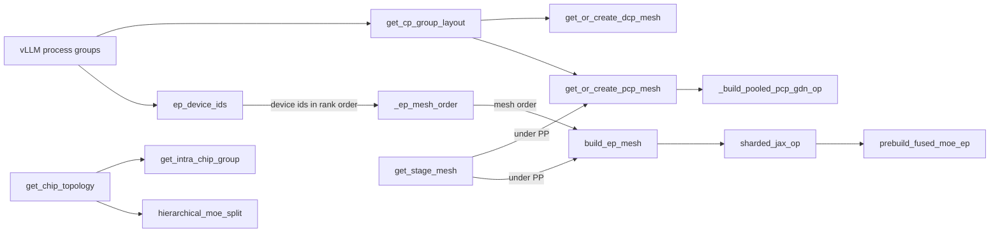
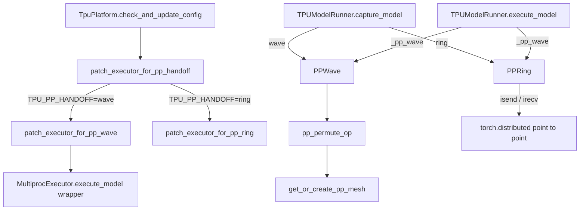

# Distributed parallelism and op-local meshes (TP, DP, EP, PCP, DCP, PP)

<!-- connect:up:begin -->
> **Cross-repo concept:** part of [expert-parallelism](../../../concepts/expert-parallelism.md), [pipeline-parallelism](../../../concepts/pipeline-parallelism.md), [ring-attention](../../../concepts/ring-attention.md), [sequence-parallelism](../../../concepts/sequence-parallelism.md), [sharding](../../../concepts/sharding.md), [sparsecore](../../../concepts/sparsecore.md) across this wiki's repos.
<!-- connect:up:end -->
## Overview

vllm-torchtpu advertises "6D composable parallelism" - TP, DP, PP, EP, prefill context parallelism (PCP) and decode context parallelism (DCP) - where an engine group consumes `DP * TP * PP * PCP` logical devices, and a v7x chip exposes two logical TensorCore devices (repo `docs/user_guide/parallelism.md`). The key design idea of `src/vllm_torchtpu/distributed/` is a **split between two execution models**. The model runner is deliberately single-device: one worker process per TPU device, crossing ranks through `torch.distributed` (TP all-reduce, DP/EP gathers through [`TpuDeviceCommunicator`](../catalog/src/vllm_torchtpu/distributed/tpu_communicator.md#TpuDeviceCommunicator "src/vllm_torchtpu/distributed/tpu_communicator.py:L35")). But a *single op* may still be a multi-device SPMD program: the package builds **op-local JAX meshes** over vLLM's EP, PCP, DCP and PP process groups ([`build_ep_mesh`](../catalog/src/vllm_torchtpu/distributed/ep_mesh.md#build_ep_mesh "src/vllm_torchtpu/distributed/ep_mesh.py:L266"), [`get_or_create_pcp_mesh`](../catalog/src/vllm_torchtpu/distributed/pcp.md#get_or_create_pcp_mesh "src/vllm_torchtpu/distributed/pcp.py:L92"), [`get_or_create_dcp_mesh`](../catalog/src/vllm_torchtpu/distributed/dcp.md#get_or_create_dcp_mesh "src/vllm_torchtpu/distributed/dcp.py:L104"), [`get_or_create_pp_mesh`](../catalog/src/vllm_torchtpu/distributed/pp_shift.md#get_or_create_pp_mesh "src/vllm_torchtpu/distributed/pp_shift.py:L46")) so a Pallas kernel or XLA collective can `shard_map` over them and fuse its transport into the kernel, and [`sharded_jax_op`](../catalog/src/vllm_torchtpu/distributed/sharded_jax_op.md#sharded_jax_op "src/vllm_torchtpu/distributed/sharded_jax_op.py:L135") turns such a function into a torch custom op. Most of the subtlety is **device order**: torch_tpu wants every Pallas mesh to span the world (or one pipeline stage) and every kernel in one compiled module to share one DeviceAssignment, while the speed of a collective depends on the physical order the mesh walks. The same package hosts the pipeline-stage hand-off (wave or ring), chip-topology helpers (intra-chip groups, hierarchical MoE) and multi-host bootstrap; KV transfer lives in the same directory but is covered on [kv-transfer-and-disaggregated-serving](kv-transfer-and-disaggregated-serving.md).

## Diagram

Mesh and group construction (built at load time, never inside a traced region):

Legend:
- `GROUPS` - (concept) vLLM `parallel_state` group coordinators, read through accessors such as [`get_ep_group`](../catalog/src/vllm_torchtpu/distributed/ep_mesh.md#get_ep_group "src/vllm_torchtpu/distributed/ep_mesh.py:L119") and [`get_dcp_group`](../catalog/src/vllm_torchtpu/distributed/dcp.md#get_dcp_group "src/vllm_torchtpu/distributed/dcp.py:L45")
- `CPL` - [`get_cp_group_layout`](../catalog/src/vllm_torchtpu/distributed/mesh_utils.md#get_cp_group_layout "src/vllm_torchtpu/distributed/mesh_utils.py:L108")
- `DCPM` - [`get_or_create_dcp_mesh`](../catalog/src/vllm_torchtpu/distributed/dcp.md#get_or_create_dcp_mesh "src/vllm_torchtpu/distributed/dcp.py:L104")
- `PCPM` - [`get_or_create_pcp_mesh`](../catalog/src/vllm_torchtpu/distributed/pcp.md#get_or_create_pcp_mesh "src/vllm_torchtpu/distributed/pcp.py:L92")
- `EPD` - [`ep_device_ids`](../catalog/src/vllm_torchtpu/distributed/ep_mesh.md#ep_device_ids "src/vllm_torchtpu/distributed/ep_mesh.py:L132")
- `ORD` - [`_ep_mesh_order`](../catalog/src/vllm_torchtpu/distributed/ep_mesh.md#_ep_mesh_order "src/vllm_torchtpu/distributed/ep_mesh.py:L155")
- `EPM` - [`build_ep_mesh`](../catalog/src/vllm_torchtpu/distributed/ep_mesh.md#build_ep_mesh "src/vllm_torchtpu/distributed/ep_mesh.py:L266")
- `STAGE` - [`get_stage_mesh`](../catalog/src/vllm_torchtpu/distributed/mesh_utils.md#get_stage_mesh "src/vllm_torchtpu/distributed/mesh_utils.py:L169")
- `SJO` - [`sharded_jax_op`](../catalog/src/vllm_torchtpu/distributed/sharded_jax_op.md#sharded_jax_op "src/vllm_torchtpu/distributed/sharded_jax_op.py:L135")
- `MOE` - [`prebuild_fused_moe_ep`](../catalog/src/vllm_torchtpu/layers/adapter/fused_moe_ep.md#prebuild_fused_moe_ep "src/vllm_torchtpu/layers/adapter/fused_moe_ep.py:L759")
- `GDN` - [`_build_pooled_pcp_gdn_op`](../catalog/src/vllm_torchtpu/layers/adapter/custom_ops/gdn_attention_op.md#VllmGatedDeltaNetAttention._build_pooled_pcp_gdn_op "src/vllm_torchtpu/layers/adapter/custom_ops/gdn_attention_op.py:L849")
- `CHIP` - [`get_chip_topology`](../catalog/src/vllm_torchtpu/distributed/chip_topology.md#get_chip_topology "src/vllm_torchtpu/distributed/chip_topology.py:L60")
- `INTRA` - [`get_intra_chip_group`](../catalog/src/vllm_torchtpu/distributed/intra_chip.md#get_intra_chip_group "src/vllm_torchtpu/distributed/intra_chip.py:L111")
- `HIER` - [`hierarchical_moe_split`](../catalog/src/vllm_torchtpu/distributed/chip_topology.md#hierarchical_moe_split "src/vllm_torchtpu/distributed/chip_topology.py:L108")

Pipeline hand-off (engine side installed at config time, worker side built at capture):

Legend:
- `CFG` - [`check_and_update_config`](../catalog/src/vllm_torchtpu/platforms/tpu_platform.md#TpuPlatform.check_and_update_config "src/vllm_torchtpu/platforms/tpu_platform.py:L785")
- `HAND` - [`patch_executor_for_pp_handoff`](../catalog/src/vllm_torchtpu/distributed/pp_push.md#patch_executor_for_pp_handoff "src/vllm_torchtpu/distributed/pp_push.py:L380")
- `PW` - [`patch_executor_for_pp_wave`](../catalog/src/vllm_torchtpu/distributed/pp_push.md#patch_executor_for_pp_wave "src/vllm_torchtpu/distributed/pp_push.py:L417")
- `PR` - [`patch_executor_for_pp_ring`](../catalog/src/vllm_torchtpu/distributed/pp_push.md#patch_executor_for_pp_ring "src/vllm_torchtpu/distributed/pp_push.py:L388")
- `EXE` - [`execute_model`](../catalog/src/vllm_torchtpu/distributed/pp_push.md#patch_executor_for_pp_wave.execute_model "src/vllm_torchtpu/distributed/pp_push.py:L437") (with its sibling [`sample_tokens`](../catalog/src/vllm_torchtpu/distributed/pp_push.md#patch_executor_for_pp_wave.sample_tokens "src/vllm_torchtpu/distributed/pp_push.py:L450"))
- `CAP` - [`capture_model`](../catalog/src/vllm_torchtpu/runner/tpu_runner.md#TPUModelRunner.capture_model "src/vllm_torchtpu/runner/tpu_runner.py:L6930")
- `WAVE` - [`PPWave`](../catalog/src/vllm_torchtpu/distributed/pp_wave.md#PPWave "src/vllm_torchtpu/distributed/pp_wave.py:L204")
- `RING` - [`PPRing`](../catalog/src/vllm_torchtpu/distributed/pp_ring.md#PPRing "src/vllm_torchtpu/distributed/pp_ring.py:L188")
- `PERM` - [`pp_permute_op`](../catalog/src/vllm_torchtpu/distributed/pp_shift.md#pp_permute_op "src/vllm_torchtpu/distributed/pp_shift.py:L82")
- `PPM` - [`get_or_create_pp_mesh`](../catalog/src/vllm_torchtpu/distributed/pp_shift.md#get_or_create_pp_mesh "src/vllm_torchtpu/distributed/pp_shift.py:L46")
- `P2P` - (concept) `torch.distributed.isend` / `irecv`
- `RUN` - [`execute_model`](../catalog/src/vllm_torchtpu/runner/tpu_runner.md#TPUModelRunner.execute_model "src/vllm_torchtpu/runner/tpu_runner.py:L3884"), holding the hand-off object in [`_pp_wave`](../catalog/src/vllm_torchtpu/runner/tpu_runner.md#TPUModelRunner._pp_wave "src/vllm_torchtpu/runner/tpu_runner.py:L653")

## Design rationale (why it's built this way)

- **Single-device runner, multi-device ops.** The `ep_mesh.py` docstring: "The runner's model mesh is deliberately single-device ... the torch-native model path runs one JAX device per worker process and crosses ranks through torch.distributed. That is not a limit on what a *single op* can do." PCP attention already ran a `shard_map` Pallas kernel with device-to-device remote DMAs over a PCP mesh, and the EP mesh is "the same construction for the EP group, so an MoE op can fuse its dispatch/combine transport into the kernel instead of paying a separate, fully exposed reduce-scatter."
- **One mesh per axis, each spanning the world.** `mesh_utils.py`: "Every axis builds its own Pallas mesh, because torch_tpu requires one that spans the whole world and the axes factor the world differently." So DCP uses a 2-D `(dcp_lane, dcp)` mesh whose lane axis "no kernel collects over; it is there so the mesh spans the world", and each axis keeps its own cache dict so one axis never receives another axis's mesh. Under PP a group is one stage, and [`get_stage_mesh`](../catalog/src/vllm_torchtpu/distributed/mesh_utils.md#get_stage_mesh "src/vllm_torchtpu/distributed/mesh_utils.py:L169") builds a mesh over just that stage's devices, so "a stage launches its programs while the other stages launch theirs".
- **One DeviceAssignment per module, but order changes collective speed.** [`_ep_mesh_order`](../catalog/src/vllm_torchtpu/distributed/ep_mesh.md#_ep_mesh_order "src/vllm_torchtpu/distributed/ep_mesh.py:L155") is "the one place the mesh order is decided". It prefers ascending device id because XLA's SparseCore-offloaded all-gathers inside the fused MoE are much slower over rank order: "on a tpu7x 2x2x2 DSv4-Pro run the fp8 activation all-gather (identical HLO and bytes) went from 178 to 321 us and end-to-end throughput dropped 4.5%." With PCP or DCP on, the EP mesh must stay in rank order, because both CP meshes are rank-ordered and an EP mesh in device-id order beside either "fails to compile with 'Disjoint or conflicting device assignments'". `MOE_FUSED_EP_SORTED_GATHER` resolves the conflict differently: the mesh stays rank-ordered and only the activation all-gather runs over a separate device-id ordered process group ([`ep_sorted_gather_group`](../catalog/src/vllm_torchtpu/distributed/ep_mesh.md#ep_sorted_gather_group "src/vllm_torchtpu/distributed/ep_mesh.py:L227")), because torch_tpu "lets a torch collective's group order differ from the kernels' ... but requires every JAX op in a module to share one order."
- **The axis name is a kernel constant.** [`EP_AXIS_NAME`](../catalog/src/vllm_torchtpu/distributed/ep_mesh.md#EP_AXIS_NAME "src/vllm_torchtpu/distributed/ep_mesh.py:L56") is `"d"` because "the fused MoE kernel body calls `lax.axis_index` on its own module constant ... so a mesh axis named anything else traces the whole kernel and then dies on an unbound axis name."
- **Misaligned groups must fail loudly.** A mesh built over the wrong rank grouping still compiles and runs - "they collect over the wrong partners, which is a wrong answer rather than an error" (`dcp.py`). So DCP groups must be contiguous rank runs, the PCP mesh must be exactly `PCP x TP` rank-aligned (with TP groups cross-checked), the EP mesh's ids must equal the gathered EP ids, and a stage mesh must hold the stage's devices in rank order - all checked at build time.
- **Patch one line instead of forking torch_tpu.** `pallas.jax_op` sizes outputs from `lowered.out_avals`, where `jax.export` records `shard_map` results as replicated - "for an EP MoE at 2048 tokens a rank, an output claiming 16384 rows". An earlier reimplementation in the PCP adapter "has since fallen behind", so [`sharded_jax_op`](../catalog/src/vllm_torchtpu/distributed/sharded_jax_op.md#sharded_jax_op "src/vllm_torchtpu/distributed/sharded_jax_op.py:L135") derives its callable from the *installed* source and swaps only the line that builds output placeholders; if upstream changes that line it warns and falls back to stock, failing on a shape mismatch rather than silently.
- **PCP ring order comes from placement, not reordering.** [`resolve_pcp_topology_order`](../catalog/src/vllm_torchtpu/distributed/pcp_rank_order.md#resolve_pcp_topology_order "src/vllm_torchtpu/distributed/pcp_rank_order.py:L61") can build both PCP rings and TP lanes from one `(dp, pcp, tp)` topology-aware mesh (so TP partners always hold the same sequence chunk), and treats any failure as an error "because a silent fallback to the arithmetic layout would hide a real problem behind a small and unmeasurable slowdown". At this commit, though, the worker deliberately keeps the PCP group in natural rank order: torch_tpu now binds partition p to PyTorch rank p, so a permuted group would no longer reorder the ring and would only make `rank_in_group` disagree with the rank the kernels index by; "the rank -> chip binding is already a Hamiltonian cycle" because consecutive ranks land on ICI-adjacent chips (`worker/tpu_worker.py`).
- **Intra-chip groups are cheap.** `intra_chip.py`: "Collectives over this group stay on-package, so they are far cheaper than the same collective over the full TP group. That makes it worth sharding a weight across a chip's cores even when the resulting exchange happens every layer: the halved HBM read beats the added on-chip hop." Hierarchical MoE uses the same chip grouping the other way round: "Expert parallelism runs *between* chips and tensor parallelism *within* one" ([`hierarchical_moe_split`](../catalog/src/vllm_torchtpu/distributed/chip_topology.md#hierarchical_moe_split "src/vllm_torchtpu/distributed/chip_topology.py:L108")).
- **Send one tensor across a stage boundary.** Both hand-offs carry the *sum* of hidden states and residual in the model dtype, halving link bytes. `pp_wave.py` states the cost: the receiving norm "normalizes a sum rounded once more than in a single-stage model: a relative difference of at most 2^-8 per element for bfloat16. ... sending both tensors would reproduce the single-stage arithmetic exactly."

## Entry points

- [`check_and_update_config`](../catalog/src/vllm_torchtpu/platforms/tpu_platform.md#TpuPlatform.check_and_update_config "src/vllm_torchtpu/platforms/tpu_platform.py:L785") - runs during `VllmConfig` construction on every node. It installs the pipeline hand-off's engine side via [`patch_executor_for_pp_handoff`](../catalog/src/vllm_torchtpu/distributed/pp_push.md#patch_executor_for_pp_handoff "src/vllm_torchtpu/distributed/pp_push.py:L380") when `pipeline_parallel_size > 1`, and for a non-Ray `--nnodes > 1` run calls [`prepare_mp_multihost_env`](../catalog/src/vllm_torchtpu/distributed/tpu_mp_multihost.md#prepare_mp_multihost_env "src/vllm_torchtpu/distributed/tpu_mp_multihost.py:L128") before any worker forks.
- [`TpuDeviceCommunicator`](../catalog/src/vllm_torchtpu/distributed/tpu_communicator.md#TpuDeviceCommunicator "src/vllm_torchtpu/distributed/tpu_communicator.py:L35") - the device communicator class [`TpuPlatform`](../catalog/src/vllm_torchtpu/platforms/tpu_platform.md#TpuPlatform "src/vllm_torchtpu/platforms/tpu_platform.py:L453") hands vLLM; reached by every MoE layer's dispatch/combine when EP spans DP engines.
- [`build_ep_mesh`](../catalog/src/vllm_torchtpu/distributed/ep_mesh.md#build_ep_mesh "src/vllm_torchtpu/distributed/ep_mesh.py:L266") - called at weight load / op prebuild by MoE paths ([`prebuild_fused_moe_ep`](../catalog/src/vllm_torchtpu/layers/adapter/fused_moe_ep.md#prebuild_fused_moe_ep "src/vllm_torchtpu/layers/adapter/fused_moe_ep.py:L759"), [`prebuild_adaptive_fused_moe`](../catalog/src/vllm_torchtpu/kernels/experimental/adaptive_fused_moe/vllm_adapter.md#prebuild_adaptive_fused_moe "src/vllm_torchtpu/kernels/experimental/adaptive_fused_moe/vllm_adapter.py:L81"), [`arm_fused_moe_decode`](../catalog/src/vllm_torchtpu/layers/adapter/fused_moe_decode.md#arm_fused_moe_decode "src/vllm_torchtpu/layers/adapter/fused_moe_decode.py:L513"), the MoE TP-decode op's [`_topology`](../catalog/src/vllm_torchtpu/layers/adapter/moe_tp_decode.md#_topology "src/vllm_torchtpu/layers/adapter/moe_tp_decode.py:L121"), Kimi-K3's [`_mesh_and_tables`](../catalog/src/vllm_torchtpu/models/vllm/kimi_k3/collective_ops.md#_mesh_and_tables "src/vllm_torchtpu/models/vllm/kimi_k3/collective_ops.py:L247")). Returns None when EP is off; it gathers device ids collectively, so it "must not be called for the first time inside a traced region".
- [`get_or_create_pcp_mesh`](../catalog/src/vllm_torchtpu/distributed/pcp.md#get_or_create_pcp_mesh "src/vllm_torchtpu/distributed/pcp.py:L92") and [`get_or_create_dcp_mesh`](../catalog/src/vllm_torchtpu/distributed/dcp.md#get_or_create_dcp_mesh "src/vllm_torchtpu/distributed/dcp.py:L104") - called when CP attention ops are built: the GDN ops ([`_build_gdn_op`](../catalog/src/vllm_torchtpu/layers/adapter/custom_ops/gdn_attention_op.md#VllmGatedDeltaNetAttention._build_gdn_op "src/vllm_torchtpu/layers/adapter/custom_ops/gdn_attention_op.py:L553"), [`_build_pooled_pcp_gdn_op`](../catalog/src/vllm_torchtpu/layers/adapter/custom_ops/gdn_attention_op.md#VllmGatedDeltaNetAttention._build_pooled_pcp_gdn_op "src/vllm_torchtpu/layers/adapter/custom_ops/gdn_attention_op.py:L849")) take the PCP mesh; the MLA backend's [`_dcp_mesh`](../catalog/src/vllm_torchtpu/layers/adapter/attention.md#PallasMLAttentionBackendImpl._dcp_mesh "src/vllm_torchtpu/layers/adapter/attention.py:L1999") and the sparse indexer's [`_build_streamidx_dcp_op`](../catalog/src/vllm_torchtpu/layers/adapter/custom_ops/mla_attention_op.md#VllmTPUSparseAttnIndexer._build_streamidx_dcp_op "src/vllm_torchtpu/layers/adapter/custom_ops/mla_attention_op.py:L550") take the DCP mesh.
- [`sharded_jax_op`](../catalog/src/vllm_torchtpu/distributed/sharded_jax_op.md#sharded_jax_op "src/vllm_torchtpu/distributed/sharded_jax_op.py:L135") - used wherever a multi-device JAX/Pallas function must become a torch custom op with genuinely sharded outputs, e.g. the Kimi-K3 sequence-parallel collectives ([`_build_op`](../catalog/src/vllm_torchtpu/models/vllm/kimi_k3/collective_ops.md#_build_op "src/vllm_torchtpu/models/vllm/kimi_k3/collective_ops.py:L138"), [`_build_token_op`](../catalog/src/vllm_torchtpu/models/vllm/kimi_k3/collective_ops.md#_build_token_op "src/vllm_torchtpu/models/vllm/kimi_k3/collective_ops.py:L259"), [`_build_mla_ops`](../catalog/src/vllm_torchtpu/models/vllm/kimi_k3/collective_ops.md#_build_mla_ops "src/vllm_torchtpu/models/vllm/kimi_k3/collective_ops.py:L42")).
- [`capture_model`](../catalog/src/vllm_torchtpu/runner/tpu_runner.md#TPUModelRunner.capture_model "src/vllm_torchtpu/runner/tpu_runner.py:L6930") - "Precompile every torch.compile subgraph across all input buckets"; under PP it first builds the worker-side hand-off ([`PPWave`](../catalog/src/vllm_torchtpu/distributed/pp_wave.md#PPWave "src/vllm_torchtpu/distributed/pp_wave.py:L204") or [`PPRing`](../catalog/src/vllm_torchtpu/distributed/pp_ring.md#PPRing "src/vllm_torchtpu/distributed/pp_ring.py:L188")) and runs its warmup on every stage.
- [`get_intra_chip_group`](../catalog/src/vllm_torchtpu/distributed/intra_chip.md#get_intra_chip_group "src/vllm_torchtpu/distributed/intra_chip.py:L111") and [`hierarchical_split_or_none`](../catalog/src/vllm_torchtpu/layers/adapter/moe_hierarchical.md#hierarchical_split_or_none "src/vllm_torchtpu/layers/adapter/moe_hierarchical.py:L28") - reached during model construction by layers that opt into chip-aware sharding (MLA latent projections, DeepSeek-V4 intra-chip attention, Kimi-K3's [`shared_group`](../catalog/src/vllm_torchtpu/models/vllm/kimi_k3/moe.md#KimiMoE.shared_group "src/vllm_torchtpu/models/vllm/kimi_k3/moe.py:L146")).

## Mechanism (step-by-step)

1. **Bootstrap and groups.** On a multi-host `mp` run (no Ray), [`prepare_mp_multihost_env`](../catalog/src/vllm_torchtpu/distributed/tpu_mp_multihost.md#prepare_mp_multihost_env "src/vllm_torchtpu/distributed/tpu_mp_multihost.py:L128") does a short TCPStore rendezvous (host 0 is the master) to exchange host IPs and a shared xprof session id, then exports `TORCH_TPU_SLICEBUILDER_ADDRESSES` (one `ip:port` per chip, ordered by host then local rank, i.e. by global rank) and `TORCH_TPU_TOPOLOGY` from [`get_tpu_multihost_topology`](../catalog/src/vllm_torchtpu/platforms/tpu_platform.md#get_tpu_multihost_topology "src/vllm_torchtpu/platforms/tpu_platform.py:L155") (the `TORCH_TPU_TOPOLOGY` env if set, else a per-generation fallback map keyed by device count). It runs from the config hook rather than executor init because the headless node "hardcodes vanilla ... MultiprocExecutor", so the TPU executor never runs there. vLLM then builds its TP/PP/DP/EP/PCP/DCP groups as usual; the worker wraps that in a group-construction context that logs every layout and, when PCP and DCP are both on, sorts DCP rank lists so `GroupCoordinator.ranks` matches the device group (the topology reorder that [`resolve_pcp_topology_order`](../catalog/src/vllm_torchtpu/distributed/pcp_rank_order.md#resolve_pcp_topology_order "src/vllm_torchtpu/distributed/pcp_rank_order.py:L61") could supply is not passed in at this commit).

2. **Rank-to-device layout.** Every mesh needs "this group's ranks, in order, and where they live". [`get_cp_group_layout`](../catalog/src/vllm_torchtpu/distributed/mesh_utils.md#get_cp_group_layout "src/vllm_torchtpu/distributed/mesh_utils.py:L108") all-gathers `(global_rank, tpu_global_device_id)` over the group's CPU group and returns a [`CpGroupLayout`](../catalog/src/vllm_torchtpu/distributed/mesh_utils.md#CpGroupLayout "src/vllm_torchtpu/distributed/mesh_utils.py:L42"); [`ep_device_ids`](../catalog/src/vllm_torchtpu/distributed/ep_mesh.md#ep_device_ids "src/vllm_torchtpu/distributed/ep_mesh.py:L132") does the same for the EP group. Gathering rather than computing matters because global rank need not follow device order - under DP each engine's workers are placed separately, and on every tpu7x host local ranks 0..7 land on devices `[0, 1, 4, 5, 6, 7, 2, 3]`. Because the gather is a collective, all meshes are built and cached at load time.

3. **EP mesh.** [`build_ep_mesh`](../catalog/src/vllm_torchtpu/distributed/ep_mesh.md#build_ep_mesh "src/vllm_torchtpu/distributed/ep_mesh.py:L266") takes torch_tpu's `get_pallas_mesh` devices (or a [`get_stage_mesh`](../catalog/src/vllm_torchtpu/distributed/mesh_utils.md#get_stage_mesh "src/vllm_torchtpu/distributed/mesh_utils.py:L169") stage mesh under PP), checks their ids equal the EP group's, and re-lays them in the order [`_ep_mesh_order`](../catalog/src/vllm_torchtpu/distributed/ep_mesh.md#_ep_mesh_order "src/vllm_torchtpu/distributed/ep_mesh.py:L155") picks: ascending device id, or rank order when PCP, DCP or `MOE_FUSED_EP_SORTED_GATHER` is on. It refuses an EP group that does not cover the world (or a whole stage), because EP beside another axis "needs a mesh_shape factorisation that has not been worked out". The permutation leaks into the kernel contract: the fused MoE reads a token's expert id as `mesh_index * experts_per_shard + j`, so the shard at mesh index i owns the experts of EP rank [`ep_rank_order`](../catalog/src/vllm_torchtpu/distributed/ep_mesh.md#ep_rank_order "src/vllm_torchtpu/distributed/ep_mesh.py:L198")`()[i]` and callers must reorder experts. Token replica groups (which ranks hold the same tokens - the TP group, or just this rank under MoE sequence parallelism) are likewise gathered and translated into mesh coordinates by [`ep_token_replica_groups`](../catalog/src/vllm_torchtpu/distributed/ep_mesh.md#ep_token_replica_groups "src/vllm_torchtpu/distributed/ep_mesh.py:L63"), never derived from rank arithmetic.

4. **PCP mesh.** [`get_or_create_pcp_mesh`](../catalog/src/vllm_torchtpu/distributed/pcp.md#get_or_create_pcp_mesh "src/vllm_torchtpu/distributed/pcp.py:L92") builds a rank-aligned `PCP x TP` mesh from [`get_pcp_group_layout`](../catalog/src/vllm_torchtpu/distributed/pcp.md#get_pcp_group_layout "src/vllm_torchtpu/distributed/pcp.py:L82"), requiring "Partition `pcp_rank * tp_size + tp_rank` is the global PyTorch rank" and validating that the actual PCP and TP groups match that formula rather than "silently accepting reordered groups". Under PP it builds a stage mesh, and a stage may span a PCP group or a TP group but not both. The PCP streaming ragged paged attention kernel rings over this mesh, and the GDN ops shard their recurrent state on `(tp, pcp)` within one dimension - a multi-axis spec torch_tpu's stock shape conversion cannot express, so [`install_pallas_shape_conversion`](../catalog/src/vllm_torchtpu/distributed/pallas_shapes.md#install_pallas_shape_conversion "src/vllm_torchtpu/distributed/pallas_shapes.py:L51") replaces its global/local shape helpers with ones that multiply all mesh axes named in a dimension's spec (and reject a global dimension not divisible by that factor). Host-side PCP traffic, e.g. gathering hidden states, uses [`all_gather_equal_tokens`](../catalog/src/vllm_torchtpu/distributed/pcp.md#all_gather_equal_tokens "src/vllm_torchtpu/distributed/pcp.py:L59") over the native group.

5. **DCP mesh and merge.** [`get_or_create_dcp_mesh`](../catalog/src/vllm_torchtpu/distributed/dcp.md#get_or_create_dcp_mesh "src/vllm_torchtpu/distributed/dcp.py:L104") validates that DCP is the fastest-varying factor of the global rank (`global_rank == lane * dcp_size + dcp_rank`) and builds the `(world // dcp, dcp)` mesh; kernels collect only over the `dcp` axis, giving one independent DCP group per lane. For GQA, [`forward_with_dcp`](../catalog/src/vllm_torchtpu/layers/adapter/cp_attention.md#forward_with_dcp "src/vllm_torchtpu/layers/adapter/cp_attention.py:L274") runs a cache-only pass in which the query is all-gathered by heads to attend every rank's KV shard, merges the partials with [`cp_lse_ag_out_rs`](../catalog/src/vllm_torchtpu/distributed/dcp_comm.md#cp_lse_ag_out_rs "src/vllm_torchtpu/distributed/dcp_comm.py:L24") (all-gather the f32 LSEs, weight each partial by `exp(lse - merged_lse)`, reduce-scatter back to own heads, optionally in a narrower `rs_dtype`), then a new-tokens-only pass with no communication. MLA uses the analogous [`merge_lse_partials_scatter_heads`](../catalog/src/vllm_torchtpu/layers/adapter/cp_mla_attention.md#merge_lse_partials_scatter_heads "src/vllm_torchtpu/layers/adapter/cp_mla_attention.py:L81"), with an all-to-all variant for small token counts behind `TPU_DCP_LSE_MERGE_A2A`. The AG-RS merge is kept over a Helix-style all-to-all merge because "we observe no benefit over AG-RS on TPU topologies".

6. **Wrap as a torch op.** [`sharded_jax_op`](../catalog/src/vllm_torchtpu/distributed/sharded_jax_op.md#sharded_jax_op "src/vllm_torchtpu/distributed/sharded_jax_op.py:L135") jits the function with `out_shardings` (the only way the real output shardings survive into the export's `_out_named_shardings`), registers a `torch.library.custom_op` whose call path sizes outputs to *this rank's shard*, and registers a fake impl with the same sizing for `torch.compile`. Input partition specs describe the global arrays while the torch tensors passed in are local shards. `output_partition_specs` is mandatory - "getting it wrong is how a sharded output silently becomes a replicated one" - and the docstring warns to return a single array rather than a one-tuple, because a `-> ((Tensor))` schema makes torch `guard_int` every symbolic input dimension, so a compiled caller "loses its dynamic batch dimension".

7. **Runtime collectives outside kernels.** TP stays on vLLM's torch all-reduce. When EP spans DP engines, [`TpuDeviceCommunicator`](../catalog/src/vllm_torchtpu/distributed/tpu_communicator.md#TpuDeviceCommunicator "src/vllm_torchtpu/distributed/tpu_communicator.py:L35") implements MoE dispatch as all-gathers of hidden states, router logits / top-k weights and ids across the DP group (the EP group under sequence parallelism), and combine as a reduce-scatter of the partial sums back to this rank's token slice; vLLM's TP all-reduce still does the TP-side reduction, and callers "must pass equal token counts on each DP rank". It installs a null all-to-all manager only to satisfy vLLM's DP+MoE probe - TPU never routes compute through all2all.

8. **Chip-aware groups.** [`get_chip_topology`](../catalog/src/vllm_torchtpu/distributed/chip_topology.md#get_chip_topology "src/vllm_torchtpu/distributed/chip_topology.py:L60") groups visible devices by their `coords` into a [`ChipTopology`](../catalog/src/vllm_torchtpu/distributed/chip_topology.md#ChipTopology "src/vllm_torchtpu/distributed/chip_topology.py:L26") (chips sorted by coordinates so every rank agrees which chip is EP rank 0), returning None rather than raising if devices expose no coords or chips are ragged. [`get_intra_chip_group`](../catalog/src/vllm_torchtpu/distributed/intra_chip.md#get_intra_chip_group "src/vllm_torchtpu/distributed/intra_chip.py:L111") turns [`_chip_rank_groups`](../catalog/src/vllm_torchtpu/distributed/intra_chip.md#_chip_rank_groups "src/vllm_torchtpu/distributed/intra_chip.py:L39") into a vLLM `GroupCoordinator` named `intra_chip`, built once and collectively during model construction. With `TPU_MOE_HIERARCHICAL_EP`, [`hierarchical_split_or_none`](../catalog/src/vllm_torchtpu/layers/adapter/moe_hierarchical.md#hierarchical_split_or_none "src/vllm_torchtpu/layers/adapter/moe_hierarchical.py:L28") rewrites the `FusedMoEParallelConfig` numbers to EP = chip count, TP = cores per chip; any unusable topology falls back to flat EP.

9. **Prebuild before tracing.** Mesh-backed ops are resolved before the model is traced or captured: [`prebuild_fused_moe_ep`](../catalog/src/vllm_torchtpu/layers/adapter/fused_moe_ep.md#prebuild_fused_moe_ep "src/vllm_torchtpu/layers/adapter/fused_moe_ep.py:L759") ("Resolve the mesh and build the fused-EP op for one layer") pulls the EP mesh, the token replica groups and, with `MOE_FUSED_EP_SORTED_GATHER`, the sorted-gather group; [`arm_fused_moe_decode`](../catalog/src/vllm_torchtpu/layers/adapter/fused_moe_decode.md#arm_fused_moe_decode "src/vllm_torchtpu/layers/adapter/fused_moe_decode.py:L513") arms decode layers. Then [`capture_model`](../catalog/src/vllm_torchtpu/runner/tpu_runner.md#TPUModelRunner.capture_model "src/vllm_torchtpu/runner/tpu_runner.py:L6930") precompiles every subgraph. This keeps the collective id gathers and `new_group` calls out of compiled regions, and every rank reaches them in the same order because all ranks build the same layers in the same order.

10. **Pipeline hand-off: engine side.** [`patch_executor_for_pp_handoff`](../catalog/src/vllm_torchtpu/distributed/pp_push.md#patch_executor_for_pp_handoff "src/vllm_torchtpu/distributed/pp_push.py:L380") picks by `TPU_PP_HANDOFF`. Under the wave, [`patch_executor_for_pp_wave`](../catalog/src/vllm_torchtpu/distributed/pp_push.md#patch_executor_for_pp_wave "src/vllm_torchtpu/distributed/pp_push.py:L417") wraps `MultiprocExecutor`'s [`execute_model`](../catalog/src/vllm_torchtpu/distributed/pp_push.md#patch_executor_for_pp_wave.execute_model "src/vllm_torchtpu/distributed/pp_push.py:L437") and [`sample_tokens`](../catalog/src/vllm_torchtpu/distributed/pp_push.md#patch_executor_for_pp_wave.sample_tokens "src/vllm_torchtpu/distributed/pp_push.py:L450") so their futures count dispatched steps; when the engine waits on a step that has not yet reached the last stage, the future first sends `stages - 2 - (steps since)` empty `pp_push` forwards (or a `pp_settle` if it is the newest step), so in-flight forwards move on "and nothing drains and nothing restarts". Under the ring, [`patch_executor_for_pp_ring`](../catalog/src/vllm_torchtpu/distributed/pp_push.md#patch_executor_for_pp_ring "src/vllm_torchtpu/distributed/pp_push.py:L388") instead raises `max_concurrent_batches` by `max(1, stages // 2)` extra steps so stage 0's next forward is already queued while the engine core prepares the following one ("Half the stage count reached the floor on an eight-stage prefill engine"). Both widen vLLM's shared-memory message rings from the default ten messages to `4 * (stages + extra) + 8`, because the last stage reads a step's calls several steps late.

11. **Pipeline hand-off: worker side.** [`capture_model`](../catalog/src/vllm_torchtpu/runner/tpu_runner.md#TPUModelRunner.capture_model "src/vllm_torchtpu/runner/tpu_runner.py:L6930") stores the hand-off in [`_pp_wave`](../catalog/src/vllm_torchtpu/runner/tpu_runner.md#TPUModelRunner._pp_wave "src/vllm_torchtpu/runner/tpu_runner.py:L653"), which [`execute_model`](../catalog/src/vllm_torchtpu/runner/tpu_runner.md#TPUModelRunner.execute_model "src/vllm_torchtpu/runner/tpu_runner.py:L3884") drives around each forward. [`PPWave`](../catalog/src/vllm_torchtpu/distributed/pp_wave.md#PPWave "src/vllm_torchtpu/distributed/pp_wave.py:L204") runs one [`pp_permute_op`](../catalog/src/vllm_torchtpu/distributed/pp_shift.md#pp_permute_op "src/vllm_torchtpu/distributed/pp_shift.py:L82") per forward - a single XLA collective-permute over [`get_or_create_pp_mesh`](../catalog/src/vllm_torchtpu/distributed/pp_shift.md#get_or_create_pp_mesh "src/vllm_torchtpu/distributed/pp_shift.py:L46") forming one closed cycle (stage 0 ignores what the last stage sends). Stage 0 launches after its forward and every other stage before its forward, with prologue launches of zeros, so "launch number p on one stage pairs with launch number p on every other stage"; every launch runs the same program padded to the largest token bucket and is submitted immediately. Side tensors (e.g. a sparse-attention model's shared top-k table) ride the same launch as extra operands. [`PPRing`](../catalog/src/vllm_torchtpu/distributed/pp_ring.md#PPRing "src/vllm_torchtpu/distributed/pp_ring.py:L188") instead `isend`s each forward's output from a helper thread to the device holding the same rows in the next stage, which pre-posts tagged `irecv`s per forward at step start; "a stage waits only for its own input", there are no prologues, pushes, settles or barriers, and at most `TPU_PP_RING_DEPTH` forwards wait in a stage's send queue.

## Key data structures

- [`CpGroupLayout`](../catalog/src/vllm_torchtpu/distributed/mesh_utils.md#CpGroupLayout "src/vllm_torchtpu/distributed/mesh_utils.py:L42") - a group's `ranks`, matching `device_ids`, `rank_in_group`, `world_size`, plus ring neighbours `prev_rank_in_group` / `next_rank_in_group`. Cached per `(global_rank, ranks, rank_in_group, device_id)`; shared by PCP ([`get_pcp_group_layout`](../catalog/src/vllm_torchtpu/distributed/pcp.md#get_pcp_group_layout "src/vllm_torchtpu/distributed/pcp.py:L82")) and DCP ([`get_dcp_group_layout`](../catalog/src/vllm_torchtpu/distributed/dcp.md#get_dcp_group_layout "src/vllm_torchtpu/distributed/dcp.py:L65")).
- Per-axis mesh caches - EP keyed by `(axis_name, device ids in mesh order)`; PCP by axes, shape, ranks, device ids and TP ranks; DCP by axes, shape and ranks; the PP mesh is a module singleton. Separate dicts on purpose.
- EP order artifacts - the permutation from [`ep_rank_order`](../catalog/src/vllm_torchtpu/distributed/ep_mesh.md#ep_rank_order "src/vllm_torchtpu/distributed/ep_mesh.py:L198"), token replica groups in mesh coordinates, and the optional sorted-gather `(group, positions)` where `positions[i]` is the group rank of EP rank i (built with `new_group(..., sort_ranks=False)`, or torch would sort it back into rank order).
- [`ChipTopology`](../catalog/src/vllm_torchtpu/distributed/chip_topology.md#ChipTopology "src/vllm_torchtpu/distributed/chip_topology.py:L26") - `chips` (chip index -> sorted device ids), `device_ids` (runtime order), `cores_per_chip`; `chip_of(rank)` maps a TP rank to `(chip, core)`.
- PP hand-off state - [`PPWave`](../catalog/src/vllm_torchtpu/distributed/pp_wave.md#PPWave "src/vllm_torchtpu/distributed/pp_wave.py:L204") keeps launch / burst counters, preallocated zero buffers at `max_num_tokens` rows, and a one-slot async queue for stage 0's helper thread; [`PPRing`](../catalog/src/vllm_torchtpu/distributed/pp_ring.md#PPRing "src/vllm_torchtpu/distributed/pp_ring.py:L188") keeps a transfer counter (which, with the tensor's place, is the message tag), `posted_through` / `landed_through` watermarks, and the send queue.

### Configuration surface (performance-relevant)

| Knob | Default | Effect |
|---|---|---|
| `--tensor-parallel-size`, `--data-parallel-size`, `--pipeline-parallel-size`, `--prefill-context-parallel-size`, `--decode-context-parallel-size`, `--enable-expert-parallel` | 1 / off | The six axes; devices per engine group = `DP * TP * PP * PCP` |
| `MOE_FUSED_EP_SORTED_GATHER` | off | Keep EP mesh rank-ordered, run the activation all-gather over a device-id ordered group |
| `TPU_MOE_HIERARCHICAL_EP` | off | EP between chips, TP within a chip (needs EP on and >= 2 cores per chip) |
| `TPU_LATENT_PROJ_INTRA_CHIP_TP` | off | Shard MLA latent projections across a chip's cores over the intra-chip group |
| `TPU_PCP_TOPOLOGY_AWARE_MESH` | 1 | Read by the topology resolver; the worker does not apply its result at this commit |
| `TPU_PP_HANDOFF` | `wave` | `ring` = point-to-point hand-off with extra steps in flight |
| `TPU_PP_RING_DEPTH` | 2 | Forwards a ring stage may queue for sending; bounded by receive flags |
| `TPU_PP_LAZY_PUSH` | off | Engine core sends wave pushes when stage 0 would idle, instead of before each wait |
| `TPU_MULTIHOST_BACKEND`, `TORCH_TPU_TOPOLOGY` | unset | `mp` vs `ray` multi-host bootstrap; explicit ICI shape overrides the fallback map |
| `VLLM_TPU_DEVICE_ORDER` | unset | Physical device index per local rank (e.g. `0,2,1,3,4,6,5,7`) |

## Dynamics (design intent)

- **Wave lockstep vs ring overlap.** The wave pairs launch p on every stage, so with mixed prompt lengths each round lasts as long as the slowest forward in flight, and a forward reaches the last of S stages only after `S - 2` later forwards. The ring decouples stages at the cost of extra in-flight steps and reserved HBM (outgoing `(depth + 1)` buffers, up to seven landing buffers, and a zero residual per padded row count, reserved before KV sizing).
- **Multi-chip stages under the wave.** A stage spanning more than one chip drains its device and joins a world barrier before every hand-off, because "with a stage program and a hand-off running at the same time, a core of the stage stops inside a stage collective and the runtime halts the device"; stage 0 does that drain on a helper thread so the worker thread can move on. One-chip stages launch without waiting.
- **Ring credit and receive flags.** `isend` returns only once the receiver has posted the matching receive ("that is the credit"). A device has 8 receive flags and a receive beyond them "stalls its sender without an error", so the ring keeps at most 7 posted and refuses a depth that could exceed that.
- **PP mesh order vs stage mesh order.** [`get_or_create_pp_mesh`](../catalog/src/vllm_torchtpu/distributed/pp_shift.md#get_or_create_pp_mesh "src/vllm_torchtpu/distributed/pp_shift.py:L46") lays the hand-off mesh out in device-id order because "the runtime addresses collective peers by device order" and routes the permute by each rank's mesh position, whereas stage meshes are rank-ordered.
- **Collectives at load time.** Device-id gathers, token replica gathers, sorted-gather `new_group` and the intra-chip group are world- or group-collective and must be reached by every rank in the same order at weight load.

## Edge cases

- **EP beside another axis** that does not cover the world raises `NotImplementedError` in [`build_ep_mesh`](../catalog/src/vllm_torchtpu/distributed/ep_mesh.md#build_ep_mesh "src/vllm_torchtpu/distributed/ep_mesh.py:L266"); the MoE TP-decode op refuses unless TP ranks equal EP ranks and cover the world; Kimi-K3 rings require identical TP and EP rank order.
- **DCP with non-contiguous groups** (TP4/DCP4 on tpu7x: DCP groups are devices `[0, 1, 4, 5]` and `[6, 7, 2, 3]`) is why the EP mesh must stay rank-ordered when DCP is on.
- **Overriding the DCP axis name** must be done in both the mesh and the kernels' partition specs, or they disagree.
- **`sharded_jax_op` against a changed torch_tpu**: if the expected placeholder line is gone, it warns and uses stock behaviour; sharded ops then fail on an output shape mismatch.
- **Pipeline restrictions** (platform validation): no TP inside a stage (stage TP collectives stall on the first serving step), multi-device stages (PCP, or EP across DP) need a torch_tpu that builds stage-sized meshes, no async scheduling, only prefill-only MTP with one draft token on a KV producer, and the ring needs libtpu 0.0.50+ with torch_tpu 0.2.0+.
- **Topology resolver scope**: [`resolve_pcp_topology_order`](../catalog/src/vllm_torchtpu/distributed/pcp_rank_order.md#resolve_pcp_topology_order "src/vllm_torchtpu/distributed/pcp_rank_order.py:L61") returns None for multi-host (`nnodes > 1`) and raises if reached with `pp > 1` or `dp > 1`.
- **Chip topology unknowable** (no `coords`, ragged chips, partial world): intra-chip and hierarchical paths return None and the weight stays replicated / EP stays flat - "always correct".

## Open questions

- The packet subgraph omits several helpers that the mechanism leans on: `ep_mesh_index`, `get_pcp_world_size`, `ring_handoff`, `ring_extra_steps`, `check_ring_receives` / `hbm_reserve_bytes`, the runner's `pp_handoff_hbm_reserve_bytes`, `pcp_topology_order` / `verify_pcp_topology_order`, `prepare_mp_multihost_dp_env` and `validate_pipeline_parallel_config`; they are described above from source without citations.
- [`resolve_pcp_topology_order`](../catalog/src/vllm_torchtpu/distributed/pcp_rank_order.md#resolve_pcp_topology_order "src/vllm_torchtpu/distributed/pcp_rank_order.py:L61") has no caller in this checkout and `TPU_PCP_TOPOLOGY_AWARE_MESH` therefore has no effect on group construction; whether it is kept for a future multi-host layout or is dead code is not settled by the source.
- Several guards reference torch_tpu changes (mesh order equal to DeviceAssignment, stage-sized meshes); which layouts a deployment accepts depends on the pinned torch_tpu and cannot be settled from this repo alone.
- The 178 -> 321 us all-gather figure and the 4.5% throughput delta are single-configuration measurements recorded in a code comment; no benchmark in the repo reproduces them.

> [!inferred]
> Since the runner mesh is single-device, any parallelism not expressed either as a torch collective or as an op-local mesh kernel is invisible to XLA: overlap between, for example, the TP all-reduce and the next layer's compute depends on torch_tpu's scheduling of separate programs rather than on one SPMD module's latency-hiding scheduler.

## See also

- [kv-transfer-and-disaggregated-serving](kv-transfer-and-disaggregated-serving.md) - P/D connectors in `distributed/kv_transfer/`, which lower PCP/TP/PP ownership into transfer spans
- [host-offload](host-offload.md) - storage shards keyed by TP/PCP/PP coordinates
- [pcp-streaming-rpa-kernel](pcp-streaming-rpa-kernel.md) - the PCP ring attention kernel on the PCP mesh
- [gdn-pcp-fused-kernel](gdn-pcp-fused-kernel.md), [gated-deltanet-kernels](gated-deltanet-kernels.md) - GDN ops sharded on `(tp, pcp)`
- [mla-attention-kernels](mla-attention-kernels.md), [deepseek-v4-streamindex-topk-kernel](deepseek-v4-streamindex-topk-kernel.md) - DCP MLA attention and indexer
- [fused-moe-kernels](fused-moe-kernels.md), [adaptive-fused-moe-kernel](adaptive-fused-moe-kernel.md) - consumers of the EP mesh
- [sparsecore-ragged-gather-scatter](sparsecore-ragged-gather-scatter.md) - SparseCore collectives whose speed depends on mesh order
- [tpu-model-runner](tpu-model-runner.md), [compilation-and-graph-capture](compilation-and-graph-capture.md) - where meshes and hand-offs are built before capture
- [tpu-schedulers](tpu-schedulers.md) - engine-side scheduling the pipeline steps flow through
- [tpu-platform](tpu-platform.md) - config validation and multi-host bootstrap hooks
- [kimi-k3-model](kimi-k3-model.md), [deepseek-v4-model](deepseek-v4-model.md) - intra-chip and sequence-parallel users
