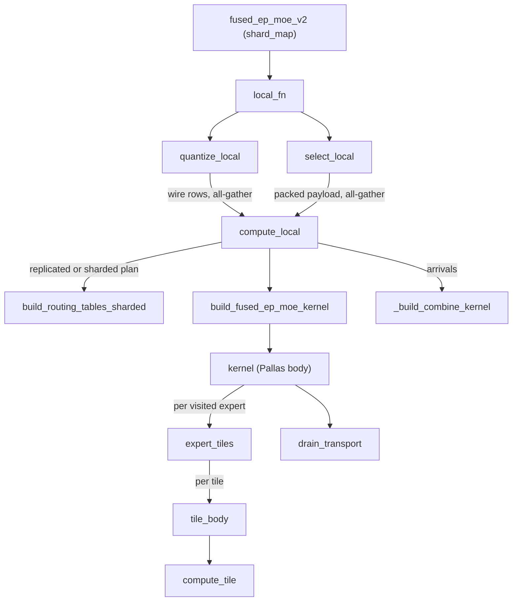
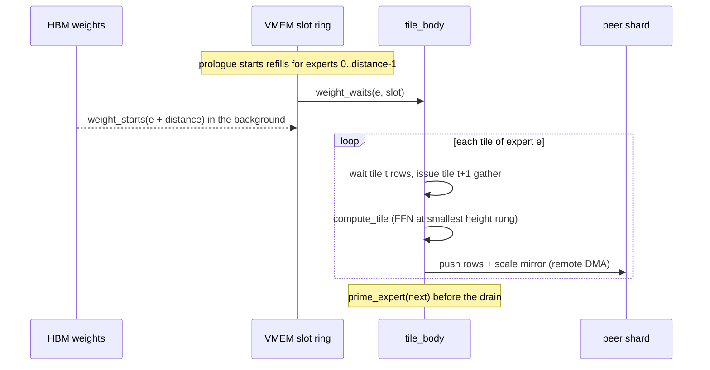

# Fused expert-parallel MoE kernel (fused_ep_moe_v2): route, push, FFN and combine in one SPMD program

<!-- connect:up:begin -->
> **Cross-repo concept:** part of [expert-parallelism](../../../concepts/expert-parallelism.md), [pallas-kernel](../../../concepts/pallas-kernel.md), [vmem-budget](../../../concepts/vmem-budget.md) across this wiki's repos.
<!-- connect:up:end -->
## Overview

`src/vllm_torchtpu/kernels/fused_moe/v2` replaces the default expert-parallel (EP) MoE recipe - all-gather tokens, route, permute, two grouped matmuls, combine, reduce-scatter - with **one SPMD program per MoE layer**. The kernel's own docstring states the idea: "one Pallas TPU kernel computes the expert half of an MoE layer for one expert-parallel shard and pushes each result row to the shard that owns its token, so the layer needs no dense combine reduce-scatter." The serving bridge that calls it explains why that matters: in a phased profile of a large MoE model, the reduce-scatter cost "1190 us per MoE layer and shows it fully exposed", while the symmetric all-gather hid behind compute; pushing result rows from inside the kernel lets "the transport overlap the matmuls rather than bracketing them."

The package splits into three halves that must agree exactly:

- a **serving layer**, [`fused_ep_moe_v2`](../catalog/src/vllm_torchtpu/kernels/fused_moe/v2/layer.md#fused_ep_moe_v2 "src/vllm_torchtpu/kernels/fused_moe/v2/layer.py:L253"), a `shard_map` over the single EP mesh axis that quantizes, routes (top-k inside the program), all-gathers rows plus one packed routing payload, builds the routing plan, calls the kernel, and combines;
- a **host module** (`host.py`) of layout constants, the routing-table builders ([`build_routing_tables`](../catalog/src/vllm_torchtpu/kernels/fused_moe/v2/host.md#build_routing_tables "src/vllm_torchtpu/kernels/fused_moe/v2/host.py:L522"), [`build_routing_tables_sharded`](../catalog/src/vllm_torchtpu/kernels/fused_moe/v2/host.md#build_routing_tables_sharded "src/vllm_torchtpu/kernels/fused_moe/v2/host.py:L825")) and the VMEM accounting ([`vmem_estimate_bytes`](../catalog/src/vllm_torchtpu/kernels/fused_moe/v2/host.md#vmem_estimate_bytes "src/vllm_torchtpu/kernels/fused_moe/v2/host.py:L1524"), [`fit_weight_slots`](../catalog/src/vllm_torchtpu/kernels/fused_moe/v2/host.md#fit_weight_slots "src/vllm_torchtpu/kernels/fused_moe/v2/host.py:L1586")) - "Nothing here runs inside the Pallas body";
- the **kernel** built by [`_build_fused_ep_moe_kernel`](../catalog/src/vllm_torchtpu/kernels/fused_moe/v2/kernel.md#_build_fused_ep_moe_kernel "src/vllm_torchtpu/kernels/fused_moe/v2/kernel.py:L524"), which walks this shard's non-empty local experts, streams their weights through a VMEM slot ring, runs the gated FFN per `[tile_m, hidden]` tile, and pushes rows to destination shards with remote DMAs; plus a separate Pallas **combine** kernel ([`_build_combine_kernel`](../catalog/src/vllm_torchtpu/kernels/fused_moe/v2/kernel.md#_build_combine_kernel "src/vllm_torchtpu/kernels/fused_moe/v2/kernel.py:L2220")).

A single [`WeightFormat`](../catalog/src/vllm_torchtpu/kernels/fused_moe/v2/host.md#WeightFormat "src/vllm_torchtpu/kernels/fused_moe/v2/host.py:L254") (fp8 / fp4 / int8 / bf16) decides every element type downstream: weight slabs, activation staging, the wire dtype and which scale tables exist.

## Diagram

One MoE layer on one EP shard (`stage="fused"`):

Legend:
- `LAYER` - [`fused_ep_moe_v2`](../catalog/src/vllm_torchtpu/kernels/fused_moe/v2/layer.md#fused_ep_moe_v2 "src/vllm_torchtpu/kernels/fused_moe/v2/layer.py:L253")
- `LOCAL` - [`local_fn`](../catalog/src/vllm_torchtpu/kernels/fused_moe/v2/layer.md#fused_ep_moe_v2.local_fn "src/vllm_torchtpu/kernels/fused_moe/v2/layer.py:L796")
- `QL` - [`quantize_local`](../catalog/src/vllm_torchtpu/kernels/fused_moe/v2/layer.md#fused_ep_moe_v2.quantize_local "src/vllm_torchtpu/kernels/fused_moe/v2/layer.py:L512")
- `SL` - [`select_local`](../catalog/src/vllm_torchtpu/kernels/fused_moe/v2/layer.md#fused_ep_moe_v2.select_local "src/vllm_torchtpu/kernels/fused_moe/v2/layer.py:L540")
- `CL` - [`compute_local`](../catalog/src/vllm_torchtpu/kernels/fused_moe/v2/layer.md#fused_ep_moe_v2.compute_local "src/vllm_torchtpu/kernels/fused_moe/v2/layer.py:L621")
- `PLAN` - [`build_routing_tables_sharded`](../catalog/src/vllm_torchtpu/kernels/fused_moe/v2/host.md#build_routing_tables_sharded "src/vllm_torchtpu/kernels/fused_moe/v2/host.py:L825") (or [`build_routing_tables`](../catalog/src/vllm_torchtpu/kernels/fused_moe/v2/host.md#build_routing_tables "src/vllm_torchtpu/kernels/fused_moe/v2/host.py:L522"))
- `BUILD` - [`build_fused_ep_moe_kernel`](../catalog/src/vllm_torchtpu/kernels/fused_moe/v2/kernel.md#build_fused_ep_moe_kernel "src/vllm_torchtpu/kernels/fused_moe/v2/kernel.py:L2125")
- `K` - [`kernel`](../catalog/src/vllm_torchtpu/kernels/fused_moe/v2/kernel.md#_build_fused_ep_moe_kernel.kernel "src/vllm_torchtpu/kernels/fused_moe/v2/kernel.py:L758")
- `ET` - [`expert_tiles`](../catalog/src/vllm_torchtpu/kernels/fused_moe/v2/kernel.md#_build_fused_ep_moe_kernel.kernel.expert_tiles "src/vllm_torchtpu/kernels/fused_moe/v2/kernel.py:L1269")
- `TB` - [`tile_body`](../catalog/src/vllm_torchtpu/kernels/fused_moe/v2/kernel.md#_build_fused_ep_moe_kernel.kernel.expert_tiles.tile_body "src/vllm_torchtpu/kernels/fused_moe/v2/kernel.py:L1465")
- `CT` - [`compute_tile`](../catalog/src/vllm_torchtpu/kernels/fused_moe/v2/kernel.md#_build_fused_ep_moe_kernel.kernel.expert_tiles.tile_body.compute_tile "src/vllm_torchtpu/kernels/fused_moe/v2/kernel.py:L1538")
- `DR` - [`drain_transport`](../catalog/src/vllm_torchtpu/kernels/fused_moe/v2/kernel.md#_build_fused_ep_moe_kernel.kernel.drain_transport "src/vllm_torchtpu/kernels/fused_moe/v2/kernel.py:L1849")
- `COMB` - [`_build_combine_kernel`](../catalog/src/vllm_torchtpu/kernels/fused_moe/v2/kernel.md#_build_combine_kernel "src/vllm_torchtpu/kernels/fused_moe/v2/kernel.py:L2220")

Inside the kernel, per visited expert (the weight ring and the double-buffered tile pipeline):

## Design rationale (why it's built this way)

**Push, don't reduce-scatter.** Result rows are shipped to the token owner by `make_async_remote_copy` from inside the kernel, so the EP combine traffic overlaps later compute instead of trailing the layer. In [`_build_fused_ep_moe_kernel`](../catalog/src/vllm_torchtpu/kernels/fused_moe/v2/kernel.md#_build_fused_ep_moe_kernel "src/vllm_torchtpu/kernels/fused_moe/v2/kernel.py:L524") the granularity depends on `push_from_vmem`: when each expert is expected to fit in one tile, every tile ships straight out of VMEM as soon as it is computed; otherwise tiles are committed to an HBM contribution slab and each expert's (expert, destination) runs are pushed after that expert's tiles and commit drain finish. The rows go out **unweighted**; "The router weight stays local: the destination combine applies it in f32 from its own copy, so the wire never carries it" (the routing-payload packer in `layer.py`).

**One all-gather of routing state.** [`_exchange_layout`](../catalog/src/vllm_torchtpu/kernels/fused_moe/v2/layer.md#_exchange_layout "src/vllm_torchtpu/kernels/fused_moe/v2/layer.py:L157"): "ONE all-gather carries everything the other shards need to know about this shard's tokens: the selections, the row scales the wire quantized them by, and the per-expert pair counts the routing plan exchanges. The plan's own count collective disappears into this one". Sections are lane-block aligned "so every unpack slice is a view."

**Plan on the host side of the kernel, not in it.** Assigning every routed (token, expert) pair a slab row, an arrival row and a scale-mirror position is irregular integer work. It runs as plain JAX (`host.py`) and the kernel receives only small scalar-prefetch tables - [`N_PREFETCH`](../catalog/src/vllm_torchtpu/kernels/fused_moe/v2/kernel.md#N_PREFETCH "src/vllm_torchtpu/kernels/fused_moe/v2/kernel.py:L100") of them - because "Every table shipped is another blocking HBM->SMEM DMA at the head of the kernel, and the prefetch also has to fit in 1 MB of SMEM." Three duplicate tables are derived inside the kernel instead of shipped.

**VMEM decides the schedule, not a constant.** The weight ring is `nbuf` copies of one expert's slabs; [`fit_weight_slots`](../catalog/src/vllm_torchtpu/kernels/fused_moe/v2/host.md#fit_weight_slots "src/vllm_torchtpu/kernels/fused_moe/v2/host.py:L1586") "The deepest prefetch schedule this shape's VMEM leaves room for" starts at prefetch distance 2 (3 slots) and walks down one slot at a time ("even distance one keeps a refill in flight, which is most of the win"). The scratch list is declared from the same [`vmem_scratch_arrays`](../catalog/src/vllm_torchtpu/kernels/fused_moe/v2/host.md#vmem_scratch_arrays "src/vllm_torchtpu/kernels/fused_moe/v2/host.py:L1354") the estimate sums, "so a buffer cannot be resized on one side only."

**Formats buy bytes, not FLOPs.** [`WEIGHT_FORMS`](../catalog/src/vllm_torchtpu/kernels/fused_moe/v2/host.md#WEIGHT_FORMS "src/vllm_torchtpu/kernels/fused_moe/v2/host.py:L331") maps each [`WeightFormat`](../catalog/src/vllm_torchtpu/kernels/fused_moe/v2/host.md#WeightFormat "src/vllm_torchtpu/kernels/fused_moe/v2/host.py:L254") to its element types. fp4 is "Storage only: there is no four-bit MXU, so each block is widened to e4m3"; int8 is likewise widened to bf16 one [`WIDEN_KCHUNK`](../catalog/src/vllm_torchtpu/kernels/fused_moe/v2/host.md#WIDEN_KCHUNK "src/vllm_torchtpu/kernels/fused_moe/v2/host.py:L47") (512) chunk at a time because "TPU v7, the generation this kernel is validated on, takes no integer input on the matrix unit ... The format buys weight bytes and weight bandwidth, not matmul work." Four-bit weights stream as packed u32 words ([`PACK4`](../catalog/src/vllm_torchtpu/kernels/fused_moe/v2/host.md#PACK4 "src/vllm_torchtpu/kernels/fused_moe/v2/host.py:L37") = 8 values per word) "so the DMA moves half the bytes".

**Small row blocks everywhere.** Every transport moves whole [`ROWBLK`](../catalog/src/vllm_torchtpu/kernels/fused_moe/v2/host.md#ROWBLK "src/vllm_torchtpu/kernels/fused_moe/v2/host.py:L89") = 2-row blocks; it is also the padding each (expert, destination) run rounds up to, "so it sets how many rows the gather fetches, the FFN computes and the transport moves that no token asked for -- half the arrival buffer at the decode bucket is this padding." Token rows are staged as `[rows, hidden/128, 128]` so that an 8-row DMA offset is legal for an 8-bit array whose sublane tile is 32.

**Measured, not chosen.** Several thresholds carry their measurement in a comment, e.g. the activation all-gather is hoisted ahead of the slab scatters only at >= 1024 local tokens ("+2.80% at t_local 2048 and -0.01 / -7.81 / -1.92 / -1.94% at 1024 / 256 / 64 / 32").

## Entry points

- [`fused_ep_moe_v2`](../catalog/src/vllm_torchtpu/kernels/fused_moe/v2/layer.md#fused_ep_moe_v2 "src/vllm_torchtpu/kernels/fused_moe/v2/layer.py:L253") - "Run one MoE layer through the fused expert-parallel kernel." The package's declared API (with [`WeightFormat`](../catalog/src/vllm_torchtpu/kernels/fused_moe/v2/__init__.md#WeightFormat "src/vllm_torchtpu/kernels/fused_moe/v2/__init__.py:L41"), `WEIGHT_FORMS`, `vmem_estimate_bytes`, `vmem_limit`). Reached from the torch op that the serving bridge builds once per distinct closure in [`_build_op`](../catalog/src/vllm_torchtpu/layers/adapter/fused_moe_ep.md#_build_op "src/vllm_torchtpu/layers/adapter/fused_moe_ep.py:L168") (outside this unit), on every MoE forward of an armed layer. The bridge passes `capacity=128` (the tile height) and widens the gate logits to f32 at the boundary.
- [`_build_split_ops`](../catalog/src/vllm_torchtpu/layers/adapter/fused_moe_ep.md#_build_split_ops "src/vllm_torchtpu/layers/adapter/fused_moe_ep.py:L391") (outside this unit) - the sorted-gather variant: it calls the layer twice, as [`route_fn`](../catalog/src/vllm_torchtpu/kernels/fused_moe/v2/layer.md#fused_ep_moe_v2.route_fn "src/vllm_torchtpu/kernels/fused_moe/v2/layer.py:L825") (`stage="route"`) and [`compute_fn`](../catalog/src/vllm_torchtpu/kernels/fused_moe/v2/layer.md#fused_ep_moe_v2.compute_fn "src/vllm_torchtpu/kernels/fused_moe/v2/layer.py:L839") (`stage="compute"`), doing the activation all-gather itself in between over a process group in device-id order. It sizes buffers with [`replica_wire_rows`](../catalog/src/vllm_torchtpu/kernels/fused_moe/v2/token_parallel.md#replica_wire_rows "src/vllm_torchtpu/kernels/fused_moe/v2/token_parallel.py:L24") and [`_exchange_layout`](../catalog/src/vllm_torchtpu/kernels/fused_moe/v2/layer.md#_exchange_layout "src/vllm_torchtpu/kernels/fused_moe/v2/layer.py:L157").
- [`_prebuild_w4a8`](../catalog/src/vllm_torchtpu/layers/adapter/quantization/nvfp4.md#_prebuild_w4a8 "src/vllm_torchtpu/layers/adapter/quantization/nvfp4.py:L203") (outside this unit) - NVFP4 admission at weight load: "Admit the proposed runtime layout while checkpoint weights are intact." It derives the smallest legal fp4 block as [`U32_SUBLANE_TILE`](../catalog/src/vllm_torchtpu/kernels/fused_moe/v2/host.md#U32_SUBLANE_TILE "src/vllm_torchtpu/kernels/fused_moe/v2/host.py:L1325") x `PACK4` = 64 rows.
- [`vmem_estimate_bytes`](../catalog/src/vllm_torchtpu/kernels/fused_moe/v2/host.md#vmem_estimate_bytes "src/vllm_torchtpu/kernels/fused_moe/v2/host.py:L1524") / [`fit_weight_slots`](../catalog/src/vllm_torchtpu/kernels/fused_moe/v2/host.md#fit_weight_slots "src/vllm_torchtpu/kernels/fused_moe/v2/host.py:L1586") - the declared VMEM accounting a caller can use to predict whether a layer fits. In-tree, the builder [`_build_fused_ep_moe_kernel`](../catalog/src/vllm_torchtpu/kernels/fused_moe/v2/kernel.md#_build_fused_ep_moe_kernel "src/vllm_torchtpu/kernels/fused_moe/v2/kernel.py:L524") calls `fit_weight_slots`, which calls `vmem_estimate_bytes` once per candidate depth; the serving bridge's prebuild does not call either (its fit check there is the fixed SMEM working set of the token-gather windows).

## Mechanism (step-by-step)

1. **Validate and size.** [`fused_ep_moe_v2`](../catalog/src/vllm_torchtpu/kernels/fused_moe/v2/layer.md#fused_ep_moe_v2 "src/vllm_torchtpu/kernels/fused_moe/v2/layer.py:L253") resolves the format record with [`weight_form`](../catalog/src/vllm_torchtpu/kernels/fused_moe/v2/host.md#weight_form "src/vllm_torchtpu/kernels/fused_moe/v2/host.py:L347") and re-derives each weight's format from its dtype with [`weight_format_of_dtype`](../catalog/src/vllm_torchtpu/kernels/fused_moe/v2/host.md#weight_format_of_dtype "src/vllm_torchtpu/kernels/fused_moe/v2/host.py:L358"): int8 and bf16 have identical slab shapes, so naming one and passing the other "is a half-slab read with correct-looking shapes all the way down." Scales must already be in the kernel's layout (`[E, N]` per channel, `[E, blocks, N]` per contraction block) - a loader-shaped table is refused, not reshaped, because a reshape would sit on every call. It then fixes the per-shard slab stride at [`ragged_stride_bound`](../catalog/src/vllm_torchtpu/kernels/fused_moe/v2/host.md#ragged_stride_bound "src/vllm_torchtpu/kernels/fused_moe/v2/host.py:L371") ("every routed row landing on one shard, the row-block alignment padding and one tile-height tail-read window" - the no-drop worst case) and the routing block at [`routing_block`](../catalog/src/vllm_torchtpu/kernels/fused_moe/v2/host.md#routing_block "src/vllm_torchtpu/kernels/fused_moe/v2/host.py:L415") (widest power of two <= 256 dividing `t_local * topk`).

2. **Quantize this shard's rows.** Inside the `shard_map`, [`local_fn`](../catalog/src/vllm_torchtpu/kernels/fused_moe/v2/layer.md#fused_ep_moe_v2.local_fn "src/vllm_torchtpu/kernels/fused_moe/v2/layer.py:L796") ("One shard's half of the layer: route, dispatch, kernel, combine") calls [`quantize_local`](../catalog/src/vllm_torchtpu/kernels/fused_moe/v2/layer.md#fused_ep_moe_v2.quantize_local "src/vllm_torchtpu/kernels/fused_moe/v2/layer.py:L512"). With token replica [`groups`](../catalog/src/vllm_torchtpu/kernels/fused_moe/v2/token_parallel.md#TokenReplicaLayout.groups "src/vllm_torchtpu/kernels/fused_moe/v2/token_parallel.py:L49") (e.g. a TP group holding identical rows), [`split`](../catalog/src/vllm_torchtpu/kernels/fused_moe/v2/token_parallel.md#TokenReplicaLayout.split "src/vllm_torchtpu/kernels/fused_moe/v2/token_parallel.py:L96") gives each member a disjoint slice so replicated tokens are routed and computed once. Rows are then per-row dynamically quantized to fp8 only where [`quantized_activations`](../catalog/src/vllm_torchtpu/kernels/fused_moe/v2/host.md#WeightForm.quantized_activations "src/vllm_torchtpu/kernels/fused_moe/v2/host.py:L310") is true (fp8 and fp4 weights); int8 and bf16 weights get unquantized bf16 rows, "with no quantize and dequantize pair inserted around a model that never asked for one." The shard index is passed as a real operand (`rank`) rather than `lax.axis_index`, because that lowers to `partition-id`, "which the SPMD partitioner rejects when torch_tpu recompiles this module through its jax.export bridge."

3. **Route.** [`select_local`](../catalog/src/vllm_torchtpu/kernels/fused_moe/v2/layer.md#fused_ep_moe_v2.select_local "src/vllm_torchtpu/kernels/fused_moe/v2/layer.py:L540") applies one of the [`SCORING_FNS`](../catalog/src/vllm_torchtpu/kernels/fused_moe/v2/layer.md#SCORING_FNS "src/vllm_torchtpu/kernels/fused_moe/v2/layer.py:L70") (softmax / sigmoid / sqrtsoftplus) in f32 and takes top-k with an in-VMEM Pallas max-and-mask selector (replacing XLA's `lax.top_k`), optionally on `scores + score_bias` with weights from the unbiased scores, or takes the ids from a caller hash table (DeepSeek-V4 bottom layers). It renormalizes, applies the routed scaling factor, and explicitly masks rows with no finite score - the source explains that the old implicit drop was "a property of the accumulation dtype and the association order, not of the design." Expert ids are relabelled from EP-rank order to device-mesh order only *after* top-k, so the full `[tokens, experts]` logits are never permuted. The selections, row-scale bit patterns and per-expert counts are packed into one flat i32 payload laid out by [`_exchange_layout`](../catalog/src/vllm_torchtpu/kernels/fused_moe/v2/layer.md#_exchange_layout "src/vllm_torchtpu/kernels/fused_moe/v2/layer.py:L157") and all-gathered alongside the wire rows.

4. **Build the routing plan.** [`compute_local`](../catalog/src/vllm_torchtpu/kernels/fused_moe/v2/layer.md#fused_ep_moe_v2.compute_local "src/vllm_torchtpu/kernels/fused_moe/v2/layer.py:L621") ("Plan, kernel and combine over the gathered rows and payload") unpacks the payload and builds the plan. [`build_routing_tables`](../catalog/src/vllm_torchtpu/kernels/fused_moe/v2/host.md#build_routing_tables "src/vllm_torchtpu/kernels/fused_moe/v2/host.py:L522") "Assign[s] every routed (token, expert) pair the slab row it computes on": pairs are ordered by expert then by owning shard, each (expert, dest) run padded to `ROWBLK`; it computes per-pair ranks with block histograms and one-hot select-sums (deliberately not gathers: "lowering this lookup as a gather cuts FLOPs but increases device traffic by more than an order of magnitude"). With `sharded_plan` (env `MOE_FUSED_EP_V2_SHARDED_PLAN`), [`build_routing_tables_sharded`](../catalog/src/vllm_torchtpu/kernels/fused_moe/v2/host.md#build_routing_tables_sharded "src/vllm_torchtpu/kernels/fused_moe/v2/host.py:L825") computes only the two complementary 1/ep slices this shard consumes (arrival positions for its own tokens; slab rows for its own experts), reusing the count row already in the payload. The activation row scales are scattered onto a flat slab handed over in lane-block view, avoiding "the largest single piece of glue above a thousand rows." Empty experts are dropped from the visit list, so their weights never stream.

5. **Get (or reuse) the kernel.** [`build_fused_ep_moe_kernel`](../catalog/src/vllm_torchtpu/kernels/fused_moe/v2/kernel.md#build_fused_ep_moe_kernel "src/vllm_torchtpu/kernels/fused_moe/v2/kernel.py:L2125") is a locked, unbounded memo ("Pallas keys its kernel-to-jaxpr cache on the `kernel` object itself, so memoizing the build is what makes pallas hit across builds"). On a miss, [`_build_fused_ep_moe_kernel`](../catalog/src/vllm_torchtpu/kernels/fused_moe/v2/kernel.md#_build_fused_ep_moe_kernel "src/vllm_torchtpu/kernels/fused_moe/v2/kernel.py:L524") refuses (by `ValueError`, not `assert`, so `python -O` cannot let an illegal config build) any shape that breaks the layout: `capacity % ROWBLK`, hidden not 1..64 whole [`HIDDEN_LANE_BLOCK`](../catalog/src/vllm_torchtpu/kernels/fused_moe/v2/host.md#HIDDEN_LANE_BLOCK "src/vllm_torchtpu/kernels/fused_moe/v2/host.py:L92")s, fp4 block not a multiple of 64 or not dividing both contractions. It picks the weight ring depth via [`fit_weight_slots`](../catalog/src/vllm_torchtpu/kernels/fused_moe/v2/host.md#fit_weight_slots "src/vllm_torchtpu/kernels/fused_moe/v2/host.py:L1586") (logging when it lands below the ceiling and refusing with a list of "the remaining levers" when even one slot does not fit), the FFN height rungs, and `push_from_vmem` - whether tiles ship straight from VMEM (when each expert is expected to fit in one tile) or via an HBM contribution slab. [`make_call`](../catalog/src/vllm_torchtpu/kernels/fused_moe/v2/kernel.md#_build_fused_ep_moe_kernel.make_call "src/vllm_torchtpu/kernels/fused_moe/v2/kernel.py:L1960") produces "The pallas_call for this build, at this arrival-buffer height".

6. **Kernel prologue and expert loop.** The [`kernel`](../catalog/src/vllm_torchtpu/kernels/fused_moe/v2/kernel.md#_build_fused_ep_moe_kernel.kernel "src/vllm_torchtpu/kernels/fused_moe/v2/kernel.py:L758") body closes the per-shard counts on the scalar core, lands resident bias tables, and issues [`weight_starts`](../catalog/src/vllm_torchtpu/kernels/fused_moe/v2/kernel.md#_build_fused_ep_moe_kernel.kernel.weight_starts "src/vllm_torchtpu/kernels/fused_moe/v2/kernel.py:L915") for the first `distance` visited experts (scale tables first, at a separate DMA priority so weight refills "stay off the in-order queue the token gather issues on"), then an all-pairs barrier. A `fori_loop` over the visit list runs [`expert_tiles`](../catalog/src/vllm_torchtpu/kernels/fused_moe/v2/kernel.md#_build_fused_ep_moe_kernel.kernel.expert_tiles "src/vllm_torchtpu/kernels/fused_moe/v2/kernel.py:L1269") ("One expert step: a fori_loop over its [tile_m, H] tiles"): wait this expert's slot, refill the slot for the expert `distance` ahead, then tile. Before draining, it calls [`prime_expert`](../catalog/src/vllm_torchtpu/kernels/fused_moe/v2/kernel.md#_build_fused_ep_moe_kernel.kernel.prime_expert "src/vllm_torchtpu/kernels/fused_moe/v2/kernel.py:L1237") for the next visited expert, whose token-gather index window (streamed HBM -> SMEM through two fixed windows) was already issued on the last tile - "the only arrival the kernel waits for with nothing issued behind it, so a tile of compute is what it costs to hide."

7. **Per tile: gather, FFN, ship.** [`tile_body`](../catalog/src/vllm_torchtpu/kernels/fused_moe/v2/kernel.md#_build_fused_ep_moe_kernel.kernel.expert_tiles.tile_body "src/vllm_torchtpu/kernels/fused_moe/v2/kernel.py:L1465") ("Compute tile t, stage it for the wire and ship it") guards reuse of its output parity (two parities, [`OUT_PARITIES`](../catalog/src/vllm_torchtpu/kernels/fused_moe/v2/host.md#OUT_PARITIES "src/vllm_torchtpu/kernels/fused_moe/v2/host.py:L166")), waits this tile's gathered token rows and issues tile `t+1`'s gather into the other slot "so the fetch runs under the MXU window". [`compute_tile`](../catalog/src/vllm_torchtpu/kernels/fused_moe/v2/kernel.md#_build_fused_ep_moe_kernel.kernel.expert_tiles.tile_body.compute_tile "src/vllm_torchtpu/kernels/fused_moe/v2/kernel.py:L1538") runs the FFN at the smallest height rung covering the tile's live rows (up to 4 rungs, overridable by [`MOE_FUSED_EP_V2_HEIGHT_RUNGS_OVERRIDE`](../catalog/src/vllm_torchtpu/envs.md#MOE_FUSED_EP_V2_HEIGHT_RUNGS_OVERRIDE "src/vllm_torchtpu/envs.py:L106")), so a short tail tile does not compute a full 128 rows. The format picks the body: fp4 reads packed blocks through [`_fp4_block_readers`](../catalog/src/vllm_torchtpu/kernels/fused_moe/v2/kernel.md#_build_fused_ep_moe_kernel.kernel._fp4_block_readers "src/vllm_torchtpu/kernels/fused_moe/v2/kernel.py:L1006") and widens them, int8 widens 512-row chunks, fp8 and bf16 contract whole slabs. [`_intermediate_rows`](../catalog/src/vllm_torchtpu/kernels/fused_moe/v2/kernel.md#_intermediate_rows "src/vllm_torchtpu/kernels/fused_moe/v2/kernel.py:L250") applies scales and the gate/up bias to the post-scale halves, the activation (silu, GPT-OSS swigluoai, or DeepSeek-V4's clamped silu) in 512-column chunks, and requantizes for the second matmul where the format needs it. The epilogue applies the down scale and bias and quantizes for the wire; the rows (and a per-row scale "mirror") are then pushed per (expert, destination) at true length with remote DMAs, and own-destination rows by a local copy.

8. **Drain and combine.** [`drain_transport`](../catalog/src/vllm_torchtpu/kernels/fused_moe/v2/kernel.md#_build_fused_ep_moe_kernel.kernel.drain_transport "src/vllm_torchtpu/kernels/fused_moe/v2/kernel.py:L1849") ("Consume the pushes and the commits the per-tile waits left") waits the send/receive semaphores against byte counts closed from the count table, followed by a closing barrier. Back in [`compute_local`](../catalog/src/vllm_torchtpu/kernels/fused_moe/v2/layer.md#fused_ep_moe_v2.compute_local "src/vllm_torchtpu/kernels/fused_moe/v2/layer.py:L621"), each token's `topk` arrival rows are summed with a coefficient folding the arrival row scale and the router weight. When [`combine_step_tokens`](../catalog/src/vllm_torchtpu/kernels/fused_moe/v2/kernel.md#combine_step_tokens "src/vllm_torchtpu/kernels/fused_moe/v2/kernel.py:L2196") admits the shape (>= 256 local tokens), [`_build_combine_kernel`](../catalog/src/vllm_torchtpu/kernels/fused_moe/v2/kernel.md#_build_combine_kernel "src/vllm_torchtpu/kernels/fused_moe/v2/kernel.py:L2220") does the row gather and weighted sum in one Mosaic call: XLA would otherwise answer `arrivals[pos]` with a SparseCore gather whose output goes to HBM ("At t_local=2048 that is an 80 MiB temp written and read straight back: 160 MiB of round trip"). Rows that routed nowhere are zeroed ("zero times an unwritten NaN is not" zero), and replica groups restore their original row order with an in-group all-gather.

## Key data structures

| Structure | What it represents |
|---|---|
| [`WeightFormat`](../catalog/src/vllm_torchtpu/kernels/fused_moe/v2/host.md#WeightFormat "src/vllm_torchtpu/kernels/fused_moe/v2/host.py:L254") / [`WEIGHT_FORMS`](../catalog/src/vllm_torchtpu/kernels/fused_moe/v2/host.md#WEIGHT_FORMS "src/vllm_torchtpu/kernels/fused_moe/v2/host.py:L331") | `fp8`: e4m3 weights, per-channel scales, fp8 rows and wire. `fp4`: e2m1 weights, per-contraction-block scales (default [`QB4`](../catalog/src/vllm_torchtpu/kernels/fused_moe/v2/host.md#QB4 "src/vllm_torchtpu/kernels/fused_moe/v2/host.py:L33") = 512), fp8 rows and wire (W4A8). `int8`: per-channel scales, bf16 rows and wire. `bf16`: no scales. [`has_scales`](../catalog/src/vllm_torchtpu/kernels/fused_moe/v2/host.md#WeightForm.has_scales "src/vllm_torchtpu/kernels/fused_moe/v2/host.py:L305") and `quantized_activations` are read off the record everywhere. [`WEIGHT_FORMAT_NAMES`](../catalog/src/vllm_torchtpu/kernels/fused_moe/v2/host.md#WEIGHT_FORMAT_NAMES "src/vllm_torchtpu/kernels/fused_moe/v2/host.py:L344") is what refusals quote. |
| Routing tables | Per pair: `arrival_row`, `mirror_row`, `slab_row`; per (expert, dest): true and `ROWBLK`-aligned run lengths and starts; per dest: receive bases and totals; per expert: slab base. Shipped to the kernel as 4 transport + 1 push + 2 slab + visit + count + rank tables. |
| Expert slab | Shard `s` owns rows `[s * stride, (s+1) * stride)` of a ragged slab, `stride` = [`ragged_stride_bound`](../catalog/src/vllm_torchtpu/kernels/fused_moe/v2/host.md#ragged_stride_bound "src/vllm_torchtpu/kernels/fused_moe/v2/host.py:L371") rounded to `capacity`. |
| VMEM scratch ([`vmem_scratch_arrays`](../catalog/src/vllm_torchtpu/kernels/fused_moe/v2/host.md#vmem_scratch_arrays "src/vllm_torchtpu/kernels/fused_moe/v2/host.py:L1354") + [`vmem_tile_body_arrays`](../catalog/src/vllm_torchtpu/kernels/fused_moe/v2/host.md#vmem_tile_body_arrays "src/vllm_torchtpu/kernels/fused_moe/v2/host.py:L1458")) | `lhs_vm [2, tile_m, hidden/128, 128]` (activation staging), `w1_vm [nbuf, hidden, 2*inter]` and `w2_vm [nbuf, inter, hidden]` (or packed u32 `[nbuf, K/8, N]` for fp4), scale tables `nbuf` deep, biases resident for all local experts, `out_vm` + scale mirror two parities deep. Budget is 98% of the chip's VMEM. |
| Arrivals | `[recv_rows, hidden/128, 128]` in the wire dtype plus an f32 scale mirror indexed by source *tile* (one sublane per tile), because "a transport can only address the mirror a sublane at a time". |

## Dynamics (design intent)

- **Overlap points.** Weight refills run `distance` experts ahead on a dedicated DMA priority; activation gathers run one tile ahead in the other parity; result pushes run while the next tile computes; the next expert's index window is issued a tile early; the next expert is primed before the current expert's drain. In the combine, row DMAs for step `n + 2` are issued beside step `n`'s reduction, alternating two DMA queues, because "What the schedule costs is the DESCRIPTOR, not the arithmetic".
- **Compile-cache growth law.** `ragged_stride_bound` is part of the kernel cache key and depends on the token bucket, so the build cache holds "one Pallas program per compiled token bucket, times the weight formats a process serves, times the four combinations of the two optional expert biases, times the fused activations." The layer-level `shard_map` callable is also cached per config so hidden layers do not re-trace.
- **Arming is a deployment decision.** Per the serving bridge, `MOE_FUSED_EP_KERNEL_MIN_TOKENS` (default 1024) is compared once, at weight load, against the scheduler's largest batch; "Where it is armed it serves every step, decode included" (it reports 33,304 vs 30,888 tok/s and faster median TPOT for a large MoE model at DP8+EP, while a smaller proxy predicted the opposite).

## Edge cases

- `T % ep != 0`, or a `ragged_stride` below the no-drop bound ("one shard's slab could bleed into the next"), is refused.
- A `bf16` gate output fails the selector's f32 accumulator; the bridge widens to f32.
- With replica groups, the `-inf` fill for padded gate rows is checked against the logits too, since sigmoid/sqrtsoftplus map `-inf` to a finite 0.
- The fp4 path binds to a private ref-level `bitcast` (built against jax 0.10.2); if jax drops it the kernel raises a named `NotImplementedError` rather than a bare `AttributeError`.
- The oldest supported chip generation is 7: the kernel is built and measured on TPU v7 only, and the fp4 build refuses a chip whose u32 sublane tiling disagrees with [`U32_SUBLANE_TILE`](../catalog/src/vllm_torchtpu/kernels/fused_moe/v2/host.md#U32_SUBLANE_TILE "src/vllm_torchtpu/kernels/fused_moe/v2/host.py:L1325") = 8.
- No in-trace counter of masked (dropped) rows exists: `jax.debug.print` would stop the program lowering for TPU from a host, so "an incident today is degraded output against a completely clean log."

## Open questions

- The top-k selector (`pallas_select` in `router_ops.py`), the `shard_*` table cutters, `TokenReplicaLayout` itself, `rowquant_fp8` and the per-format FFN bodies (`expert_ffn_fp8` / `_int8` / `_bf16` / `_blockscale`) are central but not in this packet's subgraph; they are described above from source reading only.
- No tests are in the packet's evidence; the source cites `tests/kernels/fused_moe/test_fused_ep_moe_v2_tables.py` as the guard for the in-kernel table derivations.

> [!inferred]
> The kernel name suffixes (one per optional feature) are kept stable so "every fingerprint taken against it still matches" - this suggests profile-name or HLO-fingerprint comparisons are part of how changes to this kernel are validated, but the comparison tooling is not in this packet.

## See also

- [Adaptive fused MoE kernel](adaptive-fused-moe-kernel.md) - the experimental fork with asymmetric W1/W2 weight rings.
- [Quantization methods](quantization-methods.md) - the fp8 / NVFP4 MoE methods that prebuild and arm this kernel.
- [Distributed parallelism and meshes](distributed-parallelism-and-meshes.md) - the EP mesh, rank order and token replica groups.
- [vLLM layer adapters](vllm-layer-adapters.md), [Custom ops](custom-ops.md)
- [SparseCore ragged gather/scatter](sparsecore-ragged-gather-scatter.md)
- [DeepSeek-V4 model](deepseek-v4-model.md), [Kimi K3 kernels](kimi-k3-kernels.md)
