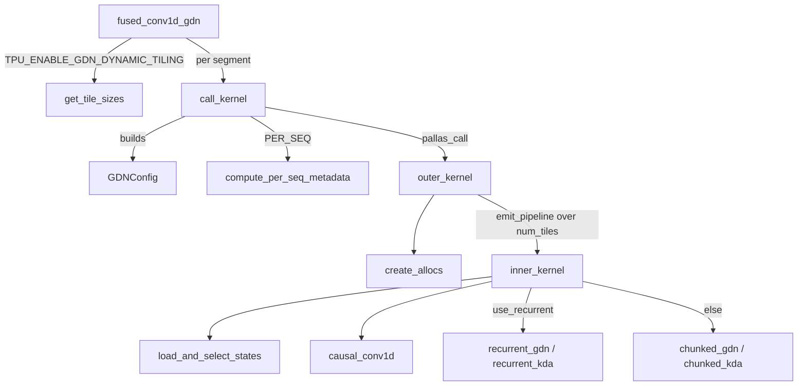

# Gated DeltaNet (GDN) v3 kernels: fused Conv1D + GDN/KDA Pallas kernel

<!-- connect:up:begin -->
> **Cross-repo concept:** part of [kv-cache](../../../concepts/kv-cache.md), [mosaic-kernel](../../../concepts/mosaic-kernel.md), [pallas-kernel](../../../concepts/pallas-kernel.md), [vmem](../../../concepts/vmem.md), [vmem-budget](../../../concepts/vmem-budget.md) across this wiki's repos.
<!-- connect:up:end -->
## Overview

Hybrid linear-attention models (Qwen-style GDN layers, Kimi-Linear / KDA layers) carry a per-sequence *state* instead of a growing KV cache: a short causal convolution state (`kernel_size - 1` past tokens of the mixed QKV projection) and a recurrent matrix state of shape `[n_v, d_k, d_v]` per sequence. The `kernels/gdn/v3` package computes one such layer step in a single Pallas kernel - [`fused_conv1d_gdn`](../catalog/src/vllm_torchtpu/kernels/gdn/v3/wrapper.md#fused_conv1d_gdn "src/vllm_torchtpu/kernels/gdn/v3/wrapper.py:L333"), whose docstring is simply "Perform conv1d and gdn in a single fused kernel." The key design idea is that **one kernel body serves every batch shape by changing only how tokens are tiled**: decode / speculative-verify sequences are packed many-sequences-per-tile (`BATCHED`), prefill / mixed sequences are walked one-sequence-per-tile in fixed-size chunks with the state carried in VMEM scratch between tiles (`PER_SEQ`). Within a tile the GDN math picks a token-recurrent scan or a chunked (triangular-solve) formulation, and the state is read from / written back to HBM with ragged, metadata-driven DMAs so padding tokens and idle sequences cost no HBM traffic. A small geometry module, [`GdnHeadGeometry`](../catalog/src/vllm_torchtpu/kernels/gdn/head_geometry.md#GdnHeadGeometry "src/vllm_torchtpu/kernels/gdn/head_geometry.py:L20"), defines how GDN heads (and therefore the state shapes) split across TP and PCP ranks; it is shared by the layer code, the platform's KV-pool sizing and the KV-transfer connector.

## Diagram

Control flow of one call (two `pallas_call`s chained through the aliased output):



Legend:
- `W` - [`fused_conv1d_gdn`](../catalog/src/vllm_torchtpu/kernels/gdn/v3/wrapper.md#fused_conv1d_gdn "src/vllm_torchtpu/kernels/gdn/v3/wrapper.py:L333")
- `TS` - [`get_tile_sizes`](../catalog/src/vllm_torchtpu/kernels/gdn/v3/tiling.md#get_tile_sizes "src/vllm_torchtpu/kernels/gdn/v3/tiling.py:L268")
- `CK` - [`call_kernel`](../catalog/src/vllm_torchtpu/kernels/gdn/v3/wrapper.md#fused_conv1d_gdn.call_kernel "src/vllm_torchtpu/kernels/gdn/v3/wrapper.py:L631")
- `CFG` - [`GDNConfig`](../catalog/src/vllm_torchtpu/kernels/gdn/v3/config.md#GDNConfig "src/vllm_torchtpu/kernels/gdn/v3/config.py:L53")
- `MD` - [`compute_per_seq_metadata`](../catalog/src/vllm_torchtpu/kernels/gdn/v3/metadata.md#compute_per_seq_metadata "src/vllm_torchtpu/kernels/gdn/v3/metadata.py:L66")
- `OK` - [`outer_kernel`](../catalog/src/vllm_torchtpu/kernels/gdn/v3/wrapper.md#outer_kernel "src/vllm_torchtpu/kernels/gdn/v3/wrapper.py:L211")
- `CA` - [`create_allocs`](../catalog/src/vllm_torchtpu/kernels/gdn/v3/memory_ref.md#create_allocs "src/vllm_torchtpu/kernels/gdn/v3/memory_ref.py:L412")
- `IK` - [`inner_kernel`](../catalog/src/vllm_torchtpu/kernels/gdn/v3/wrapper.md#inner_kernel "src/vllm_torchtpu/kernels/gdn/v3/wrapper.py:L38")
- `LS` - [`load_and_select_states`](../catalog/src/vllm_torchtpu/kernels/gdn/v3/vmem_ldst.md#load_and_select_states "src/vllm_torchtpu/kernels/gdn/v3/vmem_ldst.py:L94")
- `CV` - [`causal_conv1d`](../catalog/src/vllm_torchtpu/kernels/gdn/v3/compute_conv1d.md#causal_conv1d "src/vllm_torchtpu/kernels/gdn/v3/compute_conv1d.py:L21")
- `RG` - [`recurrent_gdn`](../catalog/src/vllm_torchtpu/kernels/gdn/v3/compute_gdn.md#recurrent_gdn "src/vllm_torchtpu/kernels/gdn/v3/compute_gdn.py:L406") / [`recurrent_kda`](../catalog/src/vllm_torchtpu/kernels/gdn/v3/compute_kda.md#recurrent_kda "src/vllm_torchtpu/kernels/gdn/v3/compute_kda.py:L425")
- `CG` - [`chunked_gdn`](../catalog/src/vllm_torchtpu/kernels/gdn/v3/compute_gdn.md#chunked_gdn "src/vllm_torchtpu/kernels/gdn/v3/compute_gdn.py:L252") / [`chunked_kda`](../catalog/src/vllm_torchtpu/kernels/gdn/v3/compute_kda.md#chunked_kda "src/vllm_torchtpu/kernels/gdn/v3/compute_kda.py:L301")

How the two tiling modes reshape the same `GDNConfig` (one row per mode):

```
mode      seq_tile_size   chunk_size       state carry           use_recurrent when
BATCHED   tile_size       window_size      none (1 seq = 1 tile)  always (chunk 1 or window > 1)
PER_SEQ   1               tile_size        VMEM carry scratch     only if tile_size == 1
```

## Design rationale (why it's built this way)

- **Fuse Conv1D into the GDN kernel.** The short conv's output is the q/k/v the recurrence consumes, and the conv state lives next to the recurrent state in the same pool row. Doing both in one kernel means the QKV activation is read from HBM once and the conv output never round-trips HBM. [`inner_kernel`](../catalog/src/vllm_torchtpu/kernels/gdn/v3/wrapper.md#inner_kernel "src/vllm_torchtpu/kernels/gdn/v3/wrapper.py:L38") describes itself as "a facade adhering to strict separation of concerns": it sees only VMEM refs; all DMA logic lives in the buffered refs built by [`create_allocs`](../catalog/src/vllm_torchtpu/kernels/gdn/v3/memory_ref.md#create_allocs "src/vllm_torchtpu/kernels/gdn/v3/memory_ref.py:L412").
- **Compact layout for the conv, large layout for chunked GDN.** The source comment in `inner_kernel` is explicit: a sliding-window conv over a normal 2D layout packs several rows per vector register and "necessitate[s] costly shuffling for every sliding", so the conv runs on a *compact* layout where one register holds one row. That is also why the conv state must be fp32. The chunked GDN path, which is matmul-heavy, instead reloads activations as a *large* (MXU-friendly) layout via strided loads ([`load_activation_as_large`](../catalog/src/vllm_torchtpu/kernels/gdn/v3/vmem_ldst.md#load_activation_as_large "src/vllm_torchtpu/kernels/gdn/v3/vmem_ldst.py:L205")), while the recurrent path keeps the compact layout ([`load_activation_as_compact`](../catalog/src/vllm_torchtpu/kernels/gdn/v3/vmem_ldst.md#load_activation_as_compact "src/vllm_torchtpu/kernels/gdn/v3/vmem_ldst.py:L174")).
- **Recurrent vs chunked is decided by checkpoints, not just length.** `GDNConfig.use_recurrent` is true when `chunk_size == 1` or `window_size > 1`: "Keeping more than one state checkpoint mandates the recurrent scan, since the chunked path only ever produces the final state." So speculative-verify windows always take the token-recurrent scan even though they hold several tokens.
- **Speculative rollback by checkpoint selection.** [`window_size`](../catalog/src/vllm_torchtpu/kernels/gdn/v3/config.md#GDNConfig.window_size "src/vllm_torchtpu/kernels/gdn/v3/config.py:L78") is `num_spec_tokens + 1`; the kernel writes one state checkpoint per window position and the next step reads from `state_indices[s] + read_offset[s]` (the checkpoint of the last accepted token). A recurrent state cannot be "un-applied", so keeping every candidate post-token state is the only way to reject drafts without recompute. With `window_size == 1` the extra axis folds away, so the non-speculative path pays nothing.
- **MXU-shaped algebra in the chunked path.** `chunked_gdn_per_seq` concatenates `v*beta` with `k*beta*gate` before multiplying by the inverted triangular matrix ("If v_head_dim < mxu size, concatenating them will help increase mxu utilization"), stacks `w` and gated `q` against the same state to "leverage weight stationary architecture", and repeats `q k^T` across V heads only *after* the matmul to save compute.
- **VPU/XLU vs MXU trade in the triangular solve.** `GDNConfig.triangular_block_size` splits the chunk's lower-triangular inverse into diagonal blocks solved by forward substitution on the VPU/XLU and off-diagonal blocks done as MXU GEMMs; "raising it moves work from MXU to XLU", and it shrinks as the number of 8-head groups grows.
- **Separate input and output state windows.** The state-input buffered ref's docstring notes that loads have their own double-buffered window "so the load for tile p + 2, issued during step p + 1, cannot overwrite the slot that tile p's store is still reading" - a write-after-read hazard that a shared window would create under pipelining.

> [!inferred]
> Running the decode/verify segment and the prefill/mixed segment as two separately compiled `pallas_call`s (rather than one kernel with a runtime branch) lets each get its own static tile shape, VMEM limit and compute path (recurrent vs chunked), which a single kernel could not specialize. The second call writes into the first call's output buffer through input/output aliasing, so the split costs no extra output copy.

## Entry points

- [`fused_conv1d_gdn`](../catalog/src/vllm_torchtpu/kernels/gdn/v3/wrapper.md#fused_conv1d_gdn "src/vllm_torchtpu/kernels/gdn/v3/wrapper.py:L333") - the jitted public entry (`states` donated, shape/tile/dtype arguments static). Reached per GDN/KDA layer per forward (usually once; the KDA op under speculative decoding calls it twice, `batched_only` for the verify windows then `prefill_only`): from the GDN layer core (local TP path under `shard_map`, the PCP prefill path, and the unified-block-pool path) and from the KDA custom op's [`run_kernel`](../catalog/src/vllm_torchtpu/layers/adapter/custom_ops/kda_attention_op.md#_build_fused_core.fused_core.run_kernel "src/vllm_torchtpu/layers/adapter/custom_ops/kda_attention_op.py:L384") with `attention_mode=KDA`. Inputs are the flat token batch plus vLLM-style ragged metadata (`query_start_loc`, `state_indices`, `seq_lens`, and a 3-element `distribution = [decode_end, prefill_end, mixed_end]`).
- [`derive_gdn_head_geometry`](../catalog/src/vllm_torchtpu/kernels/gdn/head_geometry.md#derive_gdn_head_geometry "src/vllm_torchtpu/kernels/gdn/head_geometry.py:L63") - "Derive the native sharding/replication relationship for GDN TP and PCP." Called at config/sizing time by the platform ([`_localize_gdn_state_shapes_for_pcp`](../catalog/src/vllm_torchtpu/platforms/tpu_block_size_utils.md#_localize_gdn_state_shapes_for_pcp "src/vllm_torchtpu/platforms/tpu_block_size_utils.py:L160"), [`_hybrid_mamba_state_layout`](../catalog/src/vllm_torchtpu/platforms/tpu_block_size_utils.md#_hybrid_mamba_state_layout "src/vllm_torchtpu/platforms/tpu_block_size_utils.py:L202")) to size per-rank state, and at layer-build time by the GDN custom op ([`_build_gdn_op`](../catalog/src/vllm_torchtpu/layers/adapter/custom_ops/gdn_attention_op.md#VllmGatedDeltaNetAttention._build_gdn_op "src/vllm_torchtpu/layers/adapter/custom_ops/gdn_attention_op.py:L553"), [`_build_pooled_pcp_gdn_op`](../catalog/src/vllm_torchtpu/layers/adapter/custom_ops/gdn_attention_op.md#VllmGatedDeltaNetAttention._build_pooled_pcp_gdn_op "src/vllm_torchtpu/layers/adapter/custom_ops/gdn_attention_op.py:L849")) and the PCP prefill path ([`run_jax_gdn_attention_pcp_tp_prefill`](../catalog/src/vllm_torchtpu/layers/core/gdn_attention.md#run_jax_gdn_attention_pcp_tp_prefill "src/vllm_torchtpu/layers/core/gdn_attention.py:L531")).
- [`local_state_shapes`](../catalog/src/vllm_torchtpu/kernels/gdn/head_geometry.md#GdnHeadGeometry.local_state_shapes "src/vllm_torchtpu/kernels/gdn/head_geometry.py:L48") - "Apply head ownership, preserving tap/speculation and layout axes." This is how the hybrid KV pool learns the rank-local conv width and recurrent head count it must allocate, before any kernel runs.
- [`TPU_ENABLE_GDN_DYNAMIC_TILING`](../catalog/src/vllm_torchtpu/envs.md#TPU_ENABLE_GDN_DYNAMIC_TILING "src/vllm_torchtpu/envs.py:L96") - env var (default off) that switches tile selection from the static defaults to [`get_tile_sizes`](../catalog/src/vllm_torchtpu/kernels/gdn/v3/tiling.md#get_tile_sizes "src/vllm_torchtpu/kernels/gdn/v3/tiling.py:L268") for GDN (KDA always stays on static tiles).

## Mechanism (step-by-step)

1. **Validate dtypes and normalize state.** [`fused_conv1d_gdn`](../catalog/src/vllm_torchtpu/kernels/gdn/v3/wrapper.md#fused_conv1d_gdn "src/vllm_torchtpu/kernels/gdn/v3/wrapper.py:L333") requires `kernel_act_dtype == float32` (activations are upcast before the kernel; bf16 activations are a TODO), an fp32 conv state, and an fp32 or bf16 recurrent state ("upcast once on load and rounded once on store"). `states` is either a `(conv, recurrent)` tuple or a single unified-pool array; the latter sets `is_shared`, in which case the conv region is found at a granule offset after the recurrent region (`GDNConfig.conv_hbm_offset`). A bf16 recurrent state is reshaped so two values pack into one 32-bit word. For KDA it also checks `gate_lower_bound < 0`, because the chunked solve needs every causal exponent `g_r - g_t` to be non-positive.

2. **Choose tile sizes.** With [`TPU_ENABLE_GDN_DYNAMIC_TILING`](../catalog/src/vllm_torchtpu/envs.md#TPU_ENABLE_GDN_DYNAMIC_TILING "src/vllm_torchtpu/envs.py:L96") set (and not KDA), [`get_tile_sizes`](../catalog/src/vllm_torchtpu/kernels/gdn/v3/tiling.md#get_tile_sizes "src/vllm_torchtpu/kernels/gdn/v3/tiling.py:L268") picks the decode tile as the minimum of a speed target and a VMEM-feasibility ceiling. The speed target balances fixed per-grid-step pipeline overhead against the unoverlapped first state fetch / last write-back: largest `T` in `(16, 8, 4, 2, 1)` with `T^2 * n_v <= 16 * num_seqs`. The mixed (prefill) chunk is the largest of `(128, 64, ..., 1)` whose VMEM estimate fits. Otherwise the static defaults apply (`decode_tile_size=4`, `mixed_tile_size=64`), but the decode tile is still shrunk so the double-buffered state windows (`1 + window` recurrent checkpoints per sequence, the dominant term) fit in half of the VMEM budget. The budget itself is [`get_vmem_limit_bytes`](../catalog/src/vllm_torchtpu/kernels/gdn/v3/config.md#GDNConfig.get_vmem_limit_bytes "src/vllm_torchtpu/kernels/gdn/v3/config.py:L220"): 80% of VMEM capacity, raised to 90% for windowed (speculative) kernels because "for large-head models the default 0.80 budget is not enough". KDA speculative verify is forced to one sequence per tile.

3. **Pad, then run up to two kernels.** Activations are padded to a 32-bit packing multiple on the token axis and to a lane multiple on the head/gate axis, then reshaped to `[tokens, 1, dim]`. [`call_kernel`](../catalog/src/vllm_torchtpu/kernels/gdn/v3/wrapper.md#fused_conv1d_gdn.call_kernel "src/vllm_torchtpu/kernels/gdn/v3/wrapper.py:L631") is invoked for the `BATCHED` segment (decode/verify sequences `[0, distribution[0])`) unless `prefill_only`, then for `PER_SEQ` (sequences `[distribution[0], distribution[2])`) unless `batched_only`. Each call builds a [`GDNConfig`](../catalog/src/vllm_torchtpu/kernels/gdn/v3/config.md#GDNConfig "src/vllm_torchtpu/kernels/gdn/v3/config.py:L53") (see [`GDNMode`](../catalog/src/vllm_torchtpu/kernels/gdn/v3/config.md#GDNMode "src/vllm_torchtpu/kernels/gdn/v3/config.py:L33")); `PER_SEQ` always uses `window_size = 1`. States are aliased input-to-output (in-place update), and the second call aliases the first call's output activation buffer so both segments land in one tensor. The kernel is named by [`get_kernel_name`](../catalog/src/vllm_torchtpu/kernels/gdn/v3/config.md#GDNConfig.get_kernel_name "src/vllm_torchtpu/kernels/gdn/v3/config.py:L185") as `fused_conv1d_<gdn|kda>_<batched|per_seq>_b<seq_tile>_c<chunk>[_w<N>][_bounded]`, which is what appears in profiles; bounds checks are disabled.

4. **Build ragged tile metadata in XLA, place it in SMEM.** For `PER_SEQ`, [`compute_per_seq_metadata`](../catalog/src/vllm_torchtpu/kernels/gdn/v3/metadata.md#compute_per_seq_metadata "src/vllm_torchtpu/kernels/gdn/v3/metadata.py:L66") ("Metadata for computing single sequence per tile") rolls the per-sequence arrays so the first prefill sequence is at index 0, computes `ceil(query_len / chunk_size)` tiles per sequence, and expands them with a fixed-length `jnp.repeat` into per-program-id tables: sequence index, starting token row, valid row count, first/last-tile flags, plus per-sequence `has_initial_state = seq_len - query_len > 0`. The grid length `num_tiles` is the sum of real tiles, so padded sequences generate no grid steps. The batched variant maps one tile to `tile_size` sequences, each contributing exactly its verify window. The source notes this preprocessing runs per layer "but will be CSEed by compiler".

5. **Set up the ragged DMA pipeline.** [`outer_kernel`](../catalog/src/vllm_torchtpu/kernels/gdn/v3/wrapper.md#outer_kernel "src/vllm_torchtpu/kernels/gdn/v3/wrapper.py:L211") ("Setup memory allocations and emit pipeline for running inner_kernel") asks [`create_allocs`](../catalog/src/vllm_torchtpu/kernels/gdn/v3/memory_ref.md#create_allocs "src/vllm_torchtpu/kernels/gdn/v3/memory_ref.py:L412") for eight buffered refs - qkv, b, a, conv-in, recurrent-in, out, conv-out, recurrent-out - all double-buffered (`num_buffers=2`, no lookahead), and runs `emit_pipeline` over `(num_tiles,)`. The activation refs override the copy hooks to issue one DMA per sequence slot sized by the metadata's row count, so a decode tile only moves real tokens. The state refs ([`copy_in`](../catalog/src/vllm_torchtpu/kernels/gdn/v3/memory_ref.md#StateInBufferedRef.copy_in "src/vllm_torchtpu/kernels/gdn/v3/memory_ref.py:L291"), [`copy_out`](../catalog/src/vllm_torchtpu/kernels/gdn/v3/memory_ref.md#StateOutBufferedRef.copy_out "src/vllm_torchtpu/kernels/gdn/v3/memory_ref.py:L357")) address HBM in 512-byte granules and make each DMA conditional by setting its size to 0 or 1: read only on a sequence's first tile when it has an initial state, write only on its last tile, one checkpoint per valid window position (`t < min(r_size, window_size)`) into its own source block. All refs reach the metadata through [`metadata_ref`](../catalog/src/vllm_torchtpu/kernels/gdn/v3/memory_ref.md#BaseBufferedRef.metadata_ref "src/vllm_torchtpu/kernels/gdn/v3/memory_ref.py:L139"), held as a static field because the SMEM buffer is allocated outside the kernel.

6. **Select the starting state.** In each tile, [`load_and_select_states`](../catalog/src/vllm_torchtpu/kernels/gdn/v3/vmem_ldst.md#load_and_select_states "src/vllm_torchtpu/kernels/gdn/v3/vmem_ldst.py:L94") ("Load correct states from HBM or prior tile, and masks invalid states") picks, per sequence slot: the HBM state on a first tile with history, the VMEM carry scratch from the previous tile otherwise (only `PER_SEQ` allocates carry scratch, see [`get_scratch_shape_dict`](../catalog/src/vllm_torchtpu/kernels/gdn/v3/config.md#GDNConfig.get_scratch_shape_dict "src/vllm_torchtpu/kernels/gdn/v3/config.py:L227")), or zeros for a fresh sequence. The recurrent state is unpacked from uint32 words to its storage dtype and upcast to fp32.

7. **Conv1D then SiLU.** [`causal_conv1d`](../catalog/src/vllm_torchtpu/kernels/gdn/v3/compute_conv1d.md#causal_conv1d "src/vllm_torchtpu/kernels/gdn/v3/compute_conv1d.py:L21") ("Perform causal Conv1D. Returns Conv1D output and convolution states.") prepends the previous conv state to the tile's QKV and computes the depthwise conv as `kernel_size` shifted multiply-adds per output row - static loops the compiler fuses. Because a sequence may end mid-tile, the new conv state is not "the last `kernel_size - 1` rows" but is selected by masking on `real_sizes`; with a speculative window it emits one conv checkpoint per window position. The result goes through SiLU.

8. **GDN recurrence: recurrent scan or chunked solve.** If `use_recurrent`, [`recurrent_gdn`](../catalog/src/vllm_torchtpu/kernels/gdn/v3/compute_gdn.md#recurrent_gdn "src/vllm_torchtpu/kernels/gdn/v3/compute_gdn.py:L406") runs the delta rule token by token: decay the state by `exp(g)`, predict `k S`, correct with `beta (v - k S)`, rank-1 update, read out `q S`. Plain decode (`chunk == 1, window == 1`) takes a fast path that concatenates `k` and `q` and projects both against the decayed state in one batched dot. Otherwise [`chunked_gdn`](../catalog/src/vllm_torchtpu/kernels/gdn/v3/compute_gdn.md#chunked_gdn "src/vllm_torchtpu/kernels/gdn/v3/compute_gdn.py:L252") processes a whole chunk per sequence via [`chunked_gdn_per_seq`](../catalog/src/vllm_torchtpu/kernels/gdn/v3/compute_gdn.md#chunked_gdn_per_seq "src/vllm_torchtpu/kernels/gdn/v3/compute_gdn.py:L106"): cumulative log-decay, a `[chunk, chunk]` lower-triangular system `I + gate * beta k k^T` inverted blockwise, then a handful of batched matmuls produce the chunk output and the final state. Both paths L2-normalize q/k, scale q by `d_k^-0.5`, apply `beta = sigmoid(b)` and `g = -exp(A_log) * softplus(a + dt_bias)`, and mask rows past `real_sizes` with `g = 0` so invalid rows act as "no decay". KDA ([`recurrent_kda`](../catalog/src/vllm_torchtpu/kernels/gdn/v3/compute_kda.md#recurrent_kda "src/vllm_torchtpu/kernels/gdn/v3/compute_kda.py:L425"), [`chunked_kda`](../catalog/src/vllm_torchtpu/kernels/gdn/v3/compute_kda.md#chunked_kda "src/vllm_torchtpu/kernels/gdn/v3/compute_kda.py:L301"), [`chunked_kda_per_seq`](../catalog/src/vllm_torchtpu/kernels/gdn/v3/compute_kda.md#chunked_kda_per_seq "src/vllm_torchtpu/kernels/gdn/v3/compute_kda.py:L66")) is the same structure with a per-channel gate ([`is_kda`](../catalog/src/vllm_torchtpu/kernels/gdn/v3/config.md#GDNConfig.is_kda "src/vllm_torchtpu/kernels/gdn/v3/config.py:L118")).

9. **Store.** [`inner_kernel`](../catalog/src/vllm_torchtpu/kernels/gdn/v3/wrapper.md#inner_kernel "src/vllm_torchtpu/kernels/gdn/v3/wrapper.py:L38") writes the output tile, rounds the recurrent state to its storage dtype and bitcasts it into the uint32 window, and in `PER_SEQ` stores the last checkpoint into the carry scratch for the next tile. The pipeline's `copy_out` then moves only the real rows and checkpoints back to HBM.

## Key data structures

- [`GDNConfig`](../catalog/src/vllm_torchtpu/kernels/gdn/v3/config.md#GDNConfig "src/vllm_torchtpu/kernels/gdn/v3/config.py:L53") - the static (pytree-registered, frozen) kernel configuration; one instance per compiled kernel. Holds head counts ([`num_v_heads`](../catalog/src/vllm_torchtpu/kernels/gdn/v3/config.md#GDNConfig.num_v_heads "src/vllm_torchtpu/kernels/gdn/v3/config.py:L61"), [`kq_head_dim`](../catalog/src/vllm_torchtpu/kernels/gdn/v3/config.md#GDNConfig.kq_head_dim "src/vllm_torchtpu/kernels/gdn/v3/config.py:L62"), [`v_head_dim`](../catalog/src/vllm_torchtpu/kernels/gdn/v3/config.md#GDNConfig.v_head_dim "src/vllm_torchtpu/kernels/gdn/v3/config.py:L63")), `tile_size`, `window_size`, `is_shared`, and the [`dtypes`](../catalog/src/vllm_torchtpu/kernels/gdn/v3/config.md#GDNConfig.dtypes "src/vllm_torchtpu/kernels/gdn/v3/config.py:L55") bundle (activation in/out, [`compute`](../catalog/src/vllm_torchtpu/kernels/gdn/v3/config.md#Dtypes.compute "src/vllm_torchtpu/kernels/gdn/v3/config.py:L46") precision, recurrent and conv state). Derived properties do the mode mapping: [`chunk_size`](../catalog/src/vllm_torchtpu/kernels/gdn/v3/config.md#GDNConfig.chunk_size "src/vllm_torchtpu/kernels/gdn/v3/config.py:L100") is `tile_size` for `PER_SEQ` and `window_size` for `BATCHED`; [`seq_tile_size`](../catalog/src/vllm_torchtpu/kernels/gdn/v3/config.md#GDNConfig.seq_tile_size "src/vllm_torchtpu/kernels/gdn/v3/config.py:L108") is 1 for `PER_SEQ` and `tile_size` for `BATCHED`. [`get_out_shape`](../catalog/src/vllm_torchtpu/kernels/gdn/v3/config.md#GDNConfig.get_out_shape "src/vllm_torchtpu/kernels/gdn/v3/config.py:L206") gives the `[tokens, n_v, d_v]` output.
- **Tile metadata** (built by [`compute_per_seq_metadata`](../catalog/src/vllm_torchtpu/kernels/gdn/v3/metadata.md#compute_per_seq_metadata "src/vllm_torchtpu/kernels/gdn/v3/metadata.py:L66")) - SMEM tables indexed by program id (`p_id_to_s_idx`, `p_id_to_r_base`, `p_id_to_r_size`, first/last flags) and by sequence (`has_initial_state`, `state_indices`, `read_offset`, optional `[num_seqs, window]` `ckpt_indices`, which let each speculative checkpoint live in an independent pool block so the pool's block size does not depend on `window_size`).
- **State tensors** - conv state `[slots, kernel_size - 1, 1, dim]` (fp32) and recurrent state `[slots, n_v, d_k, d_v]` (fp32 or bf16, viewed as uint32 words in VMEM), or a single unified pool row holding both. Slot 0 is documented as "a null block used for padded or invalid tokens".
- [`GdnHeadGeometry`](../catalog/src/vllm_torchtpu/kernels/gdn/head_geometry.md#GdnHeadGeometry "src/vllm_torchtpu/kernels/gdn/head_geometry.py:L20") - "Validated rank-local GDN head geometry." Value heads are always sharded across all [`parallel_size`](../catalog/src/vllm_torchtpu/kernels/gdn/head_geometry.md#GdnHeadGeometry.parallel_size "src/vllm_torchtpu/kernels/gdn/head_geometry.py:L30") ranks ([`local_num_v_heads`](../catalog/src/vllm_torchtpu/kernels/gdn/head_geometry.md#GdnHeadGeometry.local_num_v_heads "src/vllm_torchtpu/kernels/gdn/head_geometry.py:L33")). Q/K heads ([`num_kq_heads`](../catalog/src/vllm_torchtpu/kernels/gdn/head_geometry.md#GdnHeadGeometry.num_kq_heads "src/vllm_torchtpu/kernels/gdn/head_geometry.py:L28")) are sharded when there are at least as many as ranks and otherwise replicated across adjacent ranks: [`kq_replication_factor`](../catalog/src/vllm_torchtpu/kernels/gdn/head_geometry.md#GdnHeadGeometry.kq_replication_factor "src/vllm_torchtpu/kernels/gdn/head_geometry.py:L34") = `parallel_size / min(n_kq, parallel_size)`, [`kq_shard_index`](../catalog/src/vllm_torchtpu/kernels/gdn/head_geometry.md#GdnHeadGeometry.kq_shard_index "src/vllm_torchtpu/kernels/gdn/head_geometry.py:L36") = `rank // kq_replication_factor`, [`local_num_kq_heads`](../catalog/src/vllm_torchtpu/kernels/gdn/head_geometry.md#GdnHeadGeometry.local_num_kq_heads "src/vllm_torchtpu/kernels/gdn/head_geometry.py:L32") = `n_kq / min(n_kq, parallel_size)`. [`local_conv_dim`](../catalog/src/vllm_torchtpu/kernels/gdn/head_geometry.md#GdnHeadGeometry.local_conv_dim "src/vllm_torchtpu/kernels/gdn/head_geometry.py:L41") = `2 * local_kq * d_k + local_v * d_v` is the rank-local conv-state width.

## Dynamics (design intent)

- **Overlap.** Both kernels are `emit_pipeline` loops with two buffers per ref, so tile `p + 1`'s activation and state DMAs overlap tile `p`'s compute. The decode-tile heuristic's docstring states the remaining cost model: the first state fetch and last write-back are *not* overlapped and scale with `T * n_v`, while per-step overhead scales with the number of steps, hence `T^2 * n_v <= K * num_seqs` with `K = 16`; decode tiles are capped at 16 sequences because "larger tiles increase per-slot state DMA descriptors and register spills without reducing per-slot compute".
- **Serial dependence inside `PER_SEQ`.** Consecutive tiles of one sequence depend on each other through the carry scratch, so a long prefill is a serial chain of `ceil(len / chunk)` grid steps; the chunk size (up to 128 with dynamic tiling) is the main lever for long-prefill latency.
- **Compile specialization.** Each distinct `(mode, tile, chunk, window, bounded)` combination is a separately compiled and separately named kernel; "Windows of different sizes compile to different kernels; keep them distinguishable in profiles."
- **Rank-local math.** The kernel itself is unaware of sharding: callers pass rank-local `n_kq` / `n_v` (for TP, `n // tp_size` inside `shard_map`) and rank-local states sized by [`local_state_shapes`](../catalog/src/vllm_torchtpu/kernels/gdn/head_geometry.md#GdnHeadGeometry.local_state_shapes "src/vllm_torchtpu/kernels/gdn/head_geometry.py:L48"). The KV-transfer connector re-derives the same geometry to map one rank's head shard onto a peer's narrower states ([`lower_gdn_state_fanout_spans_sol`](../catalog/src/vllm_torchtpu/distributed/kv_transfer/raiden/seq_on_lane.md#lower_gdn_state_fanout_spans_sol "src/vllm_torchtpu/distributed/kv_transfer/raiden/seq_on_lane.py:L703"), [`_validate_gdn_transfer_geometry`](../catalog/src/vllm_torchtpu/distributed/kv_transfer/tpu_connector.md#TPURaidenConnectorWorker._validate_gdn_transfer_geometry "src/vllm_torchtpu/distributed/kv_transfer/tpu_connector.py:L4052")).

## Edge cases

- **Divisibility.** [`derive_gdn_head_geometry`](../catalog/src/vllm_torchtpu/kernels/gdn/head_geometry.md#derive_gdn_head_geometry "src/vllm_torchtpu/kernels/gdn/head_geometry.py:L63") raises unless `n_v % parallel_size == 0`, `n_kq` divides evenly into its shards (or `parallel_size` into its replicas), and each local Q/K head owns an integer number of local V heads. A TP x PCP degree that violates these fails at sizing time, not at kernel launch.
- **Batched metadata precondition.** The batched metadata assumes every decode/verify sequence has `query_len <= window_size`; the source leaves error handling for violations as a TODO, so a caller that misclassifies a longer sequence into the first segment gets silently wrong results.
- **dtype limits.** Activations must be fp32 inside the kernel and the conv state must be fp32; a bf16 conv state raises `NotImplementedError`. Under KDA, `dt_bias` must stay 2D `[n_v, d_k]` because "Mosaic rejects that shape cast from a flat vector".
- **KDA gate overflow.** `chunked_kda_per_seq` explains why diagonal sub-blocks take exact pairwise gate differences on the VPU: Kimi-Linear's unbounded gate can reach -1736 for one token, so the factored `exp(g_r - g_ref) * exp(g_ref - g_t)` form gives `0 * inf = NaN` ("26 of 32 heads NaN" on real layer-0 weights). A mismatched `gate_lower_bound` versus the model's config "silently changes the decay".
- **KDA tiling.** KDA ignores dynamic tiling (its VMEM estimate does not model the per-channel gate) and runs speculative verify one sequence per tile.
- **PER_SEQ reads checkpoint `read_offset`.** A prefix-cache resume on the unified pool may land on a state block whose committed state is a non-zero verify checkpoint, so `PER_SEQ` also honors `read_offsets`; its final state is always written to checkpoint 0.
- **Wait descriptors.** With bounds checks disabled, the self-copy descriptor used to wait on state DMAs "may nominally exceed the window row; it is never executed".

## Open questions

- The batched-mode metadata builder (`compute_batched_seq_metadata`) and the `MetadataRef` / `StateInBufferedRef` / `StateOutBufferedRef` / `InBufferedRef` classes are central but not in this packet's subgraph, so they are described here only through the cited `copy_in` / `copy_out` / `metadata_ref` members.
- `triangular_block_size`, `use_recurrent` and `conv_hbm_offset` (the properties that select the compute path and pool offset) are also not in the subgraph; their behavior is taken from the source of [`GDNConfig`](../catalog/src/vllm_torchtpu/kernels/gdn/v3/config.md#GDNConfig "src/vllm_torchtpu/kernels/gdn/v3/config.py:L53").
- There are no tests under the configured test paths for this subgraph, so the static tile defaults (4 / 64) and the `K = 16` step-cost constant have no in-repo benchmark backing visible here; the wrapper still carries a TODO to derive tile size from input dimensions.
- Whether dynamic tiling should become the default is not settled in source (the env var defaults to off).

## See also

- [gdn-pcp-fused-kernel](gdn-pcp-fused-kernel.md) - the communication-fused PCP prefill variant that reuses `inner_kernel` with an explicit tile index.
- [kv-cache-layout-and-hbm-budget](kv-cache-layout-and-hbm-budget.md) - the hybrid/unified pool that stores the conv and recurrent states.
- [attention-and-layer-core](attention-and-layer-core.md) and [vllm-layer-adapters](vllm-layer-adapters.md) - the GDN/KDA layer and custom-op callers.
- [speculative-decoding](speculative-decoding.md) - where `num_spec_tokens`, `read_offsets` and checkpoint rollback come from.
- [distributed-parallelism-and-meshes](distributed-parallelism-and-meshes.md) - TP/PCP meshes that `GdnHeadGeometry` maps heads onto.
- [kv-transfer-and-disaggregated-serving](kv-transfer-and-disaggregated-serving.md) - GDN state transfer across ranks.
- [kimi-k3-kernels](kimi-k3-kernels.md) - KDA-based model kernels.
- [ragged-paged-attention-kernel](ragged-paged-attention-kernel.md) - the softmax-attention counterpart with similar ragged metadata.
