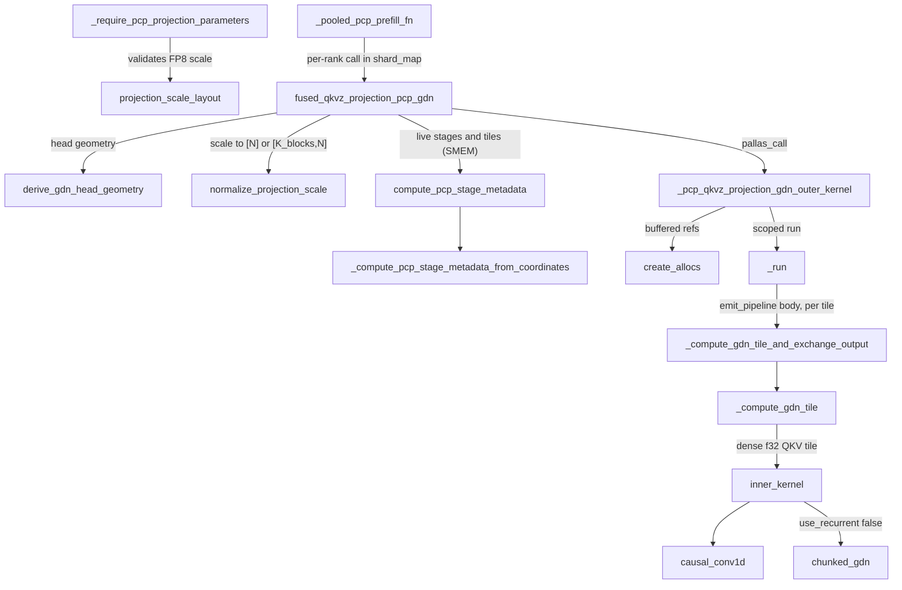
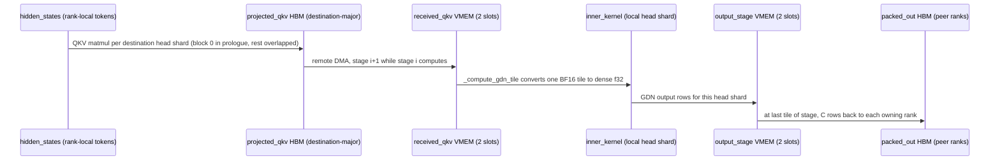

# Fused GDN prefill-context-parallel (PCP) kernel

<!-- connect:up:begin -->
> **Cross-repo concept:** part of [kv-cache](../../../concepts/kv-cache.md), [pallas-kernel](../../../concepts/pallas-kernel.md), [vmem-budget](../../../concepts/vmem-budget.md) across this wiki's repos.
<!-- connect:up:end -->
## Overview

`kernels/experimental/gdn_pcp_fused` is a fork of the GDN v3 kernel built for one job: Gated DeltaNet (GDN) prefill when tokens are split across a PCP mesh axis and GDN state lives in the unified KV pool. GDN is a recurrence over tokens, so it cannot run on a token shard. Each rank has to see *every* token for the value heads it owns. The kernel therefore transposes token-sharded activations into head-sharded ones, runs the recurrence, and transposes back. The key design idea is that it does all of this in **one Pallas call**: [`fused_qkvz_projection_pcp_gdn`](../catalog/src/vllm_torchtpu/kernels/experimental/gdn_pcp_fused/pcp_wrapper.md#fused_qkvz_projection_pcp_gdn "src/vllm_torchtpu/kernels/experimental/gdn_pcp_fused/pcp_wrapper.py:L1328") projects QKVZ in-kernel from the rank-local hidden states, pushes each destination's QKV rows over remote DMA into a double-buffered VMEM receive window, and runs the forked v3 GDN tile kernel ([`inner_kernel`](../catalog/src/vllm_torchtpu/kernels/experimental/gdn_pcp_fused/kernel.md#inner_kernel "src/vllm_torchtpu/kernels/experimental/gdn_pcp_fused/kernel.py:L37")) on stage `i` while stage `i + 1` is in flight. The remaining projection matmuls are hidden one per GDN tile. A replicated runtime schedule ([`compute_pcp_stage_metadata`](../catalog/src/vllm_torchtpu/kernels/experimental/gdn_pcp_fused/pcp_metadata.md#compute_pcp_stage_metadata "src/vllm_torchtpu/kernels/experimental/gdn_pcp_fused/pcp_metadata.py:L132")) sizes the active work from the live requests, not from the compile bucket.

The module docstring states the contract: "The Qwen3.5 BF16/FP8 entry projects QKVZ in-kernel and interleaves all but the first projection block with GDN tiles. BA exchange, gated normalization, and the final output projection remain outside."

## Diagram

Legend:
- `LAYER` - [`_require_pcp_projection_parameters`](../catalog/src/vllm_torchtpu/layers/adapter/custom_ops/gdn_attention_op.md#VllmGatedDeltaNetAttention._require_pcp_projection_parameters "src/vllm_torchtpu/layers/adapter/custom_ops/gdn_attention_op.py:L1020")
- `PSL` - [`projection_scale_layout`](../catalog/src/vllm_torchtpu/kernels/experimental/gdn_pcp_fused/projection_scale.md#projection_scale_layout "src/vllm_torchtpu/kernels/experimental/gdn_pcp_fused/projection_scale.py:L35")
- `SHMAP` - [`_pooled_pcp_prefill_fn`](../catalog/src/vllm_torchtpu/layers/core/gdn_attention.md#run_jax_gdn_attention_pooled_pcp_prefill_projection._pooled_pcp_prefill_fn "src/vllm_torchtpu/layers/core/gdn_attention.py:L1108")
- `ENTRY` - [`fused_qkvz_projection_pcp_gdn`](../catalog/src/vllm_torchtpu/kernels/experimental/gdn_pcp_fused/pcp_wrapper.md#fused_qkvz_projection_pcp_gdn "src/vllm_torchtpu/kernels/experimental/gdn_pcp_fused/pcp_wrapper.py:L1328")
- `GEO` - [`derive_gdn_head_geometry`](../catalog/src/vllm_torchtpu/kernels/gdn/head_geometry.md#derive_gdn_head_geometry "src/vllm_torchtpu/kernels/gdn/head_geometry.py:L63")
- `NPS` - [`normalize_projection_scale`](../catalog/src/vllm_torchtpu/kernels/experimental/gdn_pcp_fused/projection_scale.md#normalize_projection_scale "src/vllm_torchtpu/kernels/experimental/gdn_pcp_fused/projection_scale.py:L74")
- `META` - [`compute_pcp_stage_metadata`](../catalog/src/vllm_torchtpu/kernels/experimental/gdn_pcp_fused/pcp_metadata.md#compute_pcp_stage_metadata "src/vllm_torchtpu/kernels/experimental/gdn_pcp_fused/pcp_metadata.py:L132")
- `BUILD` - [`_compute_pcp_stage_metadata_from_coordinates`](../catalog/src/vllm_torchtpu/kernels/experimental/gdn_pcp_fused/pcp_metadata.md#_compute_pcp_stage_metadata_from_coordinates "src/vllm_torchtpu/kernels/experimental/gdn_pcp_fused/pcp_metadata.py:L175")
- `OUTER` - [`_pcp_qkvz_projection_gdn_outer_kernel`](../catalog/src/vllm_torchtpu/kernels/experimental/gdn_pcp_fused/pcp_wrapper.md#_pcp_qkvz_projection_gdn_outer_kernel "src/vllm_torchtpu/kernels/experimental/gdn_pcp_fused/pcp_wrapper.py:L232")
- `ALLOC` - [`create_allocs`](../catalog/src/vllm_torchtpu/kernels/experimental/gdn_pcp_fused/memory_ref.md#create_allocs "src/vllm_torchtpu/kernels/experimental/gdn_pcp_fused/memory_ref.py:L437")
- `RUN` - [`_run`](../catalog/src/vllm_torchtpu/kernels/experimental/gdn_pcp_fused/pcp_wrapper.md#_pcp_qkvz_projection_gdn_outer_kernel._run "src/vllm_torchtpu/kernels/experimental/gdn_pcp_fused/pcp_wrapper.py:L1151")
- `BODY` - [`_compute_gdn_tile_and_exchange_output`](../catalog/src/vllm_torchtpu/kernels/experimental/gdn_pcp_fused/pcp_wrapper.md#_pcp_qkvz_projection_gdn_outer_kernel._compute_gdn_tile_and_exchange_output "src/vllm_torchtpu/kernels/experimental/gdn_pcp_fused/pcp_wrapper.py:L966")
- `TILE` - [`_compute_gdn_tile`](../catalog/src/vllm_torchtpu/kernels/experimental/gdn_pcp_fused/pcp_wrapper.md#_compute_gdn_tile "src/vllm_torchtpu/kernels/experimental/gdn_pcp_fused/pcp_wrapper.py:L145")
- `INNER` - [`inner_kernel`](../catalog/src/vllm_torchtpu/kernels/experimental/gdn_pcp_fused/kernel.md#inner_kernel "src/vllm_torchtpu/kernels/experimental/gdn_pcp_fused/kernel.py:L37")
- `CONV` - [`causal_conv1d`](../catalog/src/vllm_torchtpu/kernels/experimental/gdn_pcp_fused/compute_conv1d.md#causal_conv1d "src/vllm_torchtpu/kernels/experimental/gdn_pcp_fused/compute_conv1d.py:L27")
- `CHUNK` - [`chunked_gdn`](../catalog/src/vllm_torchtpu/kernels/experimental/gdn_pcp_fused/compute_gdn.md#chunked_gdn "src/vllm_torchtpu/kernels/experimental/gdn_pcp_fused/compute_gdn.py:L256")

The per-rank data movement for PCP size `P` and communication chunk `C` (one stage = `P x C` request-major tokens):

## Design rationale (why it's built this way)

- **Fuse the transpose with the projection, not just with GDN.** The non-fused PCP paths in `layers/core/gdn_attention.py` exchange tokens outside the kernel (README). Here the projected QKV never goes back to HBM in a padded token-major form. [`_pcp_qkvz_projection_gdn_outer_kernel`](../catalog/src/vllm_torchtpu/kernels/experimental/gdn_pcp_fused/pcp_wrapper.md#_pcp_qkvz_projection_gdn_outer_kernel "src/vllm_torchtpu/kernels/experimental/gdn_pcp_fused/pcp_wrapper.py:L232") writes it "directly into a compact destination-major HBM layout, so each source rank pushes one contiguous rank-local token chunk per destination without head-width padding" (module docstring). Each destination gets its own QKV out-block (`num_qkv_out_blocks = pcp_size`), shaped as a stack of physical `(8, 128)` tiles ([`_TPU_TILE_ROWS`](../catalog/src/vllm_torchtpu/kernels/experimental/gdn_pcp_fused/pcp_wrapper.md#_TPU_TILE_ROWS "src/vllm_torchtpu/kernels/experimental/gdn_pcp_fused/pcp_wrapper.py:L74") x [`_TPU_TILE_COLUMNS`](../catalog/src/vllm_torchtpu/kernels/experimental/gdn_pcp_fused/pcp_wrapper.md#_TPU_TILE_COLUMNS "src/vllm_torchtpu/kernels/experimental/gdn_pcp_fused/pcp_wrapper.py:L75")), so a DMA moves whole tiles.
- **Only the first projection block is on the critical path.** The QKV for token block 0 has to exist before stage 0 can communicate, so it runs in the prologue. Everything else goes into a work queue in block-major order (block-0 Z, then each later block's `P` QKV blocks followed by its `P` Z blocks), so the prepared X tile is reused. The pipeline body issues one projection tile per GDN tile. The source comment calls that the "only unconditional critical-path work".
- **Read-only pool + compact updates instead of aliasing.** The `input_output_aliases` comment in [`fused_qkvz_projection_pcp_gdn`](../catalog/src/vllm_torchtpu/kernels/experimental/gdn_pcp_fused/pcp_wrapper.md#fused_qkvz_projection_pcp_gdn "src/vllm_torchtpu/kernels/experimental/gdn_pcp_fused/pcp_wrapper.py:L1328") says: "XLA keeps a whole copy of any buffer aliased through this communicating kernel (measured: two pool-sized copies per call)". So the kernel only reads the pool. The state output ref writes per-sequence compact updates, and the wrapper scatters them back with native dynamic slices, which lets the donated pool update in place. On a large unified pool this is the main HBM-traffic decision in the design.
- **Runtime-bounded schedule over static capacities.** The `pcp_metadata` module docstring: "A short request compiled in a large token/request bucket therefore does not acquire the bucket's padded communication or compute work." [`_schedule_capacities`](../catalog/src/vllm_torchtpu/kernels/experimental/gdn_pcp_fused/pcp_metadata.md#_schedule_capacities "src/vllm_torchtpu/kernels/experimental/gdn_pcp_fused/pcp_metadata.py:L112") fixes array capacities at trace time, and while-loops fill only the live prefix. The same rule shows up in the kernel: the projection loop bound comes from the rank's live row end (`rank_active_row_end`), so at most one projection token block of tail padding is computed.
- **Reuse the v3 tile kernel unchanged.** [`inner_kernel`](../catalog/src/vllm_torchtpu/kernels/experimental/gdn_pcp_fused/kernel.md#inner_kernel "src/vllm_torchtpu/kernels/experimental/gdn_pcp_fused/kernel.py:L37") gained one argument, `p_id`, because "Communication-fused outer kernels pass their global compute-tile index because their surrounding pipeline owns the Pallas program id." Everything communication-specific stays in the outer kernel.
- **A deliberate fork.** The file header comments say this copy "is owned by the PCP workstream and must not import from kernels/gdn/v3", and that upstream v3 changes are ported by hand (the wrapper header says "through #1422, plus #1927's split of the state windows"). Per the directory README, the plan is to fold it back into v3 and delete the fork once PCP work settles. The one shared contract is the GDN state layout in the unified pool, because "PCP prefill writes state that the V3 decode path later reads".

## Entry points

- [`fused_qkvz_projection_pcp_gdn`](../catalog/src/vllm_torchtpu/kernels/experimental/gdn_pcp_fused/pcp_wrapper.md#fused_qkvz_projection_pcp_gdn "src/vllm_torchtpu/kernels/experimental/gdn_pcp_fused/pcp_wrapper.py:L1328") - the `jax.jit` front-end (`state_source` donated; head counts/dims, `pcp_size`, `comm_chunk_size`, `mixed_tile_size`, precision and mesh names static). Docstring: "Run ragged PCP prefill with fused QKVZ projection and communication." Returns `(new_pool, packed_out, z)` for the rank's own tokens. It is reached once per GDN layer per prefill step from [`_pooled_pcp_prefill_fn`](../catalog/src/vllm_torchtpu/layers/core/gdn_attention.md#run_jax_gdn_attention_pooled_pcp_prefill_projection._pooled_pcp_prefill_fn "src/vllm_torchtpu/layers/core/gdn_attention.py:L1108"), the per-rank body of a `shard_map` over a mesh with a `pcp` axis. That body first exchanges B/A outside the kernel and restores them to request-major order, then selects the PCP-local conv weight / `A_log` / `dt_bias` shards and reshapes the pool to logical blocks. The layer takes this path whenever PCP is configured and a unified pool is allocated (the layer calls it "the mandatory fused path").
- [`projection_scale_layout`](../catalog/src/vllm_torchtpu/kernels/experimental/gdn_pcp_fused/projection_scale.md#projection_scale_layout "src/vllm_torchtpu/kernels/experimental/gdn_pcp_fused/projection_scale.py:L35") - the second external entry. The Torch-side layer method [`_require_pcp_projection_parameters`](../catalog/src/vllm_torchtpu/layers/adapter/custom_ops/gdn_attention_op.md#VllmGatedDeltaNetAttention._require_pcp_projection_parameters "src/vllm_torchtpu/layers/adapter/custom_ops/gdn_attention_op.py:L1020") calls it before dispatch to reject FP8 QKVZ scale shapes the kernel cannot consume. Accepted layouts ([`ProjectionScaleLayout`](../catalog/src/vllm_torchtpu/kernels/experimental/gdn_pcp_fused/projection_scale.md#ProjectionScaleLayout "src/vllm_torchtpu/kernels/experimental/gdn_pcp_fused/projection_scale.py:L28")): tensor scalar, per-channel `[N]`, block grid `[N_blocks, K_blocks]`, and the Linear runtime `[1, K_blocks, 1, N]`. K blocks must be multiples of 128 columns.

## Mechanism (step-by-step)

1. **Validate geometry and pick the tile.** [`fused_qkvz_projection_pcp_gdn`](../catalog/src/vllm_torchtpu/kernels/experimental/gdn_pcp_fused/pcp_wrapper.md#fused_qkvz_projection_pcp_gdn "src/vllm_torchtpu/kernels/experimental/gdn_pcp_fused/pcp_wrapper.py:L1328") calls [`derive_gdn_head_geometry`](../catalog/src/vllm_torchtpu/kernels/gdn/head_geometry.md#derive_gdn_head_geometry "src/vllm_torchtpu/kernels/gdn/head_geometry.py:L63") with `parallel_size = pcp_size`. Value heads are split across PCP ranks. Q/K heads are split, or replicated when there are fewer of them than ranks; [`local_num_kq_heads`](../catalog/src/vllm_torchtpu/kernels/gdn/head_geometry.md#GdnHeadGeometry.local_num_kq_heads "src/vllm_torchtpu/kernels/gdn/head_geometry.py:L32") is the per-rank count. The front-end enforces a long list of hardware-shaped constraints (see Edge cases). The GDN tile is `min(mixed_tile_size=64, P*C, global_batch)`, and the GDN config is built in `PER_SEQ` mode with `is_shared=True` (unified pool), an fp32 conv state and an fp32 or bf16 recurrent state. FP8 weight scales are normalized by [`normalize_projection_scale`](../catalog/src/vllm_torchtpu/kernels/experimental/gdn_pcp_fused/projection_scale.md#normalize_projection_scale "src/vllm_torchtpu/kernels/experimental/gdn_pcp_fused/projection_scale.py:L74") into `[N]` or `[K_blocks, N]`, which "Expands only scale metadata, never the FP8 weights", so Q/K/V/Z column pieces can be gathered at arbitrary channel boundaries.

2. **Build the replicated stage/tile schedule.** [`compute_pcp_stage_metadata`](../catalog/src/vllm_torchtpu/kernels/experimental/gdn_pcp_fused/pcp_metadata.md#compute_pcp_stage_metadata "src/vllm_torchtpu/kernels/experimental/gdn_pcp_fused/pcp_metadata.py:L132") separates two coordinates. Token ownership (which rank holds a row) follows `query_start_loc[:-1]`. Request state semantics (does the request have an initial state) follow absolute starts `seq_lens - q_lens`. [`_compute_pcp_stage_metadata_from_coordinates`](../catalog/src/vllm_torchtpu/kernels/experimental/gdn_pcp_fused/pcp_metadata.md#_compute_pcp_stage_metadata_from_coordinates "src/vllm_torchtpu/kernels/experimental/gdn_pcp_fused/pcp_metadata.py:L175") loops over live requests. [`_emit_request`](../catalog/src/vllm_torchtpu/kernels/experimental/gdn_pcp_fused/pcp_metadata.md#_compute_pcp_stage_metadata_from_coordinates._emit_request "src/vllm_torchtpu/kernels/experimental/gdn_pcp_fused/pcp_metadata.py:L265") splits each request at `P x C` interleave-round boundaries into **stages** (a stage is "one request's intersection with one token-owner PCP interleave round"). Within a stage, GDN tiles are split again at rank-slot boundaries so every VMEM token offset stays DMA-aligned. [`_plan_projection_catchup`](../catalog/src/vllm_torchtpu/kernels/experimental/gdn_pcp_fused/pcp_metadata.md#_compute_pcp_stage_metadata_from_coordinates._plan_projection_catchup "src/vllm_torchtpu/kernels/experimental/gdn_pcp_fused/pcp_metadata.py:L460") then works out, per stage and per rank, how many projection work items the queue must have finished before that stage's QKV can be sent. It also works out how many extra (catch-up) items must run synchronously when too few GDN tiles came before to hide them. The GDN-facing half is packed into a [`MetadataRef`](../catalog/src/vllm_torchtpu/kernels/experimental/gdn_pcp_fused/memory_ref.md#MetadataRef "src/vllm_torchtpu/kernels/experimental/gdn_pcp_fused/memory_ref.py:L83") via [`create`](../catalog/src/vllm_torchtpu/kernels/experimental/gdn_pcp_fused/memory_ref.md#MetadataRef.create "src/vllm_torchtpu/kernels/experimental/gdn_pcp_fused/memory_ref.py:L107"), and both halves go to the kernel in SMEM.

3. **Prologue: first projection block, pad copies, stage-0 send.** Inside [`_run`](../catalog/src/vllm_torchtpu/kernels/experimental/gdn_pcp_fused/pcp_wrapper.md#_pcp_qkvz_projection_gdn_outer_kernel._run "src/vllm_torchtpu/kernels/experimental/gdn_pcp_fused/pcp_wrapper.py:L1151"), the kernel first starts HBM-to-HBM copies of each sequence's non-state granules (pool -> compact update). These do not depend on any compute, so they overlap the whole schedule. It then projects all `P` QKV out-blocks for token block 0, the only unconditional critical-path work. Projection is an MXU `dot_general` into an fp32 accumulator. For FP8 weights, X is quantized per row on the fly (`absmax / finfo.max`, zero mapped to 1), and blocked scales accumulate one K block at a time. Last in the prologue, the kernel runs any stage-0 catch-up and starts stage 0's QKV remote copies: a local `make_async_copy` for its own slot and `make_async_remote_copy` for every peer, addressed by full mesh coordinate where only the PCP coordinate differs.

4. **Per-tile pipeline body.** [`create_allocs`](../catalog/src/vllm_torchtpu/kernels/experimental/gdn_pcp_fused/memory_ref.md#create_allocs "src/vllm_torchtpu/kernels/experimental/gdn_pcp_fused/memory_ref.py:L437") builds the double-buffered refs for b/a, conv/recurrent state in/out, and the GDN output. Its QKV alloc is thrown away, because QKV arrives by remote DMA rather than from an HBM block spec. `pltpu.emit_pipeline` then runs [`_compute_gdn_tile_and_exchange_output`](../catalog/src/vllm_torchtpu/kernels/experimental/gdn_pcp_fused/pcp_wrapper.md#_pcp_qkvz_projection_gdn_outer_kernel._compute_gdn_tile_and_exchange_output "src/vllm_torchtpu/kernels/experimental/gdn_pcp_fused/pcp_wrapper.py:L966") once per live GDN tile. In order, it (a) starts the DMAs for the next projection work item in the queue, (b) at the first tile of stage `s >= 2`, drains the output slot it is about to reuse, (c) computes the GDN tile, (d) finishes the projection matmul whose operands arrived during (c), and (e) copies the tile's output into the `output_stage` VMEM slot. At the last tile of a stage it pushes each destination's valid rows back into that rank's `packed_out` at column index `rank`. So each rank ends with all value heads for its own tokens: the reverse transpose.

5. **Converting a received tile.** [`_compute_gdn_tile`](../catalog/src/vllm_torchtpu/kernels/experimental/gdn_pcp_fused/pcp_wrapper.md#_compute_gdn_tile "src/vllm_torchtpu/kernels/experimental/gdn_pcp_fused/pcp_wrapper.py:L145") ("Convert one received BF16 tile and run the existing GDN inner kernel") handles ragged offsets. A source rank's rows can start up to seven rows into a physical 8-row tile, so the receive window reserves one extra leading group per source. The prefix is a runtime value, but slicing needs a static offset, so the code emits eight `pl.when` branches, one per possible prefix (0..7). Each branch un-tiles with a tile-preserving `einshape`, slices `tile_size` rows and writes fp32 into `compute_qkv_ref`. Then it calls [`inner_kernel`](../catalog/src/vllm_torchtpu/kernels/experimental/gdn_pcp_fused/kernel.md#inner_kernel "src/vllm_torchtpu/kernels/experimental/gdn_pcp_fused/kernel.py:L37") with the explicit `p_id`.

6. **The GDN tile itself (inherited from v3).** [`inner_kernel`](../catalog/src/vllm_torchtpu/kernels/experimental/gdn_pcp_fused/kernel.md#inner_kernel "src/vllm_torchtpu/kernels/experimental/gdn_pcp_fused/kernel.py:L37") first calls [`load_and_select_states`](../catalog/src/vllm_torchtpu/kernels/experimental/gdn_pcp_fused/vmem_ldst.md#load_and_select_states "src/vllm_torchtpu/kernels/experimental/gdn_pcp_fused/vmem_ldst.py:L101") to pick the starting state: from HBM on a request's first tile (zeros when it has no initial state), otherwise from the inter-tile carry scratch. It then runs [`causal_conv1d`](../catalog/src/vllm_torchtpu/kernels/experimental/gdn_pcp_fused/compute_conv1d.md#causal_conv1d "src/vllm_torchtpu/kernels/experimental/gdn_pcp_fused/compute_conv1d.py:L27") in a compact layout (one register = one row, so the sliding window needs no shuffles), applies SiLU, and runs the delta rule. [`use_recurrent`](../catalog/src/vllm_torchtpu/kernels/experimental/gdn_pcp_fused/config.md#GDNConfig.use_recurrent "src/vllm_torchtpu/kernels/experimental/gdn_pcp_fused/config.py:L165") picks between [`chunked_gdn`](../catalog/src/vllm_torchtpu/kernels/experimental/gdn_pcp_fused/compute_gdn.md#chunked_gdn "src/vllm_torchtpu/kernels/experimental/gdn_pcp_fused/compute_gdn.py:L256") (the normal case here, since in `PER_SEQ` [`chunk_size`](../catalog/src/vllm_torchtpu/kernels/experimental/gdn_pcp_fused/config.md#GDNConfig.chunk_size "src/vllm_torchtpu/kernels/experimental/gdn_pcp_fused/config.py:L106") equals the tile) and [`recurrent_gdn`](../catalog/src/vllm_torchtpu/kernels/experimental/gdn_pcp_fused/compute_gdn.md#recurrent_gdn "src/vllm_torchtpu/kernels/experimental/gdn_pcp_fused/compute_gdn.py:L410") (only when the chunk is 1). Activations are loaded with [`load_activation_as_large`](../catalog/src/vllm_torchtpu/kernels/experimental/gdn_pcp_fused/vmem_ldst.md#load_activation_as_large "src/vllm_torchtpu/kernels/experimental/gdn_pcp_fused/vmem_ldst.py:L207") or [`load_activation_as_compact`](../catalog/src/vllm_torchtpu/kernels/experimental/gdn_pcp_fused/vmem_ldst.md#load_activation_as_compact "src/vllm_torchtpu/kernels/experimental/gdn_pcp_fused/vmem_ldst.py:L181") to match. The new recurrent state is rounded to the state dtype and bit-packed into the uint32 window.

7. **Stage prologue: overlap the next stage's communication.** At the first tile of each stage, the pipeline's `body_prologue` waits for this stage's QKV to land and runs the exact projection catch-up the next stage needs. It then waits for the previous stage's sends with [`_wait_qkv_send`](../catalog/src/vllm_torchtpu/kernels/experimental/gdn_pcp_fused/pcp_wrapper.md#_pcp_qkvz_projection_gdn_outer_kernel._wait_qkv_send "src/vllm_torchtpu/kernels/experimental/gdn_pcp_fused/pcp_wrapper.py:L528"), does an all-rank semaphore barrier so no peer still reads the slot, and starts the next stage's QKV remote DMA into the other VMEM slot. The goal is for stage `i + 1`'s communication to overlap all of stage `i`'s GDN tiles. A very imbalanced ragged batch can still expose communication, and catch-up projection then runs synchronously.

8. **Drain, scatter state, mask Z.** After the pipeline, [`_run`](../catalog/src/vllm_torchtpu/kernels/experimental/gdn_pcp_fused/pcp_wrapper.md#_pcp_qkvz_projection_gdn_outer_kernel._run "src/vllm_torchtpu/kernels/experimental/gdn_pcp_fused/pcp_wrapper.py:L1151") finishes any Z projection tail the live tiles could not hide. It waits on the last two stages' QKV and output semaphores (earlier ones were drained before their slot was reused) and on the pad copies, then runs a **two-phase** final barrier "to prevent a fast rank from entering the next invocation and reusing this remote-copy schedule while a peer is still leaving the current one". Back in [`fused_qkvz_projection_pcp_gdn`](../catalog/src/vllm_torchtpu/kernels/experimental/gdn_pcp_fused/pcp_wrapper.md#fused_qkvz_projection_pcp_gdn "src/vllm_torchtpu/kernels/experimental/gdn_pcp_fused/pcp_wrapper.py:L1328"), compact state updates are scattered into the donated pool in a runtime `fori_loop` over live sequences. `packed_out` is reshaped to `[local_tokens, n_v, d_v]`. Z rows past the kernel-reported active row end are zeroed, because Z is written only for live projection blocks and "Its unwritten HBM suffix is unspecified".

## Key data structures

- **[`GDNConfig`](../catalog/src/vllm_torchtpu/kernels/experimental/gdn_pcp_fused/config.md#GDNConfig "src/vllm_torchtpu/kernels/experimental/gdn_pcp_fused/config.py:L59")** - the frozen, pytree-registered static config. Here it describes the PCP-local head shard: [`num_kq_heads`](../catalog/src/vllm_torchtpu/kernels/experimental/gdn_pcp_fused/config.md#GDNConfig.num_kq_heads "src/vllm_torchtpu/kernels/experimental/gdn_pcp_fused/config.py:L66"), [`num_v_heads`](../catalog/src/vllm_torchtpu/kernels/experimental/gdn_pcp_fused/config.md#GDNConfig.num_v_heads "src/vllm_torchtpu/kernels/experimental/gdn_pcp_fused/config.py:L67"), [`kq_head_dim`](../catalog/src/vllm_torchtpu/kernels/experimental/gdn_pcp_fused/config.md#GDNConfig.kq_head_dim "src/vllm_torchtpu/kernels/experimental/gdn_pcp_fused/config.py:L68"), [`v_head_dim`](../catalog/src/vllm_torchtpu/kernels/experimental/gdn_pcp_fused/config.md#GDNConfig.v_head_dim "src/vllm_torchtpu/kernels/experimental/gdn_pcp_fused/config.py:L69"), with `batch_size` set to the global (all-rank) token count. [`tile_size`](../catalog/src/vllm_torchtpu/kernels/experimental/gdn_pcp_fused/config.md#GDNConfig.tile_size "src/vllm_torchtpu/kernels/experimental/gdn_pcp_fused/config.py:L65") drives [`chunk_size`](../catalog/src/vllm_torchtpu/kernels/experimental/gdn_pcp_fused/config.md#GDNConfig.chunk_size "src/vllm_torchtpu/kernels/experimental/gdn_pcp_fused/config.py:L106") and [`seq_tile_size`](../catalog/src/vllm_torchtpu/kernels/experimental/gdn_pcp_fused/config.md#GDNConfig.seq_tile_size "src/vllm_torchtpu/kernels/experimental/gdn_pcp_fused/config.py:L114") (1 in `PER_SEQ`). [`window_size`](../catalog/src/vllm_torchtpu/kernels/experimental/gdn_pcp_fused/config.md#GDNConfig.window_size "src/vllm_torchtpu/kernels/experimental/gdn_pcp_fused/config.py:L84") stays 1 because PCP prefill keeps no speculative checkpoints. [`dtypes`](../catalog/src/vllm_torchtpu/kernels/experimental/gdn_pcp_fused/config.md#GDNConfig.dtypes "src/vllm_torchtpu/kernels/experimental/gdn_pcp_fused/config.py:L61") carries [`compute`](../catalog/src/vllm_torchtpu/kernels/experimental/gdn_pcp_fused/config.md#Dtypes.compute "src/vllm_torchtpu/kernels/experimental/gdn_pcp_fused/config.py:L52") (the `compute_precision` knob, fp32 by default). [`conv_hbm_offset`](../catalog/src/vllm_torchtpu/kernels/experimental/gdn_pcp_fused/config.md#GDNConfig.conv_hbm_offset "src/vllm_torchtpu/kernels/experimental/gdn_pcp_fused/config.py:L89") places the conv region after the recurrent region inside one pool block, in 512-byte granules (computed from [`v_dim_size`](../catalog/src/vllm_torchtpu/kernels/experimental/gdn_pcp_fused/config.md#GDNConfig.v_dim_size "src/vllm_torchtpu/kernels/experimental/gdn_pcp_fused/config.py:L174")). [`prev_kernel_size`](../catalog/src/vllm_torchtpu/kernels/experimental/gdn_pcp_fused/config.md#GDNConfig.prev_kernel_size "src/vllm_torchtpu/kernels/experimental/gdn_pcp_fused/config.py:L120") sizes the conv state. [`get_out_shape`](../catalog/src/vllm_torchtpu/kernels/experimental/gdn_pcp_fused/config.md#GDNConfig.get_out_shape "src/vllm_torchtpu/kernels/experimental/gdn_pcp_fused/config.py:L201") and [`get_scratch_shape_dict`](../catalog/src/vllm_torchtpu/kernels/experimental/gdn_pcp_fused/config.md#GDNConfig.get_scratch_shape_dict "src/vllm_torchtpu/kernels/experimental/gdn_pcp_fused/config.py:L207") give the GDN output shape and the `PER_SEQ` fp32 carry scratches.
- **[`MetadataRef`](../catalog/src/vllm_torchtpu/kernels/experimental/gdn_pcp_fused/memory_ref.md#MetadataRef "src/vllm_torchtpu/kernels/experimental/gdn_pcp_fused/memory_ref.py:L83")** - per-tile SMEM tables (tile -> sequence, row base, row count, first/last-tile flags) plus per-sequence initial-state flag and state block index. This is the same structure the non-PCP v3 kernel consumes, which is why the tile kernel runs unchanged.
- **PCP stage metadata** (returned next to `MetadataRef`; the dataclass is not in this packet) - per stage: request id, tokens, and per-rank `rank_row_start` / `rank_valid_rows` / `rank_recv_start`; per tile: owning stage and row-in-stage; per stage x rank: projection catch-up start/count and work offsets. It is replicated on every rank, so every rank computes the same schedule.
- **Buffered refs** - [`BaseBufferedRef`](../catalog/src/vllm_torchtpu/kernels/experimental/gdn_pcp_fused/memory_ref.md#BaseBufferedRef "src/vllm_torchtpu/kernels/experimental/gdn_pcp_fused/memory_ref.py:L141") subclasses `pltpu.BufferedRef`. Its [`metadata_ref`](../catalog/src/vllm_torchtpu/kernels/experimental/gdn_pcp_fused/memory_ref.md#BaseBufferedRef.metadata_ref "src/vllm_torchtpu/kernels/experimental/gdn_pcp_fused/memory_ref.py:L146") field is static, so the custom [`copy_in`](../catalog/src/vllm_torchtpu/kernels/experimental/gdn_pcp_fused/memory_ref.md#InBufferedRef.copy_in "src/vllm_torchtpu/kernels/experimental/gdn_pcp_fused/memory_ref.py:L182") / [`wait_in`](../catalog/src/vllm_torchtpu/kernels/experimental/gdn_pcp_fused/memory_ref.md#InBufferedRef.wait_in "src/vllm_torchtpu/kernels/experimental/gdn_pcp_fused/memory_ref.py:L199") / [`copy_out`](../catalog/src/vllm_torchtpu/kernels/experimental/gdn_pcp_fused/memory_ref.md#OutBufferedRef.copy_out "src/vllm_torchtpu/kernels/experimental/gdn_pcp_fused/memory_ref.py:L221") / [`wait_out`](../catalog/src/vllm_torchtpu/kernels/experimental/gdn_pcp_fused/memory_ref.md#OutBufferedRef.wait_out "src/vllm_torchtpu/kernels/experimental/gdn_pcp_fused/memory_ref.py:L238") methods can issue ragged, metadata-sized DMAs instead of fixed blocks. The state refs read a request's initial state only on its first tile ([`copy_in`](../catalog/src/vllm_torchtpu/kernels/experimental/gdn_pcp_fused/memory_ref.md#StateInBufferedRef.copy_in "src/vllm_torchtpu/kernels/experimental/gdn_pcp_fused/memory_ref.py:L297"), [`wait_in`](../catalog/src/vllm_torchtpu/kernels/experimental/gdn_pcp_fused/memory_ref.md#StateInBufferedRef.wait_in "src/vllm_torchtpu/kernels/experimental/gdn_pcp_fused/memory_ref.py:L328")) and write only on its last tile. With a compact output ref set, the write goes to the per-sequence update rather than the pool ([`copy_out`](../catalog/src/vllm_torchtpu/kernels/experimental/gdn_pcp_fused/memory_ref.md#StateOutBufferedRef.copy_out "src/vllm_torchtpu/kernels/experimental/gdn_pcp_fused/memory_ref.py:L375"), [`wait_out`](../catalog/src/vllm_torchtpu/kernels/experimental/gdn_pcp_fused/memory_ref.md#StateOutBufferedRef.wait_out "src/vllm_torchtpu/kernels/experimental/gdn_pcp_fused/memory_ref.py:L416")).
- **Kernel buffers** - `projected_qkv` HBM `[P, local_tokens/8, local_dim/128, 8, 128]`; `received_qkv` VMEM `[2, P * receive_group_stride, local_dim/128, 8, 128]`; `output_stage` VMEM `[2, P*C, local_n_v, d_v]`; projection staging tiles of [`token_block_size`](../catalog/src/vllm_torchtpu/kernels/experimental/gdn_pcp_fused/pcp_wrapper.md#_ProjectionConfig.token_block_size "src/vllm_torchtpu/kernels/experimental/gdn_pcp_fused/pcp_wrapper.py:L67") = `2 * C` rows ("Two communication chunks keep short ragged batches from doing a large rounded-up projection while still amortizing the projection loop"). The VMEM limit is 90% of capacity, "the same 90% hardware budget as the production GMM kernels".

## Dynamics (design intent)

- **Two overlapped streams per rank.** Communication runs one stage ahead in double-buffered slots: the QKV receive window and the output staging window, each with its own send/recv DMA semaphore pair per slot. The projection matmul runs one work item behind its DMA prefetch, inside the GDN tile loop. Slot reuse is gated by semaphore drains plus an all-rank barrier on a remotely addressable REGULAR semaphore.
- **Ordering hazards the code explicitly handles.** `_start_qkv_stage` drains the last projection output DMA first ("The last overlapped projection can still be writing HBM even when no catch-up work remains"). Catch-up loops force a final wait so the QKV DMA reads finished HBM. Pad copies touch only granules past `state_pad_start`, so they need no ordering with the state writes.
- **Work scales with live data.** Stage count, tile count, projection queue length, the state scatter loop and the Z tail all use runtime bounds. Only buffer capacities follow the compile bucket.
- Tests: `tests/kernels/experimental/gdn_pcp_fused/test_pcp_metadata.py` and `test_projection_scale.py` cover the schedule builder and the scale layouts. Per the README, `tests/layers/core/test_gdn_attention_pcp.py` checks the pool layout against the v3 reference.

## Edge cases

- `pcp_size` must be > 1, and the PCP axis must appear exactly once in `mesh_axis_names`. `hidden_states` must be BF16. QKVZ weights must be BF16 (no scale) or `float8_e4m3fn` with an fp32 scale.
- Alignment requirements: `comm_chunk_size` must be a multiple of the VMEM row tile (16 rows for BF16) and of 8. Rank-local tokens must divide by `2 * comm_chunk_size`. The hidden K dim must be a multiple of 256 (MXU). PCP-local key/value shard widths must be multiples of 128. The value shard can be at most `8 x 128 = 1024` columns, because one Z out-block must fit one physical tile. `P*C` must divide by the GDN tile.
- The decode segment is *not* split off. The comment says the fused op "has no such sibling" batched kernel, so `start_seq = 0` and decode requests also take the `PER_SEQ` path; otherwise a decode-only batch would produce zero tiles.
- A sequence's state is written back only if it is below `distribution[-1]`, has tokens, and has a valid in-range state block. All other sequences get `state_dst = -1` and are skipped.
- The GDN state must fit in the leading slices of a pool block, and the slice size must be a whole number of 512-byte granules; otherwise a `ValueError` is raised.
- `disable_bounds_checks=True` is set. The wait descriptors in the state refs can nominally exceed the window and are "never executed, only used to wait for the same number of bytes".

## Open questions

- No in-repo benchmark compares the fused path with the non-fused PCP paths, so the size of the overlap win is not stated. The only measured number in source is the two pool-sized copies avoided by not aliasing the pool.
- The `compute_precision` knob defaults to fp32, and the shard_map caller does not override it. Whether bf16 compute is supported for this path is not settled in the code shown.
- The PCP stage-metadata dataclass, `_ProjectionConfig`, `_scatter_state_updates` and the receive-stride helper are central but missing from this packet's Subgraph, so they are described without catalog links.

## See also

- [gated-deltanet-kernels](gated-deltanet-kernels.md) - the non-PCP GDN v3 kernel this directory forks.
- [pcp-streaming-rpa-kernel](pcp-streaming-rpa-kernel.md) - the PCP streaming attention kernels whose remote-copy addressing this kernel mirrors.
- [distributed-parallelism-and-meshes](distributed-parallelism-and-meshes.md) - the `pcp` / TP mesh axes.
- [kv-cache-layout-and-hbm-budget](kv-cache-layout-and-hbm-budget.md) - the unified pool holding GDN state.
- [quantization-methods](quantization-methods.md) - FP8 QKVZ weights and scale layouts.
- [vllm-layer-adapters](vllm-layer-adapters.md) - the GDN attention layer that dispatches here.
