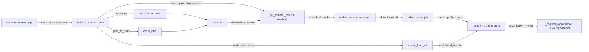
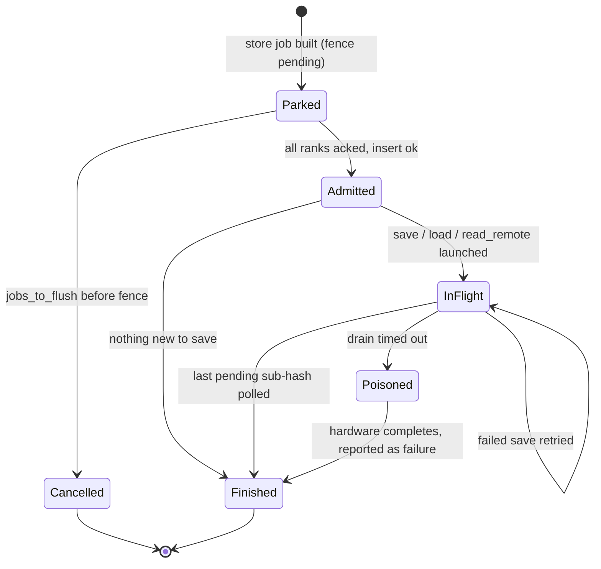

# Host KV offload (Raiden store-backed offloading connector)

<!-- connect:up:begin -->
> **Cross-repo concept:** part of [kv-cache](../../../concepts/kv-cache.md) across this wiki's repos.
<!-- connect:up:end -->
## Overview

Host offload extends vLLM's prefix cache past HBM: when the scheduler would otherwise drop a computed KV block, the block is copied to a host-DRAM pool, and a later request with the same prefix loads it back instead of recomputing the prefill. On TPU this is implemented by `src/vllm_torchtpu/offload/`, which plugs into vLLM's generic `OffloadingConnector` contract but replaces its per-worker transfer engine with a **controller-driven** design: one C++ `KVCacheStore` (from the Raiden / `tpu_sync` library) runs in the scheduler process and owns the directory (hash -> host slot), the LRU, the pins and the DMAs, while every TPU worker only registers its HBM KV buffers once and then acts as a passive DMA endpoint. The Python layer is therefore mostly a *protocol adapter plus failure-aware bookkeeping*: it translates vLLM's lookup/prepare/submit calls into Raiden `lookup`/`insert`/`save`/`load`/`read_remote` calls ([`submit_store_job`](../catalog/src/vllm_torchtpu/offload/raiden_store.md#RaidenOffloadingManager.submit_store_job "src/vllm_torchtpu/offload/raiden_store.py:L911"), [`submit_load_job`](../catalog/src/vllm_torchtpu/offload/raiden_store.md#RaidenOffloadingManager.submit_load_job "src/vllm_torchtpu/offload/raiden_store.py:L1005")), fences stores behind the forward pass that wrote the blocks, and guarantees that every pin is spent or given back exactly once ([`_finalize`](../catalog/src/vllm_torchtpu/offload/raiden_store.md#RaidenOffloadingManager._finalize "src/vllm_torchtpu/offload/raiden_store.py:L1129")). Two optional extensions ride on the same store: cross-replica sharing through a global registry (peer blocks are read straight into HBM) and a POSIX storage tier behind host DRAM.

For TPU inference performance the knobs that matter are: how many blocks fit on the host (`cpu_bytes_to_use` divided by bytes-per-block summed over all ranks), how many DMAs one block costs (one per layer fragment in the default layer-major layout, since contiguous kernel blocks are already fused by Raiden; collapsed to a single DMA by the block-major bundle), and whether the save path ever stalls the device (it does not: stores are fenced on a TPU event polled across engine steps).

## Diagram

Legend:
- `SCHED` - (concept) vLLM v1 scheduler producing offload jobs
- `META` - [`build_connector_meta`](../catalog/src/vllm_torchtpu/offload/raiden_connector.md#TPURaidenOffloadingScheduler.build_connector_meta "src/vllm_torchtpu/offload/raiden_connector.py:L216")
- `LOAD` - [`submit_load_job`](../catalog/src/vllm_torchtpu/offload/raiden_store.md#RaidenOffloadingManager.submit_load_job "src/vllm_torchtpu/offload/raiden_store.py:L1005")
- `W` - [`get_transfer_results`](../catalog/src/vllm_torchtpu/offload/raiden_connector.md#TPURaidenOffloadingConnector.get_transfer_results "src/vllm_torchtpu/offload/raiden_connector.py:L511")
- `UPD` - [`update_connector_output`](../catalog/src/vllm_torchtpu/offload/raiden_connector.md#TPURaidenOffloadingScheduler.update_connector_output "src/vllm_torchtpu/offload/raiden_connector.py:L306")
- `STORE` - [`submit_store_job`](../catalog/src/vllm_torchtpu/offload/raiden_store.md#RaidenOffloadingManager.submit_store_job "src/vllm_torchtpu/offload/raiden_store.py:L911")
- `KVS` - (concept) Raiden C++ `KVCacheStore`, held as [`_store`](../catalog/src/vllm_torchtpu/offload/raiden_store.md#RaidenOffloadingManager._store "src/vllm_torchtpu/offload/raiden_store.py:L431")
- `DRAIN` - [`drain_jobs`](../catalog/src/vllm_torchtpu/offload/raiden_store.md#RaidenOffloadingManager.drain_jobs "src/vllm_torchtpu/offload/raiden_store.py:L1347")
- `POLL` - [`poll_finished_jobs`](../catalog/src/vllm_torchtpu/offload/raiden_store.md#RaidenOffloadingManager.poll_finished_jobs "src/vllm_torchtpu/offload/raiden_store.py:L1340")
- `FIN` - [`_finalize`](../catalog/src/vllm_torchtpu/offload/raiden_store.md#RaidenOffloadingManager._finalize "src/vllm_torchtpu/offload/raiden_store.py:L1129")
- `REG` - [`_register_loop`](../catalog/src/vllm_torchtpu/offload/raiden_store.md#RaidenStoreOffloadingWorker._register_loop "src/vllm_torchtpu/offload/raiden_store.py:L1841")

A second view: the lifecycle of one admitted job record ([`Admission`](../catalog/src/vllm_torchtpu/offload/raiden_store.md#Admission "src/vllm_torchtpu/offload/raiden_store.py:L254")).

## Design rationale (why it's built this way)

- **One store in the scheduler, passive workers.** The module docstring states the split: "All directory tracking (hash -> host slot), LRU eviction, pinning, and DMA transfers are managed by Raiden's C++ `KVCacheStore`. Workers register device KV buffers once with the controller ... and act as passive DMA endpoints." vLLM's stock offload connector hands per-rank job dicts to every worker; here [`build_connector_meta`](../catalog/src/vllm_torchtpu/offload/raiden_connector.md#TPURaidenOffloadingScheduler.build_connector_meta "src/vllm_torchtpu/offload/raiden_connector.py:L216") always ships empty `load_jobs`/`store_jobs`, and the worker-side submit hooks raise if ever reached. A single directory means a TP/PCP/PP-sharded block is admitted, pinned and evicted atomically across ranks; Raiden fans the DMA out to every registered rank.
- **Save fence instead of a device sync.** A store must not read HBM before the forward pass that wrote those KV blocks retires. Rather than blocking the host, each worker enqueues pending pool writes, records a TPU event, and acknowledges only once the event has retired, polled non-blockingly across engine steps ([`get_transfer_results`](../catalog/src/vllm_torchtpu/offload/raiden_connector.md#TPURaidenOffloadingConnector.get_transfer_results "src/vllm_torchtpu/offload/raiden_connector.py:L511")). The connector docstring: the fence works "without inducing device idle bubbles". Loads need no fence because their destination blocks are freshly allocated.
- **Two-phase admission.** Raiden keys "candidate-restoration state by the sorted hash batch passed to `insert`, so release / rollback must use exactly the admitted batch, exactly once" ([`Admission`](../catalog/src/vllm_torchtpu/offload/raiden_store.md#Admission "src/vllm_torchtpu/offload/raiden_store.py:L254")). So `insert` pins the whole batch first; only then does a probe, which is stable under the job's own pins, decide which entries this admission created and must actually be DMA'd ([`_newly_inserted_sub_hashes`](../catalog/src/vllm_torchtpu/offload/raiden_store.md#RaidenOffloadingManager._newly_inserted_sub_hashes "src/vllm_torchtpu/offload/raiden_store.py:L537")). Re-saving an already host-resident entry would "trip Raiden's HBM gate and get the whole batch rejected".
- **The directory is the source of truth; Python keeps almost no cache state.** The only cache-state bookkeeping is [`_inflight_store_keys`](../catalog/src/vllm_torchtpu/offload/raiden_store.md#RaidenOffloadingManager._inflight_store_keys "src/vllm_torchtpu/offload/raiden_store.py:L458"), described as "load-bearing": it bars a second admission of a key between `prepare_store` and `insert`, the window where the store holds nothing for it. Every other store/skip/touch decision probes the store, so an LRU-displaced key is simply re-offered next time.
- **Fail closed, recompute.** No Raiden abort or remove API exists, so every ambiguous state (an HBM residue of a failed save, a sub-hash that vanished under its own pin, a drain timeout) resolves to "fail the job, let vLLM recompute" rather than risk shipping torn or foreign bytes.
- **Capacity summed over ranks, recorded before the spec is built.** Host capacity is `cpu_bytes_to_use // bytes_per_block_all_ranks`. Under pipeline parallelism the stages hold different layers, "and the sum over the per-worker configs is what one worker's figure times the world size cannot give" ([`record_all_ranks_kv_bytes_per_block`](../catalog/src/vllm_torchtpu/offload/raiden_store.md#record_all_ranks_kv_bytes_per_block "src/vllm_torchtpu/offload/raiden_store.py:L186")); a TPU patch records that sum in both the engine core and each worker ([`_patch_vllm_offload_all_ranks_kv_bytes`](../catalog/src/vllm_torchtpu/__init__.md#_patch_vllm_offload_all_ranks_kv_bytes "src/vllm_torchtpu/__init__.py:L841")).
- **Block-major layout to cut DMA count.** By default a scheduler block is `device_block_size_factor` kernel blocks per layer fragment, each its own store entry; with `VLLM_TPU_BLOCK_MAJOR_KV` the runner allocates the whole model's KV as one `[kernel_blocks, F, *R]` bundle, so all F layer fragments of a block are contiguous and one block costs one hardware DMA instead of F (module docstring of `block_major_layout.py`; [`resolve_block_major_contract`](../catalog/src/vllm_torchtpu/offload/block_major_layout.md#resolve_block_major_contract "src/vllm_torchtpu/offload/block_major_layout.py:L130")).

## Entry points

- [`build_connector_meta`](../catalog/src/vllm_torchtpu/offload/raiden_connector.md#TPURaidenOffloadingScheduler.build_connector_meta "src/vllm_torchtpu/offload/raiden_connector.py:L216") - the per-step scheduler hook. Runs after vLLM's own offloading scheduler has produced store/load jobs; parks stores, launches loads, handles `jobs_to_flush`, and collects finished jobs into the worker echo channel. This is where all transfer traffic enters the subsystem. Enabled with `--kv-transfer-config '{"kv_connector": "TPURaidenOffloadingConnector", "kv_connector_module_path": "vllm_torchtpu.offload.raiden_connector", "kv_role": "kv_both", "kv_connector_extra_config": {"cpu_bytes_to_use": ...}}'`.
- [`update_connector_output`](../catalog/src/vllm_torchtpu/offload/raiden_connector.md#TPURaidenOffloadingScheduler.update_connector_output "src/vllm_torchtpu/offload/raiden_connector.py:L306") - scheduler side, after each model step: counts per-rank `fenced_jobs` acks and launches a parked store when all `num_workers` ranks have acked.
- [`get_transfer_results`](../catalog/src/vllm_torchtpu/offload/raiden_connector.md#TPURaidenOffloadingConnector.get_transfer_results "src/vllm_torchtpu/offload/raiden_connector.py:L511") - worker side, each step: records fence events, acknowledges retired ones, and echoes finished stores/loads (including `failed_recving`) back to vLLM.
- [`get_manager`](../catalog/src/vllm_torchtpu/offload/raiden_store.md#TPURaidenStoreOffloadingSpec.get_manager "src/vllm_torchtpu/offload/raiden_store.py:L2552") and [`get_worker`](../catalog/src/vllm_torchtpu/offload/raiden_store.md#TPURaidenStoreOffloadingSpec.get_worker "src/vllm_torchtpu/offload/raiden_store.py:L2605") - lazy factories on the offloading spec. `get_manager` constructs the store (blocking until every worker registers); `get_worker` builds the per-rank HBM view and starts background registration.
- [`record_all_ranks_kv_bytes_per_block`](../catalog/src/vllm_torchtpu/offload/raiden_store.md#record_all_ranks_kv_bytes_per_block "src/vllm_torchtpu/offload/raiden_store.py:L186") - called from the patched [`generate_scheduler_kv_cache_config_tpu`](../catalog/src/vllm_torchtpu/__init__.md#_patch_vllm_offload_all_ranks_kv_bytes.generate_scheduler_kv_cache_config_tpu "src/vllm_torchtpu/__init__.py:L860") (engine core) and the worker init path, before the spec exists.
- [`block_major_layer_indices`](../catalog/src/vllm_torchtpu/offload/block_major_layout.md#block_major_layer_indices "src/vllm_torchtpu/offload/block_major_layout.py:L94") - called by the runner's [`initialize_kv_cache`](../catalog/src/vllm_torchtpu/runner/kv_cache_manager.md#KVCacheManager.initialize_kv_cache "src/vllm_torchtpu/runner/kv_cache_manager.py:L1360") when [`VLLM_TPU_BLOCK_MAJOR_KV`](../catalog/src/vllm_torchtpu/envs.md#VLLM_TPU_BLOCK_MAJOR_KV "src/vllm_torchtpu/envs.py:L139") is set, to map each attention layer to its fragment slot in the bundle.

## Mechanism (step-by-step)

1. **Spec construction and sizing.** The connector builds the offloading spec in the scheduler and in every worker. It resolves the physical kernel geometry with [`resolve_kernel_geometry`](../catalog/src/vllm_torchtpu/offload/raiden_store.md#resolve_kernel_geometry "src/vllm_torchtpu/offload/raiden_store.py:L1626") ("shared between the scheduler ... and worker ranks ... to guarantee exact geometry parity"), giving `device_block_size_factor = device_block_size // kernel_block_size`: one vLLM block maps to that many store entries with sub-hashes `namespace || OffloadKey || sub_idx`. It derives the optional block-major contract, then sizes the host pool as `cpu_bytes_to_use // bytes_per_block_all_ranks` using the recorded all-ranks figure from [`record_all_ranks_kv_bytes_per_block`](../catalog/src/vllm_torchtpu/offload/raiden_store.md#record_all_ranks_kv_bytes_per_block "src/vllm_torchtpu/offload/raiden_store.py:L186") (falling back to `worker_kv_bytes_per_block x world_size`, which is refused under PP). A 16-byte SHA-256 key namespace is derived from everything that changes the binary KV layout (model, revision, quantization, dtype, block sizes, per-block shape, world size, CP geometry, block-major fingerprint, offloaded group ids), and stored as [`key_namespace`](../catalog/src/vllm_torchtpu/offload/raiden_store.md#TPURaidenStoreOffloadingSpec.key_namespace "src/vllm_torchtpu/offload/raiden_store.py:L2477") so incompatible engines never alias keys in a shared registry or storage directory.

2. **Store bring-up and worker registration.** [`get_manager`](../catalog/src/vllm_torchtpu/offload/raiden_store.md#TPURaidenStoreOffloadingSpec.get_manager "src/vllm_torchtpu/offload/raiden_store.py:L2552") constructs the `KVCacheStore` with `expected_worker_count=world_size`; construction blocks in the controller init until every rank registers and raises on timeout. The controller port is [`raiden_controller_port`](../catalog/src/vllm_torchtpu/offload/raiden_store.md#TPURaidenStoreOffloadingSpec.raiden_controller_port "src/vllm_torchtpu/offload/raiden_store.py:L2521") (default base 27800, chosen below Linux's ephemeral range, plus the local DP rank) and the store identity is [`raiden_job_name`](../catalog/src/vllm_torchtpu/offload/raiden_store.md#TPURaidenStoreOffloadingSpec.raiden_job_name "src/vllm_torchtpu/offload/raiden_store.py:L2541") (suffixed `-dp<rank>` per global DP rank). Workers start earlier than the store exists, so [`_register_loop`](../catalog/src/vllm_torchtpu/offload/raiden_store.md#RaidenStoreOffloadingWorker._register_loop "src/vllm_torchtpu/offload/raiden_store.py:L1841") runs on a daemon thread, TCP-probes the controller (guarding against loopback self-connect), and registers the rank's HBM tensors with exponential backoff capped at 5 s. The docstring's performance point: registration happens "while engine init is still loading/compiling, which keeps the host-pool allocation and registration RPCs off the first request's critical path".

3. **Lookup and load preparation.** On a prefix-cache miss in HBM, vLLM asks the manager whether a key is offloaded. The lookup probes the store without pinning (a pin-and-release would reorder the LRU), returns `HIT_PENDING` for keys whose store is in flight, `MISS` for keys previously marked unloadable for this request, and stashes peer (`REMOTE`) or storage (`SHARED_STORAGE`) slices for later. When the scheduler commits to loading, [`prepare_load`](../catalog/src/vllm_torchtpu/offload/raiden_store.md#RaidenOffloadingManager.prepare_load "src/vllm_torchtpu/offload/raiden_store.py:L696") walks the batch: local host-pool hits are pinned (so they cannot be evicted before the DMA), peer/storage hits carry their slice forward, and if an entry vanished to eviction it releases what it pinned and returns an unpinned spec so the job fails cleanly and the blocks recompute.

4. **Load launch (immediate).** [`build_connector_meta`](../catalog/src/vllm_torchtpu/offload/raiden_connector.md#TPURaidenOffloadingScheduler.build_connector_meta "src/vllm_torchtpu/offload/raiden_connector.py:L216") calls [`submit_load_job`](../catalog/src/vllm_torchtpu/offload/raiden_store.md#RaidenOffloadingManager.submit_load_job "src/vllm_torchtpu/offload/raiden_store.py:L1005") at once, because destination HBM blocks are freshly allocated. The batch is split into local sub-hashes (Raiden `load`, host -> HBM) and remote ones (a single `read_remote` for both peer and storage slices, straight into HBM), keeping each list's hash-to-device-block pairing. If one launch fails after the other succeeded, [`_fail_launch`](../catalog/src/vllm_torchtpu/offload/raiden_store.md#RaidenOffloadingManager._fail_launch "src/vllm_torchtpu/offload/raiden_store.py:L1055") keeps the job non-terminal until the in-flight half resolves, so cleanup runs exactly once. The admission is indexed in [`_admissions`](../catalog/src/vllm_torchtpu/offload/raiden_store.md#RaidenOffloadingManager._admissions "src/vllm_torchtpu/offload/raiden_store.py:L482") and per sub-hash in [`_hash_to_admission`](../catalog/src/vllm_torchtpu/offload/raiden_store.md#RaidenOffloadingManager._hash_to_admission "src/vllm_torchtpu/offload/raiden_store.py:L483").

5. **Store parking and the device fence.** New store jobs are not launched; [`build_connector_meta`](../catalog/src/vllm_torchtpu/offload/raiden_connector.md#TPURaidenOffloadingScheduler.build_connector_meta "src/vllm_torchtpu/offload/raiden_connector.py:L216") parks them and ships their ids as `fence_job_ids`. On each worker, [`get_transfer_results`](../catalog/src/vllm_torchtpu/offload/raiden_connector.md#TPURaidenOffloadingConnector.get_transfer_results "src/vllm_torchtpu/offload/raiden_connector.py:L511") calls `torch_tpu`'s non-blocking `sync.synchronize(pool_tensors, wait=False)` so deferred KV-pool writes are enqueued, records a `torch.tpu.Event`, and on later steps acknowledges each fence whose event `query()` reports retired. [`update_connector_output`](../catalog/src/vllm_torchtpu/offload/raiden_connector.md#TPURaidenOffloadingScheduler.update_connector_output "src/vllm_torchtpu/offload/raiden_connector.py:L306") aggregates the acks and, when all ranks have acked, calls [`submit_store_job`](../catalog/src/vllm_torchtpu/offload/raiden_store.md#RaidenOffloadingManager.submit_store_job "src/vllm_torchtpu/offload/raiden_store.py:L911"). The cost of offload on the device timeline is thus one extra event per step, never a host wait.

6. **Store admission and save.** [`submit_store_job`](../catalog/src/vllm_torchtpu/offload/raiden_store.md#RaidenOffloadingManager.submit_store_job "src/vllm_torchtpu/offload/raiden_store.py:L911") expands keys to sub-hashes and device kernel-block ids and calls `insert(..., on_host=False)` with `HBM` slices; Raiden atomically pins pre-existing entries and reserves host capacity, or rolls back the whole batch under capacity pressure (the job fails, [`_inflight_store_keys`](../catalog/src/vllm_torchtpu/offload/raiden_store.md#RaidenOffloadingManager._inflight_store_keys "src/vllm_torchtpu/offload/raiden_store.py:L458") is cleared). [`_newly_inserted_sub_hashes`](../catalog/src/vllm_torchtpu/offload/raiden_store.md#RaidenOffloadingManager._newly_inserted_sub_hashes "src/vllm_torchtpu/offload/raiden_store.py:L537") then classifies each sub-hash: `HBM` bound to this job's device block -> save; `HOST`/`HOST_AND_HBM`/`REMOTE` -> already resident, skip; anything else -> fail closed. If nothing is new, the pins are released and the job finishes successfully with no DMA. Otherwise `save()` is issued for exactly the new entries; per the module docstring, "contiguous device kernel blocks are fused by Raiden into single hardware DMAs". With a storage tier configured, the save completes only once every rank has written its shard file.

7. **Polling and finalization.** Every scheduler step, [`poll_finished_jobs`](../catalog/src/vllm_torchtpu/offload/raiden_store.md#RaidenOffloadingManager.poll_finished_jobs "src/vllm_torchtpu/offload/raiden_store.py:L1340") runs [`_poll_once`](../catalog/src/vllm_torchtpu/offload/raiden_store.md#RaidenOffloadingManager._poll_once "src/vllm_torchtpu/offload/raiden_store.py:L1231"), which queries only the status streams that have live work (save, local load, remote read) and maps each done/failed sub-hash back to its admission via [`_hash_to_admission`](../catalog/src/vllm_torchtpu/offload/raiden_store.md#RaidenOffloadingManager._hash_to_admission "src/vllm_torchtpu/offload/raiden_store.py:L483"). A completed save or local load spends its pin. When an admission's [`pending`](../catalog/src/vllm_torchtpu/offload/raiden_store.md#Admission.pending "src/vllm_torchtpu/offload/raiden_store.py:L269") set empties, a failed store first gets [`_maybe_retry_save`](../catalog/src/vllm_torchtpu/offload/raiden_store.md#RaidenOffloadingManager._maybe_retry_save "src/vllm_torchtpu/offload/raiden_store.py:L1297") (default one retry of only the failed subset), then [`_finalize`](../catalog/src/vllm_torchtpu/offload/raiden_store.md#RaidenOffloadingManager._finalize "src/vllm_torchtpu/offload/raiden_store.py:L1129") releases exactly the pins nothing spent ([`_pins_still_held`](../catalog/src/vllm_torchtpu/offload/raiden_store.md#RaidenOffloadingManager._pins_still_held "src/vllm_torchtpu/offload/raiden_store.py:L523")), appends a [`FinishedJob`](../catalog/src/vllm_torchtpu/offload/raiden_store.md#FinishedJob "src/vllm_torchtpu/offload/raiden_store.py:L300"), and for a failed load calls [`_mark_unloadable`](../catalog/src/vllm_torchtpu/offload/raiden_store.md#RaidenOffloadingManager._mark_unloadable "src/vllm_torchtpu/offload/raiden_store.py:L1167") so that request recomputes from the failed key instead of retrying the same load every step.

8. **Block reuse: cancel or drain.** When vLLM is about to recycle a store job's source blocks it lists the job in `jobs_to_flush`. A still-parked store is simply cancelled. A launched one is passed to [`drain_jobs`](../catalog/src/vllm_torchtpu/offload/raiden_store.md#RaidenOffloadingManager.drain_jobs "src/vllm_torchtpu/offload/raiden_store.py:L1347"), which zeroes the job's retries ("a retry would read garbage"), then busy-polls every 0.5 ms until the job completes or `VLLM_TPU_OFFLOAD_WAIT_TIMEOUT_S` (default 30 s) expires. On timeout the admission is marked poisoned: Raiden has no abort, so the DMA keeps running, but the finalizer reports it as a failure so torn bytes are never committed. This drain is the one place the offload path can stall the scheduler.

9. **Echo back to vLLM.** Finished and drained jobs are packed into the connector metadata (`finished_store_job_ids`, `finished_load_jobs`, `failed_load_req_ids`); on the worker, [`get_transfer_results`](../catalog/src/vllm_torchtpu/offload/raiden_connector.md#TPURaidenOffloadingConnector.get_transfer_results "src/vllm_torchtpu/offload/raiden_connector.py:L511") reports them as `finished_recving` and `failed_recving` by request id (block ids would be ambiguous across KV cache groups), which releases requests from `WAITING_FOR_REMOTE_KVS` and lets `kv_load_failure_policy` decide between recompute and failure.

## Key data structures

- [`Admission`](../catalog/src/vllm_torchtpu/offload/raiden_store.md#Admission "src/vllm_torchtpu/offload/raiden_store.py:L254") - "Exact-batch record of one launched store/load job": [`job_id`](../catalog/src/vllm_torchtpu/offload/raiden_store.md#Admission.job_id "src/vllm_torchtpu/offload/raiden_store.py:L264"), [`op`](../catalog/src/vllm_torchtpu/offload/raiden_store.md#Admission.op "src/vllm_torchtpu/offload/raiden_store.py:L265") ([`AdmissionOp`](../catalog/src/vllm_torchtpu/offload/raiden_store.md#AdmissionOp "src/vllm_torchtpu/offload/raiden_store.py:L248") `STORE` or `LOAD`), [`keys`](../catalog/src/vllm_torchtpu/offload/raiden_store.md#Admission.keys "src/vllm_torchtpu/offload/raiden_store.py:L266"), the expanded `sub_hashes`, the [`pending`](../catalog/src/vllm_torchtpu/offload/raiden_store.md#Admission.pending "src/vllm_torchtpu/offload/raiden_store.py:L269") set awaiting a poll verdict, `consumed_sub_hashes` (pins already spent), `remote_sub_hashes` (peer/storage reads, never pinned), `failed_sub_hashes`, `retries_left`, and the `failed` / `poisoned` flags. The pin accounting is the whole point: release must cover exactly `sub_hashes - consumed - remote`.
- [`FinishedJob`](../catalog/src/vllm_torchtpu/offload/raiden_store.md#FinishedJob "src/vllm_torchtpu/offload/raiden_store.py:L300") - terminal report ([`job_id`](../catalog/src/vllm_torchtpu/offload/raiden_store.md#FinishedJob.job_id "src/vllm_torchtpu/offload/raiden_store.py:L301"), [`op`](../catalog/src/vllm_torchtpu/offload/raiden_store.md#FinishedJob.op "src/vllm_torchtpu/offload/raiden_store.py:L302"), success, owning request, unwritten device blocks) accumulated in [`_finished`](../catalog/src/vllm_torchtpu/offload/raiden_store.md#RaidenOffloadingManager._finished "src/vllm_torchtpu/offload/raiden_store.py:L484") until the next poll drains it.
- [`_block_status`](../catalog/src/vllm_torchtpu/offload/raiden_store.md#RaidenOffloadingManager._block_status "src/vllm_torchtpu/offload/raiden_store.py:L432") - Raiden's residency enum as seen from Python: `HBM` (admitted, bytes only on device), `HOST`, `HOST_AND_HBM`, `REMOTE` (on a peer replica), `SHARED_STORAGE` (only in the storage tier). Almost every branch in lookup/prepare/admission is a switch on it.
- Storage-tier coordinates: `StorageRankCoords` carries [`tp_size`](../catalog/src/vllm_torchtpu/offload/raiden_store.md#StorageRankCoords.tp_size "src/vllm_torchtpu/offload/raiden_store.py:L2207"), [`pcp_size`](../catalog/src/vllm_torchtpu/offload/raiden_store.md#StorageRankCoords.pcp_size "src/vllm_torchtpu/offload/raiden_store.py:L2209"), [`pp_size`](../catalog/src/vllm_torchtpu/offload/raiden_store.md#StorageRankCoords.pp_size "src/vllm_torchtpu/offload/raiden_store.py:L2211") and ranks; [`storage_size`](../catalog/src/vllm_torchtpu/offload/raiden_store.md#StorageRankCoords.storage_size "src/vllm_torchtpu/offload/raiden_store.py:L2249") ("How many shard files a block has") is `pp x pcp x tp`. [`worker_storage_rank_coords`](../catalog/src/vllm_torchtpu/offload/raiden_store.md#worker_storage_rank_coords "src/vllm_torchtpu/offload/raiden_store.py:L2254") reads them from the TP/PCP/PP groups, explicitly not from the world rank, which under DP+EP spans every replica.
- Block-major contract (`fragment_count`, `fragment_row_bytes`, `bundle_row_bytes`, `logical_fingerprint`) - computed purely from configs by [`resolve_block_major_contract`](../catalog/src/vllm_torchtpu/offload/block_major_layout.md#resolve_block_major_contract "src/vllm_torchtpu/offload/block_major_layout.py:L130") (or [`_resolve_unified_pool_contract`](../catalog/src/vllm_torchtpu/offload/block_major_layout.md#_resolve_unified_pool_contract "src/vllm_torchtpu/offload/block_major_layout.py:L238") when the unified hybrid pool is merged into one block-major pool, see [`unified_block_major_enabled`](../catalog/src/vllm_torchtpu/block_major_pool.md#unified_block_major_enabled "src/vllm_torchtpu/block_major_pool.py:L45")), so scheduler and workers agree before any tensor is allocated. The fingerprint salts the key namespace.

### Configuration surface

| Knob | Where | Default | Effect |
|---|---|---|---|
| `cpu_bytes_to_use` | `kv_connector_extra_config` (`--kv-offloading-size`) | required | Host DRAM budget; capacity in blocks = budget / all-ranks bytes per block |
| `VLLM_TPU_BLOCK_MAJOR_KV` | env | off | Allocate KV as one `[blocks, F, *R]` bundle; 1 DMA per block instead of F; also turns on `prefer_cross_layer_blocks` |
| `VLLM_TPU_OFFLOAD_WAIT_TIMEOUT_S` | env | 30.0 | Drain deadline before in-flight jobs are poisoned |
| `VLLM_TPU_OFFLOAD_SAVE_RETRIES` | env | 1 | Retries of the failed subset of a save |
| `raiden_controller_port` | extra config | 27800 (+ local DP rank) | Controller port; warned if inside the ephemeral range |
| `raiden_job_name` | extra config | `vllm-offload-<engine_id>` (+ `-dp<N>`) | Store identity |
| `global_registry_address`, `store_server_ip`, `kv_pool_group` | extra config | empty | Cross-replica sharing; requires a dialable pod IP and `PYTHONHASHSEED` |
| `raiden_storage_path` / `RAIDEN_STORAGE_PATH` (+ `_type`, `_capacity_gb`, `_model_name`, `_properties`) | extra config or env | off | POSIX storage tier behind host DRAM; validated by [`resolve_storage_config`](../catalog/src/vllm_torchtpu/offload/raiden_store.md#resolve_storage_config "src/vllm_torchtpu/offload/raiden_store.py:L2101") |
| [`EXPERIMENTAL_RAIDEN_STORAGE_SKIP_PARALLELISM_CHECK`](../catalog/src/vllm_torchtpu/envs.md#EXPERIMENTAL_RAIDEN_STORAGE_SKIP_PARALLELISM_CHECK "src/vllm_torchtpu/envs.py:L185") | env or extra config | off | Testing only: allow the storage tier with PP > 1 |
| `RAIDEN_DISABLE_SINGLETON_WORKER` | env | on (forced) | Must stay on; the singleton worker collides with the in-process control plane's ports |
| `RAIDEN_SHM_KEY` | env | empty | Unsupported; startup fails if set |

## Dynamics (design intent)

- **Cross-step pipelining of stores.** A store job spans at least two scheduler steps: built in step N, fenced on the workers as the device retires step N's writes, launched in the step whose `update_connector_output` sees the last ack, polled to completion later. The source blocks stay retained the whole time because the job is non-terminal; that is also what makes a save retry safe ([`_maybe_retry_save`](../catalog/src/vllm_torchtpu/offload/raiden_store.md#RaidenOffloadingManager._maybe_retry_save "src/vllm_torchtpu/offload/raiden_store.py:L1297") docstring).
- **Threads.** Raiden calls the eviction callback on its own thread; an internal lock guards the eviction queue, and evictions surface as vLLM `BlockRemoved` KV-cache events on the first lost sub-block of a logical block. Worker registration runs on a per-rank daemon thread. Everything else runs on the scheduler thread.
- **Startup barrier.** The store constructor is a barrier across all ranks; a rank that cannot register fails engine startup (the Raiden-side timeout is documented in-line as `RAIDEN_EXPECTED_WORKERS_TIMEOUT_S`, default 120 s). Consequently no inference step ever runs with an unregistered rank, and there is no per-step registration hook.
- **Peer and storage reads borrow nothing.** A `read_remote` takes no pin, reserves no host capacity and leaves no directory entry, so a key served from a peer is fetched again on every miss until a local store admits it; storage-tier reads, by contrast, also publish the block into host DRAM (unpinned) so the next lookup finds it locally.

## Edge cases

- **HBM residue.** A save that failed and exhausted its retries leaves an `HBM` entry with a dead device binding (no remove API). Lookup answers `MISS` for it (answering `HIT_PENDING` would park the request forever), and admission fails closed if it meets one bound to a foreign device block.
- **Storage tier with PP** is refused unless the experimental skip flag is set; the tier also requires an absolute, writable path and `PYTHONHASHSEED`, and nothing ever deletes files from it ("the directory grows until an operator prunes it").
- **Cross-replica sharing without `PYTHONHASHSEED`** raises at startup: unseeded replicas build disjoint block-hash chains and would silently get zero cross-instance hits. Without `store_server_ip` it raises too, since publishing `127.0.0.1` would be undialable.
- **Block-major restrictions.** The bundle requires `device_block_size == kernel_block_size` (factor 1), uniform backing sizes, a single attention group in the runner path, and no multi-shape KV caches (DeepSeek-V4 / GLM-DSA style); [`block_major_layer_indices`](../catalog/src/vllm_torchtpu/offload/block_major_layout.md#block_major_layer_indices "src/vllm_torchtpu/offload/block_major_layout.py:L94") raises if vLLM's placement is not block-outermost.
- **Hybrid models** (attention + Mamba/GDN) are supported only on the TPU unified block pool, where every group shares one padded page size; concurrent PCP and DCP is rejected.
- **Load finalizing after its request finished** is not recorded as unloadable, since no `on_request_finished` would come to clear it.
- **`reset_prefix_cache` with `reset_external=true`** reports failure: the Raiden store does not support an external reset.
- **`get_finished` on the connector** raises if any load failed; failures only travel through `get_transfer_results().failed_recving`.

## Open questions

- The packet subgraph omits the manager class itself (`RaidenOffloadingManager`), its `lookup` / `prepare_store` / `touch` methods, `derive_offload_namespace`, the worker class constructor, and the connector's `register_kv_caches`; they are described above from source without citations.
- The DMA engine, host-pool allocator, LRU policy and the global registry protocol live in the external Raiden / `tpu_sync` C++ library and are not visible in this repo; achieved host<->HBM bandwidth and the actual coalescing behavior cannot be determined statically.
- The `kv_pool_group` docstring mentions "store nodes absorbing this pool's evictions"; how those remote eviction targets are deployed is not described in this repo.

> [!inferred]
> The interaction between the busy-polling drain (0.5 ms sleeps, up to 30 s) and scheduler latency under heavy block churn is not measured anywhere in the repo; a workload that frequently recycles blocks with in-flight saves could see scheduler stalls bounded by the save time of those jobs.

## See also

- [kv-cache-layout-and-hbm-budget](kv-cache-layout-and-hbm-budget.md) - the HBM pool whose blocks are offloaded, unified block pool and block-major allocation
- [kv-transfer-and-disaggregated-serving](kv-transfer-and-disaggregated-serving.md) - the Raiden P/D connector this offload connector composes with in `TPUMultiConnector`
- [distributed-parallelism-and-meshes](distributed-parallelism-and-meshes.md) - TP/PCP/PP/DP groups that define storage shards and controller ports
- [tpu-model-runner](tpu-model-runner.md) - where the KV cache is initialized and connector hooks run each step
- [tpu-schedulers](tpu-schedulers.md)
- [ragged-paged-attention-kernel](ragged-paged-attention-kernel.md) - the attention kernel that reads the (bundled) KV pages
