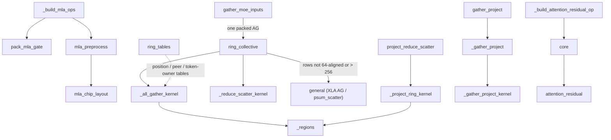
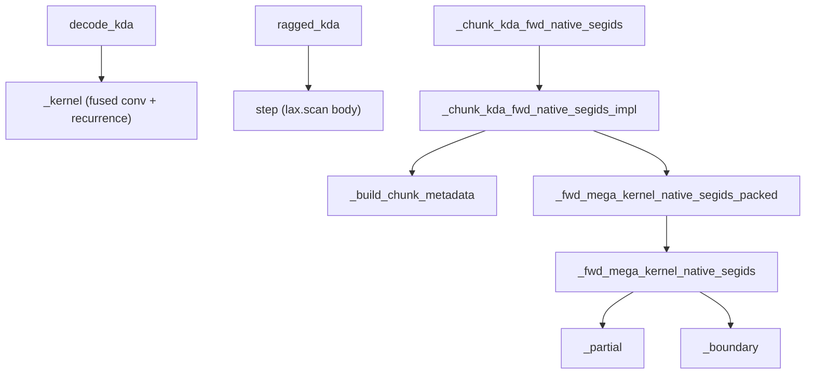

# Kimi-K3 Pallas kernels (SP32 ring collectives, fused projection-collectives, Attention Residual, KDA)

<!-- connect:up:begin -->
> **Cross-repo concept:** part of [pallas-kernel](../../../concepts/pallas-kernel.md), [ring-attention](../../../concepts/ring-attention.md), [sequence-parallelism](../../../concepts/sequence-parallelism.md), [vmem](../../../concepts/vmem.md) across this wiki's repos.
<!-- connect:up:end -->
## Overview

`src/vllm_torchtpu/kernels/kimi_k3/` holds the JAX/Pallas kernels written for the Kimi-K3 model. It
has two halves with different status. The **collectives half** (`collectives.py`, plus
`attention_residual.py`) is on the serving path: it implements the K3 sequence-parallel prefill
(`TPU_K3_SP_PREFILL`) as hand-written Pallas **ring** kernels over a flat 32-rank `k3_sp` mesh. The
key idea is that one 32-rank ring is replaced by **three independent Hamiltonian cycles over the 16
physical chips, each traversed in both directions**, so a collective drives six neighbour links at
once, and that matmuls are fused *into* the ring steps (project-then-reduce-scatter, gather-then-
project) so communication hides under MXU work. The **KDA half** (`decode_kda.py`, `kda.py`,
`mega_kda/`) is a set of self-contained Kimi Delta Attention kernels (a fused single-token decode, a
`lax.scan` reference recurrence, and an inference-only chunked "mega" prefill); at this pin they are
imported only by `tests/kernels/`, while the production KDA custom ops run on the GDN v3 kernel.

## Diagram

Serving-path kernels and how the model bridges enter them:

Legend:
- `BMLA` - [`_build_mla_ops`](../catalog/src/vllm_torchtpu/models/vllm/kimi_k3/collective_ops.md#_build_mla_ops "src/vllm_torchtpu/models/vllm/kimi_k3/collective_ops.py:L42")
- `PACK` - [`pack_mla_gate`](../catalog/src/vllm_torchtpu/kernels/kimi_k3/collectives.md#pack_mla_gate "src/vllm_torchtpu/kernels/kimi_k3/collectives.py:L54")
- `PRE` - [`mla_preprocess`](../catalog/src/vllm_torchtpu/kernels/kimi_k3/collectives.md#mla_preprocess "src/vllm_torchtpu/kernels/kimi_k3/collectives.py:L72")
- `LAYOUT` - [`mla_chip_layout`](../catalog/src/vllm_torchtpu/kernels/kimi_k3/collectives.md#mla_chip_layout "src/vllm_torchtpu/kernels/kimi_k3/collectives.py:L38")
- `RING` - [`ring_collective`](../catalog/src/vllm_torchtpu/kernels/kimi_k3/collectives.md#ring_collective "src/vllm_torchtpu/kernels/kimi_k3/collectives.py:L454")
- `AG` - [`_all_gather_kernel`](../catalog/src/vllm_torchtpu/kernels/kimi_k3/collectives.md#_all_gather_kernel "src/vllm_torchtpu/kernels/kimi_k3/collectives.py:L334")
- `RS` - [`_reduce_scatter_kernel`](../catalog/src/vllm_torchtpu/kernels/kimi_k3/collectives.md#_reduce_scatter_kernel "src/vllm_torchtpu/kernels/kimi_k3/collectives.py:L199")
- `GEN` - [`general`](../catalog/src/vllm_torchtpu/kernels/kimi_k3/collectives.md#ring_collective.general "src/vllm_torchtpu/kernels/kimi_k3/collectives.py:L471")
- `MOE` - [`gather_moe_inputs`](../catalog/src/vllm_torchtpu/kernels/kimi_k3/collectives.md#gather_moe_inputs "src/vllm_torchtpu/kernels/kimi_k3/collectives.py:L126")
- `PRS` - [`project_reduce_scatter`](../catalog/src/vllm_torchtpu/kernels/kimi_k3/collectives.md#project_reduce_scatter "src/vllm_torchtpu/kernels/kimi_k3/collectives.py:L689")
- `PRK` - [`_project_ring_kernel`](../catalog/src/vllm_torchtpu/kernels/kimi_k3/collectives.md#_project_ring_kernel "src/vllm_torchtpu/kernels/kimi_k3/collectives.py:L545")
- `GP` - [`gather_project`](../catalog/src/vllm_torchtpu/kernels/kimi_k3/collectives.md#gather_project "src/vllm_torchtpu/kernels/kimi_k3/collectives.py:L957")
- `GPI` - [`_gather_project`](../catalog/src/vllm_torchtpu/kernels/kimi_k3/collectives.md#_gather_project "src/vllm_torchtpu/kernels/kimi_k3/collectives.py:L915")
- `GPK` - [`_gather_project_kernel`](../catalog/src/vllm_torchtpu/kernels/kimi_k3/collectives.md#_gather_project_kernel "src/vllm_torchtpu/kernels/kimi_k3/collectives.py:L759")
- `REG` - [`_regions`](../catalog/src/vllm_torchtpu/kernels/kimi_k3/collectives.md#_regions "src/vllm_torchtpu/kernels/kimi_k3/collectives.py:L185")
- `TAB` - [`ring_tables`](../catalog/src/vllm_torchtpu/kernels/kimi_k3/collectives.md#ring_tables "src/vllm_torchtpu/kernels/kimi_k3/collectives.py:L157")
- `BRES` - [`_build_attention_residual_op`](../catalog/src/vllm_torchtpu/models/vllm/kimi_k3/layers.md#_build_attention_residual_op "src/vllm_torchtpu/models/vllm/kimi_k3/layers.py:L43")
- `CORE` - [`core`](../catalog/src/vllm_torchtpu/models/vllm/kimi_k3/layers.md#_build_attention_residual_op.core "src/vllm_torchtpu/models/vllm/kimi_k3/layers.py:L48")
- `ARES` - [`attention_residual`](../catalog/src/vllm_torchtpu/kernels/kimi_k3/attention_residual.md#attention_residual "src/vllm_torchtpu/kernels/kimi_k3/attention_residual.py:L37")

Standalone KDA kernels (tested, not wired into the serving op at this pin):

Legend:
- `DEC` - [`decode_kda`](../catalog/src/vllm_torchtpu/kernels/kimi_k3/decode_kda.md#decode_kda "src/vllm_torchtpu/kernels/kimi_k3/decode_kda.py:L208")
- `DK` - [`_kernel`](../catalog/src/vllm_torchtpu/kernels/kimi_k3/decode_kda.md#_kernel "src/vllm_torchtpu/kernels/kimi_k3/decode_kda.py:L99")
- `RAG` - [`ragged_kda`](../catalog/src/vllm_torchtpu/kernels/kimi_k3/kda.md#ragged_kda "src/vllm_torchtpu/kernels/kimi_k3/kda.py:L72")
- `STEP` - [`step`](../catalog/src/vllm_torchtpu/kernels/kimi_k3/kda.md#ragged_kda.step "src/vllm_torchtpu/kernels/kimi_k3/kda.py:L136")
- `MEGA` - [`_chunk_kda_fwd_native_segids`](../catalog/src/vllm_torchtpu/kernels/kimi_k3/mega_kda/kernel.md#_chunk_kda_fwd_native_segids "src/vllm_torchtpu/kernels/kimi_k3/mega_kda/kernel.py:L1777")
- `IMPL` - [`_chunk_kda_fwd_native_segids_impl`](../catalog/src/vllm_torchtpu/kernels/kimi_k3/mega_kda/kernel.md#_chunk_kda_fwd_native_segids_impl "src/vllm_torchtpu/kernels/kimi_k3/mega_kda/kernel.py:L1264")
- `META` - [`_build_chunk_metadata`](../catalog/src/vllm_torchtpu/kernels/kimi_k3/mega_kda/kernel.md#_build_chunk_metadata "src/vllm_torchtpu/kernels/kimi_k3/mega_kda/kernel.py:L52")
- `PKD` - [`_fwd_mega_kernel_native_segids_packed`](../catalog/src/vllm_torchtpu/kernels/kimi_k3/mega_kda/kernel.md#_fwd_mega_kernel_native_segids_packed "src/vllm_torchtpu/kernels/kimi_k3/mega_kda/kernel.py:L1235")
- `MK` - [`_fwd_mega_kernel_native_segids`](../catalog/src/vllm_torchtpu/kernels/kimi_k3/mega_kda/kernel.md#_fwd_mega_kernel_native_segids "src/vllm_torchtpu/kernels/kimi_k3/mega_kda/kernel.py:L108")
- `PART` - [`_partial`](../catalog/src/vllm_torchtpu/kernels/kimi_k3/mega_kda/kernel.md#_fwd_mega_kernel_native_segids._partial "src/vllm_torchtpu/kernels/kimi_k3/mega_kda/kernel.py:L536")
- `BND` - [`_boundary`](../catalog/src/vllm_torchtpu/kernels/kimi_k3/mega_kda/kernel.md#_fwd_mega_kernel_native_segids._boundary "src/vllm_torchtpu/kernels/kimi_k3/mega_kda/kernel.py:L816")

## Design rationale (why it's built this way)

**Three cycles, two directions, twelve streams.** `CYCLES` lists three different orderings of the 16
chips of a 2x2x4 slice; [`ring_tables`](../catalog/src/vllm_torchtpu/kernels/kimi_k3/collectives.md#ring_tables "src/vllm_torchtpu/kernels/kimi_k3/collectives.py:L157")
expands each into a 32-position ring (both cores of a chip are adjacent) and returns an int32 table
`[family, {position, peer, token-owner}, mesh-index]`.
[`_regions`](../catalog/src/vllm_torchtpu/kernels/kimi_k3/collectives.md#_regions "src/vllm_torchtpu/kernels/kimi_k3/collectives.py:L185")
then splits a rank's `[rows, width]` block into 12 streams: 2 row groups x 3 column bands (one per
ring family, 128-aligned) x 2 directions, each a quarter of the rows. Every stream moves on its own
ring and direction, so a single collective keeps traffic on many physical links instead of
serializing it around one ring. Hence the hard constraints: rows % 64 == 0, width % 128 == 0,
width >= 384.

**Three permutations kept separate.** The module docstring is explicit: "Physical ring position,
mesh index, and Torch token owner are distinct. Tables explicitly translate all three; never permute
the JAX mesh to match physical coordinates in the multi-process runtime." `ring_tables` therefore
rejects a mesh whose device ids are not ascending, and every kernel looks up the destination row
block through the token-owner row of the table rather than assuming mesh index == token shard.

**Fuse the matmul into the ring.** A reduce-scatter after an output projection would first
materialize the full `[T, 7168]` partial on every rank and then ship it.
[`project_reduce_scatter`](../catalog/src/vllm_torchtpu/kernels/kimi_k3/collectives.md#project_reduce_scatter "src/vllm_torchtpu/kernels/kimi_k3/collectives.py:L689")
("Fuse a three-head BF16 attention projection with SP32 RS") instead keeps the `384 x 7168` weight
resident in VMEM and, at each of the 32 ring steps, computes only the partial rows for the token
owner currently being accumulated, adds what arrived from the neighbour and forwards it. The mirror
image, [`gather_project`](../catalog/src/vllm_torchtpu/kernels/kimi_k3/collectives.md#gather_project "src/vllm_torchtpu/kernels/kimi_k3/collectives.py:L957")
("Gather SP32 hidden states while projecting into packed KDA inputs"), multiplies each arriving
token tile by a resident `7168 x 1792` weight and accumulates in an fp32 VMEM buffer, so the
all-gathered hidden states never exist in HBM.

**One transfer for MoE routing payloads.**
[`gather_moe_inputs`](../catalog/src/vllm_torchtpu/kernels/kimi_k3/collectives.md#gather_moe_inputs "src/vllm_torchtpu/kernels/kimi_k3/collectives.py:L126")
packs latent activations, BF16 router weights and expert ids into one BF16 payload so the MoE
dispatch costs one ring all-gather instead of three. Ids are split into low and high bytes and each
byte is stored as a BF16 *value* (0..255), because "Byte-valued BF16 lanes preserve IDs without
NaN/subnormal bit encodings"; the docstring notes "K3 has 896 global experts".

**Always have an XLA escape hatch for row counts.** Each fused entry point checks the per-rank row
count (or, for `gather_project`, the local token count) and falls back to plain JAX collectives: [`general`](../catalog/src/vllm_torchtpu/kernels/kimi_k3/collectives.md#ring_collective.general "src/vllm_torchtpu/kernels/kimi_k3/collectives.py:L471")
for `ring_collective` when rows are not 64-aligned or exceed 256 ("XLA handles other shard sizes,
preserving Torch token ownership"), a separate `shard_map` matmul followed by `ring_collective` (which
then takes the same XLA path) for `project_reduce_scatter`, and a grouped `all_gather` + matmul in
[`local`](../catalog/src/vllm_torchtpu/kernels/kimi_k3/collectives.md#gather_project.local "src/vllm_torchtpu/kernels/kimi_k3/collectives.py:L960")
of `gather_project` when the local token count is not a multiple of 128. The fallback covers row
counts only: a width that is not 128-aligned or below 384, a non-BF16 input, or a projection shape
other than `[32, T, 384]` x `[32, 384, 7168]` raises `ValueError` instead, so the model bridge filters
widths and dtypes before calling in.

**KDA kernels are isolated from training code.** The mega-KDA module docstring: "This module is
intentionally separate from chunk_fwd_mega.py so inference optimizations cannot change the training,
recompute, or context-parallel paths." Inference-only choices (skip a redundant causal mask, clip
beta in-kernel, pack two heads per MXU tile) are all keyed on `only_fwd`.

> [!inferred]
> The standalone KDA kernels look like the staging ground for replacing the GDN-v3-based KDA ops: the
> decode kernel's test module describes it as doing "in one Pallas call what main splits across two
> custom ops", and the mega kernel ships with per-feature env toggles, which is typical of kernels
> still being tuned before being wired in.

## Entry points

- [`ring_collective`](../catalog/src/vllm_torchtpu/kernels/kimi_k3/collectives.md#ring_collective "src/vllm_torchtpu/kernels/kimi_k3/collectives.py:L454")
  ("AG takes global [T,D]; RS takes global [32,T,D] partials") is reached from the model's per-layer
  `pallas::kimi_ring_ag_<id>` / `pallas::kimi_ring_rs_<id>` custom ops whenever a K3 SP prefill
  bucket all-gathers or reduce-scatters a BF16 activation of a supported width.
- [`project_reduce_scatter`](../catalog/src/vllm_torchtpu/kernels/kimi_k3/collectives.md#project_reduce_scatter "src/vllm_torchtpu/kernels/kimi_k3/collectives.py:L689")
  is reached from `pallas::kimi_project_rs_<collective_id>` (layer-derived id `22000 + layer`) for the KDA and MLA output projections in SP mode.
- [`gather_project`](../catalog/src/vllm_torchtpu/kernels/kimi_k3/collectives.md#gather_project "src/vllm_torchtpu/kernels/kimi_k3/collectives.py:L957")
  is reached from `pallas::kimi_gather_project_<collective_id>` (id `23000 + layer`) for the KDA packed input projection in SP
  mode.
- [`gather_moe_inputs`](../catalog/src/vllm_torchtpu/kernels/kimi_k3/collectives.md#gather_moe_inputs "src/vllm_torchtpu/kernels/kimi_k3/collectives.py:L126")
  is reached from `pallas::kimi_moe_ag_<collective_id>` (id `24000 + layer`) after local routing in the expert-parallel MoE path.
- [`mla_preprocess`](../catalog/src/vllm_torchtpu/kernels/kimi_k3/collectives.md#mla_preprocess "src/vllm_torchtpu/kernels/kimi_k3/collectives.py:L72")
  and [`pack_mla_gate`](../catalog/src/vllm_torchtpu/kernels/kimi_k3/collectives.md#pack_mla_gate "src/vllm_torchtpu/kernels/kimi_k3/collectives.py:L54")
  are wrapped as `pallas::kimi_mla_preprocess_<layer>` / `pallas::kimi_mla_pack_gate_<layer>` by
  [`_build_mla_ops`](../catalog/src/vllm_torchtpu/models/vllm/kimi_k3/collective_ops.md#_build_mla_ops "src/vllm_torchtpu/models/vllm/kimi_k3/collective_ops.py:L42");
  the pack runs once at load time, the preprocess on every MLA layer forward once installed.
- [`mla_chip_layout`](../catalog/src/vllm_torchtpu/kernels/kimi_k3/collectives.md#mla_chip_layout "src/vllm_torchtpu/kernels/kimi_k3/collectives.py:L38")
  ("Physical pairs and same-core groups, ordered by Torch token ownership") is also used directly by
  [`_build_token_op`](../catalog/src/vllm_torchtpu/models/vllm/kimi_k3/collective_ops.md#_build_token_op "src/vllm_torchtpu/models/vllm/kimi_k3/collective_ops.py:L259")
  to form the TP2 chip-pair groups for the shared-expert MLP token collectives.
- [`attention_residual`](../catalog/src/vllm_torchtpu/kernels/kimi_k3/attention_residual.md#attention_residual "src/vllm_torchtpu/kernels/kimi_k3/attention_residual.py:L37")
  is registered as `pallas::kimi_attention_residual_<eps>` by
  [`_build_attention_residual_op`](../catalog/src/vllm_torchtpu/models/vllm/kimi_k3/layers.md#_build_attention_residual_op "src/vllm_torchtpu/models/vllm/kimi_k3/layers.py:L43")
  and called for every Block Attention Residual mix on 16-token-divisible buckets.
- [`decode_kda`](../catalog/src/vllm_torchtpu/kernels/kimi_k3/decode_kda.md#decode_kda "src/vllm_torchtpu/kernels/kimi_k3/decode_kda.py:L208"),
  [`ragged_kda`](../catalog/src/vllm_torchtpu/kernels/kimi_k3/kda.md#ragged_kda "src/vllm_torchtpu/kernels/kimi_k3/kda.py:L72")
  and [`_chunk_kda_fwd_native_segids`](../catalog/src/vllm_torchtpu/kernels/kimi_k3/mega_kda/kernel.md#_chunk_kda_fwd_native_segids "src/vllm_torchtpu/kernels/kimi_k3/mega_kda/kernel.py:L1777")
  (behind the `mega_kda` package's inference wrapper) are reached today only from the kernel tests.

## Mechanism (step-by-step)

1. **Tables are built once per mesh.** The model bridge computes
   [`ring_tables`](../catalog/src/vllm_torchtpu/kernels/kimi_k3/collectives.md#ring_tables "src/vllm_torchtpu/kernels/kimi_k3/collectives.py:L157")
   from the flat `k3_sp` device list and the Torch token-owner permutation. It validates 32 devices,
   ascending ids, a physical 2x2x4 coordinate box and two cores per chip, maps each core to a
   physical index `((x*2 + y)*4 + z)*2 + core`, and for each of the three cycles records every rank's
   ring position, the mesh index of each position, and the token owner of each mesh index. The table
   is passed into every ring kernel as a scalar-prefetch operand.

2. **Every ring kernel opens with a neighbour handshake.** On grid step 0, the all-gather, reduce-
   scatter and fused kernels each signal the global barrier semaphore on their six neighbours (left
   and right on each of three families, found with per-kernel helpers such as
   [`ring_coords`](../catalog/src/vllm_torchtpu/kernels/kimi_k3/collectives.md#_reduce_scatter_kernel.ring_coords "src/vllm_torchtpu/kernels/kimi_k3/collectives.py:L222")
   in the RS kernel and [`peer`](../catalog/src/vllm_torchtpu/kernels/kimi_k3/collectives.md#_all_gather_kernel.peer "src/vllm_torchtpu/kernels/kimi_k3/collectives.py:L357")
   in the AG kernel), wait for six signals, then repeat with a scoped regular semaphore so no peer
   starts sending into buffers that are not yet set up. The barrier is the reason each call site
   needs a distinct `collective_id`.

3. **The ring all-gather forwards and scatters to owners.**
   [`ring_collective`](../catalog/src/vllm_torchtpu/kernels/kimi_k3/collectives.md#ring_collective "src/vllm_torchtpu/kernels/kimi_k3/collectives.py:L454")
   launches [`local`](../catalog/src/vllm_torchtpu/kernels/kimi_k3/collectives.md#ring_collective.local "src/vllm_torchtpu/kernels/kimi_k3/collectives.py:L491")
   inside a `shard_map`, which builds a `pallas_call` over grid `(1, 32)` with HBM-resident input and
   output, a VMEM payload plus a double-buffered `received` area, and DMA / regular semaphores sized
   by the 12 streams. In [`_all_gather_kernel`](../catalog/src/vllm_torchtpu/kernels/kimi_k3/collectives.md#_all_gather_kernel "src/vllm_torchtpu/kernels/kimi_k3/collectives.py:L334"),
   step 0 loads the local rows into the payload; every later step waits for the neighbour's remote
   copy ([`receive`](../catalog/src/vllm_torchtpu/kernels/kimi_k3/collectives.md#_all_gather_kernel.receive "src/vllm_torchtpu/kernels/kimi_k3/collectives.py:L428")),
   moves it into the payload and returns a credit to the sender. Each step also issues
   [`store`](../catalog/src/vllm_torchtpu/kernels/kimi_k3/collectives.md#_all_gather_kernel.store "src/vllm_torchtpu/kernels/kimi_k3/collectives.py:L407"),
   a DMA of the payload into the output rows of the token owner that payload came from, and forwards
   the payload to the next rank unless it is the last step. Credits bound the in-flight transfers to
   the two receive buffers.

4. **The ring reduce-scatter accumulates as it travels.** In
   [`_reduce_scatter_kernel`](../catalog/src/vllm_torchtpu/kernels/kimi_k3/collectives.md#_reduce_scatter_kernel "src/vllm_torchtpu/kernels/kimi_k3/collectives.py:L199"),
   at step `s` each stream reads, from the rank's full-token partial in HBM, the rows belonging to the
   owner `s + 1` positions upstream, seeds or adds the received running sum, and forwards it. After 31
   hops the running sum held locally is the complete reduction for this rank's own rows, which is
   written to the `[rows, width]` output. The VMEM budget is `(3 or 4) x rows x width x 2 bytes + 8
   MiB`, which is why shards larger than 256 rows per rank go to the XLA fallback.

5. **Projection + reduce-scatter fuses a matmul into step 4.**
   [`project_reduce_scatter`](../catalog/src/vllm_torchtpu/kernels/kimi_k3/collectives.md#project_reduce_scatter "src/vllm_torchtpu/kernels/kimi_k3/collectives.py:L689")
   requires `x` as a global `[32, T, 384]` array (each rank's 384 local head features for all T tokens) and `w` as `[32, 384, 7168]`, both BF16. Its
   [`local`](../catalog/src/vllm_torchtpu/kernels/kimi_k3/collectives.md#project_reduce_scatter.local "src/vllm_torchtpu/kernels/kimi_k3/collectives.py:L717")
   allocates a VMEM copy of the rank's `384 x 7168` weight; in
   [`_project_ring_kernel`](../catalog/src/vllm_torchtpu/kernels/kimi_k3/collectives.md#_project_ring_kernel "src/vllm_torchtpu/kernels/kimi_k3/collectives.py:L545")
   the weight is DMA'd once at step 0 and every stream at every step computes
   `inputs[stream] @ weights[:, cols]` (fp32 accumulate, BF16 result) for the current owner's rows
   before the same add-and-forward logic as the plain RS, under a 40 MiB VMEM limit.

6. **Gather + projection consumes tiles as they arrive.**
   [`gather_project`](../catalog/src/vllm_torchtpu/kernels/kimi_k3/collectives.md#gather_project "src/vllm_torchtpu/kernels/kimi_k3/collectives.py:L957")
   calls [`_gather_project`](../catalog/src/vllm_torchtpu/kernels/kimi_k3/collectives.md#_gather_project "src/vllm_torchtpu/kernels/kimi_k3/collectives.py:L915")
   when the local token count is a multiple of 128. It uses six streams (three column bands of 2432 /
   2432 / 2304 hidden features x two directions of 64 rows) over grid `(T_local/128, 32)`. In
   [`_gather_project_kernel`](../catalog/src/vllm_torchtpu/kernels/kimi_k3/collectives.md#_gather_project_kernel "src/vllm_torchtpu/kernels/kimi_k3/collectives.py:L759"),
   each step forwards the payload via [`remote`](../catalog/src/vllm_torchtpu/kernels/kimi_k3/collectives.md#_gather_project_kernel.remote "src/vllm_torchtpu/kernels/kimi_k3/collectives.py:L821"),
   takes in the next one with [`receive`](../catalog/src/vllm_torchtpu/kernels/kimi_k3/collectives.md#_gather_project_kernel.receive "src/vllm_torchtpu/kernels/kimi_k3/collectives.py:L846"),
   and for each pair of direction streams multiplies the 128-row tile's column band by the matching
   rows of the resident `7168 x 1792` weight, adding the product into the fp32 accumulator rows of the
   owner it came from (`acc` is `4096 x 1792`, 32 owners x 128 rows). Because a column band only
   covers part of the hidden dimension, the 1792-wide output is a *sum over bands* - the "vmem_sum" in
   the kernel name. At step 31 the accumulator is cast to BF16 and written out per owner through two
   rotating output buffers ([`copy`](../catalog/src/vllm_torchtpu/kernels/kimi_k3/collectives.md#_gather_project_kernel.finish.copy "src/vllm_torchtpu/kernels/kimi_k3/collectives.py:L897")).

7. **The MoE gather packs, rings, and unpacks.**
   [`gather_moe_inputs`](../catalog/src/vllm_torchtpu/kernels/kimi_k3/collectives.md#gather_moe_inputs "src/vllm_torchtpu/kernels/kimi_k3/collectives.py:L126")
   runs [`pack`](../catalog/src/vllm_torchtpu/kernels/kimi_k3/collectives.md#gather_moe_inputs.pack "src/vllm_torchtpu/kernels/kimi_k3/collectives.py:L133")
   per rank (concatenate latent, weights, low-byte ids, high-byte ids; pad to a multiple of 128
   columns), runs one [`ring_collective`](../catalog/src/vllm_torchtpu/kernels/kimi_k3/collectives.md#ring_collective "src/vllm_torchtpu/kernels/kimi_k3/collectives.py:L454")
   all-gather, then slices the result and rebuilds ids as `((high*256 + low) << 16) >> 16` - the
   shift pair sign-extends the 16-bit value back to int32 so negative (masked) ids survive.

8. **MLA preprocessing turns a TP32 layout into SP-friendly pieces.**
   [`mla_chip_layout`](../catalog/src/vllm_torchtpu/kernels/kimi_k3/collectives.md#mla_chip_layout "src/vllm_torchtpu/kernels/kimi_k3/collectives.py:L38")
   groups the 32 devices into 16 two-core chip pairs and two parity groups (all core-0s, all
   core-1s). At load time [`pack_mla_gate`](../catalog/src/vllm_torchtpu/kernels/kimi_k3/collectives.md#pack_mla_gate "src/vllm_torchtpu/kernels/kimi_k3/collectives.py:L54")
   all-gathers the 384-column gate slice (columns 2112 onward) of each rank's fused weight across its
   parity group, giving each rank 16 ranks' worth of gate columns ("Replicate complementary TP2 gate
   shards from the original TP32 weights"). Per forward, the SP branch of
   [`local`](../catalog/src/vllm_torchtpu/kernels/kimi_k3/collectives.md#mla_preprocess.local "src/vllm_torchtpu/kernels/kimi_k3/collectives.py:L79")
   projects only the local tokens through the replicated `q_a` / `kv_a` columns, all-gathers tokens
   within the chip pair to compute the gate against the packed gate weight, and redistributes the gate
   with an `all_to_all` over the parity group, reordered to token-owner order. The q and kv latents are
   RMS-normalized in fp32 by [`norm`](../catalog/src/vllm_torchtpu/kernels/kimi_k3/collectives.md#mla_preprocess.local.norm "src/vllm_torchtpu/kernels/kimi_k3/collectives.py:L80"),
   concatenated with the RoPE part and padded to 2176 columns, all-gathered across all 32 ranks and
   reordered by owner, so every rank leaves with full-sequence `q (1536) / kv (512) / rope (64)` and
   its own heads' gate (384).

9. **Block Attention Residual is a tiled softmax over saved blocks.**
   [`attention_residual`](../catalog/src/vllm_torchtpu/kernels/kimi_k3/attention_residual.md#attention_residual "src/vllm_torchtpu/kernels/kimi_k3/attention_residual.py:L37")
   tiles tokens by 16 and, in [`_mix_kernel`](../catalog/src/vllm_torchtpu/kernels/kimi_k3/attention_residual.md#_mix_kernel "src/vllm_torchtpu/kernels/kimi_k3/attention_residual.py:L24"),
   concatenates the saved blocks with the current prefix, RMS-normalizes each in fp32, scores them
   with the load-time folded `norm.weight x proj.weight` vector, softmaxes over the block axis and
   returns the weighted sum. "No state or cache is modified"; the kernel requests a 63 MiB VMEM limit
   because a tile holds `16 x blocks x hidden` values.

10. **Fused KDA decode gathers paged state as a pipelined DMA.**
    [`decode_kda`](../catalog/src/vllm_torchtpu/kernels/kimi_k3/decode_kda.md#decode_kda "src/vllm_torchtpu/kernels/kimi_k3/decode_kda.py:L208")
    runs one sequence per grid step; per-sequence activations are indexed by
    [`seq_map`](../catalog/src/vllm_torchtpu/kernels/kimi_k3/decode_kda.md#decode_kda.seq_map "src/vllm_torchtpu/kernels/kimi_k3/decode_kda.py:L304"),
    and the conv-state and recurrent-state blocks are indexed by the scalar-prefetched
    `state_indices[s]`, so "the gather Pallas pipelines as a DMA (overlapping the next slot's fetch
    with this step's compute) instead of XLA materialising it as a separate HBM-bound
    `gather_fusion`". [`_kernel`](../catalog/src/vllm_torchtpu/kernels/kimi_k3/decode_kda.md#_kernel "src/vllm_torchtpu/kernels/kimi_k3/decode_kda.py:L99")
    applies the short convolution + SiLU from the carried conv state, L2-normalizes q and k with
    [`_l2_norm`](../catalog/src/vllm_torchtpu/kernels/kimi_k3/decode_kda.md#_l2_norm "src/vllm_torchtpu/kernels/kimi_k3/decode_kda.py:L39"),
    applies KDA's per-channel decay to the `[d_k, d_v]` state, performs the delta-rule update and
    reads the output from the updated state; both state pools are aliased input -> output.

11. **The reference recurrence is a scan over tokens.**
    [`ragged_kda`](../catalog/src/vllm_torchtpu/kernels/kimi_k3/kda.md#ragged_kda "src/vllm_torchtpu/kernels/kimi_k3/kda.py:L72")
    validates shapes and dtypes (fp32 state, `A_log` and `dt_bias`; int32 metadata), maps tokens to
    sequences with `searchsorted`, and runs [`step`](../catalog/src/vllm_torchtpu/kernels/kimi_k3/kda.md#ragged_kda.step "src/vllm_torchtpu/kernels/kimi_k3/kda.py:L136")
    under `lax.scan`, zeroing state at the first token of a sequence with no prior state and writing
    back only for valid tokens with a non-negative slot. It is the numerical contract the faster
    kernels and tests compare against.

12. **The mega-KDA prefill classifies 64-token chunks and keeps state in VMEM.**
    [`_chunk_kda_fwd_native_segids_impl`](../catalog/src/vllm_torchtpu/kernels/kimi_k3/mega_kda/kernel.md#_chunk_kda_fwd_native_segids_impl "src/vllm_torchtpu/kernels/kimi_k3/mega_kda/kernel.py:L1264")
    runs [`_build_chunk_metadata`](../catalog/src/vllm_torchtpu/kernels/kimi_k3/mega_kda/kernel.md#_build_chunk_metadata "src/vllm_torchtpu/kernels/kimi_k3/mega_kda/kernel.py:L52")
    over the one-indexed `segment_ids` (0 = padding) to label every chunk
    [`CHUNK_KIND_ALL_PAD`](../catalog/src/vllm_torchtpu/kernels/kimi_k3/mega_kda/kernel.md#CHUNK_KIND_ALL_PAD "src/vllm_torchtpu/kernels/kimi_k3/mega_kda/kernel.py:L41"),
    [`CHUNK_KIND_FULL_IN_SEGMENT`](../catalog/src/vllm_torchtpu/kernels/kimi_k3/mega_kda/kernel.md#CHUNK_KIND_FULL_IN_SEGMENT "src/vllm_torchtpu/kernels/kimi_k3/mega_kda/kernel.py:L42"),
    boundary (two segments) or partial-pad, plus a last-real-chunk flag; in inference these are
    packed into one int32 (3 kind bits + two 14-bit segment ids) and fed through
    [`_fwd_mega_kernel_native_segids_packed`](../catalog/src/vllm_torchtpu/kernels/kimi_k3/mega_kda/kernel.md#_fwd_mega_kernel_native_segids_packed "src/vllm_torchtpu/kernels/kimi_k3/mega_kda/kernel.py:L1235").
    Inputs are padded to 128 lanes with [`_pad`](../catalog/src/vllm_torchtpu/kernels/kimi_k3/mega_kda/kernel.md#_chunk_kda_fwd_native_segids_impl._pad "src/vllm_torchtpu/kernels/kimi_k3/mega_kda/kernel.py:L1341")
    and [`align_up`](../catalog/src/vllm_torchtpu/kernels/kimi_k3/mega_kda/kernel.md#align_up "src/vllm_torchtpu/kernels/kimi_k3/mega_kda/kernel.py:L48").
    The grid is (head groups, batch, chunks) with semantics (parallel, parallel, arbitrary), blocks
    addressed by [`_in_map`](../catalog/src/vllm_torchtpu/kernels/kimi_k3/mega_kda/kernel.md#_chunk_kda_fwd_native_segids_impl._in_map "src/vllm_torchtpu/kernels/kimi_k3/mega_kda/kernel.py:L1485")
    / [`_out_map`](../catalog/src/vllm_torchtpu/kernels/kimi_k3/mega_kda/kernel.md#_chunk_kda_fwd_native_segids_impl._out_map "src/vllm_torchtpu/kernels/kimi_k3/mega_kda/kernel.py:L1491"):
    chunks of one head group run sequentially and carry the `[MB, K, V]` recurrent state in a VMEM
    scratch.

13. **Each chunk kind has its own body in the mega kernel.**
    [`_fwd_mega_kernel_native_segids`](../catalog/src/vllm_torchtpu/kernels/kimi_k3/mega_kda/kernel.md#_fwd_mega_kernel_native_segids "src/vllm_torchtpu/kernels/kimi_k3/mega_kda/kernel.py:L108")
    zero-fills all-pad chunks; for a full chunk it resets or loads the state when the segment changes
    (initial state via [`_read_h0`](../catalog/src/vllm_torchtpu/kernels/kimi_k3/mega_kda/kernel.md#_fwd_mega_kernel_native_segids._read_h0 "src/vllm_torchtpu/kernels/kimi_k3/mega_kda/kernel.py:L211")
    or a manual DMA), runs gate cumsum, the intra-chunk triangular solve (Neumann series on 8-token
    diagonal blocks, scores in 16-token windows) and the state/output update, and stores the final
    state of a finished segment with [`_dma_state_to_ht`](../catalog/src/vllm_torchtpu/kernels/kimi_k3/mega_kda/kernel.md#_fwd_mega_kernel_native_segids._dma_state_to_ht "src/vllm_torchtpu/kernels/kimi_k3/mega_kda/kernel.py:L195").
    [`_partial`](../catalog/src/vllm_torchtpu/kernels/kimi_k3/mega_kda/kernel.md#_fwd_mega_kernel_native_segids._partial "src/vllm_torchtpu/kernels/kimi_k3/mega_kda/kernel.py:L536")
    masks padded tokens out of q/k/v/g/beta, and
    [`_boundary`](../catalog/src/vllm_torchtpu/kernels/kimi_k3/mega_kda/kernel.md#_fwd_mega_kernel_native_segids._boundary "src/vllm_torchtpu/kernels/kimi_k3/mega_kda/kernel.py:L816")
    handles a chunk where segment A ends and segment B begins: it prefetches B's initial state
    overlapped with A's compute, builds per-segment masks, emits A's final state and seeds the scratch
    with B's updated state - which is why a 64-token tile may intersect at most two live requests.

## Key data structures

- **Ring tables** (`int32 [3, 3, 32]`): per family, rank -> ring position, position -> mesh index,
  mesh index -> Torch token owner; built by [`ring_tables`](../catalog/src/vllm_torchtpu/kernels/kimi_k3/collectives.md#ring_tables "src/vllm_torchtpu/kernels/kimi_k3/collectives.py:L157").
- **Stream regions**: tuples `(row_begin, rows, col_begin, width)`, 12 for the plain and project rings
  ([`_regions`](../catalog/src/vllm_torchtpu/kernels/kimi_k3/collectives.md#_regions "src/vllm_torchtpu/kernels/kimi_k3/collectives.py:L185")),
  6 hard-coded ones for gather-project. Stream index encodes family `(s // 2) % 3` and direction
  `s % 2`.
- **Ring VMEM scratch**: a payload `[rows, width]`, `received [2, rows, width]` (double buffer), and
  for the fused variants the resident weight (`384 x 7168` or `7168 x 1792` BF16) and an fp32
  accumulator; semaphores per stream for local loads, sends, receives and credits.
- **Chunk metadata** (mega-KDA): per 64-token chunk a kind (all-pad / full / boundary / partial-pad),
  first and last segment id, and a last-real flag; padded to at least 128 chunks so the scalar-
  prefetch arrays satisfy TPU block-shape rules.
- **Training residual layout**: [`_native_residual_layout_jit_for_sharding`](../catalog/src/vllm_torchtpu/kernels/kimi_k3/mega_kda/kernel.md#_native_residual_layout_jit_for_sharding "src/vllm_torchtpu/kernels/kimi_k3/mega_kda/kernel.py:L1784")
  and [`_get_native_residual_layout_jit`](../catalog/src/vllm_torchtpu/kernels/kimi_k3/mega_kda/kernel.md#_get_native_residual_layout_jit "src/vllm_torchtpu/kernels/kimi_k3/mega_kda/kernel.py:L1813")
  pick a JIT whose output ABI accepts the Pallas `(8, 128)`-tiled layout for the `Aqk` / `Akk`
  residuals, avoiding a relayout when those are stored (unused when `only_fwd`).

## Dynamics (design intent)

- **Overlap inside the ring.** Each step waits only for the previous step's remote copy of the same
  stream; reads of the next owner's rows from HBM are started before that wait, and in the fused
  kernels the matmul for the current step overlaps the in-flight transfer. Credits from the receiver
  gate re-use of a buffer after the first two steps (`step >= buffers`).
- **Sequential chunks, parallel heads.** The mega kernel marks the chunk axis `arbitrary` so state can
  live in VMEM across chunks, while head groups and batch are `parallel`.
  Mini-batch size defaults to `min(H, 32)` heads per program for inference (`KDA_FWD_MB` overrides).
- **Numerical safety comments drive tile sizes.** "With gate values as low as -5, a 32-token block can
  form masked pre-causal products near 2**155" (so the score window is 16), and "A monolithic 64x64
  Neumann polynomial can reach O(1e17) intermediates" (so the inverse uses 8-token diagonal blocks).
  `KDA_PACK_HEAD_INV` pairs two heads into one 128x128 MXU tile since "A 64x64 batched dot occupies a
  physical 128x128 tile".
- **Env toggles** (all read in `envs.py`): `KDA_PACKED_METADATA` (default on), `KDA_PACK_HEAD_INV`
  (on), `KDA_OVERLAP_H0_DMA` / `KDA_OVERLAP_HT_DMA` (on), `KDA_MANUAL_STATE_DMA`,
  `KDA_MANUAL_H0_DMA`, `KDA_MANUAL_HT_DMA` (optional overrides), `KDA_FWD_MB`. None affect the ring
  collectives, which have no env knobs beyond `TPU_K3_SP_PREFILL` on the model side.

## Edge cases

- Ring kernels are BF16-only and require exactly a flat 32-device `k3_sp` mesh on a 2x2x4 slice
  with two cores per chip; anything else raises at op build time (the model only calls them after
  matching shapes, so this surfaces as a configuration error rather than a silent fallback).
- Per-rank shard rows must be a multiple of 64 and at most 256 for the ring kernels (and the local
  token count a multiple of 128 for gather-project); otherwise the XLA fallback runs, which is
  correct but materializes full intermediates.
- `gather_moe_inputs` assumes ids fit in int16; the model caller only uses it for at most 32768
  experts and BF16 router weights.
- In `decode_kda`, slot 0 is the reserved null block: rows with `state_indices <= 0` emit zeros and
  write back what they read, and a real sequence on its first step starts from zero state even if its
  slot holds stale data. `state_transposed` handles vLLM pools that store `[d_v, d_k]`.
- The mega kernel requires BF16 inputs, `chunk_size == 64`, T padded to a multiple of 64, in-kernel
  q/k L2-norm and gate activation, and `lower_bound` in `[-5, 0)`; packed metadata is disabled when
  `N_max >= 16384`.
- `attention_residual` returns the prefix unchanged when there are no saved blocks or no tokens, and
  raises for token counts not divisible by 16 (the model only calls it on divisible buckets).

## Open questions

- The production KDA path is `layers/adapter/custom_ops/kda_attention_op.py`, described there as a
  "Torch custom-op bridge for Kimi KDA on the fused conv1d + GDN v3 kernel"; whether `decode_kda` or
  the mega kernel is planned to replace it is not stated in the source.
- The packet does not include the model-side `_build_op`, `_build_project_op`,
  `_build_gather_project_op` and `_build_moe_gather_op` bridges (which assign the `collective_id`s and
  register fake shapes), nor the `mega_kda` package's public `kda_forward_inference` wrapper and its
  `_layout_supported` two-segments-per-tile guard; they are described from source without citations.
- No tests are in this packet's evidence set, although `tests/kernels/test_kimi_collective_topology.py`,
  `test_kimi_decode_kda.py`, `test_kimi_kda.py`, `test_kimi_mega_kda.py` and
  `test_kimi_attention_residual.py` exist in the repo.
- Whether the three `CYCLES` are edge-disjoint on the 2x2x4 torus (which would make the six
  concurrent streams fully link-independent) is not asserted anywhere in the code.

## See also

- [kimi-k3-model](kimi-k3-model.md) - the model code that builds these ops and decides when the
  fused paths apply.
- [gated-deltanet-kernels](gated-deltanet-kernels.md) and [gdn-pcp-fused-kernel](gdn-pcp-fused-kernel.md):
  the GDN v3 kernels the serving KDA op runs on; `decode_kda` reuses their transpose helper.
- [mla-attention-kernels](mla-attention-kernels.md) - the MLA attention kernel fed by `mla_preprocess`.
- [fused-moe-kernels](fused-moe-kernels.md) - the expert GMM that consumes the gathered MoE inputs.
- [distributed-parallelism-and-meshes](distributed-parallelism-and-meshes.md) - EP mesh and rank
  order the ring tables are built from.
- [custom-ops](custom-ops.md) - how JAX functions are registered as `pallas::` torch custom ops.
