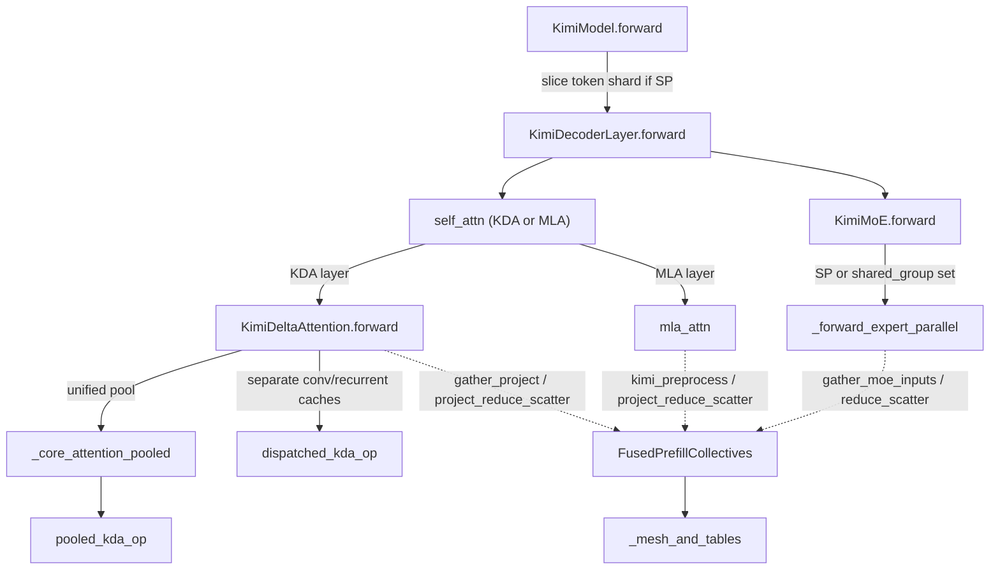
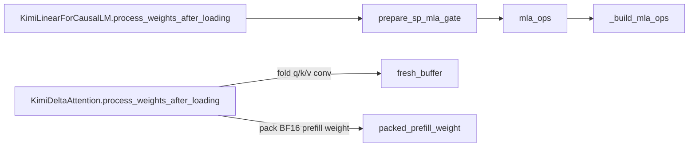

# Kimi-K3 / Kimi-Linear model (KDA + MLA hybrid, TP32/EP32 sequence-parallel prefill)

<!-- connect:up:begin -->
> **Cross-repo concept:** part of [expert-parallelism](../../../concepts/expert-parallelism.md), [kv-cache](../../../concepts/kv-cache.md), [sequence-parallelism](../../../concepts/sequence-parallelism.md) across this wiki's repos.
<!-- connect:up:end -->
## Overview

`src/vllm_torchtpu/models/vllm/kimi_k3/` is the plugin's own implementation of the Kimi hybrid
architecture: a decoder stack where each layer is either **Kimi Delta Attention** (KDA, a gated
linear-attention recurrence with a short depthwise convolution) or **NoPE Multi-head Latent
Attention** (MLA), followed by either a dense gated MLP or a (optionally latent) MoE. Three registry
entries come out of it: the text model `KimiLinearForCausalLM`, the multimodal
`KimiK3ForConditionalGeneration` (adds the MoonViT vision tower), and the `K3DSparkModel` drafter used
by DSpark speculative decoding. The single key design idea is that **the model has two execution
regimes chosen per forward**: the default tensor-parallel path (every rank sees every token, layers
end in an all-reduce), and the opt-in `TPU_K3_SP_PREFILL` path, which shards tokens 32 ways on a
TP32/EP32 slice and swaps each generic collective for a fused Pallas ring kernel through
[`FusedPrefillCollectives`](../catalog/src/vllm_torchtpu/models/vllm/kimi_k3/collective_ops.md#FusedPrefillCollectives "src/vllm_torchtpu/models/vllm/kimi_k3/collective_ops.py:L321")
whenever the activation shape and dtype match what the kernels were built for. Everything else
(KDA kernels, MLA kernel, fused-MoE GMM) is delegated to the shared TPU layer adapters.

## Diagram

Legend:
- `KM` - [`forward`](../catalog/src/vllm_torchtpu/models/vllm/kimi_k3/model.md#KimiModel.forward "src/vllm_torchtpu/models/vllm/kimi_k3/model.py:L264")
- `DL` - [`forward`](../catalog/src/vllm_torchtpu/models/vllm/kimi_k3/model.md#KimiDecoderLayer.forward "src/vllm_torchtpu/models/vllm/kimi_k3/model.py:L150")
- `SA` - [`self_attn`](../catalog/src/vllm_torchtpu/models/vllm/kimi_k3/model.md#KimiDecoderLayer.self_attn "src/vllm_torchtpu/models/vllm/kimi_k3/model.py:L100")
- `KDA` - [`forward`](../catalog/src/vllm_torchtpu/models/vllm/kimi_k3/attention.md#KimiDeltaAttention.forward "src/vllm_torchtpu/models/vllm/kimi_k3/attention.py:L695")
- `MLA` - [`mla_attn`](../catalog/src/vllm_torchtpu/models/vllm/kimi_k3/attention.md#MultiHeadLatentAttention.mla_attn "src/vllm_torchtpu/models/vllm/kimi_k3/attention.py:L363")
- `POOL` - [`_core_attention_pooled`](../catalog/src/vllm_torchtpu/models/vllm/kimi_k3/attention.md#KimiDeltaAttention._core_attention_pooled "src/vllm_torchtpu/models/vllm/kimi_k3/attention.py:L801")
- `PKOP` - [`pooled_kda_op`](../catalog/src/vllm_torchtpu/models/vllm/kimi_k3/attention.md#KimiDeltaAttention.pooled_kda_op "src/vllm_torchtpu/models/vllm/kimi_k3/attention.py:L597")
- `DKOP` - [`dispatched_kda_op`](../catalog/src/vllm_torchtpu/models/vllm/kimi_k3/attention.md#KimiDeltaAttention.dispatched_kda_op "src/vllm_torchtpu/models/vllm/kimi_k3/attention.py:L582")
- `MOE` - [`forward`](../catalog/src/vllm_torchtpu/models/vllm/kimi_k3/moe.md#KimiMoE.forward "src/vllm_torchtpu/models/vllm/kimi_k3/moe.py:L264")
- `EP` - [`_forward_expert_parallel`](../catalog/src/vllm_torchtpu/models/vllm/kimi_k3/moe.md#KimiMoE._forward_expert_parallel "src/vllm_torchtpu/models/vllm/kimi_k3/moe.py:L275")
- `FPC` - [`FusedPrefillCollectives`](../catalog/src/vllm_torchtpu/models/vllm/kimi_k3/collective_ops.md#FusedPrefillCollectives "src/vllm_torchtpu/models/vllm/kimi_k3/collective_ops.py:L321")
- `MESH` - [`_mesh_and_tables`](../catalog/src/vllm_torchtpu/models/vllm/kimi_k3/collective_ops.md#_mesh_and_tables "src/vllm_torchtpu/models/vllm/kimi_k3/collective_ops.py:L247")

Load-time preparation (runs once, after the checkpoint loaders, and decides which fast paths exist):

Legend:
- `PWL` - [`process_weights_after_loading`](../catalog/src/vllm_torchtpu/models/vllm/kimi_k3/model.md#KimiLinearForCausalLM.process_weights_after_loading "src/vllm_torchtpu/models/vllm/kimi_k3/model.py:L400")
- `GATE` - [`prepare_sp_mla_gate`](../catalog/src/vllm_torchtpu/models/vllm/kimi_k3/attention.md#MultiHeadLatentAttention.prepare_sp_mla_gate "src/vllm_torchtpu/models/vllm/kimi_k3/attention.py:L380")
- `OPS` - [`mla_ops`](../catalog/src/vllm_torchtpu/models/vllm/kimi_k3/collective_ops.md#FusedPrefillCollectives.mla_ops "src/vllm_torchtpu/models/vllm/kimi_k3/collective_ops.py:L344")
- `BUILD` - [`_build_mla_ops`](../catalog/src/vllm_torchtpu/models/vllm/kimi_k3/collective_ops.md#_build_mla_ops "src/vllm_torchtpu/models/vllm/kimi_k3/collective_ops.py:L42")
- `KPWL` - [`process_weights_after_loading`](../catalog/src/vllm_torchtpu/models/vllm/kimi_k3/attention.md#KimiDeltaAttention.process_weights_after_loading "src/vllm_torchtpu/models/vllm/kimi_k3/attention.py:L636")
- `FB` - [`fresh_buffer`](../catalog/src/vllm_torchtpu/utils.md#fresh_buffer "src/vllm_torchtpu/utils.py:L395")
- `PPW` - [`packed_prefill_weight`](../catalog/src/vllm_torchtpu/models/vllm/kimi_k3/attention.md#KimiDeltaAttention.packed_prefill_weight "src/vllm_torchtpu/models/vllm/kimi_k3/attention.py:L666")

## Design rationale (why it's built this way)

**Sequence parallelism is decided per forward, not per deployment.** `TPU_K3_SP_PREFILL` only arms
the machinery (and `KimiModel.__init__` refuses to start unless TP=32, expert parallelism is on, and
PP=DP=1). Whether a given step actually runs sharded is decided in
[`forward`](../catalog/src/vllm_torchtpu/models/vllm/kimi_k3/model.md#KimiModel.forward "src/vllm_torchtpu/models/vllm/kimi_k3/model.py:L264")
as `num_tokens > 0 and num_tokens % world_size == 0`. Small decode buckets that do not divide by 32
silently take the replicated TP path with all-reduces, so one compiled model serves both prefill
(large, divisible token buckets) and decode.

**Every fused collective has a generic fallback, gated on exact shape/dtype.**
[`all_gather`](../catalog/src/vllm_torchtpu/models/vllm/kimi_k3/collective_ops.md#FusedPrefillCollectives.all_gather "src/vllm_torchtpu/models/vllm/kimi_k3/collective_ops.py:L348")
and [`reduce_scatter`](../catalog/src/vllm_torchtpu/models/vllm/kimi_k3/collective_ops.md#FusedPrefillCollectives.reduce_scatter "src/vllm_torchtpu/models/vllm/kimi_k3/collective_ops.py:L359")
use the Pallas rings only for 2-D BF16 tensors whose width is one of 2176 / 3584 / 7168 (and, for
RS, rows divisible by 32); anything else goes to the base vLLM TP group. Likewise
[`project_reduce_scatter`](../catalog/src/vllm_torchtpu/models/vllm/kimi_k3/collective_ops.md#FusedPrefillCollectives.project_reduce_scatter "src/vllm_torchtpu/models/vllm/kimi_k3/collective_ops.py:L371")
fuses the output projection only for a BF16 `(384, 7168)` weight that the TPU linear loader has
already transposed (the [`WEIGHT_FLIPPED_ATTR`](../catalog/src/vllm_torchtpu/layers/adapter/linear_common.md#WEIGHT_FLIPPED_ATTR "src/vllm_torchtpu/layers/adapter/linear_common.py:L53")
marker), with "Preserve the linear method for other weight formats" as the stated reason. The
hard-coded widths are the K3 geometry: hidden 7168, three local KDA heads of 128 (384) at TP32, and a
2176-wide padded MLA latent.

**Ring collectives need stable, distinct barrier identities.** `FusedPrefillCollectives` derives a
fixed `collective_id` per layer and per collective (20000 + 2 x layer for AG, +1 for RS, 22000 +
layer for project-RS, 23000 + layer for gather-project, 24000 + layer for the MoE gather) - the code
comment: "Fixed layer-derived IDs keep independent ring barriers distinct." The mesh and routing
tables come from one cached
[`_mesh_and_tables`](../catalog/src/vllm_torchtpu/models/vllm/kimi_k3/collective_ops.md#_mesh_and_tables "src/vllm_torchtpu/models/vllm/kimi_k3/collective_ops.py:L247")
call that insists the EP group and TP group have identical rank order and builds the flat `k3_sp`
mesh with [`build_ep_mesh`](../catalog/src/vllm_torchtpu/distributed/ep_mesh.md#build_ep_mesh "src/vllm_torchtpu/distributed/ep_mesh.py:L266").

**Do layout work once at load time, never per step.** The checkpoint stores q/k/v short-conv
weights as three `[dim, 1, kernel]` tensors; KDA's
[`process_weights_after_loading`](../catalog/src/vllm_torchtpu/models/vllm/kimi_k3/attention.md#KimiDeltaAttention.process_weights_after_loading "src/vllm_torchtpu/models/vllm/kimi_k3/attention.py:L636")
stacks them once into the kernels' `[kernel_size, 3, heads, head_dim]` layout. Its docstring:
"the ops used to concatenate and transpose them on every step". The result goes through
[`fresh_buffer`](../catalog/src/vllm_torchtpu/utils.md#fresh_buffer "src/vllm_torchtpu/utils.py:L395")
because otherwise "torch_tpu re-materializes that lineage as a per-step `tt_jit_as_strided` program
at the dispatched op's boundary". The same philosophy produces the packed BF16 prefill projection
and the folded Attention Residual weight.

**Same parameter list for every token bucket.** In KDA's
[`forward`](../catalog/src/vllm_torchtpu/models/vllm/kimi_k3/attention.md#KimiDeltaAttention.forward "src/vllm_torchtpu/models/vllm/kimi_k3/attention.py:L695"),
the packed-weight path is taken for both SP and non-SP buckets once the packed weight exists, with
the comment "Every token bucket must capture the same parameter list: the serving compiler hands
executables between traces by input ABI."

> [!inferred]
> The fixed per-rank widths and the TP2 "chip pair" structure suggest the SP path was co-designed with
> one specific deployment (a 2x2x4 v7x slice, 16 chips x 2 cores = 32 ranks, as enforced by the ring
> kernels); other slice shapes or TP sizes will always take the generic-collective fallback.

## Entry points

- [`forward`](../catalog/src/vllm_torchtpu/models/vllm/kimi_k3/model.md#KimiModel.forward "src/vllm_torchtpu/models/vllm/kimi_k3/model.py:L264")
  (`KimiModel`, compiled via `support_torch_compile` with dynamic token dimension) - reached from the
  runner's model forward for every scheduled step, through `KimiLinearForCausalLM.forward` or, for
  the multimodal checkpoint, `KimiK3ForConditionalGeneration.forward`, which only delegates to its
  language model.
- [`process_weights_after_loading`](../catalog/src/vllm_torchtpu/models/vllm/kimi_k3/model.md#KimiLinearForCausalLM.process_weights_after_loading "src/vllm_torchtpu/models/vllm/kimi_k3/model.py:L400")
  is called once after weight loading. It walks all modules: folds every Attention Residual, seeds the
  MoE router for dummy-weight runs, and calls
  [`prepare_sp_mla_gate`](../catalog/src/vllm_torchtpu/models/vllm/kimi_k3/attention.md#MultiHeadLatentAttention.prepare_sp_mla_gate "src/vllm_torchtpu/models/vllm/kimi_k3/attention.py:L380")
  on each MLA layer. Its docstring notes the generic loader hook "fires per module only for attention
  layers, so the residuals are folded from here instead."
- [`process_weights_after_loading`](../catalog/src/vllm_torchtpu/models/vllm/kimi_k3/attention.md#KimiDeltaAttention.process_weights_after_loading "src/vllm_torchtpu/models/vllm/kimi_k3/attention.py:L636")
  (KDA) - the per-attention-layer loader hook vLLM calls with the activation dtype; folds conv weights
  and builds the packed prefill weight.
- [`precompute_and_store_context_kv`](../catalog/src/vllm_torchtpu/models/vllm/kimi_k3/dspark.md#K3DSparkModel.precompute_and_store_context_kv "src/vllm_torchtpu/models/vllm/kimi_k3/dspark.py:L180")
  is called by the DFlash/DSpark proposer in `spec_decode/dflash.py`, which opts into the
  TPU-specific hook `K3DSparkForCausalLM.tpu_precompute_and_store_context_kv` when the draft exposes
  it, to turn the target model's auxiliary hidden states into the drafter's latent KV cache before
  drafting.
- [`vision_tower`](../catalog/src/vllm_torchtpu/models/vllm/kimi_k3/model.md#KimiK3ForConditionalGeneration.vision_tower "src/vllm_torchtpu/models/vllm/kimi_k3/model.py:L591")
  is the MoonViT encoder, reached through the multimodal encoder path (`embed_multimodal`, or the
  encoder budget-graph protocol methods) before text decoding.

## Mechanism (step-by-step)

1. **Layer construction decides the per-layer shape of the model.** Each `KimiDecoderLayer` builds
   its [`self_attn`](../catalog/src/vllm_torchtpu/models/vllm/kimi_k3/model.md#KimiDecoderLayer.self_attn "src/vllm_torchtpu/models/vllm/kimi_k3/model.py:L100")
   as `KimiDeltaAttention` when `config.is_kda_layer(layer_idx)` and as NoPE `MultiHeadLatentAttention`
   otherwise; it gets a `KimiMoE` when `layer_idx >= first_k_dense_replace` and
   `layer_idx % moe_layer_freq == 0`, else a dense `KimiMLP`. When `TPU_K3_SP_PREFILL` is set, every
   KDA, MLA and MoE layer also builds a
   [`FusedPrefillCollectives`](../catalog/src/vllm_torchtpu/models/vllm/kimi_k3/collective_ops.md#FusedPrefillCollectives "src/vllm_torchtpu/models/vllm/kimi_k3/collective_ops.py:L321")
   (for MLA, stored in [`prefill_group`](../catalog/src/vllm_torchtpu/models/vllm/kimi_k3/attention.md#MultiHeadLatentAttention.prefill_group "src/vllm_torchtpu/models/vllm/kimi_k3/attention.py:L345")),
   which registers that layer's ring custom ops up front.

2. **The model forward picks the regime and shards tokens.**
   [`forward`](../catalog/src/vllm_torchtpu/models/vllm/kimi_k3/model.md#KimiModel.forward "src/vllm_torchtpu/models/vllm/kimi_k3/model.py:L264")
   embeds the input ids, then, if `sequence_parallel` holds for this bucket, reshapes the
   `[T, hidden]` activations to `[32, T/32, hidden]` and keeps only this rank's slice. Each layer gets
   `sequence_parallel` as an argument, and at the end the normed hidden states (and any auxiliary
   hidden states requested for speculative decoding) are all-gathered back to full length. The empty
   `block_residuals` buffer is deliberately a zero-width view of the activations: "A view avoids
   passing a symbolic local token count to TorchTPU's concrete-size allocation kernel during the
   dynamic trace."

3. **The decoder layer runs pre-norm residual blocks, optionally with Block Attention Residuals.**
   [`forward`](../catalog/src/vllm_torchtpu/models/vllm/kimi_k3/model.md#KimiDecoderLayer.forward "src/vllm_torchtpu/models/vllm/kimi_k3/model.py:L150")
   follows the standard norm -> attention -> add -> norm -> MLP/MoE -> add path when
   `attn_res_block_size` is unset. With it set (K3), the residual stream is a running `prefix_sum`
   plus a growing `block_residuals` stack: every `attn_res_block_size` layers the current prefix sum is
   appended as a new block, and the inputs to attention and to the MLP are softmax-weighted mixes of
   the saved blocks and the current prefix (computed by `AttentionResidual`, which uses a Pallas kernel
   for 16-token-divisible prefills and plain torch otherwise).

4. **KDA layers project, then pick a state backend.** KDA's
   [`forward`](../catalog/src/vllm_torchtpu/models/vllm/kimi_k3/attention.md#KimiDeltaAttention.forward "src/vllm_torchtpu/models/vllm/kimi_k3/attention.py:L695")
   produces `mixed_qkv`, `beta`, the raw decay gate and the output gate. If
   [`packed_prefill_weight`](../catalog/src/vllm_torchtpu/models/vllm/kimi_k3/attention.md#KimiDeltaAttention.packed_prefill_weight "src/vllm_torchtpu/models/vllm/kimi_k3/attention.py:L666")
   exists, one matmul against a `[7168, 1792]` packed weight does all input projections (in SP mode
   that matmul is fused with the token all-gather via `group.gather_project`); otherwise it uses
   [`fused_qkvb_proj`](../catalog/src/vllm_torchtpu/models/vllm/kimi_k3/attention.md#KimiDeltaAttention.fused_qkvb_proj "src/vllm_torchtpu/models/vllm/kimi_k3/attention.py:L493")
   plus either full-rank [`g_proj`](../catalog/src/vllm_torchtpu/models/vllm/kimi_k3/attention.md#KimiDeltaAttention.g_proj "src/vllm_torchtpu/models/vllm/kimi_k3/attention.py:L509")
   or the low-rank `fused_fa_ga_proj` -> [`g_b_proj`](../catalog/src/vllm_torchtpu/models/vllm/kimi_k3/attention.md#KimiDeltaAttention.g_b_proj "src/vllm_torchtpu/models/vllm/kimi_k3/attention.py:L549")
   pair; the decay gate always comes from [`f_b_proj`](../catalog/src/vllm_torchtpu/models/vllm/kimi_k3/attention.md#KimiDeltaAttention.f_b_proj "src/vllm_torchtpu/models/vllm/kimi_k3/attention.py:L541").
   Then, from the per-layer attention metadata: no metadata or an empty cache (profiling / dummy run)
   yields zeros; a one-element `kv_cache` means the **unified block pool**, handled by
   [`_core_attention_pooled`](../catalog/src/vllm_torchtpu/models/vllm/kimi_k3/attention.md#KimiDeltaAttention._core_attention_pooled "src/vllm_torchtpu/models/vllm/kimi_k3/attention.py:L801");
   a two-element cache (conv state, recurrent state) goes to
   [`dispatched_kda_op`](../catalog/src/vllm_torchtpu/models/vllm/kimi_k3/attention.md#KimiDeltaAttention.dispatched_kda_op "src/vllm_torchtpu/models/vllm/kimi_k3/attention.py:L582"),
   the fused short-conv + recurrence custom op that receives the folded conv weight, `A_log`,
   [`dt_bias`](../catalog/src/vllm_torchtpu/models/vllm/kimi_k3/attention.md#KimiDeltaAttention.dt_bias "src/vllm_torchtpu/models/vllm/kimi_k3/attention.py:L560"),
   the output-norm weight and the ragged metadata (`query_start_loc`, `mamba_state_indices`,
   `seq_lens`, [`request_distribution`](../catalog/src/vllm_torchtpu/layers/core/attention_metadata.md#AttentionMetadata.request_distribution "src/vllm_torchtpu/layers/core/attention_metadata.py:L90"),
   window distribution and speculative slot offsets).

5. **Pooled KDA reads and writes state inside the attention-shaped pool.**
   [`_core_attention_pooled`](../catalog/src/vllm_torchtpu/models/vllm/kimi_k3/attention.md#KimiDeltaAttention._core_attention_pooled "src/vllm_torchtpu/models/vllm/kimi_k3/attention.py:L801")
   - "conv and recurrent state live in the pool's per-block byte regions and are gathered/scattered
   by the op" - requires `mamba_state_indices`, passes optional checkpoint indices (prefix-cache
   snapshots of hybrid state) and rejects PCP streaming metadata via
   [`is_pcp_streaming_attention_metadata`](../catalog/src/vllm_torchtpu/layers/core/sequence_layout.md#is_pcp_streaming_attention_metadata "src/vllm_torchtpu/layers/core/sequence_layout.py:L435").
   The op itself is [`pooled_kda_op`](../catalog/src/vllm_torchtpu/models/vllm/kimi_k3/attention.md#KimiDeltaAttention.pooled_kda_op "src/vllm_torchtpu/models/vllm/kimi_k3/attention.py:L597"),
   built by [`build_kimi_pooled_kda_op`](../catalog/src/vllm_torchtpu/layers/adapter/custom_ops/kda_attention_op.md#build_kimi_pooled_kda_op "src/vllm_torchtpu/layers/adapter/custom_ops/kda_attention_op.py:L736");
   it reads `cache_config.block_size` per call because "the platform's block-size derivation for the
   pool runs after model construction".

6. **KDA output projection closes the TP or SP reduction.** After the KDA core, SP buckets with a
   fused group call
   [`project_reduce_scatter`](../catalog/src/vllm_torchtpu/models/vllm/kimi_k3/collective_ops.md#FusedPrefillCollectives.project_reduce_scatter "src/vllm_torchtpu/models/vllm/kimi_k3/collective_ops.py:L371"),
   which fuses the row-parallel `o_proj` (384 local features -> 7168) with the 32-way reduce-scatter
   so each rank ends up with the fully reduced rows for its own tokens. Non-SP buckets run `o_proj`
   with `reduce_results=False` and an explicit all-reduce.

7. **MLA layers dispatch to the TPU MLA wrapper, optionally with fused SP preprocessing.** The MLA
   module's own forward chooses `prefill_group` vs the TP group. If SP is active but no fused
   preprocessing is installed, it first all-gathers the token shard; with a
   `FusedPrefillCollectives` group it passes `prefill_group=group` into
   [`mla_attn`](../catalog/src/vllm_torchtpu/models/vllm/kimi_k3/attention.md#MultiHeadLatentAttention.mla_attn "src/vllm_torchtpu/models/vllm/kimi_k3/attention.py:L363")
   (the TPU `MultiHeadLatentAttentionWrapper`), which then uses the installed `kimi_preprocess` op and
   finishes with `prefill_group.project_reduce_scatter` itself. The preprocessing op is installed by
   [`prepare_sp_mla_gate`](../catalog/src/vllm_torchtpu/models/vllm/kimi_k3/attention.md#MultiHeadLatentAttention.prepare_sp_mla_gate "src/vllm_torchtpu/models/vllm/kimi_k3/attention.py:L380")
   only when the fused `q_a + kv_a + gate` projection is a flipped BF16 `(7168, 2496)` weight; it asks
   [`mla_ops`](../catalog/src/vllm_torchtpu/models/vllm/kimi_k3/collective_ops.md#FusedPrefillCollectives.mla_ops "src/vllm_torchtpu/models/vllm/kimi_k3/collective_ops.py:L344")
   for a `(pack, preprocess)` pair from
   [`_build_mla_ops`](../catalog/src/vllm_torchtpu/models/vllm/kimi_k3/collective_ops.md#_build_mla_ops "src/vllm_torchtpu/models/vllm/kimi_k3/collective_ops.py:L42")
   and stores the packed gate weight on the wrapper. The fused projection mixes replicated outputs
   (`q_a`, `kv_a`) with a TP-sharded output gate in one local matmul (`MixedParallelMergedLinear`),
   which is why 2496 = 2112 replicated columns + 384 gate columns per rank.

8. **MoE runs either the plain fused-MoE path or the EP/SP path.**
   [`forward`](../catalog/src/vllm_torchtpu/models/vllm/kimi_k3/moe.md#KimiMoE.forward "src/vllm_torchtpu/models/vllm/kimi_k3/moe.py:L264")
   computes fp32 router logits with [`gate`](../catalog/src/vllm_torchtpu/models/vllm/kimi_k3/moe.md#KimiMoE.gate "src/vllm_torchtpu/models/vllm/kimi_k3/moe.py:L96")
   and calls [`experts`](../catalog/src/vllm_torchtpu/models/vllm/kimi_k3/moe.md#KimiMoE.experts "src/vllm_torchtpu/models/vllm/kimi_k3/moe.py:L190")
   (a `FusedMoEFactory` module built under the hierarchical-EP parallel config, carrying the shared
   experts and the latent input/output transforms) on all tokens. When SP is active, or when the
   SP machinery is armed but this bucket is replicated,
   [`_forward_expert_parallel`](../catalog/src/vllm_torchtpu/models/vllm/kimi_k3/moe.md#KimiMoE._forward_expert_parallel "src/vllm_torchtpu/models/vllm/kimi_k3/moe.py:L275")
   takes over: it computes the router logits, down-projects to the latent expert width, and then
   branches. On an SP bucket it routes locally with
   [`route`](../catalog/src/vllm_torchtpu/layers/adapter/moe_routing.md#route "src/vllm_torchtpu/layers/adapter/moe_routing.py:L150"),
   ring-gathers latent activations + router weights + expert ids in one packed transfer
   (`group.gather_moe_inputs`), runs the MXFP4 experts with
   [`apply_with_routing`](../catalog/src/vllm_torchtpu/layers/adapter/quantization/compressed_tensors/compressed_tensors_moe/compressed_tensors_moe_w4an_mxfp4.md#VllmCompressedTensorsW4ANMxfp4MoEMethod.apply_with_routing "src/vllm_torchtpu/layers/adapter/quantization/compressed_tensors/compressed_tensors_moe/compressed_tensors_moe_w4an_mxfp4.py:L295"),
   and reduce-scatters; on an armed-but-replicated bucket it instead runs the experts' monolithic
   apply on all tokens and all-reduces. Either way it then applies the latent norm and
   [`routed_expert_up_proj`](../catalog/src/vllm_torchtpu/models/vllm/kimi_k3/moe.md#KimiMoE.routed_expert_up_proj "src/vllm_torchtpu/models/vllm/kimi_k3/moe.py:L126"),
   and finally adds the [`shared_experts`](../catalog/src/vllm_torchtpu/models/vllm/kimi_k3/moe.md#KimiMoE.shared_experts "src/vllm_torchtpu/models/vllm/kimi_k3/moe.py:L153")
   output, computed on the two-core intra-chip [`shared_group`](../catalog/src/vllm_torchtpu/models/vllm/kimi_k3/moe.md#KimiMoE.shared_group "src/vllm_torchtpu/models/vllm/kimi_k3/moe.py:L146")
   (TP2) instead of TP32.

9. **The DSpark drafter writes its KV cache from target hidden states in one projection.**
   [`precompute_and_store_context_kv`](../catalog/src/vllm_torchtpu/models/vllm/kimi_k3/dspark.md#K3DSparkModel.precompute_and_store_context_kv "src/vllm_torchtpu/models/vllm/kimi_k3/dspark.py:L180")
   projects the concatenated target auxiliary states through `context_proj` + norm, computes every
   drafter layer's `kv_lora + rope` latent with a single fused `context_kv_proj` (its weights are the
   per-layer `kv_a_proj_with_mqa` weights duplicated at load time), then for each of the
   [`layers`](../catalog/src/vllm_torchtpu/models/vllm/kimi_k3/dspark.md#K3DSparkModel.layers "src/vllm_torchtpu/models/vllm/kimi_k3/dspark.py:L139")
   applies the KV norm and RoPE, quantizes to the cache dtype with the layer's KV scale ("This context
   path bypasses the regular MLA forward, so mirror its cache quantization here") and calls the MLA
   core op with all-zero queries purely to update the cache. The drafter layers themselves are MLA
   with RoPE and `non_causal_multi_token_decode=True`; dimensions come from the draft
   [`config`](../catalog/src/vllm_torchtpu/models/vllm/kimi_k3/dspark.md#K3DSparkModel.config "src/vllm_torchtpu/models/vllm/kimi_k3/dspark.py:L126").

## Key data structures

- **Per-layer KDA weights.** [`fused_qkvb_proj`](../catalog/src/vllm_torchtpu/models/vllm/kimi_k3/attention.md#KimiDeltaAttention.fused_qkvb_proj "src/vllm_torchtpu/models/vllm/kimi_k3/attention.py:L493")
  outputs `[proj] x 3 + [total_heads]` (q, k, v, beta);
  [`q_conv1d`](../catalog/src/vllm_torchtpu/models/vllm/kimi_k3/attention.md#KimiDeltaAttention.q_conv1d "src/vllm_torchtpu/models/vllm/kimi_k3/attention.py:L527"),
  [`k_conv1d`](../catalog/src/vllm_torchtpu/models/vllm/kimi_k3/attention.md#KimiDeltaAttention.k_conv1d "src/vllm_torchtpu/models/vllm/kimi_k3/attention.py:L528")
  and [`v_conv1d`](../catalog/src/vllm_torchtpu/models/vllm/kimi_k3/attention.md#KimiDeltaAttention.v_conv1d "src/vllm_torchtpu/models/vllm/kimi_k3/attention.py:L529")
  are checkpoint-compatible containers whose [`weight`](../catalog/src/vllm_torchtpu/models/vllm/kimi_k3/attention.md#CausalDepthwiseConv1d.weight "src/vllm_torchtpu/models/vllm/kimi_k3/attention.py:L440")
  is TP-chunked on load; the runtime only reads the non-persistent `conv_weight_fused` buffer built
  from them. [`num_heads`](../catalog/src/vllm_torchtpu/models/vllm/kimi_k3/attention.md#KimiDeltaAttention.num_heads "src/vllm_torchtpu/models/vllm/kimi_k3/attention.py:L480")
  is the local head count (total / TP), [`head_dim`](../catalog/src/vllm_torchtpu/models/vllm/kimi_k3/attention.md#KimiDeltaAttention.head_dim "src/vllm_torchtpu/models/vllm/kimi_k3/attention.py:L476")
  is 128 for K3, and [`projection_size`](../catalog/src/vllm_torchtpu/models/vllm/kimi_k3/attention.md#KimiDeltaAttention.projection_size "src/vllm_torchtpu/models/vllm/kimi_k3/attention.py:L481")
  / [`local_projection_size`](../catalog/src/vllm_torchtpu/models/vllm/kimi_k3/attention.md#KimiDeltaAttention.local_projection_size "src/vllm_torchtpu/models/vllm/kimi_k3/attention.py:L482")
  are global vs per-rank `heads x head_dim`.
- **KDA state (per request slot).** Conv state shaped `(conv_size - 1, 1, 3 x local_proj)` in fp32
  and recurrent state `(local_heads, head_dim, head_dim)`. The shape is declared in the fused kernel's
  slot layout "so XLA does not relayout the whole pool around every call", and the conv cache is fp32
  regardless of `mamba_cache_dtype` because a narrower dtype "makes `fused_conv1d_gdn` widen the whole
  slot pool once per layer per step".
- **Packed BF16 prefill weight.** [`packed_prefill_weight`](../catalog/src/vllm_torchtpu/models/vllm/kimi_k3/attention.md#KimiDeltaAttention.packed_prefill_weight "src/vllm_torchtpu/models/vllm/kimi_k3/attention.py:L666")
  `= [qkvb (1155) | zeros (125) | gate (384) | f_a (128)]`, 1792 columns; "q/k/v occupy 1152
  columns; pad the 3 beta columns to an MXU tile". Built only with SP armed, full-rank gate, 3 local
  heads x 128 and flipped BF16 source weights.
- **MLA gate state on the wrapper.** `kimi_preprocess` (the fused preprocessing op) and
  `kimi_gate_weight` (packed gate, `(7168, 6144)` per the op's fake shape) are reset to `None` and
  rebuilt every time [`prepare_sp_mla_gate`](../catalog/src/vllm_torchtpu/models/vllm/kimi_k3/attention.md#MultiHeadLatentAttention.prepare_sp_mla_gate "src/vllm_torchtpu/models/vllm/kimi_k3/attention.py:L380")
  runs ("after checkpoint loading or reload"). [`q_b_proj`](../catalog/src/vllm_torchtpu/models/vllm/kimi_k3/attention.md#MultiHeadLatentAttention.q_b_proj "src/vllm_torchtpu/models/vllm/kimi_k3/attention.py:L251")
  stays a normal column-parallel linear applied after preprocessing.
- **Ring op registry.** Module-level `_OPS` caches each `pallas::kimi_*` custom op by
  (kind, collective id, device ids, routing tables), so repeated layer construction and reloads reuse
  the same registered op.

## Dynamics (design intent)

- **Prefill vs decode.** SP engages only for token buckets divisible by 32 (step 2); since the MoE and
  MLA modules keep their SP groups built, a replicated bucket on an SP-armed deployment still goes
  through [`_forward_expert_parallel`](../catalog/src/vllm_torchtpu/models/vllm/kimi_k3/moe.md#KimiMoE._forward_expert_parallel "src/vllm_torchtpu/models/vllm/kimi_k3/moe.py:L275")
  with `apply_monolithic` + all-reduce rather than the plain `experts` call.
- **Weight streaming memory.** `KimiLinearForCausalLM.load_weights` feeds non-expert weights to
  `AutoWeightsLoader` as a generator interleaved with expert dispatch; the comment explains a list
  "would pin every dense weight's host tensor until the loop ends (~115 GB per rank for Kimi-K3 --
  enough to OOM a 944 GB host at 8 ranks before loading finishes)".
- **Vision encoder and collectives.** Kimi's 12 vision heads force vision data parallelism at TP=8;
  `embed_multimodal` patches the TP all-gather with a TPU-materializing variant, and
  `encoder_eager_forward` processes only the local subset because a cross-rank all-gather joined by
  only the eager-fallback ranks "desyncs and the whole engine deadlocks".
- **Dummy-weight benchmarking.** `KimiMoE.initialize_dummy_router` replaces the generic +/-0.001
  dummy weights with fan-in-scaled random router weights and seeded per-layer biases, so dummy-load
  runs produce realistic routing spread instead of bias-dominated routes.

## Edge cases

- `TPU_K3_SP_PREFILL=1` raises at construction unless TP=32 + EP, PP=1, DP=1, a physical two-core chip
  group exists for the shared experts, and the routed experts expose `apply_with_routing` (the native
  MXFP4 MoE backend) - other quantizations cannot use SP prefill.
- The fused paths are silently skipped (generic collectives used) for non-BF16 weights or
  activations, non-flipped weights, or any width other than the K3 geometry; a misconfigured
  checkpoint loses performance without an error.
- Pooled KDA raises `NotImplementedError` under PCP streaming prefill, and `KimiLinearForCausalLM`
  rejects pipeline parallelism (`intermediate_tensors` must be `None`).
- MoE intermediate size is padded up to 128 per partition when the TP split would go below it; the
  padded expert weights are zeroed and the unpadded size is recorded for the kernel.
- Only NoPE MLA is supported for the main model (`mla_use_nope`); RoPE MLA exists only for the DSpark
  drafter.
- `AttentionResidual` uses its Pallas kernel only on TPU and only for token counts divisible by 16;
  a single-token bucket takes a separate concatenated-slots torch path (its own trace).

## Open questions

- The KDA custom ops themselves (`build_kimi_dispatched_kda_op`, `_pooled_kda_core`) live in
  `layers/adapter/custom_ops/kda_attention_op.py` and run on the GDN v3 fused conv1d kernel; only the
  pooled builder and core are in this packet. See the gated-deltanet kernel page for the kernel side.
- `TokenShardCollectives` (the token AG/RS for dense MLPs and the model-level shard/gather) and the
  `MixedParallelMergedLinear`, `AttentionResidual`, `KimiMLP` classes are not in this packet's
  subgraph, so they are described from source without citations.
- No tests under the configured test paths reference this subgraph; `tests/models/vllm/test_kimi_k3.py`
  exists in the repo but was not part of the evidence set, so SP-path correctness claims are from
  source only.
- Where exactly the 32-way token-owner permutation (`ep_rank_order`) comes from, and whether SP
  prefill composes with prefix caching or disaggregated KV transfer, is not settled by this unit.

## See also

- [kimi-k3-kernels](kimi-k3-kernels.md) - the Pallas ring collectives, fused projections, Attention
  Residual and standalone KDA kernels this model calls.
- [vllm-model-patches](vllm-model-patches.md) - registration of the Kimi architectures and the model
  wrapper context.
- [gated-deltanet-kernels](gated-deltanet-kernels.md) - the GDN v3 kernels the production KDA ops run on.
- [mla-attention-kernels](mla-attention-kernels.md) - the MLA attention kernel behind `mla_attn`.
- [fused-moe-kernels](fused-moe-kernels.md) and [quantization-methods](quantization-methods.md) - the
  MXFP4 fused-MoE path used by `apply_with_routing`.
- [kv-cache-layout-and-hbm-budget](kv-cache-layout-and-hbm-budget.md) - the unified block pool shared
  by KDA state and MLA KV.
- [distributed-parallelism-and-meshes](distributed-parallelism-and-meshes.md) - EP mesh construction
  and hierarchical EP.
- [speculative-decoding](speculative-decoding.md) - DSpark proposer that drives the K3 drafter.
- [deepseek-v4-model](deepseek-v4-model.md) - the other dedicated MLA + MoE model implementation.
