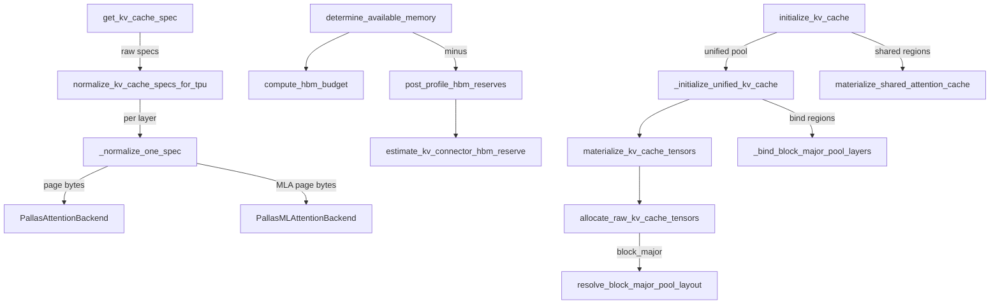

# KV-cache layout and HBM budget - page geometry, block count and pool materialization

<!-- connect:up:begin -->
> **Cross-repo concept:** part of [kv-cache](../../../concepts/kv-cache.md) across this wiki's repos.
<!-- connect:up:end -->
## Overview

vLLM's KV cache manager thinks in abstract pages: a spec says "block_size tokens x heads x
head_size x dtype", vLLM multiplies, divides the free memory by it, and hands back a block count.
On TPU that arithmetic is wrong in two directions, and this subsystem exists to correct it. First,
**a page costs more than its shape**: the Pallas ragged-paged-attention layout pads `head_size` to
128 lanes and packs K/V heads into 32-bit words, and a hybrid model's recurrent (GDN/KDA) state
must fit inside an attention-shaped page. [`normalize_kv_cache_specs_for_tpu`](../catalog/src/vllm_torchtpu/kv_cache_spec_normalizer.md#normalize_kv_cache_specs_for_tpu "src/vllm_torchtpu/kv_cache_spec_normalizer.py:L34")
rewrites every spec to the bytes actually allocated so vLLM's block math is honest. Second,
**free memory is not the KV budget**: [`compute_hbm_budget`](../catalog/src/vllm_torchtpu/utils.md#compute_hbm_budget "src/vllm_torchtpu/utils.py:L222")
caps HBM at `gpu_memory_utilization`, subtracts what is already resident after the profile run,
and [`post_profile_hbm_reserves`](../catalog/src/vllm_torchtpu/runner/tpu_runner.md#TPUModelRunner.post_profile_hbm_reserves "src/vllm_torchtpu/runner/tpu_runner.py:L5652")
subtracts what will be allocated *after* the probe. Once vLLM returns a `KVCacheConfig`,
[`initialize_kv_cache`](../catalog/src/vllm_torchtpu/runner/kv_cache_manager.md#KVCacheManager.initialize_kv_cache "src/vllm_torchtpu/runner/kv_cache_manager.py:L1360")
materializes it in one of several physical layouts, chosen by model family and two env vars.

## Diagram

Legend:
- `GS` - [`get_kv_cache_spec`](../catalog/src/vllm_torchtpu/runner/kv_cache_manager.md#KVCacheManager.get_kv_cache_spec "src/vllm_torchtpu/runner/kv_cache_manager.py:L229")
- `NS` - [`normalize_kv_cache_specs_for_tpu`](../catalog/src/vllm_torchtpu/kv_cache_spec_normalizer.md#normalize_kv_cache_specs_for_tpu "src/vllm_torchtpu/kv_cache_spec_normalizer.py:L34")
- `N1` - [`_normalize_one_spec`](../catalog/src/vllm_torchtpu/kv_cache_spec_normalizer.md#_normalize_one_spec "src/vllm_torchtpu/kv_cache_spec_normalizer.py:L121")
- `PAB` - [`PallasAttentionBackend`](../catalog/src/vllm_torchtpu/layers/adapter/attention.md#PallasAttentionBackend "src/vllm_torchtpu/layers/adapter/attention.py:L562")
- `PMB` - [`PallasMLAttentionBackend`](../catalog/src/vllm_torchtpu/layers/adapter/attention.md#PallasMLAttentionBackend "src/vllm_torchtpu/layers/adapter/attention.py:L1669")
- `DAM` - [`determine_available_memory`](../catalog/src/vllm_torchtpu/worker/tpu_worker.md#TPUWorker.determine_available_memory "src/vllm_torchtpu/worker/tpu_worker.py:L503")
- `HB` - [`compute_hbm_budget`](../catalog/src/vllm_torchtpu/utils.md#compute_hbm_budget "src/vllm_torchtpu/utils.py:L222")
- `PPR` - [`post_profile_hbm_reserves`](../catalog/src/vllm_torchtpu/runner/tpu_runner.md#TPUModelRunner.post_profile_hbm_reserves "src/vllm_torchtpu/runner/tpu_runner.py:L5652")
- `EKR` - [`estimate_kv_connector_hbm_reserve`](../catalog/src/vllm_torchtpu/utils.md#estimate_kv_connector_hbm_reserve "src/vllm_torchtpu/utils.py:L237")
- `IKV` - [`initialize_kv_cache`](../catalog/src/vllm_torchtpu/runner/kv_cache_manager.md#KVCacheManager.initialize_kv_cache "src/vllm_torchtpu/runner/kv_cache_manager.py:L1360")
- `UKV` - [`_initialize_unified_kv_cache`](../catalog/src/vllm_torchtpu/runner/kv_cache_manager.md#KVCacheManager._initialize_unified_kv_cache "src/vllm_torchtpu/runner/kv_cache_manager.py:L1137")
- `MSA` - [`materialize_shared_attention_cache`](../catalog/src/vllm_torchtpu/kv_cache_materializer.md#materialize_shared_attention_cache "src/vllm_torchtpu/kv_cache_materializer.py:L356")
- `MKV` - [`materialize_kv_cache_tensors`](../catalog/src/vllm_torchtpu/kv_cache_materializer.md#materialize_kv_cache_tensors "src/vllm_torchtpu/kv_cache_materializer.py:L463")
- `ARK` - [`allocate_raw_kv_cache_tensors`](../catalog/src/vllm_torchtpu/kv_cache_materializer.md#allocate_raw_kv_cache_tensors "src/vllm_torchtpu/kv_cache_materializer.py:L237")
- `RBL` - [`resolve_block_major_pool_layout`](../catalog/src/vllm_torchtpu/kv_cache_materializer.md#resolve_block_major_pool_layout "src/vllm_torchtpu/kv_cache_materializer.py:L208")
- `BBM` - [`_bind_block_major_pool_layers`](../catalog/src/vllm_torchtpu/runner/kv_cache_manager.md#KVCacheManager._bind_block_major_pool_layers "src/vllm_torchtpu/runner/kv_cache_manager.py:L1329")

The physical layouts, in the order `initialize_kv_cache` tries them:

| Layout | When | Shape (per tensor) | Selected by |
|---|---|---|---|
| Unified hybrid pool | GDN/KDA hybrids (Qwen3-Next, Qwen3.5, Qwen4Exp, Kimi-Linear, Kimi-K3) | `P` attention-shaped pools, one per layer region | [`unified_kv_layout_enabled`](../catalog/src/vllm_torchtpu/platforms/tpu_block_size_utils.md#unified_kv_layout_enabled "src/vllm_torchtpu/platforms/tpu_block_size_utils.py:L54") (architecture list, or `TPU_VLLM_ENABLE_UNIFIED_BLOCK_POOL`) |
| Block-major unified pool | unified pool + `VLLM_TPU_BLOCK_MAJOR_KV=1` | one `(num_blocks, P x split, *page)` tensor | [`unified_block_major_enabled`](../catalog/src/vllm_torchtpu/block_major_pool.md#unified_block_major_enabled "src/vllm_torchtpu/block_major_pool.py:L45") |
| Dense block-major bundle | attention-only + `VLLM_TPU_BLOCK_MAJOR_KV=1` | one `[num_blocks, num_layers, *page]` tensor | env var, inside `initialize_kv_cache` |
| Shared attention cache | pure-attention groups whose layers share a vLLM placement region | one tensor per region | [`materialize_shared_attention_cache`](../catalog/src/vllm_torchtpu/kv_cache_materializer.md#materialize_shared_attention_cache "src/vllm_torchtpu/kv_cache_materializer.py:L356") |
| Per-layer caches | everything else (incl. DeepSeek-V4 packed layout, non-unified Mamba) | one tensor per layer / state | default |

## Design rationale (why it's built this way)

- **Publish the real page, not the logical one.** The padding warning the KV cache manager emits
  says it directly: the layout "pads head_size to a whole 128-lane register and the K/V
  vectors to a whole 32-bit word, so HBM use exceeds a shape-and-dtype estimate", and suggests
  lowering TP or enabling attention DP when `head_size` is already a multiple of 128. The
  normalizer takes `max(backend page bytes, the spec's real page bytes, any existing padding)` and
  writes it to `page_size_padded`, so vLLM's division matches the allocator.
- **One allocator source for every consumer.** The block-major geometry is derived "from
  `KVCacheConfig` alone" (docstring of
  [`resolve_block_major_pool_layout`](../catalog/src/vllm_torchtpu/kv_cache_materializer.md#resolve_block_major_pool_layout "src/vllm_torchtpu/kv_cache_materializer.py:L208"))
  so that the scheduler process, which never allocates device memory, the worker allocator, the
  offload contract ([`resolve_block_major_contract`](../catalog/src/vllm_torchtpu/offload/block_major_layout.md#resolve_block_major_contract "src/vllm_torchtpu/offload/block_major_layout.py:L130"),
  [`resolve_kernel_geometry`](../catalog/src/vllm_torchtpu/offload/raiden_store.md#resolve_kernel_geometry "src/vllm_torchtpu/offload/raiden_store.py:L1626"))
  and the Raiden transfer manifest agree byte for byte. The same rule appears for GDN state dtypes:
  "Everything that describes pool bytes ... must take its dtypes and sizes from here, so no two
  consumers can disagree about the physical layout."
- **One shared reserve function.** [`post_profile_hbm_reserves`](../catalog/src/vllm_torchtpu/runner/tpu_runner.md#TPUModelRunner.post_profile_hbm_reserves "src/vllm_torchtpu/runner/tpu_runner.py:L5652")
  exists so the worker's budget and the KV manager's block-count overrides subtract the same
  bytes: "Without one shared source, a reserve added to only one of them would let the other fill
  that HBM with KV blocks."
- **Unified pool = recurrent state lives in attention pages.** For GDN hybrids the attention and
  Mamba groups share one attention-shaped pool; Mamba adapters address byte regions inside each
  manager page "without creating typed aliases". Every layer on a buffer holds the exact same pool
  object, which "gives torch.compile one persistent graph input instead of per-layer typed aliases
  or clones" and keeps in-place donation working.
- **Block-major = one DMA per block.** The module docstring of the block-major pool: row `b`
  holds scheduler block `b` for all `P` regions, so "the offload tier and the transfer plane move
  it as one DMA". Kernels fold the leading axes with a zero-copy reshape and remap block IDs, so
  donation and aliasing survive.

## Entry points

- [`get_kv_cache_spec`](../catalog/src/vllm_torchtpu/runner/kv_cache_manager.md#KVCacheManager.get_kv_cache_spec "src/vllm_torchtpu/runner/kv_cache_manager.py:L229") -
  called by vLLM before the memory probe. Builds `FullAttentionSpec` / `SlidingWindowSpec` /
  `MLAAttentionSpec` / Mamba specs per layer, registers cross-layer (and cross-model MTP) KV sharing
  so shared layers get no spec, then normalizes everything.
- [`determine_available_memory`](../catalog/src/vllm_torchtpu/worker/tpu_worker.md#TPUWorker.determine_available_memory "src/vllm_torchtpu/worker/tpu_worker.py:L503") -
  the worker's memory probe; returns `kv_cache_memory_bytes` verbatim if set, else runs the
  profile forward and computes the budget.
- [`initialize_kv_cache`](../catalog/src/vllm_torchtpu/runner/kv_cache_manager.md#KVCacheManager.initialize_kv_cache "src/vllm_torchtpu/runner/kv_cache_manager.py:L1360") -
  called once with vLLM's resolved `KVCacheConfig`; allocates and binds the caches.
- [`fit_num_blocks_to_hbm`](../catalog/src/vllm_torchtpu/experimental/export/universal_adapter.md#UniversalVllmExportableLLM.fit_num_blocks_to_hbm "src/vllm_torchtpu/experimental/export/universal_adapter.py:L691") -
  the export path's equivalent: "Same budget as `TPUWorker.determine_available_memory`", but with no
  profile pass, so activation scratch must fit in the headroom `gpu_memory_utilization` leaves;
  all ranks take the minimum.

## Mechanism (step-by-step)

1. **Pick block size so recurrent state fits a page.** For hybrid models the platform's block-size
   derivation calls [`_hybrid_mamba_state_layout`](../catalog/src/vllm_torchtpu/platforms/tpu_block_size_utils.md#_hybrid_mamba_state_layout "src/vllm_torchtpu/platforms/tpu_block_size_utils.py:L202"),
   which computes TP-local (and PCP-local) conv and SSM state bytes and hands them to
   [`derive_pooled_gdn_state_layout`](../catalog/src/vllm_torchtpu/gdn_pool_layout.md#derive_pooled_gdn_state_layout "src/vllm_torchtpu/gdn_pool_layout.py:L150"):
   SSM state is measured in attention token rows ([`ssm_tokens`](../catalog/src/vllm_torchtpu/gdn_pool_layout.md#PooledGDNStateLayout.ssm_tokens "src/vllm_torchtpu/gdn_pool_layout.py:L126")
   rounded up, last row padded), conv state in a power-of-two row count, and each row must be a
   whole number of 512-byte granules. The resulting
   [`PooledGDNStateLayout`](../catalog/src/vllm_torchtpu/gdn_pool_layout.md#PooledGDNStateLayout "src/vllm_torchtpu/gdn_pool_layout.py:L122")'s
   required token count becomes a floor on the manager block size. This is why hybrid models run
   with block sizes of thousands of tokens: the block is sized to hold one request's recurrent
   state, not tuned for attention.

2. **Normalize specs to physical page bytes.** [`get_kv_cache_spec`](../catalog/src/vllm_torchtpu/runner/kv_cache_manager.md#KVCacheManager.get_kv_cache_spec "src/vllm_torchtpu/runner/kv_cache_manager.py:L229")
   ends by calling the normalizer, which runs
   [`_normalize_one_spec`](../catalog/src/vllm_torchtpu/kv_cache_spec_normalizer.md#_normalize_one_spec "src/vllm_torchtpu/kv_cache_spec_normalizer.py:L121")
   on each attention spec: it picks the backend that will allocate (the DSA indexer backend for
   packed uint8 indexer caches, [`PallasMLAttentionBackend`](../catalog/src/vllm_torchtpu/layers/adapter/attention.md#PallasMLAttentionBackend "src/vllm_torchtpu/layers/adapter/attention.py:L1669")
   for MLA, otherwise the active [`PallasAttentionBackend`](../catalog/src/vllm_torchtpu/layers/adapter/attention.md#PallasAttentionBackend "src/vllm_torchtpu/layers/adapter/attention.py:L562")
   subclass), asks it for page bytes, and stores the max as `page_size_padded`. Integer-typed MLA
   caches keep their declared dtype (their packed layout is fixed by the kernel). With the unified
   layout, Mamba specs are first retyped to the pool's physical state dtypes, then every non-exempt
   spec is padded to the single largest page so attention and state pages are interchangeable.
   DeepSeek-V4 and sparse-MLA layers are exempt and pass through verbatim.

3. **Compute the budget.** [`determine_available_memory`](../catalog/src/vllm_torchtpu/worker/tpu_worker.md#TPUWorker.determine_available_memory "src/vllm_torchtpu/worker/tpu_worker.py:L503")
   runs the profile forward, then [`compute_hbm_budget`](../catalog/src/vllm_torchtpu/utils.md#compute_hbm_budget "src/vllm_torchtpu/utils.py:L222")
   sums `(limit, limit - free)` over the worker's devices and returns an
   [`HbmBudget`](../catalog/src/vllm_torchtpu/utils.md#HbmBudget "src/vllm_torchtpu/utils.py:L190")
   with `cap = limit x gpu_memory_utilization` and `available = cap - used`. The worker subtracts
   the three post-profile reserves - KV connector staging
   ([`estimate_kv_connector_hbm_reserve`](../catalog/src/vllm_torchtpu/utils.md#estimate_kv_connector_hbm_reserve "src/vllm_torchtpu/utils.py:L237"),
   read from an estimator classmethod the offload spec may advertise), the LoRA slot-write transient, and
   the pipeline ring hand-off buffers - takes the minimum across EP-DP ranks, logs a
   `Memory statistics | ...` line, and raises with a suggested fix if the result is not positive.
   Pure pooling models may be capped further to a deterministic, config-only value so the block
   count (and thus the compile hash) is stable across restarts.

4. **Pin the block count for hybrid per-layer pools.** On the non-unified hybrid path the KV
   manager computes its own `num_gpu_blocks_override` from
   [`_available_kv_cache_hbm`](../catalog/src/vllm_torchtpu/runner/kv_cache_manager.md#KVCacheManager._available_kv_cache_hbm "src/vllm_torchtpu/runner/kv_cache_manager.py:L897")
   (same formula, same reserves) with a two-step floor that can land one block below vLLM's
   single-step floor; the docstring explains that one block of `group_size x uniform_page` bytes is
   "enough to tip high-utilization configurations into OOM" given the imprecision in vLLM's estimate.

5. **Materialize the unified pool.** For unified-layout models,
   [`_initialize_unified_kv_cache`](../catalog/src/vllm_torchtpu/runner/kv_cache_manager.md#KVCacheManager._initialize_unified_kv_cache "src/vllm_torchtpu/runner/kv_cache_manager.py:L1137")
   builds attention groups, maps each group to its kernel block size with
   [`build_kernel_block_size_by_group_id`](../catalog/src/vllm_torchtpu/kv_cache_materializer.md#build_kernel_block_size_by_group_id "src/vllm_torchtpu/kv_cache_materializer.py:L427")
   (a manager block may be split into several smaller kernel blocks), and calls
   [`materialize_kv_cache_tensors`](../catalog/src/vllm_torchtpu/kv_cache_materializer.md#materialize_kv_cache_tensors "src/vllm_torchtpu/kv_cache_materializer.py:L463").
   [`allocate_raw_kv_cache_tensors`](../catalog/src/vllm_torchtpu/kv_cache_materializer.md#allocate_raw_kv_cache_tensors "src/vllm_torchtpu/kv_cache_materializer.py:L237")
   then allocates either `P` region pools of the stock attention shape at
   `num_blocks x split` kernel blocks, or (block-major) one merged tensor described by a
   [`BlockMajorPoolLayout`](../catalog/src/vllm_torchtpu/block_major_pool.md#BlockMajorPoolLayout "src/vllm_torchtpu/block_major_pool.py:L61")
   of [`num_pools`](../catalog/src/vllm_torchtpu/block_major_pool.md#BlockMajorPoolLayout.num_pools "src/vllm_torchtpu/block_major_pool.py:L72")
   regions. It asserts that `split x attention page bytes` equals vLLM's pool page, catching any
   drift between step 2 and allocation. FP8 pools use `torch.empty`; others are zero-filled. The
   result is a [`MaterializedKVCache`](../catalog/src/vllm_torchtpu/kv_cache_materializer.md#MaterializedKVCache "src/vllm_torchtpu/kv_cache_materializer.py:L39")
   whose [`bm_pool_layout`](../catalog/src/vllm_torchtpu/kv_cache_materializer.md#MaterializedKVCache.bm_pool_layout "src/vllm_torchtpu/kv_cache_materializer.py:L48")
   is set only for the merged pool.

6. **Quiesce before compiling.** The unified path calls
   [`synchronize_tensors`](../catalog/src/vllm_torchtpu/utils.md#synchronize_tensors "src/vllm_torchtpu/utils.py:L358")
   on the raw pools before any compiled program runs. The comment is the most important HBM
   gotcha in this subsystem: "PJRT only donates quiescent buffers: a pending write at enqueue time
   makes every donated pool parameter fall back to a fresh pool-sized output copy (a 2x-pool
   transient that OOMs at high gpu_memory_utilization)." The Mamba seed-copy program is precompiled
   at this point for the same reason.

7. **Bind block-major regions.** With a merged pool,
   [`_bind_block_major_pool_layers`](../catalog/src/vllm_torchtpu/runner/kv_cache_manager.md#KVCacheManager._bind_block_major_pool_layers "src/vllm_torchtpu/runner/kv_cache_manager.py:L1329")
   tells each layer its region index: GDN layers via
   [`set_block_major_pool`](../catalog/src/vllm_torchtpu/layers/adapter/custom_ops/gdn_attention_op.md#VllmGatedDeltaNetAttention.set_block_major_pool "src/vllm_torchtpu/layers/adapter/custom_ops/gdn_attention_op.py:L409"),
   attention layers via their impl (whose
   [`_bm_kernel`](../catalog/src/vllm_torchtpu/layers/adapter/attention.md#PallasAttentionBackendImpl._bm_kernel "src/vllm_torchtpu/layers/adapter/attention.py:L888")
   flag was fixed at construction from the same config predicate). Any other layer type is
   rejected "to prevent cross-region aliasing". The Raiden manifest uses
   [`_region_placement`](../catalog/src/vllm_torchtpu/distributed/kv_transfer/raiden/pool_manifest.md#_region_placement "src/vllm_torchtpu/distributed/kv_transfer/raiden/pool_manifest.py:L292")
   to compute each region's byte offset inside a row, and
   [`build_qwen35_pool_manifest`](../catalog/src/vllm_torchtpu/distributed/kv_transfer/raiden/pool_manifest.md#build_qwen35_pool_manifest "src/vllm_torchtpu/distributed/kv_transfer/raiden/pool_manifest.py:L785")
   builds the canonical pool order from the live materialization (pool indices travel on the
   wire, so both peers must agree).

8. **Non-unified path.** Otherwise [`initialize_kv_cache`](../catalog/src/vllm_torchtpu/runner/kv_cache_manager.md#KVCacheManager.initialize_kv_cache "src/vllm_torchtpu/runner/kv_cache_manager.py:L1360")
   optionally allocates the dense block-major bundle (refusing SPMD, hybrids, DeepSeek-V4, PCP,
   PP, spec decode, `head_size == 64`, and heterogeneous attention specs), hands DeepSeek-V4 to its
   own allocator, and for pure-attention models overlays layers that share a vLLM placement region
   onto one tensor via
   [`materialize_shared_attention_cache`](../catalog/src/vllm_torchtpu/kv_cache_materializer.md#materialize_shared_attention_cache "src/vllm_torchtpu/kv_cache_materializer.py:L356")
   ("Allocate one tensor for attention groups sharing scheduler pages"). Remaining layers get
   per-layer tensors; Mamba states on this path may use a compact slot count
   (`max_num_reqs + 1`) instead of `num_blocks`.

## Key data structures

| Structure | What it holds |
|---|---|
| [`HbmBudget`](../catalog/src/vllm_torchtpu/utils.md#HbmBudget "src/vllm_torchtpu/utils.py:L190") | `total_limit`, `total_used`, `cap`, `available` in bytes, summed over devices. |
| post-profile reserves | `kv_connector`, `lora_slot_write`, `pp_handoff` - bytes allocated after the profile forward. |
| [`PooledGDNStateLayout`](../catalog/src/vllm_torchtpu/gdn_pool_layout.md#PooledGDNStateLayout "src/vllm_torchtpu/gdn_pool_layout.py:L122") | SSM/conv state bytes and their extent in attention token rows (`ssm_tokens`, `conv_tokens`, `token_bytes`). |
| [`BlockMajorPoolLayout`](../catalog/src/vllm_torchtpu/block_major_pool.md#BlockMajorPoolLayout "src/vllm_torchtpu/block_major_pool.py:L61") | `num_blocks`, `num_pools` (P), `split` (kernel blocks per manager block), `pool_index_by_layer`. Row width is `P x split` kernel blocks. |
| [`MaterializedKVCache`](../catalog/src/vllm_torchtpu/kv_cache_materializer.md#MaterializedKVCache "src/vllm_torchtpu/kv_cache_materializer.py:L39") | `kv_caches` per layer, `raw_tensors` (pools), `layer_to_raw`, optional `bm_pool_layout`. |
| [`GqaPaddingSpec`](../catalog/src/vllm_torchtpu/gqa_head_padding.md#GqaPaddingSpec "src/vllm_torchtpu/gqa_head_padding.py:L36") | Per-KV-group original and padded query heads when `num_heads % tp != 0`. |

The Pallas RPA page shape behind all of this is `[num_blocks, block_size, ceil(2K / p), p,
head_size padded to 128]` where `p` is the dtype packing per 32-bit word (K/V packed along heads),
or `K` instead of `2K` for the `head_size == 64` kernel (K/V packed along head_dim).

## Dynamics (design intent)

- **Ordering.** Specs are generated and normalized before the probe; the probe compiles only the
  max token bucket so the program-region reservation it leaves is small (see
  [tpu-model-runner](tpu-model-runner.md)); reserves are subtracted after; allocation happens last
  and is synchronized before any compiled program runs.
- **GQA head padding changes attention, not KV size.** When Q heads do not divide TP (e.g. 28 Q
  heads, 4 KV heads, TP=8), [`compute_padded_gqa_heads`](../catalog/src/vllm_torchtpu/gqa_head_padding.md#compute_padded_gqa_heads "src/vllm_torchtpu/gqa_head_padding.py:L53")
  pads query heads per KV group using [`align_to`](../catalog/src/vllm_torchtpu/utils.md#align_to "src/vllm_torchtpu/utils.py:L38"),
  and the padded Qwen2 attention [`__init__`](../catalog/src/vllm_torchtpu/models/vllm/qwen2.md#TPUTPPaddedQwen2Attention.__init__ "src/vllm_torchtpu/models/vllm/qwen2.py:L46")
  rebuilds `qkv_proj`/`o_proj` and installs zero-padding loaders
  ([`install_qkv_padded_loader`](../catalog/src/vllm_torchtpu/gqa_head_padding.md#install_qkv_padded_loader "src/vllm_torchtpu/gqa_head_padding.py:L240"),
  [`install_o_proj_padded_loader`](../catalog/src/vllm_torchtpu/gqa_head_padding.md#install_o_proj_padded_loader "src/vllm_torchtpu/gqa_head_padding.py:L257")).
  It only applies when TP is a multiple of the KV head count, i.e. KV heads are replicated across
  ranks; only Q and O weights are padded, the KV head count per rank is unchanged.
- **Host memory during load.** Two load-time patches protect host RAM rather than HBM:
  [`patch_default_model_loader_page_cache`](../catalog/src/vllm_torchtpu/model_loader_patches.md#patch_default_model_loader_page_cache "src/vllm_torchtpu/model_loader_patches.py:L710")
  (opt-in `TPU_EVICT_WEIGHTS_PAGE_CACHE`) evicts weight files from the page cache after the last
  model loads, "freeing host memory for runtime allocations such as large KV cache offloading";
  [`patch_moe_expert_write_staging`](../catalog/src/vllm_torchtpu/model_loader_patches.md#patch_moe_expert_write_staging "src/vllm_torchtpu/model_loader_patches.py:L922")
  routes per-expert writes through reusable host stand-ins and uploads each parameter once via
  [`flush`](../catalog/src/vllm_torchtpu/model_loader_patches.md#ExpertParamStager.flush "src/vllm_torchtpu/model_loader_patches.py:L875"),
  because on TPU each per-expert copy is "its own program that rewrites the whole parameter" and a
  stage holding whole experts would otherwise hold its expert weights twice by the end of loading.

## Edge cases

- `kv_cache_memory_bytes` bypasses `gpu_memory_utilization` and the reserves entirely; the worker
  logs a warning that it is manual control.
- Block-major unified pools refuse spec decode, decode context parallelism, PP and SPMD; the dense
  bundle refuses an even longer list. Both fail closed at init rather than corrupting layout.
- A pool page mismatch (`fa_page_bytes x split != pool_page_bytes`) raises with full group
  geometry - usually a sign the normalizer and allocator saw different backends.
- `PallasAttentionBackend.get_kv_cache_shape` returns a placeholder shape for dtype `"auto"`
  because vLLM's offloading connector probes it only to find the `num_blocks` dim.
- The DeepSeek-V4 indexer K cache picks a packed uint8 layout through
  [`indexer_kv_layout`](../catalog/src/vllm_torchtpu/kernels/deepseek_v4/streamindex_topk/streamindex_topk.md#indexer_kv_layout "src/vllm_torchtpu/kernels/deepseek_v4/streamindex_topk/streamindex_topk.py:L847")
  and [`get_kv_cache_shape`](../catalog/src/vllm_torchtpu/kernels/deepseek_v4/streamindex_topk/streamindex_topk.md#get_kv_cache_shape "src/vllm_torchtpu/kernels/deepseek_v4/streamindex_topk/streamindex_topk.py:L923");
  the default `sal` mode gives `SEQ_ALONG_LANE` only when `block_size` is a positive multiple of
  128 and Raiden GLM admission is off, and silently falls back to `HEAD_ALONG_SUBLANE` (with a
  one-time warning) otherwise, so the indexer page shape depends on block size.

## Open questions

- The `HbmBudget` docstring defines `available` as "cap - total_used - headroom", but
  `compute_hbm_budget` computes `cap - total_used` with no headroom term.
- Comments in the spec normalizer and block-size utilities describe the pooled conv state as
  fixed bf16, while the GDN pool layout module sets the default pooled conv dtype to `torch.float32`; the
  constant is what sizes the pool.
- [`set_libtpu_flag_default`](../catalog/src/vllm_torchtpu/env_override.md#set_libtpu_flag_default "src/vllm_torchtpu/env_override.py:L163")
  appears in this packet but its only caller enables a SparseCore all-to-all offload flag for the
  diffusion platform; it is not part of KV sizing.

## See also

- [tpu-model-runner](tpu-model-runner.md) - the profile forward (the probe) and the runner that owns these caches.
- [tpu-schedulers](tpu-schedulers.md) - the scheduler side that consumes `num_blocks`.
- [ragged-paged-attention-kernel](ragged-paged-attention-kernel.md), [batched-ragged-paged-attention-kernel](batched-ragged-paged-attention-kernel.md) - the kernels whose page layout is allocated here.
- [gated-deltanet-kernels](gated-deltanet-kernels.md) - pooled GDN state readers.
- [host-offload](host-offload.md), [kv-transfer-and-disaggregated-serving](kv-transfer-and-disaggregated-serving.md) - consumers of the block-major geometry.
- [deepseek-v4-model](deepseek-v4-model.md) - the exempt packed KV layout.
