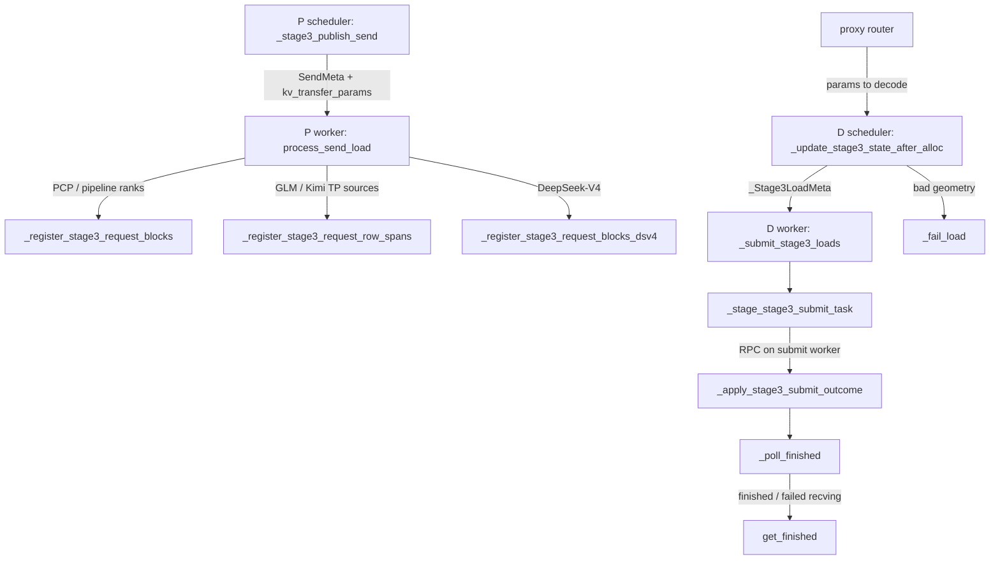
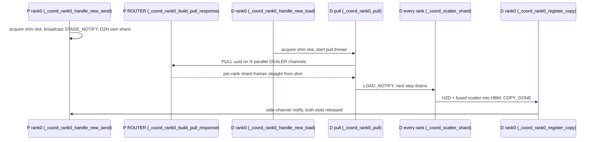

# KV transfer and P/D disaggregated serving (TPUConnector, Raiden Stage-3)

<!-- connect:up:begin -->
> **Cross-repo concept:** part of [kv-cache](../../../concepts/kv-cache.md), [sharding](../../../concepts/sharding.md) across this wiki's repos.
<!-- connect:up:end -->
## Overview

Prefill/decode (P/D) disaggregation runs compute-bound prefill on one engine pool (`kv_role="kv_producer"`) and memory-bandwidth-bound decode on another (`kv_consumer`), so long prompts never stall decode steps and each pool can pick its own TP/DP/PCP/EP layout (repo `docs/user_guide/disaggregated_serving.md`). The only thing that must cross between them is the prompt's KV cache (plus GDN/Mamba recurrent state for hybrid models). `src/vllm_torchtpu/distributed/kv_transfer/` implements that crossing as a vLLM v1 KV connector with one scheduler-facing API and **three transports** behind it: (1) a ZMQ + per-host shared-memory pull, ported from the JAX tpu-inference connector, that stages D2H on P and scatters H2D on D; (2) a "legacy" Raiden pull in which P registers its block ids and D's workers start an equal-page read; and (3) **Raiden Stage-3**, where P declares *byte spans* of its KV pools to a Raiden controller, D declares only its destination pages, and the controller plans a reshard that can map, for example, a `PCP=4, TP=2` producer onto a `DP=8, TP=1` consumer with no data transform. The design idea that ties the modules together: Python owns vLLM request bookkeeping (who sends, who loads, which blocks, when it is safe to free), while bytes, host slots and readiness belong to the transport (shm pool or the Raiden C++ engine). Everything else in the package - pool manifests, layout fingerprints, byte-span lowerings, completion adapters, stats - exists to make that hand-off exact across heterogeneous meshes.

## Diagram

Control flow of one disaggregated request on the Raiden Stage-3 path (the production path for large models):

Legend:
- `P_FIN` - [`_stage3_publish_send`](../catalog/src/vllm_torchtpu/distributed/kv_transfer/tpu_connector.md#TPURaidenConnectorScheduler._stage3_publish_send "src/vllm_torchtpu/distributed/kv_transfer/tpu_connector.py:L2319")
- `P_REG` - [`process_send_load`](../catalog/src/vllm_torchtpu/distributed/kv_transfer/tpu_connector.md#TPURaidenConnectorWorker.process_send_load "src/vllm_torchtpu/distributed/kv_transfer/tpu_connector.py:L4090")
- `SPANS_PCP` - [`_register_stage3_request_blocks`](../catalog/src/vllm_torchtpu/distributed/kv_transfer/tpu_connector.md#TPURaidenConnectorWorker._register_stage3_request_blocks "src/vllm_torchtpu/distributed/kv_transfer/tpu_connector.py:L4239")
- `SPANS_TP` - [`_register_stage3_request_row_spans`](../catalog/src/vllm_torchtpu/distributed/kv_transfer/tpu_connector.md#TPURaidenConnectorWorker._register_stage3_request_row_spans "src/vllm_torchtpu/distributed/kv_transfer/tpu_connector.py:L4553")
- `SPANS_DS` - [`_register_stage3_request_blocks_dsv4`](../catalog/src/vllm_torchtpu/distributed/kv_transfer/tpu_connector.md#TPURaidenConnectorWorker._register_stage3_request_blocks_dsv4 "src/vllm_torchtpu/distributed/kv_transfer/tpu_connector.py:L4810")
- `PROXY` - (concept) the disaggregated proxy that sends `max_tokens=1` to P and forwards P's `kv_transfer_params` to D
- `D_ALLOC` - [`_update_stage3_state_after_alloc`](../catalog/src/vllm_torchtpu/distributed/kv_transfer/tpu_connector.md#TPURaidenConnectorScheduler._update_stage3_state_after_alloc "src/vllm_torchtpu/distributed/kv_transfer/tpu_connector.py:L1856")
- `D_SUB` - [`_submit_stage3_loads`](../catalog/src/vllm_torchtpu/distributed/kv_transfer/tpu_connector.md#TPURaidenConnectorWorker._submit_stage3_loads "src/vllm_torchtpu/distributed/kv_transfer/tpu_connector.py:L5534")
- `D_STAGE` - [`_stage_stage3_submit_task`](../catalog/src/vllm_torchtpu/distributed/kv_transfer/tpu_connector.md#TPURaidenConnectorWorker._stage_stage3_submit_task "src/vllm_torchtpu/distributed/kv_transfer/tpu_connector.py:L5789")
- `D_APPLY` - [`_apply_stage3_submit_outcome`](../catalog/src/vllm_torchtpu/distributed/kv_transfer/tpu_connector.md#TPURaidenConnectorWorker._apply_stage3_submit_outcome "src/vllm_torchtpu/distributed/kv_transfer/tpu_connector.py:L6058")
- `D_POLL` - [`_poll_finished`](../catalog/src/vllm_torchtpu/distributed/kv_transfer/tpu_connector.md#TPURaidenConnectorWorker._poll_finished "src/vllm_torchtpu/distributed/kv_transfer/tpu_connector.py:L6597")
- `D_FIN` - [`get_finished`](../catalog/src/vllm_torchtpu/distributed/kv_transfer/tpu_connector.md#TPURaidenConnectorWorker.get_finished "src/vllm_torchtpu/distributed/kv_transfer/tpu_connector.py:L6459")
- `D_FAIL` - [`_fail_load`](../catalog/src/vllm_torchtpu/distributed/kv_transfer/tpu_connector.md#TPURaidenConnectorScheduler._fail_load "src/vllm_torchtpu/distributed/kv_transfer/tpu_connector.py:L2061")

The ZMQ/shm transport, by contrast, is a rank-0-coordinated pull:

## Design rationale (why it's built this way)

- **One facade, pluggable transport.** The connector picks its scheduler/worker halves once at init (`TPUConnector --> using Raiden|ZMQ-shm backend`), from the connector name, `kv_connector_extra_config.use_raiden_connector`, or `TPU_KV_RESHARD_TRANSPORT=raiden` (which forces Raiden *and* selects Stage-3). The scheduler-to-worker contract (`SendMeta`, `LoadMeta`, `TPUConnectorMetadata` in `connector_metadata.py`) is shared by all transports so routing logic is written once.
- **Stage-3 moves raw bytes, so identity is measured, not assumed.** "The Stage-3 data path copies PjRt bytes without materializing a logical torch tensor" (`layout_fingerprint.py`). Admission therefore builds a canonical *pool manifest* from the live materialization (never from pinned constants) and registers a physical-layout fingerprint; the controller compares fingerprints before planning, so a token-major peer and a seq-on-lane peer that happen to have identical byte sizes "fail closed at plan time" ([`measured_sol_layout_fingerprint`](../catalog/src/vllm_torchtpu/distributed/kv_transfer/raiden/seq_on_lane.md#measured_sol_layout_fingerprint "src/vllm_torchtpu/distributed/kv_transfer/raiden/seq_on_lane.py:L914")).
- **Producers declare, the controller plans.** In Stage-3, D never learns P's physical block ids: "They stay in the source controller's D5 registry; the only source-side routing datum crossing the P/D boundary is its controller address" (`_Stage3LoadMeta` docstring). Each producer rank lowers its own token/head ownership (PCP interleave, TP head shard, pipeline layer subset) into byte spans; the controller intersects them with the destination's TP/DCP ownership. This is what makes heterogeneous resharding possible without a gather on either side ([`lower_fa_spans_sol`](../catalog/src/vllm_torchtpu/distributed/kv_transfer/raiden/seq_on_lane.md#lower_fa_spans_sol "src/vllm_torchtpu/distributed/kv_transfer/raiden/seq_on_lane.py:L351")).
- **Why the seq-on-lane layout reshards for free.** On the batched-RPA `SEQ_ALONG_LANE` cache the K/V rows of one destination head shard are "one contiguous run per kernel page -- which is what lets the raw byte-span transport route a producer's full-head pages to head-sharded (TP > 1) consumers without any data transform" (`seq_on_lane.py` module docstring).
- **P stops one token short.** D always recomputes the final prompt token to get its first logits. For Mamba/GDN state or sliding-window groups, P computing that token would ship `h(N)` and D would advance the recurrence twice, or P would recycle window pages the transfer still lists; so P drops the last prompt token at admission (`_maybe_truncate_prompt_for_handoff` and the Stage-3 override of `on_new_request`).
- **ZMQ staging runs inline on the main thread.** "Running stage on a background executor is unsafe under TP>1: ... the D2H sync blocked behind [the next model_forward] and the PULL timed out. Inline stage drains each rank's XLA queue before model_forward adds anything to it" (`_coord_process_send_load`). Rank 0 still broadcasts first so other ranks stage in parallel ([`_coord_rank0_handle_new_send`](../catalog/src/vllm_torchtpu/distributed/kv_transfer/zmq_shm_base.md#ZmqShmKvConnectorBase._coord_rank0_handle_new_send "src/vllm_torchtpu/distributed/kv_transfer/zmq_shm_base.py:L1004")).
- **Wire throughput needs many I/O threads and channels.** The ZMQ context is created with `io_threads = tp_size` because the default single I/O thread "caps aggregate wire throughput at what one thread can push (~10 Gbps) regardless of socket count", and D pulls over `n_channels` parallel DEALER sockets to `base_port + ch` ([`_coord_rank0_pull`](../catalog/src/vllm_torchtpu/distributed/kv_transfer/zmq_shm_base.md#ZmqShmKvConnectorBase._coord_rank0_pull "src/vllm_torchtpu/distributed/kv_transfer/zmq_shm_base.py:L1511")).
- **Errors travel by request, not by block.** Multi-group KV layouts make block ids ambiguous, and vLLM rejects block-level failures for them, so load failures are reported as `failed_recving` request ids through `get_transfer_results`, and P-side send failures become explicit HTTP error contracts ([`_ERROR_BY_OUTCOME`](../catalog/src/vllm_torchtpu/core/raiden_pd.md#_ERROR_BY_OUTCOME "src/vllm_torchtpu/core/raiden_pd.py:L53")).

## Entry points

- [`execute_model`](../catalog/src/vllm_torchtpu/runner/tpu_runner.md#TPUModelRunner.execute_model "src/vllm_torchtpu/runner/tpu_runner.py:L3884") - the model runner binds connector metadata and calls the connector's `start_load_kv`, which routes to the worker's `process_send_load` (both send registration and load submission run here, because `wait_for_save` is never reached for a finished prefill). With `TPU_RAIDEN_INLINE_LOAD` the load is waited for inside the step. It also opens a [`begin_kv_save_nan_check`](../catalog/src/vllm_torchtpu/distributed/kv_transfer/kv_save_nan_check.md#begin_kv_save_nan_check "src/vllm_torchtpu/distributed/kv_transfer/kv_save_nan_check.py:L147") snapshot per step.
- [`get_finished_kv_transfers`](../catalog/src/vllm_torchtpu/runner/tpu_runner.md#TPUModelRunner.get_finished_kv_transfers "src/vllm_torchtpu/runner/tpu_runner.py:L1278") - end of each step: collects `finished_sending` / `finished_recving` / `failed_recving`, load-error block ids, worker metadata (where [`RaidenSendResults`](../catalog/src/vllm_torchtpu/distributed/kv_transfer/raiden_pd_completion.md#RaidenSendResults "src/vllm_torchtpu/distributed/kv_transfer/raiden_pd_completion.py:L93") rides) and [`TpuKVConnectorStats`](../catalog/src/vllm_torchtpu/distributed/kv_transfer/tpu_connector_stats.md#TpuKVConnectorStats "src/vllm_torchtpu/distributed/kv_transfer/tpu_connector_stats.py:L71").
- [`_stage3_publish_send`](../catalog/src/vllm_torchtpu/distributed/kv_transfer/tpu_connector.md#TPURaidenConnectorScheduler._stage3_publish_send "src/vllm_torchtpu/distributed/kv_transfer/tpu_connector.py:L2319") - P scheduler, reached from `request_finished` (or earlier, from register-ahead in the prompt-completing step); mints the transfer uuid and the consumer-facing `kv_transfer_params`.
- [`_update_stage3_state_after_alloc`](../catalog/src/vllm_torchtpu/distributed/kv_transfer/tpu_connector.md#TPURaidenConnectorScheduler._update_stage3_state_after_alloc "src/vllm_torchtpu/distributed/kv_transfer/tpu_connector.py:L1856") - D scheduler, after vLLM allocates destination pages for a request carrying P's params; "Declares a destination transfer without source physical IDs."
- [`_admit_raiden_hybrid_kv_cache`](../catalog/src/vllm_torchtpu/distributed/kv_transfer/tpu_connector.md#TPURaidenConnectorWorker._admit_raiden_hybrid_kv_cache "src/vllm_torchtpu/distributed/kv_transfer/tpu_connector.py:L2864"), [`_admit_raiden_glm_kv_cache`](../catalog/src/vllm_torchtpu/distributed/kv_transfer/tpu_connector.md#TPURaidenConnectorWorker._admit_raiden_glm_kv_cache "src/vllm_torchtpu/distributed/kv_transfer/tpu_connector.py:L3080"), [`_admit_raiden_dsv4_kv_cache`](../catalog/src/vllm_torchtpu/distributed/kv_transfer/tpu_connector.md#TPURaidenConnectorWorker._admit_raiden_dsv4_kv_cache "src/vllm_torchtpu/distributed/kv_transfer/tpu_connector.py:L3291") - worker startup (`register_runner`): build the pool manifest and construct the Raiden engine over the model's KV pools, one per model family (Qwen3.5/Kimi hybrid, GLM MLA+DSA, DeepSeek-V4).
- [`_coord_rank0_ipc_loop`](../catalog/src/vllm_torchtpu/distributed/kv_transfer/zmq_shm_base.md#ZmqShmKvConnectorBase._coord_rank0_ipc_loop "src/vllm_torchtpu/distributed/kv_transfer/zmq_shm_base.py:L2047") - ZMQ transport: the host-coordinator thread that receives HELLO / STAGE_DONE / COPY_DONE from the other local ranks and drains outbound broadcasts.
- [`update_from_output`](../catalog/src/vllm_torchtpu/core/raiden_pd.md#_ProducerCompletion.update_from_output "src/vllm_torchtpu/core/raiden_pd.py:L80") - opt-in (`additional_config.raiden_pd_send_completion`) wrapper on the P scheduler that holds the HTTP response open until the send barrier and maps [`RaidenSendOutcome`](../catalog/src/vllm_torchtpu/distributed/kv_transfer/raiden_pd_completion.md#RaidenSendOutcome "src/vllm_torchtpu/distributed/kv_transfer/raiden_pd_completion.py:L70") to a final status.

## Mechanism (step-by-step)

1. **Admission: build the manifest and engine (Raiden).** At `register_runner`, the worker builds a canonical pool manifest from the live KV tensors: [`build_qwen35_pool_manifest`](../catalog/src/vllm_torchtpu/distributed/kv_transfer/raiden/pool_manifest.md#build_qwen35_pool_manifest "src/vllm_torchtpu/distributed/kv_transfer/raiden/pool_manifest.py:L785") for full-attention + GDN hybrids, [`build_kimi_k3_pool_manifest`](../catalog/src/vllm_torchtpu/distributed/kv_transfer/raiden/pool_manifest.md#build_kimi_k3_pool_manifest "src/vllm_torchtpu/distributed/kv_transfer/raiden/pool_manifest.py:L990"), [`build_glm_mla_pool_manifest`](../catalog/src/vllm_torchtpu/distributed/kv_transfer/raiden/pool_manifest.md#build_glm_mla_pool_manifest "src/vllm_torchtpu/distributed/kv_transfer/raiden/pool_manifest.py:L1280"), or [`build_dsv4_pool_manifest`](../catalog/src/vllm_torchtpu/distributed/kv_transfer/raiden/pool_manifest.md#build_dsv4_pool_manifest "src/vllm_torchtpu/distributed/kv_transfer/raiden/pool_manifest.py:L1643") ("one pool per (layer, array)", because DSv4 caches alias the same array at byte offset 0 and only the allocator keeps them apart). Pool order and tags travel on the wire, so both peers must agree on them; per-layer tags let a pipeline stage pair only its own layers. For unified-pool GDN layers, [`_pooled_gdn_state_views`](../catalog/src/vllm_torchtpu/distributed/kv_transfer/raiden/pool_manifest.md#_pooled_gdn_state_views "src/vllm_torchtpu/distributed/kv_transfer/raiden/pool_manifest.py:L500") derives the `(conv, ssm)` descriptors from the pooled kernel's byte model rather than the declared MambaSpec, since only the kernel model describes the bytes that actually move. [`_bind_pool_manifest`](../catalog/src/vllm_torchtpu/distributed/kv_transfer/raiden/pool_manifest.md#_bind_pool_manifest "src/vllm_torchtpu/distributed/kv_transfer/raiden/pool_manifest.py:L1111") resolves logical pools to live storages and validates page bounds; anything it cannot describe raises [`ManifestError`](../catalog/src/vllm_torchtpu/distributed/kv_transfer/raiden/pool_manifest.md#ManifestError "src/vllm_torchtpu/distributed/kv_transfer/raiden/pool_manifest.py:L95") before any Raiden manager exists. With `TPU_RAIDEN_RESHARD_IMPL=store`, the transfer-rank-0 worker also hosts the reshard store in-process ("zero sidecars").

2. **P: publish the send.** When a producer request finishes (or, with register-ahead, in the step that completes its prompt), [`_stage3_publish_send`](../catalog/src/vllm_torchtpu/distributed/kv_transfer/tpu_connector.md#TPURaidenConnectorScheduler._stage3_publish_send "src/vllm_torchtpu/distributed/kv_transfer/tpu_connector.py:L2319") normalizes the block table to cover every scheduler block including the partial tail, checks that `TPU_RAIDEN_TRANSFER_PARALLELISM` equals the source's transfer ranks (`PCP x TP`, `PP x PCP`, TP for GLM/Kimi sources, 1 for DSv4 DP attention), skips transfers that are too short for PCP, exceed `TPU_RAIDEN_MAX_TRANSFER_TOKENS`, or list sliding-window pages already recycled, and selects the committed Mamba state slots. It enqueues a `SendMeta` and returns params (`uuid`, `num_tokens`, `src_controller_address`, `src_job_name`, `src_engine_id`, `src_parallelism`, `dst_tp_size`, `dst_dcp_size`). A bounded dedup table keyed by request id makes duplicate finish callbacks idempotent instead of minting a second uuid.

3. **P: register byte spans.** On the next step, the producer worker's [`process_send_load`](../catalog/src/vllm_torchtpu/distributed/kv_transfer/tpu_connector.md#TPURaidenConnectorWorker.process_send_load "src/vllm_torchtpu/distributed/kv_transfer/tpu_connector.py:L4090") (after a full KV sync when a speculative drafter may still have deferred writes) lowers each request to spans for its own rank: [`_register_stage3_request_blocks`](../catalog/src/vllm_torchtpu/distributed/kv_transfer/tpu_connector.md#TPURaidenConnectorWorker._register_stage3_request_blocks "src/vllm_torchtpu/distributed/kv_transfer/tpu_connector.py:L4239") ("only this PCP rank's interleaved physical source blocks"; a pipeline stage lowers over its stage's PCP ranks and expresses its layer subset via per-layer tags), [`_register_stage3_request_row_spans`](../catalog/src/vllm_torchtpu/distributed/kv_transfer/tpu_connector.md#TPURaidenConnectorWorker._register_stage3_request_row_spans "src/vllm_torchtpu/distributed/kv_transfer/tpu_connector.py:L4553") (GLM/Kimi row-granular stripes), or [`_register_stage3_request_blocks_dsv4`](../catalog/src/vllm_torchtpu/distributed/kv_transfer/tpu_connector.md#TPURaidenConnectorWorker._register_stage3_request_blocks_dsv4 "src/vllm_torchtpu/distributed/kv_transfer/tpu_connector.py:L4810") (one registration per pool tag, each against its own group's block table). GDN state is head-sharded across PCP ranks, so [`_stage3_state_pool_spans`](../catalog/src/vllm_torchtpu/distributed/kv_transfer/tpu_connector.md#TPURaidenConnectorWorker._stage3_state_pool_spans "src/vllm_torchtpu/distributed/kv_transfer/tpu_connector.py:L5114") declares each rank's slice in compact byte space and lets the controller combine them into the full destination state; [`lower_gdn_state_fanout_spans_sol`](../catalog/src/vllm_torchtpu/distributed/kv_transfer/raiden/seq_on_lane.md#lower_gdn_state_fanout_spans_sol "src/vllm_torchtpu/distributed/kv_transfer/raiden/seq_on_lane.py:L703") fans one rank's heads out to narrower destination shards. On the seq-on-lane layout, FA spans come from [`lower_fa_spans_sol`](../catalog/src/vllm_torchtpu/distributed/kv_transfer/raiden/seq_on_lane.md#lower_fa_spans_sol "src/vllm_torchtpu/distributed/kv_transfer/raiden/seq_on_lane.py:L351") using geometry validated by [`sol_fa_geometry_from_manifest`](../catalog/src/vllm_torchtpu/distributed/kv_transfer/raiden/seq_on_lane.md#sol_fa_geometry_from_manifest "src/vllm_torchtpu/distributed/kv_transfer/raiden/seq_on_lane.py:L276").

4. **D: declare the destination.** The proxy forwards P's params to D. [`_update_stage3_state_after_alloc`](../catalog/src/vllm_torchtpu/distributed/kv_transfer/tpu_connector.md#TPURaidenConnectorScheduler._update_stage3_state_after_alloc "src/vllm_torchtpu/distributed/kv_transfer/tpu_connector.py:L1856") checks that the allocation holds the complete destination page set for every planned group (scheduler blocks cover `block_size x DCP` global tokens); a mismatch goes to [`_fail_load`](../catalog/src/vllm_torchtpu/distributed/kv_transfer/tpu_connector.md#TPURaidenConnectorScheduler._fail_load "src/vllm_torchtpu/distributed/kv_transfer/tpu_connector.py:L2061"), which enqueues a `fail_only` load so every rank reports the failure and one rank releases P's registration. A full local prefix hit enqueues a release so P does not hold pinned blocks until the pull timeout. With prefix-aware loads ([`_prefix_aware_load_enabled`](../catalog/src/vllm_torchtpu/distributed/kv_transfer/tpu_connector.md#_prefix_aware_load_enabled "src/vllm_torchtpu/distributed/kv_transfer/tpu_connector.py:L755"): [`TPU_RAIDEN_PREFIX_AWARE_LOAD`](../catalog/src/vllm_torchtpu/envs.md#TPU_RAIDEN_PREFIX_AWARE_LOAD "src/vllm_torchtpu/envs.py:L70") requested and the installed reshard client supports skip bytes), a partial decode-local prefix hit pulls only the suffix into the trailing, newly allocated pages; otherwise "the full producer payload is pulled into every destination page".

5. **D: submit off the model-runner thread.** [`_submit_stage3_loads`](../catalog/src/vllm_torchtpu/distributed/kv_transfer/tpu_connector.md#TPURaidenConnectorWorker._submit_stage3_loads "src/vllm_torchtpu/distributed/kv_transfer/tpu_connector.py:L5534") "starts exactly one source-controller transfer per request": tables are staged on the model-runner thread by [`_stage_stage3_submit_task`](../catalog/src/vllm_torchtpu/distributed/kv_transfer/tpu_connector.md#TPURaidenConnectorWorker._stage_stage3_submit_task "src/vllm_torchtpu/distributed/kv_transfer/tpu_connector.py:L5789"), the coordination RPC (receiver arm + sender dispatch) runs on a background submit worker unless the load is inline, and [`_apply_stage3_submit_outcome`](../catalog/src/vllm_torchtpu/distributed/kv_transfer/tpu_connector.md#TPURaidenConnectorWorker._apply_stage3_submit_outcome "src/vllm_torchtpu/distributed/kv_transfer/tpu_connector.py:L6058") applies the result on the runner thread. Outcomes are classified `accepted`, `failed` (before receiver arming, safe to fail fast) or `uncertain` (after arming). A sharded TP consumer submits once from tp-rank 0 naming every TP worker as a destination unit. Keeping the RPC off the runner thread is what keeps a slow controller round-trip from showing up as a decode-step stall.

6. **D: observe completion.** [`_poll_finished`](../catalog/src/vllm_torchtpu/distributed/kv_transfer/tpu_connector.md#TPURaidenConnectorWorker._poll_finished "src/vllm_torchtpu/distributed/kv_transfer/tpu_connector.py:L6597") reads the native manager's `poll_stats`, translates native ids back to decode-local request ids, ignores terminals with no accepted submission, and parks terminals whose RPC is still in flight until the submission resolves: "Stage-3 success requires both halves", the RPC acknowledgement and local byte completion. On P, [`_stage3_ready_producer_send_terminals`](../catalog/src/vllm_torchtpu/distributed/kv_transfer/tpu_connector.md#TPURaidenConnectorWorker._stage3_ready_producer_send_terminals "src/vllm_torchtpu/distributed/kv_transfer/tpu_connector.py:L5278") collapses FA and state completions onto the one base request vLLM knows. [`get_finished`](../catalog/src/vllm_torchtpu/distributed/kv_transfer/tpu_connector.md#TPURaidenConnectorWorker.get_finished "src/vllm_torchtpu/distributed/kv_transfer/tpu_connector.py:L6459") then reports `finished_sending` (P frees blocks), `finished_recving` (D's request leaves `WAITING_FOR_REMOTE_KVS`) and `failed_recving` (recompute or fail per `kv_load_failure_policy`).

7. **ZMQ/shm alternative: stage, pull, scatter.** On the ZMQ transport, P's rank 0 ([`_coord_rank0_handle_new_send`](../catalog/src/vllm_torchtpu/distributed/kv_transfer/zmq_shm_base.md#ZmqShmKvConnectorBase._coord_rank0_handle_new_send "src/vllm_torchtpu/distributed/kv_transfer/zmq_shm_base.py:L1004")) acquires a slot in a per-host `SharedMemory` pool (one region per `(slot, rank, layer)`), broadcasts `STAGE_NOTIFY`, and every rank D2Hs its shard. D's rank 0 ([`_coord_rank0_handle_new_load`](../catalog/src/vllm_torchtpu/distributed/kv_transfer/zmq_shm_base.md#ZmqShmKvConnectorBase._coord_rank0_handle_new_load "src/vllm_torchtpu/distributed/kv_transfer/zmq_shm_base.py:L1383")) acquires its own slot, deduplicating re-emits after preemption by uuid so a second slot is not orphaned, and [`_coord_rank0_pull`](../catalog/src/vllm_torchtpu/distributed/kv_transfer/zmq_shm_base.md#ZmqShmKvConnectorBase._coord_rank0_pull "src/vllm_torchtpu/distributed/kv_transfer/zmq_shm_base.py:L1511") pulls all ranks' shards over parallel channels straight into shm. P serves the pull from shm via [`_coord_rank0_build_pull_response`](../catalog/src/vllm_torchtpu/distributed/kv_transfer/zmq_shm_base.md#ZmqShmKvConnectorBase._coord_rank0_build_pull_response "src/vllm_torchtpu/distributed/kv_transfer/zmq_shm_base.py:L2444"), which waits for the entry because D can race P's own metadata tick. On the following step each D rank runs [`_coord_scatter_shard`](../catalog/src/vllm_torchtpu/distributed/kv_transfer/zmq_shm_base.md#ZmqShmKvConnectorBase._coord_scatter_shard "src/vllm_torchtpu/distributed/kv_transfer/zmq_shm_base.py:L1831"): H2D then one fused multi-layer Pallas scatter with each destination cache donated and aliased (fallback: per-layer `index_put_`). [`_coord_rank0_register_copy`](../catalog/src/vllm_torchtpu/distributed/kv_transfer/zmq_shm_base.md#ZmqShmKvConnectorBase._coord_rank0_register_copy "src/vllm_torchtpu/distributed/kv_transfer/zmq_shm_base.py:L1944") counts `COPY_DONE` from every local rank, notifies P over the side channel, and frees the slot. Because P publishes the whole payload under one uuid with no partial pull, D always pulls every prefill block.

8. **Cross-cutting: NaN gating and producer completion.** Each step, [`KVSaveNanCheck`](../catalog/src/vllm_torchtpu/distributed/kv_transfer/kv_save_nan_check.md#KVSaveNanCheck "src/vllm_torchtpu/distributed/kv_transfer/kv_save_nan_check.py:L63") [`record`](../catalog/src/vllm_torchtpu/distributed/kv_transfer/kv_save_nan_check.md#KVSaveNanCheck.record "src/vllm_torchtpu/distributed/kv_transfer/kv_save_nan_check.py:L76")s per-token NaN flags from every forward chunk with a non-blocking D2H plus a TPU event, mapping packed tokens back to requests through the [`SequenceLayoutPlan`](../catalog/src/vllm_torchtpu/layers/core/sequence_layout.md#SequenceLayoutPlan "src/vllm_torchtpu/layers/core/sequence_layout.py:L60") (only the rank-local [`token_slice`](../catalog/src/vllm_torchtpu/layers/core/sequence_layout.md#SequenceLayoutPlan.token_slice "src/vllm_torchtpu/layers/core/sequence_layout.py:L62")); [`wait_for_save_with_nan_check`](../catalog/src/vllm_torchtpu/distributed/kv_transfer/kv_save_nan_check.md#wait_for_save_with_nan_check "src/vllm_torchtpu/distributed/kv_transfer/kv_save_nan_check.py:L156") hands the snapshot only to leaf connectors that opt in, so stores can refuse to publish KV computed from NaN activations "without synchronizing the issuer". With send completion enabled, [`RaidenSendResults`](../catalog/src/vllm_torchtpu/distributed/kv_transfer/raiden_pd_completion.md#RaidenSendResults "src/vllm_torchtpu/distributed/kv_transfer/raiden_pd_completion.py:L93") aggregates per-rank [`RaidenSendOutcome`](../catalog/src/vllm_torchtpu/distributed/kv_transfer/raiden_pd_completion.md#RaidenSendOutcome "src/vllm_torchtpu/distributed/kv_transfer/raiden_pd_completion.py:L70") values by worst-wins priority (`SEND_FAILURE` > `UNCLAIMED_TIMEOUT` > `SUCCESS`), and the P scheduler's [`update_from_output`](../catalog/src/vllm_torchtpu/core/raiden_pd.md#_ProducerCompletion.update_from_output "src/vllm_torchtpu/core/raiden_pd.py:L80") turns a non-success into `model.KVTPrefillWriteFailure` or `model.KVTPrefillTransferTimeout`.

## Key data structures

- `SendMeta` / `LoadMeta` / `TPUConnectorMetadata` - connector-neutral scheduler-to-worker bookkeeping. `SendMeta` carries the uuid, source block ids, an absolute `expiration_time` (compared across hosts), and for Stage-3 the exact `num_tokens`, committed Mamba state slots, per-group block tables (DSv4 only), the dropped `next_prompt_token_id`, and `registered_ahead`. `LoadMeta.report_completion=False` marks loads this connector does not own (a full local hit, or another `TPUMultiConnector` child's load).
- `_Stage3LoadMeta` - D-local declaration of one controller transfer: uuid, source request id, destination pages, `num_tokens`, source controller/job/engine/replica/parallelism, plus `release_only` / `fail_only` flavors. Deliberately no source block ids.
- Pool manifest - ordered pools, regions and wire-visible tags (`fa.l3`, `gdn.conv.g0.l0`, `mla.nope.l3`, ...) bound to live storages; tag strings are a frozen two-repo protocol (`raiden/tags.py`).
- Host shm pool - `slot x rank x layer` regions of `max_per_layer_bytes`; free list on rank 0 only, other ranks compute offsets. Only meaningful bytes go on the wire.
- [`TpuKVConnectorStats`](../catalog/src/vllm_torchtpu/distributed/kv_transfer/tpu_connector_stats.md#TpuKVConnectorStats "src/vllm_torchtpu/distributed/kv_transfer/tpu_connector_stats.py:L71") - serializable lists: `d2h_transfer_time`, `h2d_transfer_time`, `kv_pull_time`, `mb_transferred`, `num_failed_transfers`, `prefill_queue_length`, `decode_queue_length`, and runner CPU-issue / device-elapsed timing samples; exported to Prometheus. Each transport keeps one as `transfer_stats` ([ZMQ](../catalog/src/vllm_torchtpu/distributed/kv_transfer/zmq_shm_base.md#ZmqShmKvConnectorBase.transfer_stats "src/vllm_torchtpu/distributed/kv_transfer/zmq_shm_base.py:L331"), [Raiden](../catalog/src/vllm_torchtpu/distributed/kv_transfer/tpu_connector.md#TPURaidenConnectorWorker.transfer_stats "src/vllm_torchtpu/distributed/kv_transfer/tpu_connector.py:L2756")), surfaced by [`get_kv_connector_stats`](../catalog/src/vllm_torchtpu/distributed/kv_transfer/zmq_shm_base.md#ZmqShmKvConnectorBase.get_kv_connector_stats "src/vllm_torchtpu/distributed/kv_transfer/zmq_shm_base.py:L2758"); the ZMQ worker's [`node_id`](../catalog/src/vllm_torchtpu/distributed/kv_transfer/zmq_shm_base.md#ZmqShmKvConnectorBase.node_id "src/vllm_torchtpu/distributed/kv_transfer/zmq_shm_base.py:L297") also offsets its side-channel port.

### Configuration surface (performance-relevant)

| Knob | Default | Effect |
|---|---|---|
| `TPU_KV_RESHARD_TRANSPORT` | `zmq` | `raiden` forces the Raiden backend and enables Stage-3 resharding |
| `TPU_USE_RAIDEN_KV_CACHE_MANAGER` + `TPU_RAIDEN_{QWEN35,KIMIK3,GLM,DSV4}_ADMISSION` | off | Raiden-compatible KV layout and per-family pool admission |
| `TPU_RAIDEN_CONTROLLER_ADDRESS`, `TPU_RAIDEN_JOB_NAME`, `TPU_RAIDEN_ENGINE_ID` | `""`, `""`, `"0"` | Controller endpoint and source identity carried in params |
| `TPU_RAIDEN_TRANSFER_PARALLELISM` | 8 | Source transfer ranks; must equal the producer's PCP x TP (or PP x PCP, TP, 1) |
| `TPU_RAIDEN_RESHARD_IMPL` | `controller` | `store` hosts the reshard store in each engine's rank-0 worker (needs `TPU_RAIDEN_ADVERTISE_HOST`) |
| `TPU_RAIDEN_PREFIX_AWARE_LOAD` | off | Suffix-only loads on partial decode-local prefix hits |
| `TPU_RAIDEN_STAGE3_REGISTER_AHEAD` | on | Register P's spans in the prompt-completing step, not the step after the finish |
| `TPU_RAIDEN_INLINE_LOAD` | off | D waits for the load inside the step instead of async `WAITING_FOR_REMOTE_KVS` |
| `TPU_RAIDEN_MAX_TRANSFER_TOKENS` | unset | Skip transfers above this size (D re-prefills) |
| `TPU_RAIDEN_DST_SHARDS`, `destination_decode_context_parallel_size` | 1 | Destination TP shard count and DCP degree the producer lowers against |
| `additional_config.raiden_pd_send_completion` | false | Hold P's response until send outcome is known (TP1/DP1/PP1 Stage-3 only) |

## Dynamics (design intent)

- **Register-ahead vs finish-time registration.** Without it, a PCP/TP/DP producer registers in the step after the finish response; under async scheduling that step first waits for the next batch's forward, "so the consumer's load parks on the deferred-submit path for a whole prefill step" (`_stage3_register_ahead_enabled`). Pipeline producers always register ahead; GLM, DSv4 and Kimi-K3 keep finish-time registration.
- **Threads.** ZMQ: one IPC thread per host coordinator, an external data loop per channel, a notification loop, an expiry sweeper, and a stage-waiter thread; staging itself is inline on the main thread. Raiden Stage-3: coordination RPCs on submit-worker threads with a mailbox drained by the runner thread.
- **Expiry.** Unclaimed sends expire after the P2P pull timeout (`TPU_P2P_WAIT_PULL_TIMEOUT`); a live PULL extends the deadline so the sweeper never frees a slot mid-serve. This is also why D sends an explicit release on a full local hit rather than letting P hold blocks until timeout.
- **Composition with offload.** `TPUMultiConnector` combines `TPURaidenConnector` with the offloading connector; prefix-aware suffix loads are only enabled if every child reports [`supports_divergent_local_hybrid_hits`](../catalog/src/vllm_torchtpu/offload/raiden_connector.md#TPURaidenOffloadingConnector.supports_divergent_local_hybrid_hits "src/vllm_torchtpu/offload/raiden_connector.py:L345"), otherwise decode pulls whole payloads (a warning names the incapable child).
- **Decode preemption.** With `kv_load_failure_policy="fail"`, D aborts capacity-preempted running requests with `stop_reason="kv_cache_preempted"` instead of recomputing the prompt on the decode pool (repo docs; overridable via `additional_config.abort_on_preemption`).

## Edge cases

- **Doc vs code naming.** The user guide's examples use `"kv_connector": "TpuRaidenConnector"` with module path `vllm_torchtpu.distributed.kv_transfer.raiden.raiden_connector`, but the class registered by the platform is `TPURaidenConnector` in `vllm_torchtpu.distributed.kv_transfer.tpu_connector`, and no `raiden/raiden_connector.py` exists at this commit. The docs' env table also lists `zmq`/`tcp` for `TPU_KV_RESHARD_TRANSPORT`, while `envs.py` accepts `zmq`/`raiden`.
- **Only full blocks travel on the legacy paths.** P transfers full blocks only and D re-prefills the trailing partial block; Stage-3 instead has a byte-precise partial tail and uses P's `num_computed_tokens` (often `prompt_tokens - 1`) as the extent.
- **Short PCP prompts** below `pcp_size x cp_kv_cache_interleave_size` tokens skip the transfer on FA-only PCP producers (D prefills locally).
- **Stage-3 multi-group models** other than DSv4 raise `NotImplementedError` rather than silently transferring only the first group; prefix-aware loads are not yet enabled for DSv4.
- **Block-major KV** (`VLLM_TPU_BLOCK_MAJOR_KV=1`) is rejected by the Kimi-K3 and seq-on-lane manifests.
- **ZMQ shm pool exhaustion** drops the send (logged with the current slot holders); the scheduler surfaces the failure.
- **NaN check coverage.** It does not cover speculative drafter KV writes during `sample_tokens()`, and no connector in this repo implements the opt-in `SupportsKVSaveNanCheck` protocol at this commit; it is a hook for external stores.
- **`raiden_pd_send_completion`** is refused unless the engine is a Stage-3 producer at TP1/DP1/PP1 with exactly one `TPURaidenConnector`.

## Open questions

- The packet subgraph omits the connector classes themselves (`TPUConnector`, `TPURaidenConnector`, the two scheduler and two worker classes), `TPUMultiConnector`, `HostKVShmPool`, the `kv_scatter` module and the producer-side ZMQ staging helpers; they are described above from source without citations.
- The Raiden controller's planner, the "D5 registry", the DMA/RDMA data plane and the `tpu_sync` reshard client are external to this repo; transfer bandwidth, whether transfers ride ICI or DCN, and how spans are coalesced cannot be determined statically.
- Several comments reference design documents (`RESHARD_DP4TP2_SEQ_ON_LANE_PLAN.md`, `DESIGN_DSV4_PD.md`) and milestone labels (T3.1, E0', D1, P3) that are not in the repository.

> [!inferred]
> The legacy Raiden pull and the ZMQ pull both force D to fetch the whole prefill payload even on a partial prefix hit, so for workloads with high decode-side prefix reuse the Stage-3 path with `TPU_RAIDEN_PREFIX_AWARE_LOAD` is the only one whose transfer volume scales with the uncached suffix.

## See also

- [host-offload](host-offload.md) - the Raiden store-backed offloading connector composed with this one in `TPUMultiConnector`
- [distributed-parallelism-and-meshes](distributed-parallelism-and-meshes.md) - PCP/DCP/TP/PP/DP groups that define source and destination ownership
- [kv-cache-layout-and-hbm-budget](kv-cache-layout-and-hbm-budget.md) - unified block pool, block-major and seq-on-lane layouts the manifests describe
- [batched-ragged-paged-attention-kernel](batched-ragged-paged-attention-kernel.md) - the `SEQ_ALONG_LANE` cache layout
- [pcp-streaming-rpa-kernel](pcp-streaming-rpa-kernel.md) - PCP token ownership lowered into byte spans
- [gated-deltanet-kernels](gated-deltanet-kernels.md) - pooled GDN state whose byte model drives state spans
- [tpu-model-runner](tpu-model-runner.md) - where connector hooks run each step
- [tpu-schedulers](tpu-schedulers.md)
- [deepseek-v4-model](deepseek-v4-model.md), [kimi-k3-model](kimi-k3-model.md)
