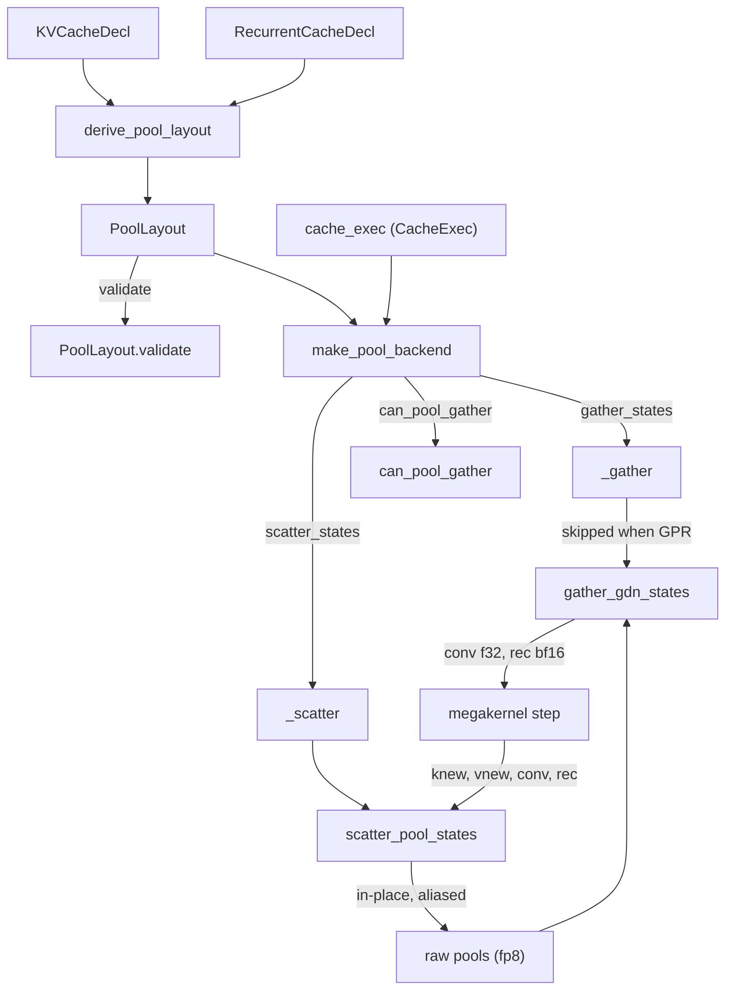
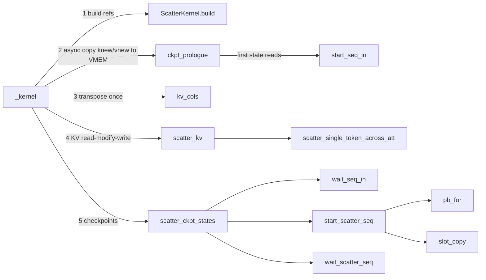

# Megakernel unified raw pool (paged KV + GDN checkpoint slots, gather/scatter kernels)

<!-- connect:up:begin -->
> **Cross-repo concept:** part of [kv-cache](../../../concepts/kv-cache.md), [pallas-kernel](../../../concepts/pallas-kernel.md), [vmem](../../../concepts/vmem.md) across this wiki's repos.
<!-- connect:up:end -->
## Overview

For hybrid models that interleave full-attention layers with recurrent GatedDeltaNet (GDN) layers,
the megakernel keeps **all** per-sequence cache state in one kind of buffer: a *raw pool* of fp8
pages, one pool per attention layer. A page is either a KV page (K and V for `page_size` tokens of
one head pair) or part of a *checkpoint slot* that holds one GDN layer's recurrent state (4 pages,
bf16 packed as u32 pairs) and causal-conv window (1 page, bf16). Recurrent layers are attached to
the next attention layer's pool, so a model with `num_pools` attention layers and `slots_per_pool`
recurrent layers per attention layer needs exactly `num_pools` arrays and one page allocator.
[`PoolLayout`](../catalog/src/vllm_torchtpu/megakernel/pool/layout.md#PoolLayout "src/vllm_torchtpu/megakernel/pool/layout.py:L84")
is the byte-level contract;
[`gather_gdn_states`](../catalog/src/vllm_torchtpu/megakernel/pool/gather.md#gather_gdn_states "src/vllm_torchtpu/megakernel/pool/gather.py:L39")
unpacks recurrent state for a step and
[`scatter_pool_states`](../catalog/src/vllm_torchtpu/megakernel/pool/scatter.md#scatter_pool_states "src/vllm_torchtpu/megakernel/pool/scatter.py:L44")
writes new KV rows and fresh checkpoints back in place;
[`make_pool_backend`](../catalog/src/vllm_torchtpu/megakernel/pool/backend.md#make_pool_backend "src/vllm_torchtpu/megakernel/pool/backend.py:L240")
packages both as the callbacks a megakernel model spec carries. The package docstring calls it
"Framework-free (jax + numpy only) and model-agnostic: everything is driven by a `PoolLayout`"; the
Pallas kernel names (`qwen3_5_gather_gdn_states`, `qwen3_5_scatter_pool_states`) show the hybrid
model it was built for.

## Diagram

Legend:
- `KVD` - [`KVCacheDecl`](../catalog/src/vllm_torchtpu/megakernel/decls.md#KVCacheDecl "src/vllm_torchtpu/megakernel/decls.py:L84")
- `RCD` - [`RecurrentCacheDecl`](../catalog/src/vllm_torchtpu/megakernel/decls.md#RecurrentCacheDecl "src/vllm_torchtpu/megakernel/decls.py:L98")
- `DER` - [`derive_pool_layout`](../catalog/src/vllm_torchtpu/megakernel/pool/derive.md#derive_pool_layout "src/vllm_torchtpu/megakernel/pool/derive.py:L38")
- `PL` - [`PoolLayout`](../catalog/src/vllm_torchtpu/megakernel/pool/layout.md#PoolLayout "src/vllm_torchtpu/megakernel/pool/layout.py:L84")
- `VAL` - [`validate`](../catalog/src/vllm_torchtpu/megakernel/pool/layout.md#PoolLayout.validate "src/vllm_torchtpu/megakernel/pool/layout.py:L226")
- `MPB` - [`make_pool_backend`](../catalog/src/vllm_torchtpu/megakernel/pool/backend.md#make_pool_backend "src/vllm_torchtpu/megakernel/pool/backend.py:L240")
- `CX` - [`cache_exec`](../catalog/src/vllm_torchtpu/megakernel/pool/config.md#cache_exec "src/vllm_torchtpu/megakernel/pool/config.py:L110")
- `G` - [`_gather`](../catalog/src/vllm_torchtpu/megakernel/pool/backend.md#make_pool_backend._gather "src/vllm_torchtpu/megakernel/pool/backend.py:L269")
- `S` - [`_scatter`](../catalog/src/vllm_torchtpu/megakernel/pool/backend.md#make_pool_backend._scatter "src/vllm_torchtpu/megakernel/pool/backend.py:L292")
- `CPG` - [`can_pool_gather`](../catalog/src/vllm_torchtpu/megakernel/pool/backend.md#can_pool_gather "src/vllm_torchtpu/megakernel/pool/backend.py:L207")
- `GK` - [`gather_gdn_states`](../catalog/src/vllm_torchtpu/megakernel/pool/gather.md#gather_gdn_states "src/vllm_torchtpu/megakernel/pool/gather.py:L39")
- `SK` - [`scatter_pool_states`](../catalog/src/vllm_torchtpu/megakernel/pool/scatter.md#scatter_pool_states "src/vllm_torchtpu/megakernel/pool/scatter.py:L44")
- `CORE` - (concept) the fused megakernel step, see [megakernel](megakernel.md)
- `POOLS` - (concept) the `num_pools` per-rank raw pool arrays

The scatter kernel body, in execution order:

Legend:
- `K` - [`_kernel`](../catalog/src/vllm_torchtpu/megakernel/pool/scatter.md#scatter_pool_states._kernel "src/vllm_torchtpu/megakernel/pool/scatter.py:L200")
- `B` - [`build`](../catalog/src/vllm_torchtpu/megakernel/pool/scatter_ctx.md#ScatterKernel.build "src/vllm_torchtpu/megakernel/pool/scatter_ctx.py:L119")
- `P` - [`ckpt_prologue`](../catalog/src/vllm_torchtpu/megakernel/pool/scatter_sched.md#ckpt_prologue "src/vllm_torchtpu/megakernel/pool/scatter_sched.py:L101")
- `SI` - [`start_seq_in`](../catalog/src/vllm_torchtpu/megakernel/pool/scatter_sched.md#start_seq_in "src/vllm_torchtpu/megakernel/pool/scatter_sched.py:L31")
- `KC` - [`kv_cols`](../catalog/src/vllm_torchtpu/megakernel/pool/scatter_kv.md#kv_cols "src/vllm_torchtpu/megakernel/pool/scatter_kv.py:L31")
- `SKV` - [`scatter_kv`](../catalog/src/vllm_torchtpu/megakernel/pool/scatter_kv.md#scatter_kv "src/vllm_torchtpu/megakernel/pool/scatter_kv.py:L118")
- `ST` - [`scatter_single_token_across_att`](../catalog/src/vllm_torchtpu/megakernel/pool/scatter_kv.md#scatter_single_token_across_att "src/vllm_torchtpu/megakernel/pool/scatter_kv.py:L42")
- `SCS` - [`scatter_ckpt_states`](../catalog/src/vllm_torchtpu/megakernel/pool/scatter_sched.md#scatter_ckpt_states "src/vllm_torchtpu/megakernel/pool/scatter_sched.py:L134")
- `WSI` - [`wait_seq_in`](../catalog/src/vllm_torchtpu/megakernel/pool/scatter_sched.md#wait_seq_in "src/vllm_torchtpu/megakernel/pool/scatter_sched.py:L66")
- `SSS` - [`start_scatter_seq`](../catalog/src/vllm_torchtpu/megakernel/pool/scatter_ckpt.md#start_scatter_seq "src/vllm_torchtpu/megakernel/pool/scatter_ckpt.py:L181")
- `WSS` - [`wait_scatter_seq`](../catalog/src/vllm_torchtpu/megakernel/pool/scatter_ckpt.md#wait_scatter_seq "src/vllm_torchtpu/megakernel/pool/scatter_ckpt.py:L305")
- `PB` - [`pb_for`](../catalog/src/vllm_torchtpu/megakernel/pool/scatter_ckpt.md#pb_for "src/vllm_torchtpu/megakernel/pool/scatter_ckpt.py:L137")
- `SC` - [`slot_copy`](../catalog/src/vllm_torchtpu/megakernel/pool/scatter_ckpt.md#slot_copy "src/vllm_torchtpu/megakernel/pool/scatter_ckpt.py:L167")

## Design rationale (why it's built this way)

- **One page space for two cache kinds.** KV pages and recurrent checkpoints share the same pool and
  the same page indices, so a hybrid model needs one allocator and one page budget instead of a
  separate fixed-size SSM state cache. Recurrent state is checkpointed into *slots* addressed by a
  checkpoint index table, which is what lets a verify step (`T > 1`) write one checkpoint per draft
  position and a later step resume from the accepted one via `read_offsets`.
- **Byte layout chosen for zero-copy views.** A page is
  [`kv_page_shape`](../catalog/src/vllm_torchtpu/megakernel/pool/layout.md#PoolLayout.kv_page_shape "src/vllm_torchtpu/megakernel/pool/layout.py:L165")
  = `(2 * kvh, hd // 4, 4, page_size)` fp8: the `(hd // 4, 4)` pair "packs `hd` fp8 values into
  32-bit words along sublanes, so a `bitcast` to `uint32` yields `(hd // 4, page_size)` u32 rows
  without lane transposes". Tokens sit on the lane axis ([`LANES`](../catalog/src/vllm_torchtpu/megakernel/pool/layout.md#LANES "src/vllm_torchtpu/megakernel/pool/layout.py:L62") = 128 = `page_size`),
  so writing one token is a per-lane select. bf16 recurrent and conv state is stored by bitcasting
  the same fp8 page to u32 / bf16 rows in VMEM, the only place such a cross-dtype view is free.
- **Only validated geometry runs.** [`validate`](../catalog/src/vllm_torchtpu/megakernel/pool/layout.md#PoolLayout.validate "src/vllm_torchtpu/megakernel/pool/layout.py:L226")
  accepts only `hd == 256`, `page_size == 128`, `kvh == 1` (one K/V head pair per rank per page),
  4 recurrent + 1 conv page per slot, `KD == VD == 128`, 3 conv taps, fp8 pages and bf16 checkpoints:
  "these combinations are the only ones exercised on TPU; `PoolLayout.validate` rejects anything
  else instead of guessing".
- **Null page and null slot.** Pages `[0, reserved_pages)` are dummies and slot id 0 is the null
  slot, so "padded or inactive rows that default to page or slot `0` never overwrite live state",
  and `ckpt_indices[..., 0] > 0` doubles as the active-sequence flag (`act_mode="from_ckpt"`).
- **Three pool-I/O modes with explicit numerics.**
  [`POOL_IO_NUMERICS`](../catalog/src/vllm_torchtpu/megakernel/pool/config.md#POOL_IO_NUMERICS.POOL_IO_NUMERICS "src/vllm_torchtpu/megakernel/pool/config.py:L44")
  classifies them: *split* (separate gather and scatter launches, the default), *GPR* - in-kernel
  recurrent gather, `exact` in auto mode where it only fires on WIDE verify buckets, `approx` when
  forced on every eligible bucket - and *fused pool I/O* (KV read-modify-write and recurrent I/O
  inside the megakernel), always `approx` (the source comment: it "always runs the head-major
  recurrence"). A profile declared `numerics="exact"` that turns on an approx mode is rejected with a
  `ValueError` rather than silently re-labelled; the approx modes it enables are listed by
  [`approx_features`](../catalog/src/vllm_torchtpu/megakernel/profile.md#approx_features "src/vllm_torchtpu/megakernel/profile.py:L240").
- **Hide DMA latency with two VMEM slots everywhere.** Both kernels are pure data movers (no MXU
  work), so their cost is DMA issue and wait; each keeps two page buffers and two semaphore sets and
  overlaps the read of the next sequence or layer with the pack and write of the current one.

## Entry points

- [`derive_pool_layout`](../catalog/src/vllm_torchtpu/megakernel/pool/derive.md#derive_pool_layout "src/vllm_torchtpu/megakernel/pool/derive.py:L38") -
  build time: turns the per-layer `cache_decl()` sequence of a model (or an explicit
  `(kv_decl, rec_decl, num_pools=..., slots_per_pool=...)`) into a `PoolLayout`. Geometry only; call
  `validate` separately.
- [`make_pool_backend`](../catalog/src/vllm_torchtpu/megakernel/pool/backend.md#make_pool_backend "src/vllm_torchtpu/megakernel/pool/backend.py:L240") -
  build time: returns the `PoolBackend` with `gather_states`, `scatter_states` and
  `can_pool_gather` closures; `rec_chunk` (the recurrent module's chunking) enables GPR.
- [`gather_gdn_states`](../catalog/src/vllm_torchtpu/megakernel/pool/gather.md#gather_gdn_states "src/vllm_torchtpu/megakernel/pool/gather.py:L39") -
  every step before the megakernel (split mode): per-rank `conv` and `rec` for all recurrent layers.
- [`scatter_pool_states`](../catalog/src/vllm_torchtpu/megakernel/pool/scatter.md#scatter_pool_states "src/vllm_torchtpu/megakernel/pool/scatter.py:L44") -
  every step after the megakernel (unless fused): new K/V rows plus recurrent checkpoints, in place.
- [`states_to_pool`](../catalog/src/vllm_torchtpu/megakernel/pool/pack.md#states_to_pool "src/vllm_torchtpu/megakernel/pool/pack.py:L210")
  and [`pool_to_states`](../catalog/src/vllm_torchtpu/megakernel/pool/pack.md#pool_to_states "src/vllm_torchtpu/megakernel/pool/pack.py:L315") -
  host/test packers between logical states (`[R, ...]` unfolded or rank-folded) and raw pools, the
  reference the kernels are tested against.

## Mechanism (step-by-step)

1. **Derive the layout from declarations.** In sequence mode [`derive_pool_layout`](../catalog/src/vllm_torchtpu/megakernel/pool/derive.md#derive_pool_layout "src/vllm_torchtpu/megakernel/pool/derive.py:L38") walks the layer list, counting recurrent declarations until the next attention declaration; each attention layer becomes a pool and the count before it becomes [`slots_per_pool`](../catalog/src/vllm_torchtpu/megakernel/pool/layout.md#PoolLayout.slots_per_pool "src/vllm_torchtpu/megakernel/pool/layout.py:L94"). All KV declarations must be identical, all recurrent ones identical, counts uniform, and no recurrent layer may trail the last attention layer. When the declaration leaves [`rec_pages_per_slot`](../catalog/src/vllm_torchtpu/megakernel/pool/layout.md#PoolLayout.rec_pages_per_slot "src/vllm_torchtpu/megakernel/pool/layout.py:L106") unset it is sized from the per-rank state `(ceil(vh / R), KD, VD)` and floored at 4, so `R` must be passed - the TP degree decides whether a rank's SSM state fits its slot.

2. **Validate against the execution spec.** [`validate`](../catalog/src/vllm_torchtpu/megakernel/pool/layout.md#PoolLayout.validate "src/vllm_torchtpu/megakernel/pool/layout.py:L226") (its local [`_need`](../catalog/src/vllm_torchtpu/megakernel/pool/layout.md#PoolLayout._need "src/vllm_torchtpu/megakernel/pool/layout.py:L235") raises [`MegakernelConfigError`](../catalog/src/vllm_torchtpu/megakernel/errors.md#MegakernelConfigError "src/vllm_torchtpu/megakernel/errors.py:L19") with the layout in the message) enforces the validated geometry, that the `CacheExec` [`page_size`](../catalog/src/vllm_torchtpu/megakernel/pool/config.md#CacheExec.page_size "src/vllm_torchtpu/megakernel/pool/config.py:L60") matches, that `kh` and `vh` divide by `R`, that the per-rank conv width [`qkv_per_rank`](../catalog/src/vllm_torchtpu/megakernel/pool/layout.md#PoolLayout.qkv_per_rank "src/vllm_torchtpu/megakernel/pool/layout.py:L213") (`2 * kh/R * KD + vh/R * VD`) is a multiple of 128, that the per-rank SSM state fits [`rec_u32_rows`](../catalog/src/vllm_torchtpu/megakernel/pool/layout.md#PoolLayout.rec_u32_rows "src/vllm_torchtpu/megakernel/pool/layout.py:L180") and the 16-row-padded conv window fits [`conv_page_rows`](../catalog/src/vllm_torchtpu/megakernel/pool/layout.md#PoolLayout.conv_page_rows "src/vllm_torchtpu/megakernel/pool/layout.py:L185"). For GPR the `(rup(conv_taps + T, 8), QKV)` verify window must fit the K half of the conv page; for fused I/O (at least 16 rows) the whole page. Both kernels call it first, every launch.

3. **Pick the I/O mode per bucket.** [`cache_exec`](../catalog/src/vllm_torchtpu/megakernel/pool/config.md#cache_exec "src/vllm_torchtpu/megakernel/pool/config.py:L110") reads `ExecSpec.cache` (default `CacheExec()`), [`with_cache`](../catalog/src/vllm_torchtpu/megakernel/pool/config.md#with_cache "src/vllm_torchtpu/megakernel/pool/config.py:L120") derives a variant, and a profile's [`exec_for`](../catalog/src/vllm_torchtpu/megakernel/profile.md#Profile.exec_for "src/vllm_torchtpu/megakernel/profile.py:L179") fills [`pool_gather`](../catalog/src/vllm_torchtpu/megakernel/pool/config.md#CacheExec.pool_gather "src/vllm_torchtpu/megakernel/pool/config.py:L69") unless the caller set it (`False` means "no explicit choice"; a profile's `True` becomes `"eligible"`). [`can_pool_gather`](../catalog/src/vllm_torchtpu/megakernel/pool/backend.md#can_pool_gather "src/vllm_torchtpu/megakernel/pool/backend.py:L207") then decides eligibility: recurrent layout, matching page size, `T > 1`, a mode other than `False`/`"split"`, WIDE when auto, a `rec_chunk` whose chunk rows are a multiple of 8 and of `T` with at least 2 ring buffers when there are several chunks, and a conv window that fits.

4. **Gather recurrent state (split mode).** The backend's [`_gather`](../catalog/src/vllm_torchtpu/megakernel/pool/backend.md#make_pool_backend._gather "src/vllm_torchtpu/megakernel/pool/backend.py:L269") returns nothing for KV-only layouts or when GPR is on (the megakernel then reads the pool itself); otherwise [`gather_gdn_states`](../catalog/src/vllm_torchtpu/megakernel/pool/gather.md#gather_gdn_states "src/vllm_torchtpu/megakernel/pool/gather.py:L39") launches one `pallas_call` whose [`_kernel`](../catalog/src/vllm_torchtpu/megakernel/pool/gather.md#gather_gdn_states._kernel "src/vllm_torchtpu/megakernel/pool/gather.py:L143") loops pools x sub-layers x sequences, DMAing each sequence's slot (`pages_per_slot` pages from the page picked by `read_offsets`) into a two-slot `page_buf` while the previous one is unpacked. [`finish_page_read`](../catalog/src/vllm_torchtpu/megakernel/pool/gather.md#gather_gdn_states._kernel.finish_page_read "src/vllm_torchtpu/megakernel/pool/gather.py:L201") bitcasts the recurrent pages back to `(vh, KD, VD)` bf16 and the conv page to bf16 rows; a negative read offset marks a cold start, skips the DMA and emits zeros. Per-pool conv (and, when `NS * vh <= 128`, coalesced rec) results are written out with their own double-buffered DMAs. Outputs are `conv` f32 (`(ngdn, rup(3B, 8), QKV)` at `T = 1`, `(ngdn, NS, rup(3 + T, 8), QKV)` when verifying) and `rec` bf16 `(ngdn, NS * vh, KD, VD)`.

5. **Set up the scatter launch.** [`scatter_pool_states`](../catalog/src/vllm_torchtpu/megakernel/pool/scatter.md#scatter_pool_states "src/vllm_torchtpu/megakernel/pool/scatter.py:L44") (called through [`_scatter`](../catalog/src/vllm_torchtpu/megakernel/pool/backend.md#make_pool_backend._scatter "src/vllm_torchtpu/megakernel/pool/backend.py:L292"), which picks `conv_ckpt`/`rec_ckpt` outputs on verify steps and passes `conv_partial = GPR`) requires `page_size >= MR`, runs [`check_ckpt_bounds`](../catalog/src/vllm_torchtpu/megakernel/pool/backend.md#check_ckpt_bounds "src/vllm_torchtpu/megakernel/pool/backend.py:L70"), and pre-gathers only the `(NS, T)` KV page ids each row writes (clamped to [`num_pages`](../catalog/src/vllm_torchtpu/megakernel/pool/config.md#CacheExec.num_pages "src/vllm_torchtpu/megakernel/pool/config.py:L61")) so SMEM holds `NS * T` ints instead of the full page table. [`prepare_ckpt`](../catalog/src/vllm_torchtpu/megakernel/pool/scatter_ckpt.md#prepare_ckpt "src/vllm_torchtpu/megakernel/pool/scatter_ckpt.py:L32") decides whether the conv window can be streamed straight from the caller's 4D conv tensor (`direct_conv`) or must be packed host-side into `T` per-token windows. `knew`/`vnew` are clipped to +-448 and cast to fp8, and the raw pools are aliased input to output so the kernel writes only the pages it touches.

6. **Write KV with a two-slot read-modify-write pipeline.** The kernel [`_kernel`](../catalog/src/vllm_torchtpu/megakernel/pool/scatter.md#scatter_pool_states._kernel "src/vllm_torchtpu/megakernel/pool/scatter.py:L200") first starts async copies of `knew`/`vnew` into VMEM and, while they fly, runs [`ckpt_prologue`](../catalog/src/vllm_torchtpu/megakernel/pool/scatter_sched.md#ckpt_prologue "src/vllm_torchtpu/megakernel/pool/scatter_sched.py:L101") (first state reads plus zeroing unused slot-page tails). [`kv_cols`](../catalog/src/vllm_torchtpu/megakernel/pool/scatter_kv.md#kv_cols "src/vllm_torchtpu/megakernel/pool/scatter_kv.py:L31") transposes every pool's `[MR, HD]` rows into `[HD/4, page_size]` i32 lane columns once (`NS > 1`). [`scatter_kv`](../catalog/src/vllm_torchtpu/megakernel/pool/scatter_kv.md#scatter_kv "src/vllm_torchtpu/megakernel/pool/scatter_kv.py:L118") then, per active row (decode) or per sequence (verify), reads the same page id from pool 0, 1, ... in turn with two VMEM page slots - read `g+1` while patching `g`; write `g` overlaps the in-flight read of `g+1` and is waited before read `g+2` reuses its slot - rolling the column so the token's lane lines up and selecting it into the page. Verify sequences whose `T` tokens land on one page get one RMW per pool; otherwise [`scatter_single_token_across_att`](../catalog/src/vllm_torchtpu/megakernel/pool/scatter_kv.md#scatter_single_token_across_att "src/vllm_torchtpu/megakernel/pool/scatter_kv.py:L42") handles each token.

7. **Write checkpoints with an NS-specialized pipeline.** [`scatter_ckpt_states`](../catalog/src/vllm_torchtpu/megakernel/pool/scatter_sched.md#scatter_ckpt_states "src/vllm_torchtpu/megakernel/pool/scatter_sched.py:L134") iterates every recurrent layer `o` and sequence with hand-unrolled schedules for `NS` = 1, 2, 3 and a `fori_loop` over sequence pairs beyond that, always in the pattern wait previous write -> [`wait_seq_in`](../catalog/src/vllm_torchtpu/megakernel/pool/scatter_sched.md#wait_seq_in "src/vllm_torchtpu/megakernel/pool/scatter_sched.py:L66") -> [`start_scatter_seq`](../catalog/src/vllm_torchtpu/megakernel/pool/scatter_ckpt.md#start_scatter_seq "src/vllm_torchtpu/megakernel/pool/scatter_ckpt.py:L181") -> [`start_seq_in`](../catalog/src/vllm_torchtpu/megakernel/pool/scatter_sched.md#start_seq_in "src/vllm_torchtpu/megakernel/pool/scatter_sched.py:L31") for the next item, so the next state read always overlaps the current pack and write. `start_scatter_seq` packs each token's `(vh, KD, VD)` state as u32 into the slot's recurrent pages and the conv taps as bf16 into the conv page, then issues the write: one DMA of `pps * T` pages when the `T` slots are contiguous (`is_contig_ckpt`), one per token otherwise, or under GPR a [`slot_copy`](../catalog/src/vllm_torchtpu/megakernel/pool/scatter_ckpt.md#slot_copy "src/vllm_torchtpu/megakernel/pool/scatter_ckpt.py:L167") of only the live rows (the recurrent pages plus the padded conv rows, not the rest of the conv page); in that mode the prologue also skips zeroing the conv page. Page bases come from [`pb_for`](../catalog/src/vllm_torchtpu/megakernel/pool/scatter_ckpt.md#pb_for "src/vllm_torchtpu/megakernel/pool/scatter_ckpt.py:L137"), clamped and debug-checked; [`wait_scatter_seq`](../catalog/src/vllm_torchtpu/megakernel/pool/scatter_ckpt.md#wait_scatter_seq "src/vllm_torchtpu/megakernel/pool/scatter_ckpt.py:L305") rebuilds the same descriptors to wait.

8. **Host packers and test layouts.** [`states_to_pool`](../catalog/src/vllm_torchtpu/megakernel/pool/pack.md#states_to_pool "src/vllm_torchtpu/megakernel/pool/pack.py:L210") / [`pool_to_states`](../catalog/src/vllm_torchtpu/megakernel/pool/pack.md#pool_to_states "src/vllm_torchtpu/megakernel/pool/pack.py:L315") (built from `ssm_to_raw_pages`, `conv_to_raw_page` and `raw_page_to_conv`) do the same packing in NumPy/JAX so kernel outputs can be compared byte for byte; `allocate_test_layout` builds disjoint page tables and slot tables sized by [`min_num_pages`](../catalog/src/vllm_torchtpu/megakernel/pool/layout.md#PoolLayout.min_num_pages "src/vllm_torchtpu/megakernel/pool/layout.py:L152") with [`_pages_per_seq`](../catalog/src/vllm_torchtpu/megakernel/pool/pack.md#_pages_per_seq "src/vllm_torchtpu/megakernel/pool/pack.py:L159") = `ctx // page_size` pages per sequence.

## Key data structures

| Structure | Meaning | Notes |
|---|---|---|
| raw pool `[num_pages, *kv_page_shape]` fp8 per rank (`[R * num_pages, ...]` rank-folded) | one per attention layer | default `num_pages` = 4096 per pool per rank; with the validated page `(2, 64, 4, 128)` a page is 64 KiB, so ~256 MiB per pool per rank |
| checkpoint slot | [`pages_per_slot`](../catalog/src/vllm_torchtpu/megakernel/pool/layout.md#PoolLayout.pages_per_slot "src/vllm_torchtpu/megakernel/pool/layout.py:L114") = 4 recurrent + 1 conv page | conv page index = `rec_pages_per_slot`; [`conv_taps`](../catalog/src/vllm_torchtpu/megakernel/pool/layout.md#PoolLayout.conv_taps "src/vllm_torchtpu/megakernel/pool/layout.py:L108") = 3 |
| `ckpt_indices` | `int32` slot table, 3D `(slots_per_pool, NS, K)` or 2D `(NS, K)` | `page_base`: 3D slot `c` -> pages `[c*pps, (c+1)*pps)`; 2D shares one slot id across sub-layers, `c*(pps*slots_per_pool) + sub*pps`; 3D slots must be disjoint across sub-layers |
| `read_offsets` | `(slots_per_pool, NS)` or `(NS,)` index into `ckpt_indices[..., K]` | negative = cold start (zero state) |
| `CacheExec` (on `ExecSpec.cache`) | paged execution settings | `paged_kv`, `page_size`=128, `num_pages`=4096, `max_pages_per_seq` (0 -> [`resolved_max_pages_per_seq`](../catalog/src/vllm_torchtpu/megakernel/pool/config.md#resolved_max_pages_per_seq "src/vllm_torchtpu/megakernel/pool/config.py:L125") = `ceil(ctx / page)`), `fused_pool_io`, `pool_gather` (`False`, `"split"`, `None`, `"eligible"`, `True`), `act_mode`, `ckpt_2d`, `ckpt_k`, `roff_1d`, `check_ckpt_bounds`; derived `FUSED`, `GPR` |
| `PoolBackend` | layout + callbacks | `kernel_names`, `supports_fused_io`, `supports_pool_gather`, `page_table_state_name` |
| [`ScatterKernel`](../catalog/src/vllm_torchtpu/megakernel/pool/scatter_ctx.md#ScatterKernel "src/vllm_torchtpu/megakernel/pool/scatter_ctx.py:L84") | the scatter kernel's refs plus static geometry `sg` | split across `scatter_kv`, `scatter_ckpt`, `scatter_sched` helpers; activity via `is_active` |

Both kernels size `vmem_limit_bytes` from the tile set's `vmem_mib` via [`resolved_tiles`](../catalog/src/vllm_torchtpu/megakernel/exec_spec.md#ExecSpec.resolved_tiles "src/vllm_torchtpu/megakernel/exec_spec.py:L217") (the default rule, [`default_tiles`](../catalog/src/vllm_torchtpu/megakernel/profiles/default.md#default_tiles "src/vllm_torchtpu/megakernel/profiles/default.py:L82"), uses [`DEFAULT_CHIP`](../catalog/src/vllm_torchtpu/megakernel/profiles/default.md#DEFAULT_CHIP "src/vllm_torchtpu/megakernel/profiles/default.py:L52") = v7x, 62 MiB) and disable Mosaic bounds checks unless `bounds_checks` is set.

## Dynamics (design intent)

- **Overlap pattern**: every loop is "start next read, finish current (wait + unpack/pack), start current write, wait the write two items back", with semaphore pairs indexed by slot. Writes of sequence `s` are waited before slot `s & 1` is reused, matching the review rule that no DMA starts into a slot before the last DMA on it was waited on.
- **Specialization by `NS`**: small sequence counts (1, 2, 3) are fully unrolled at trace time; larger counts use a pair loop with an odd-count tail, so decode buckets with few sequences avoid loop overhead.
- **Activity**: `act_mode` `"from_ckpt"` (slot id > 0), `"all"`, or `"ref"` (an `(NS,)` int32 mask in SMEM); inactive sequences issue no DMAs at all.
- **Interpret parity**: on TPU, packing uses zero-copy `Ref.bitcast(...).reshape(...)` stores; CPU interpret mode cannot discharge those, so it uses `lax.bitcast_convert_type` + `swapaxes` to produce "the exact same byte layout" - the docstring of `scatter_pool_states` spells this out. GPR's partial conv writes are disabled in interpret mode.
- **Tests**: `tests/megakernel/test_pool_scatter.py` and `test_pool_gather.py` cover 2D/3D checkpoint tables, `T > 1`, odd `NS`, cold starts (`K + 1`), cross-page verify writes, one rank of two, and the direct conv path for 24 lane-row windows, comparing against the host packers.

## Edge cases

- `page_size < MR` (more than 128 padded rows per call) is rejected: the KV column trick needs every batch row to map into one page's lanes.
- Index safety is layered: host-side [`check_ckpt_bounds`](../catalog/src/vllm_torchtpu/megakernel/pool/backend.md#check_ckpt_bounds "src/vllm_torchtpu/megakernel/pool/backend.py:L70") validates shapes always but slot values only on concrete (non-traced) inputs, or on every eager call when `CacheExec.check_ckpt_bounds` is set (a device-to-host sync); in-kernel, all page indices are clamped to `[0, num_pages)` and `pl.debug_check` fires only with `jax_pallas_enable_debug_checks`.
- `active_seqs="from_ckpt"` on a KV-only layout raises; use `"all"` or a mask.
- `make_pool_backend(supports_pool_gather=True)` without `rec_chunk` raises, since GPR would never be eligible.
- Recurrent layers after the last attention layer, or non-uniform slots per pool, cannot be expressed in sequence mode unless `slots_per_pool` is overridden.
- With `vh` smaller than `R` (shrunk test geometries), slot sizing ceil-divides so a rank never gets zero heads, but `validate` with an `ExecSpec` still requires `vh % R == 0`.

## Open questions

- No caller of the backend exists outside `tests/` at this commit (see [megakernel](megakernel.md)), so how the runner allocates `ckpt_indices` / `read_offsets` (e.g. per draft position for speculative decoding) is not visible.
- The fused pool I/O path (`FUSED`) is configured and validated here but implemented inside the megakernel core, which is not in the tree; its actual DMA schedule cannot be read.
- Why GPR needs the partial (`conv_partial`) checkpoint write - presumably so the scatter does not clobber conv-page bytes the in-kernel gather path stages in the K half - is not stated in the source.
- Packet gap: `allocate_test_layout`, `resolve_active_seqs`, `kernel_debug_check`, `CacheExec`, `PoolBackend`, `ScatterGeom`, `is_contig_ckpt`, `is_active`, `ssm_to_raw_pages`, `conv_to_raw_page` and `raw_page_to_conv` are named here but not in this packet's subgraph, so they are uncited.

## See also

- [megakernel](megakernel.md) - the declarative model spec, `ExecSpec` and planner this pool plugs into
- [gated-deltanet-kernels](gated-deltanet-kernels.md) - the recurrent layers whose conv/SSM state the slots hold
- [kv-cache-layout-and-hbm-budget](kv-cache-layout-and-hbm-budget.md) - the vLLM-side KV cache and its unified pool adapters
- [ragged-paged-attention-kernel](ragged-paged-attention-kernel.md)
- [speculative-decoding](speculative-decoding.md) - verify steps (`T > 1`) and per-position checkpoints
