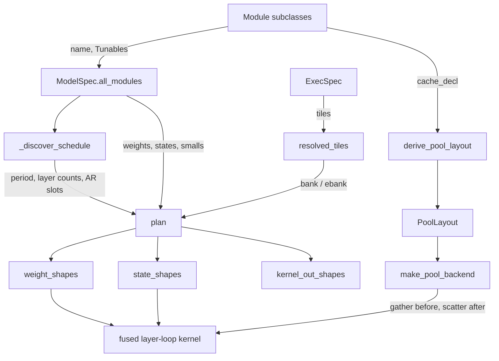

# Megakernel library (declarative model spec, ExecSpec, planner)

<!-- connect:up:begin -->
> **Cross-repo concept:** part of [kv-cache](../../../concepts/kv-cache.md), [pallas-kernel](../../../concepts/pallas-kernel.md), [vmem](../../../concepts/vmem.md), [vmem-budget](../../../concepts/vmem-budget.md) across this wiki's repos.
<!-- connect:up:end -->
## Overview

`src/vllm_torchtpu/megakernel` is a self-contained JAX + Pallas library for a *megakernel*: one
Pallas kernel that runs every layer of a decode (or MTP-verify) step, streaming weights from HBM
through VMEM rings instead of launching one XLA program per op. Its key design idea is that a
model is **declared, not hand-written**: each block of a layer is a
[`Module`](../catalog/src/vllm_torchtpu/megakernel/module.md#Module "src/vllm_torchtpu/megakernel/module.py:L37")
("Composable megakernel module (attention, recurrent, FFN, norm, etc.)") that declares its weights,
states, per-layer smalls and scratch; modules are arranged into one repeating layer (a slot list with
optional two-branch switch slots, e.g. recurrent vs attention mixers), and a pure build-time
[`plan`](../catalog/src/vllm_torchtpu/megakernel/planner.md#plan "src/vllm_torchtpu/megakernel/planner.py:L189")
turns that declaration plus an
[`ExecSpec`](../catalog/src/vllm_torchtpu/megakernel/exec_spec.md#ExecSpec "src/vllm_torchtpu/megakernel/exec_spec.py:L187")
(batch rows, tokens per sequence, TP/EP ranks, context, tiles) into weight tile sizes, a static
weight-stream schedule, a smalls table layout and the per-rank operand shapes. Paged KV and recurrent
(GDN) state live in a unified fp8 raw pool served by separate gather/scatter Pallas kernels
([`make_pool_backend`](../catalog/src/vllm_torchtpu/megakernel/pool/backend.md#make_pool_backend "src/vllm_torchtpu/megakernel/pool/backend.py:L240")),
documented in depth on [megakernel-pool](megakernel-pool.md).

At this commit the package is a library in waiting: nothing else under `src/` imports it (only
`tests/megakernel/` does), and the core emitter that would build the fused layer-loop `pallas_call`
is not in the tree - only its declarations, planner, profiles and pool I/O kernels are.

## Diagram

Legend:
- `MOD` - [`Module`](../catalog/src/vllm_torchtpu/megakernel/module.md#Module "src/vllm_torchtpu/megakernel/module.py:L37")
- `ALL` - [`all_modules`](../catalog/src/vllm_torchtpu/megakernel/spec.md#ModelSpec.all_modules "src/vllm_torchtpu/megakernel/spec.py:L180")
- `DS` - [`_discover_schedule`](../catalog/src/vllm_torchtpu/megakernel/planner.md#_discover_schedule "src/vllm_torchtpu/megakernel/planner.py:L88")
- `EX` - [`ExecSpec`](../catalog/src/vllm_torchtpu/megakernel/exec_spec.md#ExecSpec "src/vllm_torchtpu/megakernel/exec_spec.py:L187")
- `RT` - [`resolved_tiles`](../catalog/src/vllm_torchtpu/megakernel/exec_spec.md#ExecSpec.resolved_tiles "src/vllm_torchtpu/megakernel/exec_spec.py:L217")
- `PLAN` - [`plan`](../catalog/src/vllm_torchtpu/megakernel/planner.md#plan "src/vllm_torchtpu/megakernel/planner.py:L189")
- `WS` - [`weight_shapes`](../catalog/src/vllm_torchtpu/megakernel/planner.md#weight_shapes "src/vllm_torchtpu/megakernel/planner.py:L398")
- `SS` - [`state_shapes`](../catalog/src/vllm_torchtpu/megakernel/planner.md#state_shapes "src/vllm_torchtpu/megakernel/planner.py:L431")
- `KO` - [`kernel_out_shapes`](../catalog/src/vllm_torchtpu/megakernel/planner.md#kernel_out_shapes "src/vllm_torchtpu/megakernel/planner.py:L452")
- `DER` - [`derive_pool_layout`](../catalog/src/vllm_torchtpu/megakernel/pool/derive.md#derive_pool_layout "src/vllm_torchtpu/megakernel/pool/derive.py:L38")
- `PL` - [`PoolLayout`](../catalog/src/vllm_torchtpu/megakernel/pool/layout.md#PoolLayout "src/vllm_torchtpu/megakernel/pool/layout.py:L84")
- `MPB` - [`make_pool_backend`](../catalog/src/vllm_torchtpu/megakernel/pool/backend.md#make_pool_backend "src/vllm_torchtpu/megakernel/pool/backend.py:L240")
- `CORE` - (concept) the fused layer-loop megakernel; its builder is not in this repo at this commit

## Design rationale (why it's built this way)

- **Framework-free and portable.** The package docstring calls itself "Core declarations, execution
  config, VMEM pool aliasing, and numeric primitives"; `tests/megakernel/test_portability.py` is an
  AST guard enforcing zero imports from `vllm`, `vllm_torchtpu` or `torch`, only stdlib / `jax` /
  `numpy` absolute imports, and private `jax._src` use only in `pool_alias.py`. The ruff config
  bans `torch`, `torch_tpu` and `vllm` imports in `megakernel/` as in `kernels/`. The profile module
  says adapters "(vLLM, SGLang, plain JAX)" consume it, so the library is shaped to be shared
  across serving stacks rather than tied to this plugin's runner.
- **Declaration-driven planning.** A new architecture should be a new slot list, not a new kernel.
  [`plan`](../catalog/src/vllm_torchtpu/megakernel/planner.md#plan "src/vllm_torchtpu/megakernel/planner.py:L189")
  is documented as a "Pure function of `model_spec` and `ex` ... never fits tiles or queries device
  budgets", so plans are deterministic and testable on CPU (`ExecSpec.interpret` runs Pallas in CPU
  interpret mode).
- **Weights stream through fixed-size rings.** Each weight declares a stream ring: `static` (the
  per-layer dense schedule), `dynamic` (expert weights, picked by routing at run time) or `hbm`
  (left in HBM, read by the module itself). Static/dynamic weights are cut along K into tiles that
  fit one ring slot: the planner picks the largest multiple-of-128 divisor of K whose `(8, 128)`-tiled
  storage fits `bank` (dense) or `ebank` (expert) bytes. Default tiles are 14 dense slots x 2 MiB and
  10 expert slots x 1 MiB (~38 MiB of ring) inside a 62 MiB VMEM limit. Decode is weight-bandwidth
  bound, so the ring depth is what hides HBM latency.
- **Numerics are a first-class tuning axis.** Every core tile knob carries a numerics class in
  `TILE_NUMERICS`: `exact` knobs (ring depth `nbd`, budgets, `lazy`, `rel_fetch`) only reschedule
  DMAs and must stay bit-identical, while `approx` knobs (`bank`/`ebank` K-tiling, `rsag`, `hier`,
  `dense_acc_pair`, ...) change arithmetic and must pass an accuracy ladder. Named profiles
  (`profile.py`) group per-bucket tiles and pool-I/O modes and are rejected if declared `exact` while
  turning on an approx feature.
- **Fail loudly.**
  [`MegakernelConfigError`](../catalog/src/vllm_torchtpu/megakernel/errors.md#MegakernelConfigError "src/vllm_torchtpu/megakernel/errors.py:L19")
  is "never silently ignored"; a separate `MegakernelLayoutError` marks an incompatible external
  cache layout where "callers may fall back to a non-megakernel path".
- **v7x first.** The default tile rule sizes for TPU v7x (64 MiB VMEM per core, 2 MiB left for
  compiler scratch, 1 MiB SMEM) and calls it "the only chip the megakernel is validated on"; any
  other TPU `device_kind` raises at build time.

## Entry points

- [`Module`](../catalog/src/vllm_torchtpu/megakernel/module.md#Module "src/vllm_torchtpu/megakernel/module.py:L37") -
  subclassed once per block kind. Defining a subclass with `Tunables` (or `Debug`) registers that
  dataclass under its [`name`](../catalog/src/vllm_torchtpu/megakernel/module.md#Module.name "src/vllm_torchtpu/megakernel/module.py:L47"),
  which is also the key the planner uses to deduplicate modules and attribute weights. `bind(...)`
  maps checkpoint prefixes and HF config fields;
  [`_resolve_binding`](../catalog/src/vllm_torchtpu/megakernel/module.md#Module._resolve_binding "src/vllm_torchtpu/megakernel/module.py:L218")
  resolves them against a concrete HF config into the module's geometry.
- [`ExecSpec`](../catalog/src/vllm_torchtpu/megakernel/exec_spec.md#ExecSpec "src/vllm_torchtpu/megakernel/exec_spec.py:L187") -
  "Execution-time configuration (independent of model architecture)": `B` active rows, `T` tokens
  per sequence, `R` ranks, `ctx`, `stack_e`, `interpret`, optional `tiles`, `debug` and a `cache`
  extension. Built per batch bucket (by a profile's `exec_for` in the adapters).
- [`plan`](../catalog/src/vllm_torchtpu/megakernel/planner.md#plan "src/vllm_torchtpu/megakernel/planner.py:L189") -
  called at kernel build time; also called implicitly by
  [`weight_shapes`](../catalog/src/vllm_torchtpu/megakernel/planner.md#weight_shapes "src/vllm_torchtpu/megakernel/planner.py:L398"),
  [`state_shapes`](../catalog/src/vllm_torchtpu/megakernel/planner.md#state_shapes "src/vllm_torchtpu/megakernel/planner.py:L431")
  and [`kernel_out_shapes`](../catalog/src/vllm_torchtpu/megakernel/planner.md#kernel_out_shapes "src/vllm_torchtpu/megakernel/planner.py:L452")
  when no plan is passed - the functions a weight loader and a kernel builder use to size operands.
- [`derive_pool_layout`](../catalog/src/vllm_torchtpu/megakernel/pool/derive.md#derive_pool_layout "src/vllm_torchtpu/megakernel/pool/derive.py:L38")
  and [`make_pool_backend`](../catalog/src/vllm_torchtpu/megakernel/pool/backend.md#make_pool_backend "src/vllm_torchtpu/megakernel/pool/backend.py:L240") -
  how a model with a page-based cache builds the optional cache backend it hangs on its model
  spec (see [megakernel-pool](megakernel-pool.md)).

## Mechanism (step-by-step)

1. **Modules declare what they need.** A [`Module`](../catalog/src/vllm_torchtpu/megakernel/module.md#Module "src/vllm_torchtpu/megakernel/module.py:L37") overrides declaration hooks - `weights` (name, K, per-rank N, dtype, stream ring, stacked vs per-layer layout, extra lead dims such as experts), `states` / `outputs` (per-layer per-rank HBM/SMEM/VMEM tensors with r/w/rw access), `smalls` (per-layer 1D vectors), `shared_widths` (minimum widths of shared core VMEM buffers), `scratch` and `extra_inputs` - plus execution hooks the core calls: `prologue` before the inter-rank barrier, `init_buffers`, `on_layer_start` alongside smalls double-buffering, `emit` per layer returning a partial `[MB, H]` output, `epilogue`, and `host_update_states` "inside `shard_map` after `pallas_call` returns". A module's `reduction` (`allreduce`, `none`, `custom`) says whether its partial output is summed across the `R` ranks, and `cache_decl` returns a [`KVCacheDecl`](../catalog/src/vllm_torchtpu/megakernel/decls.md#KVCacheDecl "src/vllm_torchtpu/megakernel/decls.py:L84") or [`RecurrentCacheDecl`](../catalog/src/vllm_torchtpu/megakernel/decls.md#RecurrentCacheDecl "src/vllm_torchtpu/megakernel/decls.py:L98") for the pool.

2. **The model spec fixes one layer type.** The model spec holds the HF-derived config `g`, one layer type (a tuple of slots, each a module or a switch slot) and an optional cache backend. [`all_modules`](../catalog/src/vllm_torchtpu/megakernel/spec.md#ModelSpec.all_modules "src/vllm_torchtpu/megakernel/spec.py:L180") returns the unique active modules in declaration order and raises if two different modules share a `name`, because every later table (weight owners, tunables, debug flags, layer counts) is keyed by that name.

3. **The execution spec derives row geometry.** [`ExecSpec`](../catalog/src/vllm_torchtpu/megakernel/exec_spec.md#ExecSpec "src/vllm_torchtpu/megakernel/exec_spec.py:L187") turns `B` and [`T`](../catalog/src/vllm_torchtpu/megakernel/exec_spec.md#ExecSpec.T "src/vllm_torchtpu/megakernel/exec_spec.py:L191") into [`NS`](../catalog/src/vllm_torchtpu/megakernel/exec_spec.md#ExecSpec.NS "src/vllm_torchtpu/megakernel/exec_spec.py:L226") sequences (`B // T`, asserting divisibility), `MR = rup(B, 8)`, `M = max(16, rup(B, 16))` and the internal activation row count `MB` chosen by the `mb8` tile knob; `VER` (verify, `T > 1`) and `WIDE` (`B > wide_rows`, default 16) select per-bucket schedules, and `MAX_BATCH_ROWS` caps a call at 128 rows. [`resolved_tiles`](../catalog/src/vllm_torchtpu/megakernel/exec_spec.md#ExecSpec.resolved_tiles "src/vllm_torchtpu/megakernel/exec_spec.py:L217") returns the explicit tiles or the library default rule; leaving `tiles=None` is what lets a builder refine ring depths to the VMEM budget later.

4. **Discover the repeating schedule.** [`_discover_schedule`](../catalog/src/vllm_torchtpu/megakernel/planner.md#_discover_schedule "src/vllm_torchtpu/megakernel/planner.py:L88") finds the cycle `period = sum(branch_counts)` of the (at most one distinct) multi-branch switch slot, requires `L % period == 0`, assigns each module its active layer count (`L` for plain slots, `n_cycles * count` for a branch) and its branch index, checks that branches of one slot share `reduction` and `input_norm`, and gives each `allreduce` slot an index - at most 2 per layer, because the all-reduce ring is double-buffered. Its docstring notes non-periodic layouts (GLM's 3 dense + 75 MoE layers) will need a per-layer table later.

5. **Plan weights, smalls, states and tiles.** [`plan`](../catalog/src/vllm_torchtpu/megakernel/planner.md#plan "src/vllm_torchtpu/megakernel/planner.py:L189") walks the modules once: weights are bucketed by stream ring (duplicate names raise), smalls fields get 128-aligned columns in one shared table (a field may be shared only by branches of the same slot, taking the max width; a module's `input_norm` must be one of its smalls), states are merged only if identical, read-only and not per-layer, and shared buffer widths start at `acc = H` and 128 for `ybuf`/`xb2`/`mix`. It then computes the K tile `tk` and tile count `nt` per streamed weight from `bank`/`ebank`, builds per-branch ordered segments of static tiles, and derives `t_cycle` and `T_TOTAL = (L / period) * t_cycle` - the total number of static weight tiles the dense ring streams per step. Module-specific derived parameters come last via each module's `plan_params`.

6. **Size the operands.** [`weight_shapes`](../catalog/src/vllm_torchtpu/megakernel/planner.md#weight_shapes "src/vllm_torchtpu/megakernel/planner.py:L398") gives streamed weights a pre-tiled HBM shape `(layers, *lead_dims, nt, tk, N)` (or a tuple of per-layer arrays for `per_layer` layout) so every ring refill is one contiguous tile DMA; `hbm` weights stay untiled as `(layers, *lead_dims, K, N)`. It appends the f32 `smalls` table `(L, 1, smalls_width)` and `final_norm`. [`state_shapes`](../catalog/src/vllm_torchtpu/megakernel/planner.md#state_shapes "src/vllm_torchtpu/megakernel/planner.py:L431") and [`kernel_out_shapes`](../catalog/src/vllm_torchtpu/megakernel/planner.md#kernel_out_shapes "src/vllm_torchtpu/megakernel/planner.py:L452") do the same for states and outputs, the latter always leading with `hidden` `(M, H)` in [`BF16`](../catalog/src/vllm_torchtpu/megakernel/ops.md#BF16 "src/vllm_torchtpu/megakernel/ops.py:L24").

7. **Attach the paged cache.** For a model with paged KV and recurrent layers, [`derive_pool_layout`](../catalog/src/vllm_torchtpu/megakernel/pool/derive.md#derive_pool_layout "src/vllm_torchtpu/megakernel/pool/derive.py:L38") folds the modules' cache declarations into a [`PoolLayout`](../catalog/src/vllm_torchtpu/megakernel/pool/layout.md#PoolLayout "src/vllm_torchtpu/megakernel/pool/layout.py:L84") (one [`FP8`](../catalog/src/vllm_torchtpu/megakernel/ops.md#FP8 "src/vllm_torchtpu/megakernel/ops.py:L28") pool per attention layer, recurrent layers attached to the next attention layer), and [`make_pool_backend`](../catalog/src/vllm_torchtpu/megakernel/pool/backend.md#make_pool_backend "src/vllm_torchtpu/megakernel/pool/backend.py:L240") wraps it with gather/scatter callbacks around [`gather_gdn_states`](../catalog/src/vllm_torchtpu/megakernel/pool/gather.md#gather_gdn_states "src/vllm_torchtpu/megakernel/pool/gather.py:L39") and [`scatter_pool_states`](../catalog/src/vllm_torchtpu/megakernel/pool/scatter.md#scatter_pool_states "src/vllm_torchtpu/megakernel/pool/scatter.py:L44"). The paged settings ride on `ExecSpec.cache`, read through [`cache_exec`](../catalog/src/vllm_torchtpu/megakernel/pool/config.md#cache_exec "src/vllm_torchtpu/megakernel/pool/config.py:L110"), which the core config never reads itself.

> [!inferred]
> The intended step is: split gather of recurrent state from the pool, one fused megakernel
> `pallas_call` inside `shard_map` over the `R` ranks (layer loop, weight rings, in-kernel
> all-reduce ring), then a scatter of new KV and recurrent checkpoints back into the pool, with
> fused pool I/O or in-kernel gather (GPR) as opt-in variants that remove the separate launches.
> This is read from the module hook docstrings, the `PoolBackend` callbacks and the `CacheExec`
> modes; the core that ties them together is not in this tree.

## Key data structures

| Structure | What it represents | Perf-relevant fields |
|---|---|---|
| [`ExecSpec`](../catalog/src/vllm_torchtpu/megakernel/exec_spec.md#ExecSpec "src/vllm_torchtpu/megakernel/exec_spec.py:L187") | one batch bucket's execution config (frozen) | `B`, `T`, `R`, `ctx`, `stack_e`, `tiles`, `cache` |
| tile set (`Tiles`) | core tiling, ring depths, budgets, collectives | `bank`=2 MiB, `nbd`=14, `ebank`=1 MiB, `nbe`=10, `vmem_mib`=62, `smem_mib`=1, `rsag`, `hier` (v7x-8 hierarchical all-reduce 0..3), `war`, `mb8`, `wide_rows`=16, `dense_acc_pair`, `dmm_unroll`, `rel_fetch`, `inplace`, `lazy`, per-module `modules` tunables |
| plan (`Plan`) | everything derived at build time | `tk`/`nt` per weight, `branch_segs`, `t_cycle`, `T_TOTAL`, `smalls_layout`, `slot_ar_index`, `module_layer_counts` |
| [`KVCacheDecl`](../catalog/src/vllm_torchtpu/megakernel/decls.md#KVCacheDecl "src/vllm_torchtpu/megakernel/decls.py:L84") / [`RecurrentCacheDecl`](../catalog/src/vllm_torchtpu/megakernel/decls.md#RecurrentCacheDecl "src/vllm_torchtpu/megakernel/decls.py:L98") | per-module cache requirement | `hd`, `kvh`, `page_size`; `kh`, `vh`, `KD`, `VD`, `conv_taps` |
| profile (`Profile`) | named per-deployment tuning bundle | tile rule, decode/verify buckets, `fused_pool_io`, `pool_gather`, `numerics` |

Numeric helpers in `ops.py` define the dtype vocabulary ([`BF16`](../catalog/src/vllm_torchtpu/megakernel/ops.md#BF16 "src/vllm_torchtpu/megakernel/ops.py:L24"), [`FP8`](../catalog/src/vllm_torchtpu/megakernel/ops.md#FP8 "src/vllm_torchtpu/megakernel/ops.py:L28") = `float8_e4m3fn`, [`I32`](../catalog/src/vllm_torchtpu/megakernel/ops.md#I32 "src/vllm_torchtpu/megakernel/ops.py:L26")) and reference math that rounds through bf16 (`rnd`, `rmsnorm`, `silu_mul`) plus a balanced `lax.cond` tree (`bswitch`) for O(log N) branch selection. `pool_alias.py` lets one flat VMEM scratch buffer be re-viewed at several shapes by lowering to `tpu.reinterpret_cast` on the physical `(8, 128)` tiling, a private Mosaic hook the public `ref.reshape` cannot express.

## Dynamics (design intent)

- **Ordering inside a step**: `prologue` (once, before the inter-rank barrier) -> `init_buffers` -> per layer `on_layer_start` + `emit` -> `epilogue`, then `host_update_states` on the host side of `shard_map`. Smalls are double-buffered per layer; at most two all-reduce slots per layer map onto the double-buffered all-reduce ring.
- **Lazy refill**: `lazy=True` refills a module's dense slots after its own streams; `rel_fetch` decodes dense refills at trace time; both are `exact` (scheduling only).
- **Per-bucket specialization**: one `ExecSpec` per `(T, B)` bucket; `WIDE` buckets (`B > wide_rows`) take a different schedule, and modules are told never to compare `B` to a literal but to read `wide_rows`, so tile rules can tune the threshold.
- **Tests**: `tests/megakernel/test_planner.py` checks that the planner derives weights/smalls/states only from active modules and that a two-branch switch slot yields per-branch counts and schedules, using CPU-sized fake modules (`megakernel_fakes.py`).

## Edge cases

- Streamed weight `K` must be a positive multiple of 128, and at least a 128-row tile must fit `bank`/`ebank`; otherwise [`MegakernelConfigError`](../catalog/src/vllm_torchtpu/megakernel/errors.md#MegakernelConfigError "src/vllm_torchtpu/megakernel/errors.py:L19") reports the minimum tile size.
- `L` not a multiple of the switch period, more than 2 active branches in a switch slot, two switch slots with different periods, or a third `allreduce` slot per layer all raise.
- `DebugOptions.modules` naming an inactive module raises before planning; debug flags live outside the tile set so setting them keeps `tiles=None` and its VMEM refinement.
- An `ExecSpec.cache` equal to its own defaults is normalized to `None`, so `ExecSpec` equality and hashing do not depend on whether the default cache config was passed explicitly.
- `B % T != 0` trips an assertion in `NS`; `stack_e` (4D stacked vs per-layer 3D expert weights) is the one module layout choice kept in core because builder, packing and the expert ring all depend on it.
- On a TPU other than v7x, budget lookup raises instead of guessing; on CPU the v7x budget is used so interpret-mode tests run.

## Open questions

- The fused core builder (the layer-loop `pallas_call`, ring scheduler and all-reduce ring) and any vLLM-side adapter that would call this library are not present at `bf318e424`; the roadmap lists "custom megakernels" as a co-maintainership deliverable. Which models and serving paths will use it is not settled by the source.
- Packet gap: the subgraph omits the central types `ModelSpec`, `LayerType`, `SwitchSlot`, `WeightDecl`, `StateDecl`, `Tiles`, `Plan`, `k_tile`, `Profile` / `exec_for` and `pool_alias.view`, so they are described here but not cited.
- `inplace` (aliasing state inputs to outputs) is marked `approx` as "not proven exact"; whether it ever changes results is open.

## See also

- [megakernel-pool](megakernel-pool.md) - the unified KV + recurrent raw pool and its gather/scatter kernels
- [gated-deltanet-kernels](gated-deltanet-kernels.md) - the recurrent (GDN) layers whose state the pool checkpoints
- [ragged-paged-attention-kernel](ragged-paged-attention-kernel.md) - the non-megakernel paged attention path
- [kv-cache-layout-and-hbm-budget](kv-cache-layout-and-hbm-budget.md)
- [speculative-decoding](speculative-decoding.md) - the MTP verify path behind `T > 1`
- [distributed-parallelism-and-meshes](distributed-parallelism-and-meshes.md)
- [custom-ops](custom-ops.md)
