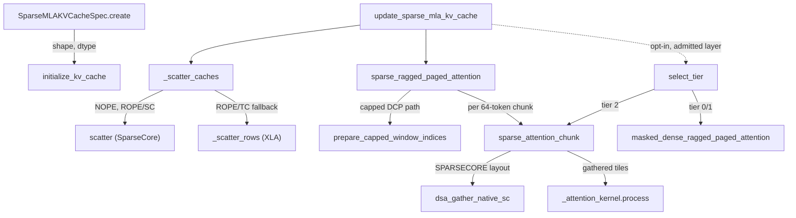
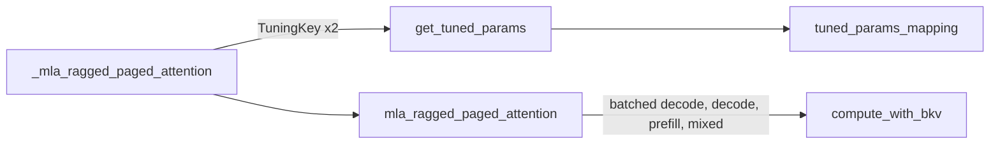

# MLA attention kernels: dense v2 RPA, sparse DSA gather-attend, masked-dense, and the split fp8 latent cache

<!-- connect:up:begin -->
> **Cross-repo concept:** part of [flash-attention](../../../concepts/flash-attention.md), [kv-cache](../../../concepts/kv-cache.md), [pallas-kernel](../../../concepts/pallas-kernel.md), [sparsecore](../../../concepts/sparsecore.md), [vmem-budget](../../../concepts/vmem-budget.md) across this wiki's repos.
<!-- connect:up:end -->
## Overview

`src/vllm_torchtpu/kernels/mla` holds three Pallas attention kernels for Multi-head Latent Attention (MLA), plus the code that lays out and writes their KV caches. They answer two different questions:

- **Dense MLA** (every query attends its whole causal context) is served by the **v2 ragged paged attention kernel**, [`mla_ragged_paged_attention`](../catalog/src/vllm_torchtpu/kernels/mla/v2/kernel.md#mla_ragged_paged_attention "src/vllm_torchtpu/kernels/mla/v2/kernel.py:L2317"). It is a flash-attention-style kernel over a single packed latent cache (`kv_c` + `k_pe` in one array) that also writes this step's new latents into that cache in the same launch. Block sizes come from a hand-tuned table keyed by [`TuningKey`](../catalog/src/vllm_torchtpu/kernels/mla/v2/tuned_params.md#TuningKey "src/vllm_torchtpu/kernels/mla/v2/tuned_params.py:L23").
- **Sparse MLA** (DeepSeek Sparse Attention, "DSA": an indexer picks `topk` KV positions per query token; the module docstring names GLM-5.2) is served by [`sparse_ragged_paged_attention`](../catalog/src/vllm_torchtpu/kernels/mla/sparse/kernel.md#sparse_ragged_paged_attention "src/vllm_torchtpu/kernels/mla/sparse/kernel.py:L1066"). It does **not** stream the cache: it *gathers* each token's `topk` rows out of the paged cache (on SparseCore by default) into a dense buffer and then runs a single-block softmax per query token. Cost is flat in sequence length. An opt-in sibling, [`masked_dense_ragged_paged_attention`](../catalog/src/vllm_torchtpu/kernels/mla/masked_dense/kernel.md#masked_dense_ragged_paged_attention "src/vllm_torchtpu/kernels/mla/masked_dense/kernel.py:L594"), answers the same sparse question the other way round - stream the whole (short) cache and mask the scores - and a device-side router picks between them per step with a calibrated cost model ([`select_tier`](../catalog/src/vllm_torchtpu/kernels/mla/dispatch.md#select_tier "src/vllm_torchtpu/kernels/mla/dispatch.py:L186")).

The sparse kernels read a **split, fp8, byte-packed cache**: a NOPE cache (the 512-byte compressed latent) and a ROPE cache (the 64-byte decoupled rope key), each described by a [`SparseMLAKVCacheSpec`](../catalog/src/vllm_torchtpu/kernels/mla/kv_cache_utils.md#SparseMLAKVCacheSpec "src/vllm_torchtpu/kernels/mla/kv_cache_utils.py:L107") whose [`layout`](../catalog/src/vllm_torchtpu/kernels/mla/kv_cache_utils.md#SparseMLAKVCacheSpec.layout "src/vllm_torchtpu/kernels/mla/kv_cache_utils.py:L109") is either TensorCore-tiled `uint8` or native-SparseCore `uint32`. Unlike the v2 kernel, the sparse kernel does not write the cache: a separate SparseCore scatter ([`update_sparse_mla_kv_cache`](../catalog/src/vllm_torchtpu/kernels/mla/kv_cache_utils.md#update_sparse_mla_kv_cache "src/vllm_torchtpu/kernels/mla/kv_cache_utils.py:L376")) runs first. The key design idea of the whole package: **make the byte layout of the cache match what the gather engine can DMA natively**, so that the irregular part of sparse attention (indexed row reads) runs on SparseCore while the TensorCore only sees dense, lane-aligned tiles.

## Diagram

Sparse MLA, one layer, one step (the default path for DSA models):

Legend:
- `SPEC` - [`create`](../catalog/src/vllm_torchtpu/kernels/mla/kv_cache_utils.md#SparseMLAKVCacheSpec.create "src/vllm_torchtpu/kernels/mla/kv_cache_utils.py:L116")
- `ALLOC` - [`initialize_kv_cache`](../catalog/src/vllm_torchtpu/runner/kv_cache_manager.md#KVCacheManager.initialize_kv_cache "src/vllm_torchtpu/runner/kv_cache_manager.py:L1360") (outside this unit)
- `UPD` - [`update_sparse_mla_kv_cache`](../catalog/src/vllm_torchtpu/kernels/mla/kv_cache_utils.md#update_sparse_mla_kv_cache "src/vllm_torchtpu/kernels/mla/kv_cache_utils.py:L376")
- `SC` - [`_scatter_caches`](../catalog/src/vllm_torchtpu/kernels/mla/kv_cache_utils.md#_scatter_caches "src/vllm_torchtpu/kernels/mla/kv_cache_utils.py:L430")
- `SCAT` - [`scatter`](../catalog/src/vllm_torchtpu/kernels/mla/scatter.md#scatter "src/vllm_torchtpu/kernels/mla/scatter.py:L21")
- `XLA` - [`_scatter_rows`](../catalog/src/vllm_torchtpu/kernels/mla/kv_cache_utils.md#_scatter_rows "src/vllm_torchtpu/kernels/mla/kv_cache_utils.py:L325")
- `SRPA` - [`sparse_ragged_paged_attention`](../catalog/src/vllm_torchtpu/kernels/mla/sparse/kernel.md#sparse_ragged_paged_attention "src/vllm_torchtpu/kernels/mla/sparse/kernel.py:L1066")
- `PREP` - [`prepare_capped_window_indices`](../catalog/src/vllm_torchtpu/kernels/mla/sparse/kernel.md#prepare_capped_window_indices "src/vllm_torchtpu/kernels/mla/sparse/kernel.py:L236")
- `CHUNK` - [`sparse_attention_chunk`](../catalog/src/vllm_torchtpu/kernels/mla/sparse/kernel.md#sparse_attention_chunk "src/vllm_torchtpu/kernels/mla/sparse/kernel.py:L1449")
- `G` - [`dsa_gather_native_sc`](../catalog/src/vllm_torchtpu/kernels/mla/sparse/native_sc_gather.md#dsa_gather_native_sc "src/vllm_torchtpu/kernels/mla/sparse/native_sc_gather.py:L251")
- `ATT` - [`process`](../catalog/src/vllm_torchtpu/kernels/mla/sparse/kernel.md#_attention_kernel.process "src/vllm_torchtpu/kernels/mla/sparse/kernel.py:L880")
- `TIER` - [`select_tier`](../catalog/src/vllm_torchtpu/kernels/mla/dispatch.md#select_tier "src/vllm_torchtpu/kernels/mla/dispatch.py:L186")
- `MD` - [`masked_dense_ragged_paged_attention`](../catalog/src/vllm_torchtpu/kernels/mla/masked_dense/kernel.md#masked_dense_ragged_paged_attention "src/vllm_torchtpu/kernels/mla/masked_dense/kernel.py:L594")

Dense MLA (v2) launches one `pallas_call` per request segment, each with its own tuned block shape:

Legend:
- `IFACE` - [`_mla_ragged_paged_attention`](../catalog/src/vllm_torchtpu/layers/core/attention_interface.md#mla_attention._mla_ragged_paged_attention "src/vllm_torchtpu/layers/core/attention_interface.py:L746") (outside this unit)
- `TP` - [`get_tuned_params`](../catalog/src/vllm_torchtpu/kernels/mla/v2/tuned_params.md#get_tuned_params "src/vllm_torchtpu/kernels/mla/v2/tuned_params.py:L1348")
- `TAB` - [`tuned_params_mapping`](../catalog/src/vllm_torchtpu/kernels/mla/v2/tuned_params.md#tuned_params_mapping.tuned_params_mapping "src/vllm_torchtpu/kernels/mla/v2/tuned_params.py:L83")
- `V2` - [`mla_ragged_paged_attention`](../catalog/src/vllm_torchtpu/kernels/mla/v2/kernel.md#mla_ragged_paged_attention "src/vllm_torchtpu/kernels/mla/v2/kernel.py:L2317")
- `BODY` - [`compute_with_bkv`](../catalog/src/vllm_torchtpu/kernels/mla/v2/kernel.md#_mla_ragged_paged_attention_kernel.process.compute_with_bq.compute_with_bkv "src/vllm_torchtpu/kernels/mla/v2/kernel.py:L1885")

## Design rationale (why it's built this way)

**Gather instead of stream for sparse attention.** With a `topk` of 2048 and long contexts, streaming the whole cache wastes HBM bandwidth on rows the indexer did not pick. The sparse kernel therefore gathers exactly `topk` rows per token and attends them in one block. The module docstring of the masked-dense kernel states the trade-off precisely: the gather's "cost is flat in sequence length, which is what you want for long contexts", while streaming-and-masking is O(kv_len) "so it only wins while the sequence is short - but in that regime it wins by a lot, because many query tokens then select overlapping KV rows and the gather hot-spots on the same cache lines." The sparse kernel's own comment quantifies the hotspot: "We've seen 30%+ performance degradation compared to the no-duplicate-indices case."

**Single-block softmax, no running max.** Each query token attends exactly one gathered block, so the sparse attention body has no flash-attention rescale state; per its comment, "The step1/step2 split only interleaves VPU and MXU work across batch entries." The [`process`](../catalog/src/vllm_torchtpu/kernels/mla/sparse/kernel.md#_attention_kernel.process "src/vllm_torchtpu/kernels/mla/sparse/kernel.py:L880") loop computes QK+softmax for entry `i` while finishing PV for entry `i-1`, and even inserts an artificial data dependency (`jnp.where(prev_out == jnp.inf, ...)`) "to force MXU/VPU interleaving by limiting LLO's QK runahead".

**Byte layouts chosen for the DMA engines.** [`KVCacheLayout`](../catalog/src/vllm_torchtpu/kernels/mla/kv_cache_utils.md#KVCacheLayout "src/vllm_torchtpu/kernels/mla/kv_cache_utils.py:L42") documents both: TENSORCORE is "uint8, 2D-tiled. 4 sublanes fold into 32-bit words via hardware TC tiling"; SPARSECORE is "uint32, 1D-flat. The writer explicitly bit-packs `WORD_BYTES` byte bands into 32-bit words ... for native SC DMA." Both store a token as 32-bit words ([`WORD_BYTES`](../catalog/src/vllm_torchtpu/kernels/mla/kv_cache_utils.md#WORD_BYTES "src/vllm_torchtpu/kernels/mla/kv_cache_utils.py:L31") = 4), so the attention kernel consumes either through the same bitcast. The NOPE TensorCore head dim is asserted to be exactly `WORD_BYTES * TILE_LANE_BYTES` = 512 bytes, i.e. one fp8 latent fills four 128-byte lanes with no padding.

**Pack the small ROPE key densely on SparseCore.** A 64-byte rope key would waste half of a 128-byte TensorCore lane row. [`create`](../catalog/src/vllm_torchtpu/kernels/mla/kv_cache_utils.md#SparseMLAKVCacheSpec.create "src/vllm_torchtpu/kernels/mla/kv_cache_utils.py:L116") instead packs whole tokens into 512-byte (128-word) rows at the SparseCore 16-lane (64-byte) granularity - [`tokens_per_row`](../catalog/src/vllm_torchtpu/kernels/mla/kv_cache_utils.md#SparseMLAKVCacheSpec.tokens_per_row "src/vllm_torchtpu/kernels/mla/kv_cache_utils.py:L194") tokens per row - but only "whenever the resulting per-page row count stays unpadded under XLA's (8, 128) HBM tile". The gather then register-transposes those rows back into the four-token tile the TensorCore consumer reads ([`ROPE_PACKING`](../catalog/src/vllm_torchtpu/kernels/mla/sparse/native_sc_gather.md#ROPE_PACKING "src/vllm_torchtpu/kernels/mla/sparse/native_sc_gather.py:L39") = 4).

**Routing lives outside the kernels.** `dispatch.py`'s docstring: "The router owns eligibility, selection and composition; each kernel package under `kernels/mla` owns only its implementation and does not import this module." The masked-dense route is admitted only for one exact, calibrated profile (GLM-5.2 geometry on TPU7x), because "an unrecognized sparse model must therefore retain the original gather kernel." The choice among routes is made **on device** from batch tensors, so one compiled graph serves every batch mix.

**Golden XLA writers.** Every Pallas cache writer has a pure-jnp twin ([`update_sparse_mla_kv_cache_jax`](../catalog/src/vllm_torchtpu/kernels/mla/kv_cache_utils.md#update_sparse_mla_kv_cache_jax "src/vllm_torchtpu/kernels/mla/kv_cache_utils.py:L463"), [`update_sparse_mla_kv_cache_dcp_jax`](../catalog/src/vllm_torchtpu/kernels/mla/kv_cache_utils.md#update_sparse_mla_kv_cache_dcp_jax "src/vllm_torchtpu/kernels/mla/kv_cache_utils.py:L576")): "Needs no TPU, so it runs on CPU: this is the golden the SparseCore writer is checked against", and also the fallback for layouts the SparseCore writer cannot express.

## Entry points

- [`get_sparse_kv_cache_specs`](../catalog/src/vllm_torchtpu/layers/adapter/attention.md#PallasMLAttentionBackend.get_sparse_kv_cache_specs "src/vllm_torchtpu/layers/adapter/attention.py:L1768") (outside this unit) - "The (nope, rope) specs for one sparse-MLA layer." Called at KV-cache allocation time; it builds the two [`SparseMLAKVCacheSpec`](../catalog/src/vllm_torchtpu/kernels/mla/kv_cache_utils.md#SparseMLAKVCacheSpec "src/vllm_torchtpu/kernels/mla/kv_cache_utils.py:L107") objects from the per-cache layout env settings (`TPU_SPARSE_MLA_NOPE_LAYOUT` / `TPU_SPARSE_MLA_ROPE_LAYOUT`, both defaulting to `sparsecore`). [`initialize_kv_cache`](../catalog/src/vllm_torchtpu/runner/kv_cache_manager.md#KVCacheManager.initialize_kv_cache "src/vllm_torchtpu/runner/kv_cache_manager.py:L1360") then allocates tensors of exactly [`shape`](../catalog/src/vllm_torchtpu/kernels/mla/kv_cache_utils.md#SparseMLAKVCacheSpec.shape "src/vllm_torchtpu/kernels/mla/kv_cache_utils.py:L199") and [`torch_dtype`](../catalog/src/vllm_torchtpu/kernels/mla/kv_cache_utils.md#SparseMLAKVCacheSpec.torch_dtype "src/vllm_torchtpu/kernels/mla/kv_cache_utils.py:L185").
- [`update_sparse_mla_kv_cache`](../catalog/src/vllm_torchtpu/kernels/mla/kv_cache_utils.md#update_sparse_mla_kv_cache "src/vllm_torchtpu/kernels/mla/kv_cache_utils.py:L376") - every sparse-MLA layer forward, inside the layer's `shard_map`, before attention. Writes this step's `kv_c_normed` / `k_pe` latents.
- [`update_sparse_mla_kv_cache_dcp`](../catalog/src/vllm_torchtpu/kernels/mla/kv_cache_utils.md#update_sparse_mla_kv_cache_dcp "src/vllm_torchtpu/kernels/mla/kv_cache_utils.py:L495") - the decode-context-parallel twin, reached from [`_local`](../catalog/src/vllm_torchtpu/layers/core/attention_interface.md#sparse_mla_attention_dcp._local "src/vllm_torchtpu/layers/core/attention_interface.py:L1169") (outside this unit) when the layer was built with a DCP mesh ([`_dcp_mesh`](../catalog/src/vllm_torchtpu/layers/adapter/attention.md#PallasMLAttentionBackendImpl._dcp_mesh "src/vllm_torchtpu/layers/adapter/attention.py:L1999")).
- [`sparse_ragged_paged_attention`](../catalog/src/vllm_torchtpu/kernels/mla/sparse/kernel.md#sparse_ragged_paged_attention "src/vllm_torchtpu/kernels/mla/sparse/kernel.py:L1066") - "MLA Ragged paged attention that supports mixed prefill and decode." The default sparse path, called directly by the sparse MLA layer (non-DCP, with `q = concat(ql_nope, q_pe)`) and by the DCP `_local` body with `return_lse=True` so per-rank partial outputs can be merged.
- [`select_tier`](../catalog/src/vllm_torchtpu/kernels/mla/dispatch.md#select_tier "src/vllm_torchtpu/kernels/mla/dispatch.py:L186") - "Selects 0 (analytic), 1 (bitmap) or 2 (sparse) for one step." Reached only for layers that were admitted at cache-allocation time and whose static shapes match (masked-dense opt-in; `TPU_MLA_MASKED_DENSE_ENABLED`).
- [`mla_ragged_paged_attention`](../catalog/src/vllm_torchtpu/kernels/mla/v2/kernel.md#mla_ragged_paged_attention "src/vllm_torchtpu/kernels/mla/v2/kernel.py:L2317") - dense MLA (non-sparse DeepSeek-style and other MLA models), called from [`_mla_ragged_paged_attention`](../catalog/src/vllm_torchtpu/layers/core/attention_interface.md#mla_attention._mla_ragged_paged_attention "src/vllm_torchtpu/layers/core/attention_interface.py:L746") after two [`get_tuned_params`](../catalog/src/vllm_torchtpu/kernels/mla/v2/tuned_params.md#get_tuned_params "src/vllm_torchtpu/kernels/mla/v2/tuned_params.py:L1348") lookups. Heads are sharded on the `model` mesh axis.

## Mechanism (step-by-step)

### Sparse (DSA) path

1. **Spec and allocation.** [`create`](../catalog/src/vllm_torchtpu/kernels/mla/kv_cache_utils.md#SparseMLAKVCacheSpec.create "src/vllm_torchtpu/kernels/mla/kv_cache_utils.py:L116") "Builds a spec with the kernel's page/head-dim padding applied": it rounds `page_size` to the packing factor and the head dim to [`TILE_LANE_BYTES`](../catalog/src/vllm_torchtpu/kernels/mla/kv_cache_utils.md#TILE_LANE_BYTES "src/vllm_torchtpu/kernels/mla/kv_cache_utils.py:L32") (128), then applies the layout-specific rules (dense SparseCore ROPE packing, the 512-byte NOPE assertion for TensorCore). [`shape`](../catalog/src/vllm_torchtpu/kernels/mla/kv_cache_utils.md#SparseMLAKVCacheSpec.shape "src/vllm_torchtpu/kernels/mla/kv_cache_utils.py:L199") is then the single source of truth for the four physical forms: NOPE/TC `u8[pages, page_size, 4, 128]`, NOPE/SC `u32[pages, page_size, 128]`, ROPE/TC `u8[pages, page_size/4, 4, 128]`, ROPE/SC `u32[pages, page_size/tokens_per_row, 128]`. Because all of these are 1 byte per fp8 element, the per-token HBM cost is fixed by layout, not by dtype.

2. **Cache write.** [`update_sparse_mla_kv_cache`](../catalog/src/vllm_torchtpu/kernels/mla/kv_cache_utils.md#update_sparse_mla_kv_cache "src/vllm_torchtpu/kernels/mla/kv_cache_utils.py:L376") first runs [`_check_inputs`](../catalog/src/vllm_torchtpu/kernels/mla/kv_cache_utils.md#_check_inputs "src/vllm_torchtpu/kernels/mla/kv_cache_utils.py:L346") - which asserts the latents are `float8_e4m3fn` ("sparse MLA kernel requires --kv-cache-dtype fp8") and that both caches match their specs - then computes each token's `(page, slot)` from `seq_lens`, `block_tables` and `query_start_loc`. Padding tokens are aimed at an out-of-bounds page sentinel; JAX drops those scatters and the Pallas writers predicate on the sign. [`_scatter_caches`](../catalog/src/vllm_torchtpu/kernels/mla/kv_cache_utils.md#_scatter_caches "src/vllm_torchtpu/kernels/mla/kv_cache_utils.py:L430") sends both NOPE layouts and ROPE/SPARSECORE to the SparseCore DMA writer ([`scatter`](../catalog/src/vllm_torchtpu/kernels/mla/scatter.md#scatter "src/vllm_torchtpu/kernels/mla/scatter.py:L21") -> [`scatter_rows`](../catalog/src/vllm_torchtpu/kernels/mla/scatter_utils.md#scatter_rows "src/vllm_torchtpu/kernels/mla/scatter_utils.py:L145")), and only ROPE/TENSORCORE to the XLA [`_scatter_rows`](../catalog/src/vllm_torchtpu/kernels/mla/kv_cache_utils.md#_scatter_rows "src/vllm_torchtpu/kernels/mla/kv_cache_utils.py:L325"), because "its token is a single lane row, not the `WORD_BYTES` rows the TC sublane fold packs into a word."

3. **Top-k to physical rows.** [`sparse_ragged_paged_attention`](../catalog/src/vllm_torchtpu/kernels/mla/sparse/kernel.md#sparse_ragged_paged_attention "src/vllm_torchtpu/kernels/mla/sparse/kernel.py:L1066") validates the cache geometry for the chosen `cache_layout`, then translates the indexer's logical positions into flat physical cache rows once per call. Per-token `kv_lens` is the count of non-`-1` entries. The page-table lookup runs as a small Pallas kernel that walks the per-token page-table window in [`_GATHER_PAGE_CHUNK`](../catalog/src/vllm_torchtpu/kernels/mla/sparse/kernel.md#_GATHER_PAGE_CHUNK "src/vllm_torchtpu/kernels/mla/sparse/kernel.py:L64") (128) column chunks. The `-1` padding entries are deliberately **scattered across the cache with prime multipliers** ("to avoid read hot spots") rather than all pointing at row 0. When a `topk_cap` is in force (SparseCore layout, DCP), [`prepare_capped_window_indices`](../catalog/src/vllm_torchtpu/kernels/mla/sparse/kernel.md#prepare_capped_window_indices "src/vllm_torchtpu/kernels/mla/sparse/kernel.py:L236") instead "Launches the TPU kernel to translate logical slots to physical rows" directly into a window-major layout, sizing its grid to the number of live windows so unneeded windows are never translated.

4. **Chunked gather + attend.** The query rows are processed in static chunks (default 64 tokens; overridable through `TPU_SPARSE_MLA_CHUNK_TOKENS`) by [`sparse_attention_chunk`](../catalog/src/vllm_torchtpu/kernels/mla/sparse/kernel.md#sparse_attention_chunk "src/vllm_torchtpu/kernels/mla/sparse/kernel.py:L1449"), which "Gathers and attends query rows `[start_pos, min(end_pos, token_end))`". The gather produces a dense `[chunk, topk, ...]` buffer: on the SPARSECORE layout via [`dsa_gather_native_sc`](../catalog/src/vllm_torchtpu/kernels/mla/sparse/native_sc_gather.md#dsa_gather_native_sc "src/vllm_torchtpu/kernels/mla/sparse/native_sc_gather.py:L251") ("Gather explicit native-SC `uint32` NOPE and ROPE cache rows"), which runs as a SparseCore `pl.kernel` across [`NUM_LANES`](../catalog/src/vllm_torchtpu/kernels/mla/sparse/native_sc_gather.md#NUM_LANES "src/vllm_torchtpu/kernels/mla/sparse/native_sc_gather.py:L38") = 16-lane subcores and can be bounded to the rows the attention grid will actually read (`num_live_indices`); on the TensorCore layout via the `dsa_gather` kernel. Small chunks (the decode bucket, `small_chunk_tokens` = 16) switch to a batch-1 grid and a bounded "live" gather so a one-token decode step does not pay for a full 64-row gather.

5. **Attention body.** Each chunk launches one `pallas_call` whose grid walks query tokens in batches of `attention_kernel_batch_size` (16), treating every query token as an independent "sequence" over its gathered rows. [`process`](../catalog/src/vllm_torchtpu/kernels/mla/sparse/kernel.md#_attention_kernel.process "src/vllm_torchtpu/kernels/mla/sparse/kernel.py:L880") double-buffers the next batch's Q and KV DMAs while computing the current one, bitcasts the gathered words to `float8_e4m3fn`, concatenates NOPE (512) and ROPE (64) and pads to the query's 128-aligned head dim (640). Two correctness details matter here: scores past `kv_len` are masked to `f32.min` (a zeroed key would still score 0 and inflate the denominator), **and** the key data past `kv_len` is zeroed, because the scattered padding rows "can decode to fp8 NaN" and `0 * NaN = NaN` in the PV einsum. The output aliases `q` (`input_output_aliases`), so successive chunks write in place.

6. **Capped windows (DCP).** With `topk_cap` set, each token's top-k is split into `topk_cap`-slot windows; the pipelined body attends window 0 only, and tokens with more live rows are recomputed in-kernel by an online-softmax fix-up over all their windows. This pays off when a rank holds "far fewer than `topk` live entries (DCP)", per the [`sparse_ragged_paged_attention`](../catalog/src/vllm_torchtpu/kernels/mla/sparse/kernel.md#sparse_ragged_paged_attention "src/vllm_torchtpu/kernels/mla/sparse/kernel.py:L1066") docstring.

### DCP writer

7. **Owner-masked scatter.** [`update_sparse_mla_kv_cache_dcp`](../catalog/src/vllm_torchtpu/kernels/mla/kv_cache_utils.md#update_sparse_mla_kv_cache_dcp "src/vllm_torchtpu/kernels/mla/kv_cache_utils.py:L495") explains why DCP is cheap: under PCP the cache is replicated and "the caller pays an all-gather", but under DCP "the rows are local to begin with and each rank simply masks its write down to the positions it owns. The all-gather disappears entirely rather than moving." [`_get_dcp_page_and_slot`](../catalog/src/vllm_torchtpu/kernels/mla/kv_cache_utils.md#_get_dcp_page_and_slot "src/vllm_torchtpu/kernels/mla/kv_cache_utils.py:L614") computes chunk-interleaved ownership over a *virtual* page of `page_size * dcp_size` positions and resolves virtual page ordinals by `virtual % num_pages` - the same resolution the readers use, which keeps the indexer cache, latent cache and top-k coordinates in one coordinate space. Rows a rank does not own get the out-of-bounds page, so the write needs "no collective and no branch".

### Masked-dense router (opt-in)

8. **Admission, then a device-side choice.** At cache allocation the layer is admitted only if the process config and layer geometry match the calibrated GLM-5.2 profile (64 heads, 512 NOPE, 64 ROPE, top-k 2048, page size 1024, TensorCore caches, TP/PP/DCP/PCP all 1, no speculative decoding, KV transfer or offloading). Per call, the static check requires at least 512 query rows. [`select_tier`](../catalog/src/vllm_torchtpu/kernels/mla/dispatch.md#select_tier "src/vllm_torchtpu/kernels/mla/dispatch.py:L186") then evaluates an integer nanosecond cost for each route from the per-sequence query-block x KV-block grid and picks the argmin: tier 0 "analytic" (KV <= 2048, so every causal position is in the top-k and the mask is just causal, computed from iota), tier 1 "bitmap" (KV <= 6144, mask built on SparseCore from `topk_indices`), tier 2 sparse. A masked-dense tier may run a sparse prefix (one-token decodes and over-limit requests) followed by a masked-dense suffix, but only if those requests form a contiguous prefix and the suffix has at least 512 tokens ("A 1,024-token TPU7x sweep found a split with 256 masked-dense suffix rows slower than sparse-only, while 512 suffix rows was faster"). [`masked_dense_ragged_paged_attention`](../catalog/src/vllm_torchtpu/kernels/mla/masked_dense/kernel.md#masked_dense_ragged_paged_attention "src/vllm_torchtpu/kernels/mla/masked_dense/kernel.py:L594") then streams the cache in 1024-token KV blocks with the selection applied as a score mask.

### Dense (v2) path

9. **Tuned block shapes.** [`_mla_ragged_paged_attention`](../catalog/src/vllm_torchtpu/layers/core/attention_interface.md#mla_attention._mla_ragged_paged_attention "src/vllm_torchtpu/layers/core/attention_interface.py:L746") builds two [`TuningKey`](../catalog/src/vllm_torchtpu/kernels/mla/v2/tuned_params.md#TuningKey "src/vllm_torchtpu/kernels/mla/v2/tuned_params.py:L23")s - a `batched_decode` key and a `mixed` key - and looks each up in [`tuned_params_mapping`](../catalog/src/vllm_torchtpu/kernels/mla/v2/tuned_params.md#tuned_params_mapping.tuned_params_mapping "src/vllm_torchtpu/kernels/mla/v2/tuned_params.py:L83") via [`get_tuned_params`](../catalog/src/vllm_torchtpu/kernels/mla/v2/tuned_params.md#get_tuned_params "src/vllm_torchtpu/kernels/mla/v2/tuned_params.py:L1348"). A miss logs a warning and returns generic defaults (mixed: 1 KV page x 16 queries per block; decode: batch 4, 3 KV pages per block; 60 MiB VMEM). The resulting [`TunableParams`](../catalog/src/vllm_torchtpu/kernels/mla/v2/tuned_params.md#TunableParams "src/vllm_torchtpu/kernels/mla/v2/tuned_params.py:L69") fields - [`num_kv_pages_per_block`](../catalog/src/vllm_torchtpu/kernels/mla/v2/tuned_params.md#TunableParams.num_kv_pages_per_block "src/vllm_torchtpu/kernels/mla/v2/tuned_params.py:L72"), [`num_queries_per_block`](../catalog/src/vllm_torchtpu/kernels/mla/v2/tuned_params.md#TunableParams.num_queries_per_block "src/vllm_torchtpu/kernels/mla/v2/tuned_params.py:L73"), [`vmem_limit_bytes`](../catalog/src/vllm_torchtpu/kernels/mla/v2/tuned_params.md#TunableParams.vmem_limit_bytes "src/vllm_torchtpu/kernels/mla/v2/tuned_params.py:L74"), [`decode_batch_size`](../catalog/src/vllm_torchtpu/kernels/mla/v2/tuned_params.md#TunableParams.decode_batch_size "src/vllm_torchtpu/kernels/mla/v2/tuned_params.py:L76"), [`q_split`](../catalog/src/vllm_torchtpu/kernels/mla/v2/tuned_params.md#TunableParams.q_split "src/vllm_torchtpu/kernels/mla/v2/tuned_params.py:L80") - become the per-case block tuples; the mixed-case values can be overridden by `MIXED_NUM_KV_PAGES_PER_BLOCK`, `MIXED_NUM_QUERIES_PER_BLOCK` and `MIXED_Q_SPLIT`, and the prefill case is hard-wired to 1 page x 16 queries.

10. **Four segment launches.** [`mla_ragged_paged_attention`](../catalog/src/vllm_torchtpu/kernels/mla/v2/kernel.md#mla_ragged_paged_attention "src/vllm_torchtpu/kernels/mla/v2/kernel.py:L2317") uses the `distribution` triple `(i, j, k)` (decode-only / chunked-prefill-only / mixed) to issue up to four `pallas_call`s that alias the output and the cache through each other: batched decode (`decode_batch_size` sequences per grid step, `static_q_len=1`), leftover decode (batch 1), prefill-only (only when `chunk_prefill_size` is given), and mixed (dynamic query length, `mixed_q_split` parallel query splits). Each launch has a profile-visible named scope such as `MLA-bd-bq_1-bkvp_3-p_..-bsz_8`. Inside, [`compute_with_bkv`](../catalog/src/vllm_torchtpu/kernels/mla/v2/kernel.md#_mla_ragged_paged_attention_kernel.process.compute_with_bq.compute_with_bkv "src/vllm_torchtpu/kernels/mla/v2/kernel.py:L1885") prefetches the next KV block, packs any of this step's new KV that falls into the current block into VMEM (handling misalignment against the `kv_packing` word boundary), starts the write-back of that block to the cache on the first query block only, and runs a two-step flash attention (QK+softmax, then PV) so VALU work overlaps the matmuls. `debug_mode` replaces all DMAs and compute with [`debug_print`](../catalog/src/vllm_torchtpu/kernels/mla/v2/kernel.md#_mla_ragged_paged_attention_kernel.debug_print "src/vllm_torchtpu/kernels/mla/v2/kernel.py:L432") tracing (needs `--xla_tpu_enable_log_recorder`).

## Key data structures

| Structure | What it represents |
|---|---|
| [`SparseMLAKVCacheSpec`](../catalog/src/vllm_torchtpu/kernels/mla/kv_cache_utils.md#SparseMLAKVCacheSpec "src/vllm_torchtpu/kernels/mla/kv_cache_utils.py:L107") | Frozen `(cache_type, layout, num_pages, page_size, head_dim, kv_packing)` for one of the two sparse caches. [`page_size`](../catalog/src/vllm_torchtpu/kernels/mla/kv_cache_utils.md#SparseMLAKVCacheSpec.page_size "src/vllm_torchtpu/kernels/mla/kv_cache_utils.py:L111") is already padded; [`jax_dtype`](../catalog/src/vllm_torchtpu/kernels/mla/kv_cache_utils.md#SparseMLAKVCacheSpec.jax_dtype "src/vllm_torchtpu/kernels/mla/kv_cache_utils.py:L181") is `uint8` (TC) or `uint32` (SC). The allocator, both writers and the attention wrapper all derive shapes from it, which is what keeps them from drifting. |
| [`KVCacheType`](../catalog/src/vllm_torchtpu/kernels/mla/kv_cache_utils.md#KVCacheType "src/vllm_torchtpu/kernels/mla/kv_cache_utils.py:L55") / [`KVCacheLayout`](../catalog/src/vllm_torchtpu/kernels/mla/kv_cache_utils.md#KVCacheLayout "src/vllm_torchtpu/kernels/mla/kv_cache_utils.py:L42") | NOPE vs ROPE; TENSORCORE vs SPARSECORE. The sparse attention wrappers require both caches of a layer to share one layout. |
| `distribution` `i32[3]` | `(i, j, k)`: sequences `[0:i]` decode-only, `[i:j]` chunked-prefill-only, `[j:k]` mixed; `k` is the sequence count. Shared by all three kernels; the v2 kernel launches one segment per range. |
| [`TuningKey`](../catalog/src/vllm_torchtpu/kernels/mla/v2/tuned_params.md#TuningKey "src/vllm_torchtpu/kernels/mla/v2/tuned_params.py:L23") | Exact-match key: [`case`](../catalog/src/vllm_torchtpu/kernels/mla/v2/tuned_params.md#TuningKey.case "src/vllm_torchtpu/kernels/mla/v2/tuned_params.py:L26"), [`max_num_tokens`](../catalog/src/vllm_torchtpu/kernels/mla/v2/tuned_params.md#TuningKey.max_num_tokens "src/vllm_torchtpu/kernels/mla/v2/tuned_params.py:L27"), [`actual_num_q_heads`](../catalog/src/vllm_torchtpu/kernels/mla/v2/tuned_params.md#TuningKey.actual_num_q_heads "src/vllm_torchtpu/kernels/mla/v2/tuned_params.py:L29"), [`actual_lkv_dim`](../catalog/src/vllm_torchtpu/kernels/mla/v2/tuned_params.md#TuningKey.actual_lkv_dim "src/vllm_torchtpu/kernels/mla/v2/tuned_params.py:L31"), [`actual_r_dim`](../catalog/src/vllm_torchtpu/kernels/mla/v2/tuned_params.md#TuningKey.actual_r_dim "src/vllm_torchtpu/kernels/mla/v2/tuned_params.py:L33"), [`kv_dtype`](../catalog/src/vllm_torchtpu/kernels/mla/v2/tuned_params.md#TuningKey.kv_dtype "src/vllm_torchtpu/kernels/mla/v2/tuned_params.py:L34"), [`page_size_per_kv_packing`](../catalog/src/vllm_torchtpu/kernels/mla/v2/tuned_params.md#TuningKey.page_size_per_kv_packing "src/vllm_torchtpu/kernels/mla/v2/tuned_params.py:L38"), [`kv_packing`](../catalog/src/vllm_torchtpu/kernels/mla/v2/tuned_params.md#TuningKey.kv_packing "src/vllm_torchtpu/kernels/mla/v2/tuned_params.py:L41"), [`max_num_seqs`](../catalog/src/vllm_torchtpu/kernels/mla/v2/tuned_params.md#TuningKey.max_num_seqs "src/vllm_torchtpu/kernels/mla/v2/tuned_params.py:L46"), [`pages_per_seq`](../catalog/src/vllm_torchtpu/kernels/mla/v2/tuned_params.md#TuningKey.pages_per_seq "src/vllm_torchtpu/kernels/mla/v2/tuned_params.py:L49") and more. Dataclass equality means any field mismatch is a miss. |
| [`tuned_params_mapping`](../catalog/src/vllm_torchtpu/kernels/mla/v2/tuned_params.md#tuned_params_mapping.tuned_params_mapping "src/vllm_torchtpu/kernels/mla/v2/tuned_params.py:L83") | ~70 hand-entered `TuningKey -> TunableParams` rows (comments name e.g. Mistral-Small batched decode on TPU v7-8). |
| Gathered buffers | Per chunk: NOPE `[chunk, topk, 128]` words (SC) or `[chunk, topk*4, 128]` bytes (TC), ROPE `[chunk, topk/4, 128]`. Sized `chunk * topk` rows, so the 64-token chunk default bounds VMEM/HBM scratch. Default VMEM limit for the sparse kernel is 100 MiB. |

## Dynamics (design intent)

- **One graph for every batch mix.** All routing decisions in the masked-dense path ([`select_tier`](../catalog/src/vllm_torchtpu/kernels/mla/dispatch.md#select_tier "src/vllm_torchtpu/kernels/mla/dispatch.py:L186"), the prefix split) are computed from device tensors and expressed as `lax.switch` / `lax.cond`, so no step-dependent recompilation. Decode-sized token buckets (< 512 rows) are kept on "the original sparse graph", because "a dynamic dispatcher would add branch and compilation cost to the common decode path". The router builds the query concat and output crop *inside* each branch because "under the torch-tpu lowering an array crossing a `lax.switch`/`lax.cond` boundary is copied".
- **Request ordering is a perf hint only.** When every sparse MLA layer is admitted, the runner may order prefill requests longest-KV-first so long requests form the sparse prefix; "The routing re-derives and validates any split on device, so this order affects performance only."
- **Pipelining.** Both attention kernels use a one-dimensional `arbitrary` grid with manual double-buffered DMAs (semaphore pairs), prefetching the next batch while computing the current one; the sparse kernel's outputs are sent asynchronously and waited two grid steps later.
- **Gather work tracks real tokens.** The `live_gather_all_chunks` / `small_chunk_live_gather` options bound the SparseCore gather to `[start_pos, batch_end) x topk`; "Fully dead chunks issue no gather."

## Edge cases

- **fp8 only for sparse MLA.** [`_check_inputs`](../catalog/src/vllm_torchtpu/kernels/mla/kv_cache_utils.md#_check_inputs "src/vllm_torchtpu/kernels/mla/kv_cache_utils.py:L346") asserts `float8_e4m3fn` latents; a bf16 KV cache fails at the first write.
- **`kv_len >= 1` is required.** In DCP, a rank owning none of a token's top-k still gets one dummy entry at position 0 (the caller's comment: "the softmax it produces is real but meaningless"), and the merge excludes it.
- **Overwrite past `token_end`.** [`sparse_attention_chunk`](../catalog/src/vllm_torchtpu/kernels/mla/sparse/kernel.md#sparse_attention_chunk "src/vllm_torchtpu/kernels/mla/sparse/kernel.py:L1449") rounds its grid up to the kernel batch, so "up to `attention_kernel_batch_size - 1` rows at or after `token_end` may also be overwritten"; the masked-dense split passes `preserve_suffix` to forbid this (TensorCore caches without LSE only).
- **Chunk size constraints.** A custom sparse chunk must be a multiple of the attention batch (16); `topk_cap` must be a multiple of the gather atom (64) and divide `topk`.
- **ROPE packing falls back silently.** If the dense SparseCore ROPE packing would leave a per-page row count that XLA pads, [`create`](../catalog/src/vllm_torchtpu/kernels/mla/kv_cache_utils.md#SparseMLAKVCacheSpec.create "src/vllm_torchtpu/kernels/mla/kv_cache_utils.py:L116") keeps the 128-byte-per-token head dim instead.
- **DCP interleave.** `interleave_size` must be a multiple of `WORD_BYTES` (or a rope word would straddle ranks) and divide `page_size` (or the reader's local index disagrees with the writer's) - [`_get_dcp_page_and_slot`](../catalog/src/vllm_torchtpu/kernels/mla/kv_cache_utils.md#_get_dcp_page_and_slot "src/vllm_torchtpu/kernels/mla/kv_cache_utils.py:L614") raises otherwise.
- **Masked-dense analytic tier correctness depends on the bound.** The analytic (iota) mask is exact only when `max_kv_len <= topk`; the masked-dense docstring warns "a longer sequence would silently attend to KV rows the indexer did not select." The router disables tier 0 whenever its limit exceeds the top-k width.

## Open questions

> [!inferred]
> In [`_mla_ragged_paged_attention`](../catalog/src/vllm_torchtpu/layers/core/attention_interface.md#mla_attention._mla_ragged_paged_attention "src/vllm_torchtpu/layers/core/attention_interface.py:L746") the `batched_decode` key is built without `page_size_per_kv_packing`, `kv_packing`, `max_num_seqs`, `pages_per_seq` or `q_dtype`, so it always uses the dataclass defaults (256, 4, 160, 9, fp8). Whether that is intentional (decode tuning assumed independent of page geometry) or a source of silent table misses for other configs is not settled by the source; a miss is only visible as a warning log.

- The sparse kernel applies `k_scale` to the PV product as well, with a TODO for a separate `v_scale`; it relies on MLA sharing one latent for K and V.
- The `split_q` and `lse_lane_dense` modes are described in the kernel as what "should be the default" but are kept off for compatibility; only the DCP path enables split-q (behind `TPU_MLA_SPARSE_SPLIT_Q`).
- No tests are in this packet's evidence set, so per-route speedups are known only from source comments (30%+ gather hotspot penalty; the masked-dense cost-model fits).

## See also

- [Ragged paged attention kernel](ragged-paged-attention-kernel.md) - the GQA/MHA counterpart of the v2 MLA kernel.
- [KV-cache layout and HBM budget](kv-cache-layout-and-hbm-budget.md) - how the sparse MLA specs feed cache allocation.
- [SparseCore ragged gather/scatter](sparsecore-ragged-gather-scatter.md)
- [Attention and layer core](attention-and-layer-core.md) - the `shard_map` wrappers that call these kernels.
- [Distributed parallelism and meshes](distributed-parallelism-and-meshes.md) - DCP mesh construction.
- [DeepSeek-V4 compress-and-store kernel](deepseek-v4-compress-and-store-kernel.md), [DeepSeek-V4 stream-index top-k kernel](deepseek-v4-streamindex-topk-kernel.md) - the indexer side that produces `topk_indices`.
- [PCP streaming RPA kernel](pcp-streaming-rpa-kernel.md)
