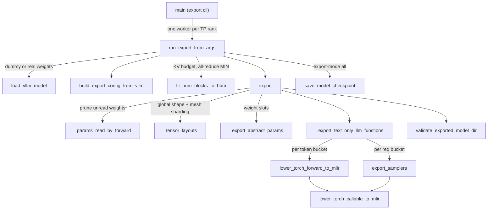

# AOT StableHLO model export and the rvllm Rust launcher

<!-- connect:up:begin -->
> **Cross-repo concept:** part of [kv-cache](../../../concepts/kv-cache.md), [sharding](../../../concepts/sharding.md) across this wiki's repos.
<!-- connect:up:end -->
## Overview

`src/vllm_torchtpu/experimental/` contains two cooperating tools. The **exporter** (`python -m vllm_torchtpu.experimental.export`) takes the `vllm serve` command line, loads the model through vLLM and the TorchTPU plugin exactly as serving would, and lowers it ahead of time into a "StableHLO serving directory": one `forward_bucket{B}.mlir` per token bucket, one `compute_logits_req{R}.mlir` plus four sampler modules per request bucket, an `abstract_params.mlir` identity that defines the weight slots, a `metadata.json` contract, companion tokenizer files, and optionally the real weights as an Orbax checkpoint. The **Rust launcher** (`python -m vllm_torchtpu.experimental.rust serve <model> ...`) splits a `vllm serve` command line between the exporter and `rvllm serve`, exports once into a content-addressed cache, then `exec`s the rvllm binary (not in this repo), which runs the artifact through PJRT "with no Python in the serving process". The key design idea is that everything `vllm serve` decides at startup (block size, KV block count, buckets, sharding, XLA flags, sampler variants) must be **baked into the artifact**, and each module is lowered **shard-local** - the program one device runs, with collectives written explicitly - so the runtime only has to place weights and dispatch programs.

## Diagram

The export pipeline (one worker process per tensor-parallel rank runs everything below `run_export_from_args`):



Legend:
- `CLI` - [`main`](../catalog/src/vllm_torchtpu/experimental/export/cli.md#main "src/vllm_torchtpu/experimental/export/cli.py:L500")
- `RUN` - [`run_export_from_args`](../catalog/src/vllm_torchtpu/experimental/export/cli.md#run_export_from_args "src/vllm_torchtpu/experimental/export/cli.py:L330")
- `LOAD` - [`load_vllm_model`](../catalog/src/vllm_torchtpu/experimental/export/universal_adapter.md#load_vllm_model "src/vllm_torchtpu/experimental/export/universal_adapter.py:L406")
- `CFG` - [`build_export_config_from_vllm`](../catalog/src/vllm_torchtpu/experimental/export/universal_adapter.md#build_export_config_from_vllm "src/vllm_torchtpu/experimental/export/universal_adapter.py:L168")
- `FIT` - [`fit_num_blocks_to_hbm`](../catalog/src/vllm_torchtpu/experimental/export/universal_adapter.md#UniversalVllmExportableLLM.fit_num_blocks_to_hbm "src/vllm_torchtpu/experimental/export/universal_adapter.py:L691")
- `EXP` - [`export`](../catalog/src/vllm_torchtpu/experimental/export/exporter.md#export "src/vllm_torchtpu/experimental/export/exporter.py:L809")
- `PRB` - [`_params_read_by_forward`](../catalog/src/vllm_torchtpu/experimental/export/exporter.md#_params_read_by_forward "src/vllm_torchtpu/experimental/export/exporter.py:L462")
- `LAY` - [`_tensor_layouts`](../catalog/src/vllm_torchtpu/experimental/export/exporter.md#_tensor_layouts "src/vllm_torchtpu/experimental/export/exporter.py:L158")
- `ABS` - [`_export_abstract_params`](../catalog/src/vllm_torchtpu/experimental/export/exporter.md#_export_abstract_params "src/vllm_torchtpu/experimental/export/exporter.py:L306")
- `FUN` - [`_export_text_only_llm_functions`](../catalog/src/vllm_torchtpu/experimental/export/exporter.md#_export_text_only_llm_functions "src/vllm_torchtpu/experimental/export/exporter.py:L489")
- `LFW` - [`lower_torch_forward_to_mlir`](../catalog/src/vllm_torchtpu/experimental/export/tpu_lowering.md#lower_torch_forward_to_mlir "src/vllm_torchtpu/experimental/export/tpu_lowering.py:L284")
- `SMP` - [`export_samplers`](../catalog/src/vllm_torchtpu/experimental/export/sampling.md#export_samplers "src/vllm_torchtpu/experimental/export/sampling.py:L215")
- `LCM` - [`lower_torch_callable_to_mlir`](../catalog/src/vllm_torchtpu/experimental/export/tpu_lowering.md#lower_torch_callable_to_mlir "src/vllm_torchtpu/experimental/export/tpu_lowering.py:L204")
- `VAL` - [`validate_exported_model_dir`](../catalog/src/vllm_torchtpu/experimental/export/validator.md#validate_exported_model_dir "src/vllm_torchtpu/experimental/export/validator.py:L262")
- `CKP` - [`save_model_checkpoint`](../catalog/src/vllm_torchtpu/experimental/export/checkpoint.md#save_model_checkpoint "src/vllm_torchtpu/experimental/export/checkpoint.py:L308")

The launcher's control flow around it:

```mermaid
sequenceDiagram
  participant U as user (vllm serve argv)
  participant L as main (rust launcher)
  participant S as split_args
  participant E as export cli (child process)
  participant R as rvllm binary
  U->>L: serve MODEL [args] --rvllm-binary X
  L->>S: split argv with vLLM's own serve parser
  S-->>L: export_args, serve_args, warnings (or LauncherError)
  L->>L: resolve + sha256-verify binary; cache key = sha256(model, export_args, exporter source)
  alt cached artifact has .complete
    L->>L: reuse ~/.cache/rvllm/artifacts/KEY
  else
    L->>E: python -m ...export MODEL --export-mode all --output-dir KEY.partial
    E-->>L: exit status (non-zero ends the launcher)
    L->>L: rename .partial -> KEY, touch .complete
  end
  L->>R: exec rvllm serve ARTIFACT serve_args
```

Legend:
- `U` - (concept) the caller's command line
- `L` - [`main`](../catalog/src/vllm_torchtpu/experimental/rust/launcher.md#main "src/vllm_torchtpu/experimental/rust/launcher.py:L416")
- `S` - [`split_args`](../catalog/src/vllm_torchtpu/experimental/rust/launcher.md#split_args "src/vllm_torchtpu/experimental/rust/launcher.py:L168")
- `E` - [`main`](../catalog/src/vllm_torchtpu/experimental/export/cli.md#main "src/vllm_torchtpu/experimental/export/cli.py:L500") (run as a subprocess)
- `R` - (concept) the external rvllm binary

## Design rationale (why it's built this way)

- **Reuse vLLM's model, not a hand port.** The adapter around the loaded model "works generically across all vLLM model architectures ... without model-specific hand-written layers": parameters are discovered from the module, sharding is inferred per weight name, and the forward drives vLLM's own backbone under a forward context. [`load_vllm_model`](../catalog/src/vllm_torchtpu/experimental/export/universal_adapter.md#load_vllm_model "src/vllm_torchtpu/experimental/export/universal_adapter.py:L406") applies the TPU quantization config ([`get_tpu_quantization_config`](../catalog/src/vllm_torchtpu/layers/adapter/quantization/__init__.md#get_tpu_quantization_config "src/vllm_torchtpu/layers/adapter/quantization/__init__.py:L51")) and prebuilds each Pallas attention layer's kernel ([`initialize_kernel`](../catalog/src/vllm_torchtpu/layers/adapter/attention.md#PallasAttentionBackendImpl.initialize_kernel "src/vllm_torchtpu/layers/adapter/attention.py:L1329")), so the exported graphs contain the same RPA / MoE kernels the Python serving path runs.
- **Shard-local modules, one worker per rank.** `metadata.json` declares `mlir_shapes: shard_local`; each module is "the program one device runs, with collectives written explicitly in the graph". Tracing collectives needs every rank, so the CLI starts one export worker per TP rank and keeps rank 0's directory. Weights and states are still declared with *global* shapes plus a per-dimension mesh sharding ([`_TensorLayout`](../catalog/src/vllm_torchtpu/experimental/export/exporter.md#_TensorLayout "src/vllm_torchtpu/experimental/export/exporter.py:L148")), so a runtime can place them without knowing vLLM's sharding rules. The mesh has two axes, `data` and `model`; expert parallelism runs on the tensor-parallel devices, so `tp` and `ep` both map to `model`.
- **Bake every startup decision.** The export README is explicit that the artifact "keeps them no matter where it is served": block size, `num_blocks`, buckets and `max_*` limits. [`build_export_config_from_vllm`](../catalog/src/vllm_torchtpu/experimental/export/universal_adapter.md#build_export_config_from_vllm "src/vllm_torchtpu/experimental/export/universal_adapter.py:L168") raises the block size to the smallest power of two whose block table fits half of SMEM (mirroring serving), and [`fit_num_blocks_to_hbm`](../catalog/src/vllm_torchtpu/experimental/export/universal_adapter.md#UniversalVllmExportableLLM.fit_num_blocks_to_hbm "src/vllm_torchtpu/experimental/export/universal_adapter.py:L691") reproduces serving's KV budget. libtpu XLA flags are carried as `compile_options.env_option_overrides` so a runtime that never imports vLLM compiles with the same flags.
- **Request buckets as powers of two.** The default request buckets mirror the runner's padding (8, 16, 32, ... up to `max_num_seqs`); the docstring warns that a fixed list jumping to `max_num_seqs` "would run the LM head and the sampler on 512 rows for any batch above 64".
- **In-place KV via explicit aliasing.** KV/state arguments are donated and paired with their output by `tf.aliasing_output`, because "identical-shape donors, e.g. every layer's KV cache, cannot be paired otherwise".
- **One load serves graph and weights.** The CLI parser forces `load_format = dummy`, and in `--export-mode model` the graph is traced from dummy weights, reading only the checkpoint's config and tokenizer files. In the default `all` mode the worker instead loads the real weights once on TPU (`load_format = auto`), traces the graph from that model and saves the same weights as the checkpoint; `checkpoint` mode fills an existing artifact's weights from a CPU load.
- **The launcher never silently drops a flag.** [`split_args`](../catalog/src/vllm_torchtpu/experimental/rust/launcher.md#split_args "src/vllm_torchtpu/experimental/rust/launcher.py:L168") uses vLLM's real `vllm serve` parser, so option names and value arity are vLLM's; it either routes, warns (log/docs-only options), or raises [`LauncherError`](../catalog/src/vllm_torchtpu/experimental/rust/launcher.md#LauncherError "src/vllm_torchtpu/experimental/rust/launcher.py:L124"). It then `exec`s rvllm so "the server is the only process left, and it gets signals and the exit status directly".

## Entry points

- [`main`](../catalog/src/vllm_torchtpu/experimental/export/cli.md#main "src/vllm_torchtpu/experimental/export/cli.py:L500") - "CLI entrypoint for `python -m vllm_torchtpu.experimental.export`". Dispatches on `--export-mode`: `checkpoint` runs CPU load workers; otherwise it parses args, rejects unsupported parallelism before any worker loads the model, and launches one worker per TP rank (a worker invocation runs [`run_export_from_args`](../catalog/src/vllm_torchtpu/experimental/export/cli.md#run_export_from_args "src/vllm_torchtpu/experimental/export/cli.py:L330") directly).
- [`build_arg_parser`](../catalog/src/vllm_torchtpu/experimental/export/cli.md#build_arg_parser "src/vllm_torchtpu/experimental/export/cli.py:L55") - "the `vllm serve` argument parser plus the export options" (`--output-dir`, `--target-tpu`, `--token-buckets`, `--req-buckets`, `--num-blocks`, `--export-mode`, plus hidden worker flags); shared by the launcher.
- [`export`](../catalog/src/vllm_torchtpu/experimental/export/exporter.md#export "src/vllm_torchtpu/experimental/export/exporter.py:L809") - the library entry: "Exports an `ExportableTextOnlyLLM` to a serving artifact directory". Any object satisfying [`ExportableTextOnlyLLM`](../catalog/src/vllm_torchtpu/experimental/export/api.md#ExportableTextOnlyLLM "src/vllm_torchtpu/experimental/export/api.py:L157") can be exported, not just vLLM models.
- [`main`](../catalog/src/vllm_torchtpu/experimental/rust/launcher.md#main "src/vllm_torchtpu/experimental/rust/launcher.py:L416") - `python -m vllm_torchtpu.experimental.rust`: `serve` exports-then-execs rvllm, `bench` execs `vllm bench`, and other subcommands (`proxy`, `--version`) exec the rvllm binary directly.

## Mechanism (step-by-step)

1. **Worker fan-out.** [`main`](../catalog/src/vllm_torchtpu/experimental/export/cli.md#main "src/vllm_torchtpu/experimental/export/cli.py:L500") prepares a worker environment the way single-host serving does (world size, master address, the unified block pool disabled so recurrent layers keep per-layer state, and the platform's single-host TPU env from [`TpuPlatform`](../catalog/src/vllm_torchtpu/platforms/tpu_platform.md#TpuPlatform "src/vllm_torchtpu/platforms/tpu_platform.py:L453")), picks a JAX coordinator port, and spawns `tp_size` copies of itself, each writing to its own rank directory. If any rank fails the export fails; otherwise rank 0's directory is copied to `--output-dir`, because every rank traces the identical per-device programs.

2. **Config and model.** In each worker [`run_export_from_args`](../catalog/src/vllm_torchtpu/experimental/export/cli.md#run_export_from_args "src/vllm_torchtpu/experimental/export/cli.py:L330") first converts `--speculative-config` into a `serving_config` record and clears it, because "the serving runtime drafts; vLLM must not build a drafter for the export" - only `ngram` is accepted, since it needs no exported draft graphs. It then creates the `VllmConfig` (prefix caching off for hybrid recurrent models), initializes JAX for `all` mode, and calls [`load_vllm_model`](../catalog/src/vllm_torchtpu/experimental/export/universal_adapter.md#load_vllm_model "src/vllm_torchtpu/experimental/export/universal_adapter.py:L406") with real weights for `all` or dummy weights for `model`. Loading comes before the export config because it finalizes the KV block size (`update_block_size_for_backend`, as vLLM's executors do).

3. **Deriving the export config.** [`build_export_config_from_vllm`](../catalog/src/vllm_torchtpu/experimental/export/universal_adapter.md#build_export_config_from_vllm "src/vllm_torchtpu/experimental/export/universal_adapter.py:L168") fills a frozen [`TextOnlyLLMExportConfig`](../catalog/src/vllm_torchtpu/experimental/export/api.md#TextOnlyLLMExportConfig "src/vllm_torchtpu/experimental/export/api.py:L61") from the vLLM config, falling back to HF config fields via [`_extract_hf_field`](../catalog/src/vllm_torchtpu/experimental/export/universal_adapter.md#_extract_hf_field "src/vllm_torchtpu/experimental/export/universal_adapter.py:L87") (which also looks inside a nested `text_config`). It auto-detects `target_tpu` with [`get_chip_version`](../catalog/src/vllm_torchtpu/tpu_info.md#get_chip_version "src/vllm_torchtpu/tpu_info.py:L65") (default `v6e`), takes token buckets from `compilation_config.compile_sizes` or `16,32,64,128,256`, sets `num_partitions = tp` with SPMD partitioning, and resolves [`hf_checkpoint_dir`](../catalog/src/vllm_torchtpu/experimental/export/api.md#TextOnlyLLMExportConfig.hf_checkpoint_dir "src/vllm_torchtpu/experimental/export/api.py:L104") (fetching `tokenizer.json` and `generation_config.json` into the Hub cache, since dummy loading caches only `config.json`). `--num-blocks` and the speculative record are applied on top with `dataclasses.replace`.

4. **Sizing the KV pool.** Unless `--num-blocks` or `num_gpu_blocks_override` is set, [`fit_num_blocks_to_hbm`](../catalog/src/vllm_torchtpu/experimental/export/universal_adapter.md#UniversalVllmExportableLLM.fit_num_blocks_to_hbm "src/vllm_torchtpu/experimental/export/universal_adapter.py:L691") computes the budget as `--kv-cache-memory-bytes`, or the HBM limit x `--gpu-memory-utilization` minus HBM in use after loading ([`compute_hbm_budget`](../catalog/src/vllm_torchtpu/utils.md#compute_hbm_budget "src/vllm_torchtpu/utils.py:L222")). Per-block bytes are measured, not computed by formula: [`_state_bytes`](../catalog/src/vllm_torchtpu/experimental/export/universal_adapter.md#UniversalVllmExportableLLM._state_bytes "src/vllm_torchtpu/experimental/export/universal_adapter.py:L750") sums the declared state tensors at `n` and `n + 1` blocks, so backend padding is included and fixed-size recurrent state comes off the top. The result is all-reduced with MIN across ranks ("rank 0's artifact serves every rank") and written back to [`num_blocks`](../catalog/src/vllm_torchtpu/experimental/export/api.md#TextOnlyLLMExportConfig.num_blocks "src/vllm_torchtpu/experimental/export/api.py:L96").

5. **Declaring state.** [`abstract_states`](../catalog/src/vllm_torchtpu/experimental/export/universal_adapter.md#UniversalVllmExportableLLM.abstract_states "src/vllm_torchtpu/experimental/export/universal_adapter.py:L957") flattens [`_layer_state_specs`](../catalog/src/vllm_torchtpu/experimental/export/universal_adapter.md#UniversalVllmExportableLLM._layer_state_specs "src/vllm_torchtpu/experimental/export/universal_adapter.py:L863"): a Pallas attention layer contributes one KV cache in the backend's own shape (fp8 when `--kv-cache-dtype fp8`), a dense MLA layer one latent KV head replicated on every rank, and a Gated DeltaNet layer two `[num_state_slots, ...]` tensors (conv state split over `model` along channels, recurrent state along value heads). Sparse MLA and non-GDN recurrent layers raise. If a layer type is unknown, `abstract_states` falls back to a uniform `[num_blocks, block_size, 2 x num_kv_heads, head_dim]` cache per layer - the same default the exporter's [`_state_specs`](../catalog/src/vllm_torchtpu/experimental/export/exporter.md#_state_specs "src/vllm_torchtpu/experimental/export/exporter.py:L387") uses for a model that reports no `abstract_states`.

6. **Choosing and laying out weights.** [`export`](../catalog/src/vllm_torchtpu/experimental/export/exporter.md#export "src/vllm_torchtpu/experimental/export/exporter.py:L809") starts from [`abstract_params`](../catalog/src/vllm_torchtpu/experimental/export/universal_adapter.md#UniversalVllmExportableLLM.abstract_params "src/vllm_torchtpu/experimental/export/universal_adapter.py:L762") (parameters with inferred TP/EP sharding, buffers as constants, and a separately named tied LM head so the embedding stays a forward input). [`_params_read_by_forward`](../catalog/src/vllm_torchtpu/experimental/export/exporter.md#_params_read_by_forward "src/vllm_torchtpu/experimental/export/exporter.py:L462") lowers the smallest forward bucket once with every candidate and keeps only the `@main` arguments the body actually reads (e.g. vocabulary shard bounds are read only under TP). [`_tensor_layouts`](../catalog/src/vllm_torchtpu/experimental/export/exporter.md#_tensor_layouts "src/vllm_torchtpu/experimental/export/exporter.py:L158") then assigns each weight a global shape and mesh sharding; a buffer whose value differs per rank becomes a global array with a leading `model`-split dimension, each device holding a `[1, ...]` shard that the forward reshapes back.

7. **Weight slots.** [`_export_abstract_params`](../catalog/src/vllm_torchtpu/experimental/export/exporter.md#_export_abstract_params "src/vllm_torchtpu/experimental/export/exporter.py:L306") lowers an identity module whose input `i` aliases output `i`, at the shard-local shapes from [`_lowered_params`](../catalog/src/vllm_torchtpu/experimental/export/exporter.md#_lowered_params "src/vllm_torchtpu/experimental/export/exporter.py:L208"). Its [`_weight_input_entry`](../catalog/src/vllm_torchtpu/experimental/export/exporter.md#_weight_input_entry "src/vllm_torchtpu/experimental/export/exporter.py:L281") records assign every weight a serving slot index after the six user inputs; the same slot appears on every later module that reads that weight, which is how a runtime binds one device buffer to many programs.

8. **Forward modules per token bucket.** [`_export_text_only_llm_functions`](../catalog/src/vllm_torchtpu/experimental/export/exporter.md#_export_text_only_llm_functions "src/vllm_torchtpu/experimental/export/exporter.py:L489") lowers `forward_bucket{B}.mlir` for each token bucket through [`lower_torch_forward_to_mlir`](../catalog/src/vllm_torchtpu/experimental/export/tpu_lowering.md#lower_torch_forward_to_mlir "src/vllm_torchtpu/experimental/export/tpu_lowering.py:L284"). The `@main` signature is fixed: the six int32 user inputs from [`_user_inputs`](../catalog/src/vllm_torchtpu/experimental/export/exporter.md#_user_inputs "src/vllm_torchtpu/experimental/export/exporter.py:L256") (`input_ids[B]`, `positions[B]` or `[3, B]` for mrope, `kv_lens[max_num_seqs]`, `block_tables[max_num_pages]`, `query_start_loc[max_num_seqs + 1]`, `req_dist[3]`), then the forward weights, then the per-layer states (donated and aliased to outputs), then trailing extras such as `mamba_state_indices`. Only the token dimension varies by bucket; every control tensor is sized by the static maxima ([`max_num_pages`](../catalog/src/vllm_torchtpu/experimental/export/api.md#TextOnlyLLMExportConfig.max_num_pages "src/vllm_torchtpu/experimental/export/api.py:L115") = `max_num_seqs` x pages per sequence). Inside the trace the adapter turns the control tensors into the plugin's attention metadata with [`make_attention_metadata`](../catalog/src/vllm_torchtpu/experimental/export/universal_adapter.md#make_attention_metadata "src/vllm_torchtpu/experimental/export/universal_adapter.py:L61") and calls vLLM's backbone with the weights bound functionally; outputs are the updated states plus `hidden_states[B, hidden]`, each described by an [`_io_entry`](../catalog/src/vllm_torchtpu/experimental/export/exporter.md#_io_entry "src/vllm_torchtpu/experimental/export/exporter.py:L227") in `metadata.json`.

9. **Logits and samplers per request bucket.** For each request bucket R the same function lowers `compute_logits_req{R}.mlir`, which all-gathers the vocabulary shards and drops vocab padding so logits are replicated, marked `intermediate` so they stay on device. [`export_samplers`](../catalog/src/vllm_torchtpu/experimental/export/sampling.md#export_samplers "src/vllm_torchtpu/experimental/export/sampling.py:L215") then writes four sampler modules over those logits - `sample_tokens` (greedy argmax), `sample_tokens_temperature`, `sample_tokens_stochastic` (temperature, top-k, top-p; it takes a `min_p` input only to keep the samplers' signature and does not apply it) and `sample_tokens_penalized` (adds repetition/presence/frequency penalties over a `[R, max_model_len]` history) - so a runtime picks the cheapest variant per batch. Randomness comes from one uniform per row expanded by an integer hash of the token id, keeping sampling batch-invariant and reproducible from a request seed.

10. **Lowering through TorchTPU.** [`lower_torch_callable_to_mlir`](../catalog/src/vllm_torchtpu/experimental/export/tpu_lowering.md#lower_torch_callable_to_mlir "src/vllm_torchtpu/experimental/export/tpu_lowering.py:L204") creates TorchTPU placeholder tensors from [`ShapeDtypeStruct`](../catalog/src/vllm_torchtpu/experimental/export/api.md#ShapeDtypeStruct "src/vllm_torchtpu/experimental/export/api.py:L24") specs, switches TorchTPU into its internal compile-FX-graph eager mode with `torch.compiler.is_compiling` patched to True, runs the callable on clones of the placeholders (so in-place KV writes do not attach to the argument tensors), and serializes the traced result to StableHLO text. Dtypes are normalized both ways by [`dtype_name`](../catalog/src/vllm_torchtpu/experimental/export/tpu_lowering.md#dtype_name "src/vllm_torchtpu/experimental/export/tpu_lowering.py:L104") and [`torch_dtype`](../catalog/src/vllm_torchtpu/experimental/export/tpu_lowering.md#torch_dtype "src/vllm_torchtpu/experimental/export/tpu_lowering.py:L109") (`bf16`, `i32`, `f8E4M3FN`, ...). Each stage is wrapped in a [`trace`](../catalog/src/vllm_torchtpu/experimental/export/trace.md#trace "src/vllm_torchtpu/experimental/export/trace.py:L50") span that logs start/end lines per rank, giving a stage timeline of an export.

11. **Metadata, companions, validation, weights.** [`export`](../catalog/src/vllm_torchtpu/experimental/export/exporter.md#export "src/vllm_torchtpu/experimental/export/exporter.py:L809") writes `metadata.json` (`format_version: 2`, mesh `[dp, tp]` on axes `data`/`model`, a `serving_config` with vocab/EOS/capacity fields and [`_recurrent_serving_config`](../catalog/src/vllm_torchtpu/experimental/export/exporter.md#_recurrent_serving_config "src/vllm_torchtpu/experimental/export/exporter.py:L428")'s `num_state_slots`, compile options, and every function variant), copies `tokenizer.json`, `generation_config.json` and the chat template via [`_emit_model_companion_files`](../catalog/src/vllm_torchtpu/experimental/export/exporter.md#_emit_model_companion_files "src/vllm_torchtpu/experimental/export/exporter.py:L716") (a missing tokenizer is fatal), and finishes with [`validate_exported_model_dir`](../catalog/src/vllm_torchtpu/experimental/export/validator.md#validate_exported_model_dir "src/vllm_torchtpu/experimental/export/validator.py:L262"), which checks the contract including an allowlist of custom calls (TPU custom calls, sharding markers, and an `rvllm.ComputeMasks` call). In `all` mode each worker then calls [`save_model_checkpoint`](../catalog/src/vllm_torchtpu/experimental/export/checkpoint.md#save_model_checkpoint "src/vllm_torchtpu/experimental/export/checkpoint.py:L308") to write its shards of every `abstract_params` input as Orbax Zarr arrays `array_{i}` in `serving_checkpoint/data`, from host memory, so the served weights include vLLM's load-time FP8 requantization and casts.

12. **Launcher.** [`main`](../catalog/src/vllm_torchtpu/experimental/rust/launcher.md#main "src/vllm_torchtpu/experimental/rust/launcher.py:L416") strips `--rvllm-binary`, and [`split_args`](../catalog/src/vllm_torchtpu/experimental/rust/launcher.md#split_args "src/vllm_torchtpu/experimental/rust/launcher.py:L168") walks the remaining tokens with the parser from [`build_arg_parser`](../catalog/src/vllm_torchtpu/experimental/export/cli.md#build_arg_parser "src/vllm_torchtpu/experimental/export/cli.py:L55"): engine arguments (fields of `AsyncEngineArgs`) go to the exporter; `--host`, `--port`, `--served-model-name`, `--[no-]async-scheduling` go to rvllm (`--load-format` to both); rvllm-only deployment flags (`--role`, `--kv-port`, `--kv-producers`, ...) pass through; `--output-dir` / `--export-mode` are refused as launcher-chosen and `--kv-transfer-config` is refused in favor of rvllm's own disaggregation flags. A local binary file is used as is, while a binary fetched from a `gs://`, `https://` or directory location is verified against the `sha256` in that location's `metadata.json`; the artifact key hashes model + export args + the exporter's own source files, a fresh export goes to `KEY.partial` and is renamed and stamped `.complete` only on success, and the launcher finally `exec`s `rvllm serve <artifact>`.

## Key data structures

- [`TextOnlyLLMExportConfig`](../catalog/src/vllm_torchtpu/experimental/export/api.md#TextOnlyLLMExportConfig "src/vllm_torchtpu/experimental/export/api.py:L61") - the frozen record of every static size baked into the artifact: model dims, `block_size`, [`num_blocks`](../catalog/src/vllm_torchtpu/experimental/export/api.md#TextOnlyLLMExportConfig.num_blocks "src/vllm_torchtpu/experimental/export/api.py:L96"), `max_num_seqs`, `max_model_len`, `token_buckets`, `req_buckets`, `uses_mrope`, `speculative_config`; derived [`max_num_pages`](../catalog/src/vllm_torchtpu/experimental/export/api.md#TextOnlyLLMExportConfig.max_num_pages "src/vllm_torchtpu/experimental/export/api.py:L115"), `max_cu_seqs` and `num_state_slots` (`max_num_seqs + 1`, slot 0 null). Its base adds [`tensor_parallel_size`](../catalog/src/vllm_torchtpu/experimental/export/api.md#ModelExportConfig.tensor_parallel_size "src/vllm_torchtpu/experimental/export/api.py:L55") ("size of the serving mesh's 'tp' axis").
- [`ExportableTextOnlyLLM`](../catalog/src/vllm_torchtpu/experimental/export/api.md#ExportableTextOnlyLLM "src/vllm_torchtpu/experimental/export/api.py:L157") - the protocol the exporter consumes: [`export_config`](../catalog/src/vllm_torchtpu/experimental/export/api.md#ExportableTextOnlyLLM.export_config "src/vllm_torchtpu/experimental/export/api.py:L169"), `abstract_params`, optional `abstract_states`, a flattened 1-D continuous-batching `forward(weights, kv_caches, *, input_ids, positions, kv_lens, block_tables, query_start_loc, req_dist)`, `compute_logits` and `sample_tokens`. The vLLM adapter keeps its config in [`_export_config`](../catalog/src/vllm_torchtpu/experimental/export/universal_adapter.md#UniversalVllmExportableLLM._export_config "src/vllm_torchtpu/experimental/export/universal_adapter.py:L658") and replaces it when `num_blocks` is fitted or mrope is detected.
- [`ShapeDtypeStruct`](../catalog/src/vllm_torchtpu/experimental/export/api.md#ShapeDtypeStruct "src/vllm_torchtpu/experimental/export/api.py:L24") - shape, dtype and optional sharding: the abstract tensor every lowering consumes.
- [`_TensorLayout`](../catalog/src/vllm_torchtpu/experimental/export/exporter.md#_TensorLayout "src/vllm_torchtpu/experimental/export/exporter.py:L148") - global shape, sharding, shard-local lowered shape, and an optional reshape for per-device constants.
- `metadata.json` - the runtime contract. `functions` maps `abstract_params`, `forward` (keyed by token bucket), `compute_logits` and the four samplers (keyed by request bucket) to `{file_path, inputs, outputs}`; each input carries `argument_type` (`user_io`, `weight`, `constant`, `state`, `intermediate`), `buffer_donor`, and a weight slot `index`.

Knobs that shape the artifact (all baked in):

| Flag | Default | Effect |
|---|---|---|
| `--token-buckets` | `compile_sizes`, else `16,32,64,128,256` | one forward module per bucket; padding waste per step |
| `--req-buckets` | powers of two from 8, ending at `--max-num-seqs` | one logits + 4 sampler modules per bucket |
| `--num-blocks` | fitted from `--kv-cache-memory-bytes` or HBM x `--gpu-memory-utilization` | KV capacity; measured on the export host |
| `--block-size` | platform choice after load, raised to fit the block table in SMEM | page size of the paged KV pool |
| `--kv-cache-dtype` | model activation dtype | fp8 KV is declared in fp8 with its packing |
| `--export-mode` | `all` | `model` (no weights), `checkpoint` (CPU, weights only), `all` (both from one TPU load) |
| `--speculative-config` | none | only `ngram` accepted; recorded for the runtime |

## Dynamics (design intent)

- **Collective calls must line up across ranks.** Constant-value gathering and the `num_blocks` MIN all-reduce are collective, so every rank runs them with the same arguments in the same order (stated in the `_tensor_layouts` and `fit_num_blocks_to_hbm` docstrings).
- **No profile pass.** The README notes that `vllm serve` measures memory after a profile run at `max_num_batched_tokens`, while the exporter does not, so activations must fit in the headroom `--gpu-memory-utilization` leaves; `--kv-cache-memory-bytes` gives both paths the same KV budget and also works on a host without the target TPU.
- **Export time vs reuse.** The launcher's cache key includes a hash of the exporter source, so any exporter change forces a re-export, while a repeated start with the same model and engine arguments skips straight to `exec`.
- **`checkpoint` vs `all`.** Per the README, `checkpoint` requantizes on CPU, where a tiny fraction of FP8 values on a rounding boundary differ by one ULP from what TPU serving computes; `all` saves exactly the TPU-computed weights from a single load.

## Edge cases

- Data or pipeline parallel size above 1 is rejected before any worker starts; only text-only causal LMs are covered.
- Speculative methods other than `ngram` (MTP, EAGLE, DFlash, draft models) are rejected because they would need exported draft graphs.
- A hybrid recurrent model whose fitted `num_blocks` equals `max_num_seqs + 1` is rejected: the runtime tells KV pools from recurrent pools by leading dimension.
- An artifact exported on one chip type or at one utilization keeps that `num_blocks` wherever it is served.
- The launcher refuses any `--rvllm-*` option other than `--rvllm-binary`, any `vllm serve` frontend option rvllm does not implement (e.g. `--api-key`, `--chat-template`), and any token `vllm serve` itself does not know.

## Open questions

- The packet subgraph lacks several central symbols, so they are described rather than linked: the adapter class itself and its `forward`, the launcher's artifact cache and binary resolution helpers, the per-rank worker launcher, the speculative-config filter, the donor-to-output aliasing pass, the weight-name sharding inference in `weight_mapper.py`, the in-graph RoPE patch in `rope_patch.py`, and the CPU checkpoint path.
- The rvllm runtime that consumes the artifact is not in this repository, so how it chooses among sampler variants or schedules buckets cannot be confirmed here.

> [!inferred]
> Because every forward bucket takes control tensors sized by `max_num_seqs` and `max_num_pages` regardless of the live batch, a large `--max-num-seqs` or `--max-model-len` grows the per-step metadata the runtime uploads and the block-table reads in the attention kernel, independent of the token bucket chosen; this follows from the fixed `@main` signature, not from a measurement.

## See also

- [compilation-and-graph-capture](compilation-and-graph-capture.md) - the JIT path this AOT path parallels.
- [kv-cache-layout-and-hbm-budget](kv-cache-layout-and-hbm-budget.md) - KV shapes and the HBM budget the exporter reproduces.
- [ragged-paged-attention-kernel](ragged-paged-attention-kernel.md) - the attention kernel baked into each forward module.
- [quantization-methods](quantization-methods.md) - FP8 load-time processing captured in the exported weights.
- [gated-deltanet-kernels](gated-deltanet-kernels.md) - recurrent layers exported as conv/recurrent state pools.
- [distributed-parallelism-and-meshes](distributed-parallelism-and-meshes.md) - TP/EP sharding mapped to the `model` axis.
- [tpu-platform](tpu-platform.md) - single-host TPU env preparation reused by export workers.
