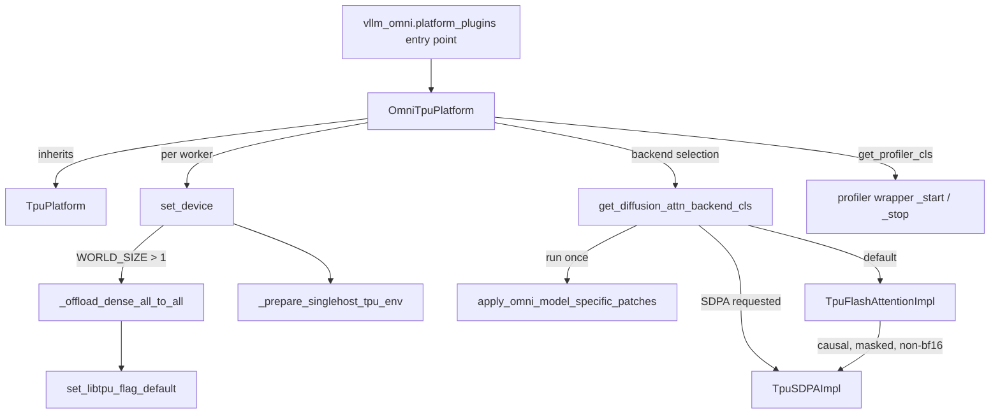

# vLLM-Omni diffusion support (OmniTpuPlatform, diffusion attention, TPU patches, profiler)

<!-- connect:up:begin -->
> **Cross-repo concept:** part of [flash-attention](../../../concepts/flash-attention.md), [pallas-kernel](../../../concepts/pallas-kernel.md), [sequence-parallelism](../../../concepts/sequence-parallelism.md), [sparsecore](../../../concepts/sparsecore.md) across this wiki's repos.
<!-- connect:up:end -->
## Overview

`src/vllm_torchtpu/omni` makes this plugin a platform for **vLLM-Omni**, the multimodal/diffusion
serving stack (installed via the `omni` extra; text-to-video, image-to-video and image models such
as Wan2.2, LTX-2 and Qwen-Image). The single key idea:
[`OmniTpuPlatform`](../catalog/src/vllm_torchtpu/omni/platform.md#OmniTpuPlatform "src/vllm_torchtpu/omni/platform.py:L30")
inherits both vLLM-Omni's `OmniPlatform` and this repo's
[`TpuPlatform`](../catalog/src/vllm_torchtpu/platforms/tpu_platform.md#TpuPlatform "src/vllm_torchtpu/platforms/tpu_platform.py:L453"),
reusing all TPU device/runtime plumbing and adding only what diffusion workers need. Because
vLLM-Omni spawns its diffusion workers itself (not through the TPU worker's lifecycle and
patch registry), the platform applies its own run-once patches - a global one at construction and
the model-specific set at the moment vLLM-Omni asks for a diffusion attention backend
([`get_diffusion_attn_backend_cls`](../catalog/src/vllm_torchtpu/omni/platform.md#OmniTpuPlatform.get_diffusion_attn_backend_cls "src/vllm_torchtpu/omni/platform.py:L53")).
Five of the eleven model-specific patches are performance fixes with measured v7x numbers: they remove per-step
recompiles, layout copies and redundant fusion work that torch_tpu/XLA would otherwise emit for
diffusion transformers. A TPU device profiler subclass completes the picture.

## Diagram

Legend:
- `EP` - (concept) the `vllm_omni.platform_plugins` entry point in `pyproject.toml`, which returns the platform path only when TPU chips are present
- `PLAT` - [`OmniTpuPlatform`](../catalog/src/vllm_torchtpu/omni/platform.md#OmniTpuPlatform "src/vllm_torchtpu/omni/platform.py:L30")
- `TPUP` - [`TpuPlatform`](../catalog/src/vllm_torchtpu/platforms/tpu_platform.md#TpuPlatform "src/vllm_torchtpu/platforms/tpu_platform.py:L453")
- `SD` - [`set_device`](../catalog/src/vllm_torchtpu/omni/platform.md#OmniTpuPlatform.set_device "src/vllm_torchtpu/omni/platform.py:L98")
- `A2A` - [`_offload_dense_all_to_all`](../catalog/src/vllm_torchtpu/omni/platform.md#OmniTpuPlatform._offload_dense_all_to_all "src/vllm_torchtpu/omni/platform.py:L121")
- `FLAG` - [`set_libtpu_flag_default`](../catalog/src/vllm_torchtpu/env_override.md#set_libtpu_flag_default "src/vllm_torchtpu/env_override.py:L163")
- `ENV` - [`_prepare_singlehost_tpu_env`](../catalog/src/vllm_torchtpu/platforms/tpu_platform.md#TpuPlatform._prepare_singlehost_tpu_env "src/vllm_torchtpu/platforms/tpu_platform.py:L624")
- `ATTN` - [`get_diffusion_attn_backend_cls`](../catalog/src/vllm_torchtpu/omni/platform.md#OmniTpuPlatform.get_diffusion_attn_backend_cls "src/vllm_torchtpu/omni/platform.py:L53")
- `MSP` - [`apply_omni_model_specific_patches`](../catalog/src/vllm_torchtpu/omni/patches.md#apply_omni_model_specific_patches "src/vllm_torchtpu/omni/patches.py:L74")
- `FA` - [`TpuFlashAttentionImpl`](../catalog/src/vllm_torchtpu/omni/attention.md#TpuFlashAttentionImpl "src/vllm_torchtpu/omni/attention.py:L77")
- `SDPA` - [`TpuSDPAImpl`](../catalog/src/vllm_torchtpu/omni/attention.md#TpuSDPAImpl "src/vllm_torchtpu/omni/attention.py:L36")
- `PROF` - the TPU profiler wrapper's [`_start`](../catalog/src/vllm_torchtpu/omni/profiler.md#TpuOmniTorchProfilerWrapper._start "src/vllm_torchtpu/omni/profiler.py:L102") / [`_stop`](../catalog/src/vllm_torchtpu/omni/profiler.md#TpuOmniTorchProfilerWrapper._stop "src/vllm_torchtpu/omni/profiler.py:L163")

## Design rationale (why it's built this way)

- **Reuse the LLM platform, override only diffusion seams.** Inheriting
  [`TpuPlatform`](../catalog/src/vllm_torchtpu/platforms/tpu_platform.md#TpuPlatform "src/vllm_torchtpu/platforms/tpu_platform.py:L453")
  keeps one source of truth for the single-host PjRt environment setup and the distributed backend,
  and both Omni autoregressive and generation workers map to the regular TPU worker. The
  Omni-specific surface is small: capability flags (no Inductor, no dense diffusion flash attention
  from upstream, no float64, no CPU offload), memory queries (HBM size from torch_tpu's hardware
  query, free/peak memory via `torch.accelerator`), the multi-rank `set_device`, the attention
  backend and the profiler.
- **Patches live in one file, applied by the platform.** The patches module docstring explains that
  diffusion workers "run in separate worker processes spawned by vLLM-Omni's DiffusionEngine rather
  than through TPUWorker's worker_init / model_load lifecycle stages, so OmniTpuPlatform applies the
  Omni patches itself". Both entry functions are `@run_once` (several patches also carry their own
  idempotence flag), each patch logs one `Applied TPU patch: ...` line, and each carries a TODO or
  removal condition naming the upstream fix that would retire it.

> [!inferred]
> Model-specific patches are deferred to backend selection presumably because that is the first
> platform hook that runs inside the diffusion worker after the model's vLLM-Omni modules are in
> use, and before any of the patched classes execute; the source states where they run, not why.
- **Fix the cause the profile shows.** The perf patches each target a specific torch_tpu/XLA
  behavior: view offsets baked into graphs (recompile per denoising step), size-2 minor dimensions
  (relayout copies around every RoPE), producer fusion duplicating a GELU per output tile, and
  multi-pass norm + RoPE fusions. The fixes are rewrites that keep results bit-identical or closer
  to an f64 reference, never approximations.
- **Orchestrator never touches the TPU.** The review rules for `omni/` require code that may run in
  the CPU-only vLLM-Omni orchestrator to avoid TPU tensors and device memory queries, because a
  second process initializing PjRt collides on the libtpu lockfile; the IPC patch moves tensors to
  CPU before pickling for the same reason.

## Entry points

- [`OmniTpuPlatform`](../catalog/src/vllm_torchtpu/omni/platform.md#OmniTpuPlatform "src/vllm_torchtpu/omni/platform.py:L30") -
  resolved by vLLM-Omni through the `vllm_omni.platform_plugins` entry point (which returns `None`
  when no TPU chip is visible). Its constructor applies the global patch that raises
  `VLLM_OMNI_ASYNC_OUTPUT_TIMEOUT` to 1800 s, because first-request compilation of large diffusion
  models (Wan 14B) exceeds vLLM-Omni's 600 s default.
- [`set_device`](../catalog/src/vllm_torchtpu/omni/platform.md#OmniTpuPlatform.set_device "src/vllm_torchtpu/omni/platform.py:L98") -
  called in each diffusion worker before its first TPU allocation; does the multi-rank bootstrap.
- [`get_diffusion_attn_backend_cls`](../catalog/src/vllm_torchtpu/omni/platform.md#OmniTpuPlatform.get_diffusion_attn_backend_cls "src/vllm_torchtpu/omni/platform.py:L53") -
  called when a diffusion model builds its attention layers; applies
  [`apply_omni_model_specific_patches`](../catalog/src/vllm_torchtpu/omni/patches.md#apply_omni_model_specific_patches "src/vllm_torchtpu/omni/patches.py:L74")
  once and returns the backend class path.
- The profiler wrapper ([`_start`](../catalog/src/vllm_torchtpu/omni/profiler.md#TpuOmniTorchProfilerWrapper._start "src/vllm_torchtpu/omni/profiler.py:L102")) -
  returned by `get_profiler_cls` and driven by Omni's `start_profile()` / `stop_profile()` when
  `profiler_config={"profiler": "torch", "torch_profiler_dir": ...}` is set.

## Mechanism (step-by-step)

1. **Worker bootstrap.** [`set_device`](../catalog/src/vllm_torchtpu/omni/platform.md#OmniTpuPlatform.set_device "src/vllm_torchtpu/omni/platform.py:L98") reads `WORLD_SIZE` (only here). For multi-rank diffusion stages it records the world size (used by [`dist_backend`](../catalog/src/vllm_torchtpu/omni/platform.md#OmniTpuPlatform.dist_backend "src/vllm_torchtpu/omni/platform.py:L43")), warns if `TPU_VISIBLE_CHIPS` is not chips `0..N-1` (multi-rank stages on other chips are unsupported), rebuilds `TORCH_TPU_SLICEBUILDER_ADDRESSES` as `localhost:MASTER_PORT+1+i` so every rank shares one list (vLLM-Omni spawns workers with no parent hook, so each would otherwise pick random ports and the slice bootstrap never completes; an inherited list from an LLM stage is replaced because sharing it hangs that stage), and turns on SparseCore dense all-to-all offload. It then runs [`_prepare_singlehost_tpu_env`](../catalog/src/vllm_torchtpu/platforms/tpu_platform.md#TpuPlatform._prepare_singlehost_tpu_env "src/vllm_torchtpu/platforms/tpu_platform.py:L624"), selects device index 0, allocates a 1-element tensor and synchronizes - forcing PjRt creation now, while the environment edits still take effect.

2. **SparseCore all-to-all for Ulysses.** [`_offload_dense_all_to_all`](../catalog/src/vllm_torchtpu/omni/platform.md#OmniTpuPlatform._offload_dense_all_to_all "src/vllm_torchtpu/omni/platform.py:L121") calls [`set_libtpu_flag_default`](../catalog/src/vllm_torchtpu/env_override.md#set_libtpu_flag_default "src/vllm_torchtpu/env_override.py:L163") with `--xla_tpu_enable_sparse_core_collective_offload_dense_all_to_all=true` (a user setting in `LIBTPU_INIT_ARGS` wins). Its docstring: "Ulysses sequence parallelism moves q, k, v and the attention output through dense all-to-alls in every transformer block. By default XLA runs them on the TensorCore, which waits for them." It works after `torch_tpu` import because libtpu parses the flags at PjRt client creation, on the first device allocation.

3. **Backend selection and fallback.** [`get_diffusion_attn_backend_cls`](../catalog/src/vllm_torchtpu/omni/platform.md#OmniTpuPlatform.get_diffusion_attn_backend_cls "src/vllm_torchtpu/omni/platform.py:L53") returns the SDPA backend (`TPU_SDPA`) when `SDPA`, `TPU_SDPA` or `TORCH_SDPA` is requested and the Pallas flash backend (`TPU_FLASH_ATTN`) otherwise. [`TpuFlashAttentionImpl`](../catalog/src/vllm_torchtpu/omni/attention.md#TpuFlashAttentionImpl "src/vllm_torchtpu/omni/attention.py:L77") builds a `pallas::diffusion_flash_attention` torch custom op (wrapping the `(B, S, H, D)` flash kernel in `kernels/diffusion_attention/`) once, eagerly in `__init__` so it is never built inside a compiled region. Its [`forward`](../catalog/src/vllm_torchtpu/omni/attention.md#TpuFlashAttentionImpl.forward "src/vllm_torchtpu/omni/attention.py:L109") rejects head counts that are not a multiple of KV heads and routes causal, masked or non-bf16 calls (one-time warning) to [`TpuSDPAImpl`](../catalog/src/vllm_torchtpu/omni/attention.md#TpuSDPAImpl "src/vllm_torchtpu/omni/attention.py:L36"), whose [`forward`](../catalog/src/vllm_torchtpu/omni/attention.md#TpuSDPAImpl.forward "src/vllm_torchtpu/omni/attention.py:L39") runs vLLM-Omni's SDPA implementation with broadcast key masks.

4. **Correctness and plumbing patches.** [`apply_omni_model_specific_patches`](../catalog/src/vllm_torchtpu/omni/patches.md#apply_omni_model_specific_patches "src/vllm_torchtpu/omni/patches.py:L74") applies eleven patches in a fixed order. The non-perf ones: [`_patch_diffusion_ipc_cpu_pack`](../catalog/src/vllm_torchtpu/omni/patches.md#_patch_diffusion_ipc_cpu_pack "src/vllm_torchtpu/omni/patches.py:L89") (pickling a TPU tensor aborts the worker with SIGABRT), [`_patch_qwen_image_rope_txt_freqs_clone`](../catalog/src/vllm_torchtpu/omni/patches.md#_patch_qwen_image_rope_txt_freqs_clone "src/vllm_torchtpu/omni/patches.py:L118") (`torch.real`/`imag` on a non-inference complex slice fails in inference mode), [`_patch_diffusion_worker_d2h_stream`](../catalog/src/vllm_torchtpu/omni/patches.md#_patch_diffusion_worker_d2h_stream "src/vllm_torchtpu/omni/patches.py:L212") (the output loop's D2H stream is created on `gpu_id`, but every TPU worker selected device 0, so [`_tpu_async_output_loop`](../catalog/src/vllm_torchtpu/omni/patches.md#_patch_diffusion_worker_d2h_stream._tpu_async_output_loop "src/vllm_torchtpu/omni/patches.py:L238") runs it with a proxy reporting the current device), [`_patch_diffusion_startup_warmup_sync`](../catalog/src/vllm_torchtpu/omni/patches.md#_patch_diffusion_startup_warmup_sync "src/vllm_torchtpu/omni/patches.py:L265") (see Dynamics), [`_patch_sdpa_fallback_dispatch`](../catalog/src/vllm_torchtpu/omni/patches.md#_patch_sdpa_fallback_dispatch "src/vllm_torchtpu/omni/patches.py:L405") (vLLM-Omni's `sdpa_fallback` raised `NotImplementedError` on out-of-tree platforms; LTX-2, SANA-Video, LingBot-Video and SenseNova-U1 use it) and [`_patch_ltx2_vocoder_cpu_init`](../catalog/src/vllm_torchtpu/omni/patches.md#_patch_ltx2_vocoder_cpu_init "src/vllm_torchtpu/omni/patches.py:L438") with [`_wrap_ltx2_bwe_filter_restore`](../catalog/src/vllm_torchtpu/omni/patches.md#_wrap_ltx2_bwe_filter_restore "src/vllm_torchtpu/omni/patches.py:L491") (torch_tpu lacks `kaiser_window` and `sinc`, so the LTX-2 vocoder and its resampler filter are built on CPU and moved).

5. **Wan: stop recompiling every denoising step.** [`_patch_wan_fresh_timestep`](../catalog/src/vllm_torchtpu/omni/patches.md#_patch_wan_fresh_timestep "src/vllm_torchtpu/omni/patches.py:L340") wraps the Wan T2V/I2V/TI2V, VACE and S2V transformers via [`_wrap_fresh_timestep`](../catalog/src/vllm_torchtpu/omni/patches.md#_wrap_fresh_timestep "src/vllm_torchtpu/omni/patches.py:L380"). The pipeline passes `t.expand(batch)`, a view into `scheduler.timesteps`, and "torch_tpu bakes a view's offset into every graph that reads it, so the transformer recompiles at every denoising step". [`_fresh_timestep_forward`](../catalog/src/vllm_torchtpu/omni/patches.md#_wrap_fresh_timestep._fresh_timestep_forward "src/vllm_torchtpu/omni/patches.py:L388") clones the timestep and flushes the clone with [`synchronize_tensors`](../catalog/src/vllm_torchtpu/utils.md#synchronize_tensors "src/vllm_torchtpu/utils.py:L358") (`wait=False`) so only a tiny copy graph sees the view. Measured on v7x, 480x832x81 on 8 cores: first 12-step request 53.0 s -> 26.9 s, bit-identical output.

6. **Wan: RoPE without relayouts.** [`_patch_wan_pair_swap_rope`](../catalog/src/vllm_torchtpu/omni/patches.md#_patch_wan_pair_swap_rope "src/vllm_torchtpu/omni/patches.py:L149") replaces `RotaryEmbeddingWan.forward` (on the class, because the CustomOp binds its method at construction) with [`rotary_embedding_wan_forward`](../catalog/src/vllm_torchtpu/omni/rope.md#rotary_embedding_wan_forward "src/vllm_torchtpu/omni/rope.py:L75"). Upstream rotates interleaved pairs with `unflatten(-1, (-1, 2))` / `stack`, which torch_tpu lowers to sequence-minor layouts plus strided copies; [`apply_rotary_pair_swap`](../catalog/src/vllm_torchtpu/omni/rope.md#apply_rotary_pair_swap "src/vllm_torchtpu/omni/rope.py:L61") computes `x * cos2 + (x @ P) * sin2` on the natural `(..., head_dim)` layout, where `P` is a signed pair-swap permutation that runs on the otherwise idle MXU and is exact in bf16 (one +-1 term per output). Cost removed: ~7 ms per Wan2.2-A14B layer at 480p on v7x (80.8 -> 73.9 ms, ~9% of the layer). Non-bf16 or non-interleaved calls use the original method.

7. **Wan: one fused q/k RMSNorm + RoPE pass.** [`_patch_wan_fused_qk_norm_rope`](../catalog/src/vllm_torchtpu/omni/patches.md#_patch_wan_fused_qk_norm_rope "src/vllm_torchtpu/omni/patches.py:L297") swaps `WanSelfAttention.forward` for [`_fused_self_attention_forward`](../catalog/src/vllm_torchtpu/omni/patches.md#_patch_wan_fused_qk_norm_rope._fused_self_attention_forward "src/vllm_torchtpu/omni/patches.py:L324"): when the call is bf16 MHA with RMSNorm q/k norms, no gate compression and `head_dim % 128 == 0`, [`wan_self_attention_fused`](../catalog/src/vllm_torchtpu/omni/rope.md#wan_self_attention_fused "src/vllm_torchtpu/omni/rope.py:L186") runs the QKV projection, then a `pallas::wan_qk_norm_rope` op ([`_qk_norm_rope_op`](../catalog/src/vllm_torchtpu/omni/rope.md#_qk_norm_rope_op "src/vllm_torchtpu/omni/rope.py:L143")) that reads q and k once and writes them once, with RoPE tables expanded per row by [`table`](../catalog/src/vllm_torchtpu/omni/rope.md#wan_self_attention_fused.table "src/vllm_torchtpu/omni/rope.py:L198"). XLA otherwise emits a row-reduction fusion (below HBM bandwidth), an apply fusion and a RoPE fusion, each streaming `(tokens, 5120)` q and k: ~0.78 ms per block at 8190 tokens per core vs 0.23 ms for the kernel, which is also closer to an f64 reference (single rounding).

8. **Wan: fence the FFN GELU.** [`_patch_wan_ffn_gelu_fence`](../catalog/src/vllm_torchtpu/omni/patches.md#_patch_wan_ffn_gelu_fence "src/vllm_torchtpu/omni/patches.py:L177") wraps `ColumnParallelGELU.forward` in [`_fenced_gelu_forward`](../catalog/src/vllm_torchtpu/omni/patches.md#_patch_wan_ffn_gelu_fence._fenced_gelu_forward "src/vllm_torchtpu/omni/patches.py:L202"), which passes the GELU output through [`optimization_barrier_op`](../catalog/src/vllm_torchtpu/layers/adapter/custom_ops/optimization_barrier_op.md#optimization_barrier_op "src/vllm_torchtpu/layers/adapter/custom_ops/optimization_barrier_op.py:L29"). XLA had fused the up-projection bias + tanh-GELU into the down-projection's operand fusion, recomputing the GELU of the `(tokens, 13824)` activation for every output tile; the barrier makes XLA materialize it once in bf16 (the value eager PyTorch produces). Measured on Wan2.2-I2V-A14B, v7x: 72.72 -> 71.39 ms per block at 32,760 tokens on one core; 0.939 -> 0.927 s/step at 480x832x81 on 8 cores (CFG 2 x Ulysses 4).

9. **LTX-2: cached split RoPE on the q/k layout.** [`_patch_ltx2_split_rope`](../catalog/src/vllm_torchtpu/omni/patches.md#_patch_ltx2_split_rope "src/vllm_torchtpu/omni/patches.py:L533") replaces the LTX-2 rope module's forward with [`_cached_rope_forward`](../catalog/src/vllm_torchtpu/omni/patches.md#_patch_ltx2_split_rope._cached_rope_forward "src/vllm_torchtpu/omni/patches.py:L585") and the module-level rotation with [`_apply_split_rotary_emb`](../catalog/src/vllm_torchtpu/omni/patches.md#_patch_ltx2_split_rope._apply_split_rotary_emb "src/vllm_torchtpu/omni/patches.py:L621"). Upstream builds `(B, H, T, D/2)` tables every step and transposes every `(B, T, H*D)` q/k to per-head layout and back; [`split_rope_natural_tables`](../catalog/src/vllm_torchtpu/omni/rope.md#split_rope_natural_tables "src/vllm_torchtpu/omni/rope.py:L94") lays tables out as `(B, 1, T, H*D)` with the half signs folded into `sin`, and [`apply_split_rotary_half_swap`](../catalog/src/vllm_torchtpu/omni/rope.md#apply_split_rotary_half_swap "src/vllm_torchtpu/omni/rope.py:L116") rotates elementwise via two rolls and a lane select. Tables are cached per module, keyed on the coords storage pointer, layout, dtype, device and version counter, and materialized once. LTX-2 T2V 704x1280x121, 40 steps, v7x: 0.770 -> 0.482 s/step (-37%). With TP, each rank slices its heads' lanes from the full-width tables.

10. **Device profiling.** On [`_start`](../catalog/src/vllm_torchtpu/omni/profiler.md#TpuOmniTorchProfilerWrapper._start "src/vllm_torchtpu/omni/profiler.py:L102") the wrapper (whose construction of `torch.profiler` is deferred because the TPU tracer binds its output directory) creates the [`profiler`](../catalog/src/vllm_torchtpu/omni/profiler.md#TpuOmniTorchProfilerWrapper.profiler "src/vllm_torchtpu/omni/profiler.py:L134") with CPU + `PrivateUse1` activities and a `TpuProfilerConfig` whose tracer levels come from [`resolve_profile_dir_and_opts`](../catalog/src/vllm_torchtpu/tracing/options.md#resolve_profile_dir_and_opts "src/vllm_torchtpu/tracing/options.py:L101"); a shared timestamp from [`resolve_canonical_dst_ts`](../catalog/src/vllm_torchtpu/profiler_trace.md#resolve_canonical_dst_ts "src/vllm_torchtpu/profiler_trace.py:L80") lets all ranks land in one `<prefix>/plugins/profile/<canonical_ts>/` XSpace run although their session timestamps differ. [`_stop`](../catalog/src/vllm_torchtpu/omni/profiler.md#TpuOmniTorchProfilerWrapper._stop "src/vllm_torchtpu/omni/profiler.py:L163") merges each rank's capture into that run and rank 0 calls [`clear_canonical_ts_marker`](../catalog/src/vllm_torchtpu/profiler_trace.md#clear_canonical_ts_marker "src/vllm_torchtpu/profiler_trace.py:L138"). Omni's `torch_profiler_with_stack` is mapped to the TPU Python tracer ([`_tpu_python_tracer`](../catalog/src/vllm_torchtpu/omni/profiler.md#TpuOmniTorchProfilerWrapper._tpu_python_tracer "src/vllm_torchtpu/omni/profiler.py:L73")) and `with_stack` is forced off.

## Key data structures

| Patch | Model / component | torch_tpu or XLA cause | Measured effect (v7x) |
|---|---|---|---|
| fresh timestep | Wan transformers | view offset baked into graphs -> recompile per step | first 12-step request 53.0 -> 26.9 s, bit-identical |
| pair-swap RoPE | Wan `RotaryEmbeddingWan` | size-2 minor dim -> relayout + strided copies | 80.8 -> 73.9 ms per layer (480p) |
| fused q/k norm + RoPE (Pallas) | `WanSelfAttention` | 3 HBM-streaming fusions, slow row reduction | 0.78 -> 0.23 ms per block (8190 tokens/core) |
| GELU fusion fence | Wan FFN | producer duplicated into matmul operand fusion | 72.72 -> 71.39 ms/block; 0.939 -> 0.927 s/step |
| cached split RoPE | LTX-2 | per-head transposes + per-step table rebuild | 0.770 -> 0.482 s/step |
| startup warmup sync | `DiffusionEngine` | deferred-op queue spills into first request | first-request numerics match later requests |
| async output timeout | all | first compile > 600 s | startup no longer times out |

The profiler's per-capture state is a small named tuple ([`_capture_state`](../catalog/src/vllm_torchtpu/omni/profiler.md#TpuOmniTorchProfilerWrapper._capture_state "src/vllm_torchtpu/omni/profiler.py:L84")) carrying the capture dir, the shared [`run_root`](../catalog/src/vllm_torchtpu/omni/profiler.md#_CaptureState.run_root "src/vllm_torchtpu/omni/profiler.py:L56"), canonical timestamp, [`rank`](../catalog/src/vllm_torchtpu/omni/profiler.md#_CaptureState.rank "src/vllm_torchtpu/omni/profiler.py:L58"), world size and session key from `_start` to `_stop`.

## Dynamics (design intent)

- **Patch timing.** The global patch runs when the platform object is constructed (in every process that builds it); model patches run on the first attention-backend lookup in a worker, once per process (`@run_once`), with per-patch flags so re-entry (or a subclass with its own `forward`, like the Wan VACE model) is handled.
- **Deferred execution and determinism.** [`_patch_diffusion_startup_warmup_sync`](../catalog/src/vllm_torchtpu/omni/patches.md#_patch_diffusion_startup_warmup_sync "src/vllm_torchtpu/omni/patches.py:L265"): the startup warmup drops its output without a host sync, so under torch_tpu `DEFER_AND_FUSE` its tail ops (VAE decode) stay queued and get fused with the first real request into different programs, making the first request differ numerically from later same-seed requests. A device synchronize after warmup fixes it - only for the in-process (uniproc) executor; mp workers never run the warmup.
- **Lazy output timing.** The 1800 s timeout patch notes that the diffusion worker reports compute done before the TPU finishes, so the async output loop's `.cpu()` blocks on the whole multi-step graph and its compile.
- **Ulysses data movement** is all-to-all per block; offloading it to SparseCore lets the TensorCore keep computing instead of waiting.

## Edge cases

- Multi-rank diffusion stages pinned to chips other than `0..N-1` (multi-stage pipelines) are warned about and unsupported.
- The flash backend never handles causal attention, masks or non-bf16 inputs; those silently (after one warning) take the slower SDPA path. LTX-2 with sequence parallelism pads audio latents and sends masked calls to `sdpa_fallback`.
- The fused Wan norm + RoPE path requires `num_kv_heads == num_heads`; GQA variants fall back to the original forward.
- Pair-swap RoPE is bit-exact only in bf16; in fp32, TPU matmuls round inputs to bf16 unless high precision is configured, so the patch only takes bf16 calls.
- The LTX-2 split-RoPE cache cannot see in-place edits of `coords` made in inference mode (inference tensors have no version counter); vLLM-Omni does not edit coords after building them.
- The warmup-sync patch does not cover mp engines until the vLLM-Omni pin allows a `collective_rpc("synchronize_device")`.

## Open questions

- Unification with the main patch registry is tracked upstream ("#1862" in the patches docstring); until then Omni patches bypass the staging rules the LLM path uses.
- Packet gap: the plugin entry function (`register_omni_tpu_platform`), the global `apply_omni_tpu_patches`, the backend classes `TpuFlashAttentionBackend` / `TpuSDPABackend`, the profiler class itself, `can_fuse_qk_norm_rope`, `_set_shared_slicebuilder_addresses` and the worker proxy are not in the subgraph, so they are described but uncited. The Pallas kernels behind `pallas::diffusion_flash_attention` and `pallas::wan_qk_norm_rope` live under `kernels/diffusion_attention/` and are not covered here.
- Whether the pair-swap matmul still wins once torch_tpu lowers size-2 minor dims without relayouts is the patch's own removal condition, not something the source measures.

## See also

- [tpu-platform](tpu-platform.md) - `TpuPlatform`, the base class and PjRt bootstrap
- [custom-ops](custom-ops.md) - `pallas.jax_op` custom ops and the optimization barrier op
- [vllm-model-patches](vllm-model-patches.md) - the patch registry the LLM path uses
- [tracing-annotations](tracing-annotations.md) - profile options and canonical-timestamp merging
- [compilation-and-graph-capture](compilation-and-graph-capture.md) - why baked view offsets cause recompiles
- [distributed-parallelism-and-meshes](distributed-parallelism-and-meshes.md)
