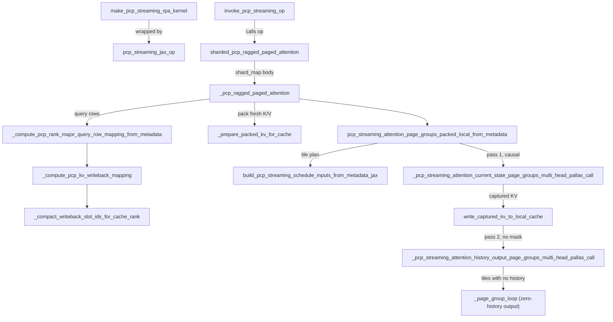
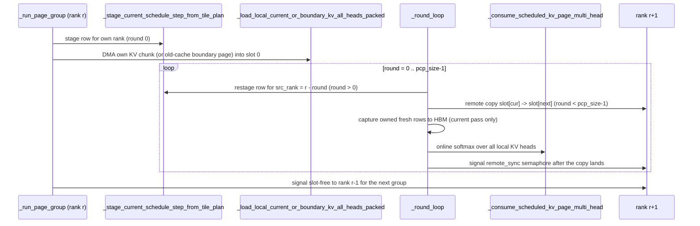

# PCP streaming RPA: ring-streamed prefill context-parallel ragged paged attention

<!-- connect:up:begin -->
> **Cross-repo concept:** part of [flash-attention](../../../concepts/flash-attention.md), [kv-cache](../../../concepts/kv-cache.md), [pallas-kernel](../../../concepts/pallas-kernel.md), [ring-attention](../../../concepts/ring-attention.md) across this wiki's repos.
<!-- connect:up:end -->
## Overview

`kernels/experimental/pcp_streaming_rpa` is the attention kernel behind **prefill context parallelism (PCP)**: a long prefill chunk is split across `pcp_size` ranks, and each rank computes full causal attention for *its* query rows **without gathering the KV cache onto every rank**. The package README states the idea directly: "each PCP rank keeps a local shard of the paged KV cache and streams KV pages around a PCP ring while computing attention for its local query tokens". The kernel module docstring calls it "the RingAttention-style PCP path".

Three layouts tie it together. **Queries** are packed rank-major in chunks of `cp_kv_cache_interleave_size` tokens ([`apply_pcp_rank_major_token_order`](../catalog/src/vllm_torchtpu/kernels/experimental/pcp_streaming_rpa/pcp_layout.md#apply_pcp_rank_major_token_order "src/vllm_torchtpu/kernels/experimental/pcp_streaming_rpa/pcp_layout.py:L190")). The **KV cache** is striped across ranks at the same chunk size, so one "virtual page" of `page_size * pcp_size` tokens is one physical page per rank. The **schedule** is a compact per-query-tile plan built on device with JAX ops ([`build_pcp_streaming_schedule_inputs_from_metadata_jax`](../catalog/src/vllm_torchtpu/kernels/experimental/pcp_streaming_rpa/schedule.md#build_pcp_streaming_schedule_inputs_from_metadata_jax "src/vllm_torchtpu/kernels/experimental/pcp_streaming_rpa/schedule.py:L112")). Pallas expands it into one per-ring-step row ([`RuntimeScheduleField`](../catalog/src/vllm_torchtpu/kernels/experimental/pcp_streaming_rpa/schedule.md#RuntimeScheduleField "src/vllm_torchtpu/kernels/experimental/pcp_streaming_rpa/schedule.py:L19")) per page group.

The attention itself runs as two ring passes with a KV writeback between them. A **current** pass is causal over the fresh chunk's KV. While that KV circulates, each rank also *captures* the rows it owns in the cache. A **history** pass is non-causal over older pages, resumes the online-softmax state, and writes the output. Everything runs under one `shard_map` over a PCP x TP mesh ([`sharded_pcp_ragged_paged_attention`](../catalog/src/vllm_torchtpu/kernels/experimental/pcp_streaming_rpa/wrapper.md#sharded_pcp_ragged_paged_attention "src/vllm_torchtpu/kernels/experimental/pcp_streaming_rpa/wrapper.py:L626")).

The performance point: KV moves over ICI in units of a page group via remote DMA, double-buffered against compute. One transfer serves all local KV heads. The new tokens' cache write needs no separate collective.

## Diagram

Data path of one PCP prefill attention call, from the vLLM adapter to the updated cache and output:

Legend:
- `MK` - [`make_pcp_streaming_rpa_kernel`](../catalog/src/vllm_torchtpu/kernels/experimental/pcp_streaming_rpa/vllm_adapter.md#make_pcp_streaming_rpa_kernel "src/vllm_torchtpu/kernels/experimental/pcp_streaming_rpa/vllm_adapter.py:L188")
- `OP` - [`pcp_streaming_jax_op`](../catalog/src/vllm_torchtpu/kernels/experimental/pcp_streaming_rpa/vllm_adapter.md#pcp_streaming_jax_op "src/vllm_torchtpu/kernels/experimental/pcp_streaming_rpa/vllm_adapter.py:L122")
- `INV` - [`invoke_pcp_streaming_op`](../catalog/src/vllm_torchtpu/kernels/experimental/pcp_streaming_rpa/vllm_adapter.md#invoke_pcp_streaming_op "src/vllm_torchtpu/kernels/experimental/pcp_streaming_rpa/vllm_adapter.py:L259")
- `SH` - [`sharded_pcp_ragged_paged_attention`](../catalog/src/vllm_torchtpu/kernels/experimental/pcp_streaming_rpa/wrapper.md#sharded_pcp_ragged_paged_attention "src/vllm_torchtpu/kernels/experimental/pcp_streaming_rpa/wrapper.py:L626")
- `BODY` - [`_pcp_ragged_paged_attention`](../catalog/src/vllm_torchtpu/kernels/experimental/pcp_streaming_rpa/wrapper.md#sharded_pcp_ragged_paged_attention._pcp_ragged_paged_attention "src/vllm_torchtpu/kernels/experimental/pcp_streaming_rpa/wrapper.py:L731")
- `QM` - [`_compute_pcp_rank_major_query_row_mapping_from_metadata`](../catalog/src/vllm_torchtpu/kernels/experimental/pcp_streaming_rpa/wrapper.md#_compute_pcp_rank_major_query_row_mapping_from_metadata "src/vllm_torchtpu/kernels/experimental/pcp_streaming_rpa/wrapper.py:L397")
- `WB` - [`_compute_pcp_kv_writeback_mapping`](../catalog/src/vllm_torchtpu/kernels/experimental/pcp_streaming_rpa/wrapper.md#_compute_pcp_kv_writeback_mapping "src/vllm_torchtpu/kernels/experimental/pcp_streaming_rpa/wrapper.py:L430")
- `CS` - [`_compact_writeback_slot_ids_for_cache_rank`](../catalog/src/vllm_torchtpu/kernels/experimental/pcp_streaming_rpa/wrapper.md#_compact_writeback_slot_ids_for_cache_rank "src/vllm_torchtpu/kernels/experimental/pcp_streaming_rpa/wrapper.py:L525")
- `PK` - [`_prepare_packed_kv_for_cache`](../catalog/src/vllm_torchtpu/kernels/experimental/pcp_streaming_rpa/wrapper.md#_prepare_packed_kv_for_cache "src/vllm_torchtpu/kernels/experimental/pcp_streaming_rpa/wrapper.py:L101")
- `ENTRY` - [`pcp_streaming_attention_page_groups_packed_local_from_metadata`](../catalog/src/vllm_torchtpu/kernels/experimental/pcp_streaming_rpa/kernel.md#pcp_streaming_attention_page_groups_packed_local_from_metadata "src/vllm_torchtpu/kernels/experimental/pcp_streaming_rpa/kernel.py:L2393")
- `SCHED` - [`build_pcp_streaming_schedule_inputs_from_metadata_jax`](../catalog/src/vllm_torchtpu/kernels/experimental/pcp_streaming_rpa/schedule.md#build_pcp_streaming_schedule_inputs_from_metadata_jax "src/vllm_torchtpu/kernels/experimental/pcp_streaming_rpa/schedule.py:L112")
- `CUR` - [`_pcp_streaming_attention_current_state_page_groups_multi_head_pallas_call`](../catalog/src/vllm_torchtpu/kernels/experimental/pcp_streaming_rpa/kernel.md#_pcp_streaming_attention_current_state_page_groups_multi_head_pallas_call "src/vllm_torchtpu/kernels/experimental/pcp_streaming_rpa/kernel.py:L2044")
- `WRITE` - [`write_captured_kv_to_local_cache`](../catalog/src/vllm_torchtpu/kernels/experimental/pcp_streaming_rpa/kernel.md#write_captured_kv_to_local_cache "src/vllm_torchtpu/kernels/experimental/pcp_streaming_rpa/kernel.py:L226")
- `HIST` - [`_pcp_streaming_attention_history_output_page_groups_multi_head_pallas_call`](../catalog/src/vllm_torchtpu/kernels/experimental/pcp_streaming_rpa/kernel.md#_pcp_streaming_attention_history_output_page_groups_multi_head_pallas_call "src/vllm_torchtpu/kernels/experimental/pcp_streaming_rpa/kernel.py:L2191")
- `ZERO` - [`_page_group_loop`](../catalog/src/vllm_torchtpu/kernels/experimental/pcp_streaming_rpa/kernel.md#_pcp_streaming_attention_zero_history_output_multi_head_kernel._page_group_loop "src/vllm_torchtpu/kernels/experimental/pcp_streaming_rpa/kernel.py:L1978") (body of the third, output-only Pallas call)

One page group inside either ring pass, seen from rank `r`. Each round consumes one rank's KV block from a double-buffered VMEM slot while the block is DMA'd onward to rank `r+1`:

## Design rationale (why it's built this way)

- **Stream KV instead of gathering it.** Gathering a long-context KV cache onto every PCP rank costs HBM capacity and all-gather bandwidth in proportion to sequence length. In each round every rank forwards one KV block (one page or fresh chunk) to its neighbour, and only two VMEM KV slots are live per rank. Beyond its cache shard, HBM use per rank is the f32 online state plus a capture buffer sized to the whole fresh chunk (`local_tokens * pcp_size` rows), not to the full context. The double-buffered remote copy in [`_round_loop`](../catalog/src/vllm_torchtpu/kernels/experimental/pcp_streaming_rpa/kernel.md#_run_pcp_page_groups_multi_head._run_page_group._round_loop "src/vllm_torchtpu/kernels/experimental/pcp_streaming_rpa/kernel.py:L1518") starts before the round's compute and is waited on after it, so ICI transfer overlaps the matmuls.
- **One transfer feeds every local KV head.** The module docstring says the packed path is multi-head "so one ring transfer is consumed by all local query heads instead of repeating the same schedule and communication once per head pair". [`_consume_scheduled_kv_page_multi_head`](../catalog/src/vllm_torchtpu/kernels/experimental/pcp_streaming_rpa/kernel.md#_consume_scheduled_kv_page_multi_head "src/vllm_torchtpu/kernels/experimental/pcp_streaming_rpa/kernel.py:L403") loops over every packed KV group in the VMEM block.
- **Two ownership coordinates.** [`_compute_pcp_local_query_row_mapping`](../catalog/src/vllm_torchtpu/kernels/experimental/pcp_streaming_rpa/wrapper.md#_compute_pcp_local_query_row_mapping "src/vllm_torchtpu/kernels/experimental/pcp_streaming_rpa/wrapper.py:L277") assigns query rows using the batch-flat `cu_q_lens` coordinate. The wrapper comment that rebuilds this map from metadata says that is because "the host packs all request-major query rows as one batch-flat stream". Cache slots, by contrast, follow the request-absolute position (`seq_len - q_len + offset`). The rank that computes a token's KV is therefore often not the rank that stores it. The design does not add a scatter collective to fix this. Fresh KV already visits every rank during the current pass, so the cache owner just copies its rows out as they pass. That is the "capture" step.
- **Split current/history passes.** The entry docstring explains: "The captured KV is written to the local cache immediately after the current pass, ending the capture buffer lifetime before the history/output pass. The history no-causal pass reads only tokens before the current request chunk, so it is unaffected by the newly written current rows." The causal mask is needed only in the current pass. History pages lie entirely before every query, so the history pass skips per-element masking.
- **The schedule is built on device and vectorised.** [`build_pcp_streaming_schedule_inputs_from_metadata_jax`](../catalog/src/vllm_torchtpu/kernels/experimental/pcp_streaming_rpa/schedule.md#build_pcp_streaming_schedule_inputs_from_metadata_jax "src/vllm_torchtpu/kernels/experimental/pcp_streaming_rpa/schedule.py:L112") takes the vLLM metadata tensors directly, so no host-side schedule has to be uploaded. Its comment records why it is one broadcast program: "The previous request x tile x rank Python loops emitted one copy of the scheduling arithmetic for every static slot (64 x 10 x 8 for the production Qwen shape), inflating StableHLO by hundreds of thousands of ops". It is a compile-time and graph-size fix, and the Pallas ABI is unchanged.
- **Compact HBM plan, wide VMEM row.** HBM holds one [`TilePlanField`](../catalog/src/vllm_torchtpu/kernels/experimental/pcp_streaming_rpa/schedule.md#TilePlanField "src/vllm_torchtpu/kernels/experimental/pcp_streaming_rpa/schedule.py:L37") row per query tile, holding 12 logical fields for each consumer rank (`pcp_size * 12` values), padded up to a multiple of 128 lanes. The 11-field runtime row is derived inside the kernel for each round. The README notes that the source rank "is implicit in the ring round and is not duplicated in the runtime row".
- **Hot-reloadable custom op.** [`pcp_streaming_jax_op`](../catalog/src/vllm_torchtpu/kernels/experimental/pcp_streaming_rpa/vllm_adapter.md#pcp_streaming_jax_op "src/vllm_torchtpu/kernels/experimental/pcp_streaming_rpa/vllm_adapter.py:L122") reproduces what torch_tpu's `pallas.jax_op` assembles. Under [`TPU_KERNEL_ITER_MODE`](../catalog/src/vllm_torchtpu/envs.md#TPU_KERNEL_ITER_MODE "src/vllm_torchtpu/envs.py:L83") it adds one thing: the torch custom op is registered behind a dispatcher, so a reloaded kernel can be swapped in without re-registering the op. Its fake kernel sizes outputs from the declared [`PCP_STREAMING_RPA_OUTPUT_PARTITION_SPECS`](../catalog/src/vllm_torchtpu/kernels/experimental/pcp_streaming_rpa/vllm_adapter.md#PCP_STREAMING_RPA_OUTPUT_PARTITION_SPECS "src/vllm_torchtpu/kernels/experimental/pcp_streaming_rpa/vllm_adapter.py:L50") because `jax.export` records `shard_map` outputs as replicated.

> [!inferred]
> The finite online-softmax init value (`-0.7 x float32 max` rather than `-inf`) and the `jnp.where(row_active, ...)` guards keep the inner loop identical whether or not a page is fully masked. Every round of every page group runs the same compute, which keeps ranks in lockstep without data-dependent early exits. A rank that skipped a round would stall the ring, because every remote copy is matched by semaphore waits on the neighbours.

## Entry points

- [`make_pcp_streaming_rpa_kernel`](../catalog/src/vllm_torchtpu/kernels/experimental/pcp_streaming_rpa/vllm_adapter.md#make_pcp_streaming_rpa_kernel "src/vllm_torchtpu/kernels/experimental/pcp_streaming_rpa/vllm_adapter.py:L188") - build time. The attention backend's [`_build_rpa_kernel`](../catalog/src/vllm_torchtpu/layers/adapter/attention.md#PallasAttentionBackendImpl._build_rpa_kernel "src/vllm_torchtpu/layers/adapter/attention.py:L930") calls this when `use_pcp_streaming` is set. It closes over all static configuration (scales, interleave size, `q_block_size`, [`KVLayout`](../catalog/src/vllm_torchtpu/kernels/experimental/batched_rpa/configs.md#KVLayout "src/vllm_torchtpu/kernels/experimental/batched_rpa/configs.py:L84"), `block_major`) and returns a function of eight tensors only. It rejects `soft_cap` and `skip_kv_update` immediately. With `block_major`, it folds the merged `(num_blocks, rows_per_block, *page)` pool into flat kernel blocks with a zero-copy reshape and unfolds the result afterwards.
- [`pcp_streaming_jax_op`](../catalog/src/vllm_torchtpu/kernels/experimental/pcp_streaming_rpa/vllm_adapter.md#pcp_streaming_jax_op "src/vllm_torchtpu/kernels/experimental/pcp_streaming_rpa/vllm_adapter.py:L122") - registers that function as a `torch.library.custom_op` over the PCP mesh from [`get_pcp_streaming_mesh`](../catalog/src/vllm_torchtpu/kernels/experimental/pcp_streaming_rpa/vllm_adapter.md#get_pcp_streaming_mesh "src/vllm_torchtpu/kernels/experimental/pcp_streaming_rpa/vllm_adapter.py:L184"). The mesh is a thin call to [`get_or_create_pcp_mesh`](../catalog/src/vllm_torchtpu/distributed/pcp.md#get_or_create_pcp_mesh "src/vllm_torchtpu/distributed/pcp.py:L92") with axes [`PCP_AXIS_NAME`](../catalog/src/vllm_torchtpu/kernels/experimental/pcp_streaming_rpa/wrapper.md#PCP_AXIS_NAME "src/vllm_torchtpu/kernels/experimental/pcp_streaming_rpa/wrapper.py:L39") and [`TP_AXIS_NAME`](../catalog/src/vllm_torchtpu/kernels/experimental/pcp_streaming_rpa/wrapper.md#TP_AXIS_NAME "src/vllm_torchtpu/kernels/experimental/pcp_streaming_rpa/wrapper.py:L40"). The MLA DCP op builders reuse the same registrar ([`_build_streamidx_dcp_op`](../catalog/src/vllm_torchtpu/layers/adapter/custom_ops/mla_attention_op.md#VllmTPUSparseAttnIndexer._build_streamidx_dcp_op "src/vllm_torchtpu/layers/adapter/custom_ops/mla_attention_op.py:L550"), [`_build_sparse_mla_dcp_op`](../catalog/src/vllm_torchtpu/layers/adapter/attention.md#PallasMLAttentionBackendImpl._build_sparse_mla_dcp_op "src/vllm_torchtpu/layers/adapter/attention.py:L2257")).
- [`invoke_pcp_streaming_op`](../catalog/src/vllm_torchtpu/kernels/experimental/pcp_streaming_rpa/vllm_adapter.md#invoke_pcp_streaming_op "src/vllm_torchtpu/kernels/experimental/pcp_streaming_rpa/vllm_adapter.py:L259") - every forward step. It translates the generic 9-tensor RPA call (`kv_cache` plus 8 args) into the 8-tensor PCP op. It drops the attention-sink slot and raises if a sink is passed.
- [`pcp_streaming_attention_page_groups_packed_local_from_metadata`](../catalog/src/vllm_torchtpu/kernels/experimental/pcp_streaming_rpa/kernel.md#pcp_streaming_attention_page_groups_packed_local_from_metadata "src/vllm_torchtpu/kernels/experimental/pcp_streaming_rpa/kernel.py:L2393") - the per-rank production entry the README names ("builds a JAX schedule from vLLM metadata, then runs the split current/history packed-local kernels"). It is called inside the `shard_map` body.
- Host-side layout helpers, called by the runner's sequence-layout code ([`prepare_pcp_sequence_layout`](../catalog/src/vllm_torchtpu/layers/core/pcp_sequence_layout.md#prepare_pcp_sequence_layout "src/vllm_torchtpu/layers/core/pcp_sequence_layout.py:L638"), [`_evaluate_streaming_query`](../catalog/src/vllm_torchtpu/layers/core/pcp_sequence_layout.md#PcpSequenceLayoutEligibility._evaluate_streaming_query "src/vllm_torchtpu/layers/core/pcp_sequence_layout.py:L266")):
  - [`pcp_local_token_counts`](../catalog/src/vllm_torchtpu/kernels/experimental/pcp_streaming_rpa/pcp_layout.md#pcp_local_token_counts "src/vllm_torchtpu/kernels/experimental/pcp_streaming_rpa/pcp_layout.py:L88") sizes the per-rank padded bucket.
  - [`apply_pcp_rank_major_token_order`](../catalog/src/vllm_torchtpu/kernels/experimental/pcp_streaming_rpa/pcp_layout.md#apply_pcp_rank_major_token_order "src/vllm_torchtpu/kernels/experimental/pcp_streaming_rpa/pcp_layout.py:L190") permutes `input_ids` / positions (and M-RoPE positions) in place.
  - [`build_pcp_logits_indices`](../catalog/src/vllm_torchtpu/kernels/experimental/pcp_streaming_rpa/pcp_layout.md#build_pcp_logits_indices "src/vllm_torchtpu/kernels/experimental/pcp_streaming_rpa/pcp_layout.py:L226") finds each request's last token in packed order so the sampler can read its logits.
- [`PCP_STREAMING_RPA_LOCAL_COMPILE_TOKEN_MULTIPLE`](../catalog/src/vllm_torchtpu/kernels/experimental/pcp_streaming_rpa/kernel.md#PCP_STREAMING_RPA_LOCAL_COMPILE_TOKEN_MULTIPLE "src/vllm_torchtpu/kernels/experimental/pcp_streaming_rpa/kernel.py:L50") (= 512) - the default local query tile. It is also read at compile-bucket time: [`_add_pipeline_chunk_buckets`](../catalog/src/vllm_torchtpu/runner/tpu_runner.md#TPUModelRunner._add_pipeline_chunk_buckets "src/vllm_torchtpu/runner/tpu_runner.py:L6203") rounds the pipeline chunk granularity up to it ("a context-parallel step holds whole query blocks on every rank"), and the sequence-layout eligibility check requires it to be a multiple of `cp_kv_cache_interleave_size`.

## Mechanism (step-by-step)

1. **Host packs tokens rank-major.** Global query positions are cut into `interleave`-sized chunks dealt round-robin to ranks: rank 0 gets `[0, I)`, `[pcp*I, ...)`, rank 1 gets `[I, 2I)`, and so on. [`build_pcp_rank_major_token_order`](../catalog/src/vllm_torchtpu/kernels/experimental/pcp_streaming_rpa/pcp_layout.md#build_pcp_rank_major_token_order "src/vllm_torchtpu/kernels/experimental/pcp_streaming_rpa/pcp_layout.py:L120") builds the source-index permutation and its inverse. [`apply_pcp_rank_major_token_order`](../catalog/src/vllm_torchtpu/kernels/experimental/pcp_streaming_rpa/pcp_layout.md#apply_pcp_rank_major_token_order "src/vllm_torchtpu/kernels/experimental/pcp_streaming_rpa/pcp_layout.py:L190") applies it to the CPU input buffers. Each rank's slice of the global token axis is then a compact run of its own rows, padded to `padded_num_tokens / pcp_size`. The owner coordinate can be offset per request ([`_resolve_token_owner_start_offsets`](../catalog/src/vllm_torchtpu/kernels/experimental/pcp_streaming_rpa/pcp_layout.md#_resolve_token_owner_start_offsets "src/vllm_torchtpu/kernels/experimental/pcp_streaming_rpa/pcp_layout.py:L37")). The streaming path passes `query_start_loc[:-1]`, so ownership is batch-flat, and the model's QKV projections run on local rows only.

2. **Wrapper enters the PCP x TP `shard_map`.** [`sharded_pcp_ragged_paged_attention`](../catalog/src/vllm_torchtpu/kernels/experimental/pcp_streaming_rpa/wrapper.md#sharded_pcp_ragged_paged_attention "src/vllm_torchtpu/kernels/experimental/pcp_streaming_rpa/wrapper.py:L626") validates the narrow contract (see Edge cases). It shards Q/K/V on `(pcp, tp)` and the KV cache on `(pcp, None, tp)`, with metadata replicated. Inside [`_pcp_ragged_paged_attention`](../catalog/src/vllm_torchtpu/kernels/experimental/pcp_streaming_rpa/wrapper.md#sharded_pcp_ragged_paged_attention._pcp_ragged_paged_attention "src/vllm_torchtpu/kernels/experimental/pcp_streaming_rpa/wrapper.py:L731"), every rank computes the *global* rank-major query-row map with [`_compute_pcp_rank_major_query_row_mapping_from_metadata`](../catalog/src/vllm_torchtpu/kernels/experimental/pcp_streaming_rpa/wrapper.md#_compute_pcp_rank_major_query_row_mapping_from_metadata "src/vllm_torchtpu/kernels/experimental/pcp_streaming_rpa/wrapper.py:L397"), a `vmap` over ranks. That map gives each row's absolute position, request, source rank and validity. [`_select_replicated_query_row_mapping_for_pcp_rank`](../catalog/src/vllm_torchtpu/kernels/experimental/pcp_streaming_rpa/wrapper.md#_select_replicated_query_row_mapping_for_pcp_rank "src/vllm_torchtpu/kernels/experimental/pcp_streaming_rpa/wrapper.py:L597") then extracts the local slice with one tiled `all_to_all` instead of `axis_index`, and the rank learns its own id from the slice's source rank.

3. **Writeback plan for fresh KV.** [`_compute_pcp_kv_writeback_mapping`](../catalog/src/vllm_torchtpu/kernels/experimental/pcp_streaming_rpa/wrapper.md#_compute_pcp_kv_writeback_mapping "src/vllm_torchtpu/kernels/experimental/pcp_streaming_rpa/wrapper.py:L430") gives every valid source row exactly one cache owner rank, one cache-local slot, and one dense offset in that owner's capture buffer ("There is no phase or fallback classification in this mapping"). The owner is `(virtual_offset // interleave) % pcp_size` within a virtual page of `page_size * pcp_size` tokens. [`_compact_writeback_slot_ids_for_cache_rank`](../catalog/src/vllm_torchtpu/kernels/experimental/pcp_streaming_rpa/wrapper.md#_compact_writeback_slot_ids_for_cache_rank "src/vllm_torchtpu/kernels/experimental/pcp_streaming_rpa/wrapper.py:L525") reorders this rank's slots into capture order, and the wrapper coalesces them into at most 4096 contiguous `(src, dst, len)` copy segments. In parallel, [`_prepare_packed_kv_for_cache`](../catalog/src/vllm_torchtpu/kernels/experimental/pcp_streaming_rpa/wrapper.md#_prepare_packed_kv_for_cache "src/vllm_torchtpu/kernels/experimental/pcp_streaming_rpa/wrapper.py:L101") packs local K and V into the batched-RPA cache layout and dtype once. Q is reshaped to `[tokens, kv_heads, q_per_kv, head_dim]` and padded on `q_per_kv` to the dtype packing ([`get_dtype_packing`](../catalog/src/vllm_torchtpu/kernels/experimental/batched_rpa/utils.md#get_dtype_packing "src/vllm_torchtpu/kernels/experimental/batched_rpa/utils.py:L63")).

4. **Tile plan on device.** [`build_pcp_streaming_schedule_inputs_from_metadata_jax`](../catalog/src/vllm_torchtpu/kernels/experimental/pcp_streaming_rpa/schedule.md#build_pcp_streaming_schedule_inputs_from_metadata_jax "src/vllm_torchtpu/kernels/experimental/pcp_streaming_rpa/schedule.py:L112") broadcasts over `[request, tile, rank]`, with up to `local_bucket / q_block_size + 2` tiles per request. For each tile it computes per-rank `Q_GLOBAL_START` / `Q_HBM_OFFSET` / `Q_TILE_SIZE` and the request's history length. It also computes two group counts:
   - [`TilePlanField`](../catalog/src/vllm_torchtpu/kernels/experimental/pcp_streaming_rpa/schedule.md#TilePlanField "src/vllm_torchtpu/kernels/experimental/pcp_streaming_rpa/schedule.py:L37") `CURRENT_NUM_GROUPS`: one group per `pcp*I` cycle of fresh tokens up to this tile's last row, plus one *history-boundary* group if the chunk starts mid virtual page.
   - [`TilePlanField`](../catalog/src/vllm_torchtpu/kernels/experimental/pcp_streaming_rpa/schedule.md#TilePlanField "src/vllm_torchtpu/kernels/experimental/pcp_streaming_rpa/schedule.py:L37") `HISTORY_NUM_GROUPS`: the number of full virtual pages before the chunk.

   `CAPTURE_CURRENT_KV` is set only on a request's last tile (`current_effective_len == q_len`), because only that tile streams *all* of the request's fresh KV, so capture happens exactly once. A compaction step then drops inactive tiles and emits `tile_ids`, exclusive `group_starts` prefix sums, and `(active_tiles, total_groups)` for each pass. Block-table entries are reduced modulo the local block count.

5. **Current (causal) pass.** [`_pcp_streaming_attention_current_state_page_groups_multi_head_pallas_call`](../catalog/src/vllm_torchtpu/kernels/experimental/pcp_streaming_rpa/kernel.md#_pcp_streaming_attention_current_state_page_groups_multi_head_pallas_call "src/vllm_torchtpu/kernels/experimental/pcp_streaming_rpa/kernel.py:L2044") is a `grid=(1,)` kernel with everything in HBM and the full VMEM capacity as its limit. It runs one flat loop over the pass's page groups.
   - **Group setup.** For each group, [`_run_page_group`](../catalog/src/vllm_torchtpu/kernels/experimental/pcp_streaming_rpa/kernel.md#_run_pcp_page_groups_multi_head._run_page_group "src/vllm_torchtpu/kernels/experimental/pcp_streaming_rpa/kernel.py:L1409") finds the owning tile from `group_starts`. On a tile's first group it DMAs the tile-plan row and the request's block-table row, resets `(m, l, acc)`, and loads the compact Q tile. [`_tile_plan_value_static`](../catalog/src/vllm_torchtpu/kernels/experimental/pcp_streaming_rpa/kernel.md#_tile_plan_value_static "src/vllm_torchtpu/kernels/experimental/pcp_streaming_rpa/kernel.py:L795") and [`_tile_plan_value`](../catalog/src/vllm_torchtpu/kernels/experimental/pcp_streaming_rpa/kernel.md#_tile_plan_value "src/vllm_torchtpu/kernels/experimental/pcp_streaming_rpa/kernel.py:L788") read plan fields: static indexing when the rank is a Python int, and a masked-sum vector lookup when the rank is traced.
   - **Staging and the first block.** [`_stage_current_schedule_step_from_tile_plan`](../catalog/src/vllm_torchtpu/kernels/experimental/pcp_streaming_rpa/kernel.md#_stage_current_schedule_step_from_tile_plan "src/vllm_torchtpu/kernels/experimental/pcp_streaming_rpa/kernel.py:L836") writes a `[pcp_size, lanes, 128]` runtime row for the source rank's chunk. The row holds the KV global start and valid length and the per-consumer Q fields. It also holds the capture fragment: at most two owner-contiguous pieces, because the batch-flat and request-absolute chunk phases can differ. A negative `KV_HBM_OFFSET` tags the history-boundary group. [`_load_local_current_or_boundary_kv_all_heads_packed`](../catalog/src/vllm_torchtpu/kernels/experimental/pcp_streaming_rpa/kernel.md#_load_local_current_or_boundary_kv_all_heads_packed "src/vllm_torchtpu/kernels/experimental/pcp_streaming_rpa/kernel.py:L1250") then fills VMEM slot 0, either from the old paged cache (boundary page) or from the freshly packed KV rows.
   - **Ring rounds.** [`_round_loop`](../catalog/src/vllm_torchtpu/kernels/experimental/pcp_streaming_rpa/kernel.md#_run_pcp_page_groups_multi_head._run_page_group._round_loop "src/vllm_torchtpu/kernels/experimental/pcp_streaming_rpa/kernel.py:L1518") runs `pcp_size` rounds. In each round it restages the row for `src_rank = (r - round) mod pcp`, starts the remote copy of the current slot to the next rank's other slot, and starts the capture DMA if this rank owns rows in the block. It then calls [`_consume_scheduled_kv_page_multi_head`](../catalog/src/vllm_torchtpu/kernels/experimental/pcp_streaming_rpa/kernel.md#_consume_scheduled_kv_page_multi_head "src/vllm_torchtpu/kernels/experimental/pcp_streaming_rpa/kernel.py:L403"), waits for the copies, and signals the neighbours' sync semaphores.

6. **Online softmax with a reconstructed causal mask.** [`_consume_scheduled_kv_page_multi_head`](../catalog/src/vllm_torchtpu/kernels/experimental/pcp_streaming_rpa/kernel.md#_consume_scheduled_kv_page_multi_head "src/vllm_torchtpu/kernels/experimental/pcp_streaming_rpa/kernel.py:L403") dequantises K/V if FP8 scales are set. For each KV head it runs [`_q_compute_loop`](../catalog/src/vllm_torchtpu/kernels/experimental/pcp_streaming_rpa/kernel.md#_consume_scheduled_kv_page_multi_head._consume_kv_head._q_compute_loop "src/vllm_torchtpu/kernels/experimental/pcp_streaming_rpa/kernel.py:L457") over `q_compute_size` row slices (unrolled): a QK `dot_general` in f32, then the flash-style `m/l/acc` update kept in VMEM scratch. In the causal pass, Q positions are rebuilt from `Q_GLOBAL_START` plus the row index, adding `(pcp_size - 1) * I` each time the row crosses an interleave chunk. KV positions are rebuilt the same way from `KV_GLOBAL_START`. The mask is `q_pos >= kv_pos` within valid lengths. In the history pass `causal=False`: K is pre-multiplied by `sm_scale` and no mask is built.

7. **Capture writeback, then history pass.** The current pass outputs only the f32 state `(m, l, acc)` for every local row, plus the captured-KV buffer. [`write_captured_kv_to_local_cache`](../catalog/src/vllm_torchtpu/kernels/experimental/pcp_streaming_rpa/kernel.md#write_captured_kv_to_local_cache "src/vllm_torchtpu/kernels/experimental/pcp_streaming_rpa/kernel.py:L226") scatters the captured rows into the donated local cache in a single Pallas call ("one single-output donated Pallas call"). In the default layout it issues one async DMA per coalesced segment and starts all of them before waiting on any; the `SEQ_ALONG_LANE` variant copies segments one at a time, read-modify-writing partial 128-token tiles. [`_pcp_streaming_attention_history_output_page_groups_multi_head_pallas_call`](../catalog/src/vllm_torchtpu/kernels/experimental/pcp_streaming_rpa/kernel.md#_pcp_streaming_attention_history_output_page_groups_multi_head_pallas_call "src/vllm_torchtpu/kernels/experimental/pcp_streaming_rpa/kernel.py:L2191") then runs the same ring over full history pages. [`_stage_history_schedule_step_from_tile_plan`](../catalog/src/vllm_torchtpu/kernels/experimental/pcp_streaming_rpa/kernel.md#_stage_history_schedule_step_from_tile_plan "src/vllm_torchtpu/kernels/experimental/pcp_streaming_rpa/kernel.py:L1038") supplies the rows and [`_load_local_kv_page_all_heads_packed`](../catalog/src/vllm_torchtpu/kernels/experimental/pcp_streaming_rpa/kernel.md#_load_local_kv_page_all_heads_packed "src/vllm_torchtpu/kernels/experimental/pcp_streaming_rpa/kernel.py:L1221") loads the pages. The pass reloads the saved state on each tile's first group and writes `acc / l` on its last group. Its output aliases the Q input buffer (`input_output_aliases={1: 0}`).

8. **Tiles with no history.** History-pass tiles exist only when the request has full history pages. A third output-only Pallas call walks the *current* pass's groups and, for tiles with `HISTORY_NUM_GROUPS == 0`, normalises the saved state into the output ([`_page_group_loop`](../catalog/src/vllm_torchtpu/kernels/experimental/pcp_streaming_rpa/kernel.md#_pcp_streaming_attention_zero_history_output_multi_head_kernel._page_group_loop "src/vllm_torchtpu/kernels/experimental/pcp_streaming_rpa/kernel.py:L1978")). The wrapper strips the `q_per_kv` padding, zeroes rows marked invalid in the query-row map ([`is_valid`](../catalog/src/vllm_torchtpu/kernels/experimental/pcp_streaming_rpa/wrapper.md#_PCPQueryRowMapping.is_valid "src/vllm_torchtpu/kernels/experimental/pcp_streaming_rpa/wrapper.py:L51")), and returns `(output, kv_cache)`. The adapter returns `(new_kv_cache, output)`.

## Key data structures

| Structure | Where | What it represents |
|---|---|---|
| Tile plan `[tiles, 1, ceil(pcp*12/128)*128]` int32 | [`TilePlanField`](../catalog/src/vllm_torchtpu/kernels/experimental/pcp_streaming_rpa/schedule.md#TilePlanField "src/vllm_torchtpu/kernels/experimental/pcp_streaming_rpa/schedule.py:L37") | Per query tile and consumer rank: request id, Q global start / HBM offset / size, token-owner start, request-absolute query start (= history length), current effective length, current-KV HBM start, writeback prefix, capture flag, current and history group counts. |
| Runtime row `[pcp, lanes, 128]` int32 in VMEM | [`RuntimeScheduleField`](../catalog/src/vllm_torchtpu/kernels/experimental/pcp_streaming_rpa/schedule.md#RuntimeScheduleField "src/vllm_torchtpu/kernels/experimental/pcp_streaming_rpa/schedule.py:L19") | The "minimal per-ring-step ABI": what the round's KV block is (page index, global start, valid length, HBM offset, negative = boundary page) and, per consumer, where its Q tile is and which capture fragment it owns. |
| Query-row map | [`_compute_pcp_local_query_row_mapping`](../catalog/src/vllm_torchtpu/kernels/experimental/pcp_streaming_rpa/wrapper.md#_compute_pcp_local_query_row_mapping "src/vllm_torchtpu/kernels/experimental/pcp_streaming_rpa/wrapper.py:L277") | Per local padded row: absolute position, request index, source rank, `is_valid`. |
| Writeback map | [`_compute_pcp_kv_writeback_mapping`](../catalog/src/vllm_torchtpu/kernels/experimental/pcp_streaming_rpa/wrapper.md#_compute_pcp_kv_writeback_mapping "src/vllm_torchtpu/kernels/experimental/pcp_streaming_rpa/wrapper.py:L430") | Per source row: cache owner rank, cache-local slot, dense capture offset; per owner: total writeback count. |
| Packed KV cache shard | [`_validate_packed_kv_layout`](../catalog/src/vllm_torchtpu/kernels/experimental/pcp_streaming_rpa/kernel.md#_validate_packed_kv_layout "src/vllm_torchtpu/kernels/experimental/pcp_streaming_rpa/kernel.py:L285") | 5D batched-RPA layout. The default is `[pages, page_size, ceil(2*kv_heads/packing), packing, head_dim]` with packing 2 (BF16) or 4 (FP8). [`SEQ_ALONG_LANE`](../catalog/src/vllm_torchtpu/kernels/experimental/batched_rpa/configs.md#KVLayout.SEQ_ALONG_LANE "src/vllm_torchtpu/kernels/experimental/batched_rpa/configs.py:L92") puts tokens on lanes (`[pages, 2*kv_heads, head_dim/packing, packing, page_size]`, FP8 only). |
| Online state `(m, l, acc)` | current-pass outputs | f32 HBM, `[kv_heads, local_tokens, q_per_kv, 128 or head_dim]`. Carried from the current pass to the history and zero-history passes. |
| Two-slot VMEM KV block | [`_run_page_group`](../catalog/src/vllm_torchtpu/kernels/experimental/pcp_streaming_rpa/kernel.md#_run_pcp_page_groups_multi_head._run_page_group "src/vllm_torchtpu/kernels/experimental/pcp_streaming_rpa/kernel.py:L1409") | `[2, 1, page_size, packed_groups, packing, head_dim]`: the slot being consumed and the slot being filled by the left neighbour. |

The verification-side [`build_runtime_schedule_reference`](../catalog/src/vllm_torchtpu/kernels/experimental/pcp_streaming_rpa/reference.md#build_runtime_schedule_reference "src/vllm_torchtpu/kernels/experimental/pcp_streaming_rpa/reference.py:L116") (with [`_set_common_fields`](../catalog/src/vllm_torchtpu/kernels/experimental/pcp_streaming_rpa/reference.md#_set_common_fields "src/vllm_torchtpu/kernels/experimental/pcp_streaming_rpa/reference.py:L89")) is a NumPy re-expansion of a tile plan into the rows the kernel stages, used to check the in-kernel staging.

## Dynamics (design intent)

- **Lockstep ring.** All ranks iterate the same flat group sequence, because the tile plan is computed from replicated metadata. The schedule builder rejects buckets not divisible by `pcp_size * q_block_size` ("for PCP lockstep schedules"). Within a group, every round issues `make_async_remote_copy` to the next rank on the mesh. Per-round `remote_sync_sems` and a per-lane `group_slot_free_sems` keep a rank from overwriting a neighbour's slot that is still being consumed. The slot-free signal goes to the previous rank before the next group starts.
- **Overlap.** Compute on `slot[cur]` runs between `remote_op.start()` and `remote_op.wait()`, so the ICI copy of the next block hides behind QK/PV matmuls. The capture DMA to HBM is likewise started before compute and waited after it (default layout). Metadata loads at the top of each pass are serial; a TODO says to overlap them "when schedule staging becomes a material kernel cost".
- **Ordering between passes.** The cache write sits between the two ring calls as a separate donated Pallas call. History reads therefore see a cache that already contains the fresh rows, but they only touch pages strictly before the chunk. The *boundary* page (partially history, partially fresh) is read from the old cache in the current pass, with `KV_VALID_LEN` limited to pre-chunk tokens.
- **Compile shape.** `q_block_size` (default 512), `q_compute_size`, `pcp_size`, interleave and layout are static. The schedule is data and is built on device each call, so different request mixes reuse the same executable.

## Edge cases

- Rejected by [`sharded_pcp_ragged_paged_attention`](../catalog/src/vllm_torchtpu/kernels/experimental/pcp_streaming_rpa/wrapper.md#sharded_pcp_ragged_paged_attention "src/vllm_torchtpu/kernels/experimental/pcp_streaming_rpa/wrapper.py:L626") / [`make_pcp_streaming_rpa_kernel`](../catalog/src/vllm_torchtpu/kernels/experimental/pcp_streaming_rpa/vllm_adapter.md#make_pcp_streaming_rpa_kernel "src/vllm_torchtpu/kernels/experimental/pcp_streaming_rpa/vllm_adapter.py:L188"): attention sinks, `head_dim == 64`, sliding window (full attention only), logits soft cap, quantized Q scale, `update_kv_cache=False` / `skip_kv_update`, and a mesh without a `pcp` axis.
- `cp_kv_cache_interleave_size` must be positive and must divide `page_size`. `q_block_size` must be a multiple of it. `q_compute_size` must divide `q_block_size` and be a multiple of 16. `SEQ_ALONG_LANE` additionally requires `page_size` and interleave to be multiples of 128.
- Q tokens and KV-cache blocks must split evenly across PCP ranks. The schedule path supports only `num_lanes == 1`.
- FP8 cache (packing 4) requires both `k_scale` and `v_scale`, each finite and positive. [`_validate_packed_kv_layout`](../catalog/src/vllm_torchtpu/kernels/experimental/pcp_streaming_rpa/kernel.md#_validate_packed_kv_layout "src/vllm_torchtpu/kernels/experimental/pcp_streaming_rpa/kernel.py:L285") also checks that the cache's packed head groups match `ceil(2*kv_heads/packing)`.
- Only the cache owner of a fresh row captures it, and only on tiles whose `current_effective_len == q_len` (a request's last tile).

> [!inferred]
> Fresh KV reaches the cache only through that capture flag. Correctness therefore depends on every active request having at least one tile whose current groups cover the whole chunk. The tile arithmetic in [`build_pcp_streaming_schedule_inputs_from_metadata_jax`](../catalog/src/vllm_torchtpu/kernels/experimental/pcp_streaming_rpa/schedule.md#build_pcp_streaming_schedule_inputs_from_metadata_jax "src/vllm_torchtpu/kernels/experimental/pcp_streaming_rpa/schedule.py:L112") appears to guarantee this via the `+2` tile headroom. There is no explicit assertion.

- The writeback descriptor table has a fixed cap of 4096 segments. Segments beyond it are dropped by the `mode="drop"` scatters.
- [`invoke_pcp_streaming_op`](../catalog/src/vllm_torchtpu/kernels/experimental/pcp_streaming_rpa/vllm_adapter.md#invoke_pcp_streaming_op "src/vllm_torchtpu/kernels/experimental/pcp_streaming_rpa/vllm_adapter.py:L259") rejects keyword tensor args and any argument count other than 8 after `kv_cache`.

## Open questions

- The README's "High-Level Flow" says the wrapper "first writes that rank's new K/V rows into the local paged KV cache shard, then calls the Pallas kernel". The code instead captures fresh KV during the current ring pass and writes it after that pass, as the README's own constraints section and the entry docstring describe. The flow paragraph appears to predate the capture design.
- The README describes the cache as "Global page `p` is stored on rank `p % pcp_size`". The slot math in [`_compute_pcp_kv_writeback_mapping`](../catalog/src/vllm_torchtpu/kernels/experimental/pcp_streaming_rpa/wrapper.md#_compute_pcp_kv_writeback_mapping "src/vllm_torchtpu/kernels/experimental/pcp_streaming_rpa/wrapper.py:L430") stripes at `cp_kv_cache_interleave_size` granularity within a virtual page of `page_size * pcp_size` tokens. The two agree only when the interleave equals `page_size`.
- If more than 4096 discontiguous writeback segments are needed, the descriptor builder drops the excess silently. It is not visible statically whether any caller bounds the segment count.
- The history pass pre-scales K by `sm_scale` in the compute dtype, while the causal pass scales f32 scores. The numerical effect for BF16 K is not discussed in the source.

## See also

- [ragged-paged-attention-kernel](ragged-paged-attention-kernel.md) - the single-device RPA kernel family.
- [batched-ragged-paged-attention-kernel](batched-ragged-paged-attention-kernel.md) - source of the packed KV layout, `KVLayout`, and packing helpers reused here.
- [distributed-parallelism-and-meshes](distributed-parallelism-and-meshes.md) - PCP/TP mesh construction and group layouts.
- [gdn-pcp-fused-kernel](gdn-pcp-fused-kernel.md) - the GatedDeltaNet counterpart under PCP.
- [mla-attention-kernels](mla-attention-kernels.md) - MLA DCP ops that reuse the PCP registrar.
- [kv-cache-layout-and-hbm-budget](kv-cache-layout-and-hbm-budget.md), [tpu-model-runner](tpu-model-runner.md), [vllm-layer-adapters](vllm-layer-adapters.md), [compilation-and-graph-capture](compilation-and-graph-capture.md).
