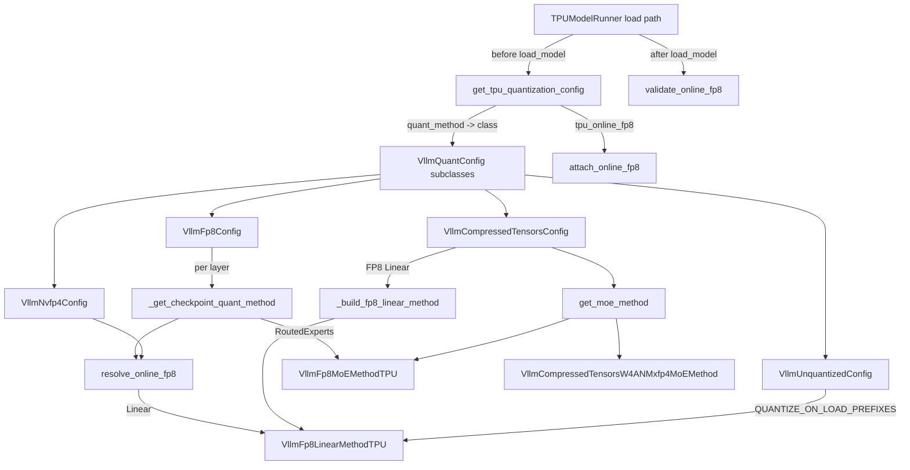
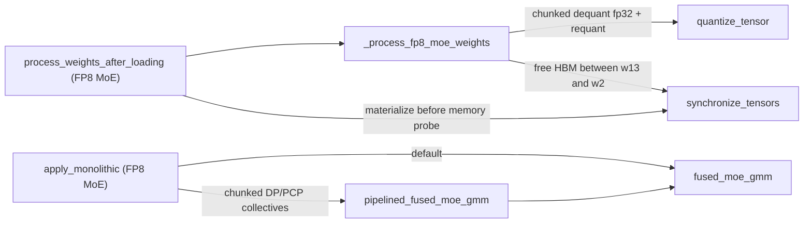

# TPU quantization methods (FP8, NVFP4, MXFP4, compressed-tensors, online FP8)

## Overview

The quantization adapter is the layer that makes vLLM's checkpoint-format zoo run on TPU kernels. vLLM picks a `QuantizationConfig` from the checkpoint's `quant_method`; on TPU that config is replaced, before any layer is built, by a TPU subclass that hands each `LinearBase` / `RoutedExperts` layer a TPU quant method. The single key idea is **load-time format conversion**: whatever the checkpoint stores (FP8 with 128x128 block scales, ModelOpt NVFP4 with block-16 E4M3 scales plus a global, OCP MXFP4 with E8M0 scales, compressed-tensors INT4 packed in INT32, plain BF16), `process_weights_after_loading` converts it once into the layouts the runtime kernels want. FP8 checkpoints are dequantized and requantized into a K-major `(k, n)` FP8 weight with per-channel or `[1, n_blocks, 1, n_out]` block scales for the dense matmul bridge, and into a transposed `[E, K, N]` weight with `[E, n_blocks, 1, N]` scales for the GMM MoE kernel; most 4-bit formats are re-laid out K-major with GMM-shaped scales and requantized only on some paths (the gpt-oss MXFP4 method instead dequantizes its experts to bf16); BF16 weights are only transposed (or quantized on load when asked). The forward then does no per-step weight re-layout. Even unquantized models go through this module, because vLLM's default unquantized MoE path assumes a different backend ([`VllmUnquantizedConfig`](../catalog/src/vllm_torchtpu/layers/adapter/quantization/unquantized.md#VllmUnquantizedConfig "src/vllm_torchtpu/layers/adapter/quantization/unquantized.py:L150")). A second, orthogonal mechanism - **online FP8** - lets an operator quantize selected BF16 Linear layers of an FP8/NVFP4 checkpoint at load time, with a fail-closed audit before serving.

## Diagram

Config selection and per-layer dispatch (control flow at model load):

Legend:
- `RUN` - [`device`](../catalog/src/vllm_torchtpu/runner/tpu_runner.md#TPUModelRunner.device "src/vllm_torchtpu/runner/tpu_runner.py:L5513") (the runner's model-load code, indexed under this symbol)
- `GET` - [`get_tpu_quantization_config`](../catalog/src/vllm_torchtpu/layers/adapter/quantization/__init__.md#get_tpu_quantization_config "src/vllm_torchtpu/layers/adapter/quantization/__init__.py:L51")
- `BASE` - [`VllmQuantConfig`](../catalog/src/vllm_torchtpu/layers/adapter/quantization/configs.md#VllmQuantConfig "src/vllm_torchtpu/layers/adapter/quantization/configs.py:L110")
- `FP8C` - [`VllmFp8Config`](../catalog/src/vllm_torchtpu/layers/adapter/quantization/fp8.md#VllmFp8Config "src/vllm_torchtpu/layers/adapter/quantization/fp8.py:L663")
- `NVC` - [`VllmNvfp4Config`](../catalog/src/vllm_torchtpu/layers/adapter/quantization/nvfp4.md#VllmNvfp4Config "src/vllm_torchtpu/layers/adapter/quantization/nvfp4.py:L257")
- `CTC` - [`VllmCompressedTensorsConfig`](../catalog/src/vllm_torchtpu/layers/adapter/quantization/compressed_tensors/compressed_tensors.md#VllmCompressedTensorsConfig "src/vllm_torchtpu/layers/adapter/quantization/compressed_tensors/compressed_tensors.py:L129")
- `UQC` - [`VllmUnquantizedConfig`](../catalog/src/vllm_torchtpu/layers/adapter/quantization/unquantized.md#VllmUnquantizedConfig "src/vllm_torchtpu/layers/adapter/quantization/unquantized.py:L150")
- `ATT` - [`attach_online_fp8`](../catalog/src/vllm_torchtpu/layers/adapter/quantization/online_fp8.md#attach_online_fp8 "src/vllm_torchtpu/layers/adapter/quantization/online_fp8.py:L138")
- `CKPT` - [`_get_checkpoint_quant_method`](../catalog/src/vllm_torchtpu/layers/adapter/quantization/fp8.md#VllmFp8Config._get_checkpoint_quant_method "src/vllm_torchtpu/layers/adapter/quantization/fp8.py:L732")
- `RES` - [`resolve_online_fp8`](../catalog/src/vllm_torchtpu/layers/adapter/quantization/fp8.md#resolve_online_fp8 "src/vllm_torchtpu/layers/adapter/quantization/fp8.py:L1707")
- `LIN` - [`VllmFp8LinearMethodTPU`](../catalog/src/vllm_torchtpu/layers/adapter/quantization/fp8.md#VllmFp8LinearMethodTPU "src/vllm_torchtpu/layers/adapter/quantization/fp8.py:L1343")
- `MOE` - [`VllmFp8MoEMethodTPU`](../catalog/src/vllm_torchtpu/layers/adapter/quantization/fp8.md#VllmFp8MoEMethodTPU "src/vllm_torchtpu/layers/adapter/quantization/fp8.py:L771")
- `CTM` - [`get_moe_method`](../catalog/src/vllm_torchtpu/layers/adapter/quantization/compressed_tensors/compressed_tensors_moe/compressed_tensors_moe.md#VllmCompressedTensorsMoEMethod.get_moe_method "src/vllm_torchtpu/layers/adapter/quantization/compressed_tensors/compressed_tensors_moe/compressed_tensors_moe.py:L49")
- `MX` - [`VllmCompressedTensorsW4ANMxfp4MoEMethod`](../catalog/src/vllm_torchtpu/layers/adapter/quantization/compressed_tensors/compressed_tensors_moe/compressed_tensors_moe_w4an_mxfp4.md#VllmCompressedTensorsW4ANMxfp4MoEMethod "src/vllm_torchtpu/layers/adapter/quantization/compressed_tensors/compressed_tensors_moe/compressed_tensors_moe_w4an_mxfp4.py:L49")
- `BLD` - [`_build_fp8_linear_method`](../catalog/src/vllm_torchtpu/layers/adapter/quantization/compressed_tensors/compressed_tensors.md#_build_fp8_linear_method "src/vllm_torchtpu/layers/adapter/quantization/compressed_tensors/compressed_tensors.py:L112")
- `VAL` - [`validate_online_fp8`](../catalog/src/vllm_torchtpu/layers/adapter/quantization/online_fp8.md#validate_online_fp8 "src/vllm_torchtpu/layers/adapter/quantization/online_fp8.py:L164")

FP8 MoE weight lifecycle, from checkpoint to the GMM kernel (data flow):

Legend:
- `PWL` - [`process_weights_after_loading`](../catalog/src/vllm_torchtpu/layers/adapter/quantization/fp8.md#VllmFp8MoEMethodTPU.process_weights_after_loading "src/vllm_torchtpu/layers/adapter/quantization/fp8.py:L982")
- `PFM` - [`_process_fp8_moe_weights`](../catalog/src/vllm_torchtpu/layers/adapter/quantization/fp8.md#_process_fp8_moe_weights "src/vllm_torchtpu/layers/adapter/quantization/fp8.py:L486")
- `QT` - [`quantize_tensor`](../catalog/src/vllm_torchtpu/layers/core/quantization.md#quantize_tensor "src/vllm_torchtpu/layers/core/quantization.py:L245")
- `SYNC` - [`synchronize_tensors`](../catalog/src/vllm_torchtpu/utils.md#synchronize_tensors "src/vllm_torchtpu/utils.py:L358")
- `APP` - [`apply_monolithic`](../catalog/src/vllm_torchtpu/layers/adapter/quantization/fp8.md#VllmFp8MoEMethodTPU.apply_monolithic "src/vllm_torchtpu/layers/adapter/quantization/fp8.py:L1108")
- `PIPE` - [`pipelined_fused_moe_gmm`](../catalog/src/vllm_torchtpu/layers/adapter/pipelined_fused_moe.md#pipelined_fused_moe_gmm "src/vllm_torchtpu/layers/adapter/pipelined_fused_moe.py:L192")
- `GMM` - [`fused_moe_gmm`](../catalog/src/vllm_torchtpu/layers/adapter/fused_moe.md#fused_moe_gmm "src/vllm_torchtpu/layers/adapter/fused_moe.py:L241")

## Design rationale (why it's built this way)

- **Requantize at load, never at runtime.** Checkpoint scale layouts are chosen for GPU kernels (128x128 FP8 blocks, block-16 NVFP4, block-32 MXFP4 with E8M0). The TPU kernels want a different blocking and a K-major weight, so the FP8 paths (and the 4-bit paths when a requant block is configured or admitted) pay a one-time dequant -> fp32 -> requant at load and install the result as fresh parameters; the NVFP4 native path keeps its block-16 scales, the INT4 path only re-lays out by default, and the gpt-oss MXFP4 method dequantizes to bf16 without requantizing. The FP8 module docstring states it plainly: "At load time we dequantize those weights, then requantize them into the runtime format used by the TPU GMM kernel. By default the runtime rhs uses per-channel scales over the contracting dimension." The runtime precision is therefore an operator choice (env vars), not a checkpoint property - an FP8 checkpoint can run with int8 weights, or with a 512-wide block, without re-exporting.
- **Transpose once, to `(k, n)`.** [`process_weights_after_loading`](../catalog/src/vllm_torchtpu/layers/adapter/quantization/fp8.md#VllmFp8LinearMethodTPU.process_weights_after_loading "src/vllm_torchtpu/layers/adapter/quantization/fp8.py:L1535") transposes the checkpoint `[n_out, n_in]` weight after quantization (so the quantizer still sees the contracting dim last) and marks it with [`WEIGHT_FLIPPED_ATTR`](../catalog/src/vllm_torchtpu/layers/adapter/linear_common.md#WEIGHT_FLIPPED_ATTR "src/vllm_torchtpu/layers/adapter/linear_common.py:L53"); the comment explains the transposition is placed "where both branches above converge ... so neither can reach the matmul N-major". Layers whose raw weight is read by other code opt out via [`KEEP_VLLM_LAYOUT_ATTR`](../catalog/src/vllm_torchtpu/layers/adapter/linear_common.md#KEEP_VLLM_LAYOUT_ATTR "src/vllm_torchtpu/layers/adapter/linear_common.py:L41") (embeddings and tied LM heads) and `apply` flips the view instead.
- **Own buffers for persistent parameters.** Requant chains leave views (squeezed scales, `unsqueeze(2)`) backed by differently-shaped storage. The FP8 linear and MoE, NVFP4 and compressed-tensors MXFP4 paths pass their final tensors through [`fresh_buffer`](../catalog/src/vllm_torchtpu/utils.md#fresh_buffer "src/vllm_torchtpu/utils.py:L395") because, per the source comments, torch_tpu would otherwise re-materialize the view "as a per-step `tt_jit_as_strided` program at the GMM `pallas.jax_op` boundary" - i.e. an extra device program every decode step.
- **Eager materialization to survive the memory probe.** The FP8, NVFP4, MXFP4, compressed-tensors MXFP4 and unquantized MoE methods end their weight processing with [`synchronize_tensors`](../catalog/src/vllm_torchtpu/utils.md#synchronize_tensors "src/vllm_torchtpu/utils.py:L358"): "Eagerly materialize weights to avoid OOM during vLLM memory probing. Without this, lazy tensors accumulate and the profiling run OOMs." (The INT4 W4A16 MoE method skips this sync and only releases host memory.) The same helper is used mid-conversion to free the checkpoint w13 HBM before the w2 fp32 chunks are allocated.
- **Reuse vLLM's parameter registration, skip its GPU init.** [`VllmFp8LinearMethodTPU`](../catalog/src/vllm_torchtpu/layers/adapter/quantization/fp8.md#VllmFp8LinearMethodTPU "src/vllm_torchtpu/layers/adapter/quantization/fp8.py:L1343") subclasses vLLM's `Fp8LinearMethod` only for `create_weights` (so the weight loader sees the expected parameter shapes) and deliberately skips its `__init__` (CUDA capability, Marlin, cutlass). The MoE methods set `is_monolithic=True` so vLLM calls `apply_monolithic(layer, x, router_logits)` and the CUDA-only router path is bypassed.
- **One FP8 runtime, many front ends.** Compressed-tensors FP8 schemes are not ported as compressed-tensors schemes; they are adapted into a [`VllmFp8Config`](../catalog/src/vllm_torchtpu/layers/adapter/quantization/fp8.md#VllmFp8Config "src/vllm_torchtpu/layers/adapter/quantization/fp8.py:L663") (via [`_build_fp8_linear_method`](../catalog/src/vllm_torchtpu/layers/adapter/quantization/compressed_tensors/compressed_tensors.md#_build_fp8_linear_method "src/vllm_torchtpu/layers/adapter/quantization/compressed_tensors/compressed_tensors.py:L112") and the MoE dispatcher) "to reuse its dequant/requant runtime path instead of duplicating it". The DeepSeek-V4 FP8 config does the same for its linears.
- **Online FP8 is fail-closed.** The policy keeps the checkpoint config intact ("attach independent per-model state") and the post-load audit refuses to serve if any target was unmatched, bypassed dispatch, or ended in the wrong format - a silently unconverted layer would otherwise look like a working but slower deployment.

## Entry points

- [`get_tpu_quantization_config`](../catalog/src/vllm_torchtpu/layers/adapter/quantization/__init__.md#get_tpu_quantization_config "src/vllm_torchtpu/layers/adapter/quantization/__init__.py:L51") - "Get TPU-specific quantization configuration." Called by the runner's model-load code (indexed under [`device`](../catalog/src/vllm_torchtpu/runner/tpu_runner.md#TPUModelRunner.device "src/vllm_torchtpu/runner/tpu_runner.py:L5513")) before `load_model`, and by the export path [`load_vllm_model`](../catalog/src/vllm_torchtpu/experimental/export/universal_adapter.md#load_vllm_model "src/vllm_torchtpu/experimental/export/universal_adapter.py:L406"). It maps `model_config.quantization` (`None`, fp8, mxfp4, nvfp4/modelopt_fp4, compressed-tensors, deepseek_v4_fp8) to a TPU class, raises `NotImplementedError` for anything else (AWQ is a TODO), renames the method to its registered `tpu-*` name so vLLM instantiates the TPU subclass, and finally attaches any online FP8 policy.
- [`validate_online_fp8`](../catalog/src/vllm_torchtpu/layers/adapter/quantization/online_fp8.md#validate_online_fp8 "src/vllm_torchtpu/layers/adapter/quantization/online_fp8.py:L164") - "Audit once after loading, before compilation or accepting requests." Called by the runner right after the model loads; a no-op unless a policy is attached.
- [`VllmFp8LinearMethodTPU`](../catalog/src/vllm_torchtpu/layers/adapter/quantization/fp8.md#VllmFp8LinearMethodTPU "src/vllm_torchtpu/layers/adapter/quantization/fp8.py:L1343") - the dense-linear workhorse; reached from every config that produces FP8 linears (native FP8, compressed-tensors FP8, DeepSeek-V4 FP8, quantize-on-load from the unquantized config, online FP8), and also driven directly by the sharded EP loader's [`consumed`](../catalog/src/vllm_torchtpu/model_loader_patches.md#_OnlineFp8LayerFinisher.consumed "src/vllm_torchtpu/model_loader_patches.py:L217") hook, which runs its post-load processing per decoder layer as soon as all of that layer's online-FP8 tensors are streamed.
- [`VllmFp8MoEMethodTPU`](../catalog/src/vllm_torchtpu/layers/adapter/quantization/fp8.md#VllmFp8MoEMethodTPU "src/vllm_torchtpu/layers/adapter/quantization/fp8.py:L771") - the FP8 (and BF16-online-quantized) MoE method; it is also the only method the TP-decode MoE path will arm on ([`_admit`](../catalog/src/vllm_torchtpu/layers/adapter/moe_tp_decode.md#_admit "src/vllm_torchtpu/layers/adapter/moe_tp_decode.py:L177") rejects any other quant method type).
- [`VllmCompressedTensorsW4ANMxfp4MoEMethod`](../catalog/src/vllm_torchtpu/layers/adapter/quantization/compressed_tensors/compressed_tensors_moe/compressed_tensors_moe_w4an_mxfp4.md#VllmCompressedTensorsW4ANMxfp4MoEMethod "src/vllm_torchtpu/layers/adapter/quantization/compressed_tensors/compressed_tensors_moe/compressed_tensors_moe_w4an_mxfp4.py:L49") - "TPU compressed-tensors packed-weight W4AN MXFP4 MoE implementation." Besides vLLM's normal `apply_monolithic`, model code calls its [`apply_with_routing`](../catalog/src/vllm_torchtpu/layers/adapter/quantization/compressed_tensors/compressed_tensors_moe/compressed_tensors_moe_w4an_mxfp4.md#VllmCompressedTensorsW4ANMxfp4MoEMethod.apply_with_routing "src/vllm_torchtpu/layers/adapter/quantization/compressed_tensors/compressed_tensors_moe/compressed_tensors_moe_w4an_mxfp4.py:L295") with pre-computed routes (e.g. [`_forward_expert_parallel`](../catalog/src/vllm_torchtpu/models/vllm/kimi_k3/moe.md#KimiMoE._forward_expert_parallel "src/vllm_torchtpu/models/vllm/kimi_k3/moe.py:L275") in the Kimi model).

## Mechanism (step-by-step)

1. **Swap the config before layers exist.** [`get_tpu_quantization_config`](../catalog/src/vllm_torchtpu/layers/adapter/quantization/__init__.md#get_tpu_quantization_config "src/vllm_torchtpu/layers/adapter/quantization/__init__.py:L51") deep-copies the model config, picks the TPU class, and calls its `set_configs`, which stores the `VllmConfig` at class level on [`VllmQuantConfig`](../catalog/src/vllm_torchtpu/layers/adapter/quantization/configs.md#VllmQuantConfig "src/vllm_torchtpu/layers/adapter/quantization/configs.py:L110") ("set once, shared by all instances"). That class-level state is what per-layer methods later read: `get_linear_config` snapshots the env-gated kernel knobs (`ENABLE_QUANTIZED_MATMUL_KERNEL`, `REQUANTIZE_BLOCK_SIZE`, `REQUANTIZE_WEIGHT_DTYPE`, `TPU_FP8_LINEAR_W8A16_MAX_ROWS`) and `get_moe_config` copies `enable_expert_parallel` into the MoE parallel config. The compressed-tensors config also populates `VllmFp8Config`'s class state, because it constructs FP8 configs on the fly. Then [`attach_online_fp8`](../catalog/src/vllm_torchtpu/layers/adapter/quantization/online_fp8.md#attach_online_fp8 "src/vllm_torchtpu/layers/adapter/quantization/online_fp8.py:L138") parses `additional_config["tpu_online_fp8"]` and stores the policy in [`online_fp8_policy`](../catalog/src/vllm_torchtpu/layers/adapter/quantization/configs.md#VllmQuantConfig.online_fp8_policy "src/vllm_torchtpu/layers/adapter/quantization/configs.py:L124"); only `fp8` and `modelopt_fp4` configs accept one.

2. **Per-layer dispatch.** vLLM asks the config's `get_quant_method(layer, prefix)` for every layer. For native FP8, [`_get_checkpoint_quant_method`](../catalog/src/vllm_torchtpu/layers/adapter/quantization/fp8.md#VllmFp8Config._get_checkpoint_quant_method "src/vllm_torchtpu/layers/adapter/quantization/fp8.py:L732") returns the FP8 MoE or linear method, or the unquantized TPU methods for layers in `ignored_layers` (matched through [`packed_modules_mapping`](../catalog/src/vllm_torchtpu/layers/adapter/quantization/configs.md#VllmQuantConfig.packed_modules_mapping "src/vllm_torchtpu/layers/adapter/quantization/configs.py:L130") so fused `qkv_proj` matches its checkpoint parts); attention layers get `None`. The result is then passed through [`resolve_online_fp8`](../catalog/src/vllm_torchtpu/layers/adapter/quantization/fp8.md#resolve_online_fp8 "src/vllm_torchtpu/layers/adapter/quantization/fp8.py:L1707"), which - only for policy-selected layers that the checkpoint left unquantized - substitutes a [`VllmFp8LinearMethodTPU`](../catalog/src/vllm_torchtpu/layers/adapter/quantization/fp8.md#VllmFp8LinearMethodTPU "src/vllm_torchtpu/layers/adapter/quantization/fp8.py:L1343") with [`online_fp8`](../catalog/src/vllm_torchtpu/layers/adapter/quantization/fp8.md#VllmFp8LinearMethodTPU.online_fp8 "src/vllm_torchtpu/layers/adapter/quantization/fp8.py:L1368") set, and records the selection for the later audit. NVFP4 follows the same two-stage shape. The unquantized config's [`get_quant_method`](../catalog/src/vllm_torchtpu/layers/adapter/quantization/unquantized.md#VllmUnquantizedConfig.get_quant_method "src/vllm_torchtpu/layers/adapter/quantization/unquantized.py:L181") has its own quantize-on-load hook: a Linear or embedding whose prefix matches [`should_quantize_on_load`](../catalog/src/vllm_torchtpu/layers/adapter/quantization/configs.md#should_quantize_on_load "src/vllm_torchtpu/layers/adapter/quantization/configs.py:L78") (dot-bounded match against `QUANTIZE_ON_LOAD_PREFIXES`, e.g. `self_attn,shared_experts`) gets an FP8 linear method with `is_checkpoint_fp8_serialized=False`; `kv_b_proj` is skipped because MLA slices and quantizes it itself (see the MLA attention op's [`process_weights_after_loading`](../catalog/src/vllm_torchtpu/layers/adapter/custom_ops/mla_attention_op.md#VllmTPUMLAAttention.process_weights_after_loading "src/vllm_torchtpu/layers/adapter/custom_ops/mla_attention_op.py:L967"), which uses the same prefix test).

3. **Compressed-tensors and DeepSeek-V4 routing.** [`VllmCompressedTensorsConfig`](../catalog/src/vllm_torchtpu/layers/adapter/quantization/compressed_tensors/compressed_tensors.md#VllmCompressedTensorsConfig "src/vllm_torchtpu/layers/adapter/quantization/compressed_tensors/compressed_tensors.py:L129")'s [`get_quant_method`](../catalog/src/vllm_torchtpu/layers/adapter/quantization/compressed_tensors/compressed_tensors.md#VllmCompressedTensorsConfig.get_quant_method "src/vllm_torchtpu/layers/adapter/quantization/compressed_tensors/compressed_tensors.py:L202") sends ignored or weight-unquantized layers to the unquantized TPU path, FP8 weights to [`_build_fp8_linear_method`](../catalog/src/vllm_torchtpu/layers/adapter/quantization/compressed_tensors/compressed_tensors.md#_build_fp8_linear_method "src/vllm_torchtpu/layers/adapter/quantization/compressed_tensors/compressed_tensors.py:L112"), and raises `NotImplementedError` for W4A8-FP8, NVFP4, W8A8-FP8 and W8A8-INT8 linear schemes. For MoE, [`get_moe_method`](../catalog/src/vllm_torchtpu/layers/adapter/quantization/compressed_tensors/compressed_tensors_moe/compressed_tensors_moe.md#VllmCompressedTensorsMoEMethod.get_moe_method "src/vllm_torchtpu/layers/adapter/quantization/compressed_tensors/compressed_tensors_moe/compressed_tensors_moe.py:L49") checks that gate/up/down share one scheme, then dispatches INT4 group/channel weights to the W4A16 method, MXFP4 to [`VllmCompressedTensorsW4ANMxfp4MoEMethod`](../catalog/src/vllm_torchtpu/layers/adapter/quantization/compressed_tensors/compressed_tensors_moe/compressed_tensors_moe_w4an_mxfp4.md#VllmCompressedTensorsW4ANMxfp4MoEMethod "src/vllm_torchtpu/layers/adapter/quantization/compressed_tensors/compressed_tensors_moe/compressed_tensors_moe_w4an_mxfp4.py:L49"), and FP8 to [`VllmFp8MoEMethodTPU`](../catalog/src/vllm_torchtpu/layers/adapter/quantization/fp8.md#VllmFp8MoEMethodTPU "src/vllm_torchtpu/layers/adapter/quantization/fp8.py:L771"). The DeepSeek-V4 config's [`get_quant_method`](../catalog/src/vllm_torchtpu/layers/adapter/quantization/deepseek_v4_fp8.md#VllmDeepseekV4Fp8Config.get_quant_method "src/vllm_torchtpu/layers/adapter/quantization/deepseek_v4_fp8.py:L73") always uses FP8 block-quant linears and picks the MoE method from `expert_dtype` (fp4 -> the DeepSeek-V4 MXFP4 method, fp8 -> FP8 MoE).

4. **Weight allocation that matches TP shards.** [`create_weights`](../catalog/src/vllm_torchtpu/layers/adapter/quantization/fp8.md#VllmFp8LinearMethodTPU.create_weights "src/vllm_torchtpu/layers/adapter/quantization/fp8.py:L1406") on the FP8 linear method handles the case where a TP shard is smaller than a checkpoint scale block (the source's example: a 1024-wide shared expert at TP=16 leaves 64 columns per rank against 128x128 blocks). It shrinks the effective block to `gcd(block, shard)` for allocation and wraps the scale parameter so the checkpoint scale grid is `repeat_interleave`-refined before TP slicing, giving each rank its exact block scale. The INT4 compressed-tensors MoE [`create_weights`](../catalog/src/vllm_torchtpu/layers/adapter/quantization/compressed_tensors/compressed_tensors_moe/compressed_tensors_moe_w4a16.md#VllmCompressedTensorsW4A16MoEMethod.create_weights "src/vllm_torchtpu/layers/adapter/quantization/compressed_tensors/compressed_tensors_moe/compressed_tensors_moe_w4a16.py:L174") goes further: it registers empty parameters and a CPU scratch weight-loader hook so that no full-size HBM buffer is pre-allocated - per the comment, upfront allocation "leads to OOM during weight loading ... without EP".

5. **Dense FP8 conversion.** [`process_weights_after_loading`](../catalog/src/vllm_torchtpu/layers/adapter/quantization/fp8.md#VllmFp8LinearMethodTPU.process_weights_after_loading "src/vllm_torchtpu/layers/adapter/quantization/fp8.py:L1535") ("Convert dense linear checkpoint weights to runtime FP8") has three branches. FP8 checkpoints go through [`_process_fp8_linear_weights`](../catalog/src/vllm_torchtpu/layers/adapter/quantization/fp8.md#_process_fp8_linear_weights "src/vllm_torchtpu/layers/adapter/quantization/fp8.py:L297"): dequantize to fp32 (collapsing block or per-tensor/per-logical-width scales), requantize with [`quantize_tensor`](../catalog/src/vllm_torchtpu/layers/core/quantization.md#quantize_tensor "src/vllm_torchtpu/layers/core/quantization.py:L245") on the last axis, and reshape the scale for the bridge. The runtime recipe comes from [`_get_linear_quant_config`](../catalog/src/vllm_torchtpu/layers/adapter/quantization/fp8.md#_get_linear_quant_config "src/vllm_torchtpu/layers/adapter/quantization/fp8.py:L216"), cached per method in [`_linear_quant_config`](../catalog/src/vllm_torchtpu/layers/adapter/quantization/fp8.md#VllmFp8LinearMethodTPU._linear_quant_config "src/vllm_torchtpu/layers/adapter/quantization/fp8.py:L1396"): with neither knob set, per-channel FP8 consumed by an XLA `dot_general` matmul; with `ENABLE_QUANTIZED_MATMUL_KERNEL=1` plus `REQUANTIZE_BLOCK_SIZE`, blockwise scales in `[1, n_blocks, 1, n_out]` for the Pallas kernel. Setting only one of the two is rejected. Online-FP8 layers instead use [`quantize_online_fp8`](../catalog/src/vllm_torchtpu/layers/adapter/quantization/online_fp8.md#quantize_online_fp8 "src/vllm_torchtpu/layers/adapter/quantization/online_fp8.py:L241") (per_tensor / per_channel / per_block on the local `[N, K]` shard). All branches then transpose to `(k, n)`, give both tensors their own buffers, set `weight_block_size` to describe scale granularity, and synchronize. At runtime `apply` calls the `quantized_matmul` bridge, which quantizes activations dynamically (W8A8) unless the token bucket is at most `TPU_FP8_LINEAR_W8A16_MAX_ROWS`, in which case activations stay bf16.

6. **FP8 MoE conversion.** [`process_weights_after_loading`](../catalog/src/vllm_torchtpu/layers/adapter/quantization/fp8.md#VllmFp8MoEMethodTPU.process_weights_after_loading "src/vllm_torchtpu/layers/adapter/quantization/fp8.py:L982") ("Process MoE weights into the runtime FP8 layout used by the GMM kernel") calls [`_process_fp8_moe_weights`](../catalog/src/vllm_torchtpu/layers/adapter/quantization/fp8.md#_process_fp8_moe_weights "src/vllm_torchtpu/layers/adapter/quantization/fp8.py:L486") for FP8 checkpoints (BF16 checkpoints take a sibling path that skips the dequant). The conversion runs a few experts at a time, bounded to ~1 GiB of fp32 per chunk, because a whole-layer fp32 copy "can be several times the device memory left after loading"; chunks are joined with one concatenation since an in-place slice write on TPU "is a program that rewrites the whole tensor, once per chunk". It also deinterleaves `swigluoai` gate/up rows, pads each w13 half and the w2 contracting dim to multiples of 128 (zeroing any intermediate padding so it is numerically inert), transposes to `[E, K, N]`, and formats scales as `[E, n_blocks, 1, N]`. The runtime dtype and block come from `MOE_REQUANTIZE_WEIGHT_DTYPE` (float8_e4m3fn default, int8, float8_e5m2) and `MOE_REQUANTIZE_BLOCK_SIZE` (unset = per-channel). Afterwards the method prebuilds the fused-MoE kernel, or the adaptive / fused-EP kernel if those are enabled and admit the layer.

7. **FP4 MoE conversion.** The FP4 methods keep weights 4-bit. NVFP4's [`process_weights_after_loading`](../catalog/src/vllm_torchtpu/layers/adapter/quantization/nvfp4.md#VllmNvfp4MoEMethod.process_weights_after_loading "src/vllm_torchtpu/layers/adapter/quantization/nvfp4.py:L388") fuses the E4M3 block-16 scale with the per-tensor FP32 global into one FP32 block scale, then asks [`_prebuild_w4a8`](../catalog/src/vllm_torchtpu/layers/adapter/quantization/nvfp4.md#_prebuild_w4a8 "src/vllm_torchtpu/layers/adapter/quantization/nvfp4.py:L203") whether the fused EP kernel admits a W4A8 layout - checking only shapes on `meta` tensors "while checkpoint weights are intact" - and only then commits to a requantized block; [`_requant_moe_w4a8`](../catalog/src/vllm_torchtpu/layers/adapter/quantization/nvfp4.md#_requant_moe_w4a8 "src/vllm_torchtpu/layers/adapter/quantization/nvfp4.py:L124") handles the case where the intermediate is not block-aligned by zero-padding before requantizing. Otherwise the layer runs W4A16 on GMM with native block-16 scales. Compressed-tensors MXFP4 ([`process_weights_after_loading`](../catalog/src/vllm_torchtpu/layers/adapter/quantization/compressed_tensors/compressed_tensors_moe/compressed_tensors_moe_w4an_mxfp4.md#VllmCompressedTensorsW4ANMxfp4MoEMethod.process_weights_after_loading "src/vllm_torchtpu/layers/adapter/quantization/compressed_tensors/compressed_tensors_moe/compressed_tensors_moe_w4an_mxfp4.py:L173")) converts E8M0 scales to fp32 and either requantizes to `MOE_REQUANTIZE_BLOCK_SIZE` or unpacks the uint8 pairs to native `float4_e2m1fn_x2` in K-major order once. DeepSeek-V4 MXFP4 ([`process_weights_after_loading`](../catalog/src/vllm_torchtpu/layers/adapter/quantization/mxfp4.md#VllmDeepseekV4Mxfp4MoEMethod.process_weights_after_loading "src/vllm_torchtpu/layers/adapter/quantization/mxfp4.py:L620")) uses [`_dequantize_and_pad`](../catalog/src/vllm_torchtpu/layers/adapter/quantization/mxfp4.md#VllmDeepseekV4Mxfp4MoEMethod._dequantize_and_pad "src/vllm_torchtpu/layers/adapter/quantization/mxfp4.py:L486") (on device when `VLLM_TPU_MXFP4_DEVICE_DEQUANT`, the default, else on CPU) and requantizes to native FP4 at block 512 (or `MOE_REQUANTIZE_BLOCK_SIZE`). The gpt-oss style MXFP4 method ([`process_weights_after_loading`](../catalog/src/vllm_torchtpu/layers/adapter/quantization/mxfp4.md#VllmMxfp4MoEMethod.process_weights_after_loading "src/vllm_torchtpu/layers/adapter/quantization/mxfp4.py:L245")) is the outlier: it dequantizes to bf16 and keeps the experts in bf16. INT4 compressed-tensors ([`process_weights_after_loading`](../catalog/src/vllm_torchtpu/layers/adapter/quantization/compressed_tensors/compressed_tensors_moe/compressed_tensors_moe_w4a16.md#VllmCompressedTensorsW4A16MoEMethod.process_weights_after_loading "src/vllm_torchtpu/layers/adapter/quantization/compressed_tensors/compressed_tensors_moe/compressed_tensors_moe_w4a16.py:L313")) transposes `[E, N, K/8] -> [E, K/8, N]`, XORs the int4 sign bits for the kernel's encoding, and can be requantized to FP4 via `MOE_REQUANTIZE_WEIGHT_DTYPE=fp4`.

8. **MoE forward.** All MoE methods route with one shared quantization-independent router, then call [`fused_moe_gmm`](../catalog/src/vllm_torchtpu/layers/adapter/fused_moe.md#fused_moe_gmm "src/vllm_torchtpu/layers/adapter/fused_moe.py:L241") with the runtime weights and scales, or [`pipelined_fused_moe_gmm`](../catalog/src/vllm_torchtpu/layers/adapter/pipelined_fused_moe.md#pipelined_fused_moe_gmm "src/vllm_torchtpu/layers/adapter/pipelined_fused_moe.py:L192") when chunked collective/compute pipelining is enabled. The FP8 [`apply_monolithic`](../catalog/src/vllm_torchtpu/layers/adapter/quantization/fp8.md#VllmFp8MoEMethodTPU.apply_monolithic "src/vllm_torchtpu/layers/adapter/quantization/fp8.py:L1108") has the longest priority ladder: adaptive fused MoE, then fused EP, then TP-decode MoE, then the pipelined path (also taken when `TPU_MOE_FP8_ALL_GATHER` quantizes activations before the all-gather), then the fused decode kernel, then plain GMM. The NVFP4 [`apply_monolithic`](../catalog/src/vllm_torchtpu/layers/adapter/quantization/nvfp4.md#VllmNvfp4MoEMethod.apply_monolithic "src/vllm_torchtpu/layers/adapter/quantization/nvfp4.py:L510") and MXFP4 [`_forward_monolithic_tpu`](../catalog/src/vllm_torchtpu/layers/adapter/quantization/mxfp4.md#VllmMxfp4MoEMethod._forward_monolithic_tpu "src/vllm_torchtpu/layers/adapter/quantization/mxfp4.py:L320") are shorter versions of the same ladder; MXFP4 is the only one that forwards `input_ids`, for DeepSeek-V4 hash routing. The compressed-tensors MXFP4 [`apply_monolithic`](../catalog/src/vllm_torchtpu/layers/adapter/quantization/compressed_tensors/compressed_tensors_moe/compressed_tensors_moe_w4an_mxfp4.md#VllmCompressedTensorsW4ANMxfp4MoEMethod.apply_monolithic "src/vllm_torchtpu/layers/adapter/quantization/compressed_tensors/compressed_tensors_moe/compressed_tensors_moe_w4an_mxfp4.py:L275") delegates to [`apply_with_routing`](../catalog/src/vllm_torchtpu/layers/adapter/quantization/compressed_tensors/compressed_tensors_moe/compressed_tensors_moe_w4an_mxfp4.md#VllmCompressedTensorsW4ANMxfp4MoEMethod.apply_with_routing "src/vllm_torchtpu/layers/adapter/quantization/compressed_tensors/compressed_tensors_moe/compressed_tensors_moe_w4an_mxfp4.py:L295"), which always zeroes routing weights of padded tokens and asks GMM to skip them.

9. **Online FP8 audit.** After loading, [`validate_online_fp8`](../catalog/src/vllm_torchtpu/layers/adapter/quantization/online_fp8.md#validate_online_fp8 "src/vllm_torchtpu/layers/adapter/quantization/online_fp8.py:L164") walks every module, re-runs the policy's [`select`](../catalog/src/vllm_torchtpu/layers/adapter/quantization/online_fp8.md#OnlineFp8Policy.select "src/vllm_torchtpu/layers/adapter/quantization/online_fp8.py:L115") against the packed-module aliases, and for each selected module requires an online-FP8 quant method, the processed flag, `float8_e4m3fn` weights, `float32` scales of the scheme's exact shape, and the matching `weight_block_size`. It logs one JSON record per converted module and raises if any target pattern matched nothing, any selected module was not processed, or nothing was converted at all.

## Key data structures

- **`VllmQuantConfig` class-level state** - `vllm_config` (shared by all instances of a class, set by `set_configs`), [`online_fp8_policy`](../catalog/src/vllm_torchtpu/layers/adapter/quantization/configs.md#VllmQuantConfig.online_fp8_policy "src/vllm_torchtpu/layers/adapter/quantization/configs.py:L124"), and [`packed_modules_mapping`](../catalog/src/vllm_torchtpu/layers/adapter/quantization/configs.md#VllmQuantConfig.packed_modules_mapping "src/vllm_torchtpu/layers/adapter/quantization/configs.py:L130") (fused module -> checkpoint parts, used by ignore lists and online-FP8 selection).
- **`LinearQuantConfig` tuple** - `(dtype_name, torch_dtype, block_size | None, blockwise_kernel)`, produced by [`_get_linear_quant_config`](../catalog/src/vllm_torchtpu/layers/adapter/quantization/fp8.md#_get_linear_quant_config "src/vllm_torchtpu/layers/adapter/quantization/fp8.py:L216"). Online FP8 pins it to `("float8_e4m3fn", fp8, None, False)` regardless of env.
- **Runtime linear layout** - `weight` `[k, n]` FP8 (or int8) tagged with [`WEIGHT_FLIPPED_ATTR`](../catalog/src/vllm_torchtpu/layers/adapter/linear_common.md#WEIGHT_FLIPPED_ATTR "src/vllm_torchtpu/layers/adapter/linear_common.py:L53"); `weight_scale` `[n]` (per-channel) or `[1, n_blocks, 1, n_out]` (blockwise); `weight_block_size` stated in checkpoint `[n_out, n_in]` terms; `weight_scale_inv` deleted.
- **Runtime MoE layout** - `w13_weight` / `w2_weight` as `[E, K, N]` (FP8/int8, packed int4 in int32, or native `float4_e2m1fn_x2`) with scales `[E, n_blocks, 1, N]` fp32 (named `*_weight_scale_inv` for FP8, `*_weight_scale` for FP4), plus an `experts_start` buffer for EP global -> local expert remapping.
- **`OnlineFp8Policy`** - `targets` / `exclude` fnmatch patterns, `weight_scheme` (per_channel default, per_tensor, per_block with `[N_out, K_in]`, K a multiple of 128), and the `matched` / `selected` bookkeeping that the audit checks.

## Dynamics (design intent)

- **Ordering.** Config swap happens before `load_model`; quant-method selection during module construction; conversion in each method's `process_weights_after_loading` after its weights stream in; the online-FP8 audit before compilation. The sharded EP loader breaks the "after all weights" assumption on purpose: [`_owners`](../catalog/src/vllm_torchtpu/model_loader_patches.md#_OnlineFp8LayerFinisher._owners "src/vllm_torchtpu/model_loader_patches.py:L195") maps each checkpoint tensor name to its decoder-layer prefix, and [`consumed`](../catalog/src/vllm_torchtpu/model_loader_patches.md#_OnlineFp8LayerFinisher.consumed "src/vllm_torchtpu/model_loader_patches.py:L217") runs that layer's online-FP8 conversion as soon as its last tensor arrives. The `_tpu_online_fp8_processed` flag (set up in `create_weights`) makes the later regular hook a no-op, so peak memory holds one layer's BF16 weights, not the whole model's.
- **Peak-memory discipline.** Chunked expert requantization, rebinding w13 before w2 is converted, CPU scratch staging for INT4/MXFP4 compressed-tensors with `release_memory_to_os`, and zeroing only the unloaded E8M0 scale slices (instead of zero-initializing whole buffers, which "caused peak-memory OOMs for large models") are all load-time HBM controls.
- **Admission before commitment.** The NVFP4 and DeepSeek-V4 MXFP4 paths decide the fused-EP W4A8 layout on `meta` tensors before any lossy requantization, then assert that the prepared tensors still match ("a mismatch here is a preparation bug rather than a fallback case"). Layers the kernel refuses keep the GMM recipe on their own, so one odd layer does not downgrade the whole model.

## Edge cases

- `REQUANTIZE_BLOCK_SIZE` without `ENABLE_QUANTIZED_MATMUL_KERNEL` (or the reverse) raises at method construction. A TP shard whose contracting dim is smaller than the requant block (e.g. 64 < 128 for a RowParallel down_proj at TP=16) silently falls back to per-channel for that layer.
- FP8 MoE rejects bias; NVFP4 MoE rejects bias and `swigluoai`; gpt-oss MXFP4 requires bias. FP8 MoE checkpoints must have hidden divisible by the block size, and a partial final block cannot be TP-sharded.
- Online FP8 requires BF16 source weights, rejects targets that already have a checkpoint method, and rejects partial selection of a fused layer ("select or exclude all of" its parts). Only `fp8` and `modelopt_fp4` checkpoints accept a policy.
- Compressed-tensors: all MoE projections must share one scheme; non-FP8 linear schemes and KV-cache quantization are not implemented. For INT4 MoE, per the dispatcher comment, `group_size < 128` falls back to dequantize-before-matmul (W4A16) inside the GMM kernel, while `>= 128` dynamically quantizes activations (W4A8).
- Embeddings with FP8 weights keep the `[vocab, hidden]` layout and are never activation-quantized (W8A16 via a plain matmul).
- `MOE_REQUANTIZE_BLOCK_SIZE` is read when `mxfp4.py` is imported (module constant `REQUANTIZED_BLOCK_SIZE`), unlike the other paths that read it at load.

## Open questions

- The runtime `quantized_matmul` bridge, `fused_moe_gmm` internals, and the fused-EP / adaptive admission predicates are outside this packet; which kernel finally runs for a given layer depends on predicates documented elsewhere (see sibling pages).
- `VllmMxfp4Config`, `VllmDeepseekV4Fp8Config` (the class), `VllmNvfp4LinearMethod`, the unquantized linear/MoE methods and `OnlineFp8Policy` (the class) are referenced in source but not in the citation subgraph, so their details here are taken from reading the source rather than cited.
> [!inferred]
> The default per-channel FP8 dense path keeps a single scale per output channel, which suggests decode-time linears trade some accuracy headroom for the cheapest scale handling; whether the blockwise Pallas path is faster on a given model is not stated in source and needs measurement.

## See also

- [Fused MoE kernels](fused-moe-kernels.md) - the GMM kernel these methods format weights for
- [Adaptive fused MoE kernel](adaptive-fused-moe-kernel.md) - the `MOE_FUSED_EP_KERNEL_IMPL=adaptive` path
- [vLLM layer adapters](vllm-layer-adapters.md) - linear/MoE adapters around the quant methods
- [TPU model runner](tpu-model-runner.md) - where the config is swapped and the audit runs
- [MLA attention kernels](mla-attention-kernels.md) - quantize-on-load of `kv_b_proj`
- [DeepSeek-V4 model](deepseek-v4-model.md) and [Kimi-K3 model](kimi-k3-model.md) - main consumers of the FP8/FP4 MoE paths
- [Distributed parallelism and meshes](distributed-parallelism-and-meshes.md) - EP/TP sharding the requant paths respect
- [Custom ops](custom-ops.md)
