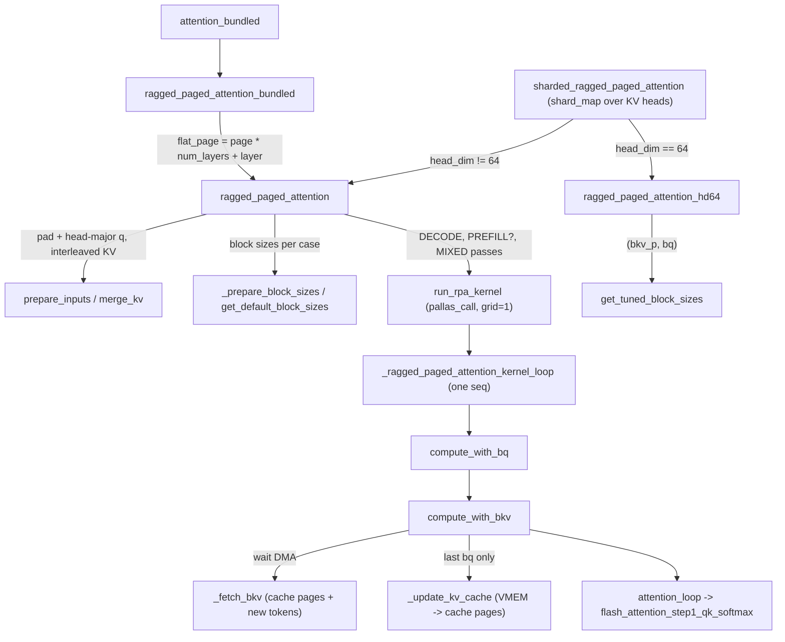

# Ragged Paged Attention (RPA v3) kernel

<!-- connect:up:begin -->
> **Cross-repo concept:** part of [continuous-batching](../../../concepts/continuous-batching.md), [flash-attention](../../../concepts/flash-attention.md), [kv-cache](../../../concepts/kv-cache.md), [pallas-kernel](../../../concepts/pallas-kernel.md), [vmem-budget](../../../concepts/vmem-budget.md) across this wiki's repos.
<!-- connect:up:end -->
## Overview
`src/vllm_torchtpu/kernels/ragged_paged_attention` is the plugin's default attention kernel for standard (non-MLA) models: a Pallas TPU kernel the module docstring calls a "TPU-Friendly Ragged Paged Attention kernel" that "supports mixed prefill and decoding". One call takes every scheduled token of the step concatenated on a single token axis (ragged), reads each sequence's history from a paged KV cache through a page table, writes the step's new K/V into that cache, and runs FlashAttention-2 style online softmax - all inside one kernel, so there is no separate cache-update op on the hot path. The key design idea is that the kernel is a single sequential walk over sequences in which the next query block and the next KV block are always being DMA'd into VMEM while the current ones are computed, and the new-token K/V that was just fetched for attention is written back to the cache from the same VMEM buffer. Around that core sit a head_dim=64 sibling ([`ragged_paged_attention_hd64`](../catalog/src/vllm_torchtpu/kernels/ragged_paged_attention/v3/kernel_hd64.md#ragged_paged_attention_hd64 "src/vllm_torchtpu/kernels/ragged_paged_attention/v3/kernel_hd64.py:L1377")) with its own tuned block-size table, a multi-layer "bundled" entry for the block-major cache, a pure-JAX reference, and a legacy standalone cache-update kernel under `v2/`.

## Diagram

Legend:
- `CALLER` - [`sharded_ragged_paged_attention`](../catalog/src/vllm_torchtpu/layers/core/attention_interface.md#sharded_ragged_paged_attention "src/vllm_torchtpu/layers/core/attention_interface.py:L353") (outside this unit)
- `BUNDLED_CALLER` - [`attention_bundled`](../catalog/src/vllm_torchtpu/layers/core/attention_interface.md#attention_bundled "src/vllm_torchtpu/layers/core/attention_interface.py:L479") (outside this unit)
- `RPA` - [`ragged_paged_attention`](../catalog/src/vllm_torchtpu/kernels/ragged_paged_attention/v3/kernel.md#ragged_paged_attention "src/vllm_torchtpu/kernels/ragged_paged_attention/v3/kernel.py:L1633")
- `HD64` - [`ragged_paged_attention_hd64`](../catalog/src/vllm_torchtpu/kernels/ragged_paged_attention/v3/kernel_hd64.md#ragged_paged_attention_hd64 "src/vllm_torchtpu/kernels/ragged_paged_attention/v3/kernel_hd64.py:L1377")
- `BUNDLED` - [`ragged_paged_attention_bundled`](../catalog/src/vllm_torchtpu/kernels/ragged_paged_attention/v3/kernel.md#ragged_paged_attention_bundled "src/vllm_torchtpu/kernels/ragged_paged_attention/v3/kernel.py:L2011")
- `PREP` - [`prepare_inputs`](../catalog/src/vllm_torchtpu/kernels/ragged_paged_attention/v3/kernel.md#prepare_inputs "src/vllm_torchtpu/kernels/ragged_paged_attention/v3/kernel.py:L1171"), [`merge_kv`](../catalog/src/vllm_torchtpu/kernels/ragged_paged_attention/v3/kernel.md#merge_kv "src/vllm_torchtpu/kernels/ragged_paged_attention/v3/kernel.py:L1140")
- `BS` - [`_prepare_block_sizes`](../catalog/src/vllm_torchtpu/kernels/ragged_paged_attention/v3/kernel.md#ragged_paged_attention._prepare_block_sizes "src/vllm_torchtpu/kernels/ragged_paged_attention/v3/kernel.py:L1929"), [`get_default_block_sizes`](../catalog/src/vllm_torchtpu/kernels/ragged_paged_attention/v3/kernel.md#get_default_block_sizes "src/vllm_torchtpu/kernels/ragged_paged_attention/v3/kernel.py:L1541")
- `RUN` - [`run_rpa_kernel`](../catalog/src/vllm_torchtpu/kernels/ragged_paged_attention/v3/kernel.md#ragged_paged_attention.run_rpa_kernel "src/vllm_torchtpu/kernels/ragged_paged_attention/v3/kernel.py:L1782")
- `LOOP` - [`_ragged_paged_attention_kernel_loop`](../catalog/src/vllm_torchtpu/kernels/ragged_paged_attention/v3/kernel.md#_ragged_paged_attention_kernel_loop "src/vllm_torchtpu/kernels/ragged_paged_attention/v3/kernel.py:L308")
- `BQ` - [`compute_with_bq`](../catalog/src/vllm_torchtpu/kernels/ragged_paged_attention/v3/kernel.md#_ragged_paged_attention_kernel_loop.process.compute_with_bq "src/vllm_torchtpu/kernels/ragged_paged_attention/v3/kernel.py:L936")
- `BKV` - [`compute_with_bkv`](../catalog/src/vllm_torchtpu/kernels/ragged_paged_attention/v3/kernel.md#_ragged_paged_attention_kernel_loop.process.compute_with_bq.compute_with_bkv "src/vllm_torchtpu/kernels/ragged_paged_attention/v3/kernel.py:L967")
- `FETCH` - (concept) the `_fetch_bkv` closure of the main kernel (the hd64 twin is [`_fetch_bkv`](../catalog/src/vllm_torchtpu/kernels/ragged_paged_attention/v3/kernel_hd64.md#_ragged_paged_attention_kernel._fetch_bkv "src/vllm_torchtpu/kernels/ragged_paged_attention/v3/kernel_hd64.py:L505"))
- `UPD` - [`_update_kv_cache`](../catalog/src/vllm_torchtpu/kernels/ragged_paged_attention/v3/kernel.md#_ragged_paged_attention_kernel_loop._update_kv_cache "src/vllm_torchtpu/kernels/ragged_paged_attention/v3/kernel.py:L652")
- `ATT` - [`attention_loop`](../catalog/src/vllm_torchtpu/kernels/ragged_paged_attention/v3/kernel.md#_ragged_paged_attention_kernel_loop.process.compute_with_bq.compute_with_bkv.attention_loop "src/vllm_torchtpu/kernels/ragged_paged_attention/v3/kernel.py:L1014"), [`flash_attention_step1_qk_softmax`](../catalog/src/vllm_torchtpu/kernels/ragged_paged_attention/v3/kernel.md#_ragged_paged_attention_kernel_loop.flash_attention_step1_qk_softmax "src/vllm_torchtpu/kernels/ragged_paged_attention/v3/kernel.py:L455")
- `TUNED` - [`get_tuned_block_sizes`](../catalog/src/vllm_torchtpu/kernels/ragged_paged_attention/v3/tuned_block_sizes_hd64.md#get_tuned_block_sizes "src/vllm_torchtpu/kernels/ragged_paged_attention/v3/tuned_block_sizes_hd64.py:L275")

## Design rationale (why it's built this way)
- **The KV cache shape is chosen for the TPU tile, not for the model.** [`get_kv_cache_shape`](../catalog/src/vllm_torchtpu/kernels/ragged_paged_attention/v3/kernel.md#get_kv_cache_shape "src/vllm_torchtpu/kernels/ragged_paged_attention/v3/kernel.py:L278") returns `[total_num_pages, page_size, align(2*num_kv_heads, packing)/packing, packing, align(head_dim, 128)]`. K and V of the same head are interleaved on one "num_kv_heads_x2" axis ([`merge_kv`](../catalog/src/vllm_torchtpu/kernels/ragged_paged_attention/v3/kernel.md#merge_kv "src/vllm_torchtpu/kernels/ragged_paged_attention/v3/kernel.py:L1140") concatenates `[k, v]` on the last dim and reshapes to `k0, v0, k1, v1, ...`), and that axis is split by [`get_dtype_packing`](../catalog/src/vllm_torchtpu/kernels/ragged_paged_attention/v3/util.md#get_dtype_packing "src/vllm_torchtpu/kernels/ragged_paged_attention/v3/util.py:L33") (`32 // bitwidth`: 1 for f32, 2 for bf16, 4 for 8-bit) so a 32-bit sublane word holds a whole K/V pair (bf16) or two heads' pairs (fp8). One page DMA therefore brings in every head's K and V for `page_size` tokens, and the kernel unpacks K and V from the same word with shifts. head_dim is padded to the 128-lane width; that padding is why a separate head_dim=64 kernel exists.
- **One sequential kernel, not a parallel grid.** [`run_rpa_kernel`](../catalog/src/vllm_torchtpu/kernels/ragged_paged_attention/v3/kernel.md#ragged_paged_attention.run_rpa_kernel "src/vllm_torchtpu/kernels/ragged_paged_attention/v3/kernel.py:L1782") launches `grid=(1,)` and loops over sequences in-kernel with `dimension_semantics=("arbitrary",)`. The source comment explains the cost: "since each sequence depends on the previous one, we need some extra work to support Megacore mode" - the dependency is the cross-sequence prefetch (sequence `i` starts the DMA for sequence `i+1`'s first blocks). The win is that DMA latency is hidden across sequence boundaries, which matters most for decode where each sequence contributes only one query row.
- **Decode, chunked prefill and mixed get separately specialized passes.** Rather than one kernel that branches per sequence, [`ragged_paged_attention`](../catalog/src/vllm_torchtpu/kernels/ragged_paged_attention/v3/kernel.md#ragged_paged_attention "src/vllm_torchtpu/kernels/ragged_paged_attention/v3/kernel.py:L1633") issues up to three `pallas_call`s, one per [`RpaCase`](../catalog/src/vllm_torchtpu/kernels/ragged_paged_attention/v3/kernel.md#RpaCase "src/vllm_torchtpu/kernels/ragged_paged_attention/v3/kernel.py:L42"), each compiled with a static `q_len` where possible (1 for decode, `chunk_prefill_size` for prefill) and its own block sizes. The scheduler-side contract is that sequences are pre-sorted into decode / prefill / mixed ranges described by the 3-int `distribution`. Static `q_len` lets decode drop the causal mask entirely ("if case == RpaCase.DECODE: use_causal_mask = False") and use `bq_sz = 1`.
- **The cache write is fused into attention.** The new tokens' K/V must be read for attention anyway; the kernel DMAs them into the same VMEM KV block as the cached history and writes that slice back to the cache pages from VMEM, so the cache update costs one extra HBM write and no extra read or op launch. It is done only on the last query block of a sequence so it happens once per token.
- **Default block sizes target HBM bandwidth, not FLOPs, for decode.** [`get_default_block_sizes`](../catalog/src/vllm_torchtpu/kernels/ragged_paged_attention/v3/kernel.md#get_default_block_sizes "src/vllm_torchtpu/kernels/ragged_paged_attention/v3/kernel.py:L1541") ("Note the default block sizes are not necessarily optimal") sizes the decode KV block as `min_bkv_sz_to_peak = 16 MiB * kv_packing / 4 / head_dim / num_kv_heads_x2` tokens - i.e. enough tokens that one KV-block DMA moves ~16 MiB - because decode attention is memory-bound and small DMAs do not reach peak HBM bandwidth.
- **Bounds and semaphore checks are off by default.** The compiler-params comment: "Paged attention invokes multiple small DMAs for each pages instead of a single large DMA. Therefore, the overhead of bounds checking becomes too significant so we disable it." (`disable_bounds_checks=True`, `disable_semaphore_checks=True`.)
- **Mask arithmetic is narrowed when safe.** [`flash_attention_step1_qk_softmax`](../catalog/src/vllm_torchtpu/kernels/ragged_paged_attention/v3/kernel.md#_ragged_paged_attention_kernel_loop.flash_attention_step1_qk_softmax "src/vllm_torchtpu/kernels/ragged_paged_attention/v3/kernel.py:L455") builds position iotas in int16 instead of int32 when q is a packed dtype, [`get_tpu_version`](../catalog/src/vllm_torchtpu/kernels/ragged_paged_attention/v3/util.md#get_tpu_version "src/vllm_torchtpu/kernels/ragged_paged_attention/v3/util.py:L53") >= 6, and the max KV length fits int16, halving the VPU work of mask construction.

> [!inferred]
> The int16 iota choice reads as matching the packed bf16 vreg layout (two 16-bit values per 32-bit lane) so mask compares stay in the same packing as the scores; the source states the condition but not the reason.

## Entry points
- [`ragged_paged_attention`](../catalog/src/vllm_torchtpu/kernels/ragged_paged_attention/v3/kernel.md#ragged_paged_attention "src/vllm_torchtpu/kernels/ragged_paged_attention/v3/kernel.py:L1633") - the jitted main entry ("Ragged paged attention that supports mixed prefill and decode"). Takes token-major `queries/keys/values`, the cache, `kv_lens`, flattened `page_indices`, `cu_q_lens` and `distribution`; returns `(output, updated_kv_cache)`. `queries/keys/values/kv_cache` are donated. Control reaches it once per attention layer per step through [`sharded_ragged_paged_attention`](../catalog/src/vllm_torchtpu/layers/core/attention_interface.md#sharded_ragged_paged_attention "src/vllm_torchtpu/layers/core/attention_interface.py:L353") ("Shards along KV heads"), which wraps it in `shard_map` with q/k/v and the cache split on the KV-head axis of the `model` mesh axis, so each chip runs the kernel on its local heads only.
- [`ragged_paged_attention_hd64`](../catalog/src/vllm_torchtpu/kernels/ragged_paged_attention/v3/kernel_hd64.md#ragged_paged_attention_hd64 "src/vllm_torchtpu/kernels/ragged_paged_attention/v3/kernel_hd64.py:L1377") - "A variant of ragged paged attention for head_dim=64". The sharded caller switches to it automatically when `q.shape[-1] == 64`; it is also the only path that accepts per-head attention sinks (the caller raises `NotImplementedError` for sinks otherwise).
- [`ragged_paged_attention_bundled`](../catalog/src/vllm_torchtpu/kernels/ragged_paged_attention/v3/kernel.md#ragged_paged_attention_bundled "src/vllm_torchtpu/kernels/ragged_paged_attention/v3/kernel.py:L2011") - "Executes ragged paged attention directly against a bundled block-major KV cache in place." Reached from [`attention_bundled`](../catalog/src/vllm_torchtpu/layers/core/attention_interface.md#attention_bundled "src/vllm_torchtpu/layers/core/attention_interface.py:L479") when the cache is one multi-layer array.
- [`get_kv_cache_shape`](../catalog/src/vllm_torchtpu/kernels/ragged_paged_attention/v3/kernel.md#get_kv_cache_shape "src/vllm_torchtpu/kernels/ragged_paged_attention/v3/kernel.py:L278") / [`get_kv_cache_shape`](../catalog/src/vllm_torchtpu/kernels/ragged_paged_attention/v3/kernel_hd64.md#get_kv_cache_shape "src/vllm_torchtpu/kernels/ragged_paged_attention/v3/kernel_hd64.py:L246") - called at cache-allocation time to size the paged cache in the kernel's native layout; [`static_validate_inputs`](../catalog/src/vllm_torchtpu/kernels/ragged_paged_attention/v3/kernel.md#static_validate_inputs "src/vllm_torchtpu/kernels/ragged_paged_attention/v3/kernel.py:L1366") rejects any other shape at trace time.
- [`get_default_block_sizes`](../catalog/src/vllm_torchtpu/kernels/ragged_paged_attention/v3/kernel.md#get_default_block_sizes "src/vllm_torchtpu/kernels/ragged_paged_attention/v3/kernel.py:L1541") and [`RpaCase`](../catalog/src/vllm_torchtpu/kernels/ragged_paged_attention/v3/kernel.md#RpaCase "src/vllm_torchtpu/kernels/ragged_paged_attention/v3/kernel.py:L42") - also used from outside: the sharded caller recomputes the defaults per case and caps `bkv_sz` (`kv_block_cap`) for the local, non-sharded speculative-decoding draft path to relieve VMEM.
- [`ref_ragged_paged_attention`](../catalog/src/vllm_torchtpu/kernels/ragged_paged_attention/v3/kernel.md#ref_ragged_paged_attention "src/vllm_torchtpu/kernels/ragged_paged_attention/v3/kernel.py:L74") / [`ref_ragged_paged_attention_hd64`](../catalog/src/vllm_torchtpu/kernels/ragged_paged_attention/v3/kernel_hd64.md#ref_ragged_paged_attention_hd64 "src/vllm_torchtpu/kernels/ragged_paged_attention/v3/kernel_hd64.py:L43") - per-sequence pure-JAX references (gather pages, scatter new K/V, einsum softmax). [`tq_ragged_paged_attention`](../catalog/src/vllm_torchtpu/layers/core/turboquant.md#tq_ragged_paged_attention "src/vllm_torchtpu/layers/core/turboquant.py:L712") names the reference as an example `rpa_fn` and reuses [`merge_kv`](../catalog/src/vllm_torchtpu/kernels/ragged_paged_attention/v3/kernel.md#merge_kv "src/vllm_torchtpu/kernels/ragged_paged_attention/v3/kernel.py:L1140") for its compressed cache.
- [`kv_cache_update`](../catalog/src/vllm_torchtpu/kernels/ragged_paged_attention/v2/ragged_kv_cache_update.md#kv_cache_update "src/vllm_torchtpu/kernels/ragged_paged_attention/v2/ragged_kv_cache_update.py:L337") - the older standalone "copy new KV slices into cache pages" kernel (see Edge cases); not on the v3 path.

## Mechanism (step-by-step)
1. **Wrapper setup and layout prep.** [`ragged_paged_attention`](../catalog/src/vllm_torchtpu/kernels/ragged_paged_attention/v3/kernel.md#ragged_paged_attention "src/vllm_torchtpu/kernels/ragged_paged_attention/v3/kernel.py:L1633") defaults `out_dtype` to bf16 (f32 only for f32 queries), sets `mask_value` to the dtype's finite min ("We do not set to -inf directly because (-inf) - (-inf) is nan"), and - because the planned estimate is not trusted yet ("change this to use `get_vmem_estimate_bytes` when VREG spilling is fixed") - sets `vmem_limit_bytes` to the chip's full VMEM capacity. [`static_validate_inputs`](../catalog/src/vllm_torchtpu/kernels/ragged_paged_attention/v3/kernel.md#static_validate_inputs "src/vllm_torchtpu/kernels/ragged_paged_attention/v3/kernel.py:L1366") checks shapes, int32 metadata, a floating KV dtype equal to k/v ("we expect the kv quantization happens outside of the RPA kernel"), and that each case's KV block sizes (`bkv_sz`, `bkv_csz`) are multiples of `page_size` (query block sizes only need `bq_sz % bq_csz == 0`). [`prepare_inputs`](../catalog/src/vllm_torchtpu/kernels/ragged_paged_attention/v3/kernel.md#prepare_inputs "src/vllm_torchtpu/kernels/ragged_paged_attention/v3/kernel.py:L1171") pads q-heads-per-KV-head up to the q packing and head_dim to 128, groups query heads under their KV head, swaps to a KV-head-major `[kv_heads, tokens, ...]` layout, and builds the interleaved new-KV tensor with [`merge_kv`](../catalog/src/vllm_torchtpu/kernels/ragged_paged_attention/v3/kernel.md#merge_kv "src/vllm_torchtpu/kernels/ragged_paged_attention/v3/kernel.py:L1140").
2. **Three passes over one in-place buffer.** For each case in DECODE, PREFILL (only if `chunk_prefill_size` is set), MIXED, [`_prepare_block_sizes`](../catalog/src/vllm_torchtpu/kernels/ragged_paged_attention/v3/kernel.md#ragged_paged_attention._prepare_block_sizes "src/vllm_torchtpu/kernels/ragged_paged_attention/v3/kernel.py:L1929") takes the caller's `(bq_sz, bkv_sz, bq_csz, bkv_csz)` tuple or falls back to [`get_default_block_sizes`](../catalog/src/vllm_torchtpu/kernels/ragged_paged_attention/v3/kernel.md#get_default_block_sizes "src/vllm_torchtpu/kernels/ragged_paged_attention/v3/kernel.py:L1541"), and [`run_rpa_kernel`](../catalog/src/vllm_torchtpu/kernels/ragged_paged_attention/v3/kernel.md#ragged_paged_attention.run_rpa_kernel "src/vllm_torchtpu/kernels/ragged_paged_attention/v3/kernel.py:L1782") is called as `q, kv_cache = run_rpa_kernel(q, kv_cache, ...)`. Its `input_output_aliases={7: 0, 9: 1}` alias the query buffer to the attention output and the cache to the updated cache, so each pass overwrites only its own sequences' rows in the shared q buffer and the next pass reads untouched query rows from the same buffer - no concatenation of per-case outputs is needed. On TPU v7 the call is additionally wrapped in a `jax.jit` that pins q, kv and cache to HBM ("jit to color the memory"); on v6 that is skipped ("v6 has issues with pinning aliased memory"). Each `pallas_call` is named `RPA{d|p|m}-p_<page>-bq_<bq>_<bq_csz>-bkv_<bkv>_<bkv_csz>[-sw_<window>]` (via [`symbol`](../catalog/src/vllm_torchtpu/kernels/ragged_paged_attention/v3/kernel.md#RpaCase.symbol "src/vllm_torchtpu/kernels/ragged_paged_attention/v3/kernel.py:L55")), which is the name to search for in a profile.
3. **VMEM and SMEM allocation.** The scratch set is a 2-slot KV block buffer `[2, bkv_sz, stride, packing, head_dim]`, 2-slot query and output buffers `[2, kv_heads, bq_sz, ...]`, a `(4, 2)` DMA semaphore array (bkv, bq, bo, cache update; two slots each), and `l`/`m` (128 lanes wide) and `acc` accumulators per KV head, allocated in `out_dtype` (bf16 by default, f32 only for f32 queries). The KV buffer's sublane stride gets one extra row when the natural stride would cause VMEM bank conflicts for the strided per-head loads. Scalar prefetch (SMEM) carries `kv_lens`, `page_indices`, `cu_q_lens`, `distribution` plus three small bookkeeping arrays that record which semaphore slot is in flight for which sequence and offset. [`get_vmem_estimate_bytes`](../catalog/src/vllm_torchtpu/kernels/ragged_paged_attention/v3/kernel.md#get_vmem_estimate_bytes "src/vllm_torchtpu/kernels/ragged_paged_attention/v3/kernel.py:L243") computes exactly this footprint but, per step 1, is not what sets the limit.
4. **Sequence range and prologue.** The kernel body selects its sequence range with [`get_range`](../catalog/src/vllm_torchtpu/kernels/ragged_paged_attention/v3/kernel.md#RpaCase.get_range "src/vllm_torchtpu/kernels/ragged_paged_attention/v3/kernel.py:L62") (`[0, d)`, `[d, p)` or `[p, m)` from `distribution`) and runs [`_ragged_paged_attention_kernel_loop`](../catalog/src/vllm_torchtpu/kernels/ragged_paged_attention/v3/kernel.md#_ragged_paged_attention_kernel_loop "src/vllm_torchtpu/kernels/ragged_paged_attention/v3/kernel.py:L308") for each `seq_idx`. On the first sequence a prologue starts the DMAs for query block 0 and the first needed KV block (with a sliding window, the KV block containing `kv_len - q_len - window`, so whole `bkv_sz` blocks before the window are never fetched; skipping is at block, not page, granularity). On the last sequence an epilogue waits on both output-send and both cache-update semaphore slots so nothing is in flight when the kernel returns.
5. **Query-block loop with prefetch.** [`compute_with_bq`](../catalog/src/vllm_torchtpu/kernels/ragged_paged_attention/v3/kernel.md#_ragged_paged_attention_kernel_loop.process.compute_with_bq "src/vllm_torchtpu/kernels/ragged_paged_attention/v3/kernel.py:L936") iterates `cdiv(q_len, bq_sz)` query blocks. It resets `l = 0, m = -inf, acc = 0`, computes `processed_q_len = (kv_len - q_len) + bq_idx * bq_sz` (the absolute position of the block's first query), and with a causal mask clips the KV range to `effective_kv_len = min(kv_len, processed_q_len + bq_sz)` - later query blocks of a long prefill do not read KV beyond their diagonal. It then starts the DMA for the *next* query block, which may belong to the next sequence, before touching any KV.
6. **KV-block loop: fetch from two sources, write back once.** [`compute_with_bkv`](../catalog/src/vllm_torchtpu/kernels/ragged_paged_attention/v3/kernel.md#_ragged_paged_attention_kernel_loop.process.compute_with_bq.compute_with_bkv "src/vllm_torchtpu/kernels/ragged_paged_attention/v3/kernel.py:L967") first starts the fetch of the next KV block (next block, next query block's first block, or next sequence's first block), then waits on the current one. The fetch splits a KV block into a "from cache" part - one DMA per page, unrolled with a static loop "to pipeline multiple DMA calls", page id looked up in the SMEM page table and size clipped so only valid tokens are copied - and a "from new" part, the tail tokens that belong to this step, copied straight from the new-KV input. Before reusing a buffer slot it waits for any cache write still draining from that slot. If the block contains new tokens and this is the last query block, [`_update_kv_cache`](../catalog/src/vllm_torchtpu/kernels/ragged_paged_attention/v3/kernel.md#_ragged_paged_attention_kernel_loop._update_kv_cache "src/vllm_torchtpu/kernels/ragged_paged_attention/v3/kernel.py:L652") starts a page-by-page DMA of that slice from VMEM to the output cache (handling a first page that starts mid-page). With `skip_kv_update` (KV-sharing layers) everything is read from the cache and nothing is written.
7. **Software-pipelined FlashAttention over KV heads.** [`attention_loop`](../catalog/src/vllm_torchtpu/kernels/ragged_paged_attention/v3/kernel.md#_ragged_paged_attention_kernel_loop.process.compute_with_bq.compute_with_bkv.attention_loop "src/vllm_torchtpu/kernels/ragged_paged_attention/v3/kernel.py:L1014") walks the fetched block in `bkv_csz` compute chunks and, inside, statically unrolls over query compute chunks (`bq_csz`) and KV heads. Per head it loads K and V with [`strided_load`](../catalog/src/vllm_torchtpu/kernels/ragged_paged_attention/v3/kernel.md#_ragged_paged_attention_kernel_loop.strided_load "src/vllm_torchtpu/kernels/ragged_paged_attention/v3/kernel.py:L806") on the uint32 view (stride = heads-per-row; for packed dtypes K and V are shifted out of the same word) and runs [`flash_attention_step1_qk_softmax`](../catalog/src/vllm_torchtpu/kernels/ragged_paged_attention/v3/kernel.md#_ragged_paged_attention_kernel_loop.flash_attention_step1_qk_softmax "src/vllm_torchtpu/kernels/ragged_paged_attention/v3/kernel.py:L455") (QK^T with f32 accumulation, scales, optional soft cap, causal / KV-length / sliding-window masks, running max and sum update). The P@V step for the *previous* head is issued after the current head's QK/softmax - the source comment: "`step2_pv` for the previous KV head, which depends on the softmax output, is overlapped with `step1_qk_softmax` for the current KV head, reducing overall wait times."
8. **Finalize and send output.** After the KV loop, the block's output is `acc / l` (an approximate reciprocal when `l` is f32 and the output is not), written into the free output slot with [`strided_store`](../catalog/src/vllm_torchtpu/kernels/ragged_paged_attention/v3/kernel.md#_ragged_paged_attention_kernel_loop.strided_store "src/vllm_torchtpu/kernels/ragged_paged_attention/v3/kernel.py:L824") after waiting on the previous send from that slot, and DMA'd to the query/output buffer asynchronously. [`prepare_outputs`](../catalog/src/vllm_torchtpu/kernels/ragged_paged_attention/v3/kernel.md#prepare_outputs "src/vllm_torchtpu/kernels/ragged_paged_attention/v3/kernel.py:L1222") undoes the head-major swap and strips head and head_dim padding.
9. **head_dim=64 variant.** [`ragged_paged_attention_hd64`](../catalog/src/vllm_torchtpu/kernels/ragged_paged_attention/v3/kernel_hd64.md#ragged_paged_attention_hd64 "src/vllm_torchtpu/kernels/ragged_paged_attention/v3/kernel_hd64.py:L1377") avoids padding 64 to 128 lanes in the cache by storing K and V side by side in one 128-lane row ([`merge_kv`](../catalog/src/vllm_torchtpu/kernels/ragged_paged_attention/v3/kernel_hd64.md#merge_kv "src/vllm_torchtpu/kernels/ragged_paged_attention/v3/kernel_hd64.py:L1018") concatenates `[k | v]` on head_dim; [`get_kv_cache_shape`](../catalog/src/vllm_torchtpu/kernels/ragged_paged_attention/v3/kernel_hd64.md#get_kv_cache_shape "src/vllm_torchtpu/kernels/ragged_paged_attention/v3/kernel_hd64.py:L246") has last dim 128 and packs heads, not K/V pairs). The query is zero-padded to 128, so `q . [k|v]` only sees the K half; P@[K|V] yields `[P@K | P@V]` and its `prepare_outputs` keeps the second half. It is a single `pallas_call` with `grid=(num_seqs,)` that branches per sequence on `distribution` (decode / prefill / mixed via `pl.when`), writes new KV on the *first* query block, uses [`DEFAULT_MASK_VALUE`](../catalog/src/vllm_torchtpu/kernels/ragged_paged_attention/v3/kernel_hd64.md#DEFAULT_MASK_VALUE "src/vllm_torchtpu/kernels/ragged_paged_attention/v3/kernel_hd64.py:L36") (`-0.7 * f32 max`), a fixed 100 MiB VMEM limit, and seeds the running max with the per-head attention sink when one is given (sink folded into the online softmax). Block sizes `(num_kv_pages_per_block, num_queries_per_block)` come from [`get_tuned_block_sizes`](../catalog/src/vllm_torchtpu/kernels/ragged_paged_attention/v3/tuned_block_sizes_hd64.md#get_tuned_block_sizes "src/vllm_torchtpu/kernels/ragged_paged_attention/v3/tuned_block_sizes_hd64.py:L275") unless passed explicitly.
10. **Bundled block-major entry.** [`ragged_paged_attention_bundled`](../catalog/src/vllm_torchtpu/kernels/ragged_paged_attention/v3/kernel.md#ragged_paged_attention_bundled "src/vllm_torchtpu/kernels/ragged_paged_attention/v3/kernel.py:L2011") takes a `[num_pages, num_layers, page_size, ...]` cache, reshapes it (metadata only) to `[num_pages * num_layers, page_size, ...]`, remaps `flat_page = page * num_layers + layer_idx`, and calls the main kernel. With `layer_idx` a dynamic scalar, one compiled kernel serves every layer, and donation makes the write in place "without emitting `dynamic_update_slice` or incurring intermediate HBM memory traffic."

## Key data structures
- **Paged KV cache** (main kernel) - `[total_num_pages, page_size, num_kv_heads_x2 / packing, packing, head_dim_128]`, sized by [`get_kv_cache_shape`](../catalog/src/vllm_torchtpu/kernels/ragged_paged_attention/v3/kernel.md#get_kv_cache_shape "src/vllm_torchtpu/kernels/ragged_paged_attention/v3/kernel.py:L278"). Inside the kernel it is viewed as `[pages * page_size, ...]` so a page DMA is a contiguous token range. hd64: `[pages, page_size, num_kv_heads / packing, packing, 128]` with K and V in lanes 0-63 / 64-127.
- **Ragged batch metadata** (all int32, SMEM): `kv_lens[max_num_seqs]` (total length including this step's tokens), `page_indices[max_num_seqs * pages_per_seq]` (flattened page table; `pages_per_seq` is inferred from its length), `cu_q_lens[max_num_seqs + 1]` (cumulative query lengths), and `distribution[3] = (decode_end, prefill_end, mixed_end)`; only the first `distribution[2]` sequences are valid.
- **[`RpaCase`](../catalog/src/vllm_torchtpu/kernels/ragged_paged_attention/v3/kernel.md#RpaCase "src/vllm_torchtpu/kernels/ragged_paged_attention/v3/kernel.py:L42")** - [`DECODE`](../catalog/src/vllm_torchtpu/kernels/ragged_paged_attention/v3/kernel.md#RpaCase.DECODE "src/vllm_torchtpu/kernels/ragged_paged_attention/v3/kernel.py:L50") (`q_len = 1`), [`PREFILL`](../catalog/src/vllm_torchtpu/kernels/ragged_paged_attention/v3/kernel.md#RpaCase.PREFILL "src/vllm_torchtpu/kernels/ragged_paged_attention/v3/kernel.py:L51") ("q_len > 1, static"), [`MIXED`](../catalog/src/vllm_torchtpu/kernels/ragged_paged_attention/v3/kernel.md#RpaCase.MIXED "src/vllm_torchtpu/kernels/ragged_paged_attention/v3/kernel.py:L52") ("q_len > 1, dynamic").
- **Block-size quadruple** `(bq_sz, bkv_sz, bq_csz, bkv_csz)` - fetch sizes (what one DMA moves into VMEM) vs compute sizes (what one matmul tile covers). Constraints: `bq_sz % bq_csz == 0`, `bkv_sz % bkv_csz == 0`, both KV sizes multiples of `page_size`. Defaults from [`get_default_block_sizes`](../catalog/src/vllm_torchtpu/kernels/ragged_paged_attention/v3/kernel.md#get_default_block_sizes "src/vllm_torchtpu/kernels/ragged_paged_attention/v3/kernel.py:L1541"):

| TPU | Case | bq_sz | bkv_sz | bq_csz | bkv_csz |
|---|---|---|---|---|---|
| v5 / v6 | DECODE | 1 | ~16 MiB worth of tokens (capped at max KV) | 1 | same as bkv_sz |
| v5 / v6 | PREFILL / MIXED | 1024 / q-per-kv (<= max_q/2) | 1024 | 512 / q-per-kv | 512 |
| v7 | DECODE | 1 | ~16 MiB worth of tokens | 1 | same as bkv_sz |
| v7 | PREFILL / MIXED | 2048 / q-per-kv (<= max_q/2) | 2048 | 1024 / q-per-kv | 512 |

- **hd64 tuned table** - `TUNED_BLOCK_SIZES[device][page_size][q/kv dtype][head config][max_model_len] -> (num_kv_pages_per_block, num_queries_per_block)` with entries for TPU v5e, v6e and v7. [`get_lookup_keys`](../catalog/src/vllm_torchtpu/kernels/ragged_paged_attention/v3/tuned_block_sizes_hd64.md#get_lookup_keys "src/vllm_torchtpu/kernels/ragged_paged_attention/v3/tuned_block_sizes_hd64.py:L323") builds the key from [`get_device_name`](../catalog/src/vllm_torchtpu/utils.md#get_device_name "src/vllm_torchtpu/utils.py:L123") and [`get_simplified_raw_key`](../catalog/src/vllm_torchtpu/kernels/ragged_paged_attention/v3/tuned_block_sizes_hd64.md#get_simplified_raw_key "src/vllm_torchtpu/kernels/ragged_paged_attention/v3/tuned_block_sizes_hd64.py:L360"), which rounds page size, head counts and `max_model_len` (= `page_size * pages_per_seq`) up with [`next_power_of_2`](../catalog/src/vllm_torchtpu/kernels/ragged_paged_attention/v3/util.md#next_power_of_2 "src/vllm_torchtpu/kernels/ragged_paged_attention/v3/util.py:L38"). On a miss it logs a warning once and uses per-generation defaults: v4 `(512/page, 32)` ("TPUv4 has much smaller VMEM"), v7 `(4096/page, 32)`, others `(2048/page, 32)`; the result is clamped to `pages_per_seq` and `max_num_tokens`.
- **Double-buffer bookkeeping** - `sem_ids` (which slot is current for bq / bkv / bo), `bo_ids` (sequence and block whose output is still being sent per slot) and `bkv_update_ids` (sequence, offset, size of the cache write draining per slot). These let a wait be issued for a DMA that was started in an earlier sequence iteration.

## Dynamics (design intent)
- **Steady state is one KV block of lookahead.** At any time at most two KV blocks, two query blocks and two output blocks are live per kernel; the DMA for block `n+1` is started before block `n` is waited on, crossing query-block and sequence boundaries. Whether compute fully hides DMA depends on `bkv_sz` vs compute per block - which is why decode uses a large bandwidth-sized `bkv_sz` and prefill/mixed use compute-sized ones.
- **Cache writes drain asynchronously.** A cache write started from KV slot `s` is only waited for when slot `s` is about to be refilled (or in the epilogue), so it overlaps the next block's compute.
- **Pass ordering is fixed.** Decode runs first, then prefill, then mixed; each pass is its own `pallas_call`, so DMA lookahead does not cross pass boundaries, and a step with only decode sequences still launches the (empty-range) mixed pass.

- **Empty ranges are free.** The prologue, pipeline and epilogue all live inside the per-sequence loop body, so a pass whose [`get_range`](../catalog/src/vllm_torchtpu/kernels/ragged_paged_attention/v3/kernel.md#RpaCase.get_range "src/vllm_torchtpu/kernels/ragged_paged_attention/v3/kernel.py:L62") is empty runs zero iterations and issues no DMAs; it costs only the launch.

## Edge cases
- **`skip_kv_mask` is a sharp tool.** The docstring: "only set to true if use_causal_mask=False and each dynamic kv_len % bkv_csz == 0." [`static_validate_inputs`](../catalog/src/vllm_torchtpu/kernels/ragged_paged_attention/v3/kernel.md#static_validate_inputs "src/vllm_torchtpu/kernels/ragged_paged_attention/v3/kernel.py:L1366") rejects causal + skip; the length condition is not checked.
- **No integer KV quantization.** The cache dtype must be floating and equal to k/v dtype; `k_scale`/`v_scale` are applied to scores/outputs but quantizing the new K/V is the caller's job.
- **`page_size` must be a multiple of the KV packing**, and every block size a multiple of `page_size`.
- **`USE_RPA_PIPELINED_DMA_STAGING` does not change the v3 main path.** [`USE_RPA_PIPELINED_DMA_STAGING`](../catalog/src/vllm_torchtpu/envs.md#USE_RPA_PIPELINED_DMA_STAGING "src/vllm_torchtpu/envs.py:L137") is the default for `fuse_non_tiling_axis_swap` in [`prepare_inputs`](../catalog/src/vllm_torchtpu/kernels/ragged_paged_attention/v3/kernel.md#prepare_inputs "src/vllm_torchtpu/kernels/ragged_paged_attention/v3/kernel.py:L1171") / [`prepare_outputs`](../catalog/src/vllm_torchtpu/kernels/ragged_paged_attention/v3/kernel.md#prepare_outputs "src/vllm_torchtpu/kernels/ragged_paged_attention/v3/kernel.py:L1222") (leave q token-major and "carry axis permutation directly in Pallas strided DMA descriptors" instead of an XLU transpose), but [`ragged_paged_attention`](../catalog/src/vllm_torchtpu/kernels/ragged_paged_attention/v3/kernel.md#ragged_paged_attention "src/vllm_torchtpu/kernels/ragged_paged_attention/v3/kernel.py:L1633") passes `fuse_non_tiling_axis_swap=False` explicitly and the kernel's query DMAs assume the head-major layout. The flag's live effect is the double-buffered staging in the v2 [`kv_cache_update`](../catalog/src/vllm_torchtpu/kernels/ragged_paged_attention/v2/ragged_kv_cache_update.md#kv_cache_update "src/vllm_torchtpu/kernels/ragged_paged_attention/v2/ragged_kv_cache_update.py:L337") kernel.
- **v2 cache-update kernel.** [`_kv_cache_update`](../catalog/src/vllm_torchtpu/kernels/ragged_paged_attention/v2/ragged_kv_cache_update.md#_kv_cache_update "src/vllm_torchtpu/kernels/ragged_paged_attention/v2/ragged_kv_cache_update.py:L212") copies `(cache_start, new_kv_start, len)` slices through VMEM in blocks of up to 64 slices (more in-flight DMAs raise HBM utilization; the docstring reports a regression at 128 on v6e "likely due to running out of scalar registers"), with an optional `shard_map` that only supports sharding along head_dim. No module under `src/` imports it at this pin; the v3 kernel does its own cache write.
- **head_dim=64 restrictions.** Attention sinks only exist on this path; there is no `chunk_prefill_size`-specific block tuning, and its block sizes are `(pages, queries)` rather than the four-tuple. A head config absent from the tuned table silently falls back to generic defaults (one warning).
- **Megacore.** Both kernels are single-core sequential (`"arbitrary"`); on a megacore chip the second core is not used by this kernel.
- **`debug_mode`** issues no DMAs and skips the math, only `pl.debug_print`s indices; the docstring notes it needs `--xla_tpu_enable_log_recorder`. Use it to debug scheduling, not numerics.

## Open questions
- The VMEM limit is the whole chip capacity until "VREG spilling is fixed"; the source does not say which configurations spill or how much headroom the estimate in [`get_vmem_estimate_bytes`](../catalog/src/vllm_torchtpu/kernels/ragged_paged_attention/v3/kernel.md#get_vmem_estimate_bytes "src/vllm_torchtpu/kernels/ragged_paged_attention/v3/kernel.py:L243") would leave.
- The main kernel has no tuned table - only heuristic defaults - while hd64 has one. Whether callers in the plugin pass tuned `d/p/m_block_sizes` for common models is decided outside this unit.
- `chunk_prefill_size` enables the PREFILL pass only when set; which caller sets it, and how the scheduler guarantees the prefill range really has that static length, is outside this unit.
- The fused token-major query layout is wired in `prepare_inputs` / `prepare_outputs` but not in the kernel; whether a kernel-side counterpart is planned is not stated.

## See also
- [kv-cache-layout-and-hbm-budget](kv-cache-layout-and-hbm-budget.md) - how the cache shape returned here is allocated and budgeted.
- [batched-ragged-paged-attention-kernel](batched-ragged-paged-attention-kernel.md) - the experimental batched RPA with schedule metadata and a `SEQ_ALONG_LANE` layout.
- [pcp-streaming-rpa-kernel](pcp-streaming-rpa-kernel.md) - prefill context-parallel streaming variant.
- [mla-attention-kernels](mla-attention-kernels.md) - the MLA counterparts.
- [attention-and-layer-core](attention-and-layer-core.md) - `attention_interface` dispatch that calls these kernels.
- [vllm-layer-adapters](vllm-layer-adapters.md) - the vLLM attention backend that builds the kernel ops.
- [host-offload](host-offload.md) - consumer of the block-major bundled cache.
- [speculative-decoding](speculative-decoding.md) - the draft path that caps `bkv_sz`.
- [tpu-schedulers](tpu-schedulers.md) - producer of the decode / prefill / mixed `distribution`.
