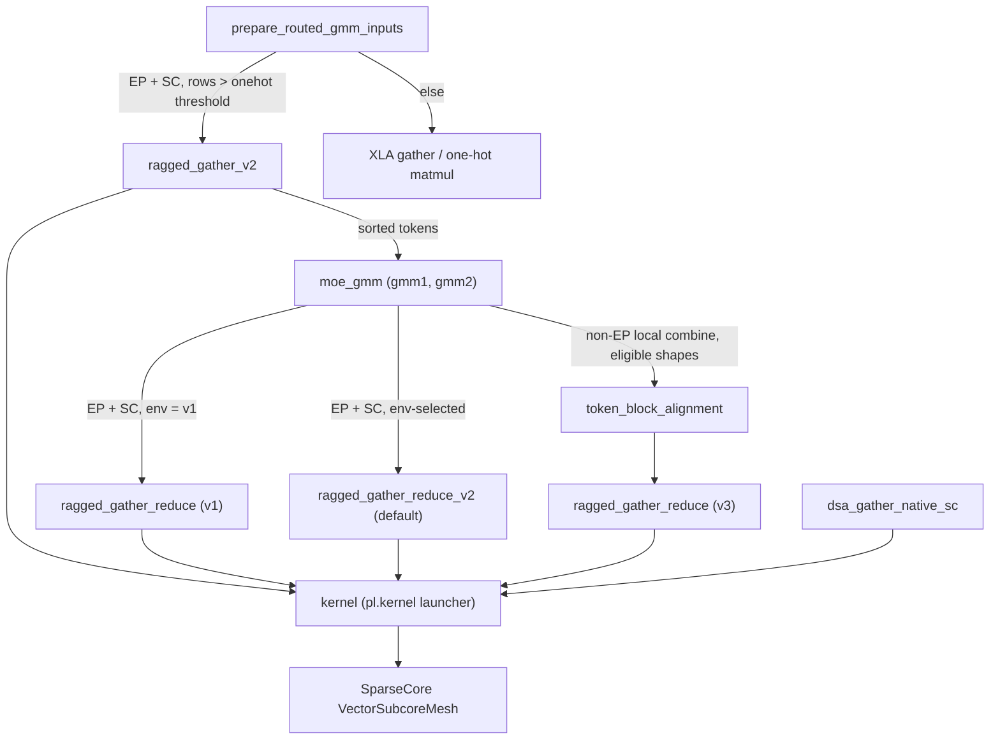
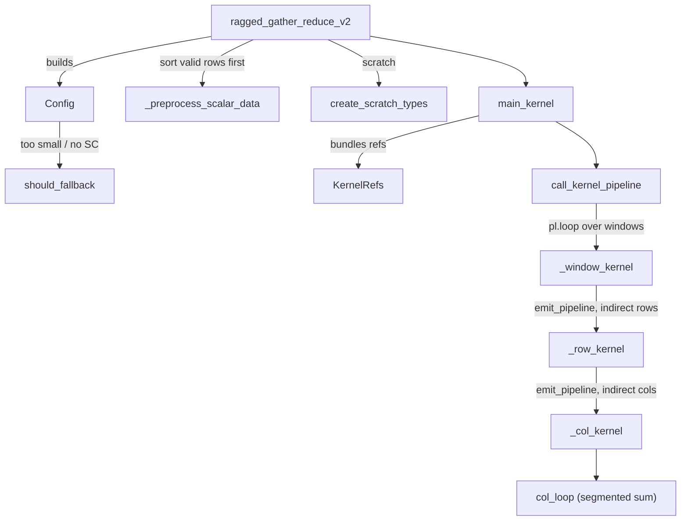

# SparseCore ragged gather / gather-reduce / scatter kernels (MoE token movement)

<!-- connect:up:begin -->
> **Cross-repo concept:** part of [expert-parallelism](../../../concepts/expert-parallelism.md), [pallas-kernel](../../../concepts/pallas-kernel.md), [sparsecore](../../../concepts/sparsecore.md), [vmem-budget](../../../concepts/vmem-budget.md) across this wiki's repos.
<!-- connect:up:end -->
## Overview
`src/vllm_torchtpu/kernels/sparse_core` holds the Pallas SparseCore (SC) kernels the MoE layer uses for the two data-movement halves around its grouped matmuls: **dispatch** (permute tokens into expert-sorted order, [`ragged_gather_v2`](../catalog/src/vllm_torchtpu/kernels/sparse_core/ragged_gather_v2.md#ragged_gather_v2 "src/vllm_torchtpu/kernels/sparse_core/ragged_gather_v2.py:L213")) and **combine** (un-permute, scale by top-k router weight, mask non-local routes, and sum the `topk` rows of each token, the `ragged_gather_reduce` family). Both are pure memory movement: the work is irregular row-granular HBM reads/writes, which is exactly what the SC's many 16-lane vector subcores and indirect DMA are built for, freeing the TensorCore for the GMMs. The one design idea shared by every kernel is a **collision-free partition of the output across all SC subcores** (row partitions x column partitions), fed by a host-side (XLA) pre-sort that makes each subcore's work a contiguous, ragged prefix of valid rows. Three generations of the combine kernel coexist: v1 (hand-issued per-row DMAs), v2 (the default; `pl.Indirect` BlockSpec pipelines with a cost-model [`Config`](../catalog/src/vllm_torchtpu/kernels/sparse_core/ragged_gather_reduce_v2/config.md#Config "src/vllm_torchtpu/kernels/sparse_core/ragged_gather_reduce_v2/config.py:L43")), and v3, a "destination-major prototype for MoE output combine" ([`ragged_gather_reduce`](../catalog/src/vllm_torchtpu/kernels/sparse_core/ragged_gather_reduce_v3.md#ragged_gather_reduce "src/vllm_torchtpu/kernels/sparse_core/ragged_gather_reduce_v3.py:L332")) that scatter-adds into a dense FP32 VMEM accumulator. Every kernel is launched through one helper, [`kernel`](../catalog/src/vllm_torchtpu/kernels/sparse_core/core_map_helper.md#kernel "src/vllm_torchtpu/kernels/sparse_core/core_map_helper.py:L35"), whose only purpose is a performance fix in the TorchTPU lowering.

## Diagram
Where the kernels sit in the MoE forward, and how a combine version is chosen:

Legend:
- `PREP` - [`prepare_routed_gmm_inputs`](../catalog/src/vllm_torchtpu/layers/core/fused_moe_gmm.md#prepare_routed_gmm_inputs "src/vllm_torchtpu/layers/core/fused_moe_gmm.py:L332")
- `RG2` - [`ragged_gather_v2`](../catalog/src/vllm_torchtpu/kernels/sparse_core/ragged_gather_v2.md#ragged_gather_v2 "src/vllm_torchtpu/kernels/sparse_core/ragged_gather_v2.py:L213")
- `XLA` - (concept) the non-SparseCore fallback path
- `GMM` - [`moe_gmm`](../catalog/src/vllm_torchtpu/layers/core/fused_moe_gmm.md#moe_gmm "src/vllm_torchtpu/layers/core/fused_moe_gmm.py:L492")
- `TBA` - [`token_block_alignment`](../catalog/src/vllm_torchtpu/kernels/sparse_core/ragged_gather_reduce_v3.md#token_block_alignment "src/vllm_torchtpu/kernels/sparse_core/ragged_gather_reduce_v3.py:L91")
- `V3` - [`ragged_gather_reduce`](../catalog/src/vllm_torchtpu/kernels/sparse_core/ragged_gather_reduce_v3.md#ragged_gather_reduce "src/vllm_torchtpu/kernels/sparse_core/ragged_gather_reduce_v3.py:L332")
- `V2` - [`ragged_gather_reduce_v2`](../catalog/src/vllm_torchtpu/kernels/sparse_core/ragged_gather_reduce_v2/wrapper.md#ragged_gather_reduce_v2 "src/vllm_torchtpu/kernels/sparse_core/ragged_gather_reduce_v2/wrapper.py:L135")
- `V1` - [`ragged_gather_reduce`](../catalog/src/vllm_torchtpu/kernels/sparse_core/ragged_gather_reduce.md#ragged_gather_reduce "src/vllm_torchtpu/kernels/sparse_core/ragged_gather_reduce.py:L448")
- `KER` - [`kernel`](../catalog/src/vllm_torchtpu/kernels/sparse_core/core_map_helper.md#kernel "src/vllm_torchtpu/kernels/sparse_core/core_map_helper.py:L35")
- `DSA` - [`dsa_gather_native_sc`](../catalog/src/vllm_torchtpu/kernels/mla/sparse/native_sc_gather.md#dsa_gather_native_sc "src/vllm_torchtpu/kernels/mla/sparse/native_sc_gather.py:L251")
- `SC` - (concept) the SparseCore vector-subcore mesh

The default (v2) combine is three nested pipelines per subcore:

Legend:
- `W` - [`ragged_gather_reduce_v2`](../catalog/src/vllm_torchtpu/kernels/sparse_core/ragged_gather_reduce_v2/wrapper.md#ragged_gather_reduce_v2 "src/vllm_torchtpu/kernels/sparse_core/ragged_gather_reduce_v2/wrapper.py:L135")
- `CFG` - [`Config`](../catalog/src/vllm_torchtpu/kernels/sparse_core/ragged_gather_reduce_v2/config.md#Config "src/vllm_torchtpu/kernels/sparse_core/ragged_gather_reduce_v2/config.py:L43")
- `FB` - [`should_fallback`](../catalog/src/vllm_torchtpu/kernels/sparse_core/ragged_gather_reduce_v2/config.md#Config.should_fallback "src/vllm_torchtpu/kernels/sparse_core/ragged_gather_reduce_v2/config.py:L93")
- `PRE` - [`_preprocess_scalar_data`](../catalog/src/vllm_torchtpu/kernels/sparse_core/ragged_gather_reduce_v2/wrapper.md#_preprocess_scalar_data "src/vllm_torchtpu/kernels/sparse_core/ragged_gather_reduce_v2/wrapper.py:L43")
- `SCR` - [`create_scratch_types`](../catalog/src/vllm_torchtpu/kernels/sparse_core/ragged_gather_reduce_v2/memory_ref.md#ScratchRef.create_scratch_types "src/vllm_torchtpu/kernels/sparse_core/ragged_gather_reduce_v2/memory_ref.py:L58")
- `MK` - [`main_kernel`](../catalog/src/vllm_torchtpu/kernels/sparse_core/ragged_gather_reduce_v2/wrapper.md#main_kernel "src/vllm_torchtpu/kernels/sparse_core/ragged_gather_reduce_v2/wrapper.py:L91")
- `KR` - [`KernelRefs`](../catalog/src/vllm_torchtpu/kernels/sparse_core/ragged_gather_reduce_v2/memory_ref.md#KernelRefs "src/vllm_torchtpu/kernels/sparse_core/ragged_gather_reduce_v2/memory_ref.py:L83")
- `CKP` - [`call_kernel_pipeline`](../catalog/src/vllm_torchtpu/kernels/sparse_core/ragged_gather_reduce_v2/kernel.md#call_kernel_pipeline "src/vllm_torchtpu/kernels/sparse_core/ragged_gather_reduce_v2/kernel.py:L25")
- `WIN` - [`_window_kernel`](../catalog/src/vllm_torchtpu/kernels/sparse_core/ragged_gather_reduce_v2/kernel.md#_window_kernel "src/vllm_torchtpu/kernels/sparse_core/ragged_gather_reduce_v2/kernel.py:L62")
- `ROW` - [`_row_kernel`](../catalog/src/vllm_torchtpu/kernels/sparse_core/ragged_gather_reduce_v2/kernel.md#_row_kernel "src/vllm_torchtpu/kernels/sparse_core/ragged_gather_reduce_v2/kernel.py:L185")
- `COL` - [`_col_kernel`](../catalog/src/vllm_torchtpu/kernels/sparse_core/ragged_gather_reduce_v2/kernel.md#_col_kernel "src/vllm_torchtpu/kernels/sparse_core/ragged_gather_reduce_v2/kernel.py:L337")
- `CL` - [`col_loop`](../catalog/src/vllm_torchtpu/kernels/sparse_core/ragged_gather_reduce_v2/kernel.md#_col_kernel.col_loop "src/vllm_torchtpu/kernels/sparse_core/ragged_gather_reduce_v2/kernel.py:L357")

## Design rationale (why it's built this way)
- **One launcher to dodge a TorchTPU copy storm.** The [`kernel`](../catalog/src/vllm_torchtpu/kernels/sparse_core/core_map_helper.md#kernel "src/vllm_torchtpu/kernels/sparse_core/core_map_helper.py:L35") module docstring explains that pre-allocating outputs with `lax.empty` emits side-effect-free `AllocateBuffer` custom calls aliased to the kernel outputs; when torch_tpu inlines custom-kernel functions across chunks/layers and runs CSE, all those identical allocations merge into one SSA value and XLA `CopyInsertion` then inserts "hundreds of HBM-to-HBM `copy(%empty)` operations per step". Passing `out_type` straight to `pl.kernel` (under `jax.jit`) yields pure `tpu_custom_call` outputs with zero `AllocateBuffer`. Any new SC kernel in this repo should launch through it; the DeepSeek sparse-MLA gather [`dsa_gather_native_sc`](../catalog/src/vllm_torchtpu/kernels/mla/sparse/native_sc_gather.md#dsa_gather_native_sc "src/vllm_torchtpu/kernels/mla/sparse/native_sc_gather.py:L251") does.
- **32-bit DMA forces row-packing tricks.** SC indirect DMA moves 32-bit words, so every kernel gathers through a 32-bit integer view of the source (`uint32` in v1/v2, `int32` in v3 and the dispatch gather), where two consecutive BF16 rows share one word row (index `>> 1`, see [`row_chunk_size`](../catalog/src/vllm_torchtpu/kernels/sparse_core/ragged_gather_reduce_v2/config.md#Config.row_chunk_size "src/vllm_torchtpu/kernels/sparse_core/ragged_gather_reduce_v2/config.py:L146") and the `row_shift` logic beside it). In the combine kernels, a shift-and-mask after the gather picks the low (even row) or high (odd row) half and places it in the FP32 sign/exponent position, so a BF16 value becomes an exact FP32 with no convert op; the dispatch gather [`ragged_gather_v2`](../catalog/src/vllm_torchtpu/kernels/sparse_core/ragged_gather_v2.md#ragged_gather_v2 "src/vllm_torchtpu/kernels/sparse_core/ragged_gather_v2.py:L213") instead extracts the wanted sub-word and repacks rows densely in the source dtype.
- **Collision-free output partitioning.** v1/v2 split the SC subcores into `num_row_partitions x num_column_partitions` ([`num_row_partitions`](../catalog/src/vllm_torchtpu/kernels/sparse_core/ragged_gather_reduce_v2/config.md#Config.num_row_partitions "src/vllm_torchtpu/kernels/sparse_core/ragged_gather_reduce_v2/config.py:L165"), [`num_column_partitions`](../catalog/src/vllm_torchtpu/kernels/sparse_core/ragged_gather_reduce_v2/config.md#Config.num_column_partitions "src/vllm_torchtpu/kernels/sparse_core/ragged_gather_reduce_v2/config.py:L175")). Inputs are padded so a reduce group (a token's `topk` routes) never straddles two row partitions ([`padded_input_size`](../catalog/src/vllm_torchtpu/kernels/sparse_core/ragged_gather_reduce_v2/config.md#Config.padded_input_size "src/vllm_torchtpu/kernels/sparse_core/ragged_gather_reduce_v2/config.py:L88")), so no two subcores ever write the same output cell. The v1 source comment states the preference: more column partitions, because big row partitions load-imbalance when `valid_rows_mask` is skewed (EP drops most routes on each shard).
- **Sort on the TensorCore, stream on the SparseCore.** A stable `argsort(~valid)` per row partition ([`_preprocess_scalar_data`](../catalog/src/vllm_torchtpu/kernels/sparse_core/ragged_gather_reduce_v2/wrapper.md#_preprocess_scalar_data "src/vllm_torchtpu/kernels/sparse_core/ragged_gather_reduce_v2/wrapper.py:L43")) is a stable partition: valid routes keep their order (so rows of one token stay adjacent) and move to the front. The kernel then only walks `ceil(valid_count / row_chunk)` blocks. This is where the v1 docstring's claim comes from: better than a dense gather-reduce "if large sparsity exists in `valid_rows_mask`. For example, expert_parallelism = 8, 16 etc."
- **FP32 output for row scatter (v1/v2), BF16 tiles for v3.** v2's [`col_loop`](../catalog/src/vllm_torchtpu/kernels/sparse_core/ragged_gather_reduce_v2/kernel.md#_col_kernel.col_loop "src/vllm_torchtpu/kernels/sparse_core/ragged_gather_reduce_v2/kernel.py:L357") comments that a BF16 output would be (16, 128)-tiled and a single-row write to an arbitrary destination is only legal for 32-bit elements, so it writes FP32 and the wrapper casts (an extra HBM pass). v3 removes that pass by owning whole destination tiles: it accumulates a dense 64-token FP32 block and emits full tile-aligned 16-row BF16 tiles.
- **SparseCore is not always faster.** Every combine entry falls back to an XLA gather-multiply-sum when the chip has no SC, and when source + output would fit in ~60% of TensorCore VMEM ([`should_fallback`](../catalog/src/vllm_torchtpu/kernels/sparse_core/ragged_gather_reduce_v2/config.md#Config.should_fallback "src/vllm_torchtpu/kernels/sparse_core/ragged_gather_reduce_v2/config.py:L93"): "a plain TC gather-reduce beats routing through SparseCore and HBM").

## Entry points
- [`ragged_gather_v2`](../catalog/src/vllm_torchtpu/kernels/sparse_core/ragged_gather_v2.md#ragged_gather_v2 "src/vllm_torchtpu/kernels/sparse_core/ragged_gather_v2.py:L213") - "gather on indices within dynamic array start and end using BlockSpec". Reached from [`prepare_routed_gmm_inputs`](../catalog/src/vllm_torchtpu/layers/core/fused_moe_gmm.md#prepare_routed_gmm_inputs "src/vllm_torchtpu/layers/core/fused_moe_gmm.py:L332") only on the EP + SparseCore path when the routed-row count exceeds the one-hot threshold; it materializes the valid local-expert prefix (`start=0`, `end=valid_count`) of `hidden_states[token_indices_sorted]`. Supports f32 / bf16 / int8 / int4.
- [`ragged_gather_reduce_v2`](../catalog/src/vllm_torchtpu/kernels/sparse_core/ragged_gather_reduce_v2/wrapper.md#ragged_gather_reduce_v2 "src/vllm_torchtpu/kernels/sparse_core/ragged_gather_reduce_v2/wrapper.py:L135") - the default EP combine. [`moe_gmm`](../catalog/src/vllm_torchtpu/layers/core/fused_moe_gmm.md#moe_gmm "src/vllm_torchtpu/layers/core/fused_moe_gmm.py:L492") calls the process-wide selected combine (env `RAGGED_GATHER_REDUCE_VERSION`, choices v1/v2/v3, default v2, fixed at import time) after GMM2 under EP + SC above the one-hot threshold.
- [`ragged_gather_reduce`](../catalog/src/vllm_torchtpu/kernels/sparse_core/ragged_gather_reduce_v3.md#ragged_gather_reduce "src/vllm_torchtpu/kernels/sparse_core/ragged_gather_reduce_v3.py:L332") (v3) - selected by the env var for EP, and called *directly* by [`moe_gmm`](../catalog/src/vllm_torchtpu/layers/core/fused_moe_gmm.md#moe_gmm "src/vllm_torchtpu/layers/core/fused_moe_gmm.py:L492") for the non-EP local combine when `topk >= 2`, `topk != 8` (top-8 stays on the TensorCore combine), BF16 GMM2 output, at most 2^20 routed rows, 16-lane SC, lane-aligned hidden, size above the VMEM cutoff, and the token count passes the [`token_block_alignment`](../catalog/src/vllm_torchtpu/kernels/sparse_core/ragged_gather_reduce_v3.md#token_block_alignment "src/vllm_torchtpu/kernels/sparse_core/ragged_gather_reduce_v3.py:L91") check (at least one full block, padding at most 1.5x).
- [`ragged_gather_reduce`](../catalog/src/vllm_torchtpu/kernels/sparse_core/ragged_gather_reduce.md#ragged_gather_reduce "src/vllm_torchtpu/kernels/sparse_core/ragged_gather_reduce.py:L448") (v1) - the legacy combine, reachable only via the env var.
- [`kernel`](../catalog/src/vllm_torchtpu/kernels/sparse_core/core_map_helper.md#kernel "src/vllm_torchtpu/kernels/sparse_core/core_map_helper.py:L35") - the shared JIT-wrapped `pl.kernel` launcher used by every kernel here and by [`dsa_gather_native_sc`](../catalog/src/vllm_torchtpu/kernels/mla/sparse/native_sc_gather.md#dsa_gather_native_sc "src/vllm_torchtpu/kernels/mla/sparse/native_sc_gather.py:L251").
- [`ragged_gather`](../catalog/src/vllm_torchtpu/kernels/sparse_core/ragged_gather.md#ragged_gather "src/vllm_torchtpu/kernels/sparse_core/ragged_gather.py:L238") and [`ragged_scatter`](../catalog/src/vllm_torchtpu/kernels/sparse_core/ragged_scatter.md#ragged_scatter "src/vllm_torchtpu/kernels/sparse_core/ragged_scatter.py:L354") - earlier per-row-DMA gather kernels. At this pin no `src/` code calls them; the tests use them as references (the v2 combine test builds its reference as `ragged_scatter` followed by a reshape-weight-sum).

## Mechanism (step-by-step)
1. **Dispatch: two-level indirect pipeline.** [`ragged_gather_v2`](../catalog/src/vllm_torchtpu/kernels/sparse_core/ragged_gather_v2.md#ragged_gather_v2 "src/vllm_torchtpu/kernels/sparse_core/ragged_gather_v2.py:L213") pads `indices` to a whole number of blocks of `16 lanes x num_row_subchunks x num_subcores` (`num_row_subchunks` = 1..4, chosen to limit padding) and sizes the column tile as the largest divisor of `hidden` that fits 80% of SC VMEM with double buffering. In [`main_kernel_v2`](../catalog/src/vllm_torchtpu/kernels/sparse_core/ragged_gather_v2.md#main_kernel_v2 "src/vllm_torchtpu/kernels/sparse_core/ragged_gather_v2.py:L51") each subcore DMAs `start`/`end`, computes how many blocks of the dynamic range it owns, and runs an outer `emit_pipeline` over index blocks whose body runs an inner `emit_pipeline` with a `pl.Indirect` row BlockSpec (packed row index `idx >> log2(packing)`). A per-128-column unpack loop inside the gather kernel extracts the wanted sub-word with `idx & (packing - 1)` and repacks rows densely for the output. The author's TODO notes the nested design leaves a DMA bubble each time the inner pipeline drains and restarts, amortized by a larger `num_row_subchunks`.

2. **Combine v2: configure, maybe fall back, pre-sort.** [`ragged_gather_reduce_v2`](../catalog/src/vllm_torchtpu/kernels/sparse_core/ragged_gather_reduce_v2/wrapper.md#ragged_gather_reduce_v2 "src/vllm_torchtpu/kernels/sparse_core/ragged_gather_reduce_v2/wrapper.py:L135") builds a frozen [`Config`](../catalog/src/vllm_torchtpu/kernels/sparse_core/ragged_gather_reduce_v2/config.md#Config "src/vllm_torchtpu/kernels/sparse_core/ragged_gather_reduce_v2/config.py:L43") from static shapes ([`input_size`](../catalog/src/vllm_torchtpu/kernels/sparse_core/ragged_gather_reduce_v2/config.md#Config.input_size "src/vllm_torchtpu/kernels/sparse_core/ragged_gather_reduce_v2/config.py:L44"), [`hidden_size`](../catalog/src/vllm_torchtpu/kernels/sparse_core/ragged_gather_reduce_v2/config.md#Config.hidden_size "src/vllm_torchtpu/kernels/sparse_core/ragged_gather_reduce_v2/config.py:L45"), [`reduce_group_size`](../catalog/src/vllm_torchtpu/kernels/sparse_core/ragged_gather_reduce_v2/config.md#Config.reduce_group_size "src/vllm_torchtpu/kernels/sparse_core/ragged_gather_reduce_v2/config.py:L47"), [`in_dtype`](../catalog/src/vllm_torchtpu/kernels/sparse_core/ragged_gather_reduce_v2/config.md#Config.in_dtype "src/vllm_torchtpu/kernels/sparse_core/ragged_gather_reduce_v2/config.py:L48"), [`tpu_info`](../catalog/src/vllm_torchtpu/kernels/sparse_core/ragged_gather_reduce_v2/config.md#Config.tpu_info "src/vllm_torchtpu/kernels/sparse_core/ragged_gather_reduce_v2/config.py:L51")); every tiling decision is a derived property, so the whole kernel shape is fixed at trace time. If [`should_fallback`](../catalog/src/vllm_torchtpu/kernels/sparse_core/ragged_gather_reduce_v2/config.md#Config.should_fallback "src/vllm_torchtpu/kernels/sparse_core/ragged_gather_reduce_v2/config.py:L93") holds it returns the XLA reference. Otherwise it pads the mask to [`padded_input_size`](../catalog/src/vllm_torchtpu/kernels/sparse_core/ragged_gather_reduce_v2/config.md#Config.padded_input_size "src/vllm_torchtpu/kernels/sparse_core/ragged_gather_reduce_v2/config.py:L88"), and [`_preprocess_scalar_data`](../catalog/src/vllm_torchtpu/kernels/sparse_core/ragged_gather_reduce_v2/wrapper.md#_preprocess_scalar_data "src/vllm_torchtpu/kernels/sparse_core/ragged_gather_reduce_v2/wrapper.py:L43") produces the per-partition stable "valid first" permutation (padded per partition to [`row_partition_size_padded`](../catalog/src/vllm_torchtpu/kernels/sparse_core/ragged_gather_reduce_v2/config.md#Config.row_partition_size_padded "src/vllm_torchtpu/kernels/sparse_core/ragged_gather_reduce_v2/config.py:L108")), the valid-row count per partition padded to one 16-lane vector, and a per-token "any valid route" mask used later to zero empty tokens.

3. **Kernel entry: resolve partition, count rows, window loop.** [`main_kernel`](../catalog/src/vllm_torchtpu/kernels/sparse_core/ragged_gather_reduce_v2/wrapper.md#main_kernel "src/vllm_torchtpu/kernels/sparse_core/ragged_gather_reduce_v2/wrapper.py:L91") maps the subcore id to `(row_partition, col_partition)`, bundles HBM and scratch refs into [`KernelRefs`](../catalog/src/vllm_torchtpu/kernels/sparse_core/ragged_gather_reduce_v2/memory_ref.md#KernelRefs "src/vllm_torchtpu/kernels/sparse_core/ragged_gather_reduce_v2/memory_ref.py:L83") via [`create`](../catalog/src/vllm_torchtpu/kernels/sparse_core/ragged_gather_reduce_v2/memory_ref.md#KernelRefs.create "src/vllm_torchtpu/kernels/sparse_core/ragged_gather_reduce_v2/memory_ref.py:L89"), and DMAs the row-count vector. [`call_kernel_pipeline`](../catalog/src/vllm_torchtpu/kernels/sparse_core/ragged_gather_reduce_v2/kernel.md#call_kernel_pipeline "src/vllm_torchtpu/kernels/sparse_core/ragged_gather_reduce_v2/kernel.py:L25") selects this partition's count with a `where` chain (no dynamic vector index), seeds the cross-block carry sentinel to -1, and runs a runtime `pl.loop` over `ceil(num_row_blocks / max_window)` windows: work scales with *valid* routes, not with the padded batch.

4. **Windowed sort permutation bounds SPMEM.** [`_window_kernel`](../catalog/src/vllm_torchtpu/kernels/sparse_core/ragged_gather_reduce_v2/kernel.md#_window_kernel "src/vllm_torchtpu/kernels/sparse_core/ragged_gather_reduce_v2/kernel.py:L62") stages one [`window_size`](../catalog/src/vllm_torchtpu/kernels/sparse_core/ragged_gather_reduce_v2/config.md#Config.window_size "src/vllm_torchtpu/kernels/sparse_core/ragged_gather_reduce_v2/config.py:L141") slice of the permutation into VMEM, plus the first row of the *next* window (clamped at the end) so the last block can detect a token continuing across the boundary. [`max_window`](../catalog/src/vllm_torchtpu/kernels/sparse_core/ragged_gather_reduce_v2/config.md#Config.max_window "src/vllm_torchtpu/kernels/sparse_core/ragged_gather_reduce_v2/config.py:L117") is "the largest window of row-blocks whose resident sort permutation fits SPMEM", computed from per-subcore VMEM words minus fixed scratch, kept 10% under: "Streaming a fixed window instead of the whole partition makes SPMEM use independent of input_size". It then runs an `emit_pipeline` over the window's row blocks whose two inputs (source indices and top-k weights) are gathered through [`_row_gather_specs`](../catalog/src/vllm_torchtpu/kernels/sparse_core/ragged_gather_reduce_v2/kernel.md#_row_gather_specs "src/vllm_torchtpu/kernels/sparse_core/ragged_gather_reduce_v2/kernel.py:L140"), `pl.Indirect` BlockSpecs indexed by the resident permutation, one per 16-row sub-chunk.

5. **Row block: plan the writes before touching data.** For each block of [`row_chunk_size`](../catalog/src/vllm_torchtpu/kernels/sparse_core/ragged_gather_reduce_v2/config.md#Config.row_chunk_size "src/vllm_torchtpu/kernels/sparse_core/ragged_gather_reduce_v2/config.py:L146") rows (16 x [`num_row_subchunks`](../catalog/src/vllm_torchtpu/kernels/sparse_core/ragged_gather_reduce_v2/config.md#Config.num_row_subchunks "src/vllm_torchtpu/kernels/sparse_core/ragged_gather_reduce_v2/config.py:L76")), [`_row_kernel`](../catalog/src/vllm_torchtpu/kernels/sparse_core/ragged_gather_reduce_v2/kernel.md#_row_kernel "src/vllm_torchtpu/kernels/sparse_core/ragged_gather_reduce_v2/kernel.py:L185") derives each route's destination token (`original_row // topk`), and scans backwards to find, for each route, the in-block row that will hold its token's fully reduced sum. It then assigns every route an `(vmem_row, hbm_row)` scatter: a route is a "final write" only if its token completes inside this sub-chunk and does not continue into the next block (checked against the next block's first row or the prefetched next-window row); every other route, and padding, is aimed at a **garbage row** (the wrapper allocates `output + 1` rows). This gives each output row exactly one writer, because "neither the pipelined row-block emit_pipeline nor the outer window loop orders the two scatters, so a double write races on the output row". The block's last destination is saved as the next block's carry.

6. **Column pipeline: indirect gather + segmented sum + scatter.** A nested `emit_pipeline` over `(sub-chunk, column chunk)` gathers 16 source rows x [`col_chunk_size`](../catalog/src/vllm_torchtpu/kernels/sparse_core/ragged_gather_reduce_v2/config.md#Config.col_chunk_size "src/vllm_torchtpu/kernels/sparse_core/ragged_gather_reduce_v2/config.py:L225") words via [`_col_gather_spec`](../catalog/src/vllm_torchtpu/kernels/sparse_core/ragged_gather_reduce_v2/kernel.md#_col_gather_spec "src/vllm_torchtpu/kernels/sparse_core/ragged_gather_reduce_v2/kernel.py:L161") (its [`col_index_map`](../catalog/src/vllm_torchtpu/kernels/sparse_core/ragged_gather_reduce_v2/kernel.md#_col_gather_spec.col_index_map "src/vllm_torchtpu/kernels/sparse_core/ragged_gather_reduce_v2/kernel.py:L169") returns the packed row vector and the column block). In [`_col_kernel`](../catalog/src/vllm_torchtpu/kernels/sparse_core/ragged_gather_reduce_v2/kernel.md#_col_kernel "src/vllm_torchtpu/kernels/sparse_core/ragged_gather_reduce_v2/kernel.py:L337"), [`col_loop`](../catalog/src/vllm_torchtpu/kernels/sparse_core/ragged_gather_reduce_v2/kernel.md#_col_kernel.col_loop "src/vllm_torchtpu/kernels/sparse_core/ragged_gather_reduce_v2/kernel.py:L357") (a `plsc.parallel_loop` over 16-lane column slices) unpacks BF16 to FP32, multiplies by the route weight, and runs a branch-free segmented sum: accumulate while the destination equals the previous route's, restart otherwise, seeded by the carry row from the previous sub-chunk. It then issues 16 row DMAs from VMEM to HBM using the planned `(vmem_row, hbm_row)` pairs; rows sharing a token write identical values, garbage-row writes are harmless. The wrapper finally slices off padding, zeroes tokens with no valid route, and casts FP32 -> input dtype.

7. **Combine v1: same math, hand-rolled DMAs.** [`ragged_gather_reduce`](../catalog/src/vllm_torchtpu/kernels/sparse_core/ragged_gather_reduce.md#ragged_gather_reduce "src/vllm_torchtpu/kernels/sparse_core/ragged_gather_reduce.py:L448") uses the same partition/pre-sort/segmented-sum idea but in one `emit_pipeline` over cores with a row-tile `pl.loop`: per tile it issues one DMA per (row, 128-lane column) slice, waits in start order on a single semaphore, and avoids `pl.when` by repeating the last valid write instead of skipping invalid rows. It has no windowing (its sort permutation is read per tile from HBM), no garbage row, and no cost-model cap on iterations or column chunk.

8. **Combine v3: destination-major scatter-add.** [`ragged_gather_reduce`](../catalog/src/vllm_torchtpu/kernels/sparse_core/ragged_gather_reduce_v3.md#ragged_gather_reduce "src/vllm_torchtpu/kernels/sparse_core/ragged_gather_reduce_v3.py:L332") inverts the ownership: [`partition_counts`](../catalog/src/vllm_torchtpu/kernels/sparse_core/ragged_gather_reduce_v3.md#partition_counts "src/vllm_torchtpu/kernels/sparse_core/ragged_gather_reduce_v3.py:L81") fixes column/row partitions (halving the column partitions for narrow widths to amortize per-block overhead) and each row partition owns contiguous blocks of [`_TOKEN_BLOCK`](../catalog/src/vllm_torchtpu/kernels/sparse_core/ragged_gather_reduce_v3.md#_TOKEN_BLOCK "src/vllm_torchtpu/kernels/sparse_core/ragged_gather_reduce_v3.py:L35") = 64 destination tokens (4 x [`_TOKEN_SUBCHUNK`](../catalog/src/vllm_torchtpu/kernels/sparse_core/ragged_gather_reduce_v3.md#_TOKEN_SUBCHUNK "src/vllm_torchtpu/kernels/sparse_core/ragged_gather_reduce_v3.py:L33") = 16). On the TensorCore side, routes of each block are compacted with a stable `argsort(~valid)` and packed into one int32 per route: source row in the low [`_ROUTE_INDEX_BITS`](../catalog/src/vllm_torchtpu/kernels/sparse_core/ragged_gather_reduce_v3.md#_ROUTE_INDEX_BITS "src/vllm_torchtpu/kernels/sparse_core/ragged_gather_reduce_v3.py:L36") = 20 bits, destination token above. In [`_main_kernel`](../catalog/src/vllm_torchtpu/kernels/sparse_core/ragged_gather_reduce_v3.md#_main_kernel "src/vllm_torchtpu/kernels/sparse_core/ragged_gather_reduce_v3.py:L96"), [`token_block_pipeline`](../catalog/src/vllm_torchtpu/kernels/sparse_core/ragged_gather_reduce_v3.md#_main_kernel.token_block_pipeline "src/vllm_torchtpu/kernels/sparse_core/ragged_gather_reduce_v3.py:L140") zeroes a dense `(64, col_size)` FP32 accumulator, then [`route_pipeline`](../catalog/src/vllm_torchtpu/kernels/sparse_core/ragged_gather_reduce_v3.md#_main_kernel.token_block_pipeline.route_pipeline "src/vllm_torchtpu/kernels/sparse_core/ragged_gather_reduce_v3.py:L180") gathers only the valid routes (16 at a time, `pl.Indirect`), weights them, and `plsc.addupdate_scatter`s them into the accumulator. Order no longer matters and there is no carry: each route is gathered exactly once and summed in place. A **fixed-two-route fast path** (block has exactly 128 valid routes whose adjacent pairs share a destination, i.e. top-2 with all routes local) pre-adds pairs and scatters half as often; the wrapper forces mismatched full blocks onto the generic path by bumping the count with a zero-weight sentinel. Finally pairs of FP32 rows are packed to BF16 (`plsc.pack`, interleaved) and written as four full tile-aligned 16-row tiles, double-buffered on two semaphores.

## Key data structures
- [`Config`](../catalog/src/vllm_torchtpu/kernels/sparse_core/ragged_gather_reduce_v2/config.md#Config "src/vllm_torchtpu/kernels/sparse_core/ragged_gather_reduce_v2/config.py:L43") (v2) - frozen dataclass; the whole cost model as properties. Notable: [`num_column_partitions`](../catalog/src/vllm_torchtpu/kernels/sparse_core/ragged_gather_reduce_v2/config.md#Config.num_column_partitions "src/vllm_torchtpu/kernels/sparse_core/ragged_gather_reduce_v2/config.py:L175") doubles while cores and hidden divide, each partition keeps >= 4 lane-width pipeline stages, row partitions fit in 16 lanes, and the outer iteration count stays <= `MAX_ITERATIONS` = 40 (pipeline startup/teardown bubbles); [`col_chunk_size`](../catalog/src/vllm_torchtpu/kernels/sparse_core/ragged_gather_reduce_v2/config.md#Config.col_chunk_size "src/vllm_torchtpu/kernels/sparse_core/ragged_gather_reduce_v2/config.py:L225") is the largest divisor of [`col_size`](../catalog/src/vllm_torchtpu/kernels/sparse_core/ragged_gather_reduce_v2/config.md#Config.col_size "src/vllm_torchtpu/kernels/sparse_core/ragged_gather_reduce_v2/config.py:L220") under 95% of SC VMEM (double-buffered) and capped at `MAX_COL_CHUNK_SIZE` = 1024 ("excessively large chunk sizes cause large pipeline bubbles"); [`aligned_hidden_size`](../catalog/src/vllm_torchtpu/kernels/sparse_core/ragged_gather_reduce_v2/config.md#Config.aligned_hidden_size "src/vllm_torchtpu/kernels/sparse_core/ragged_gather_reduce_v2/config.py:L214"), [`row_partition_size`](../catalog/src/vllm_torchtpu/kernels/sparse_core/ragged_gather_reduce_v2/config.md#Config.row_partition_size "src/vllm_torchtpu/kernels/sparse_core/ragged_gather_reduce_v2/config.py:L104"), [`max_blocks_per_partition`](../catalog/src/vllm_torchtpu/kernels/sparse_core/ragged_gather_reduce_v2/config.md#Config.max_blocks_per_partition "src/vllm_torchtpu/kernels/sparse_core/ragged_gather_reduce_v2/config.py:L113"), [`num_col_chunks`](../catalog/src/vllm_torchtpu/kernels/sparse_core/ragged_gather_reduce_v2/config.md#Config.num_col_chunks "src/vllm_torchtpu/kernels/sparse_core/ragged_gather_reduce_v2/config.py:L151"), [`output_size`](../catalog/src/vllm_torchtpu/kernels/sparse_core/ragged_gather_reduce_v2/config.md#Config.output_size "src/vllm_torchtpu/kernels/sparse_core/ragged_gather_reduce_v2/config.py:L80"); [`get_num_row_subchunks`](../catalog/src/vllm_torchtpu/kernels/sparse_core/ragged_gather_reduce_v2/config.md#Config.get_num_row_subchunks "src/vllm_torchtpu/kernels/sparse_core/ragged_gather_reduce_v2/config.py:L67") / [`get_row_chunk_size`](../catalog/src/vllm_torchtpu/kernels/sparse_core/ragged_gather_reduce_v2/config.md#Config.get_row_chunk_size "src/vllm_torchtpu/kernels/sparse_core/ragged_gather_reduce_v2/config.py:L72") take a candidate partition count so the partition search can price alternatives; [`sc_info`](../catalog/src/vllm_torchtpu/kernels/sparse_core/ragged_gather_reduce_v2/config.md#Config.sc_info "src/vllm_torchtpu/kernels/sparse_core/ragged_gather_reduce_v2/config.py:L58") asserts SC presence.
- [`KernelRefs`](../catalog/src/vllm_torchtpu/kernels/sparse_core/ragged_gather_reduce_v2/memory_ref.md#KernelRefs "src/vllm_torchtpu/kernels/sparse_core/ragged_gather_reduce_v2/memory_ref.py:L83") - pytree of [`index`](../catalog/src/vllm_torchtpu/kernels/sparse_core/ragged_gather_reduce_v2/memory_ref.md#KernelRefs.index "src/vllm_torchtpu/kernels/sparse_core/ragged_gather_reduce_v2/memory_ref.py:L84") (per-partition counts, gather indices, sort permutation), [`data`](../catalog/src/vllm_torchtpu/kernels/sparse_core/ragged_gather_reduce_v2/memory_ref.md#KernelRefs.data "src/vllm_torchtpu/kernels/sparse_core/ragged_gather_reduce_v2/memory_ref.py:L85") (source, weights, output) and [`scratch`](../catalog/src/vllm_torchtpu/kernels/sparse_core/ragged_gather_reduce_v2/memory_ref.md#KernelRefs.scratch "src/vllm_torchtpu/kernels/sparse_core/ragged_gather_reduce_v2/memory_ref.py:L86"). [`create_scratch_types`](../catalog/src/vllm_torchtpu/kernels/sparse_core/ragged_gather_reduce_v2/memory_ref.md#ScratchRef.create_scratch_types "src/vllm_torchtpu/kernels/sparse_core/ragged_gather_reduce_v2/memory_ref.py:L58") allocates: a `window_size` permutation window, five `row_chunk_size` int32 vectors (indices, destinations, DMA src/dst rows, previous-destination seeds), FP32 weights, a `(col_size / col_chunk, col_chunk)` FP32 carry row, a `(16, col_chunk)` FP32 output tile, an SMEM previous-destination scalar, and two DMA semaphores (recv, send). This is the "fixed" term [`max_window`](../catalog/src/vllm_torchtpu/kernels/sparse_core/ragged_gather_reduce_v2/config.md#Config.max_window "src/vllm_torchtpu/kernels/sparse_core/ragged_gather_reduce_v2/config.py:L117") subtracts.
- v3 route metadata - one int32 per route, `source | destination << 20`, plus FP32 weights and a per-block valid-route count broadcast to 16 lanes (the value `2 * 64` selects the fast path).

## Dynamics (design intent)
- **Parallelism.** All kernels run on a `VectorSubcoreMesh` of `num_cores x num_subcores` SC subcores; the grid dimension over cores is `PARALLEL`, so each subcore streams its partition independently with no inter-core synchronization; the partitioning, not locks, guarantees write exclusivity.
- **Ordering inside a subcore.** v1 and the older gathers use a single receive semaphore for many DMAs, so waits must follow start order ("Otherwise, a dma finish can trigger wrong dma wait to exit"). v2 relies on `emit_pipeline` double-buffering for the indirect gathers and on its single-writer plan for the unordered output scatters.
- **Ragged cost.** Each subcore's loop trip counts come from runtime counts (valid routes per partition in v1/v2, `[start, end)` in the gathers, valid routes per 64-token block in v3), so under EP the SC work tracks the local-expert share of routes while compiled shapes stay static.
- **Threshold handoff to the TensorCore.** Below `ONEHOT_MOE_PERMUTE_THRESHOLD` routed rows (auto: one SC block of rows minus one, capped) [`moe_gmm`](../catalog/src/vllm_torchtpu/layers/core/fused_moe_gmm.md#moe_gmm "src/vllm_torchtpu/layers/core/fused_moe_gmm.py:L492") and [`prepare_routed_gmm_inputs`](../catalog/src/vllm_torchtpu/layers/core/fused_moe_gmm.md#prepare_routed_gmm_inputs "src/vllm_torchtpu/layers/core/fused_moe_gmm.py:L332") replace both SC kernels with one-hot matmuls, the regime where an SC launch plus HBM round trip costs more than an MXU pass (typical of decode).

> [!inferred]
> The TensorCore pre-processing (stable argsorts, pads, the final mask/cast/slice) is ordinary XLA work around each custom call, so in a profile the SC kernel time is only part of the combine cost; v3's move to BF16 tile output and in-kernel zeroing removes two of those post-passes (the FP32->BF16 cast and the empty-token mask) that v2 still pays, which is the likely motivation for the destination-major rewrite.

## Edge cases
- **No SparseCore / small inputs.** Every entry silently degrades to XLA (`x[indices]`, or gather-multiply-sum). v1's fallback casts to BF16 regardless of input dtype; v2's wrapper casts the SC result back to `x.dtype`, but its XLA fallback also returns BF16.
- **dtype limits.** v2 [`Config`](../catalog/src/vllm_torchtpu/kernels/sparse_core/ragged_gather_reduce_v2/config.md#Config "src/vllm_torchtpu/kernels/sparse_core/ragged_gather_reduce_v2/config.py:L43") asserts bf16 or fp32 input; v1 raises for other dtypes in the kernel; v3 falls back unless the input is BF16 with `hidden % 128 == 0`; [`ragged_gather_v2`](../catalog/src/vllm_torchtpu/kernels/sparse_core/ragged_gather_v2.md#ragged_gather_v2 "src/vllm_torchtpu/kernels/sparse_core/ragged_gather_v2.py:L213") accepts f32/bf16/int8/int4 and raises otherwise.
- **v3 capacity.** At most 2^20 source rows (20-bit packed index), `input_size % topk == 0`, and an odd source row count is padded by one so BF16 row pairs exist. [`token_block_alignment`](../catalog/src/vllm_torchtpu/kernels/sparse_core/ragged_gather_reduce_v3.md#token_block_alignment "src/vllm_torchtpu/kernels/sparse_core/ragged_gather_reduce_v3.py:L91") pads tokens to `row_partitions x 64`; [`moe_gmm`](../catalog/src/vllm_torchtpu/layers/core/fused_moe_gmm.md#moe_gmm "src/vllm_torchtpu/layers/core/fused_moe_gmm.py:L492") refuses v3 for the local path when that would more than 1.5x the batch, but the env-selected EP path has no such guard.
- **Undefined out-of-range gathers.** [`ragged_scatter`](../catalog/src/vllm_torchtpu/kernels/sparse_core/ragged_scatter.md#ragged_scatter "src/vllm_torchtpu/kernels/sparse_core/ragged_scatter.py:L354") documents that output rows whose index lies outside `[start, end)` are undefined; the dispatch gather likewise only fills its valid prefix, and downstream GMM never reads past it. To avoid conflicting writes to one packed 32-bit sublane, `ragged_scatter` pre-sorts so all writes to a sublane land in the same tile on one core (counts forced to 0, 1 or `packing`).
- **Layout-pass pin.** v1/v2/v3 set `needs_layout_passes=False`: per the v1 comment, Mosaic's apply-vector-layout rejects the i32<->f32 bitcast and JAX 0.10.2 flipped that default to True. [`ragged_gather_v2`](../catalog/src/vllm_torchtpu/kernels/sparse_core/ragged_gather_v2.md#ragged_gather_v2 "src/vllm_torchtpu/kernels/sparse_core/ragged_gather_v2.py:L213") sets it True.
- **Garbage row.** v2's output has one extra trailing row that receives every non-final write; it is sliced away and must never be treated as data.

## Open questions
- The packet's Evidence block lists no tests, yet `tests/kernels/` contains SC gather / gather-reduce tests (`ragged_gather_v2_test.py`, `ragged_gather_reduce_v2_test.py`, `test_ragged_gather_reduce.py`); the configured test paths appear not to cover them, so test-derived dynamics here come from reading those files directly, not from the packet.
- v1's gather kernel and the scatter kernel (in `ragged_gather.py` / `ragged_scatter.py`) and the TensorCore-side helpers (fallbacks, v1 pre-sort, threshold resolver, combine selector in `fused_moe_gmm.py`) are not in the Subgraph, so they are described but not cited.
- Whether v3 is intended to replace v2 as the EP default is not settled in the source: the env var still defaults to v2 and v3's docstring calls it a prototype, while the non-EP local path already uses v3 unconditionally when eligible.
- The v1 kernel comment and v2 docstring both carry TODOs (`pl.Indirect` for v1, zero-initialization instead of masking and contiguous DMA destinations for v2) with no measurements in-repo.

## See also
- [fused-moe-kernels](fused-moe-kernels.md) - the GMM-based MoE layer these kernels permute/unpermute for.
- [adaptive-fused-moe-kernel](adaptive-fused-moe-kernel.md)
- [distributed-parallelism-and-meshes](distributed-parallelism-and-meshes.md) - where EP (and so the sparse `valid_rows_mask`) comes from.
- [mla-attention-kernels](mla-attention-kernels.md) - the sparse-MLA native SC gather that shares the launcher.
- [custom-ops](custom-ops.md)
- [compilation-and-graph-capture](compilation-and-graph-capture.md) - the TorchTPU inlining/CSE behavior the launcher works around.
