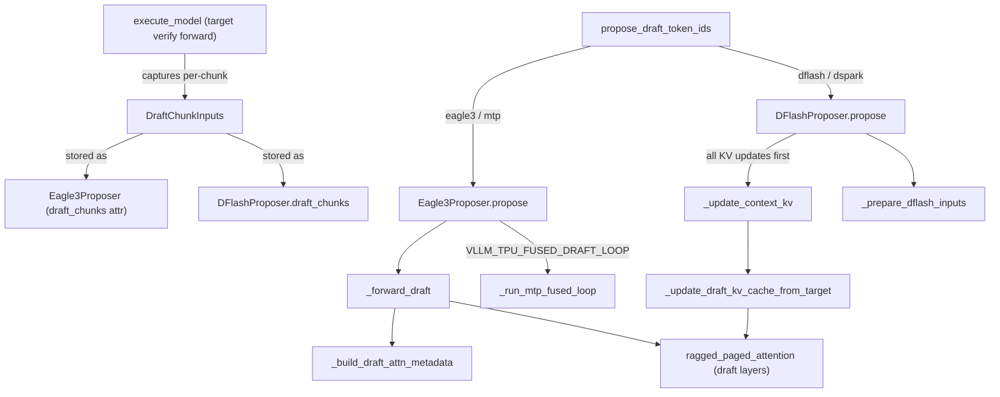
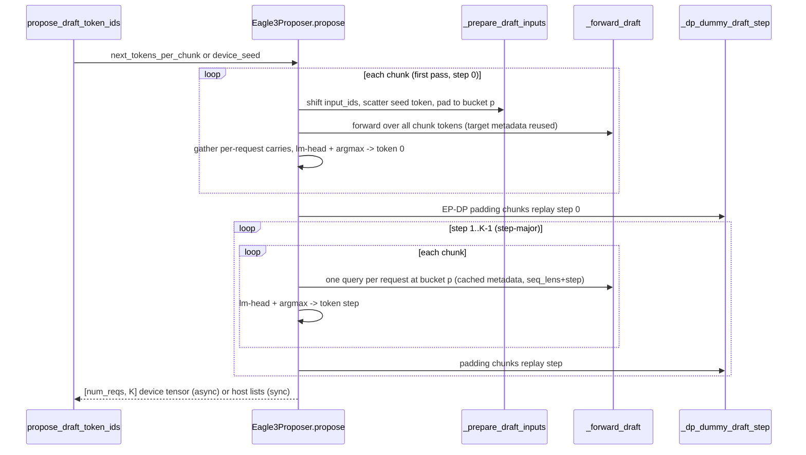

# Speculative decoding on TPU (EAGLE-3 / MTP / DFlash / DSpark proposers)

<!-- connect:up:begin -->
> **Cross-repo concept:** part of [expert-parallelism](../../../concepts/expert-parallelism.md), [kv-cache](../../../concepts/kv-cache.md) across this wiki's repos.
<!-- connect:up:end -->
## Overview

`src/vllm_torchtpu/spec_decode/` holds the TPU drafters behind vLLM's `--speculative-config`. The user guide lists five methods (`eagle3`, `mtp`, `dflash`, `ngram`, `suffix`); at this commit the runner itself only constructs the upstream host-side ngram proposer plus the device drafters (any other method, `suffix` included, hits a `NotImplementedError` at drafter construction), and this subsystem implements the two device drafters: [`Eagle3Proposer`](../catalog/src/vllm_torchtpu/spec_decode/eagle3.md#Eagle3Proposer "src/vllm_torchtpu/spec_decode/eagle3.py:L193") ("Eagle3/MTP draft proposer for TPU"), which runs a small draft head autoregressively for K steps, and [`DFlashProposer`](../catalog/src/vllm_torchtpu/spec_decode/dflash.md#DFlashProposer "src/vllm_torchtpu/spec_decode/dflash.py:L71"), a block-diffusion drafter that proposes all K tokens in one forward (the DSpark proposer in `dspark.py` subclasses it and adds a sequential Markov head). The runner fills each drafter's per-step `draft_chunks` with [`DraftChunkInputs`](../catalog/src/vllm_torchtpu/spec_decode/utils.md#DraftChunkInputs "src/vllm_torchtpu/spec_decode/utils.py:L80") captured during the target's verify forward, then calls `propose`. The key design idea is that **on TorchTPU every new shape is a new compiled program**, so nearly all of the code exists to keep the draft path shape-stable: request counts are padded to buckets ([`fit_rows`](../catalog/src/vllm_torchtpu/spec_decode/utils.md#fit_rows "src/vllm_torchtpu/spec_decode/utils.py:L53"), [`_loop_bucket`](../catalog/src/vllm_torchtpu/spec_decode/eagle3.md#Eagle3Proposer._loop_bucket "src/vllm_torchtpu/spec_decode/eagle3.py:L2230")), small eager ops are pinned into fixed `torch.compile(backend="tpu")` regions, live counts travel as device scalars, and under EP-DP lockstep idle ranks replay the exact draft collective trace.

## Diagram

Structure: who owns what, and how the target forward hands state to the drafter.

Legend:
- `EXEC` - [`execute_model`](../catalog/src/vllm_torchtpu/runner/tpu_runner.md#TPUModelRunner.execute_model "src/vllm_torchtpu/runner/tpu_runner.py:L3884")
- `DCI` - [`DraftChunkInputs`](../catalog/src/vllm_torchtpu/spec_decode/utils.md#DraftChunkInputs "src/vllm_torchtpu/spec_decode/utils.py:L80")
- `CHE` - [`Eagle3Proposer`](../catalog/src/vllm_torchtpu/spec_decode/eagle3.md#Eagle3Proposer "src/vllm_torchtpu/spec_decode/eagle3.py:L193") (its `draft_chunks` attribute)
- `CHD` - [`draft_chunks`](../catalog/src/vllm_torchtpu/spec_decode/dflash.md#DFlashProposer.draft_chunks "src/vllm_torchtpu/spec_decode/dflash.py:L132")
- `MGR` - [`propose_draft_token_ids`](../catalog/src/vllm_torchtpu/runner/speculative_decoding_manager.md#SpeculativeDecodingManager.propose_draft_token_ids "src/vllm_torchtpu/runner/speculative_decoding_manager.py:L155")
- `PE` - [`propose`](../catalog/src/vllm_torchtpu/spec_decode/eagle3.md#Eagle3Proposer.propose "src/vllm_torchtpu/spec_decode/eagle3.py:L1196")
- `PD` - [`propose`](../catalog/src/vllm_torchtpu/spec_decode/dflash.md#DFlashProposer.propose "src/vllm_torchtpu/spec_decode/dflash.py:L597")
- `FWD` - [`_forward_draft`](../catalog/src/vllm_torchtpu/spec_decode/eagle3.md#Eagle3Proposer._forward_draft "src/vllm_torchtpu/spec_decode/eagle3.py:L2074")
- `MD` - [`_build_draft_attn_metadata`](../catalog/src/vllm_torchtpu/spec_decode/eagle3.md#Eagle3Proposer._build_draft_attn_metadata "src/vllm_torchtpu/spec_decode/eagle3.py:L1853")
- `FUSED` - [`_run_mtp_fused_loop`](../catalog/src/vllm_torchtpu/spec_decode/eagle3.md#Eagle3Proposer._run_mtp_fused_loop "src/vllm_torchtpu/spec_decode/eagle3.py:L616")
- `CKV` - [`_update_context_kv`](../catalog/src/vllm_torchtpu/spec_decode/dflash.md#DFlashProposer._update_context_kv "src/vllm_torchtpu/spec_decode/dflash.py:L564")
- `UKV` - [`_update_draft_kv_cache_from_target`](../catalog/src/vllm_torchtpu/spec_decode/dflash.md#DFlashProposer._update_draft_kv_cache_from_target "src/vllm_torchtpu/spec_decode/dflash.py:L536")
- `PREP` - [`_prepare_dflash_inputs`](../catalog/src/vllm_torchtpu/spec_decode/dflash.md#DFlashProposer._prepare_dflash_inputs "src/vllm_torchtpu/spec_decode/dflash.py:L401")
- `RPA` - [`ragged_paged_attention`](../catalog/src/vllm_torchtpu/kernels/experimental/batched_rpa/wrapper.md#ragged_paged_attention "src/vllm_torchtpu/kernels/experimental/batched_rpa/wrapper.py:L518") (the draft layers run the same Pallas RPA backend as the target; shown as the kernel family)

Eagle3/MTP propose for one step (K = `num_speculative_tokens`), per-step (non-fused) path:

Legend:
- `M` - [`propose_draft_token_ids`](../catalog/src/vllm_torchtpu/runner/speculative_decoding_manager.md#SpeculativeDecodingManager.propose_draft_token_ids "src/vllm_torchtpu/runner/speculative_decoding_manager.py:L155")
- `P` - [`propose`](../catalog/src/vllm_torchtpu/spec_decode/eagle3.md#Eagle3Proposer.propose "src/vllm_torchtpu/spec_decode/eagle3.py:L1196")
- `I` - [`_prepare_draft_inputs`](../catalog/src/vllm_torchtpu/spec_decode/eagle3.md#Eagle3Proposer._prepare_draft_inputs "src/vllm_torchtpu/spec_decode/eagle3.py:L1508")
- `F` - [`_forward_draft`](../catalog/src/vllm_torchtpu/spec_decode/eagle3.md#Eagle3Proposer._forward_draft "src/vllm_torchtpu/spec_decode/eagle3.py:L2074")
- `D` - [`_dp_dummy_draft_step`](../catalog/src/vllm_torchtpu/spec_decode/eagle3.md#Eagle3Proposer._dp_dummy_draft_step "src/vllm_torchtpu/spec_decode/eagle3.py:L2465")

## Design rationale (why it's built this way)

- **Buckets, never live counts.** The [`fit_rows`](../catalog/src/vllm_torchtpu/spec_decode/utils.md#fit_rows "src/vllm_torchtpu/spec_decode/utils.py:L53") docstring states the rule for the whole subsystem: "`rows` is always a bucket, never the live request count: torch-tpu compiles a program per shape, so an exact-count slice costs a program per count." Eagle3 pads every per-request carry to the loop bucket p from [`_loop_bucket`](../catalog/src/vllm_torchtpu/spec_decode/eagle3.md#Eagle3Proposer._loop_bucket "src/vllm_torchtpu/spec_decode/eagle3.py:L2230") and slices to the real `num_reqs` only once at the very end; DFlash goes further and never slices device drafts at all (`bucketed_drafts = True`), returning one `[rows, K]` tensor per chunk that consumers trim. A comment in `_prepare_draft_inputs` calls the shrinking-batch recompile "the dominant draft propose recompile".
- **Pin eager ops into compiled regions.** TorchTPU's eager DEFER_AND_FUSE path would otherwise fuse small draft ops (gathers, the seed scatter, the lm-head + argmax, the aux-hidden concat + combine matmul) with per-step neighbors into a fresh program per dispatch context. Eagle3 wraps each in its own `@torch.compile(backend="tpu", fullgraph=True, dynamic=False)` method keyed on input shape only, and a `_static_shape_args` decorator strips dynamo's `_dynamo_dynamic_indices` stamp from tensors (a stamped tensor would lift a SymInt into a static region, which the TPU backend rejects as dynamic shape; the docstring notes the failure looked "flaky and rank-dependent" because a warm compile cache hid it).
- **One program shape per metadata build.** [`_loop_step_attn_inputs`](../catalog/src/vllm_torchtpu/spec_decode/eagle3.md#Eagle3Proposer._loop_step_attn_inputs "src/vllm_torchtpu/spec_decode/eagle3.py:L1788") always subtracts a (possibly all-zero) `num_rejected` tensor uploaded as a runtime parameter. The spec warmup's synthetic request is all-accept, so an add-only branch would leave the subtract variant to recompile cold on the first real rejection.
- **Draft parallelism is binary.** Both proposers accept `draft_tensor_parallel_size` of exactly 1 (replicated on every worker) or the target TP (sharded). A replicated draft loads under a context that collapses the TP group to world size 1, then [`maybe_share_lm_head`](../catalog/src/vllm_torchtpu/spec_decode/utils.md#maybe_share_lm_head "src/vllm_torchtpu/spec_decode/utils.py:L375") must override the draft logits processor's TP all-gather (otherwise it would gather over a group it is not sharded across).
- **Share the target's vocab tables, early.** [`_load_mtp_draft_sharing_head`](../catalog/src/vllm_torchtpu/spec_decode/eagle3.md#Eagle3Proposer._load_mtp_draft_sharing_head "src/vllm_torchtpu/spec_decode/eagle3.py:L902") binds the target's `embed_tokens` / `lm_head` between model construction and weight loading, filtering those names out of the checkpoint stream. Its docstring gives the HBM reason: otherwise a replicated draft holds "two vocab x hidden bf16 tables" through load and FP8 requantization, "and on a pipeline's last stage that HBM is not there".
- **Collectives pair by emission order.** Under EP-DP lockstep a rank with fewer chunks must still issue the same collectives in the same order as its peers, so padding chunks replay the real trace ([`_build_dp_dummy_draft`](../catalog/src/vllm_torchtpu/spec_decode/eagle3.md#Eagle3Proposer._build_dp_dummy_draft "src/vllm_torchtpu/spec_decode/eagle3.py:L2352")), interleaved step-major for Eagle3 and phase-major (all KV updates, then all forwards) for DFlash. Only drafts that actually emit cross-DP collectives participate ([`_dp_lockstep_sharded`](../catalog/src/vllm_torchtpu/spec_decode/eagle3.md#Eagle3Proposer._dp_lockstep_sharded "src/vllm_torchtpu/spec_decode/eagle3.py:L2216")): sharded drafts, or MoE drafts whose experts span the DP group even at draft TP 1. The DFlash module notes that missing a MoE draft here "is a hang, not an error".
- **Fail closed on silent-corruption paths.** Many load-time checks exist only because the failure would otherwise be silent: a DSA draft layer without a KV-cache spec attends to nothing and acceptance "collapses to roughly what an unconditioned draft would get"; a Gemma-4 style KV-sharing draft on a path that cannot skip the KV write would overwrite the target's cache with zeroed dummy K/V; a multi-layer DeepSeek-style MTP checkpoint would read logits off the wrong per-layer head. Each raises at startup instead.

## Entry points

- [`propose_draft_token_ids`](../catalog/src/vllm_torchtpu/runner/speculative_decoding_manager.md#SpeculativeDecodingManager.propose_draft_token_ids "src/vllm_torchtpu/runner/speculative_decoding_manager.py:L155") - "the single dispatch point for all draft proposing", called by the runner once per step from token sampling (stage `draft_propose`). It routes `ngram` to the upstream host proposer, a DFlash-family drafter with one seed tensor per chunk, and everything else (eagle3/mtp) with a flat seed; device seeds and `return_device` are asserted to be async-drafter only.
- [`Eagle3Proposer`](../catalog/src/vllm_torchtpu/spec_decode/eagle3.md#Eagle3Proposer "src/vllm_torchtpu/spec_decode/eagle3.py:L193") - constructed by the runner when `speculative_config.use_eagle()` (eagle3 and mtp). Also referenced by the Raiden PD connector ([`_admit_raiden_hybrid_kv_cache`](../catalog/src/vllm_torchtpu/distributed/kv_transfer/tpu_connector.md#TPURaidenConnectorWorker._admit_raiden_hybrid_kv_cache "src/vllm_torchtpu/distributed/kv_transfer/tpu_connector.py:L2864")) for prefill-only MTP drafts.
- [`DFlashProposer`](../catalog/src/vllm_torchtpu/spec_decode/dflash.md#DFlashProposer "src/vllm_torchtpu/spec_decode/dflash.py:L71") - constructed for `method == "dflash"`; its DSpark subclass for `"dspark"`.
- [`load_model`](../catalog/src/vllm_torchtpu/spec_decode/eagle3.md#Eagle3Proposer.load_model "src/vllm_torchtpu/spec_decode/eagle3.py:L297") / [`load_model`](../catalog/src/vllm_torchtpu/spec_decode/dflash.md#DFlashProposer.load_model "src/vllm_torchtpu/spec_decode/dflash.py:L198") - called after the target model loads; they load the draft, share embeddings / lm-head, tag the target layers whose hidden states feed the draft, and (DFlash) prebuild the draft layers' RPA kernels.
- [`precompile`](../catalog/src/vllm_torchtpu/spec_decode/dflash.md#DFlashProposer.precompile "src/vllm_torchtpu/spec_decode/dflash.py:L697") and [`_precompile_compute_logits`](../catalog/src/vllm_torchtpu/spec_decode/eagle3.md#Eagle3Proposer._precompile_compute_logits "src/vllm_torchtpu/spec_decode/eagle3.py:L2293") - startup warmup of the draft programs across buckets, invoked from the runner's dummy-run/precompile phase.
- [`DraftChunkInputs`](../catalog/src/vllm_torchtpu/spec_decode/utils.md#DraftChunkInputs "src/vllm_torchtpu/spec_decode/utils.py:L80") - built by [`execute_model`](../catalog/src/vllm_torchtpu/runner/tpu_runner.md#TPUModelRunner.execute_model "src/vllm_torchtpu/runner/tpu_runner.py:L3884") per target chunk and handed to the drafter as `draft_chunks` before `propose`.

## Mechanism (step-by-step)

1. **Construction and parallelism choice.** [`Eagle3Proposer`](../catalog/src/vllm_torchtpu/spec_decode/eagle3.md#Eagle3Proposer "src/vllm_torchtpu/spec_decode/eagle3.py:L193") reads its [`speculative_config`](../catalog/src/vllm_torchtpu/spec_decode/eagle3.md#Eagle3Proposer.speculative_config "src/vllm_torchtpu/spec_decode/eagle3.py:L218"), defaults an unset `draft_tensor_parallel_size` to the target TP, and rejects anything other than 1 or target TP; it records whether the draft is replicated and whether its TP layout matches the target (both can hold at TP 1). [`DFlashProposer`](../catalog/src/vllm_torchtpu/spec_decode/dflash.md#DFlashProposer "src/vllm_torchtpu/spec_decode/dflash.py:L71") does the same and additionally normalizes the draft's HF config so the mask/noise token id and the target layer ids ([`_target_layer_ids`](../catalog/src/vllm_torchtpu/spec_decode/dflash.md#DFlashProposer._target_layer_ids "src/vllm_torchtpu/spec_decode/dflash.py:L92")) resolve from any of the upstream spellings; DFlash refuses to start without target layer ids. Eagle3's class docstring states its main limitation: greedy only (temperature 0), with non-greedy requests rejected earlier at add-request time by the platform.

2. **Draft load.** [`_load_draft_model`](../catalog/src/vllm_torchtpu/spec_decode/eagle3.md#Eagle3Proposer._load_draft_model "src/vllm_torchtpu/spec_decode/eagle3.py:L861") builds [`draft_vllm_config`](../catalog/src/vllm_torchtpu/spec_decode/eagle3.md#Eagle3Proposer.draft_vllm_config "src/vllm_torchtpu/spec_decode/eagle3.py:L248") as a shallow copy of the target config with `runner_type = "draft"` and an `eagle_head` model tag, so the draft's torch.compile cache lives under a separate prefix from the target's backbone (DFlash uses `dflash_head`). It loads under [`set_vllm_model_wrapper_context`](../catalog/src/vllm_torchtpu/models/vllm/vllm_model_wrapper_context.md#set_vllm_model_wrapper_context "src/vllm_torchtpu/models/vllm/vllm_model_wrapper_context.py:L71") with the runner mesh, collapsing TP to 1 for a replicated draft, and routes an MTP draft whose TP matches the target through [`_load_mtp_draft_sharing_head`](../catalog/src/vllm_torchtpu/spec_decode/eagle3.md#Eagle3Proposer._load_mtp_draft_sharing_head "src/vllm_torchtpu/spec_decode/eagle3.py:L902") so the vocab tables are borrowed before any weights load.

3. **Wiring the draft to the target.** [`load_model`](../catalog/src/vllm_torchtpu/spec_decode/eagle3.md#Eagle3Proposer.load_model "src/vllm_torchtpu/spec_decode/eagle3.py:L297") snapshots the global attention-layer registry before and after the draft loads; the difference is the set of draft layer names used later to pick the draft's entries out of the target's attention metadata. It then calls [`maybe_share_lm_head`](../catalog/src/vllm_torchtpu/spec_decode/utils.md#maybe_share_lm_head "src/vllm_torchtpu/spec_decode/utils.py:L375") (which also rebinds DeepSeek-style per-layer `shared_head` modules, a NaN-logits trap otherwise), registers EAGLE-3 aux hidden-state layers on the target, wires Gemma-4 style Q-only MTP layers to read the target's KV cache, validates DSA (sparse-MLA) drafts, and optionally builds the IndexShare and fused-loop programs ([`_build_mtp_loop_model`](../catalog/src/vllm_torchtpu/spec_decode/eagle3.md#Eagle3Proposer._build_mtp_loop_model "src/vllm_torchtpu/spec_decode/eagle3.py:L499"), [`_build_mtp_fused_loop`](../catalog/src/vllm_torchtpu/spec_decode/eagle3.md#Eagle3Proposer._build_mtp_fused_loop "src/vllm_torchtpu/spec_decode/eagle3.py:L561")). The DFlash [`load_model`](../catalog/src/vllm_torchtpu/spec_decode/dflash.md#DFlashProposer.load_model "src/vllm_torchtpu/spec_decode/dflash.py:L198") instead tags the target's aux layers (`target_layer_ids + 1`), force-shares embeddings and head (DSpark honors the draft's own flags because reduced-vocab checkpoints carry their own head), and for each draft attention layer sets `use_causal_mask` from the draft's per-layer causal list before calling [`initialize_kernel`](../catalog/src/vllm_torchtpu/layers/adapter/attention.md#PallasAttentionBackendImpl.initialize_kernel "src/vllm_torchtpu/layers/adapter/attention.py:L1329") - in-block draft attention is non-causal, so the RPA kernel must be built with that flag before tracing.

4. **Capture during the target forward.** Each target chunk produces one [`DraftChunkInputs`](../catalog/src/vllm_torchtpu/spec_decode/utils.md#DraftChunkInputs "src/vllm_torchtpu/spec_decode/utils.py:L80"): the padded request-major token ids, device position ids, the host `query_start_loc`, the chunk's attention builder context [`attn_ctx`](../catalog/src/vllm_torchtpu/spec_decode/utils.md#DraftChunkInputs.attn_ctx "src/vllm_torchtpu/spec_decode/utils.py:L91"), the real request count [`num_reqs`](../catalog/src/vllm_torchtpu/spec_decode/utils.md#DraftChunkInputs.num_reqs "src/vllm_torchtpu/spec_decode/utils.py:L95"), the target's aux hidden states (EAGLE-3 / DFlash) or plain hidden state (MTP), an on-device snapshot of per-request draft lengths, and optionally the target's own per-layer attention metadata. Drafting mirrors the target's chunking: every proposer loops over chunks, never over a flattened batch.

5. **Eagle3 first pass (step 0).** In [`propose`](../catalog/src/vllm_torchtpu/spec_decode/eagle3.md#Eagle3Proposer.propose "src/vllm_torchtpu/spec_decode/eagle3.py:L1196") each chunk's hidden state is combined (three EAGLE-3 aux layers concatenated and projected inside one compiled region, or passed straight through for MTP). [`_prepare_draft_inputs`](../catalog/src/vllm_torchtpu/spec_decode/eagle3.md#Eagle3Proposer._prepare_draft_inputs "src/vllm_torchtpu/spec_decode/eagle3.py:L1508") left-shifts the token ids by one and scatters each request's seed token at the end of its accepted prefix (rejections clamped to at most `orig - 1`, since the bonus token always survives). In the async path the seed, its position and the rejection count are all derived on device from the rejection sampler's output, avoiding a device-to-host copy on the critical path. [`_forward_draft`](../catalog/src/vllm_torchtpu/spec_decode/eagle3.md#Eagle3Proposer._forward_draft "src/vllm_torchtpu/spec_decode/eagle3.py:L2074") then runs the draft over all of the chunk's tokens; at step 0 [`_build_draft_attn_metadata`](../catalog/src/vllm_torchtpu/spec_decode/eagle3.md#Eagle3Proposer._build_draft_attn_metadata "src/vllm_torchtpu/spec_decode/eagle3.py:L1853") reuses the draft-layer entries of the target's own metadata rather than re-walking every KV-cache group. Per-request carries (last hidden, position, pre-head hidden) are gathered at the bucketed indices and the first draft token comes out of a compiled lm-head + argmax region.

6. **Eagle3 loop steps 1..K-1.** Each loop step is a uniform decode shape (one query per request) at the chunk's loop bucket p from [`_loop_bucket`](../catalog/src/vllm_torchtpu/spec_decode/eagle3.md#Eagle3Proposer._loop_bucket "src/vllm_torchtpu/spec_decode/eagle3.py:L2230"). Positions and seq_lens advance by one per step for a draft that owns its KV cache and stay frozen for a cross-model KV-sharing draft. `query_start_loc` and `request_distribution` are hoisted per chunk (built once, not per step), and [`_build_draft_attn_metadata`](../catalog/src/vllm_torchtpu/spec_decode/eagle3.md#Eagle3Proposer._build_draft_attn_metadata "src/vllm_torchtpu/spec_decode/eagle3.py:L1853") caches step 1's metadata so steps 2+ only swap in a moved `seq_lens` tensor. The loop is step-major across chunks; with IndexShare each chunk restores its own saved step-0 top-k rows before every loop forward, because the shared top-k buffer is indexed by position in the current forward and the next chunk's step 0 overwrites it.

7. **Fused MTP loop (opt-in).** With `VLLM_TPU_FUSED_DRAFT_LOOP=1`, an MTP draft with K >= 2 and none of the special cases (IndexShare, a draft-to-target id map, frozen positions) gets steps 1..K-1 compiled as one program. [`_run_mtp_fused_loop`](../catalog/src/vllm_torchtpu/spec_decode/eagle3.md#Eagle3Proposer._run_mtp_fused_loop "src/vllm_torchtpu/spec_decode/eagle3.py:L616") builds step-1 metadata once and requires all draft layers to share one `seq_lens` tensor, which the program bumps in place between unrolled steps (seq_lens reaches the kernel through the forward context, not as an argument). Its first call traces and is run twice so the compiled outputs have concrete sizes; a chunk whose metadata does not fit falls back to the per-step loop. The fused path is skipped entirely under EP-DP lockstep.

8. **EP-DP lockstep padding.** When [`_dp_lockstep_sharded`](../catalog/src/vllm_torchtpu/spec_decode/eagle3.md#Eagle3Proposer._dp_lockstep_sharded "src/vllm_torchtpu/spec_decode/eagle3.py:L2216") holds, a rank with fewer chunks than the DP-coordinated count builds one [`_build_dp_dummy_draft`](../catalog/src/vllm_torchtpu/spec_decode/eagle3.md#Eagle3Proposer._build_dp_dummy_draft "src/vllm_torchtpu/spec_decode/eagle3.py:L2352") at the step's coordinated bucket (zeroed inputs, fixed positions so the block-table build takes the zeroed-table branch, mrope-shaped positions when the model uses them) and runs [`_dp_dummy_draft_step`](../catalog/src/vllm_torchtpu/spec_decode/eagle3.md#Eagle3Proposer._dp_dummy_draft_step "src/vllm_torchtpu/spec_decode/eagle3.py:L2465") right after its real chunks for each step, enqueueing results with [`synchronize_tensors`](../catalog/src/vllm_torchtpu/utils.md#synchronize_tensors "src/vllm_torchtpu/utils.py:L358") (`wait=False`) so the collectives fire in order without blocking the host. The first-pass bucket is the runner's DP-coordinated target token bucket (the padded all-reduced max token count); the loop bucket p comes from [`_loop_bucket`](../catalog/src/vllm_torchtpu/spec_decode/eagle3.md#Eagle3Proposer._loop_bucket "src/vllm_torchtpu/spec_decode/eagle3.py:L2230"), which under lockstep sizes to the step's all-reduced max per-chunk request count, not to `max_num_reqs`.

9. **DFlash propose: context KV first.** [`propose`](../catalog/src/vllm_torchtpu/spec_decode/dflash.md#DFlashProposer.propose "src/vllm_torchtpu/spec_decode/dflash.py:L597") is strictly device-fused (it ignores the host-side arguments and raises without a device seed). It first calls [`_update_context_kv`](../catalog/src/vllm_torchtpu/spec_decode/dflash.md#DFlashProposer._update_context_kv "src/vllm_torchtpu/spec_decode/dflash.py:L564") for every chunk, then pads with dummy KV updates for lockstep. [`_update_draft_kv_cache_from_target`](../catalog/src/vllm_torchtpu/spec_decode/dflash.md#DFlashProposer._update_draft_kv_cache_from_target "src/vllm_torchtpu/spec_decode/dflash.py:L536") "projects the target model's hidden states into the draft model's KV cache" so the draft never runs a forward over the verified context: one compiled region projects the target aux hidden states to K and V for all draft layers with a single fused matmul, applies k-norm and RoPE across all layers in one vectorized op, and writes each layer's cache through the normal Pallas attention forward - the source comment notes the alternative would be "L tiny, sequential XLA graphs".

10. **DFlash propose: one block forward per chunk.** [`_prepare_dflash_inputs`](../catalog/src/vllm_torchtpu/spec_decode/dflash.md#DFlashProposer._prepare_dflash_inputs "src/vllm_torchtpu/spec_decode/dflash.py:L401") lays each request out as `[base_token, MASK x K]` with consecutive positions, entirely inside compiled builders keyed on the padded length; the live request count enters as a device scalar read from `request_distribution`, so it never becomes a program key. The base position is the start of the verify window plus accepted tokens for verified requests, or last prompt position + 1 for prompt chunks. [`_build_draft_attn_metadata`](../catalog/src/vllm_torchtpu/spec_decode/dflash.md#DFlashProposer._build_draft_attn_metadata "src/vllm_torchtpu/spec_decode/dflash.py:L370") scales `query_start_loc` by [`block_size`](../catalog/src/vllm_torchtpu/spec_decode/dflash.md#DFlashProposer.block_size "src/vllm_torchtpu/spec_decode/dflash.py:L146") (1 + K tokens per request) using cached static tensors, and passes the real request count so padding rows stage as the null block instead of a departed request's freed blocks. A compiled forward-and-sample region runs the draft backbone, drops the base slot, and argmaxes all K mask slots in-graph; DSpark replaces that region with a K-iteration Markov chain and reports per-slot confidences through [`_observe_draft_aux`](../catalog/src/vllm_torchtpu/spec_decode/dspark.md#DSparkProposer._observe_draft_aux "src/vllm_torchtpu/spec_decode/dspark.py:L140").

11. **Returning drafts.** [`propose`](../catalog/src/vllm_torchtpu/spec_decode/eagle3.md#Eagle3Proposer.propose "src/vllm_torchtpu/spec_decode/eagle3.py:L1196") in Eagle3 stacks each chunk's `[p]` tokens to `[p, K]`, slices to the real `num_reqs` once, and either returns one device tensor (async scheduling, consumed by the next step's substitution path) or copies the constant-shape tensor to host lists (sync). DFlash returns the bucketed per-chunk tensors untouched in async mode. In sync mode [`propose_draft_token_ids`](../catalog/src/vllm_torchtpu/runner/speculative_decoding_manager.md#SpeculativeDecodingManager.propose_draft_token_ids "src/vllm_torchtpu/runner/speculative_decoding_manager.py:L155") caches the host list for the scheduler; in async mode the manager can stage a non-blocking device-to-host copy for structured-output requests.

## Key data structures

- [`DraftChunkInputs`](../catalog/src/vllm_torchtpu/spec_decode/utils.md#DraftChunkInputs "src/vllm_torchtpu/spec_decode/utils.py:L80") - the target-to-draft handoff for one chunk (see Mechanism step 4). Its `sequence_layout_plan` defaults to a shared no-op plan; prefill context parallel callers override it so draft inputs and gathers are localized to the rank's sequence shard.
- [`draft_chunks`](../catalog/src/vllm_torchtpu/spec_decode/dflash.md#DFlashProposer.draft_chunks "src/vllm_torchtpu/spec_decode/dflash.py:L132") - the list of per-chunk inputs a drafter consumes on its next `propose`; cleared after warmup teardown.
- Eagle3 metadata cache - per-propose dict keyed by `id(chunk)` holding `(metadata, seq_lens, seq_lens_delta)` of the last loop step; cleared at the start of every `propose`.
- [`draft_model`](../catalog/src/vllm_torchtpu/spec_decode/eagle3.md#Eagle3Proposer.draft_model "src/vllm_torchtpu/spec_decode/eagle3.py:L247") / [`draft_model`](../catalog/src/vllm_torchtpu/spec_decode/dflash.md#DFlashProposer.draft_model "src/vllm_torchtpu/spec_decode/dflash.py:L129") - the loaded draft `nn.Module`. MoE draft layers are armed alongside the target's by the MoE TP-decode path ([`arm`](../catalog/src/vllm_torchtpu/layers/adapter/moe_tp_decode.md#arm "src/vllm_torchtpu/layers/adapter/moe_tp_decode.py:L519") takes a `draft_model` argument).
- [`runner`](../catalog/src/vllm_torchtpu/spec_decode/eagle3.md#Eagle3Proposer.runner "src/vllm_torchtpu/spec_decode/eagle3.py:L214") - back-reference to the TPU model runner; the proposers read its token/request paddings, mesh, KV-cache spec, DP lockstep state and attention-metadata builder through it (and temporarily swap the runner's builder context to build draft metadata).

Knobs that matter for perf:

| Knob | Where read | Effect |
|---|---|---|
| `--speculative-config` `method` | runner drafter construction | ngram (host) / eagle3, mtp (`Eagle3Proposer`) / dflash, dspark (`DFlashProposer` family) |
| `num_speculative_tokens` (K) | both proposers | Eagle3: K sequential draft steps; DFlash: block of 1 + K query tokens per request in one forward |
| `draft_tensor_parallel_size` | both constructors | 1 = replicated draft (no TP collectives), target TP = sharded; anything else rejected |
| `VLLM_TPU_FUSED_DRAFT_LOOP` | `_build_mtp_fused_loop` | MTP loop steps 1..K-1 as one dispatch (default off) |
| `index_share_for_mtp_iteration` (draft HF config) | IndexShare init | DSA MTP reuses step-0 top-k; adds a second compiled draft program |
| `VLLM_TPU_BLOCK_MAJOR_KV`, PCP streaming | KV-sharing validation | incompatible with Gemma-4 style cross-model KV-sharing drafts (startup error) |

## Dynamics (design intent)

- **Compiled-program inventory.** Without IndexShare every drafter keeps exactly one compiled draft forward. IndexShare adds a second program because, per the `_build_mtp_loop_model` docstring, "the draft forward is compiled once and vLLM drops the guards that would recompile it", so the `skip_topk` flag is baked in by the first trace; the second program is first traced with `skip_topk` True and gets its own compile-cache folder.
- **Warmup split.** The Eagle3 `precompile` docstring says it warms only the small wrapper regions (combine, seed scatter, lm-head/argmax) across buckets; the draft forward and the per-step fused propose/verify programs are warmed by a real-path lifecycle warmup in the runner, because "a zeros-precompile of those emits programs that never match the runtime eager fusion". [`_precompile_compute_logits`](../catalog/src/vllm_torchtpu/spec_decode/eagle3.md#Eagle3Proposer._precompile_compute_logits "src/vllm_torchtpu/spec_decode/eagle3.py:L2293") deliberately limits sizes to buckets the loop can reach (up to the bucket just past `max_num_reqs`) instead of compiling `[n, vocab]` matmuls up to `max_num_batched_tokens`. DFlash's [`precompile`](../catalog/src/vllm_torchtpu/spec_decode/dflash.md#DFlashProposer.precompile "src/vllm_torchtpu/spec_decode/dflash.py:L697") warms both the KV-update graph and the draft forward at every draft bucket for both max-model-len and most-model-len geometries, using cached dummy inputs from [`_dummy_kv_update_inputs`](../catalog/src/vllm_torchtpu/spec_decode/dflash.md#DFlashProposer._dummy_kv_update_inputs "src/vllm_torchtpu/spec_decode/dflash.py:L748").
- **Draft buckets outgrow target buckets.** A DFlash draft forward is `num_reqs x block_size` tokens and the scheduler does not charge drafting slots for these methods, so the draft bucket list doubles past the largest target bucket until a full chunk of blocks fits; an over-large draft raises rather than compiling a new program mid-serving.
- **Lockstep phase order.** DFlash emits all KV updates before all draft forwards; its dummy replay keeps that phase structure ("never interleaved per chunk"). Eagle3 emits each step's padding right after the real chunks for that step.
- **Host/device overlap.** In async scheduling the Eagle3 seed path stays on device end to end; the remaining host work per step is metadata construction, which the per-chunk hoisting and step metadata cache minimize. The fused MTP loop removes the per-step host dispatches entirely (one dispatch for K-1 steps instead of two per step, per `mtp_fused_loop.py`).

## Edge cases

- Eagle3/MTP drafting is greedy only; DSpark warns and ignores non-greedy draft sampling, adaptive verification and draft top-k options.
- `propose` with no captured `draft_chunks` raises - this means the target verify step did not record aux or plain hidden states.
- A replicated DSA (sparse-MLA) draft below the target TP is rejected: its sparse-MLA and indexer Pallas ops are built against the full TP mesh with no single-device variant.
- IndexShare requires the top-k buffer to hold at least the loop bucket for `max_num_reqs` rows; otherwise startup fails and tells you to raise `max_num_batched_tokens` or lower `max_num_seqs`. The buffer is pre-filled with -1 so an unwritten read (e.g. on an EP-DP dummy chunk) degrades to an empty attend instead of an out-of-range gather.
- DSpark warns when the checkpoint's trained block size differs from the query block K implies: outputs stay exact (the target verifies) but acceptance can drop at every position because in-block attention is non-causal.
- `positions` with mrope are `[3, N]`; padding and dummy chunks must keep that shape or the draft's dynamic-dim guard trips with an index error.

## Open questions

- The packet subgraph omits several central symbols, so they are described rather than linked: the runner-side manager class itself, the DSpark proposer class, the Eagle3 compiled helper regions (seed scatter, carry gather, lm-head + argmax, aux combine), DFlash's compiled KV-projection and forward-and-sample regions, and the two MTP program modules (`mtp_loop_model.py`, `mtp_fused_loop.py`).
- How acceptance rate and step time trade against K on TPU is not recorded in the source; the user guide only suggests K = 3 for EAGLE-3, 1 for MTP and 15 for DFlash in its examples.

> [!inferred]
> Because Eagle3 runs K - 1 small one-query-per-request forwards while DFlash runs one forward of `num_reqs x (K + 1)` tokens, Eagle3 drafting cost is dominated by per-step dispatch and metadata overhead (the motivation for the fused MTP loop) while DFlash is closer to a short prefill; this is a reading of the code structure, not a measured claim.

## See also

- [tpu-model-runner](tpu-model-runner.md) - builds `DraftChunkInputs`, owns warmup and async scheduling.
- [compilation-and-graph-capture](compilation-and-graph-capture.md) - torch.compile on TorchTPU, model tags, guard dropping.
- [ragged-paged-attention-kernel](ragged-paged-attention-kernel.md) and [batched-ragged-paged-attention-kernel](batched-ragged-paged-attention-kernel.md) - the kernel draft layers run.
- [kv-cache-layout-and-hbm-budget](kv-cache-layout-and-hbm-budget.md) - KV groups the draft layers join.
- [distributed-parallelism-and-meshes](distributed-parallelism-and-meshes.md) - TP/EP/DP and the lockstep coordination.
- [kv-transfer-and-disaggregated-serving](kv-transfer-and-disaggregated-serving.md) - prefill-only MTP / DSpark handoff.
- [mla-attention-kernels](mla-attention-kernels.md) and [deepseek-v4-model](deepseek-v4-model.md) - DSA / MLA drafts.
