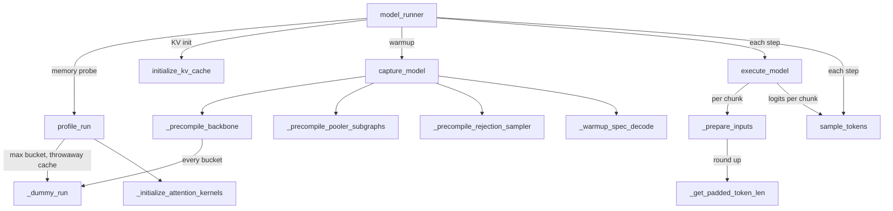

# TPU model runner - bucketed static shapes, chunked forwards and AOT warmup

<!-- connect:up:begin -->
> **Cross-repo concept:** part of [continuous-batching](../../../concepts/continuous-batching.md) across this wiki's repos.
<!-- connect:up:end -->
## Overview

[`TPUModelRunner`](../catalog/src/vllm_torchtpu/runner/tpu_runner.md#TPUModelRunner "src/vllm_torchtpu/runner/tpu_runner.py:L642")
subclasses vLLM's `GPUModelRunner` and keeps its engine-facing contract (`execute_model`,
`sample_tokens`, `profile_run`, `capture_model`, `initialize_kv_cache`), but replaces the GPU
dynamic-shape + CUDA-graph strategy with one rule: **every device program runs at a shape drawn
from a small, finite ladder that was compiled before the first request**. Token counts are rounded
up to a bucket in
[`num_tokens_paddings`](../catalog/src/vllm_torchtpu/runner/tpu_runner.md#TPUModelRunner.num_tokens_paddings "src/vllm_torchtpu/runner/tpu_runner.py:L955"),
request counts to a bucket in
[`num_reqs_paddings`](../catalog/src/vllm_torchtpu/runner/tpu_runner.md#TPUModelRunner.num_reqs_paddings "src/vllm_torchtpu/runner/tpu_runner.py:L1026"),
and the number of requests one forward may carry is capped by what the Pallas ragged-paged-attention
kernel's scalar prefetch can hold
([`num_reqs_max_model_len`](../catalog/src/vllm_torchtpu/runner/tpu_runner.md#TPUModelRunner.num_reqs_max_model_len "src/vllm_torchtpu/runner/tpu_runner.py:L8051")).
When a scheduler step holds more requests than that cap, the runner simply runs several forwards
("chunks") inside one `execute_model` call. All input preparation happens on the host into
preallocated CPU staging tensors; the device only ever sees padded, fixed-shape uploads. Startup
then walks the ladder with a dummy forward per bucket so serving is (ideally) all cache hits.

## Diagram

Legend:
- `W` - [`model_runner`](../catalog/src/vllm_torchtpu/worker/tpu_worker.md#TPUWorker.model_runner "src/vllm_torchtpu/worker/tpu_worker.py:L481")
- `PR` - [`profile_run`](../catalog/src/vllm_torchtpu/runner/tpu_runner.md#TPUModelRunner.profile_run "src/vllm_torchtpu/runner/tpu_runner.py:L7923")
- `IKV` - [`initialize_kv_cache`](../catalog/src/vllm_torchtpu/runner/kv_cache_manager.md#KVCacheManager.initialize_kv_cache "src/vllm_torchtpu/runner/kv_cache_manager.py:L1360")
- `CM` - [`capture_model`](../catalog/src/vllm_torchtpu/runner/tpu_runner.md#TPUModelRunner.capture_model "src/vllm_torchtpu/runner/tpu_runner.py:L6930")
- `EM` - [`execute_model`](../catalog/src/vllm_torchtpu/runner/tpu_runner.md#TPUModelRunner.execute_model "src/vllm_torchtpu/runner/tpu_runner.py:L3884")
- `ST` - [`sample_tokens`](../catalog/src/vllm_torchtpu/runner/tpu_runner.md#TPUModelRunner.sample_tokens "src/vllm_torchtpu/runner/tpu_runner.py:L4864")
- `DR` - [`_dummy_run`](../catalog/src/vllm_torchtpu/runner/tpu_runner.md#TPUModelRunner._dummy_run "src/vllm_torchtpu/runner/tpu_runner.py:L5822")
- `AK` - [`_initialize_attention_kernels`](../catalog/src/vllm_torchtpu/runner/tpu_runner.md#TPUModelRunner._initialize_attention_kernels "src/vllm_torchtpu/runner/tpu_runner.py:L5683")
- `PB` - [`_precompile_backbone`](../catalog/src/vllm_torchtpu/runner/tpu_runner.md#TPUModelRunner._precompile_backbone "src/vllm_torchtpu/runner/tpu_runner.py:L7164")
- `PP` - [`_precompile_pooler_subgraphs`](../catalog/src/vllm_torchtpu/runner/tpu_runner.md#TPUModelRunner._precompile_pooler_subgraphs "src/vllm_torchtpu/runner/tpu_runner.py:L6868")
- `RS` - [`_precompile_rejection_sampler`](../catalog/src/vllm_torchtpu/runner/tpu_runner.md#TPUModelRunner._precompile_rejection_sampler "src/vllm_torchtpu/runner/tpu_runner.py:L6606")
- `WS` - [`_warmup_spec_decode`](../catalog/src/vllm_torchtpu/runner/tpu_runner.md#TPUModelRunner._warmup_spec_decode "src/vllm_torchtpu/runner/tpu_runner.py:L7354")
- `PI` - [`_prepare_inputs`](../catalog/src/vllm_torchtpu/runner/tpu_runner.md#TPUModelRunner._prepare_inputs "src/vllm_torchtpu/runner/tpu_runner.py:L3031")
- `GP` - [`_get_padded_token_len`](../catalog/src/vllm_torchtpu/runner/tpu_runner.md#_get_padded_token_len "src/vllm_torchtpu/runner/tpu_runner.py:L8565")

## Design rationale (why it's built this way)

- **Static shapes instead of CUDA graphs.** The constructor forces
  `cudagraph_capture_sizes = []` and `cudagraph_mode = NONE` before calling the parent, with the
  comment "TPU uses AOT bucket precompile (_precompile_* methods) instead". The class header spells
  out a three-part *recompilation-avoidance contract*: (1) input prep on the CPU with H2D copies,
  (2) the forward split into a handful of `@torch.compile(backend="tpu")` subgraphs (backbone,
  selected-logits, sampling/structured decode, logprobs) so `_dummy_run` and `execute_model` trace
  identically, (3) `_dummy_run` exercises every padding bucket before the first real request. A
  bucket miss at serving time is a synchronous XLA compile on the engine loop, which is why so much
  of this file is warmup code.
- **Bucket ladder comes from the platform.** The token ladder is not computed here: it is read from
  `compilation_config.compile_sizes`, which the platform layer fills with its token paddings, and
  [`max_num_tokens`](../catalog/src/vllm_torchtpu/runner/tpu_runner.md#TPUModelRunner.max_num_tokens "src/vllm_torchtpu/runner/tpu_runner.py:L958")
  is overridden to the largest bucket "so all CPU staging buffers cover it". The request ladder is
  powers of two from 8 up to
  [`max_num_reqs`](../catalog/src/vllm_torchtpu/runner/tpu_runner.md#TPUModelRunner.max_num_reqs "src/vllm_torchtpu/runner/tpu_runner.py:L950"),
  which is itself raised to at least 8 "to avoid dynamic shapes" and "suboptimal alignment".
- **Per-forward request caps, not per-step.** The ragged paged attention kernel prefetches each
  request's block table into scalar memory; the runner caps requests-per-forward at the number of
  widest block tables that fit (comment: "Pallas SMEM-aware num_reqs caps"). Rather than refusing
  large batches, `execute_model` loops over chunks of at most that many requests. A second, larger
  cap
  [`num_reqs_most_model_len`](../catalog/src/vllm_torchtpu/runner/tpu_runner.md#TPUModelRunner.num_reqs_most_model_len "src/vllm_torchtpu/runner/tpu_runner.py:L8056")
  exists for the opt-in `VLLM_TPU_MOST_MODEL_LEN`: when no remaining request in the step schedules
  more than that many tokens, narrower block tables are used, so more requests fit per forward.
- **Throwaway profile compile.** [`profile_run`](../catalog/src/vllm_torchtpu/runner/tpu_runner.md#TPUModelRunner.profile_run "src/vllm_torchtpu/runner/tpu_runner.py:L7923")
  compiles the backbone at only the max bucket, into an isolated `profile_cache` directory, then
  resets Dynamo. The comment explains both choices: the KV-less (kv=0-specialized) graph must never
  land in the persistent serving cache, and "every program loaded on the TPU holds a permanent
  bottom-of-HBM program-region reservation", so one throwaway program keeps that region within
  budget for the full ladder `capture_model` compiles later.
- **Real-path warmups where isolation is not enough.** The docstring of
  [`_warmup_spec_decode`](../catalog/src/vllm_torchtpu/runner/tpu_runner.md#TPUModelRunner._warmup_spec_decode "src/vllm_torchtpu/runner/tpu_runner.py:L7354")
  notes that torch-tpu's DEFER_AND_FUSE fuses propose + verify + sample ops into combined programs
  that "depend on the live dispatch sequence", which an isolated precompile cannot reproduce; so it
  drives synthetic requests through the real two-phase path and tears them down again.

## Entry points

- [`TPUModelRunner`](../catalog/src/vllm_torchtpu/runner/tpu_runner.md#TPUModelRunner "src/vllm_torchtpu/runner/tpu_runner.py:L642") -
  constructed by the worker and held as
  [`model_runner`](../catalog/src/vllm_torchtpu/worker/tpu_worker.md#TPUWorker.model_runner "src/vllm_torchtpu/worker/tpu_worker.py:L481").
  The constructor builds the staging buffers, the padding ladders, the
  [`speculative_config`](../catalog/src/vllm_torchtpu/runner/tpu_runner.md#TPUModelRunner.speculative_config "src/vllm_torchtpu/runner/tpu_runner.py:L1087")-driven
  [`drafter`](../catalog/src/vllm_torchtpu/runner/tpu_runner.md#TPUModelRunner.drafter "src/vllm_torchtpu/runner/tpu_runner.py:L644"),
  the KV cache manager, and the per-worker JAX
  [`mesh`](../catalog/src/vllm_torchtpu/runner/tpu_runner.md#TPUModelRunner.mesh "src/vllm_torchtpu/runner/tpu_runner.py:L1118")
  (model axis only; real DP is vLLM multi-engine DP, per the comment).
- [`device`](../catalog/src/vllm_torchtpu/runner/tpu_runner.md#TPUModelRunner.device "src/vllm_torchtpu/runner/tpu_runner.py:L5513") -
  set to `torch.device("tpu")` at the top of model loading, which then installs the TPU quantization
  config via [`get_tpu_quantization_config`](../catalog/src/vllm_torchtpu/layers/adapter/quantization/__init__.md#get_tpu_quantization_config "src/vllm_torchtpu/layers/adapter/quantization/__init__.py:L51"),
  loads weights under [`set_vllm_model_wrapper_context`](../catalog/src/vllm_torchtpu/models/vllm/vllm_model_wrapper_context.md#set_vllm_model_wrapper_context "src/vllm_torchtpu/models/vllm/vllm_model_wrapper_context.py:L71"),
  audits online FP8 with [`validate_online_fp8`](../catalog/src/vllm_torchtpu/layers/adapter/quantization/online_fp8.md#validate_online_fp8 "src/vllm_torchtpu/layers/adapter/quantization/online_fp8.py:L164"),
  loads the draft model, and finally arms the MoE TP decode kernel with
  [`arm`](../catalog/src/vllm_torchtpu/layers/adapter/moe_tp_decode.md#arm "src/vllm_torchtpu/layers/adapter/moe_tp_decode.py:L519")
  when `USE_MOE_TP_DECODE_KERNEL` is set.
- [`profile_run`](../catalog/src/vllm_torchtpu/runner/tpu_runner.md#TPUModelRunner.profile_run "src/vllm_torchtpu/runner/tpu_runner.py:L7923") -
  reached from the worker's memory probe, before the KV cache exists; see
  [kv-cache-layout-and-hbm-budget](kv-cache-layout-and-hbm-budget.md).
- [`initialize_kv_cache`](../catalog/src/vllm_torchtpu/runner/kv_cache_manager.md#KVCacheManager.initialize_kv_cache "src/vllm_torchtpu/runner/kv_cache_manager.py:L1360") -
  the runner delegates KV allocation to its KV cache manager (whose back-reference is
  [`runner`](../catalog/src/vllm_torchtpu/runner/kv_cache_manager.md#KVCacheManager.runner "src/vllm_torchtpu/runner/kv_cache_manager.py:L226")).
- [`capture_model`](../catalog/src/vllm_torchtpu/runner/tpu_runner.md#TPUModelRunner.capture_model "src/vllm_torchtpu/runner/tpu_runner.py:L6930") -
  "Precompile every torch.compile subgraph across all input buckets"; reached from the worker's compile /
  warmup hook. Returns immediately after pipeline hand-off setup under `enforce_eager`.
- [`execute_model`](../catalog/src/vllm_torchtpu/runner/tpu_runner.md#TPUModelRunner.execute_model "src/vllm_torchtpu/runner/tpu_runner.py:L3884")
  and [`sample_tokens`](../catalog/src/vllm_torchtpu/runner/tpu_runner.md#TPUModelRunner.sample_tokens "src/vllm_torchtpu/runner/tpu_runner.py:L4864") -
  the per-step pair, called back to back by the worker for every scheduler output.

## Mechanism (step-by-step)

1. **Build the ladders at construction.** The constructor reads the token buckets into
   [`num_tokens_paddings`](../catalog/src/vllm_torchtpu/runner/tpu_runner.md#TPUModelRunner.num_tokens_paddings "src/vllm_torchtpu/runner/tpu_runner.py:L955"),
   pins [`max_num_tokens`](../catalog/src/vllm_torchtpu/runner/tpu_runner.md#TPUModelRunner.max_num_tokens "src/vllm_torchtpu/runner/tpu_runner.py:L958")
   to the last one, allocates the token-indexed host staging tensors (token ids, positions,
   query start offsets, sequence lengths) at that maximum plus a `max_num_reqs x
   max_num_blocks_per_req` block-table buffer, and builds
   [`num_reqs_paddings`](../catalog/src/vllm_torchtpu/runner/tpu_runner.md#TPUModelRunner.num_reqs_paddings "src/vllm_torchtpu/runner/tpu_runner.py:L1026")
   as powers of two from 8 to `max_num_reqs`. It also widens Dynamo's `cache_size_limit` and
   `accumulated_recompile_limit` to 1024, with the comment "torchTPU doesn't support SymInt yet":
   every bucket is a separate Dynamo specialization, not a symbolic one.

2. **Recompute request caps once block tables are final.** The SMEM-aware caps are refreshed after
   vLLM installs the final KV cache groups. [`num_reqs_max_model_len`](../catalog/src/vllm_torchtpu/runner/tpu_runner.md#TPUModelRunner.num_reqs_max_model_len "src/vllm_torchtpu/runner/tpu_runner.py:L8051")
   is `min(max seqs whose widest block table fits, max_num_reqs, max_num_tokens)`, and
   [`num_reqs_most_model_len`](../catalog/src/vllm_torchtpu/runner/tpu_runner.md#TPUModelRunner.num_reqs_most_model_len "src/vllm_torchtpu/runner/tpu_runner.py:L8056")
   is the same computed at `VLLM_TPU_MOST_MODEL_LEN` (or `None`). The widest table accounts for
   decode context parallelism and kernel block splitting, so it can differ per attention group.
   DeepSeek-V4 overrides these caps from its compressed-KV tables in
   [`_refresh_ds_v4_request_caps`](../catalog/src/vllm_torchtpu/runner/kv_cache_dsv4.md#DsV4KVCacheAllocator._refresh_ds_v4_request_caps "src/vllm_torchtpu/runner/kv_cache_dsv4.py:L348").

3. **Pre-build attention kernels before tracing.** [`_initialize_attention_kernels`](../catalog/src/vllm_torchtpu/runner/tpu_runner.md#TPUModelRunner._initialize_attention_kernels "src/vllm_torchtpu/runner/tpu_runner.py:L5683")
   ("Pre-build Pallas RPA and custom attention kernels before torch.compile") walks every
   attention layer, initializes its kernel, and instantiates custom attention, compressor,
   indexer and fused-op kernels on modules that expose them (DeepSeek-V4 style). It derives
   the batch-reorder threshold from the minimum decode query tile width across target and draft
   layers; a value above 1 means spec-decode verify windows run in the kernel's decode stage. A
   replicated (draft TP = 1) drafter is switched to a local, non-`shard_map` RPA kernel.

4. **Profile at one bucket.** [`profile_run`](../catalog/src/vllm_torchtpu/runner/tpu_runner.md#TPUModelRunner.profile_run "src/vllm_torchtpu/runner/tpu_runner.py:L7923")
   pre-warms the FP8 / NVFP4 quantized-matmul op locks ("Dynamo can't trace Lock"), runs
   [`_dummy_run`](../catalog/src/vllm_torchtpu/runner/tpu_runner.md#TPUModelRunner._dummy_run "src/vllm_torchtpu/runner/tpu_runner.py:L5822")
   at the max bucket with `compile_sizes` narrowed to that one size so XLA materializes the
   activation slab the HBM probe must see, resets the compile wrapper and Dynamo, then precompiles
   the sampling subgraphs and (for pooling models)
   [`_precompile_pooler_subgraphs`](../catalog/src/vllm_torchtpu/runner/tpu_runner.md#TPUModelRunner._precompile_pooler_subgraphs "src/vllm_torchtpu/runner/tpu_runner.py:L6868")
   against the restored persistent cache.

5. **Warm the whole ladder.** [`capture_model`](../catalog/src/vllm_torchtpu/runner/tpu_runner.md#TPUModelRunner.capture_model "src/vllm_torchtpu/runner/tpu_runner.py:L6930")
   first lets [`_add_pipeline_chunk_buckets`](../catalog/src/vllm_torchtpu/runner/tpu_runner.md#TPUModelRunner._add_pipeline_chunk_buckets "src/vllm_torchtpu/runner/tpu_runner.py:L6203")
   add a bucket "at every chunk granule multiple" when the pipeline chunk scheduler is on (and
   mirrors them into the drafter's compile sizes), builds the pipeline hand-off, then calls
   [`_precompile_backbone`](../catalog/src/vllm_torchtpu/runner/tpu_runner.md#TPUModelRunner._precompile_backbone "src/vllm_torchtpu/runner/tpu_runner.py:L7164")
   ("Compile the backbone for every token bucket"). For each bucket it does one dummy forward at the
   max-model-len request cap and, if `VLLM_TPU_MOST_MODEL_LEN` is set, one more at the
   most-model-len cap - so the backbone count is buckets x (1 or 2). Shape-specialized models get a
   fresh trace for buckets the current graph cannot serve; any bucket left uncompiled fails startup
   rather than the first request. Under a pipeline, [`_warmup_handoff_forwards`](../catalog/src/vllm_torchtpu/runner/tpu_runner.md#TPUModelRunner._warmup_handoff_forwards "src/vllm_torchtpu/runner/tpu_runner.py:L7240")
   reruns every bucket through the hand-off so the fused slice/pad ops at stage boundaries compile
   now, with all stages in step.

6. **Warm the satellite graphs.** Sampling helpers each sweep their reachable
   (token bucket, request bucket) grid:
   [`_precompile_compute_top_tokens`](../catalog/src/vllm_torchtpu/runner/tpu_runner.md#TPUModelRunner._precompile_compute_top_tokens "src/vllm_torchtpu/runner/tpu_runner.py:L6389"),
   [`_precompile_sample_from_logits`](../catalog/src/vllm_torchtpu/runner/tpu_runner.md#TPUModelRunner._precompile_sample_from_logits "src/vllm_torchtpu/runner/tpu_runner.py:L6482"),
   [`_precompile_structured_decoding`](../catalog/src/vllm_torchtpu/runner/tpu_runner.md#TPUModelRunner._precompile_structured_decoding "src/vllm_torchtpu/runner/tpu_runner.py:L6418"),
   [`_precompile_min_tokens_mask`](../catalog/src/vllm_torchtpu/runner/tpu_runner.md#TPUModelRunner._precompile_min_tokens_mask "src/vllm_torchtpu/runner/tpu_runner.py:L6461").
   The multimodal encoder gets its own precompile through
   [`encoder_cudagraph_manager`](../catalog/src/vllm_torchtpu/runner/tpu_runner.md#TPUModelRunner.encoder_cudagraph_manager "src/vllm_torchtpu/runner/tpu_runner.py:L6973")
   (the name is inherited; it holds the TPU MM encoder manager). With a hidden-state drafter,
   [`_precompile_rejection_sampler`](../catalog/src/vllm_torchtpu/runner/tpu_runner.md#TPUModelRunner._precompile_rejection_sampler "src/vllm_torchtpu/runner/tpu_runner.py:L6606")
   replays the verify body for every `(padded_logits_length, padded_num_reqs)` pair - both greedy
   and random rejection - because the rejection sampler is `dynamic=False` and would otherwise
   recompile "as requests finish and the batch shrinks";
   [`_precompile_spec_logprobs`](../catalog/src/vllm_torchtpu/runner/tpu_runner.md#TPUModelRunner._precompile_spec_logprobs "src/vllm_torchtpu/runner/tpu_runner.py:L6532")
   and [`_warmup_spec_decode`](../catalog/src/vllm_torchtpu/runner/tpu_runner.md#TPUModelRunner._warmup_spec_decode "src/vllm_torchtpu/runner/tpu_runner.py:L7354")
   follow. Prefill-only MTP producers (context or pipeline parallel) skip verify entirely and run
   [`_warmup_mtp_prefill`](../catalog/src/vllm_torchtpu/runner/tpu_runner.md#TPUModelRunner._warmup_mtp_prefill "src/vllm_torchtpu/runner/tpu_runner.py:L7032")
   instead.

7. **Serve a step as N chunked forwards.** [`execute_model`](../catalog/src/vllm_torchtpu/runner/tpu_runner.md#TPUModelRunner.execute_model "src/vllm_torchtpu/runner/tpu_runner.py:L3884")
   updates cached state, reorders the batch into the RPA order (1-token decodes, then spec
   verify windows, then prefill/mixed), counts how many chunks the step needs, and agrees on a target bucket and chunk count
   across EP-DP ranks (ranks with fewer chunks run dummy chunks so collectives line up). Each loop
   iteration calls
   [`_prepare_inputs`](../catalog/src/vllm_torchtpu/runner/tpu_runner.md#TPUModelRunner._prepare_inputs "src/vllm_torchtpu/runner/tpu_runner.py:L3031"),
   which takes requests from `start_index` up to the active request cap, builds token ids and
   positions with numpy (a dedicated pure-decode fast path skips the repeat/arange work), pads to a
   bucket, and issues non-blocking H2D uploads into
   [`position_ids`](../catalog/src/vllm_torchtpu/runner/tpu_runner.md#TPUModelRunner.position_ids "src/vllm_torchtpu/runner/tpu_runner.py:L3240")
   and the token ids. The forward runs under vLLM's forward context plus
   [`set_vllm_model_wrapper_context`](../catalog/src/vllm_torchtpu/models/vllm/vllm_model_wrapper_context.md#set_vllm_model_wrapper_context "src/vllm_torchtpu/models/vllm/vllm_model_wrapper_context.py:L71")
   (mesh + optional block-major KV bundle) inside a `ModelForward: <reqs> reqs, <toks> toks` trace
   annotation; logits for the chunk are computed immediately. Pooling models route through
   [`_pool_chunk`](../catalog/src/vllm_torchtpu/runner/tpu_runner.md#TPUModelRunner._pool_chunk "src/vllm_torchtpu/runner/tpu_runner.py:L4351")
   instead. Non-last pipeline stages hand hidden states on and return `None`.

8. **Sample once over all chunks.** `execute_model` parks per-chunk logits, request counts and
   spec metadata in a per-step execute state and returns `None`;
   [`sample_tokens`](../catalog/src/vllm_torchtpu/runner/tpu_runner.md#TPUModelRunner.sample_tokens "src/vllm_torchtpu/runner/tpu_runner.py:L4864")
   consumes it, running verify (rejection sampling, with
   [`get_spec_decode_metadata`](../catalog/src/vllm_torchtpu/runner/speculative_decoding_manager.md#SpeculativeDecodingManager.get_spec_decode_metadata "src/vllm_torchtpu/runner/speculative_decoding_manager.py:L268")-built
   indices) or plain sampling per chunk. Results stay at bucketed shapes "so the async D2H copy hits
   a precompiled program"; trimming to real request counts happens on the host. A dedicated
   sampling generator keeps random draws identical across TP ranks, since divergence would hang a
   collective.

## Key data structures

| State | What it represents |
|---|---|
| `num_tokens_paddings` | Sorted token buckets; every forward's token dim is one of these. May grow once via `_add_pipeline_chunk_buckets`. |
| `num_reqs_paddings` | Power-of-two request buckets (min 8) for sampling / logits graphs. |
| `num_reqs_max_model_len`, `num_reqs_most_model_len` | Requests per forward at full-length and at `VLLM_TPU_MOST_MODEL_LEN` block tables; the chunking unit. |
| `max_num_tokens` | Largest token bucket; sizes every host staging buffer. |
| per-step execute state | Hand-off from `execute_model` to `sample_tokens`: per-chunk logits, request counts, spec metadata, draft inputs. Non-`None` at `execute_model` entry is a state error. |
| `mesh` | JAX mesh with a model axis, used by `shard_map` kernels. |
| `_num_static_verify_reqs` | Count of full `1 + K` verify windows placed in the verify segment of the attention request distribution. |

## Dynamics (design intent)

- **Host-device overlap.** Uploads are `non_blocking`; a staging fence recorded before the forward
  is waited on at the start of the next `_prepare_inputs` (and of `_dummy_run`) before the host
  buffers are rewritten.
- **Async scheduling.** With async scheduling the next step's input ids can contain placeholders
  that are substituted on device from the previous step's sampled tokens, so the host does not
  wait for the D2H copy.
- **Parallel precompile.** Under `TPU_PARALLEL_PRECOMPILE`, each local rank starts its sweep at a
  different offset so ranks on a host compile different shapes first and later shapes are mostly
  compile-cache loads; `TPU_PRECOMPILE_TRACE_FIRST` additionally traces all bucket groups before
  compiling any (incompatible with `VLLM_USE_MEGA_AOT_ARTIFACT=1`).
- **Pipeline timing model.** [`profile_pipeline_chunks`](../catalog/src/vllm_torchtpu/runner/tpu_runner.md#TPUModelRunner.profile_pipeline_chunks "src/vllm_torchtpu/runner/tpu_runner.py:L6263")
  times dummy forwards at (tokens, prefix) points, best of two each, so the pipeline chunk
  scheduler can fit a step cost model; it refuses to start if one full step would overflow the
  batched kernel's SMEM schedule.

## Edge cases

- A token count above the largest bucket is a hard error from
  [`_get_padded_token_len`](../catalog/src/vllm_torchtpu/runner/tpu_runner.md#_get_padded_token_len "src/vllm_torchtpu/runner/tpu_runner.py:L8565"),
  not a silent recompile.
- In `_prepare_inputs`, a single request longer than `VLLM_TPU_MOST_MODEL_LEN` flips the whole
  chunk to the max-model-len cap, shrinking that chunk.
- `capture_model` returns early under `enforce_eager`, so every bucket compiles lazily at serving
  time.
- An MTP draft compiled with fewer buckets than the target fails startup in the draft-bucket check
  rather than asserting on the first live step at that bucket.
- [`pp_handoff_hbm_reserve_bytes`](../catalog/src/vllm_torchtpu/runner/tpu_runner.md#TPUModelRunner.pp_handoff_hbm_reserve_bytes "src/vllm_torchtpu/runner/tpu_runner.py:L6900")
  must be subtracted from the KV budget: the ring hand-off keeps a residual per token bucket and is
  allocated after `profile_run`, so the memory probe never sees it.

> [!inferred]
> Because the backbone count is buckets x (1 or 2) and each sampling sweep is a 2-D grid, both the
> bucket count and enabling `VLLM_TPU_MOST_MODEL_LEN` scale startup compile time and the
> program-region HBM reservation the `profile_run` comment describes.

## Open questions

- The token-bucket generator lives in the platform layer and is not in this packet's subgraph; how
  `compile_sizes` is derived (exponential ladder plus extra sizes, sequence-parallel filtering) is
  covered on [tpu-platform](tpu-platform.md).
- The SMEM-cap refresh method, the batch reordering for RPA, the EP-DP coordination helper, the
  runner's own model-loading method and the per-step execute-state attribute are not in the
  subgraph; their behavior is described from source above but not cited. For reference, the SMEM
  budget the caps derive from is half of a 1 MiB SMEM filled with int32 page-table entries,
  i.e. `1024 * 1024 // 2 // pages_per_request // 4` requests per forward.

## See also

- [kv-cache-layout-and-hbm-budget](kv-cache-layout-and-hbm-budget.md) - what `initialize_kv_cache` allocates and how the HBM budget is computed.
- [tpu-schedulers](tpu-schedulers.md) - the scheduler side that produces each `SchedulerOutput`.
- [compilation-and-graph-capture](compilation-and-graph-capture.md) - the `backend="tpu"` compiler and shape variants.
- [ragged-paged-attention-kernel](ragged-paged-attention-kernel.md), [batched-ragged-paged-attention-kernel](batched-ragged-paged-attention-kernel.md) - the kernels whose SMEM limits set the request caps.
- [speculative-decoding](speculative-decoding.md) - drafters and the verify path warmed here.
- [distributed-parallelism-and-meshes](distributed-parallelism-and-meshes.md) - meshes, EP-DP lockstep, pipeline hand-off.
- [tpu-platform](tpu-platform.md) - where `compile_sizes` comes from.
